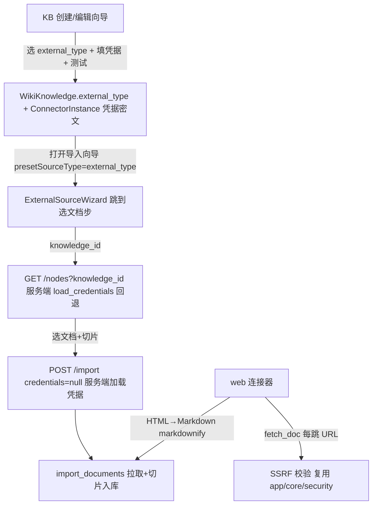

## 用户需求概述
在知识库（@file://kb）新建/编辑流程中，将「外部知识库文档导入」向导的前两步（选择平台 / 配置凭据）前移并固化到知识库本身；外部知识库新增「外部类型」属性（下拉：飞书 / 语雀 / 钉钉文档 / 企业微信 / notion / web网站），并在创建时完成平台选择与访问凭证配置，每个外部知识库固定其平台类型与凭据。之后进行文档导入时，省去平台与凭据两步，直接从已配置的知识库浏览并选择文档，再走切片入库。proxy（仅检索代理转发）子形态保持独立，external_type 仅作用于 connector（拉取文档）路径。web网站 本期实现为新的 web 站点爬虫连接器。

## 核心功能
- 知识库容器新增 external_type 字段（仅 type=3 且 kb_format=connector 时有值）。
- 新建/编辑向导（type=3 / connector）：渲染 external_type 下拉 + 动态凭据表单（按平台 schema 动态渲染）+ 连通性测试；提交时把平台与凭据（Fernet 加密）固化到该知识库。
- 凭据复用既有 ConnectorInstance 机制（键 (tenant, knowledge_id, external_type)），无需新建存储模型。
- 导入文档向导：凭 knowledge_id 由服务端加载已存凭据，直接跳到「选择文档」步，不再让用户选平台/填凭据。
- 新增 web 站点连接器：给定种子 URL 列表抓取网页正文转 Markdown，复用同一切片入库链路；抓取前做 SSRF 防护。
- proxy 子形态保持原样（配置检索端点、不拉数据）。


## 技术栈选型
- 后端：FastAPI + SQLAlchemy（同步 Session）+ Pydantic + Alembic（沿用既有栈，无新增框架）。
- 前端：Vue 3 + Vite + TypeScript + Ant Design Vue（沿用既有栈与组件库）。
- 数据持久化：WikiKnowledge 增加列 + ConnectorInstance 复用（凭据密文）。
- 依赖新增：后端 requirements.txt 增加 `markdownify`（HTML→Markdown，内部依赖 bs4）。

## 实现方案
将「平台选择 + 凭据」从导入向导前移到 KB 创建/编辑表单，并把 external_type 作为 KB 的一级属性；凭据继续用 ConnectorInstance 加密存储（与现有 import 流程一致，零新增模型）。导入向导改为接收 knowledgeId，服务端按 KB 的 external_type 回退读取已存凭据，从而跳过前两步。web 连接器按现有 BaseDocSource 抽象实现（test/list_nodes/fetch_doc），种子 URL 作为凭据字段（新增 multiline 标志），抓取每步复用 kb_proxy.py 已落地的 SSRF 校验逻辑。

关键技术决策：
1. 复用 ConnectorInstance 而非新增列：凭据已加密存于 ConnectorInstance（键含 source_type），import 流程已支持 credentials 为空时回退加载，改动最小、风险最低。
2. external_type 落 WikiKnowledge：平台是 KB 的稳定属性，放容器表最直观，且前端树/面板可据此判断导入形态。
3. 提取 SSRF 校验为共享函数：kb_proxy.py 的 `validate_endpoint_url` 内联了私有/环回地址拦截，web 爬虫需对每跳 URL 校验，应抽到 `app/core/security.py` 复用，避免逻辑漂移。
4. CredField 增加 multiline：web 的 seed_urls 为多行文本，前端据此渲染 a-textarea，复用现有动态表单机制。

## 性能与可靠性
- web 抓取受 SSRF 拦截 + httpx 超时（DEFAULT_TIMEOUT=20s）+ 抓取并发上限（复用 FETCH_CONCURRENCY=5）约束，避免慢站拖垮导入；crawl_depth 默认浅（1 层），前端可配。
- 凭据只入不出：列表/配置接口不回传明文，导入向导完全不持有明文（服务端按 knowledge_id 加载）。
- 编辑 external_type 时服务端校验 source_type 与 KB.external_type 一致，避免映射错配；已有 KbExternalDocMap 按旧 source_type 保留，新导入走新平台。

## 实现要点（落地注意事项）
- 迁移只给 `kms_knowledge` 加 nullable `external_type`（String(32) + index），存量数据零迁移；后端 server_default 不强制。
- `validate_kb_format` 扩展：type=3 + connector 时要求 external_type ∈ {feishu,yuque,dingtalk,wecom,notion,web}；type=3 + proxy 或 type≠3 时 external_type 必须为 None。create_knowledge / update_knowledge 调用该校验。
- `_knowledge_to_dict` 必须回显 external_type，供前端编辑回填与导入向导判定平台。
- update_knowledge 当前不接收 kb_format/external_type；需新增 external_type 字段（type 依旧锁定不可改）。
- `/nodes` 改造保持向后兼容：credentials 仍可为空且提供 knowledge_id 时服务端 load_credentials 回退；不破坏既有调用。
- 复用既有 `save_credentials`/`load_credentials`，新增 `/credentials`（写入）与 `/knowledges/{kid}/external-config`（返回 {external_type, has_credentials}）。
- 前端 lint/vue-tsc 本仓全量已知红，验证改动用 `npm run build 2>&1 | Select-String` 过滤自己改的路径。

## 架构设计
数据流向：


## 目录结构与文件清单
```
backend/
├── app/models/wiki/wiki_knowledge.py          # [MODIFY] 增加 external_type 列（String(32), nullable, index）
├── alembic/versions/2026_10_18_add_external_type.py  # [NEW] 为 kms_knowledge 加 external_type 列迁移
├── app/services/kb/kb_format.py               # [MODIFY] validate_kb_format 增加 external_type 规则（connector 必填且合法；proxy/其它必为空）
├── app/routers/wiki/wiki.py                   # [MODIFY] KnowledgeCreateRequest/KnowledgeUpdateRequest 加 external_type；create_knowledge/update_knowledge 校验+落库；_knowledge_to_dict 回显 external_type
├── app/routers/kb/kb_external_source.py       # [MODIFY] 新增 POST /credentials、GET /knowledges/{kid}/external-config；/nodes 支持 knowledge_id 回退加载凭据
├── app/services/kb/external_import_service.py  # [MODIFY] list_nodes 支持 knowledge_id + 凭据回退；导出凭据回退辅助
├── app/connectors/doc_sources/base.py         # [MODIFY] CredField 增加 multiline: bool=False；to_dict 输出 multiline
├── app/connectors/doc_sources/web.py          # [NEW] web 站点爬虫连接器（source_type='web'，seed_urls/crawl_depth 凭据，SSRF 校验，HTML→Markdown）
├── app/connectors/doc_sources/__init__.py      # [MODIFY] 注册 web 连接器
├── app/core/security.py                       # [NEW] 抽出 SSRF 校验函数（从 kb_proxy.validate_endpoint_url 提炼 is_private/loopback/link_local/reserved 拦截）
├── app/routers/kb/kb_proxy.py                  # [MODIFY] 复用 app/core/security 的 SSRF 校验，消除重复
├── requirements.txt                           # [MODIFY] 增加 markdownify
└── tests/kb/test_web_connector.py             # [NEW] web 连接器 + external_type 校验 + 凭据回退单测

frontend/
├── src/api/kbExternalSource.ts                # [MODIFY] 新增 saveExternalCredentials / getExternalConfig；listExternalNodes 增加 knowledge_id 参数
├── src/views/kms/KnowledgeBaseManager.vue     # [MODIFY] type=3/connector 分支：external_type 下拉 + 动态凭据表单 + 测试按钮；提交先建 KB（带 external_type）再保存凭据，随后以 presetSourceType 打开导入向导
├── src/views/kms/kb/ExternalSourceWizard.vue  # [MODIFY] presetSourceType 存在时跳过 step0/1，step 起始=2 且 tested=true；listExternalNodes 传 knowledge_id；import 传 credentials=null
├── src/views/kms/kb/ExternalLinkPane.vue      # [MODIFY] presetSourceType 优先取 KB external_type；补充 web 平台配色
└── src/i18n/_kb_keys.json                     # [MODIFY] 新增 web网站 / external_type / 凭据配置 / 测试 相关文案（复用 kbExt.* 命名）
```

## 关键代码结构
```python
# backend/app/connectors/doc_sources/base.py —— CredField 增加 multiline
@dataclass(frozen=True)
class CredField:
    name: str
    label: str
    secret: bool = False
    required: bool = False
    placeholder: str = ""
    hint: str = ""
    multiline: bool = False   # 新增：前端据此渲染多行文本（web 的 seed_urls）

# backend/app/connectors/doc_sources/web.py —— web 连接器骨架
class WebDocSource(BaseDocSource):
    source_type = "web"
    async def test_connection(self) -> DocConnResult: ...   # 抓取种子 URL，返回可达数量
    async def list_nodes(self, parent_id: Optional[str] = None) -> List[ExternalDocRef]: ...  # None→种子URL；某URL→其出站链接
    async def fetch_doc(self, doc_id: str) -> FetchDocResult: ...  # httpx GET + SSRF校验 + HTML→Markdown

# backend/app/routers/kb/kb_external_source.py —— 新增接口
@router.post("/credentials")        # body: knowledge_id, source_type, credentials -> save_credentials（校验 source_type==KB.external_type）
@router.get("/knowledges/{kid}/external-config")  # -> {external_type, has_credentials}
# /nodes 入参增加 optional knowledge_id；credentials 为空且 knowledge_id 给定时 load_credentials 回退
```

