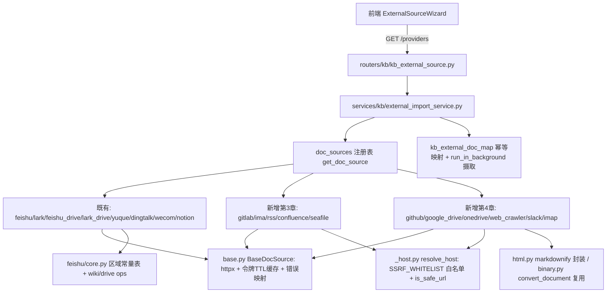

## 产品概述

以 WeKnora 审计文档《外部知识库 / 文档源接入现状梳理》（`D:\projects\github\WeKnora\docs\kms.md`）为清单依据，在 MinWorkBuddy 知识库模块的「外部知识库文档导入」链路中，接入**第 3 章「逐来源明细」全部 12 个来源 + 第 4 章「占位连接器清单」全部 6 项**。接入后知识库可选外部平台从现有 6 个（`feishu`/`dingtalk`/`yuque`/`wecom`/`notion`/`web`）扩展到 19 个，且清单内每一项都由符合既有 `BaseDocSource` 规范的正式实现承载，不残留占位或桩代码。

## 核心功能

**第 3 章 12 项**

- **飞书知识库 / Lark 知识库 / 飞书云盘 / Lark 云盘**：把现有 `feishu.py` 重构为「区域常量表 + wiki/drive 两套 ops」的公共核心，注册 4 个独立来源类型；飞书与 Lark 是两朵隔离云，凭据不通用。云盘以 `folder_token` 为必填根目录，支持下载与导出。
- **Notion**：在现有页面能力之外补 Database 记录查询与渲染（数据库作为可勾选节点，记录渲染为表格）。
- **语雀**：补 `folder_mode`（平铺 / 按目录拼接）与 `toc_only`（仅导入目录中出现的文档）。
- **钉钉文档**：补 `include_uploaded_files`（钉盘上传附件）与 `preserve_folder_structure`（按工作区/子目录结构命名）。
- **GitLab**：项目 → 目录树 → 文档文件，按扩展名白名单拉取正文，支持 `projects[]` 范围配置。
- **腾讯 IMA**：知识库 → 媒体/笔记两级列举，静态头鉴权，笔记走独立命名空间读正文。
- **RSS / Atom**：订阅源为顶层节点，条目为文档，支持私有源自定义请求头；不支持删除同步。
- **Confluence**：空间 → 页面，三种认证（Server PAT / Server Basic / Cloud API token），按版本号比对，带删除保护。
- **Seafile**：资料库 → 目录 → 文件，两步下载（API 取链接 + fileserver 取内容），含格式白名单。

**第 4 章 6 项**

- **GitHub**：仓库 → 目录树 → 文档文件，个人访问令牌鉴权。
- **Google Drive**：OAuth2 刷新令牌自动换票，目录与 Google 原生文档导出为 Markdown，二进制文件本地转换为 Markdown。
- **OneDrive / SharePoint**：应用凭据换票后走 Microsoft Graph，个人盘 / 指定驱动 / SharePoint 站点文档库，Office 与 PDF 转 Markdown。
- **Web Crawler（Sitemap）**：以 sitemap 为入口递归解析页面清单，支持包含/排除规则与页数上限，逐页抓取正文转 Markdown；**此实现覆盖并删除现有的 `web.py` 简化种子 URL 抓取实现**。
- **Slack**：频道 → 会话线程为文档，拉取整楼消息渲染为带作者与时间的记录。
- **IMAP 邮箱**：文件夹 → 邮件为文档，解析正文（纯文本优先，HTML 转 Markdown）。

## 验收口径

- 18 个来源类型（含文档外的 `wecom` 共 19 个）均出现在 `GET /api/v1/kb/external-sources/providers` 与 `supported_source_types()` 中，创建「外部知识库（type=3 / connector）」时可选择。
- 仓库内不再存在占位/桩实现：原 `web.py` 已删除，无并行保留，无悬空引用。
- 每个新增平台都有对应单测（不打真实网络、不依赖数据库），既有平台能力补齐后原有单测仍通过。
- 产出「清单项 → 实现文件 → 注册 source_type → 单测 → 前端接线」逐项核对表并全部打勾。

## 技术栈

沿用仓库现状，**不引入任何新依赖**。

| 层 | 选型 |
| --- | --- |
| 后端框架 | Python 3.12 + FastAPI 0.115 + SQLAlchemy 2.0 + Pydantic v2 |
| 外部 HTTP | `httpx>=0.26`（`BaseDocSource` 统一异步出口） |
| HTML → Markdown | `markdownify>=0.13.1`（已在 requirements.txt） |
| Office/PDF → Markdown | 复用 `app/services/wiki/doc_converter.py::convert_document(filename, data)`（内部 python-docx / pdfplumber / openpyxl / python-pptx，含 20MB 上限） |
| RSS/Atom 解析 | 标准库 `xml.etree.ElementTree` + `json`（文档原用 `gofeed`，Python 侧无此依赖，自实现 RSS2.0 / Atom / JSON Feed） |
| IMAP | 标准库 `imaplib` + `email`，阻塞调用经 `asyncio.to_thread` 包装 |
| OAuth2 换票 | `httpx` 直连令牌端点（Google `oauth2.googleapis.com`、Microsoft `login.microsoftonline.com`），不引入 SDK |
| SSRF 防护 | `app.core.security.is_safe_url(url, *, require_https=False)` + 新增 `settings.SSRF_WHITELIST` 白名单 |
| 测试 | `pytest` + `pytest-asyncio`，沿用 `tests/connectors/test_doc_sources.py` 的 `_FakeClient` / `patch_http` 替身 |
| 前端 | Vue 3 + TS + Ant Design Vue v6 + vue-i18n 四语（仅最小接线） |


## 实现方案

### 总体策略

**不改动** `BaseDocSource` 抽象、`external_import_service` 导入链路、路由与前端向导（三者与来源无关），**只新增平台实现文件 + 注册**：每个平台一个模块，实现 `test_connection` / `list_nodes` / `fetch_doc` 三个方法，在文件末尾调用 `register_doc_source(...)` 自注册，由 `doc_sources/__init__.py` 导入即生效。这与 `feishu.py` / `notion.py` / `yuque.py` 等既有实现完全同构。

### 关键技术决策

1. **飞书系重构为「核心 + 4 注册」而非复制四份**
现有 `feishu.py` 硬编码 `HOST=https://open.feishu.cn` 且只覆盖 wiki。抽出 `feishu/core.py` 承载：区域常量表（`REGIONS = {"feishu": "https://open.feishu.cn", "lark": "https://open.larksuite.com"}`）、`tenant_access_token` 换取与缓存、wiki ops（spaces / nodes / docx blocks）、drive ops（`files?folder_token=` / 下载 / 导出 / meta）。`feishu.py` / `lark.py` / `feishu_drive.py` / `lark_drive.py` 各自只声明 `source_type` 与区域/形态组合并注册。**区域取值来自模块级常量表而非用户输入**，因此不破坏「不接受任意 base_url 防 SSRF」的既有约束。

2. **私有化地址的 SSRF 统一通道（`_host.py`）**
`gitlab` / `confluence` / `seafile` / `imap` 必须让用户填地址，与「HOST 必须是模块常量」冲突。新增 `doc_sources/_host.py::resolve_host(raw, *, default=None)`：

- 命中 `settings.SSRF_WHITELIST`（逗号分隔域名/IP，大小写不敏感）→ 直接放行（用于内网私有化部署）；
- 否则必须过 `app.core.security.is_safe_url`，非法即抛 `DocSourceError`（不把 `HTTPException(422)` 泄漏到连接器层）。
这是全模块唯一的「可变主机」通道，模块 docstring 需写明理由与白名单配置方式；相关 `CredField.hint` 里提示「内网地址需先加入 SSRF_WHITELIST」。

3. **OAuth2 走 `_fetch_token()` 重载而非前置换票**
`BaseDocSource._access_token()` 已提供「惰性获取 + 300s TTL + 提前 60s 刷新」缓存。设 `token_in="header"` 并重载 `_fetch_token()`，即可让 Google Drive / OneDrive 在一次导入会话内只换一次票，与飞书 `tenant_access_token` 处理方式完全一致。换票请求必须显式传 `with_token=False`，否则递归取令牌。

4. **Slack 的错误判定不复用 `error_code_field`**
基类 `_raise_if_platform_error` 面向数值业务码（飞书 `code` / 钉钉 `errcode`），而 Slack 在 HTTP 200 下用 `{"ok": false, "error": "invalid_auth"}` 表达失败。Slack 实现内自行判 `ok` 并抛 `DocSourceError`，在模块 docstring 说明差异，避免把布尔 `ok` 硬塞进数值码体系。

5. **IMAP 与 httpx 基座的共存**
IMAP 是唯一非 HTTP 平台：不复用 `_request` / `_request_json`，自建 `imaplib` 连接并用 `asyncio.to_thread` 包装；`aclose()` 同时关闭 IMAP 连接；`timeout` 复用基类类属性保持风格统一。

6. **二进制文件统一走既有 `convert_document`**
OneDrive 的 Office/PDF、IMAP 附件、Google Drive 非原生文件、Seafile / Confluence 附件都可能在 HTTP 层拿到字节流，统一惰性 import `convert_document(filename, data)` 转 Markdown，`doc_sources` 层只做薄适配（不落库、不解析切片）。

7. **web_crawler 替换而非并存**
删除 `doc_sources/web.py`，新增 `web_crawler.py`（sitemap / sitemapindex 递归 + 包含/排除规则 + 页数上限 + 每跳 `is_safe_url`）。`source_type` 由 `web` 变 `web_crawler`，**不写兼容别名**（否则等于保留桩代码），改为在交付说明给出存量数据迁移语句：

- `UPDATE wiki_knowledge SET external_type='web_crawler' WHERE external_type='web';`
- `UPDATE kb_external_doc_map SET source_type='web_crawler' WHERE source_type='web';`
- `UPDATE connector_instance SET connector_type='web_crawler' WHERE connector_type='web';`

### 性能与可靠性

- 分页一律设硬上限并循环退出（GitHub 树单次请求、GitLab `page`、Drive `nextPageToken`、Graph `@odata.nextLink`、Slack `response_metadata.next_cursor`、IMA `next_cursor`、Confluence `start`/`limit`），避免无限翻页；sitemap 递归层数与页数钳制。
- 正文拉取受 `external_import_service.FETCH_CONCURRENCY=5` 信号量统一约束，不新增并发控制。
- 失败隔离：`list_nodes` 中单条解析失败跳过并继续；`fetch_doc` 失败抛 `DocSourceError`，由导入服务计入 `failed` 并写 `error_detail`，不影响其它文档。
- `content_hash` 未变更不重复嵌入（既有机制，零成本复用）。
- 日志沿用模块 `logger`，只记平台类型 / 文档数 / 失败原因摘要，**不记凭据、令牌、邮件正文**。

## 实现要点（执行细节）

- 新建 `backend/app/config/_app.py` 的 `AppSettings` 中加 `SSRF_WHITELIST: str = ""`（该文件字段均为 UPPER_CASE，如 `KB_SERVICE_TOKEN` / `DATAOPS_ENCRYPTION_KEY`），并在 `_host.py` 惰性读取，避免在模块导入期强绑配置。
- 每个新文件严格照抄既有骨架：模块 docstring（认证方式 / 枚举端点 / 正文端点 / SSRF 说明）+ 模块级 `HOST` 常量或 `_host.resolve_host` + 内部辅助函数 + 类 + 文件末尾 `register_doc_source(...)`。`ProviderMeta.credential_fields` 的必填项与 `secret=True` 必须标齐（驱动前端动态表单）。
- 本抽象**没有 Settings 概念**：文档里的 `settings.*`（语雀 `folder_mode`/`toc_only`、钉钉 `include_uploaded_files`/`preserve_folder_structure`、GitLab `projects`、RSS `feed_urls`）一律落成**非密 CredField**（`projects` / `feed_urls` 用 `multiline=True`）。
- 本抽象**没有增量游标**（导入是手动幂等的，`content_hash` 判定 created/updated/unchanged），文档中的游标设计只在 `ExternalDocRef.updated_at` 上体现，不实现 cursor 编解码。
- `test_connection()` **不得抛异常**：捕获 `DocSourceError` 返回 `DocConnResult(ok=False, message=str(exc))`，`finally` 中 `await self.aclose()`；缺凭据给可操作中文提示（如「缺少 GitHub Personal Access Token」）。
- `list_nodes(parent_id=None)` 顶层返回容器，传父 ID 返回子层（懒加载）；`node_type` 仅取 `space|folder|doc`。
- `fetch_doc` 返回 `FetchDocResult(title, markdown, updated_at)`；正文为空不兜底伪造，交由导入服务判失败。
- 飞书云盘 `folder_token` 必填（对齐文档「不能留空使用云空间根目录」）；GitLab 扩展名白名单沿用文档清单；Seafile 资源 ID 用 `repo_id:path`、下载第二步 fileserver 请求不带令牌；IMA 跳过 `media_type` 12/16 并对图片按响应 `Content-Type` 校正扩展名；GitHub 文件内容被清空时把「文件路径本身」作为内容发出以覆盖旧正文；Confluence 消失页面占比过高时整次报错不执行删除。
- IMAP 的 `doc_id` 用 `{mailbox}:{uidvalidity}:{uid}`，避免跨会话 UID 复用导致覆盖错文档。
- RSS 的 `auth_headers` 只附加在订阅源请求上，**绝不发给文章正文页**；`external_id = feedURL + ":" + itemID`；包注释明确「不支持删除同步」。

## 架构设计



关键点：**连接器职责止于把外部内容规约为 `FetchDocResult`**，解析 / 分块 / 嵌入 / 索引 / 检索完全不动。

## 目录结构

```
d:\projects\MinWorkBuddy\
├── backend/
│   ├── app/
│   │   ├── config/_app.py                  # [MODIFY] AppSettings 增加 SSRF_WHITELIST: str = ""
│   │   ├── connectors/doc_sources/
│   │   │   ├── base.py                     # [不改] BaseDocSource / 数据类 / 注册表 / 错误映射
│   │   │   ├── markdown.py                 # [不改] 共享 MdBlock / blocks_to_markdown
│   │   │   ├── _host.py                    # [NEW] 私有化地址统一校验：resolve_host() 先查 settings.SSRF_WHITELIST，否则强制 is_safe_url
│   │   │   ├── html.py                     # [NEW] HTML→Markdown 共用封装（markdownify + ImportError 降级，从 web.py 提取）供 web_crawler/rss/imap/confluence 复用
│   │   │   ├── binary.py                   # [NEW] 字节流→Markdown 薄适配：惰性 import wiki/doc_converter.convert_document + 扩展名与上限判定
│   │   │   ├── feishu/__init__.py          # [NEW] 飞书系子包
│   │   │   ├── feishu/core.py              # [NEW] 区域常量表 REGIONS + 令牌换取 + wikiOps + driveOps 共享核心
│   │   │   ├── feishu/wiki.py              # [NEW] 飞书/Lark 知识库实现（由 feishu.py / lark.py 注册两个 source_type）
│   │   │   ├── feishu/drive.py             # [NEW] 飞书/Lark 云盘实现（folder_token 必填，下载/导出）
│   │   │   ├── feishu.py                   # [MODIFY] 改为薄壳：引用 feishu/wiki.py 注册 source_type=feishu
│   │   │   ├── lark.py                     # [NEW] 注册 source_type=lark（区域 open.larksuite.com）
│   │   │   ├── feishu_drive.py             # [NEW] 注册 source_type=feishu_drive
│   │   │   ├── lark_drive.py               # [NEW] 注册 source_type=lark_drive
│   │   │   ├── gitlab.py                   # [NEW] GitLab：PRIVATE-TOKEN + projects/tree/raw/compare
│   │   │   ├── ima.py                      # [NEW] 腾讯 IMA：静态头 + wiki/note 双命名空间
│   │   │   ├── rss.py                      # [NEW] RSS/Atom/JSON Feed：标准库解析 + auth_headers 隔离
│   │   │   ├── confluence.py               # [NEW] Confluence：三认证 + 版本号比对 + 删除保护
│   │   │   ├── seafile.py                  # [NEW] Seafile：两步下载 + repo_id:path 资源 ID
│   │   │   ├── github.py                   # [NEW] GitHub：PAT + trees/contents
│   │   │   ├── google_drive.py             # [NEW] Google Drive：refresh_token 换票 + export/alt=media
│   │   │   ├── onedrive.py                 # [NEW] OneDrive/SharePoint：client_credentials 换票 + Graph
│   │   │   ├── web_crawler.py              # [NEW] Web Crawler(Sitemap)：sitemap/sitemapindex 递归 + 规则过滤 + 页数上限
│   │   │   ├── slack.py                    # [NEW] Slack：conversations.list/history/replies，自行判 ok:false
│   │   │   ├── imap.py                     # [NEW] IMAP：imaplib + asyncio.to_thread + 主机 SSRF 校验
│   │   │   ├── web.py                      # [DELETE] 种子 URL 简化实现，由 web_crawler.py 完全取代
│   │   │   └── __init__.py                 # [MODIFY] 导入列表 web→web_crawler 并加入 14 个新模块；__all__ 同步
│   │   └── services/kb/
│   │       ├── kb_format.py                # [MODIFY] validate_external_type 文档字符串的平台清单同步为 19 个
│   │       ├── notion 能力补齐             # [MODIFY] notion.py 增 Database 查询与记录渲染
│   │       ├── yuque 能力补齐              # [MODIFY] yuque.py 增 folder_mode / toc_only
│   │       └── dingtalk 能力补齐           # [MODIFY] dingtalk.py 增 include_uploaded_files / preserve_folder_structure
│   └── tests/connectors/
│       ├── test_doc_sources.py             # [MODIFY] 注册表完整性断言扩到 19 个；新增各平台用例（沿用 run + patch_http + _FakeClient）
│       └── test_doc_sources_new.py         # [NEW] 14 个新连接器的分层列举 / 正文转换 / 缺凭据提示 / 平台错误不被吞
├── frontend/src/
│   ├── views/kms/kb/ExternalLinkPane.vue   # [MODIFY] PLATFORM_COLORS 补齐 19 个平台，web→web_crawler
│   ├── api/kb.ts                           # [MODIFY] 第 471 行 external_type 注释同步
│   ├── views/kms/KnowledgeBaseManager.vue  # [MODIFY] 第 418 行外部类型注释同步
│   └── i18n/locales/{zh-CN,zh-TW,en-US,ja-JP}.ts  # [MODIFY] kbExt 命名空间平台相关文案同步
└── docs/
    └── superpowers/specs/2026-10-26-kb-third-party-connectors-checklist.md  # [NEW] 逐项核对表 + web→web_crawler 存量数据迁移语句
```

## 关键接口（新增共用模块）

```python
# app/connectors/doc_sources/_host.py
def resolve_host(raw: str, *, default: str | None = None, require_https: bool = False) -> str:
    """私有化部署地址的唯一放行通道。

    命中 settings.SSRF_WHITELIST（逗号分隔域名/IP）直接放行；否则必须过
    app.core.security.is_safe_url。非法地址抛 DocSourceError（不向外抛 HTTPException）。
    """

# app/connectors/doc_sources/html.py
def html_to_markdown(html: str) -> str:
    """markdownify 封装；库缺失时降级为去标签纯文本（沿用 web.py 既有降级实现）。"""

# app/connectors/doc_sources/binary.py
def bytes_to_markdown(filename: str, data: bytes) -> str:
    """惰性 import app.services.wiki.doc_converter.convert_document 转 Markdown。"""
```

## Agent Extensions

### SubAgent

- **code-explorer**
- Purpose：收尾阶段对 `backend/app`、`backend/tests`、`frontend/src` 做 very thorough 全量扫描，确认第 3 章 12 项 + 第 4 章 6 项均有正式实现、`web` 相关占位/桩代码与引用已无残留（删除 `web.py` 后无悬空 import、`external_type='web'` 无硬编码分支）、`supported_source_types()` 与清单完全一致。
- Expected outcome：产出「清单项 → 实现文件 → 注册 source_type → 单测 → 前端接线」对照表与残留项清单（残留为空方可判定通过）。

### Skill

- **Superpowers**
- Purpose：按 TDD 与阶段性评审约束推进实现，每个连接器先写失败单测再写实现，每批完成后做一次代码评审。
- Expected outcome：14 个新增连接器均完成 Red-Green-Refactor，交付前通过代码评审清单。