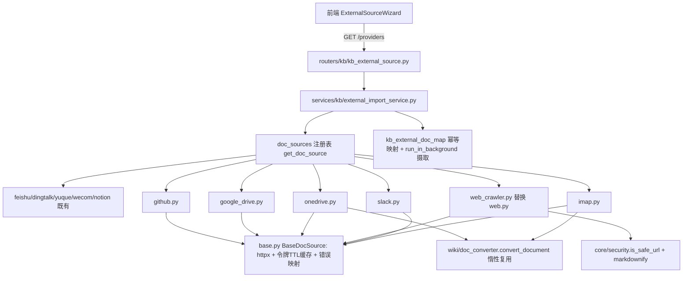

## 产品概述

在 MinWorkBuddy 知识库模块的「外部知识库文档导入」链路中，补齐 WeKnora 审计报告 `docs/kms.md` 第 4.1 节「占位连接器清单」列出的全部 6 个第三方知识库连接器，使知识库可接入的外部平台从现有 6 个扩展到 11 个，并用正式实现替换工程中既有的本地简化实现。

## 核心功能

- **GitHub 连接器**：用 Personal Access Token 接入，浏览组织/个人仓库 → 目录树 → 文档文件，按扩展名白名单拉取正文并转 Markdown。
- **Google Drive 连接器**：用 OAuth2 刷新令牌自动换取访问令牌，浏览云盘/共享盘目录与 Google 原生文档，导出为 Markdown 或下载二进制文件转换。
- **OneDrive / SharePoint 连接器**：用 Azure AD 应用凭据（租户 + client_credentials）换取 Graph 访问令牌，浏览个人盘/指定驱动/ SharePoint 站点文档库的目录与文件，Office/PDF 文件转 Markdown。
- **Web Crawler（Sitemap）连接器**：以 sitemap.xml / sitemap index 为入口递归解析站点页面清单，支持包含/排除正则与页数上限，逐页抓取正文转 Markdown；**此实现覆盖并删除现有的 `web.py` 简化种子 URL 抓取实现**。
- **Slack 连接器**：用 Bot/User Token 接入，浏览频道 → 会话主题（线程）为文档，拉取整楼消息渲染为带作者与时间的 Markdown 记录。
- **IMAP 邮箱连接器**：用主机/端口/账号密码接入邮箱，浏览邮件文件夹 → 邮件为文档，解析正文（纯文本优先，HTML 转 Markdown）。

## 验收口径

- 6 个清单项均由 `app/connectors/doc_sources/` 下符合 `BaseDocSource` 规范的正式实现承载，经 `register_doc_source` 注册，出现在 `GET /api/v1/kb/external-sources/providers` 与 `supported_source_types()` 中。
- 仓库内不再存在占位/桩实现（原 `web.py` 已删除，无并行保留）。
- 逐项产出「清单项 → 实现文件 → 注册 source_type → 单测 → 前端接线」对照表并全部打勾。

## 技术栈

| 层 | 选型（沿用仓库现状，不引入新依赖） |
| --- | --- |
| 后端框架 | Python 3.12 + FastAPI 0.115 + SQLAlchemy 2.0 + Pydantic v2 |
| 外部 HTTP | `httpx>=0.26`（`BaseDocSource` 统一出口，异步） |
| HTML → Markdown | `markdownify>=0.13.1`（已在 requirements.txt，`web.py` 已有降级实现可提取） |
| 二进制 Office/PDF → Markdown | 复用 `app/services/wiki/doc_converter.py::convert_document(filename, data)`（内部用 python-docx / pdfplumber / openpyxl / python-pptx，含 20MB 上限） |
| IMAP | Python 标准库 `imaplib` + `email`，阻塞调用经 `asyncio.to_thread` 包装 |
| OAuth2 令牌换取 | `httpx` 直连 token 端点（Google `oauth2.googleapis.com`、Microsoft `login.microsoftonline.com`），无需 SDK |
| SSRF 防护 | `app.core.security.is_safe_url(url, *, require_https=False)` |
| 测试 | `pytest` + `pytest-asyncio`，沿用 `tests/connectors/test_doc_sources.py` 的 `_FakeClient` / `patch_http` 替身 |
| 前端 | Vue 3 + TS + Ant Design Vue v6 + vue-i18n 四语（仅最小接线） |


## 实现方案

### 总体策略

不改动 `BaseDocSource` 抽象与 `external_import_service` 导入链路（二者与来源无关），**只新增平台实现文件 + 注册**：每个平台一个模块，实现 `test_connection` / `list_nodes` / `fetch_doc` 三个方法，在文件末尾调用 `register_doc_source(...)` 自注册，由 `doc_sources/__init__.py` 导入即生效。这与 `feishu.py` / `notion.py` / `yuque.py` 等既有实现完全同构，满足要求 1、4。

### 关键技术决策

1. **OAuth2 走 `_fetch_token()` 重载而非前置换票**
`BaseDocSource._access_token()` 已提供「惰性获取 + 300s TTL + 提前 60s 刷新」的缓存。设置 `token_in="header"` 并重载 `_fetch_token()`，即可让 Google Drive / OneDrive 在一次导入会话内只换一次票，与飞书 `tenant_access_token` 的处理方式完全一致，避免各平台分叉出第二套令牌缓存。换票请求必须显式传 `with_token=False`，否则会递归取令牌。

2. **Slack 的业务错误判定不复用 `error_code_field`**
基座 `_raise_if_platform_error` 面向「数值业务码」（飞书 `code` / 钉钉 `errcode`），而 Slack 在 HTTP 200 下用 `{"ok": false, "error": "invalid_auth"}` 表达失败。因此 Slack 实现内自行判 `ok` 并抛 `DocSourceError`，并在模块 docstring 中说明与基座约定的差异——避免把 `ok` 强行塞进数值码体系导致语义错乱。

3. **IMAP 与 httpx 基座的共存方式**
IMAP 是唯一非 HTTP 平台：不复用 `_request` / `_request_json`，自行建立 `imaplib` 连接并用 `asyncio.to_thread` 包装同步调用；`aclose()` 需同时关闭 IMAP 连接（`logout`/`shutdown`）；`timeout` 复用基类类属性以统一风格。其主机由用户填写，是全模块**唯一**的可变主机，必须在连接前经 `is_safe_url(f"https://{host}")` 校验，并在模块注释中说明与「HOST 必须是常量」这一 SSRF 约束的差异与例外理由。

4. **二进制文件统一走既有 `convert_document`**
OneDrive 的 Office/PDF、IMAP 附件、Google Drive 的非原生文件都可能在 HTTP 层拿到字节流。统一惰性 import `convert_document(filename, data)` 转 Markdown，避免新增第二套解析器（`doc_sources` 层只做薄适配，不落库、不解析切片）。

5. **web_crawler 替换而非并存**
按用户决策删除 `doc_sources/web.py`，新增 `web_crawler.py`（sitemap / sitemapindex 递归 + 包含/排除正则 + 页数上限 + 每跳 `is_safe_url`）。`source_type` 由 `web` 变为 `web_crawler`；不写兼容别名（否则等于保留桩代码），改为在交付说明中给出存量数据 UPDATE 语句：
`UPDATE wiki_knowledge SET external_type='web_crawler' WHERE external_type='web';`
`UPDATE kb_external_doc_map SET source_type='web_crawler' WHERE source_type='web';`
`UPDATE connector_instance SET connector_type='web_crawler' WHERE connector_type='web';`

### 性能与可靠性

- 分页一律设硬上限并循环退出（GitHub 树单请求、Drive `nextPageToken`、Graph `@odata.nextLink`、Slack `response_metadata.next_cursor`），避免无限翻页；sitemap 递归层数与页数钳制（默认 200 页 / 3 层）。
- 爬虫与 Drive/Graph/IMAP 的正文拉取受 `external_import_service.FETCH_CONCURRENCY=5` 信号量统一约束，不新增并发控制。
- 单条失败隔离：`list_nodes` 中单条记录解析失败跳过并继续；`fetch_doc` 失败抛 `DocSourceError`，由导入服务计入 `failed` 并写 `error_detail`，不影响其它文档。
- `content_hash` 未变更则不重复嵌入（既有机制，零成本复用）。
- 日志：沿用模块 `logger`，只记平台类型 / 文档数 / 失败原因摘要，**不记凭据、token、邮件正文**。

## 实现要点（执行细节）

- 每个新文件严格复制既有文件骨架：模块 docstring（认证方式 / 枚举端点 / 正文端点）+ 模块级 `HOST` 常量 + 内部辅助函数 + 类 + 文件末尾 `register_doc_source(...)`；`ProviderMeta.credential_fields` 必填项与 `secret=True` 必须标齐，才能驱动前端动态表单。
- `test_connection()` **不得抛异常**：捕获 `DocSourceError` 返回 `DocConnResult(ok=False, message=str(exc))`，`finally` 中 `await self.aclose()`；缺凭据时给出可操作中文提示（如「缺少 GitHub Personal Access Token」）。
- `list_nodes(parent_id=None)` 顶层返回容器（`folder`/`space`），传父 ID 时返回子层，保持懒加载；`node_type` 仅取 `space|folder|doc`。
- `fetch_doc` 返回 `FetchDocResult(title, markdown, updated_at)`，正文为空时由导入服务判为失败，实现层不做兜底伪造内容。
- GitHub 扩展名白名单复用 GitLab/文档类惯例：`.md .markdown .mdx .txt .rst .adoc .pdf .docx .doc .xlsx .xls .csv .pptx .ppt .html .htm .json .yaml .yml`；目录节点由 tree 路径推导。
- Google Drive 导出优先级：`export?mimeType=text/markdown` → 失败降级 `text/plain` → 二进制走 `?alt=media` + `convert_document`；Google 快捷方式解析 `shortcutDetails.targetId`。
- OneDrive：`/me/drive` 与 `/drives/{drive_id}` 与 `/sites/{site_id}/drive` 三选一；`@microsoft.graph.downloadUrl` 仅用于二进制下载，其余走 `/content` 以统一走令牌与超时。
- Slack：`conversations.list` 过滤 `is_archived`，`conversations.history` 取最近 N 条，仅把有 `thread_ts`/`reply_count>0` 的消息作为可导入 doc，`doc_id = "{channel_id}:{thread_ts}"`。
- IMAP：`port` 默认 993 / `use_ssl` 默认开；`search` 受 `since_days` 与 `max_messages` 限制；`doc_id = "{mailbox}:{uid}"`（UIDVALIDITY 参与可避免跨会话 UID 复用，建议 `{mailbox}:{uidvalidity}:{uid}`）。

## 架构设计



关键点：**连接器职责止于把外部内容规约为 `FetchDocResult{mardown}`**，解析 / 分块 / 嵌入 / 索引 / 检索完全不动。

## 目录结构

```
d:\projects\MinWorkBuddy\
├── backend/
│   ├── app/
│   │   ├── connectors/doc_sources/
│   │   │   ├── base.py                  # [不改动] BaseDocSource / 数据类 / 注册表 / 错误映射
│   │   │   ├── markdown.py              # [不改动] 共享 MdBlock / blocks_to_markdown
│   │   │   ├── html.py                  # [NEW] HTML→Markdown 共用工具：markdownify 封装 + ImportError 降级（从 web.py 提取，供 web_crawler / imap / slack 复用）
│   │   │   ├── binary.py                # [NEW] 字节流转 Markdown 薄适配：惰性 import wiki/doc_converter.convert_document + 扩展名判定与上限提示
│   │   │   ├── github.py                # [NEW] GitHub：PAT Bearer + X-GitHub-Api-Version；repos → git/trees?recursive=1 → contents raw；凭据 token(secret)/owner/repo/ref/paths
│   │   │   ├── google_drive.py          # [NEW] Google Drive：token_in=header + _fetch_token(refresh_token→oauth2.googleapis.com)；drive/v3/files 分页；export text/markdown → text/plain 降级 → alt=media+convert_document；凭据 client_id/client_secret(secret)/refresh_token(secret)/drive_id/folder_id
│   │   │   ├── onedrive.py              # [NEW] OneDrive/SharePoint：token_in=header + _fetch_token(client_credentials→login.microsoftonline.com/{tenant}/oauth2/v2.0/token)；Graph /me/drive|/drives/{id}|/sites/{id}/drive 子节点分页；/content 下载 + convert_document；凭据 tenant_id/client_id/client_secret(secret)/drive_id/site_id/folder_path
│   │   │   ├── web_crawler.py           # [NEW] Web Crawler(Sitemap)：解析 sitemap.xml 与 sitemapindex 递归；include/exclude 正则；max_pages/max_depth 钳制；每跳 is_safe_url；html.py 转 MD；凭据 sitemap_url(必填,multiline)/include_patterns/exclude_patterns/max_pages/max_depth
│   │   │   ├── slack.py                 # [NEW] Slack：Bearer token；conversations.list → 频道 folder；conversations.history → 线程 doc；conversations.replies 拉整楼渲染 Markdown；HTTP200+ok:false 自行判错并抛 DocSourceError
│   │   │   ├── imap.py                  # [NEW] IMAP 邮箱：imaplib + asyncio.to_thread；host 先经 is_safe_url；list() 列文件夹 → search 列邮件(UID)；FETCH RFC822 解析正文(text/plain 优先，html→MD)；aclose 关连接
│   │   │   ├── web.py                   # [DELETE] 种子 URL 简化实现，由 web_crawler.py 完全取代
│   │   │   └── __init__.py              # [MODIFY] 导入列表 web → web_crawler 并加入 6 个新模块；__all__ 同步
│   │   └── services/kb/
│   │       └── kb_format.py             # [MODIFY] validate_external_type 文档字符串中的平台清单同步为 11 个
│   └── tests/connectors/
│       └── test_doc_sources.py          # [MODIFY] 注册表完整性断言扩到 11 个 provider；新增 6 个平台的 list_nodes/fetch_doc/缺凭据/错误映射用例（沿用 run + patch_http + _FakeClient）
├── frontend/src/
│   ├── views/kms/kb/ExternalLinkPane.vue      # [MODIFY] PLATFORM_COLORS 增 github/google_drive/onedrive/web_crawler/slack/imap，web → web_crawler
│   ├── api/kb.ts                              # [MODIFY] 第 471 行 external_type 注释同步
│   ├── views/kms/KnowledgeBaseManager.vue     # [MODIFY] 第 418 行外部类型注释同步
│   └── i18n/locales/{zh-CN,zh-TW,en-US,ja-JP}.ts  # [MODIFY] kbExt 命名空间中与平台清单相关文案同步
└── docs/
    └── superpowers/specs/2026-10-26-kb-third-party-connectors-checklist.md  # [NEW] 「清单项→实现文件→source_type→单测→前端接线」逐项核对表 + web→web_crawler 存量数据 UPDATE 语句
```

## Agent Extensions

### SubAgent

- **code-explorer**
- Purpose：在收尾阶段对 `backend/app`、`backend/tests`、`frontend/src` 做「very thorough」全量扫描，确认 6 个清单项均有正式实现、`web` 相关的占位/桩代码与引用已无残留（`web.py` 删除后无悬空 import、`external_type='web'` 无硬编码分支）。
- Expected outcome：产出「清单项 → 实现文件 → 注册 source_type → 单测 → 前端接线」对照表与残留项清单（为空方可判定通过）。

### Skill

- **Superpowers**
- Purpose：按 TDD 与阶段性评审约束推进实现，每个连接器先写失败单测再写实现。
- Expected outcome：6 个连接器均完成 Red-Green-Refactor，交付前通过代码评审清单。