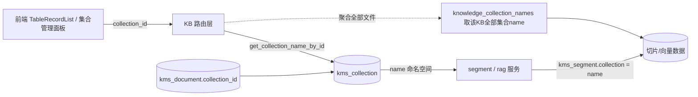

## 用户需求
表格知识库上传文件后，点「已上传文件 → 表格条目」查不到数据：根因是前端用集合 name 字符串（`kb_3`）关联 `kms_collection`，而真实存储集合名为 `kb_{kid}_{slug}`（`kb_3_qa-sample-csv-2`），两者不一致导致按错误集合名查询返回空。需彻底修正这一逻辑错误并补齐管理能力。

## 核心功能
1. **关联键改为 collection_id**：文档（`kms_document.collection_id`）与集合（`kms_collection.id`）的关联、以及所有集合相关后端接口，全部改用 `collection_id` 关联/调用；集合 name 仅作为由 id 反查得到的向量库命名空间（存储标签），不再由调用方直接传 name。
2. **已上传文件列表显示所属集合名**：文件表格新增「所属集合」列，按 `collection_id` 反查 `kms_collection.name` 展示。
3. **集合 / 字段定义管理（全能力）**：
   - 在知识库下手动新建集合并预先定义字段（名称 / 类型 / 是否启用 / 是否向量化 / 是否可过滤）；
   - 编辑现有集合的字段定义（`schema_config` 增删改）；
   - 重命名集合（改 slug/name，级联同步 `kms_document`/`kms_segment` 的 name 标签，向量数据不动）；
   - 删除集合（级联删除其下文档与切片，前端二次确认）。
4. **修复查询 bug**：文档序列化器补 `collection_id`（及 name），前端路由由 `collection_id` 反查 name，使「表格条目」正确列出数据。

## 约束与边界
- 向量库以 `kms_segment.collection` 列值作为命名空间（非独立物理表）；name 在三张表（kms_collection/kms_document/kms_segment）只是字符串标签，重命名=对三张表做一致 UPDATE，无向量搬运。
- 必须保证「每个知识库都存在一个默认 `kb_{kid}` 集合行」，否则文档型 / Q&A 型 KB 的接口无法按 id 解析。


## 技术栈
- 后端：Python + FastAPI + SQLAlchemy + PostgreSQL/pgvector（沿用现有栈）。
- 前端：Vue3 `<script setup>` + TypeScript + Ant Design Vue（antd）+ axios 封装 `request`（沿用现有栈）。
- 测试：pytest（后端）；vue-tsc 类型校验（前端）。

## 实现方案（高层策略）
1. **id 解析单点化**：新增 `get_collection_name_by_id(db, collection_id) -> str`，集合不存在则抛 404/ValueError；所有路由先按 id 反查 name，再走既有的 name 命名空间逻辑（与现状等价，但调用方不再传 name）。
2. **默认集合行兜底**：知识库创建时建 `kb_{kid}` 默认集合；并用一次启动期回填（写入 `startup_migrations` 或建库服务）为存量 KB 补齐默认集合行，使文档/QA KB 也能按 id 解析。
3. **路由改造**：将 `app/routers/kb/kb.py` 中所有 `/collections/{collection}/...` 路径参数由 name 改为 `collection_id`（整数），内部反查 name。涉及 segments / retrieve / schema(get+put) / settings(get+put) / qa-records(get/post/import/export) / table-records(post/import/preview) / assets(get/post) / index-mode。
4. **集合 CRUD**：新增 `POST /knowledges/{kid}/collections`（slug + schema_config + dimensions，复用 `create_knowledge_collection`）、`PUT /knowledges/{kid}/collections/{id}`（重命名：更新 `kms_collection.name` 并用单条 `UPDATE` 级联改 `kms_document.collection`、`kms_segment.collection`；同时可改 `schema_config`/`dimensions`）、`DELETE /knowledges/{kid}/collections/{id}`（按序删切片向量→文档→集合行）。
5. **序列化修复**：`_serialize`（文档）补 `collection_id`（与 `collection` name 一并返回，便于兼容）。
6. **删除/重试修复**：`delete_document`、`_retry_table_document` 由 `doc.collection_id` 反查 name（缺失时回退 `doc.collection` 防御）。

## 性能与可靠性
- 重命名级联：对 `kms_document`/`kms_segment` 各用一条 `UPDATE ... WHERE collection_id=:id`，O(n) 批量 SQL，不逐行；向量 embedding 列不动。
- 删除级联：先按文档批量删向量（PGVectorStore），再删 `kms_segment`、`kms_document`、`kms_collection`，置于事务内；集合下有文档时由前端二次确认，后端幂等。
- 默认集合回填为启动期幂等步骤（`INSERT ... WHERE NOT EXISTS`），不影响正确性。
- 保留现有测试库 `schema_translate_map` 隔离机制，避免回归。

## 架构设计


## 目录结构（新建/修改清单）
```
backend/
├── app/routers/kb/kb.py                  # [MODIFY] _serialize 补 collection_id；所有集合路由改收 collection_id；新增集合 CRUD 路由；delete/retry 按 id 反查
├── app/services/kb/collection_service.py # [MODIFY] 新增 get_collection_name_by_id / ensure_default_collection / rename_collection(级联) / delete_collection(级联)
├── app/services/kb/segment_service.py    # [MODIFY] 聚合查询保持按 name 标签（由 id 派生），新增必要辅助
├── app/db/startup_migrations.py          # [MODIFY] 新增幂等回填：为每个知识库补齐默认 kb_{kid} 集合行
├── app/models/wiki/wiki_knowledge.py     # [MODIFY] 建库时创建默认 kms_collection 行
├── tests/kb/test_collection_crud.py      # [NEW] 集合 CRUD / 重命名级联 / 删除级联 / id 解析404 / 默认集合回填
└── tests/kb/*.py                         # [MODIFY] 将既存按 name 调用的用例改为按 collection_id

frontend/
├── src/api/kb.ts                         # [MODIFY] 扩展 KbCollectionItem；新增集合 CRUD 函数；全部集合调用改 collectionId
├── src/views/kms/kb/TableRecordList.vue  # [MODIFY] selectedDocCollection 改由 collection_id 反查；文件列表增加“所属集合”列；上传/查询/新增走 id
├── src/views/kms/kb/KbCollectionManager.vue # [NEW] 集合与字段定义管理面板（列表/新建/编辑字段/重命名/删除）
├── src/views/kms/kb/KbDocumentPane.vue   # [MODIFY] 向 TableRecordList / QaRecordList 传 collectionId
├── src/views/kms/kb/QaRecordList.vue     # [MODIFY] props 由 collection(name) 改为 collectionId
└── src/i18n/locales/{zh-CN,en-US,zh-TW,ja-JP}.ts # [MODIFY] 补齐集合管理 i18n key
```

## 关键代码结构（接口约定）
```python
# app/services/kb/collection_service.py
def get_collection_name_by_id(db: Session, collection_id: int) -> str: ...   # 不存在抛 ValueError(404)
def ensure_default_collection(db, tenant_id, knowledge_id) -> KbCollection: ...  # 缺则建 kb_{kid}
def rename_collection(db, collection_id: int, new_slug: str) -> KbCollection: ...  # 级联 UPDATE kms_document/kms_segment.collection
def delete_collection_cascade(db, collection_id: int) -> None: ...  # 删向量+文档+切片+集合
```
```typescript
// src/api/kb.ts
export interface KbCollectionItem {
  id: number; name: string; dimensions: number;
  field_count: number; embed_fields: string[];
  schema_config?: KbSchemaField[];
}
export function createKnowledgeCollection(kid: number, body: {slug?: string; schema_config?: KbSchemaField[]; dimensions?: number}): Promise<any>
export function updateKnowledgeCollection(kid: number, id: number, body: {slug?: string; schema_config?: KbSchemaField[]; dimensions?: number}): Promise<any>
export function deleteKnowledgeCollection(kid: number, id: number): Promise<any>
// 既有按 name 的函数签名统一改为 collectionId: number
```


## 设计风格
沿用项目既有的企业级 Ant Design Vue 浅色主题（与现有 TableRecordList 三 Tab 卡片风格一致），不做视觉突变。新增「集合与字段」能力以独立 Tab/面板呈现，保持表格化、卡片化、对话框式交互。

## 页面规划（表格知识库内新增「集合与字段」Tab）
- **集合与字段（新增 Tab，置于「已上传文件 / 表格条目 / 测试」之后）**：
  - 顶部：知识库下集合列表（a-table 或 a-list），每行展示集合名、字段数、向量化字段、操作（编辑字段 / 重命名 / 删除带二次确认）。
  - 「新建集合」按钮 → 弹窗：填 slug（或自动）+ 字段定义编辑器（a-table 行内增删字段：字段名 a-input、类型 a-select[string/number/boolean]、启用/向量化/可过滤 a-switch）。
  - 「编辑字段」→ 复用字段定义编辑器弹窗，保存走 `updateKnowledgeCollection`（schema_config）。
  - 「重命名」→ 弹窗填新 slug，保存后列表与已上传文件集合名同步刷新。
  - 「删除」→ a-popconfirm 红色警告「将级联删除该集合下全部文档与切片，不可恢复」，确认后调用删除。
- **已上传文件 Tab（修改）**：文件表格新增「所属集合」列（由 `collection_id` 反查 name 展示），其余布局不变。
- **表格条目 / 测试 Tab（修改）**：查询与检索改为按 `collection_id` 反查 name 后调用，交互不变。

## 交互与响应式
- 字段定义编辑器支持行内增删与开关切换，实时校验「至少 1 个向量化字段」才可保存（disabled 提交）。
- 删除/重命名后自动 `loadCollections()` 刷新列表与文件表的集合名列。
- 整体沿用现有 CSS 变量（`--fg-muted` 等），桌面端卡片栅格，移动端不做专项适配（与现有 KB 页面一致）。

## Agent Extensions
### SubAgent
- **code-explorer**
  - Purpose: 全量排查后端 `app/routers/kb/kb.py` 与前端所有仍按集合 name 字符串调用的接口、函数与调用方，确保 id 化改造无遗漏。
  - Expected outcome: 产出完整调用点清单（路由路径、api/kb.ts 函数、Vue 组件 props），供改造逐项替换，避免遗漏导致 404/空数据回归。
