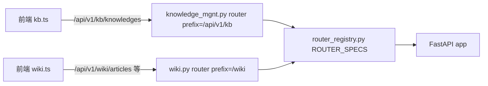

## 用户需求概述
将 `backend/app/routers/wiki/wiki.py` 中「知识库管理」相关功能迁移到新建模块 `backend/app/routers/kb/knowledge_mgnt.py`，并实现前端访问地址同步切换。

## 核心功能（迁移范围）
- 知识库（knowledge）增删改查 4 个端点：`GET /knowledges`（列表，含文章数统计）、`POST /knowledges`（创建）、`PUT /knowledges/{id}`（更新）、`DELETE /knowledges/{id}`（删除）。
- 分类（category）增删改查 4 个端点：`GET /categories`（分类树）、`POST /categories`（创建）、`PUT /categories/{id}`（更新）、`DELETE /categories/{id}`（删除，含子分类/文章数校验）。

## 约束与一致性要求
- 对外接口前缀由 `/api/v1/wiki` 改为 `/api/v1/kb`（与现有 `kb.py` 约定一致），新路径为 `/api/v1/kb/knowledges`、`/api/v1/kb/categories` 等。
- 业务逻辑、请求参数（Schema）、返回结构（dict 字段形状）保持与原 `wiki.py` 完全一致，仅代码位置与 URL 前缀变化。
- OKF 导出/导入端点（`/knowledges/{id}/okf-export`、`/okf-import`）**保留在 wiki.py**，路径不变。
- 前端：将 `wiki.ts` 中 8 个知识库/分类 API 函数迁移至 `kb.ts`，路径指向新模块，并同步更新所有调用方的 import 来源。


## 技术栈与现状
- 后端：Python + FastAPI，路由采用「显式清单注册」（`app/core/router_registry.py` 的 `ROUTER_SPECS`），router 在模块内声明完整前缀（如 `kb.py` 用 `prefix="/api/v1/kb"`）。
- 前端：Vue3 + TypeScript，`frontend/src/api/*.ts` 封装 `request`，`kb.ts` 已定义 `const BASE = '/api/v1/kb'`。

## 实现方案
采用「整块平移 + 前缀重写 + 注册接入 + 前端改址」策略：把 `wiki.py` 内 8 个端点及其依赖的辅助函数（`_slugify`/`_knowledge_to_dict`/`_category_to_dict`）、请求体 Schema（`KnowledgeCreateRequest`/`KnowledgeUpdateRequest`/`CategoryCreateRequest`/`CategoryUpdateRequest`）及所需 import 原样复制到新模块，仅将 `APIRouter(prefix="/wiki", ...)` 改为 `prefix="/api/v1/kb"`，端点函数名与装饰器路径（`/knowledges`、`/categories`、带 `{id}` 变体）保持不变。随后在 `router_registry.py` 的 kb 分组后新增一条 `RouterSpec` 接入新模块，并从 `wiki.py` 删除已迁移代码。前端按用户确认决策将函数迁至 `kb.ts`。

### 关键技术决策与权衡
1. **新模块沿用 `/api/v1/kb` 前缀**：与同目录 `kb.py` 完全一致，符合「指向新模块/服务」语义，且已验证 `kb.py` 仅占用 `/knowledges/{kid}/documents` 等子路径，新端点为顶层 `/knowledges`、`/categories`，**无路由冲突**（Starlette 按完整路径匹配，互不影响）。
2. **保持 Schema 与返回 dict 逐字段一致**：`_knowledge_to_dict`/`_category_to_dict` 直接复用，不增删字段（含 `category_count`、`article_count`、`slug` 等），确保契约零破坏。
3. **OKF 端点留在 wiki.py**：避免引入 `app.services.wiki.okf_service` 跨层依赖到 kb 模块；前端 `exportOkfBundle`/`importOkfBundle` 保持 `/api/v1/wiki/...` 不动。
4. **路由注册顺序**：新 `RouterSpec` 置于 kb 分组之后（wiki 路由之前或之后均可，因路径前缀不同不会遮蔽），保留 `router_registry.py` 注释强调的「顺序即匹配顺序」原则，不破坏既有优先级。

### 性能与可靠性
- 迁移为纯代码搬运，无新增查询/计算，时间/空间复杂度与原实现一致（列表接口 O(N) 内存遍历建树，保留原逻辑）。
- 注册阶段通过最小 import 校验确保两个 router 均可加载，避免启动期崩溃。

## 实现注意事项
- 新模块需补齐 import：`from app.models.kb.kb_category import KbCategory`、`from app.models.wiki.wiki_knowledge import WikiKnowledge`、`from app.models.wiki.wiki_article import WikiArticle`（仅 `delete_category` 依赖）；`validate_kb_format`/`validate_external_type` 来自 `app.services.kb.kb_format`，`normalize_pipeline_config` 来自 `app.services.kb.pipeline_config`；`from app.deps import get_db, get_current_user`、`from app.models.sys.sys_user import SysUser`。
- 删除 `wiki.py` 中已迁移内容后，确认 `wiki.py` 不再引用这些函数/Schema（OKF 端点仍用 `WikiKnowledge` 与 `_knowledge_to_dict`？需核实——若 OKF 端点用到则保留对应引用）。经核查：`okf_export_bundle`/`okf_import_bundle` 仅用 `WikiKnowledge` 作为查询对象、不依赖 `_knowledge_to_dict`，故 `_knowledge_to_dict` 可整体迁出；`WikiKnowledge` 在 wiki.py 仍需 import 供 OKF 使用。
- 前端 `kb.ts`：新增 8 个函数统一用 `${BASE}/categories`、`${BASE}/knowledges` 及其 `{id}` 变体，导出签名与 `wiki.ts` 原样一致（参数名、返回类型不变），以最小化调用方改动——调用方只需改 import 来源。
- 前端验证：本仓 `npm run lint`/`npm run build` 工具链存在既有错误，仅用 `npm run build 2>&1 | Select-String "kb.ts|wiki.ts|相关路径"` 过滤本次改动。

## 架构设计
复用现有「清单式路由注册」架构，不引入新机制：



## 目录结构（变更清单）
```
backend/app/
├── routers/
│   ├── kb/
│   │   └── knowledge_mgnt.py   # [NEW→写入] 知识库/分类 8 个端点 + 辅助函数(_slugify/_knowledge_to_dict/_category_to_dict) + 4 个请求 Schema；APIRouter(prefix="/api/v1/kb", tags=["知识库管理"])。业务逻辑、返回形状与原 wiki.py 完全一致。
│   │   └── kb.py               # [不改] 既有通用知识库路由，仅作前缀参考
│   └── wiki/
│       └── wiki.py             # [MODIFY] 删除已迁移的 8 个端点、3 个辅助函数、4 个 Schema 及专用 import；保留 articles/search/ask/reindex/okf 端点与 WikiKnowledge 等其余 import。
└── core/
    └── router_registry.py      # [MODIFY] 在 kb 分组（通用知识库/外部代理/外部导入之后）新增 RouterSpec("app.routers.kb.knowledge_mgnt", tags=["知识库管理"])，prefix 留空（由模块自带）。

frontend/src/
├── api/
│   ├── kb.ts                   # [MODIFY] 新增 8 个函数（listCategories/createCategory/updateCategory/deleteCategory/listKnowledges/createKnowledge/updateKnowledge/deleteKnowledge），路径用 ${BASE}/categories、${BASE}/knowledges，签名与原 wiki.ts 一致。
│   └── wiki.ts                 # [MODIFY] 删除上述 8 个函数，仅保留文章/搜索/ask 等 wiki 专属 API。
└── views/ 与 composables/ 等   # [MODIFY] 所有 import 了这 8 个函数名的 .vue/.ts，将来源由 '@/api/wiki' 改为 '@/api/kb'（函数名不变）。
```

## 关键代码结构（新模块头部）
```python
# backend/app/routers/kb/knowledge_mgnt.py
from fastapi import APIRouter, Depends, HTTPException, Query
from sqlalchemy import func, select
from sqlalchemy.orm import Session

from app.deps import get_db, get_current_user
from app.models.sys.sys_user import SysUser
from app.models.kb.kb_category import KbCategory
from app.models.wiki.wiki_knowledge import WikiKnowledge
from app.models.wiki.wiki_article import WikiArticle
from app.services.kb.kb_format import validate_external_type, validate_kb_format
from app.services.kb.pipeline_config import normalize_pipeline_config

router = APIRouter(prefix="/api/v1/kb", tags=["知识库管理"])
# 以下端点函数（list_knowledges/create_knowledge/update_knowledge/delete_knowledge
# 及 list_categories/create_category/update_category/delete_category）及其
# Schema 类、_slugify/_knowledge_to_dict/_category_to_dict 原样迁移自 wiki.py。
```

```python
# backend/app/core/router_registry.py （kb 分组内新增）
RouterSpec("app.routers.kb.knowledge_mgnt", tags=["知识库管理"]),
```


## Agent Extensions
### SubAgent
- **code-explorer**
  - 用途：全面检索前端 `frontend/src` 中所有 import 了 8 个待迁移函数（listCategories、createCategory、updateCategory、deleteCategory、listKnowledges、createKnowledge、updateKnowledge、deleteKnowledge）的 `.vue`/`.ts` 文件，输出精确调用方清单。
  - 期望结果：得到完整且无误的调用方文件列表，确保迁移后所有 `import from '@/api/wiki'` 改为 `'@/api/kb'`，无遗漏导致运行时 404/未定义。
