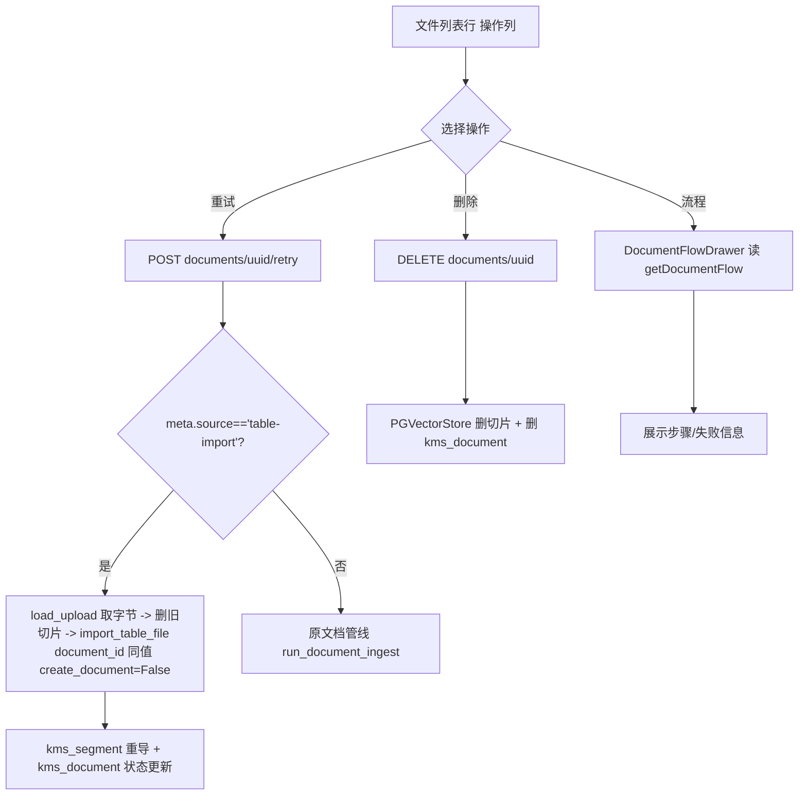

## 用户需求
通用知识库「表格」形态的两项调整：
1. 「上传文件」面板的文件列表，为每一行文件提供 **[流程][重试][删除]** 操作，交互与文档知识库保持一致。
2. 「表格条目」列表支持增删查改（早期对话已实现，本次仅确认不被破坏、回归验证）。

## 功能边界
- 文件列表行操作复用文档知识库既有语义：[流程] 打开处理流程抽屉（步骤/失败信息）；[重试] 用原始文件重新导入该文件的所有条目；[删除] 删除该文件及其全部条目。
- 「删除」可直接复用现有 `deleteDocument`（通用删 `kms_segment` + `kms_document`），前端无需后端改动。
- 「流程」直接复用现有 `DocumentFlowDrawer.vue`（接收 `KbDocument`，自带重试/重新向量化）。
- 「重试」当前后端对表格文件会 400（表格导入未留存原始文件），需补齐：导入时落盘原始文件 + 后端增加表格重试分支，使重试真正可用。
- 文件列表不额外加「分段」按钮（其下方「表格条目」面板即分段视图），仅加用户点名的 流程/重试/删除。
- 文案复用既有 i18n 键（kbMgmt.flow / retry / retryTip / retryStarted / retryFailed / confirmDeleteDoc / common.deleted / common.deleteFailed），不新增多语言文本。


## 技术栈
- 前端：Vue 3 + TypeScript + Ant Design Vue（既有项目约定，沿用 `a-table`/`a-popconfirm`/`a-drawer`/`a-button`）。
- 后端：FastAPI + SQLAlchemy；表格入库链路 `content_service.py` / `table_schema.py`；路由 `kb.py`。
- 复用组件：`DocumentFlowDrawer.vue`、`api/kb.ts` 的 `deleteDocument`、`retryDocument`、`getDocumentStatus`；后端 `save_upload/load_upload/drop_upload` 与 `PGVectorStore.delete_document`。

## 实现策略
### 1. 后端：让表格文件可重试
表格导入当前是**同步内存解析、不落盘原始文件**，而 `retry_document` 依赖 `meta.file_path`。因此：
- `import_table_file` 增加参数 `document_id: Optional[str] = None` 与 `create_document: bool = True`；`document_id` 为空时生成新 UUID，并透传给 `ingest_table_rows`（其已支持 `create_document=False`，定时同步在用）。同时用 `save_upload` 把原始文件落到 upload 目录，并把 `file_path`、`source='table-import'`、`chunker_type` 写入 `kms_document.meta`。
- `retry_document`（kb.py 第 435–499 行）增加分支：若 `meta.source == 'table-import'`，则 `load_upload(file_path)` 取回字节 → `PGVectorStore.delete_document` 清理该文档旧切片 → 置 `status='processing'`、`segment_count=0`、`retry_count+1` → 后台线程调用 `import_table_file(..., document_id=doc.uuid_code, create_document=False, session_factory=SessionLocal)`，复用同一文档行重导；否则走原文档管线逻辑。
- 关键点：`uuid_code == document_id` 不变；先删旧切片再重导，避免 `uq_kms_segment`（collection+document_id+chunk_index）唯一约束冲突。

### 2. 前端：文件列表操作列
在 `TableRecordList.vue` 的 `fileColumns` 增加 `op` 列（width ~210），渲染三个按钮，逻辑对齐 `KbDocumentPane.vue`：
- [流程]：`openFlow(record)` → `DocumentFlowDrawer`（需 import 并加 `flowOpen`/`flowDoc` state），`@changed` 触发 `loadDocs`。
- [重试]：`onRetry(record)` → `retryDocument(record.document_id)`，按行维护 `retryingId` 控制 loading，`@finish` 后 `loadDocs`+`load`（状态变为 processing 时条目暂空，重导后回填）。
- [删除]：`removeFile(record)` → `deleteDocument(...)`，若删除的是当前选中文件则清空 `selectedDoc` 与 `rows`，再 `loadDocs`+`load`。
- 删除用 `a-popconfirm`（title=`kbMgmt.confirmDeleteDoc`）；重试用 `a-tooltip`（title=`kbMgmt.retryTip`），与文档知识库一致。

### 3. 回归：表格条目增删查改
早期已实现（`startCreate/startEdit/submit/remove/onSearch` + 服务端分页），本次不改动其逻辑，仅在验证阶段确认：新增/编辑/删除条目仍挂在 `selectedDoc` 下，分页与 `q` 搜索正常。

## 架构设计


## 目录结构与改动文件
```
backend/app/services/kb/rag/content_service.py   # [MODIFY] import_table_file 增加 document_id/create_document 参数并落盘原始文件；透传 ingest_table_rows
backend/app/routers/kb/kb.py                      # [MODIFY] retry_document 增加表格导入分支（删旧切片 + 用原文件重导，后台执行）
frontend/src/views/kms/kb/TableRecordList.vue     # [MODIFY] fileColumns 增加 op 操作列；import DocumentFlowDrawer；新增 openFlow/onRetry/removeFile 与 flowOpen/flowDoc/retryingId；import deleteDocument/retryDocument
frontend/src/api/kb.ts                            # [复用] 已有 deleteDocument / retryDocument，无需改动
frontend/src/views/kms/kb/DocumentFlowDrawer.vue  # [复用] 流程抽屉，无需改动
backend/tests/kb/test_table_schema.py             # [MODIFY] 新增表格文件重试用例（落盘->retry->校验切片数回升）
```

## 关键代码结构（待落地签名）
```python
# content_service.py
def import_table_file(
    db, tenant_id, collection, data: bytes, filename: str, *,
    knowledge_id: Optional[int] = None,
    embed_field: Optional[str] = None,
    session_factory=None, kb_factory=None,
    document_id: Optional[str] = None,     # 重试时复用同一文档行
    create_document: bool = True,          # False: 不新建 kms_document 行
) -> dict: ...

# kb.py retry_document 新增分支伪代码
if (doc.meta or {}).get("source") == "table-import":
    data = load_upload(meta["file_path"])
    PGVectorStore(db, tenant_id).delete_document(doc.collection, doc.uuid_code)
    # 置 processing，后台调用 import_table_file(document_id=doc.uuid_code, create_document=False)
```

## 实现注意
- 落盘路径复用既有 `save_upload`，删除时 `drop_upload` 已随 `delete_document` 触发，保持对称。
- `import_table_file` 重试时 `embed_field=None`，由 `resolve_import_schema` 沿用已存列定义的被嵌入列。
- 删除当前选中文件后必须清空 `selectedDoc`，否则条目区会查到一个不存在的 `document_id`。
- 前端 `retryDocument` 调用后状态异步变化，靠轮询/刷新（刷新按钮与列表重载）体现，不引入额外轮询机制。
- 不改动 `ingest_table_rows`、`table_schema.py` 既有行为；仅扩展 `import_table_file` 入参。

