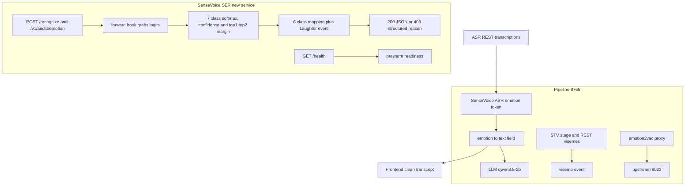

## 产品概述
在现有全双工语音服务上扩展三类能力：新增 SenseVoice 语音情感识别服务、让 ASR 情感辅助 LLM 回复、开放口型服务并切换轻量 LLM。

## 核心功能
- **SenseVoice 情感识别服务**：在 ser 目录新增与 emotion2vec 并列的一版服务，模型复用 s2s 已在用的 SenseVoice。提供 POST /recognize 与 POST /v1/audio/emotion 双别名及 GET /health；保持 400/409/429 语义。SenseVoice 7 类情感映射为 6 类（新增 happy），agitated 与 anxious 可达，happy 结合笑声事件透传；输出置信度与 top1-top2 margin、AED 事件；409 返回结构化 reason；启动预热与短截止并发等待。
- **A/B 裁决方案**：与 emotion2vec 同条件对比，复用 verify、latency_bench、e2e-smoke 脚本并新增 AED 事件与 margin 列；给出 CPU/GPU 两个 Dockerfile 与 compose 分支配置；明确 U5 人检需采集的指标以裁决是否替换。
- **情感辅助回复**：ASR 识别出的情感由 emoji 改为文字，随转录进入 pipeline 传给 LLM；客户端回显与 REST 转写保持干净。
- **口型服务**：新增独立音频转口型端点并打开实时对话口型事件。
- **模型切换**：主链路 LLM 切到 GPUStepStack 上的 qwen3.5-2b，沿用现有兼容接口，保持短回复并关闭思考链。


## 技术栈
- 情感服务：Python 3.10 + FastAPI + Uvicorn + funasr 1.4.27（SenseVoiceSmall 本地权重 936MB），CPU 用离线 wheels，GPU 用 torch 2.7.1+cu128（RTX 5070 Ti sm_120 必需）。
- Pipeline：现有 Python + FastAPI，8765 源码进程；console 后端 8000 负责反代、能力探测与状态聚合；前端 Vue 3 + TypeScript + Vite 仅加轻量状态提示。
- 测试与校验：pytest 契约测试、项目 load_config 校验、OpenAPI 路径检查、e2e 复现脚本。

## 实现方案
1. **SenseVoice SER 服务**：新增 sensevoice 子目录与 app.py，模型从本地 cache 加载（不烘焙进镜像）。用 register_forward_hook 在 decoder 输出层抓 logits，于情感 token 位置取 softmax 得 7 类概率，算 confidence 与 top1-top2 margin；低于阈值按 409 拒答并返回结构化 reason。情感 token 映射：HAPPY 归 happy（结合 AED Laughter 事件），FEARFUL/SAD 归 anxious，SURPRISED/DISGUSTED 归 agitated，ANGRY 归 anger，NEUTRAL 归 calm，EMO_UNKNOWN 或非语音拒答。启动时预热一次真实推理消除冷启动；并发门满时用带短截止的等待后再返回 429。保留参考服务不落盘、单实例语义。
2. **A/B 方案**：新增独立 compose 分支避免与 emotion2vec 端口/镜像冲突；CPU 与 GPU 各一份 Dockerfile；verify/latency_bench/e2e-smoke 复用并加 AED 事件列与 margin 列；U5 人检记录 emotion、confidence、margin、AED 事件、rawLabel、latency 与人工听记标签，以一致率和误报率裁决。
3. **情感注入 LLM**：在 STT handler 中从 postprocess 前的富标签文本提取情感文字；给 Transcription 与 TranscriptionCompletedEvent 增加可选 emotion 字段并经 notifier 透传；在 service 处理转录完成时，客户端事件发出后把情感文字拼进用户消息再交给 LLM，实现客户端干净、LLM 带注释。同步修复 ASR REST 端点只识别旧 handler 导致 SenseVoice 下 503 的问题。
4. **口型与 LLM**：口型复用 pipeline 中已加载的 STV handler，独立端点按类名查找并单实例串行；主链路打开 enable_visemes；LLM 通过 env 换成 qwen3.5-2b 并保持思考链关闭。

## 性能与可靠性
- 口型主链路引入最多 0.5s 累积缓冲（已接受），独立端点复用同一 handler 避免重复加载。
- 情感服务预热在就绪前完成，健康探测由 console 每 30s 执行，不在业务请求内阻塞。
- SenseVoice 稳态 RTF 约 0.06，情感推理开销低；hook 仅在情感 token 位置计算 softmax，额外开销可忽略。
- 所有配置改动需重启 8765 生效，不自动结束用户进程。

## 架构设计


## 目录结构
新增情感服务（D:/work/mediation_platform/mediation-deploy/ser/）：
- sensevoice/app.py [NEW] 双别名推理端点与健康端点，解码、静音判据、预加载、短截止并发门、结构化错误。
- sensevoice/model_hook.py [NEW] forward hook 抓取 logits，情感 token 位置 softmax，输出 7 类概率、confidence、margin、AED 事件。
- sensevoice/labels.py [NEW] 7 类到 6 类映射、happy 与 Laughter 透传规则、拒分类集合。
- sensevoice/requirements.txt [NEW] 依赖清单。
- sensevoice/Dockerfile [NEW] CPU 分支，离线 wheels，权重运行时挂载。
- sensevoice/Dockerfile.gpu [NEW] GPU 分支，torch 2.7.1+cu128，阿里云 pytorch-wheels flat 镜像。
- models/sensevoice-small/ [NEW] 从 s2s cache 复制或软链的本地权重。
- docker-compose.sensevoice.yml [NEW] CPU 编排，独立 project 与端口。
- docker-compose.sensevoice.gpu.yml [NEW] GPU 编排，变量写死，独立端口与 project。
- scripts/verify_sensevoice.ps1 [NEW] 复用合同验证，新增 margin 与 AED 断言。
- scripts/latency_bench_sv.ps1 与 scripts/latency_bench_sv_gpu.ps1 [NEW] 同条件延迟取证。
- scripts/e2e-smoke-sv.ps1 [NEW] 人检取数，CSV 增加 AED 事件与 margin 列。
- scripts/A-B-COMPARE.md [NEW] 同条件 A/B 步骤与 U5 裁决指标。

Pipeline 与配置（d:/work/qwen-audio-agent/speech-to-speech-src/）：
- src/speech_to_speech/STT/sense_voice_handler.py [MODIFY] 提取情感文字，保留干净音频文本，支持 ASR REST 复用。
- src/speech_to_speech/pipeline/messages.py [MODIFY] Transcription 与 PartialTranscription 增加可选 emotion 字段。
- src/speech_to_speech/pipeline/events.py [MODIFY] TranscriptionCompletedEvent 增加 emotion 字段。
- src/speech_to_speech/pipeline/transcription_notifier.py [MODIFY] 透传 emotion 字段。
- src/speech_to_speech/api/openai_realtime/service.py [MODIFY] 客户端事件后把 emotion 文字拼入用户消息送 LLM。
- src/speech_to_speech/api/openai_realtime/audio_services.py [MODIFY] ASR REST 支持 SenseVoice handler。
- src/speech_to_speech/api/openai_realtime/visemes_routes.py [NEW] 口型独立端点与 capability。
- src/speech_to_speech/api/openai_realtime/websocket_router.py [MODIFY] 挂载口型路由。
- src/speech_to_speech/api/openai_realtime/emotion_routes.py [MODIFY] 情感代理 readiness 与能力状态。
- config/prod.env [MODIFY] GPUSTACK_MODEL 改 qwen3.5-2b、SER_API_KEY 从参考 env 同步、增加 STV 模型路径。
- config/prod.yaml [MODIFY] 打开 enable_visemes 与 STV 参数，保持 LLM 关思考链。

Console 与前端：
- console/backend/app/services/audio_proxy_service.py [MODIFY] SERVICES 增加 visemes 与 capability 条目。
- console/backend/app/routers/audio_proxy.py [MODIFY] 增加口型反代路由。
- console/backend/app/config/_console.py [MODIFY] 增加口型超时配置。
- console/backend/app/services/capability_probe.py [MODIFY] 能力集合增加 visemes 与 emotion readiness 判定。
- console/frontend/src/features/voice/transport/s2s-client.ts [MODIFY] 透传 viseme 扩展事件。
- console/frontend/src/views/VoiceView.vue [MODIFY] 情感与口型能力状态提示和降级文案。
- console/frontend/src/types/api.d.ts [MODIFY] 增加能力字段类型。

测试与文档：
- tests/test_sensevoice_ser.py [NEW] 端点、映射、margin 门、结构化 409、预热与并发测试。
- tests/test_visemes_routes.py [NEW] 口型路由契约测试。
- tests/test_emotion_proxy.py [MODIFY] readiness 与降级测试。
- docs/service-enablement-CN.md [MODIFY] 新服务清单与验证步骤。
- docs/full-duplex-voice-pipeline-CN.md [MODIFY] 情感注入与口型链路。
- docs/sensevoice-ser-a-b-CN.md [NEW] A/B 方案与 U5 指标。

## 关键代码结构
```python
def capture_emotion_logits(model, tokens):
    """Return probabilities over 7 emotion tokens and Laughter event flag."""

class Transcription(PipelineMessage):
    text: str
    emotion: str | None = None

def recognize_result(emotion, confidence, margin, event, raw_label):
    """Return platform label with reason when rejected."""
```


## Agent Extensions
### SubAgent
- **code-explorer**
  - Purpose: 核对新增服务在 pipeline 的挂载点、console 反代登记点、能力探测点与前端消费点。
  - Expected outcome: 产出精确绝对路径、符号名与行号清单，确保无漏登记。
### Skill
- **test-driven-development**
  - Purpose: 对 SenseVoice SER 服务、情感注入 LLM、口型路由先写失败测试再实现。
  - Expected outcome: 新服务与降级逻辑具备契约测试保护。
- **verification-before-completion**
  - Purpose: 完成后执行配置加载、pytest、OpenAPI 与重启后 e2e 验证。
  - Expected outcome: 仅当命令输出确认通过后才声明完成。
