# 10 种主流 Agent 架构在 AgentScope 中的实现

> 适用版本：**AgentScope 2.0**（本文基于 `src/agentscope/_version.py` 的 `2.0.12dev`）。
> 可运行示例：[`examples/architecture_patterns/`](../examples/architecture_patterns/README.md)，编号 `01`–`10` 与本文章节一一对应。

AgentScope 2.0 的设计取向是「**让模型的推理与工具调用能力充分发挥，而不是用固化的编排把模型框住**」。因此本文的组织方式是：先说清每种架构**要解决什么问题**，再给出**AgentScope 里对应的构件**——能直接用现成构件的就不写代码，没有内置构件的给出最小驱动循环。

---

## 目录

| # | 架构 | 一句话 | AgentScope 构件 | 示例脚本 |
| --- | --- | --- | --- | --- |
| 1 | [ReAct](#1-react--边想边做) | 思考→调工具→看结果→再思考 | `Agent` + `Toolkit`（**内置循环**） | `01_react.py` |
| 2 | [Plan-and-Execute](#2-plan-and-execute--先谋后动) | 先列计划，再逐步执行 | 内置任务工具 + 运行时状态注入 | `02_plan_and_execute.py` |
| 3 | [Reflection](#3-reflection--自我反思) | 自己检查，自己修改 | `reply(structured_schema=...)` 自评 + 修订循环 | `03_reflection.py` |
| 4 | [Prompt Chaining](#4-prompt-chaining--流水线) | 固定步骤逐个接力 | `SOP` / `SOPStep` / `SOPEngine` | `04_prompt_chaining.py` |
| 5 | [Routing](#5-routing--智能分流) | 先分类，再派对应流程 | 结构化输出分派 + `ModelRouterMiddleware` | `05_routing.py` |
| 6 | [Parallelization](#6-parallelization--并行分身) | 拆分并行或多次投票 | `asyncio.gather` + 并发工具调用 | `06_parallelization.py` |
| 7 | [Evaluator-Optimizer](#7-evaluator-optimizer--生成评审) | 一个生成，一个评审 | `GoalPipeline` | `07_evaluator_optimizer.py` |
| 8 | [Orchestrator-Workers](#8-orchestrator-workers--主管派活) | 主控动态拆分，再汇总 | `TeamPipeline` + `TeamMember` | `08_orchestrator_workers.py` |
| 9 | [Handoff](#9-handoff--专家交接) | 按专长直接转交 | 自定义外部工具 + 驱动循环（**无内置**） | `09_handoff.py` |
| 10 | [Hierarchical](#10-hierarchical--层级团队) | 多层主管逐级分工 | 薄编排层 + 多个 `TeamPipeline` | `10_hierarchical.py` |

---

## 共性底座：所有架构都站在同一套抽象上

在展开之前，先列出 10 种架构共享的底层能力——它们决定了「为什么这些模式写起来都很短」。

| 能力 | 构件 | 说明 |
| --- | --- | --- |
| 智能体 | `agentscope.agent.Agent` | 内置推理-行动（ReAct）循环、结构化输出、中断与恢复 |
| 工具 | `agentscope.tool.Toolkit` / `FunctionTool` / `ToolBase` | Python 函数、MCP、Skill 统一注册；`is_external_tool=True` 的工具交给外部执行 |
| 上下文 | `ContextConfig` | 超阈值自动压缩、工具结果卸载、压缩工具可选暴露给模型 |
| 运行时注入 | `InjectionConfig` | 把当前时间、**任务（计划）状态**、上下文长度注入每一轮 |
| 事件流 | `agentscope.event.*` | 推理、工具调用、多模态内容统一流式推送；前端与终端共用一套事件 |
| 权限与 HITL | `agentscope.permission.*` | 细粒度工具授权、确认、bypass；挂起的回复可用结果事件恢复 |
| 中间件 | `agentscope.middleware.*` | reply / reasoning / acting / 模型调用 / 压缩 / 系统提示 等钩子 |
| 工作空间 | `agentscope.workspace.LocalWorkspace` | 隔离的文件与命令执行环境，`list_tools()` 直接给出一整套文件工具 |

一个最小智能体长这样（也是模式 1 的全部代码骨架）：

```python
from agentscope.agent import Agent
from agentscope.tool import Toolkit, Bash, Grep, Glob, Read, Write, Edit
from agentscope.credential import DashScopeCredential
from agentscope.model import DashScopeChatModel
import os

agent = Agent(
    name="Friday",
    system_prompt="You're a helpful assistant named Friday.",
    model=DashScopeChatModel(
        credential=DashScopeCredential(api_key=os.environ["DASHSCOPE_API_KEY"]),
        model="qwen3.8-max",
    ),
    toolkit=Toolkit(tools=[Bash(), Grep(), Glob(), Read(), Write(), Edit()]),
)

msg = await agent.reply(UserMsg(name="user", content="帮我看看这个项目怎么跑起来"))
```

> **切换到 OpenAI 兼容端点**（自建网关 / vLLM / GPUStack）只需换模型一行：
> ```python
> from agentscope.model import OpenAIChatModel
> from agentscope.credential import OpenAICredential
> model = OpenAIChatModel(
>     credential=OpenAICredential(api_key=os.environ["OPENAI_API_KEY"],
>                                 base_url="http://127.0.0.1:8000/v1"),
>     model="qwen3-32b",
> )
> ```
> 示例目录里的 `_common.make_model()` 检测到环境变量 `OPENAI_BASE_URL` 会自动走这条路径，10 个脚本无需改动。

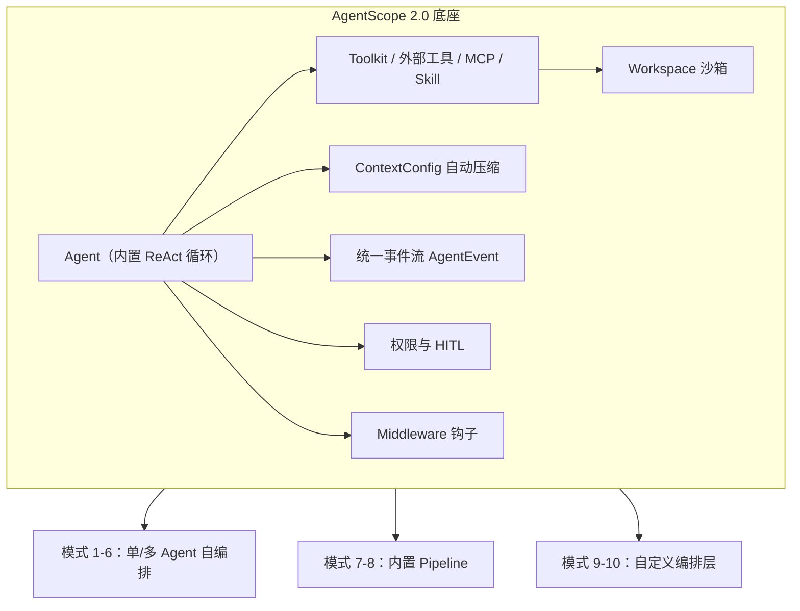

---

## 1. ReAct —— 边想边做

**要解决的问题**：问题需要多少步事先不知道，每步取决于上一步的结果（搜索问答、通用助手）。

**AgentScope 的做法**：**不需要写循环**。`Agent` 本身就跑推理-行动循环：模型输出工具调用 → 执行 → 结果回到上下文 → 再推理，直到模型给出最终回答或用尽 `ReActConfig.max_iters`。

| 关注点 | API |
| --- | --- |
| 循环上限 | `ReActConfig(max_iters=50)` |
| 工具注册 | `Toolkit(tools=[...])` / `FunctionTool(func)` |
| 结构化收尾 | `reply(..., structured_schema=Model)` → `Msg.structured_output` |
| 中断 | `UserInterruptEvent`；框架自动把未完成工具调用置为 interrupted |

```python
from agentscope.message import UserMsg
from agentscope.tool import FunctionTool
from _common import make_agent, render_stream

async def get_weather(city: str) -> str:
    """Get the current weather of a city."""
    return {"杭州": "晴，28°C", "北京": "多云，22°C"}.get(city, "晴，26°C")

agent = make_agent(
    name="Friday",
    system_prompt="Answer with the tools you have; never guess a value you "
                  "could look up.",
    tools=[FunctionTool(get_weather)],
    max_iters=10,
)
final = await render_stream(
    agent.reply_stream(UserMsg(name="user", content="杭州和北京今天谁更热？")),
)
```

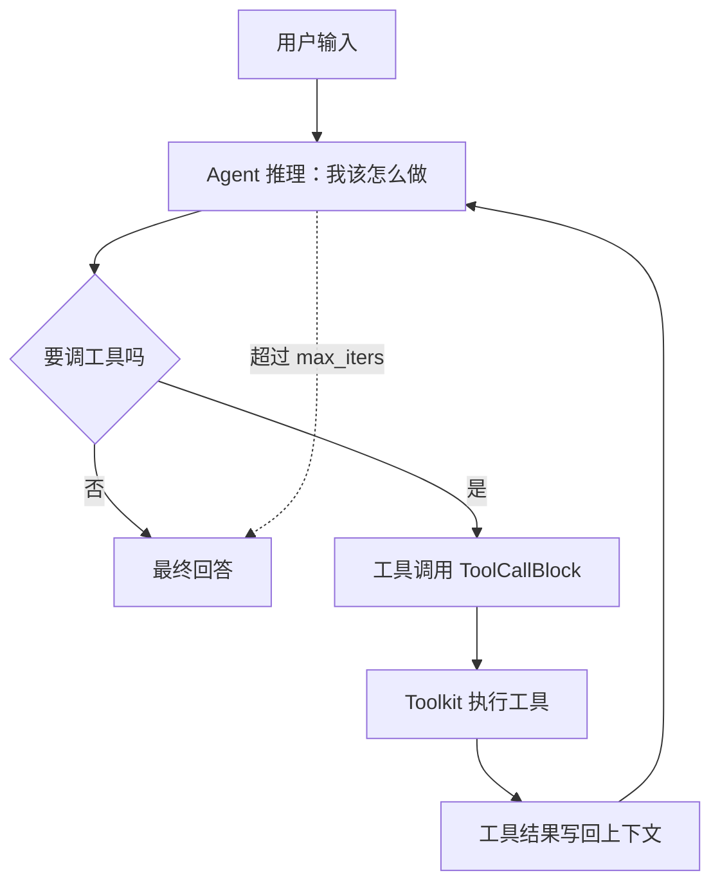

**边界**：单 Agent 单上下文，任务越长上下文压力越大——这时用模式 2（加计划）或模式 7/8（拆给别人）。

---

## 2. Plan-and-Execute —— 先谋后动

**要解决的问题**：多步骤长任务，模型容易「干着干着忘了最初要做什么」。

**AgentScope 的做法**：把计划**放进智能体的状态**，而不是放进提示词：

1. 内置任务工具 `TaskCreate` / `TaskUpdate` / `TaskList` / `TaskGet` 持有计划（写进 `AgentState.tasks_context`）；
2. `InjectionConfig.inject_runtime_state`（默认开启）在每轮把**当前任务清单**注入上下文，模型随时能看到自己承诺过什么；
3. 计划是模型自己写、自己维护的，不是你预先写死的。

```python
from agentscope.tool import TaskCreate, TaskUpdate, TaskList, TaskGet
from agentscope.workspace import LocalWorkspace

async with LocalWorkspace(workdir="./workspace") as workspace:
    agent = make_agent(
        name="Planner",
        system_prompt="先用 TaskCreate 拆解任务，再逐个完成并 TaskUpdate 标记状态。",
        tools=[*await workspace.list_tools(),
               TaskCreate(), TaskUpdate(), TaskList(), TaskGet()],
        offloader=workspace,
    )
    await render_stream(agent.reply_stream(UserMsg(name="user", content=GOAL)))

    for task in agent.state.tasks_context.tasks:   # 计划可直接读出，便于落库/展示
        print(f"[{task.state}] {task.subject}")
```

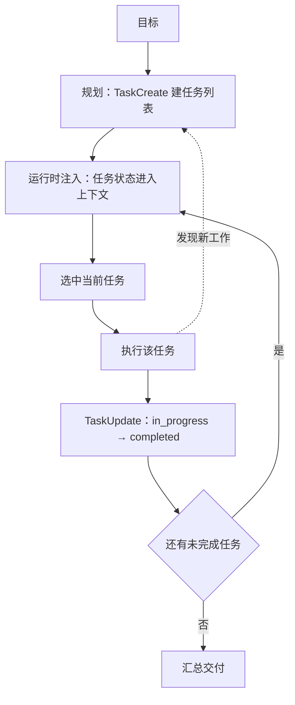

**边界**：计划由模型自己维护，长任务下可能「计划漂移」。若要求严格执行固定步骤，用模式 4（SOP）；若要求边做边动态拆分，用模式 8。

---

## 3. Reflection —— 自我反思

**要解决的问题**：一次成稿不够好，但多写几版就能明显变好（写代码、改稿）。

**AgentScope 的做法**：**同一个 Agent** 先产出，再用 `structured_schema` 让它对自己的产出打分/挑毛病，然后把意见回喂给它修订。因为评审和写作共享上下文，这才是「自我反思」；评审者换成另一个 Agent 就是模式 7。

```python
class Review(BaseModel):
    passed: bool = Field(description="是否足够好")
    score: int = Field(description="1-10 分")
    issues: list[str] = Field(description="具体、可执行的修改意见")

draft = await render_stream(agent.reply_stream(task))
for round_ in range(1, MAX_ROUNDS + 1):
    review_msg = await agent.reply(
        UserMsg(name="user", content="Review the draft you just wrote."),
        structured_schema=Review,
    )
    review = Review(**review_msg.structured_output)
    if review.passed or not review.issues:
        break
    draft = await render_stream(
        agent.reply_stream(UserMsg(name="user", content="根据意见修改：...")),
    )
```

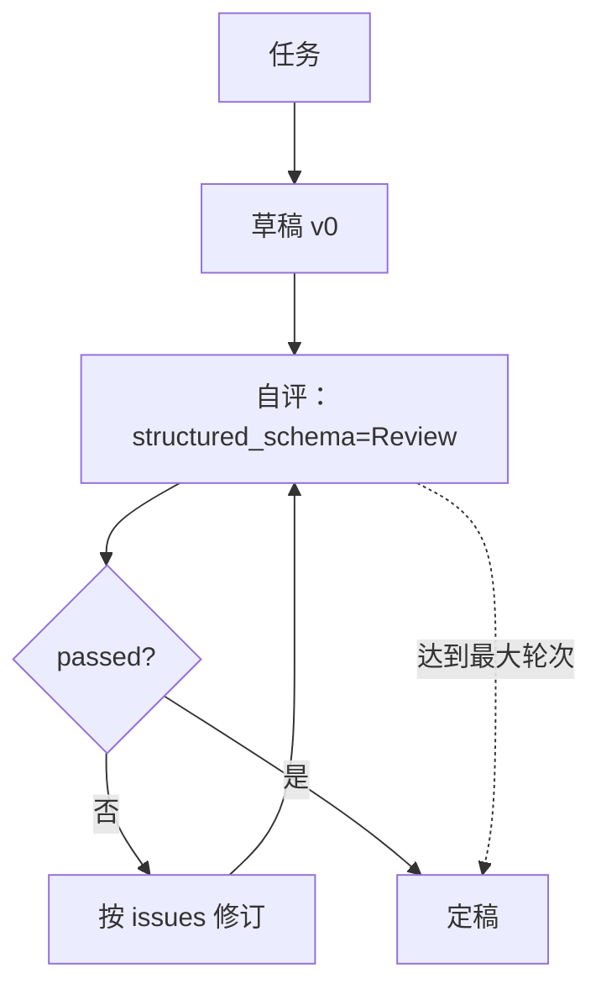

**边界**：自我评价存在「自我吹捧」与「原地打转」的风险。需要客观判据（跑测试、查事实）时，用模式 7 把评审交给独立 Agent 并给它工具。

---

## 4. Prompt Chaining —— 流水线

**要解决的问题**：步骤固定且已知（写稿→翻译→审校），每步只关心上一步的产物。

**AgentScope 的做法**：`SOP` / `SOPStep` / `SOPEngine`。

- 步骤**按序执行**；
- 每步只拿到 `<handover from="上一步">`——看不到前序步骤的工具输出、文件和对话，上下文小、契约清晰；
- `verifier=None` 时该步直接通过（纯接力）；给了 `verifier` 则该步要先被验收，失败可重试 `max_attempts` 次；
- `SOPEngine.reply_stream` 不产出最终消息，最终交接物读 `engine.state.steps[-1].submission`。

```python
from agentscope.sop import SOP, SOPStep, SOPEngine

sop = SOP(
    name="product-copy",
    steps=[
        SOPStep("写中文初稿", "写一段 60 字中文产品简介", executor=writer),
        SOPStep("译成英文", "把中文初稿译成英文", executor=translator),
        SOPStep("英文审校", "润色英文稿", executor=proofreader,
                verifier=critic, max_attempts=2),
    ],
)
engine = SOPEngine(sop)
await render_stream(engine.reply_stream(UserMsg(name="user", content=BRIEF)))
print(engine.state.steps[-1].submission)   # 最终交接物
```

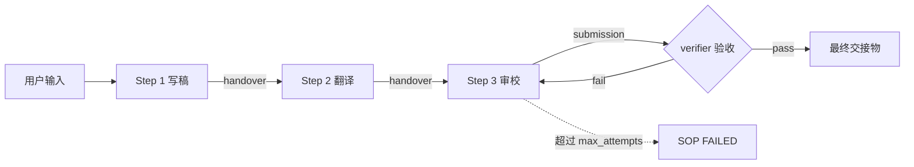

**边界**：固定顺序 = 不灵活。链路里某一步的输入在运行时才知道，或需要动态增减步骤时，改用模式 5/8。

---

## 5. Routing —— 智能分流

**要解决的问题**：不同请求该走不同流程/不同模型（客服分流、按难度选模型）。

**AgentScope 的做法**：两个正交的轴，都能直接用。

**轴 1：路由工作**——路由 Agent 用结构化输出挑专家，驱动代码把请求交给对应专家：

```python
class Route(BaseModel):
    expert: Literal["billing", "tech", "general"] = Field(description="...")

routed = await router.reply(UserMsg(name="user", content=text),
                            structured_schema=Route)
expert = Route(**routed.structured_output).expert
await render_stream(experts[expert].reply_stream(UserMsg(name="user", content=text)))
```

**轴 2：路由模型**——`ModelRouterMiddleware` 在 `on_reply` 钩子里按输入分类，**临时替换 `agent.model`**，回复结束自动还原；分类器失败或返回未知候选时保留原模型。无需任何驱动代码：

```python
from agentscope.middleware import ModelRouterMiddleware, ChatModelCandidate

agent = make_agent(
    name="Adaptive",
    system_prompt="You're a helpful assistant.",
    middlewares=[ModelRouterMiddleware(
        classifier_model=strong_model,          # 也接受 ChatModelBase
        candidates=[
            ChatModelCandidate(name="strong", model=strong_model,
                               description="复杂推理、长文写作、代码生成"),
            ChatModelCandidate(name="fast", model=fast_model,
                               description="简单问答、闲聊、格式转换"),
        ],
    )],
)
```

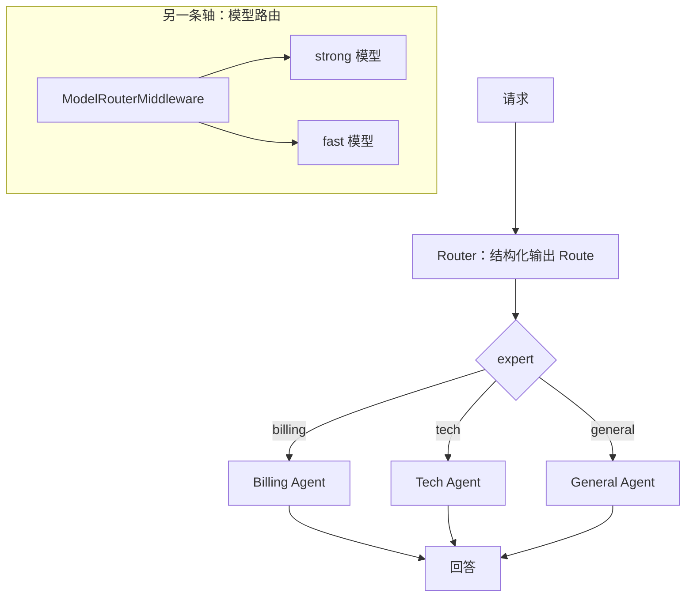

**边界**：分类器的误判会直接跑错分支。高风险场景让路由输出带 `reason` 便于审计，或加人工确认（HITL）。

---

## 6. Parallelization —— 并行分身

**要解决的问题**：批量处理、多方评审、用多次采样对抗单次抽风。

**AgentScope 的做法**：三种玩法，都是普通 asyncio。

1. **扇出 + 聚合**：多个独立 Agent 同时处理，再交给聚合者合并；
2. **多次采样投票**：同一问题跑 N 次（N 个独立实例），取多数；
3. **同一 Agent 内并发工具调用**：模型一轮吐出多个 `tool_call` 时，框架按 `is_concurrency_safe` 分桶，`True` 的并发执行（`FunctionTool` 默认 `True`）。

```python
# 1) 扇出
results = await asyncio.gather(
    *[_.reply(UserMsg(name="user", content=TEXT)) for _ in reviewers],
)
# 2) 投票
msgs = await asyncio.gather(
    *[_.reply(UserMsg(name="user", content=Q), structured_schema=Vote)
      for _ in voters],
)
winner = Counter(Vote(**_.structured_output).answer for _ in msgs).most_common(1)[0]
```

> ⚠️ **唯一硬性约束**：一个 `Agent` 实例 = 一段对话（状态里存着上下文）。**并行分支必须各自持有独立实例**，绝不能对同一个实例 `gather`。

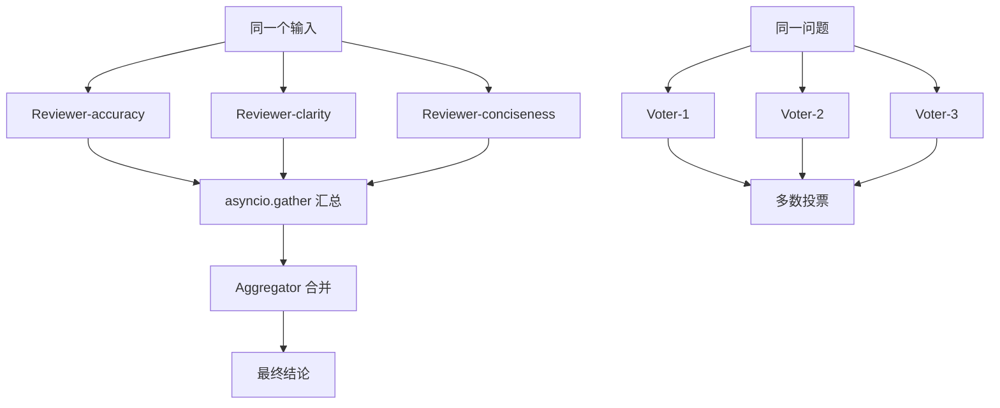

**边界**：并行放大成本与尾延迟；并发写同一文件时记得加锁或分区（工作空间共享时要特别小心）。

---

## 7. Evaluator-Optimizer —— 生成 + 评审

**要解决的问题**：需要客观判据来保证质量（翻译提质、代码必须跑通、文案达标）。

**AgentScope 的做法**：`GoalPipeline` 就是这个模式，**开箱即用**：

- **executor** 朝目标工作，结束时产出结构化「成果报告」`_ExecutionReport(report)`；
- **verifier** 拿报告与目标比对，输出 `pass` / `fail` / `impossible`；
- `fail` 时把 `message` 作为改进意见回喂 executor，最多 `max_iters` 轮；`impossible` 立即停止；
- 结构化输出解析失败会在 `max_retries` 内重试，不会静默跳过。

与模式 3 的区别：这里评审是**独立 Agent**，看不到 executor 的推理过程，只评审成果。

```python
from agentscope.pipeline import GoalPipeline

pipe = GoalPipeline(executor=executor, verifier=verifier,
                    max_iters=3, max_retries=2)
await render_stream(pipe.reply_stream(UserMsg(name="user", content=GOAL)))
```

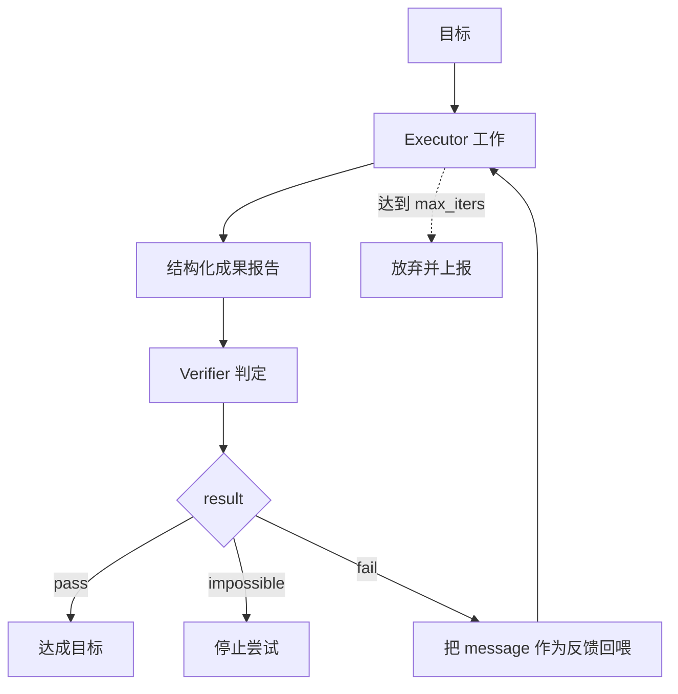

**边界**：评审者本身可能误判。给 verifier **真实工具**（读文件、跑测试）比让它凭报告想象可靠得多——示例中 executor 与 verifier 共享同一个 `LocalWorkspace` 就是这个原因。

---

## 8. Orchestrator-Workers —— 主管派活

**要解决的问题**：复杂任务，子任务取决于执行过程中发现的东西（深度研究、大型编码）。

**AgentScope 的做法**：`TeamPipeline` + `TeamMember`，**开箱即用**。

- leader 只多拿到一个外部工具 `TeamAssign(member, prompt)`，**自己决定**拆什么、派给谁；
- 每个 member 在**自己的上下文**里跑，只有最终回复作为工具结果回到 leader——leader 看不到成员的中间步骤；
- 同一轮发出的指派**并发**执行；派给同一成员的多次指派按顺序排队；
- 成员之间**不互通**，汇总永远由 leader 完成。

```python
from agentscope.pipeline import TeamPipeline, TeamMember

pipe = TeamPipeline(
    leader=leader,
    members=[
        TeamMember(agent=researcher, description="调研事实，返回带来源的要点"),
        TeamMember(agent=coder, description="写并运行 Python 代码"),
        TeamMember(agent=writer, description="把素材整理成中文文档"),
    ],
)
final = await render_stream(pipe.reply_stream(UserMsg(name="user", content=TASK)))
```

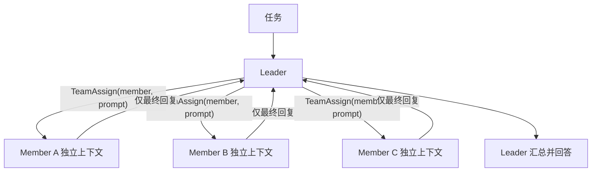

**边界**：leader 要给成员**完整任务描述**（成员看不到 leader 的对话）；成员数量过多会让 leader 每轮都难以选择——这就是模式 10 要解决的问题。

---

## 9. Handoff —— 专家交接

**要解决的问题**：请求不在当前专家的职责范围，应当**把会话交出去**（智能客服转接）。

**AgentScope 的做法**：框架**没有内置 handoff**（全仓无该概念），但它恰好是「外部工具 + 一小段驱动循环」：

1. `transfer_to` 声明为 `is_external_tool = True`：框架不执行它，而是让 Agent 挂起并发 `RequireExternalExecutionEvent`；
2. 驱动循环读出目标专家与 Agent 自己写的交接摘要；
3. 用 `UserInterruptEvent` **干净地关闭**挂起的回复（不进入推理循环，**不消耗模型调用**）；
4. 用摘要作为**新专家的第一条消息**——交接的是摘要，不是整段对话。

与模式 8 的关键区别：8 里 leader 始终掌握控制权，成员是无状态子调用；9 里控制权**真的交出去了**，前一个 Agent 从此出局。

```python
class TransferTo(ToolBase):
    name: str = "transfer_to"
    is_external_tool: bool = True          # 框架只发事件，不执行
    is_concurrency_safe: bool = False
    is_read_only: bool = False
    input_schema: dict[str, Any] = {}

    def __init__(self, experts):
        super().__init__()
        self.input_schema = {"type": "object", "properties": {
            "expert": {"type": "string", "enum": list(experts)},
            "summary": {"type": "string"}}, "required": ["expert", "summary"]}

    async def check_permissions(self, tool_input, context):
        return PermissionDecision(behavior=PermissionBehavior.ALLOW,
                                  message="Handover is always allowed.")

async for event in current.reply_stream(inputs):
    if isinstance(event, RequireExternalExecutionEvent):
        handover = next(c for c in event.tool_calls if c.name == "transfer_to")
        break                                   # Agent 已挂起，停止消费
    renderer.render(event)

parsed = json.loads(handover.input)
async for _ in current.reply_stream(            # 干净关闭挂起的回复
    UserInterruptEvent(reply_id=current.state.reply_id),
):
    pass
current = experts[parsed["expert"]]             # 控制权交出
inputs = UserMsg(name="handoff", content=f'<handover>{parsed["summary"]}</handover>')
```

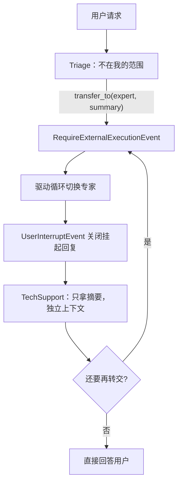

**边界**：跨交接只传摘要，丢细节；`max_hops` 必须设上限，防止 A→B→A 死循环。跨进程/跨组织转接可用 `A2AAgent` 承接远端智能体。

---

## 10. Hierarchical —— 层级团队

**要解决的问题**：复杂项目，工作先按领域切、再按任务切（一个 leader 面对 12 个成员会选不动）。

**AgentScope 的做法**：`TeamPipeline` **刻意是扁平的**——`TeamMember.agent` 要求是 `Agent` 实例，团队不能当成员。层级因此放在一层很薄的编排代码里（约 60 行）：

- director 只多一个外部工具 `assign_team(team, task)`；
- 每个**子团队**是正常的 `TeamPipeline`，有自己的 leader 和 workers，每层用自己的词汇派活；
- 子团队结果作为 `ToolResultBlock` 经 `ExternalExecutionResultEvent` 回给 director，**director 保留控制权**并自己写最终交付物。

```python
results = await asyncio.gather(*[run_team(call) for call in assignments])
inputs = ExternalExecutionResultEvent(
    reply_id=self.director.state.reply_id,
    execution_results=results,          # ToolResultBlock(id=tool_call.id, ...)
)
```

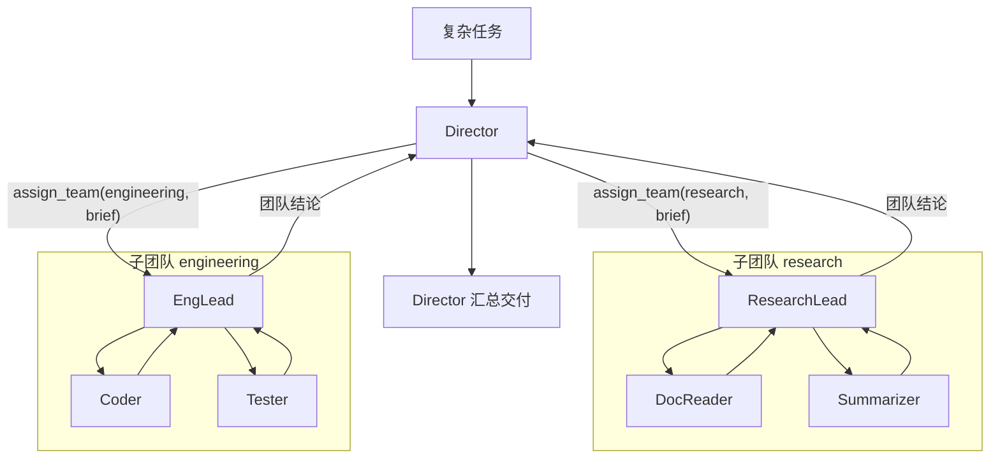

**边界**：层级越深，调试与成本越难控。建议每层 leader 只面对 2–4 个选项，并给每层设独立的迭代上限与超时。

---

## 选型对照：容易混淆的几组

| 对比 | 区别 | 怎么选 |
| --- | --- | --- |
| **Reflection** vs **Evaluator-Optimizer** | 前者自己评自己（共享上下文、成本低、易自我吹捧）；后者独立评审者（可给真实工具、判据客观） | 主观质量 → Reflection；有可验证判据（测试/事实）→ GoalPipeline |
| **Prompt Chaining** vs **Orchestrator-Workers** | 前者步骤**写代码时固定**（SOP）；后者步骤**运行时由 leader 决定** | 流程稳定可复用 → SOP；任务依赖探索 → TeamPipeline |
| **Orchestrator-Workers** vs **Handoff** | 前者 leader 始终在场、成员是无状态子调用；后者控制权一次性交出 | 需要汇总多方结果 → TeamPipeline；职责转移/升级 → Handoff |
| **Routing** vs **Orchestrator-Workers** | 前者一次请求只走一个分支；后者一次请求拆成多个分支并汇总 | 分流 → Routing；分解 → TeamPipeline |
| **Orchestrator-Workers** vs **Hierarchical** | 前者一层；后者多层，每层只面对少量选项 | 成员 ≤ 5 个 → 一层；领域多、成员多 → 分层 |

---

## 运行示例

```bash
# 安装（Python >= 3.11）
uv pip install -e .

export DASHSCOPE_API_KEY=sk-xxxxxxxx

python examples/architecture_patterns/01_react.py
python examples/architecture_patterns/02_plan_and_execute.py
# ... 直到 10_hierarchical.py
```

示例共享 `_common.py`：

| 函数 | 作用 |
| --- | --- |
| `make_model()` | 默认 DashScope `qwen3.8-max`；设了 `OPENAI_BASE_URL` 就切 OpenAI 兼容端点 |
| `make_agent(...)` | 建 Agent，权限设 `PermissionMode.BYPASS` 以便脚本免交互跑通 |
| `render_stream(...)` | 用 `ConsoleRenderer` 渲染统一事件流，返回最终消息 |

脚本里的迭代上限（`max_iters`、`max_rounds`、`max_hops`）都刻意调小以便快速跑完，生产使用请按需放大。

---

## 附：API 速查

| 需求 | 入口 |
| --- | --- |
| 定义智能体 | `from agentscope.agent import Agent, ReActConfig, ContextConfig, InjectionConfig` |
| 注册工具 | `from agentscope.tool import Toolkit, FunctionTool, ToolBase, TaskCreate, TaskUpdate, TaskList, TaskGet` |
| 内置流水线 | `from agentscope.pipeline import TeamPipeline, TeamMember, GoalPipeline` |
| 标准流程 | `from agentscope.sop import SOP, SOPStep, SOPEngine, SOPPhase` |
| 路由模型 | `from agentscope.middleware import ModelRouterMiddleware, ChatModelCandidate` |
| 分类 | `from agentscope.classifier import ChoiceQuestion, OpenAIClassifierModel` |
| 事件 | `from agentscope.event import RequireExternalExecutionEvent, ExternalExecutionResultEvent, UserConfirmResultEvent, UserInterruptEvent` |
| 消息 | `from agentscope.message import Msg, UserMsg, TextBlock, ToolResultBlock, ToolResultState` |
| 状态与权限 | `from agentscope.state import AgentState`；`from agentscope.permission import PermissionContext, PermissionMode` |
| 工作空间 | `from agentscope.workspace import LocalWorkspace`（`await workspace.list_tools()`） |
| 终端渲染 | `from agentscope.console import ConsoleRenderer, launch_console` |

> `ToolResultBlock` / `ToolResultState` 在 `agentscope.message`，**不在** `agentscope.event`；`ReplyFinishedReason` 在 `agentscope.types`。
