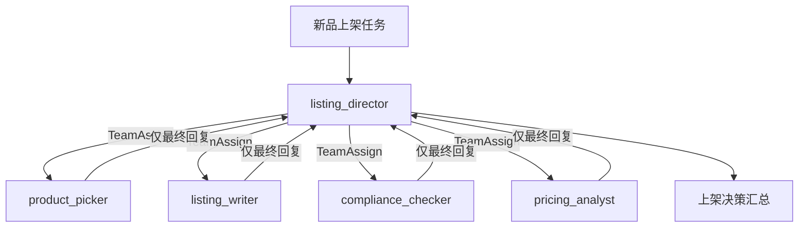
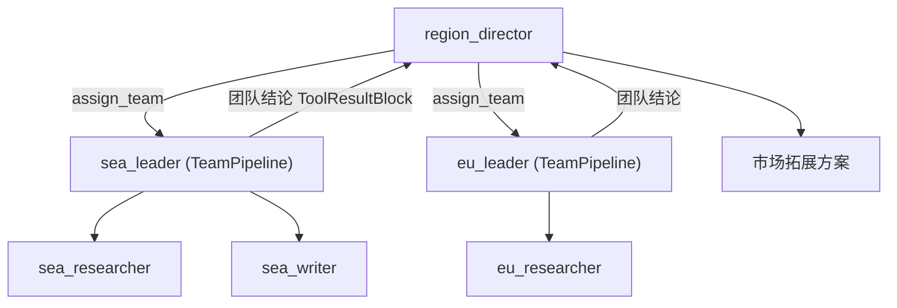
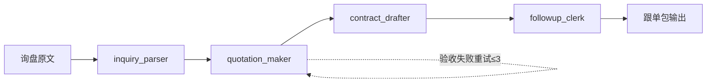
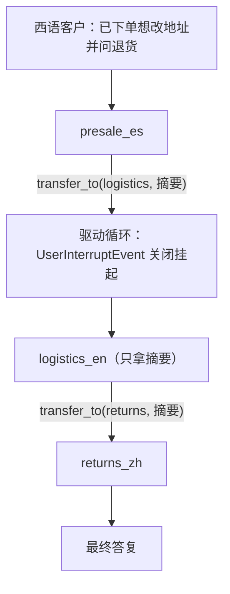
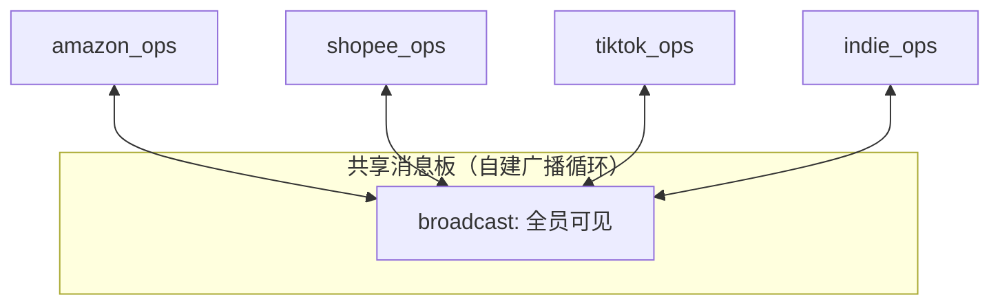
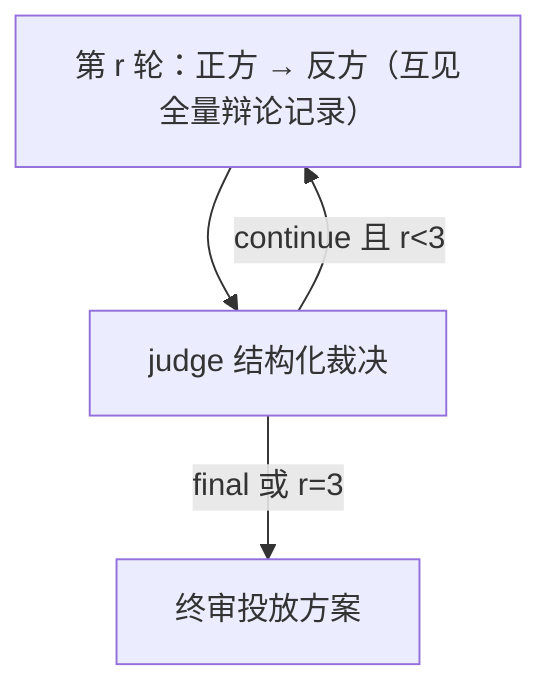
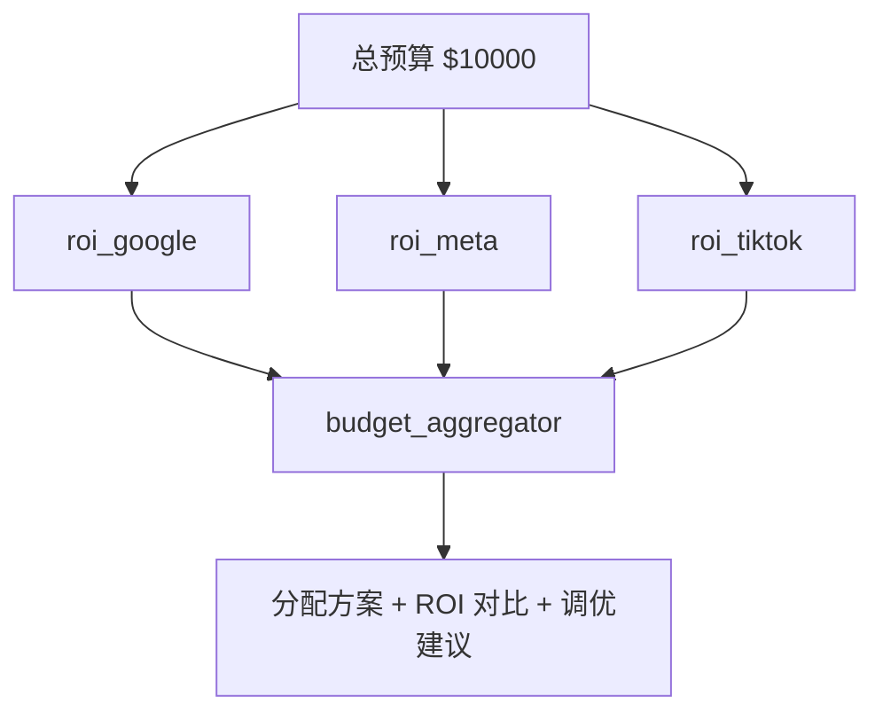
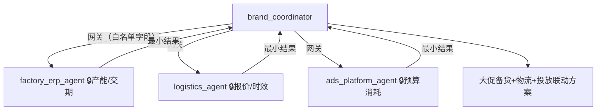

# 多智能体组织模式范例设计（AgentScope 2.0.12 × agentTeam 专家组）

> 状态：**已定稿**（2026-11-20，用户已确认全部关键决策）。
> 实施计划：`docs/superpowers/plans/2026-11-20-org-pattern-examples.md`。
> 关联文档：`docs/design/agent-architecture-patterns-zh.md`（10 种架构范式，基于 2.0.12dev 整理）。

## 0. 已确认决策（用户拍板，实施不得偏离）

| # | 决策 | 取值 |
|---|---|---|
| D1 | 版本 | venv 升级到 **agentscope==2.0.12**，对齐 requirements.txt；升级后回归语音链路与纠正服务 |
| D2 | 挂载深度 | **方案 A 双轨制**：独立可运行脚本权威演示模式语义 + API 幂等种子挂专家组；**零主链路改动**（orchestrator 仅修 D6 漂移）。方案 B（mode 策略分派）留待后续另行立项 |
| D3 | 分类与命名 | 新建 category「跨境电商」（字典 `agent_team_category` 加条目，无代码改动）；团队 `team_code` 前缀 **`xborder-*`** |
| D4 | 示例数据 | **全 mock 离线优先**；真实 MCP/技能不在本期范围 |
| D5 | DB | **不做 alembic 迁移**，种子走 HTTP API（仿 `scripts/seed_domain_content.py`） |
| D6 | 事件漂移 | 修正 orchestrator 的 `TEAM_COMPLETE` 非 canonical 事件（见 §1.4） |
| D7 | 待验证项 | 实施第一步做**最小 spike** 验证（见 §5），不改业务代码 |

## 1. 事实核实结论（全部本地实测 / 仓库代码 / 官方 release）

### 1.1 版本事实

- `backend/requirements.txt` L110 已锁 `agentscope==2.0.12`（行尾注释"固定 2.0.11"为过期注释，随升级一并修正）；`requirements-dev.txt` 为 `>=2.0.12,<3.0`。
- 本地 venv 实测安装 **2.0.11**，与锁定文件不一致；`pip install agentscope==2.0.12` 对齐。
- 2.0.12 于 2026-11-16 发布（PyPI latest，实测）。2.0.11→2.0.12 约 160 条变更，**无破坏性 API 变更**，与本工程相关：
  1. `fix(pipeline)` 成员模型失败时清理 leader 挂起的 TeamAssign（#3581）——利好 Supervisor 范例；
  2. `fix(pipeline)` GoalPipeline 重试预算限定到单次生成（#3463）；
  3. **thinking_enable 三态化**（DashScope #3192 / DeepSeek #3398 等）：未显式配置不再强制下发 disabled。纠正服务（`asr_correct.py`）按既有约定**显式双 dialect 传参**（`reasoning_effort="none"` + `chat_template_kwargs.enable_thinking=false`），不依赖框架默认值，可保留；回归时若见 400，优先检查框架层与业务层是否重复发送，做去重而非删业务方言；
  4. realtime/TTS 多处修复——语音链路需回归（含既有 workaround：qwen-audio realtime 显式传 `model_card`，升级后复验）；
  5. `feat(formatter)` OpenAI 消息 name 须符合 API 命名 pattern（#3548）——**中文 agent name 是否被改写列入 spike 验证**（§5）。
- **范例不必须 2.0.12**：所需全部 API 已在 2.0.11 实测导入成功；升级是为消除环境漂移。

### 1.2 API 事实 —— 对网络资料表的纠正

实测方法：`dir()` 遍历 `agentscope.pipeline / sop / message / agent / app.*` + 全包正则扫描
`MsgHub|GroupChat|Debate|Handoff|AgentTeam`（**零命中**）+ `inspect.signature` 验证构造签名。

| 网络资料说法 | 实测结论 | 正确路径 / 替代实现 |
|---|---|---|
| Supervisor-Worker「Leader 动态创建 Worker」 | **部分正确**：成员构造期固定，Leader 经外部工具 `TeamAssign` 动态**派活**，无动态 spawn API | `from agentscope.pipeline import TeamPipeline, TeamMember`；实测 `TeamPipeline(leader, members, reset_members=True)`；同轮指派并发、成员独立上下文、仅最终回复回 leader |
| 层级式「AgentTeams Manager/Team Leader/Worker」 | **错误**：无此类；`TeamMember.agent` 必须是 `Agent`，团队不能当成员，TeamPipeline 刻意扁平 | 薄编排层自建：director + 外部工具 `assign_team` + 多个子 TeamPipeline + `ExternalExecutionResultEvent` 回填 |
| 流水线「Pipeline/Sequential」 | **路径错误**：无 `SequentialPipeline` | `from agentscope.sop import SOP, SOPStep, SOPEngine`；实测 `SOPStep(subject, description, executor, verifier=None, max_attempts=3)` |
| 交接式「支持 Handoffs」 | **错误**：无内置 handoff | 自建：`transfer_to`（`is_external_tool=True`）→ `RequireExternalExecutionEvent` → 驱动循环切专家 → `UserInterruptEvent` 关闭挂起回复 → 摘要作新专家首条消息 |
| 对等网状「MsgHub、A2A、Channel」 | **大部分错误**：`MsgHub` 为 1.x 概念，2.0.x 不存在；`agentscope.app.hub` 是 Skill/MCP 市场；`agentscope.app.channel` 是 IM 渠道（DingTalk/Discord/Feishu） | A2A 真实存在：`from agentscope.agent import A2AAgent`；对等广播自建（共享消息板 + asyncio 轮转）；`agentscope.app.message_bus` 有 InMemory/Redis 实现，但本期不引中间件，用纯 asyncio |
| 辩论/群聊「Group Chat、Debate」 | **错误**：无此类 | 自建轮次广播循环 + 裁判 `reply(structured_schema=...)` 收敛；可选 `GoalPipeline(executor, verifier, verifier_reset_context=True, max_iters=10, max_retries=3)` |
| 并行聚合「并发子任务」 | **半正确**：pipeline 模块仅 `GoalPipeline/PipelineProtocol/TeamMember/TeamPipeline`，无专用 Fanout 类 | `asyncio.gather` 扇出 + 聚合 Agent（最小自建）；或 TeamPipeline 同轮指派（原生并发） |
| 联邦式「间接支持」 | **基本正确** | `A2AAgent` + `agentscope.mcp`（原生）；数据边界/权限白名单靠工程自建 |

其他实测存在的构件：`Agent / ReActConfig / ContextConfig / InjectionConfig`（`agentscope.agent`）、
`Toolkit / FunctionTool / ToolBase`（`agentscope.tool`）、`PermissionMode`（`agentscope.permission`）、
`ConsoleRenderer`（`agentscope.console`）、`RequireExternalExecutionEvent / ExternalExecutionResultEvent / UserInterruptEvent`（`agentscope.event`）、
`UserMsg / ToolResultBlock`（`agentscope.message`）。

> 注意区分：本工程自有 `app/ai/sop/`（SOPAgent/SOPEngine/SOPDefinition，自研实现，服务于 SOP 路由与模板）。
> 本范例**刻意使用原生 `agentscope.sop`** 以演示框架能力，不触碰、不复用 `app/ai/sop`。
> 既有文档引用的 `examples/architecture_patterns/`（01–10）在本仓库不存在，本次范例补齐该空缺。

### 1.3 工程事实（agentTeam 专家组）

- 模型：`app/models/agent/agent_team.py` 三表 `agent_team / agent_team_member / agent_team_edge`；
  成员「引用 `agent_config.id` + override 覆盖」；`mode ∈ {sequential, parallel, msghub, supervisor, dag}`
  仅记录来源模板 + 前端展示；`execution_mode` 唯一生效值 `llm_orchestrated`（`static_dag` 废弃仅回放）。
- 编排：`app/ai/team/orchestrator.py` `AgentScopeOrchestrator` = Leader + 每成员一个 `ask_xxx`
  FunctionTool 分发（Supervisor-Worker 自建版），**运行时不读 mode**。
  ⇒ 方案 A 下 8 个团队在 UI 里跑的都是统一 Leader 派活语义；模式差异由独立脚本、团队描述与文档呈现。
- 路由：`app/routers/agent/agent_team.py` `POST /api/v1/ai-team/{team_id}/run`（同步）+
  `POST /{team_id}/chat`（SSE）；运行快照 `agent_team_run.team_snapshot`。
- 事件：`app/schemas/agent/event_types.py` canonical `ExecutionEventType` **已含全部所需团队事件**：
  `team_start/done/error`、`team_layer_start/done`、`team_round_start/done`、
  `node_start/done/failed/skipped`、`handoff`、`dispatch_plan`、`plan_revised`、`intervention`。
  **8 个范例零新增枚举**。分级分发 `EventLevel.LOG/DB/STREAM/UI` + `DEFAULT_ROUTES`。
- 种子先例：`scripts/seed_domain_content.py` 以 API 幂等方式挂 3 个示例团队（金融/科研/营销），无需迁移。
- 前端：`/admin/agent-team` → `TeamList.vue`（列表/分类）→ `TeamEditor.vue`（画布）→
  `TeamConversation.vue`（SSE 事件标签已支持 `team_start/done/dispatch_plan/team_layer_*` 等、拓扑节点状态、@提及干预）→ `TeamReplay.vue`。
  `category` 为自由字符串（字典 `agent_team_category`），新增「跨境电商」无需改代码。

### 1.4 既有事件漂移（D6 修正对象）

`orchestrator._record_execution_done` 写 `event_type="TEAM_COMPLETE"`：非 canonical、
`normalize_event_type` 不识别、与端点层 `RunCollector.emit_team_done`（`team_done`）语义重复。
**修正决策**：删除 `_record_execution_done` 及其调用，`team_done` 唯一来源为 `RunCollector`
（端点层已在 `submit` 成功后调用 `emit_team_done`，失败路径有 `emit_team_error`）。
前端 `TeamConversation.vue` 已对最终结论去重，此修正不产生前端行为变化。

## 2. 8 模式统一对照总表

| # | 模式 | 原生程度 | 业务场景 | 核心 API | 挂载 mode | 主要风险 |
|---|---|---|---|---|---|---|
| 1 | Supervisor-Worker | ★★★ 原生 | 跨境新品上架统筹 | `TeamPipeline/TeamMember` | `supervisor` | leader 派活描述不全 |
| 2 | 层级式 | ★☆ 薄编排层 | 海外市场拓展 | 多 TeamPipeline + `assign_team` + `ExternalExecutionResultEvent` | `supervisor` | 越权/成本失控 |
| 3 | 流水线 | ★★★ 原生 | 询盘→报价→合同→跟单 | `SOP/SOPStep/SOPEngine` | `sequential` | 验收者误判 |
| 4 | 交接式 | ☆ 全自建 | 跨语种客服交接 | 外部工具 + `RequireExternalExecutionEvent` + `UserInterruptEvent` | `sequential` | 死循环/摘要泄漏 |
| 5 | 对等网状 | ☆ 自建广播 | 多平台运营互通 | 共享消息板 + asyncio；`A2AAgent` 可选 | `msghub` | 广播风暴 |
| 6 | 辩论/群聊 | ☆ 自建轮次 | 广告创意评审 | 广播循环 + 裁判 `structured_schema` | `msghub` | 不收敛 |
| 7 | 并行聚合 | ★★ 半原生 | 多渠道预算测算 | `asyncio.gather` + 聚合 Agent | `parallel` | 伪并发 |
| 8 | 联邦式 | ★★ A2A/MCP 原生+工程边界 | 跨组织供应链协同 | `A2AAgent` + `agentscope.mcp` + mock 网关 | `dag` | 数据边界靠工程 |

mode 取值全部落在现有 `TeamMode.ALL`，**不新增枚举**；层级/交接/联邦无专属 mode 值，
用现有值 + `description`/`role_desc` 表达语义。

## 3. 共享脚手架与每模式设计

### 3.0 共享脚手架 `backend/examples/org_patterns/_common.py`（一处复用）

- `make_model(script=None)`：`script` 非 None → `FakeChatModel(script)`（离线确定性）；
  否则优先 `OPENAI_BASE_URL`+`OPENAI_API_KEY`（OpenAI 兼容端点），其次 `DASHSCOPE_API_KEY`；
  两者皆无 → 抛带中文提示的 `RuntimeError`（提示设置环境变量或加 `--mock`）。
- `FakeChatModel`：按 spike 验证的模型基类实现，脚本化响应队列，耗尽时抛清晰错误（不静默）。
- `make_agent(name, system_prompt, tools=None, max_iters=8, model=None)`：统一
  `PermissionMode.BYPASS` 免交互；name 用 ASCII（spike 若证实中文 name 被 formatter 改写，
  则中文角色名放 `role_desc`/prompt，见 §5）。
- `render_stream(stream)`：`ConsoleRenderer` 渲染统一事件流，返回最终 `Msg`。
- `Trace`：轻量记录器（`record(kind, **kw)` 追加 dict），各范例把编排语义关键节点
  （派活/交接/发言/并发时间戳/网关拒绝）写入 trace，供离线断言。
- mock 工具（`FunctionTool`，确定性数据）：`mock_market_scan / mock_fx_rate /
  mock_compliance_check / mock_cost_table / mock_channel_roi / mock_platform_stock /
  mock_platform_price / erp_gateway / logistics_gateway / ads_gateway`。
- `run_cli(main_coro)`：argparse `--mock` 开关 + `asyncio.run` 入口包装。
- 范例**不 import `app.*`**（独立可运行）；种子脚本只走 HTTP API。

### 3.1 Supervisor-Worker —— 跨境新品上架统筹（01）

- **边界**：Leader 始终掌权，运行时决定拆什么派给谁并汇总。适用探索性拆分；不适用固定步骤（→流水线）或控制权移交（→交接）。与层级式区别：单层，Leader 直面 ≤5 成员。
- **角色**：`listing_director`（leader，GO/NO-GO 决策）、`product_picker`（选品，mock_market_scan）、`listing_writer`（多语种 Listing）、`compliance_checker`（合规，mock_compliance_check）、`pricing_analyst`（定价，mock_fx_rate）。
- **拓扑**：



成员独立上下文互不通信；同轮指派并发；终止：leader `max_iters=12`。
- **API**：`TeamPipeline/TeamMember/Agent/ReActConfig/FunctionTool` 全原生。
- **挂载**：`xborder-supervisor-listing`，`mode=supervisor`，category「跨境电商」，
  种子建 4 个 worker 的 agent_config（leader 由运行时自动生成，与现有 orchestrator 一致）。
  示例输入："评估『便携咖啡机』上架日本亚马逊，给出 GO/NO-GO 与售价"。
  事件对齐：`team_start → dispatch_plan → node_start/done×4 → team_done`（UI 统一编排下）。
- **验收**：`--mock` 离线跑通；trace 断言 4 成员均被派活、最终含 GO/NO-GO；
  单成员失败 leader 收到错误占位不中断。

### 3.2 层级式 —— 海外市场拓展（02）

- **边界**：总监只面对渠道 Leader，Leader 再派 Worker，每层自己的词汇；总监不得直派 Worker（越权即验收失败）。适用成员多、领域切分清晰；成员 ≤5 用单层 Supervisor。
- **角色**：`region_director` → `sea_leader`/`eu_leader`（各为子 TeamPipeline 的 leader）→ `sea_researcher`/`sea_writer`/`eu_researcher`。
- **拓扑**：



子团队结果经 `ExternalExecutionResultEvent` 回填；每层独立上限（总监 6 / Leader 8 / Worker 6）+ 整轮 `asyncio.wait_for` 超时。
- **API**：子团队 `TeamPipeline` 原生；`assign_team` 外部工具 + 事件原生，**驱动循环自建**（范式见关联文档 §10）。
- **挂载**：`xborder-hierarchy-expansion`，`mode=supervisor`，6 角色平铺为成员（表结构无层级字段），层级写进 `role_desc` 与 description；真实层级语义由脚本保证（方案 A 固有权衡）。
- **验收**：trace 断言调用图严格两层（总监 trace 不出现 worker 名）；子团队超时总监收到错误结果并可继续另一团队。

### 3.3 流水线 —— 外贸询盘→报价→合同→跟单（03）

- **边界**：步骤写代码时固定，逐步接力，每步可带验收者。适用 SOP 明确的业务流程；不适用运行时探索拆分。
- **角色**：`inquiry_parser` → `quotation_maker`（mock_fx_rate + mock_cost_table）→ `contract_drafter` → `followup_clerk`；报价步带 `verifier`（核对汇率与算式）。
- **拓扑**：



`SOPStep.max_attempts=3` 防单步死循环；SOPEngine 顺序执行天然终止。
- **API**：`SOP/SOPStep/SOPEngine` 全原生（`agentscope.sop`，**非** `app/ai/sop`）。
- **挂载**：`xborder-pipeline-inquiry`，`mode=sequential`，链式 edges（与 seed_domain_content 写法一致）。示例输入：一封英文询盘邮件。事件：`node_start/done` 逐节点、重试耗尽 `node_failed`。
- **验收**：trace 断言执行序严格 1→2→3→4；注入错误汇率验证 verifier 触发重试且 ≤3 次。

### 3.4 交接式 —— 跨语种客服专家交接（04）

- **边界**：控制权一次性交出，前一专家出局，只传交接摘要不传全量对话。适用职责转移/升级；与 Supervisor 区别：无常驻汇总者。
- **角色**：`presale_es`（西语售前）→ `logistics_en`（英语物流）→ `returns_zh`（中文退换货）；各挂 `transfer_to(expert, summary)` 外部工具；prompt 约束摘要含订单号/诉求/已承诺事项，禁复述整段对话。
- **拓扑**：



`max_hops=3` 防 A→B→A；每次交接发 canonical `handoff` 事件语义（trace 记录 from/to/summary）。
- **API**：`ToolBase(is_external_tool=True)` / `RequireExternalExecutionEvent` / `UserInterruptEvent` 原生构件；**切换驱动循环自建**（范式见关联文档 §9）。
- **挂载**：`xborder-handoff-support`，`mode=sequential`，description 注明交接语义由脚本演示。示例输入：西语投诉消息。
- **验收**：断言①后一专家首条消息 = `<handover>摘要</handover>` 且不含前专家完整对话；②交接 ≤ max_hops；③挂起回复干净关闭（无额外模型调用）。

### 3.5 对等网状 —— 多平台运营互通（05）

- **边界**：无中心节点，成员互见发言并按需响应，目标是状态一致而非裁决。与辩论区别：无裁判、无终局裁决。
- **角色**：`amazon_ops / shopee_ops / tiktok_ops / indie_ops`，各持 `mock_platform_stock / mock_platform_price`；prompt 约束：读到相关库存/价格变动必须回应，每轮最多 1 条。
- **拓扑**：



轮转发言（每轮每人一次，消息板增量喂给该 Agent）；连续一轮无新实质消息或 `max_rounds=4` 终止；总发言预算 16 条。
- **API**：广播循环全自建（纯 asyncio + 共享 list）；跨进程变体可选 `A2AAgent`（原生，进阶标注）。**不用 MsgHub（不存在）、不用 app.channel（IM 渠道）**。
- **挂载**：`xborder-mesh-multiplatform`，`mode=msghub`。示例输入："TikTok 闪购降价 15%，各平台同步应对"。事件：`team_round_start/done` + `node_start/done`。
- **验收**：断言①每条发言全员可见；②无中心汇总者；③预算内终止；④最终价格策略一致或显式记录分歧。

### 3.6 辩论/群聊 —— 广告创意与投放策略评审（06）

- **边界**：多方广播 + 裁判结构化裁决收敛。与对等网状区别：有裁判、有终局、目标是结论。
- **角色**：`pro_creative`（激进创意+高预算）、`con_creative`（保守合规+小步测试）、`judge`（每轮末输出 `{verdict: continue|final, reason, final_plan?}`）。
- **拓扑**：



`max_rounds=3` 硬终局：第 3 轮裁判必须 final（prompt 约束 + 代码兜底）。
- **API**：轮次循环自建；裁判 `Agent.reply(structured_schema=Verdict)` 原生结构化输出；可选 `GoalPipeline` 变体。
- **挂载**：`xborder-debate-adreview`，`mode=msghub`。示例输入："黑五网一：$5000 预算押注 TikTok 激进投放 vs Google 稳健投放"。事件：`team_round_start/done`×r + `agent_start/done` + `team_done`。
- **验收**：断言①≤3 轮必出 final；②裁决 JSON 可解析含最终方案；③正反方均看到对方上一轮观点。

### 3.7 并行聚合 —— 多渠道投流预算测算（07）

- **边界**：无依赖扇出真并发 + 聚合。与 Supervisor 区别：拆分代码写死；与流水线区别：无先后依赖。
- **角色**：`roi_google / roi_meta / roi_tiktok`（`mock_channel_roi(channel, budget)`，内部 `asyncio.sleep(1)` 模拟耗时并打时间戳）→ `budget_aggregator`。
- **拓扑**：



`asyncio.gather` + 每路 `asyncio.wait_for(timeout=60)`；单路失败→占位结果继续聚合（对齐 `NodeErrorPolicy.CONTINUE`）。
- **API**：扇出/聚合最小自建（asyncio.gather）；对照变体 TeamPipeline 同轮并发（原生）。
- **挂载**：`xborder-parallel-budget`，`mode=parallel`，edges 扇出+汇聚。示例输入："黑五 $10000 预算，三渠道 ROI 测算与分配"。事件：3 个 `node_start` 时间戳重叠 + 各自 `node_done`。
- **验收**：**时间戳证明并发**——3 路 start 间隔 <0.2s、mock sleep 1s 时总耗时 <1.5s（而非 ≥3s）；单路注入异常验证 continue。

### 3.8 联邦式 —— 跨组织供应链协同（08）

- **边界**：各组织 Agent 数据主权独立，只交换最小必要结果，跨边界走受控网关。与层级式区别：子团队不同信任域；框架管通信、工程管边界。
- **角色**：`brand_coordinator` + `factory_erp_agent`（只暴露产能/交期）+ `logistics_agent`（只暴露报价/时效）+ `ads_platform_agent`（只暴露预算消耗）；每域一个白名单网关 mock 工具（`erp_gateway / logistics_gateway / ads_gateway`），越界字段请求直接拒绝。
- **拓扑**：



- **API**：`agentscope.mcp` / `A2AAgent` 原生（真实 MCP 变体标注"进阶可选"，本期全 mock）；**白名单边界 = 工程自建**。
- **挂载**：`xborder-federated-supplychain`，`mode=dag`（协调者扇出 3 域节点）。示例输入："圣诞季：确认工厂产能、锁物流舱位、联动广告预算"。事件：`tool_call/tool_result`（网关）+ `node_*`。
- **验收**：断言①越界字段被网关拒绝（如向物流域要工厂成本价）；②协调者上下文只含白名单字段。

## 4. 文件清单与改动范围（方案 A 全量）

```
新增：
backend/examples/org_patterns/
├── _common.py                 # 共享脚手架
├── README.md                  # 运行说明、环境变量、8 模式索引
├── 01_supervisor_worker.py
├── 02_hierarchy_expansion.py
├── 03_pipeline_inquiry.py
├── 04_handoff_support.py
├── 05_mesh_multiplatform.py
├── 06_debate_adreview.py
├── 07_parallel_budget.py
└── 08_federated_supplychain.py
backend/scripts/seed_org_pattern_teams.py   # 幂等 API 种子（8 团队 + 成员 agent_config）
backend/tests/org_patterns/                 # 离线语义断言测试（pytest，不依赖网络/DB）
docs/design/org-pattern-examples-zh.md      # 本文档
docs/superpowers/plans/2026-11-20-org-pattern-examples.md

修改（仅 2 处，均非主链路逻辑重写）：
backend/app/ai/team/orchestrator.py         # D6：删除 _record_execution_done 及调用
backend/requirements.txt                    # L110 过期注释修正
```

不做：alembic 迁移、新事件枚举、新消息中间件、orchestrator mode 策略（方案 B 另行立项）、前端代码改动。

## 5. Spike 待验证项（实施第一步，D7）

| # | 待验证 | 确认方式 | 影响的决策 |
|---|---|---|---|
| S1 | FakeChatModel 应继承的模型基类与 `__call__`/响应类型签名 | 读 `agentscope.model` 基类源码 + 最小构造实测 | `_common.FakeChatModel` 实现 |
| S2 | `SOPEngine` 的运行入口（`run`/`reply`/`__call__`）与返回类型 | `inspect.signature` + 最小 SOP 实测 | 03 范例写法 |
| S3 | 2.0.12 formatter 对中文 agent name 的处理（#3548） | 构造中文 name Agent 走 OpenAI formatter 实测 | name 用 ASCII + 中文入 prompt 的兜底是否必须 |

Spike 结论回填本文档附录 A；S3 若证实中文 name 被改写，全部范例 name 用 ASCII（本设计已按此兜底命名）。

## 6. 分批落地顺序

1. **Phase 0**：升级 2.0.12 + 回归（`pytest tests/duplex tests/voice_demo tests/agent tests/ai`）+ D6 漂移修正。
2. **Phase 1（打样 3 个，覆盖三类实现路径）**：spike → `_common.py` → 01 Supervisor（原生 TeamPipeline）→ 03 流水线（原生 SOP）→ 04 交接（全自建驱动循环）→ 种子脚本（8 团队配置一次性定义，幂等）。
3. **Phase 2（由易到难扩展）**：07 并行 → 06 辩论 → 05 网状 → 02 层级 → 08 联邦 → README + 全量离线验证。

## 7. 验收总则

- 每个范例 `python backend/examples/org_patterns/0N_xxx.py --mock` 离线非交互跑通；
  无 API key 且未加 `--mock` 时给出清晰中文报错（不 hang）。
- 编排语义由 `backend/tests/org_patterns/` 的 trace 断言保证（各模式验收见 §3）。
- 失败/超时/中断：所有驱动循环有硬上限（max_iters/max_hops/max_rounds/发言预算/`asyncio.wait_for`）；
  单成员失败按 continue 策略占位继续（联邦网关拒绝除外，那是预期行为）。
- 种子脚本 `--dry-run` 可预览；重跑幂等（按 team_code/agent_code 查重）；缺成员跳过该团队不产生半成品。
- 事件只写 canonical `ExecutionEventType`；范例脚本内以 trace 表达同语义，阶段二桥接时经
  `EventEnvelope` + `normalize_event_type`/`DEFAULT_ROUTES`（参照 `app/ai/skills/execution.py` 的 SkillEventHandler 模式）。

## 附录 A：Spike 结论（agentscope 2.0.12 实测回填，2026-11-20）

- **S1：模型基类与响应类型**
  - 基类 `agentscope.model.ChatModelBase`（无抽象方法约束）；子类覆写 `async _call_api(self, model_name: str, messages: list[Msg], tools: list[dict] | None = None, tool_choice=None, **kwargs) -> ChatResponse | AsyncGenerator[ChatResponse, None]` 即可，`__call__` 由基类包装（含重试）。
  - `__call__(messages: list[Msg], tools=None, tool_choice=None, **kwargs)`；`stream=False` 时直接返回 `ChatResponse`。
  - 最小构造（实测通过）：`super().__init__(credential=OpenAICredential(api_key="sk-fake"), model=name, parameters=ChatModelBase.Parameters(), stream=False)`；2.0.12 构造改用 credential + parameters（不再是 api_key 直传）。
  - `ChatResponse(content=[TextBlock | ToolCallBlock | ThinkingBlock | DataBlock], is_last: bool, ...)`；**block 是 pydantic 模型，属性访问**（`block.text` / `block.name` / `block.input`），不可下标。
  - `ToolCallBlock` 必填 `id/name/input`（input 为 JSON **字符串**），`state` 默认 `pending`；`ToolCallState` 从 `agentscope.message` 导出（PENDING/ASKING/ALLOWED/SUBMITTED/FINISHED）。
  - 脚本耗尽的 RuntimeError 经 `__call__` 原样上抛（实测）。
- **S2：SOPEngine 运行入口**
  - `agentscope.sop` 导出：`SOP / SOPEngine / SOPStep / SOPStepBase / SOPPhase / SOPRunState / VerificationResult`。
  - **无 `run` 方法**；入口为 `SOPEngine(sop: SOP, state: SOPRunState | None = None).reply_stream(inputs: Msg | list[Msg] | UserConfirmResultEvent | UserInterruptEvent | ExternalExecutionResultEvent | None = None)`，返回事件异步生成器（ReplyStart/End、ToolCall*、TextBlock*、RequireExternalExecution 等，末尾产出 `Msg`）；另有 `phase` 只读属性。
  - `SOP(name: str, steps: list[SOPStepBase], description: str = "")`；`SOPStep(subject: str, description: str, executor: AgentLike, verifier: AgentLike | None = None, max_attempts: int = 3)`。
- **S3：中文 name 与 formatter**
  - 实测：`OpenAIChatFormatter` 对 `Msg(name="测试专家")` **原样透传 name 字段**；`OpenAIMultiAgentFormatter` 将名字嵌入 `<history>` 文本，均不改写、不报错。
  - 但 OpenAI 服务端对 messages[].name 有 `^[a-zA-Z0-9_-]+$` 模式限制，真实 API 可能 400；**维持兜底决策：范例 name 一律 ASCII，中文角色名入 system_prompt/role_desc**。
