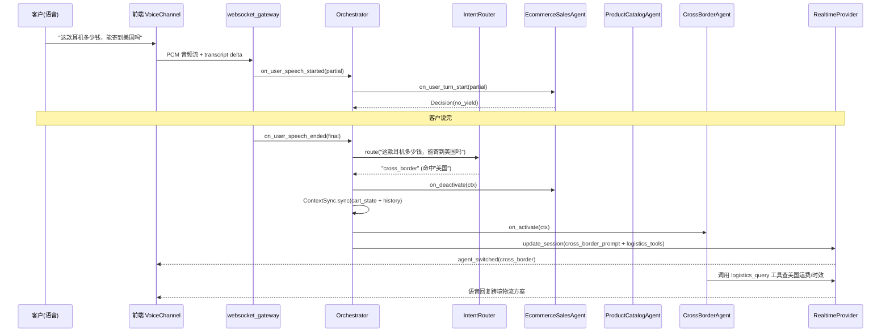
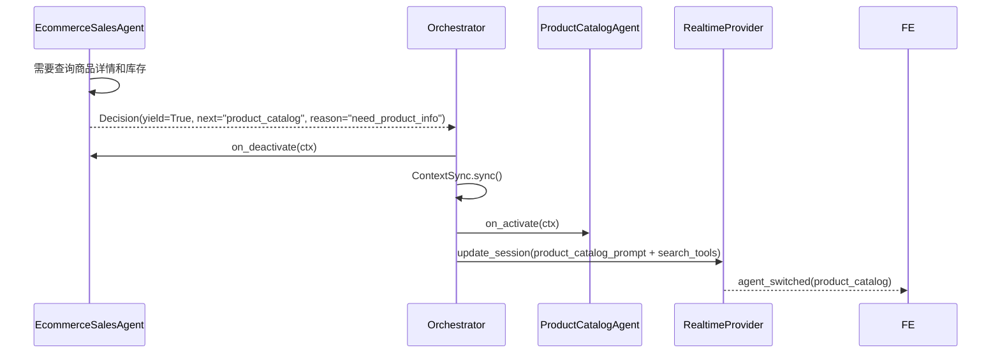
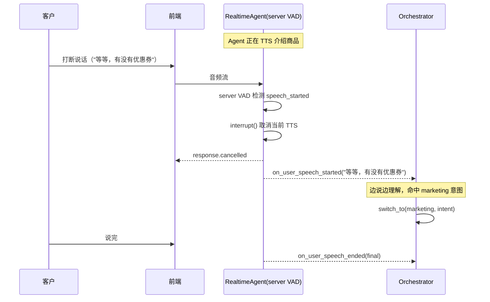
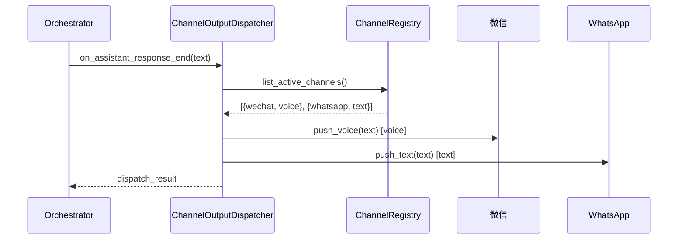

# 可插拔式全双工语音交互架构设计 — 电商与跨境贸易场景

> **版本**: v1.4  
> **日期**: 2026-11-11  
> **状态**: 待评审  
> **基线**: MinWorkBuddy 现有 AgentScope RealtimeAgent 链路 + qwen-audio-agent 参考实现  
> **主题**: 电商市场推广 · 跨境贸易 · 市场销售服务 · 销售纠纷解决 · 多渠道输出

---

## 1. 设计目标与范围

### 1.1 目标

在 MinWorkBuddy 现有语音链路（AgentScope RealtimeAgent）基础上，构建一套**可插拔、多 Agent 编排、真正全双工**的语音交互系统，面向**电商市场推广、跨境贸易、市场销售服务**场景，在以下维度全面超越 `qwen-audio-agent`：

| 维度 | qwen-audio-agent | 本架构目标 |
|------|-----------------|-----------|
| Agent 架构 | 单 LLM，固定链路 | 多 Agent 编排 + 运行时热切换 |
| 商品/知识库 | 无内置 | 原生 RAG + 商品知识库检索 Agent |
| 跨境能力 | 无 | 跨境物流/关税/清关/海外仓专业 Agent |
| 营销推广 | 无 | 促销活动/优惠券/会员体系推广 Agent |
| 纠纷处理 | 无 | AI 自动投诉处理 Agent（分类/方案/补偿/升级人工） |
| 工具调用 | 通用 tool call | 已有工具框架 + 用户确认 + 状态传递 |
| 全双工 | server VAD + interrupt | 双 VAD（客户端预判 + 服务端确认）+ 边说边理解 |
| 可扩展性 | 后端可替换 | Agent 插件化，零代码热插拔 |
| 前端 | 无 | 完整语音通道 UI + Agent 切换可视化 |

### 1.2 范围

- **后端**: `backend/app/duplex/voice/` 目录下新增编排层
- **前端**: 复用 `useVoiceChannel.ts`，新增 Agent 状态可视化
- **复用**: 知识库检索、Agent 调度、工具调用、RTC 组件

---

## 2. 整体架构

```
┌─────────────────────────────────────────────────────────────────────────┐
│                         浏览器 (VoiceChannel)                              │
│   麦克风 → DSP(去直流/噪声门/重采样) → WS ──┐                              │
│   WS → 音频播放 + 转写 + Agent状态可视化  ←─┘                              │
└──────────────────────────────────┬──────────────────────────────────────┘
                                   │ WebSocket (PCM16 + JSON 事件)
┌──────────────────────────────────▼──────────────────────────────────────┐
│                     websocket_gateway.py (现有)                            │
│         能力协商 → Provider 选择 → 事件归一化与下行推送                     │
└──────────────────────────────────┬──────────────────────────────────────┘
                                   │
┌──────────────────────────────────▼──────────────────────────────────────┐
│              ┌──────────────────────────────────────┐                     │
│              │   VoiceAgentOrchestrator (新增)       │                     │
│              │  ┌────────────┐  ┌────────────────┐ │                     │
│              │  │IntentRouter│  │ ContextSync    │ │                     │
│              │  │(意图分类器) │  │(上下文同步器)   │ │                     │
│              │  └─────┬──────┘  └────────┬───────┘ │                     │
│              │        │                  │         │                     │
│              │  ┌─────▼──────────────────▼───────┐ │                     │
│              │  │     PluginRegistry             │ │                     │
│              │  │  ┌──────────────┐ ┌──────────┐ │ │                     │
│              │  │  │EcommerceSales│ │Product   │ │ │                     │
│              │  │  │Agent         │ │Catalog   │ │ │                     │
│              │  │  └──────────────┘ └──────────┘ │ │                     │
│              │  │  ┌──────────────┐ ┌──────────┐ │ │                     │
│              │  │  │CrossBorder   │ │Marketing │ │ │  ← 可插拔           │
│              │  │  │Agent         │ │Agent     │ │ │                     │
│              │  │  └──────────────┘ └──────────┘ │ │                     │
│              │  │  ┌──────────────┐                │ │                     │
│              │  │  │Dispute       │                │ │                     │
│              │  │  │Resolution    │                │ │                     │
│              │  │  │Agent         │                │ │                     │
│              │  │  └──────────────┘                │ │                     │
│              │  └─────────────────────────────────┘ │                     │
│              └──────────────────┬───────────────────┘                     │
│                                 │ 选中的 Active Plugin                      │
┌─────────────────────────────────▼───────────────────────────────────────┐│
│         AgentscopeRealtimeProvider (现有，增强)                            ││
│         RealtimeAgent (Qwen-Omni) — server VAD + barge-in + 流式 STT/TTS ││
└─────────────────────────────────────────────────────────────────────────┘│
                                                                            │
┌─────────────────────────────────────────────────────────────────────────┐│
│                    复用层 (现有模块，零修改)                                 ││
│   KbRetrievalService │ AgentFactory │ ToolManager │ RAGMiddleware          ││
└─────────────────────────────────────────────────────────────────────────┘
```

**核心思路**：在现有 `AgentscopeRealtimeProvider` 之上增加 `VoiceAgentOrchestrator`，负责多 Agent 的注册、路由、切换和上下文同步；`RealtimeAgent` 作为执行器保持不变。插件通过 `VoiceAgentPlugin` 接口接入，运行时可动态增删。

---

## 3. 模块划分

### 3.1 新增模块清单

| 模块 | 文件路径 | 职责 |
|------|----------|------|
| `VoiceAgentPlugin` 接口 | `duplex/voice/plugins/base.py` | 定义可插拔 Agent 的契约 |
| `PluginRegistry` | `duplex/voice/plugins/registry.py` | 插件注册、查找、生命周期管理 |
| `VoiceAgentOrchestrator` | `duplex/voice/orchestrator.py` | 编排核心：路由选择 + 热切换 + 上下文同步 |
| `IntentRouter` | `duplex/voice/intent/router.py` | 流式 STT 中间结果 → Agent 意图分类 |
| `ContextSync` | `duplex/voice/context/sync.py` | Agent 切换时的对话历史/工具状态/检索缓存同步 |
| `EcommerceSalesAgentPlugin` | `duplex/voice/plugins/ecommerce_sales.py` | 电商销售顾问（默认活跃） |
| `ProductCatalogAgentPlugin` | `duplex/voice/plugins/product_catalog.py` | 商品知识库检索 Agent |
| `CrossBorderAgentPlugin` | `duplex/voice/plugins/cross_border.py` | 跨境贸易 Agent（物流/关税/清关） |
| `MarketingAgentPlugin` | `duplex/voice/plugins/marketing.py` | 市场推广 Agent（促销/优惠券/会员） |
| `DisputeResolutionAgentPlugin` | `duplex/voice/plugins/dispute_resolution.py` | 销售纠纷解决 Agent（AI 自动处理投诉） |
| `ChannelOutputDispatcher` | `duplex/voice/channels/dispatcher.py` | 多渠道输出分发器：按选中渠道与输出模式分发 Agent 回复 |
| `ChannelRegistry` | `duplex/voice/channels/registry.py` | 输出渠道注册表（微信/WhatsApp/Telegram 等） |

### 3.2 修改模块清单

| 模块 | 修改点 |
|------|--------|
| `websocket_gateway.py` | 创建 session 时注入 Orchestrator，事件流经过 Orchestrator 分发 |
| `providers/agentscope.py` | 增加 `update_session()` 方法，支持运行时切换 system_prompt/tools |
| 前端 `useVoiceChannel.ts` | 新增 `agent_switched` 事件处理 + Agent 状态展示 |

---

## 4. 接口定义

### 4.1 `VoiceAgentPlugin` 接口

```python
# duplex/voice/plugins/base.py
from abc import ABC, abstractmethod
from dataclasses import dataclass, field
from typing import Any, AsyncGenerator, Optional


@dataclass
class AgentContext:
    """跨 Agent 共享的上下文快照。"""
    conversation_history: list[dict]        # 对话历史 (OpenAI messages 格式)
    tool_call_results: dict[str, Any]       # 工具调用结果缓存 {call_id: result}
    kb_retrieval_cache: dict[str, list]     # 知识库检索缓存 {query: results}
    cart_state: dict[str, Any]              # 购物车状态（商品、数量、优惠）
    session_metadata: dict[str, Any]        # 会话元数据（客户ID、订单号、地区）
    active_agent: str = "ecommerce_sales"   # 当前活跃 Agent key


@dataclass
class PluginDecision:
    """Agent 对下一步的决策。"""
    should_yield: bool = False              # 是否主动让出控制权
    next_agent_hint: Optional[str] = None   # 建议切换到的 Agent key
    yield_reason: Optional[str] = None      # 让出原因（用于日志/前端展示）


class VoiceAgentPlugin(ABC):
    """可插拔语音 Agent 插件接口。"""

    @property
    @abstractmethod
    def key(self) -> str:
        """唯一标识，如 'ecommerce_sales' / 'product_catalog'。"""

    @property
    @abstractmethod
    def display_name(self) -> str:
        """前端展示名称。"""

    @property
    @abstractmethod
    def system_prompt(self) -> str:
        """该 Agent 的系统提示词。"""

    @property
    def tools(self) -> list[dict]:
        """该 Agent 可用的 MCP 工具 schema 列表（默认空）。"""
        return []

    @abstractmethod
    async def on_activate(self, ctx: AgentContext) -> None:
        """Agent 被激活时调用（热切换入口）。"""

    @abstractmethod
    async def on_deactivate(self, ctx: AgentContext) -> None:
        """Agent 被切走时调用。"""

    @abstractmethod
    async def on_user_turn_start(self, ctx: AgentContext,
                                  partial_transcript: str) -> PluginDecision:
        """用户语音开始（流式 STT 中间结果）。"""

    @abstractmethod
    async def on_user_turn_end(self, ctx: AgentContext,
                                final_transcript: str) -> PluginDecision:
        """用户语音结束（最终 STT 结果）。"""

    async def on_tool_call(self, ctx: AgentContext,
                            tool_name: str, arguments: dict) -> Optional[dict]:
        """工具调用钩子（可拦截/增强/缓存）。默认不拦截。"""
        return None

    async def on_assistant_turn_end(self, ctx: AgentContext,
                                     assistant_text: str) -> PluginDecision:
        """Agent 回复结束。可决定是否让出控制权。"""
        return PluginDecision()
```

### 4.2 `PluginRegistry`

```python
# duplex/voice/plugins/registry.py
import asyncio
from typing import Optional

from .base import VoiceAgentPlugin


class PluginRegistry:
    """运行时插件注册表。支持动态注册/注销/热切换。"""

    def __init__(self):
        self._plugins: dict[str, VoiceAgentPlugin] = {}
        self._lock = asyncio.Lock()

    async def register(self, plugin: VoiceAgentPlugin) -> None:
        async with self._lock:
            self._plugins[plugin.key] = plugin

    async def unregister(self, key: str) -> None:
        async with self._lock:
            self._plugins.pop(key, None)

    def get(self, key: str) -> Optional[VoiceAgentPlugin]:
        return self._plugins.get(key)

    def list_keys(self) -> list[str]:
        return list(self._plugins.keys())
```

### 4.3 `VoiceAgentOrchestrator`

```python
# duplex/voice/orchestrator.py
import asyncio
from typing import Optional
from loguru import logger

from .plugins.base import AgentContext, PluginDecision, VoiceAgentPlugin
from .plugins.registry import PluginRegistry
from .intent.router import IntentRouter
from .context.sync import ContextSync


class VoiceAgentOrchestrator:
    """多 Agent 编排核心。"""

    def __init__(self, registry: PluginRegistry, provider):
        self._registry = registry
        self._provider = provider
        self._intent_router = IntentRouter()
        self._context_sync = ContextSync()
        self._active_key: str = "ecommerce_sales"
        self._context = AgentContext(
            conversation_history=[],
            tool_call_results={},
            kb_retrieval_cache={},
            cart_state={},
            session_metadata={},
        )
        self._switch_lock = asyncio.Lock()

    @property
    def active_agent(self) -> Optional[VoiceAgentPlugin]:
        return self._registry.get(self._active_key)

    async def start(self, default_key: str = "ecommerce_sales") -> None:
        self._active_key = default_key
        plugin = self.active_agent
        if plugin:
            await plugin.on_activate(self._context)
            await self._apply_plugin_to_provider(plugin)

    async def on_user_speech_started(self, partial_text: str) -> None:
        plugin = self.active_agent
        if not plugin:
            return
        decision = await plugin.on_user_turn_start(self._context, partial_text)
        await self._handle_decision(decision)

    async def on_user_speech_ended(self, final_text: str) -> None:
        intended_key = await self._intent_router.route(final_text, self._context)
        if intended_key and intended_key != self._active_key:
            await self.switch_to(intended_key, reason="intent")
            return
        plugin = self.active_agent
        if plugin:
            decision = await plugin.on_user_turn_end(self._context, final_text)
            await self._handle_decision(decision)

    async def on_assistant_response_end(self, text: str) -> None:
        plugin = self.active_agent
        if plugin:
            decision = await plugin.on_assistant_turn_end(self._context, text)
            await self._handle_decision(decision)

    async def switch_to(self, key: str, reason: str = "manual") -> bool:
        async with self._switch_lock:
            if key == self._active_key:
                return True
            target = self._registry.get(key)
            if target is None:
                logger.warning(f"[Orchestrator] 未知 Agent: {key}")
                return False
            current = self.active_agent
            if current:
                await current.on_deactivate(self._context)
            self._context = await self._context_sync.sync(
                self._context, from_agent=self._active_key, to_agent=key)
            self._active_key = key
            self._context.active_agent = key
            await target.on_activate(self._context)
            await self._apply_plugin_to_provider(target)
            logger.info(f"[Orchestrator] Agent 切换: {current.key if current else None} → {key} (reason={reason})")
            return True

    async def _handle_decision(self, decision: PluginDecision) -> None:
        if decision.should_yield and decision.next_agent_hint:
            await self.switch_to(decision.next_agent_hint,
                                 reason=decision.yield_reason or "state_yield")

    async def _apply_plugin_to_provider(self, plugin: VoiceAgentPlugin) -> None:
        await self._provider.update_session(
            instructions=plugin.system_prompt,
            mcp_tools=plugin.tools,
        )
```

### 4.4 `IntentRouter`（电商场景意图规则）

```python
# duplex/voice/intent/router.py
import re
from typing import Optional


# 电商/跨境/营销场景意图规则
INTENT_RULES = {
    "product_catalog": [
        r"(查|找|有没有|推荐).*(商品|产品|耳机|手机|衣服|鞋|价格|库存|规格|型号)",
        r"(多少|多少钱|什么价).*(块|元)",
        r"(有货|没货|缺货|现货)",
    ],
    "cross_border": [
        r"(跨境|海外|国外|国际|美国|日本|欧洲|英国|澳洲)",
        r"(关税|清关|报关|海外仓|直邮|转运|国际物流|国际运费)",
        r"(几天到|多久能到|物流时效).*(海外|国外|跨境)",
    ],
    "marketing": [
        r"(优惠|促销|折扣|打折|券|满减|秒杀|活动|双11|618|黑五)",
        r"(会员|积分|vip|等级|权益)",
        r"(推广|广告|投放|引流|获客)",
    ],
    "dispute_resolution": [
        r"(投诉|退款|退货|换货|差评|质量问题|坏了|破损|假货|虚假宣传)",
        r"(物流慢|没收到|丢件|不发货|发错货)",
        r"(欺骗|套路|霸王条款|客服态度差|服务差)",
        r"(赔偿|补偿|维权|12315|举报)",
    ],
}


class IntentRouter:
    """意图路由：根据用户文本判断应切换到哪个 Agent。"""

    async def route(self, text: str, context) -> Optional[str]:
        for agent_key, patterns in INTENT_RULES.items():
            for pat in patterns:
                if re.search(pat, text):
                    return agent_key
        return None
```

### 4.5 `ContextSync`

```python
# duplex/voice/context/sync.py
from ..plugins.base import AgentContext


class ContextSync:
    """Agent 切换时的上下文同步器。
    
    策略：完整传递对话历史、工具调用结果、检索缓存、购物车状态、会话元数据，
    确保跨 Agent 的多轮连贯性（如购物车商品在切换后不丢失）。
    """

    async def sync(self, ctx: AgentContext,
                   from_agent: str, to_agent: str) -> AgentContext:
        return AgentContext(
            conversation_history=list(ctx.conversation_history),
            tool_call_results=dict(ctx.tool_call_results),
            kb_retrieval_cache=dict(ctx.kb_retrieval_cache),
            cart_state=dict(ctx.cart_state),
            session_metadata=dict(ctx.session_metadata),
            active_agent=to_agent,
        )
```

---

## 5. Agent 切换时序图

### 5.1 意图触发切换（用户说"这款耳机多少钱，能寄到美国吗"）



### 5.2 状态触发切换（销售顾问主动让权给商品知识库）



### 5.3 打断流程（barge-in）



---

## 6. 可插拔 Agent 接入规范

### 6.1 接入步骤

1. 在 `duplex/voice/plugins/` 下创建 `<your_agent>.py`
2. 继承 `VoiceAgentPlugin`，实现 5 个抽象方法
3. 在 `websocket_gateway.py` 的 session 创建处注册：
   ```python
   registry.register(YourAgentPlugin())
   ```
4. （可选）在 `IntentRouter.INTENT_RULES` 中添加入口规则

### 6.2 示例：`EcommerceSalesAgentPlugin`（默认活跃）

```python
# duplex/voice/plugins/ecommerce_sales.py
from .base import VoiceAgentPlugin, AgentContext, PluginDecision


class EcommerceSalesAgentPlugin(VoiceAgentPlugin):
    key = "ecommerce_sales"
    display_name = "电商销售顾问"

    @property
    def system_prompt(self) -> str:
        return (
            "你是一名专业的电商销售顾问。热情地接待客户，了解需求并推荐合适的商品。"
            "当客户询问商品详情、价格、库存时，切换到商品知识库助手查询；"
            "当客户咨询跨境配送、关税、海外仓时，切换到跨境贸易助手；"
            "当客户询问优惠活动、优惠券、会员权益时，切换到市场推广助手。"
            "目标是促成交易，提升转化率和客单价。"
        )

    async def on_activate(self, ctx): pass
    async def on_deactivate(self, ctx): pass

    async def on_user_turn_start(self, ctx, partial):
        return PluginDecision()

    async def on_user_turn_end(self, ctx, final):
        return PluginDecision()

    async def on_assistant_turn_end(self, ctx, text):
        return PluginDecision()
```

### 6.3 示例：`ProductCatalogAgentPlugin`

```python
# duplex/voice/plugins/product_catalog.py
from .base import VoiceAgentPlugin, AgentContext, PluginDecision


class ProductCatalogAgentPlugin(VoiceAgentPlugin):
    key = "product_catalog"
    display_name = "商品知识库助手"

    @property
    def system_prompt(self) -> str:
        return (
            "你是电商商品知识库助手。当客户咨询商品详情、规格、价格、库存、"
            "参数对比时，优先调用 product_search 工具检索商品库，"
            "并基于检索结果给出准确回答。可主动推荐关联商品提升客单价。"
            "查询完毕后切回电商销售顾问跟进成交。"
        )

    @property
    def tools(self) -> list[dict]:
        return [{
            "type": "function",
            "function": {
                "name": "product_search",
                "description": "检索商品库，返回商品详情、价格、库存、规格",
                "parameters": {
                    "type": "object",
                    "properties": {
                        "query": {"type": "string", "description": "商品关键词"},
                        "category": {"type": "string", "description": "商品分类"},
                        "top_k": {"type": "integer", "default": 5},
                    },
                    "required": ["query"],
                },
            },
        }]

    async def on_activate(self, ctx): pass
    async def on_deactivate(self, ctx): pass
    async def on_user_turn_start(self, ctx, p): return PluginDecision()
    async def on_user_turn_end(self, ctx, f): return PluginDecision()

    async def on_assistant_turn_end(self, ctx, text):
        return PluginDecision(
            should_yield=True,
            next_agent_hint="ecommerce_sales",
            yield_reason="product_info_done",
        )
```

### 6.4 示例：`CrossBorderAgentPlugin`

```python
# duplex/voice/plugins/cross_border.py
from .base import VoiceAgentPlugin, AgentContext, PluginDecision


class CrossBorderAgentPlugin(VoiceAgentPlugin):
    key = "cross_border"
    display_name = "跨境贸易助手"

    @property
    def system_prompt(self) -> str:
        return (
            "你是跨境贸易专家。为客户提供跨境物流方案、关税计算、清关流程、"
            "海外仓选择、国际支付方式等专业咨询。"
            "查询时调用 logistics_query 和 tariff_calc 工具获取实时数据。"
            "咨询完毕后切回电商销售顾问。"
        )

    @property
    def tools(self) -> list[dict]:
        return [
            {
                "type": "function",
                "function": {
                    "name": "logistics_query",
                    "description": "查询跨境物流方案、运费、时效",
                    "parameters": {
                        "type": "object",
                        "properties": {
                            "destination": {"type": "string"},
                            "weight": {"type": "number"},
                            "product_category": {"type": "string"},
                        },
                        "required": ["destination", "weight"],
                    },
                },
            },
            {
                "type": "function",
                "function": {
                    "name": "tariff_calc",
                    "description": "计算目的国关税和税费",
                    "parameters": {
                        "type": "object",
                        "properties": {
                            "country": {"type": "string"},
                            "hs_code": {"type": "string"},
                            "declared_value": {"type": "number"},
                        },
                        "required": ["country", "hs_code"],
                    },
                },
            },
        ]

    async def on_activate(self, ctx): pass
    async def on_deactivate(self, ctx): pass
    async def on_user_turn_start(self, ctx, p): return PluginDecision()
    async def on_user_turn_end(self, ctx, f): return PluginDecision()

    async def on_assistant_turn_end(self, ctx, text):
        return PluginDecision(
            should_yield=True,
            next_agent_hint="ecommerce_sales",
            yield_reason="cross_border_info_done",
        )
```

### 6.5 示例：`MarketingAgentPlugin`

```python
# duplex/voice/plugins/marketing.py
from .base import VoiceAgentPlugin, AgentContext, PluginDecision


class MarketingAgentPlugin(VoiceAgentPlugin):
    key = "marketing"
    display_name = "市场推广助手"

    @property
    def system_prompt(self) -> str:
        return (
            "你是市场推广专家。为客户介绍当前促销活动、优惠券、满减规则、"
            "会员等级权益、积分兑换等营销信息，提升转化率和复购率。"
            "查询时调用 promotion_query 工具获取实时活动数据。"
            "可主动推荐更优惠的组合方案。介绍完毕后切回电商销售顾问。"
        )

    @property
    def tools(self) -> list[dict]:
        return [{
            "type": "function",
            "function": {
                "name": "promotion_query",
                "description": "查询当前促销活动、优惠券、会员权益",
                "parameters": {
                    "type": "object",
                    "properties": {
                        "activity_type": {"type": "string", "enum": ["coupon", "discount", "member", "all"]},
                    },
                },
            },
        }]

    async def on_activate(self, ctx): pass
    async def on_deactivate(self, ctx): pass
    async def on_user_turn_start(self, ctx, p): return PluginDecision()
    async def on_user_turn_end(self, ctx, f): return PluginDecision()

    async def on_assistant_turn_end(self, ctx, text):
        return PluginDecision(
            should_yield=True,
            next_agent_hint="ecommerce_sales",
            yield_reason="promotion_info_done",
        )
```

### 6.6 示例：`DisputeResolutionAgentPlugin`（AI 自动投诉处理）

```python
# duplex/voice/plugins/dispute_resolution.py
from .base import VoiceAgentPlugin, AgentContext, PluginDecision


class DisputeResolutionAgentPlugin(VoiceAgentPlugin):
    key = "dispute_resolution"
    display_name = "销售纠纷解决助手"

    @property
    def system_prompt(self) -> str:
        return (
            "你是销售纠纷解决专家。当客户发起投诉时，AI 自动处理："
            "1) 先共情安抚客户情绪；"
            "2) 调用 dispute_classify 工具判断纠纷类型"
            "（商品质量/物流延误/服务态度/退款纠纷/虚假宣传/其他）；"
            "3) 根据纠纷类型给出解决方案（退款/换货/补偿/优惠券/升级人工）；"
            "4) 调用 compensation_apply 工具自动申请补偿；"
            "5) 若纠纷超出 AI 处理权限（如大额赔偿、法律诉讼），"
            "主动升级到人工客服并生成工单。"
            "处理完毕后切回电商销售顾问。"
        )

    @property
    def tools(self) -> list[dict]:
        return [
            {
                "type": "function",
                "function": {
                    "name": "dispute_classify",
                    "description": "AI 自动分类纠纷类型并给出建议处理方案",
                    "parameters": {
                        "type": "object",
                        "properties": {
                            "complaint_text": {"type": "string", "description": "客户投诉内容"},
                            "order_id": {"type": "string", "description": "订单号"},
                        },
                        "required": ["complaint_text"],
                    },
                },
            },
            {
                "type": "function",
                "function": {
                    "name": "refund_query",
                    "description": "查询订单退款政策与可退金额",
                    "parameters": {
                        "type": "object",
                        "properties": {
                            "order_id": {"type": "string"},
                            "reason": {"type": "string"},
                        },
                        "required": ["order_id"],
                    },
                },
            },
            {
                "type": "function",
                "function": {
                    "name": "compensation_apply",
                    "description": "自动申请客户补偿（优惠券/积分/现金）",
                    "parameters": {
                        "type": "object",
                        "properties": {
                            "order_id": {"type": "string"},
                            "compensation_type": {
                                "type": "string",
                                "enum": ["coupon", "points", "cash", "refund"],
                            },
                            "amount": {"type": "number"},
                            "reason": {"type": "string"},
                        },
                        "required": ["order_id", "compensation_type", "amount"],
                    },
                },
            },
            {
                "type": "function",
                "function": {
                    "name": "escalate_to_human",
                    "description": "升级到人工客服并生成工单",
                    "parameters": {
                        "type": "object",
                        "properties": {
                            "order_id": {"type": "string"},
                            "dispute_type": {"type": "string"},
                            "summary": {"type": "string"},
                            "priority": {
                                "type": "string",
                                "enum": ["low", "medium", "high", "urgent"],
                            },
                        },
                        "required": ["order_id", "dispute_type", "summary"],
                    },
                },
            },
        ]

    async def on_activate(self, ctx): pass
    async def on_deactivate(self, ctx): pass
    async def on_user_turn_start(self, ctx, p): return PluginDecision()
    async def on_user_turn_end(self, ctx, f): return PluginDecision()

    async def on_assistant_turn_end(self, ctx, text):
        return PluginDecision(
            should_yield=True,
            next_agent_hint="ecommerce_sales",
            yield_reason="dispute_resolved",
        )
```

---

## 7. 与现有模块的复用关系

| 现有模块 | 复用方式 | 零修改 |
|----------|----------|--------|
| `AgentscopeRealtimeProvider` | 作为执行器，新增 `update_session()` 热更新接口 | 小改 |
| `KbRetrievalService.search_by_text` | `ProductCatalogAgentPlugin` 的 `product_search` 工具直接调用 | ✅ |
| `AgentFactory` | 插件内部可复用现有 Agent 类型 | ✅ |
| `ToolManager.build_toolkit` | 插件 tools 经由此构建 | ✅ |
| `RAGMiddleware` | 商品知识库 RAG | ✅ |
| `useVoiceChannel.ts` | 新增 `agent_switched` 事件消费 | 小改 |
| `VoiceChannel.vue` | 新增 Agent 状态徽标 UI | 小改 |

---

## 8. 超越 qwen-audio-agent 的关键能力

| 能力 | qwen-audio-agent | 本架构 |
|------|-----------------|--------|
| 多 Agent | ❌ 单 LLM | ✅ 多 Agent 编排 + 热切换 |
| 运行时可插拔 | ❌ 改代码 | ✅ 注册即生效，零代码热切换 |
| 商品知识库 | ❌ 无 | ✅ 原生 RAG + 商品检索 Agent |
| 跨境贸易 | ❌ 无 | ✅ 物流/关税/清关/海外仓专业 Agent |
| 营销推广 | ❌ 无 | ✅ 促销/优惠券/会员体系 Agent |
| 纠纷处理 | ❌ 无 | ✅ AI 自动投诉处理（分类/方案/补偿/升级人工） |
| 多渠道输出 | ❌ 仅语音 | ✅ 微信/WhatsApp/Telegram 等多渠道，文字/语音/文字+语音可选 |
| 上下文跨 Agent 同步 | N/A | ✅ ContextSync 含购物车状态 |
| 意图预判 | ❌ 说完才处理 | ✅ 流式 STT 中间结果实时分类 |
| 双 VAD 打断 | 仅 server VAD | ✅ 客户端能量预判 + server VAD 确认 |
| 前端体验 | 无 | ✅ 完整语音通道 + Agent 切换可视化 |
| 工具调用确认 | 无 | ✅ 已有 tool.confirm_required 机制 |

---

## 9. 实施路径（建议任务拆分）

1. **Task 1**: 定义 `VoiceAgentPlugin` 接口 + `PluginRegistry`
2. **Task 2**: 实现 `ContextSync` + `IntentRouter`（电商意图规则）
3. **Task 3**: 实现 `VoiceAgentOrchestrator` 核心
4. **Task 4**: 为 `AgentscopeRealtimeProvider` 增加 `update_session()` 热更新
5. **Task 5**: 实现 5 个电商场景 Agent（销售/商品/跨境/营销/纠纷）
6. **Task 6**: 接入 `websocket_gateway.py`，串联 Orchestrator
7. **Task 7**: 前端 `agent_switched` 事件 + Agent 状态 UI
8. **Task 8**: 全双工语音模型厂商目录（`voice_catalog.py` + 可用性校验 + 前端配置界面）
9. **Task 9**: 多渠道输出模块（`ChannelRegistry` + `ChannelOutputDispatcher` + 前端渠道列表 Tab）
10. **Task 10**: 集成测试（商品咨询/跨境物流/营销活动/纠纷处理/打断/多渠道分发）

---

## 10. 全双工语音模型厂商目录

### 10.1 设计说明

为严格确保仅接入**官方全双工语音大模型**，后端维护一份厂商目录 `voice_catalog.py`（`VOICE_PROVIDER_CATALOG`），作为模型可用性校验的唯一事实来源。前端 Provider 列表仅展示目录中、且已配置有效 API Key 的厂商。

### 10.2 支持厂商与模型清单

| 厂商 key | 厂商名称 | 默认 Base URL | 官方全双工模型（默认） |
|----------|----------|---------------|------------------------|
| `dashscope` | 阿里云 DashScope（通义千问） | `https://dashscope.aliyuncs.com` | `qwen3.8-omni-flash-realtime`（默认）、`qwen-audio-3.1-realtime-plus`、`qwen3.5-omni-plus-realtime` |
| `openai` | OpenAI | `https://api.openai.com` | `gpt-realtime-2.1`（默认）、`gpt-realtime-2.1-mini`、`gpt-realtime-mini` |
| `google` | Google Gemini | `https://generativelanguage.googleapis.com` | `gemini-3.8-live`（默认）、`gemini-3.8-live-extended-thinking`、`gemini-2.5-flash-live-native-audio` |
| `volcengine` | 字节跳动火山引擎（豆包） | `https://openspeech.bytedance.com` | `doubao-seed-realtimevoice`（默认）、`doubao-seed-1-6-realtimevoice` |
| `iflytek` | 科大讯飞 | `https://spark-api-open.xf-yun.com` | `spark-ultra-human`（默认） |

> 注：仅收录经官方文档确认支持全双工实时语音交互（server VAD + interrupt + 流式 STT/TTS）的大模型。腾讯、百度等暂未发现独立全双工语音大模型 API，故未纳入。

### 10.3 关键机制

- **厂商 key 归一化**：`normalize_provider_key()` 兼容历史平台名别名（如 `DashScope`/`通义千问`/`阿里云` → `dashscope`，`字节跳动`/`豆包` → `volcengine`）。
- **可用性校验**：`_voice_row_usable` 基于目录判定（厂商在目录内 + 模型为官方全双工模型 + API Key 非空）。
- **目录接口**：后端 `/config/voice-models/provider-catalog` 返回目录，前端 `VoiceModelConfig.vue` 按厂商目录分组展示模型，`VoiceDemo.vue` Provider 下拉仅展示 `usable=true` 的厂商。
- **SQL 种子**：`voice_full_duplex_models.sql` 预置 5 厂商的 API Key 与模型示例数据。

---

## 11. 多渠道输出模块设计

### 11.1 模块定位

在 `VoiceAgentOrchestrator` 与前端语音通道之外，新增**多渠道输出层**。当前活跃 Agent 生成回复后，除在语音通道（TTS）播放外，还可按用户在编排器中选中的渠道，以**文字 / 语音 / 文字+语音**模式分发到对应即时通信渠道。

该模块与 Agent 编排器并列展示在右侧面板，通过 **Tab 切换**，保持统一的视觉风格与交互逻辑。

### 11.2 支持渠道清单

| 渠道 key | 渠道名称 | 覆盖区域 | 输出模式默认值 | 说明 |
|----------|----------|----------|----------------|------|
| `wechat` | 微信 (WeChat) | 中国大陆 | 语音 | 国内主流即时通信，支持文字/语音消息 |
| `whatsapp` | WhatsApp | 全球 180+ 国家 | 文字 | 海外主流即时通信 |
| `telegram` | Telegram | 全球（加密通信） | 语音 | 支持 Bot API |
| `messenger` | Facebook Messenger | 北美/东南亚 | 文字 | Meta 旗下即时通信 |
| `line` | LINE | 日韩/东南亚 | 文字 | 东亚主流即时通信 |
| `sms` | 短信 (SMS) | 全球 | 文字 | 适合订单通知/验证码等触达 |

### 11.3 状态定义

每个渠道维护如下状态：

```typescript
interface ChannelState {
  key: string;              // 渠道唯一标识
  active: boolean;          // 是否选中（选中 = Agent 向该渠道输出）
  output: 'text' | 'voice' | 'both';  // 输出模式
}
```

- **`active`（选中状态）**
  - `true`：该渠道被选中，Agent 回复会分发到此渠道。
  - `false`：该渠道未选中，不分发。
  - 默认选中：`wechat`、`whatsapp`（覆盖国内+海外核心场景）。
- **`output`（输出模式）**
  - `text`：仅文字消息。
  - `voice`：仅语音消息（将 TTS 音频推送至渠道）。
  - `both`：文字 + 语音同时推送。

### 11.4 交互规则

1. **Tab 切换**：右侧面板顶部 Tab 栏含「🧩 Agent 编排器」与「📡 输出渠道」两个 Tab，点击互斥切换；「输出渠道」Tab 右上角徽标实时显示当前选中渠道数量。
2. **渠道选中/取消**：点击渠道卡片任意区域（输出模式下拉框除外）切换 `active` 状态；卡片左侧高亮边 + 右侧勾选开关反映选中态。
3. **输出模式选择**：每个渠道卡片内置下拉框，切换 `text` / `voice` / `both`；下拉框点击不触发卡片选中切换。
4. **摘要同步**：面板底部「渠道摘要」实时显示：「已选中 N 个输出渠道」+ 各选中渠道的名称与输出模式，如 `微信(语音) + WhatsApp(文字)`；当 N=0 时提示「未选中任何渠道，Agent 将仅在语音通道回复」。
5. **事件日志**：渠道状态变更写入事件流：
   - `channel_toggle`：渠道选中/取消。
   - `channel_output_mode`：输出模式变更。
   - `channel_output`：Agent 回复后向各选中渠道分发（含渠道名、模式、回复摘要）。

### 11.5 分发时序



### 11.6 接口定义（后端）

```python
# duplex/voice/channels/registry.py
from dataclasses import dataclass
from typing import Literal

OutputMode = Literal["text", "voice", "both"]

@dataclass
class ChannelConfig:
    key: str
    name: str
    active: bool = False
    output: OutputMode = "text"

class ChannelRegistry:
    """输出渠道注册表，运行时可增删、切换选中态与输出模式。"""

    def __init__(self):
        self._channels: dict[str, ChannelConfig] = {}

    def register(self, cfg: ChannelConfig) -> None: ...
    def set_active(self, key: str, active: bool) -> None: ...
    def set_output(self, key: str, output: OutputMode) -> None: ...
    def list_active(self) -> list[ChannelConfig]: ...
```

```python
# duplex/voice/channels/dispatcher.py
class ChannelOutputDispatcher:
    """Agent 回复分发器：按各选中渠道的输出模式推送文字/语音。"""

    def __init__(self, registry: ChannelRegistry):
        self._registry = registry

    async def dispatch(self, text: str, audio_url: str | None = None) -> dict:
        results = {}
        for ch in self._registry.list_active():
            if ch.output in ("text", "both"):
                results[ch.key] = await self._push_text(ch.key, text)
            if ch.output in ("voice", "both") and audio_url:
                results[f"{ch.key}_voice"] = await self._push_voice(ch.key, audio_url)
        return results
```

### 11.7 前端实现要点

- 渠道列表与 Agent 编排器共用右侧面板，采用 `.tab-bar` + `.tab-pane` 结构，`.tab.active` 控制显示。
- `channelState` 对象作为唯一数据源，UI 与摘要通过 `updateChannelSummary()` 单点同步，避免双写不一致。
- 卡片点击事件中判断 `e.target.closest(".ch-output")`，确保下拉框操作不触发选中切换。
- Agent 回复播放完成后调用 `dispatchToChannels(text)` 向事件流写入分发日志。
