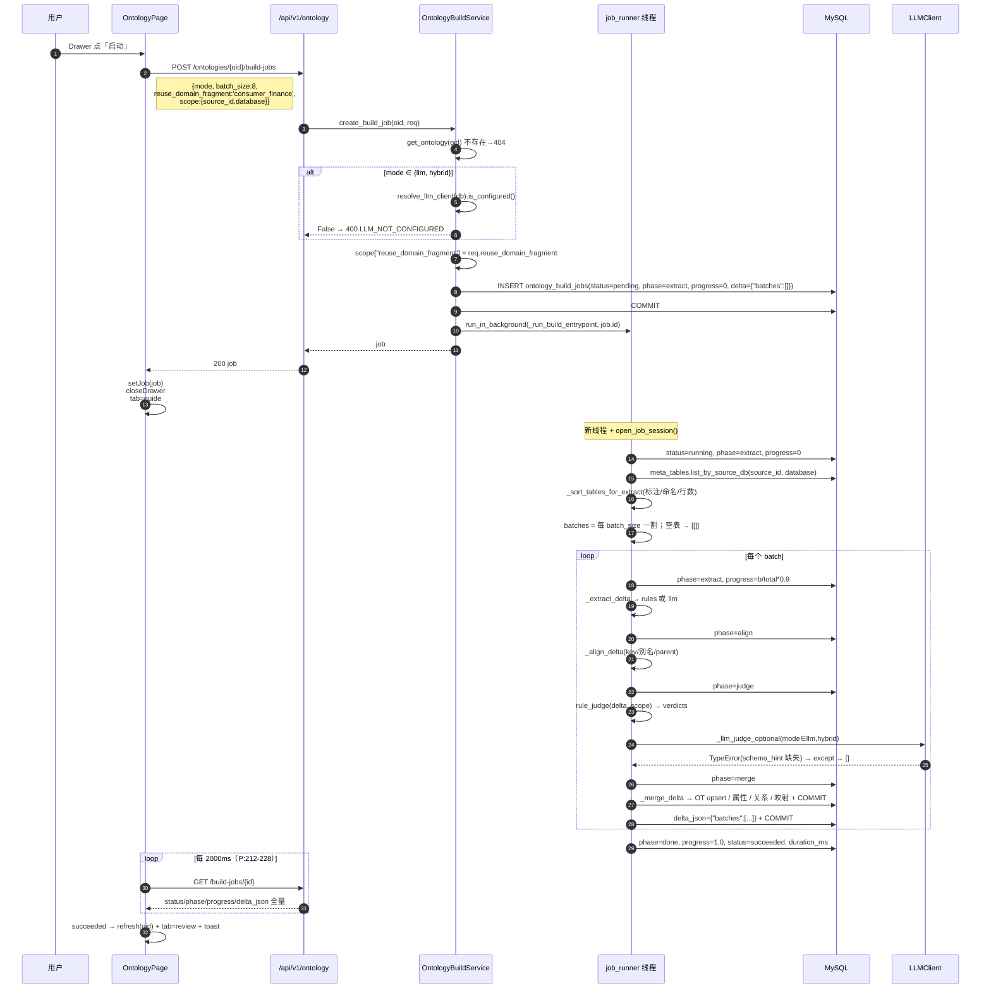
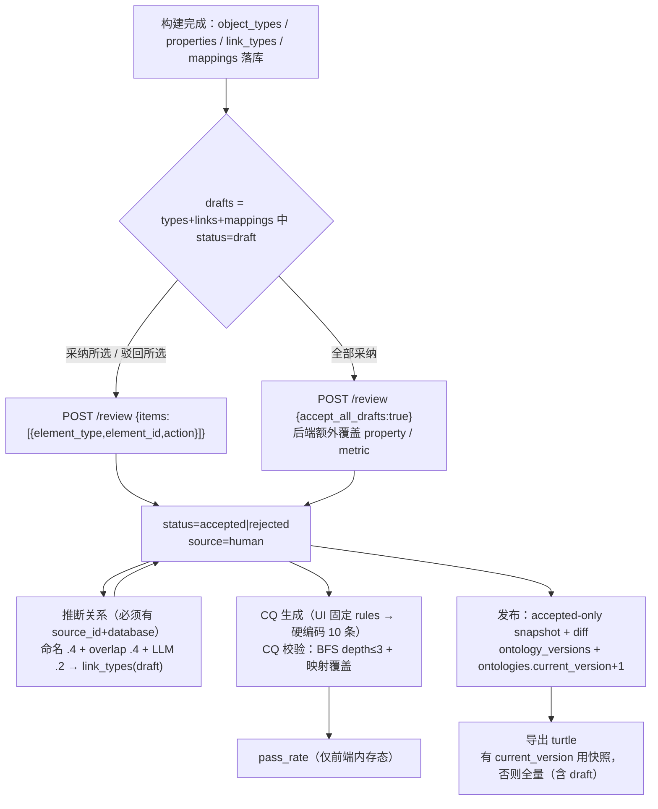
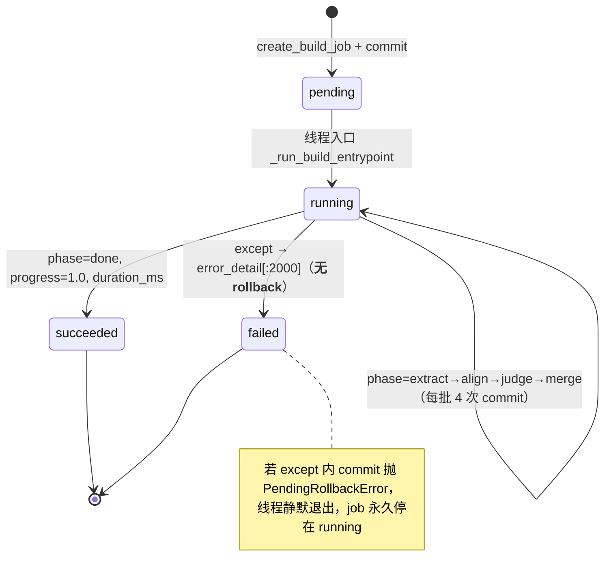
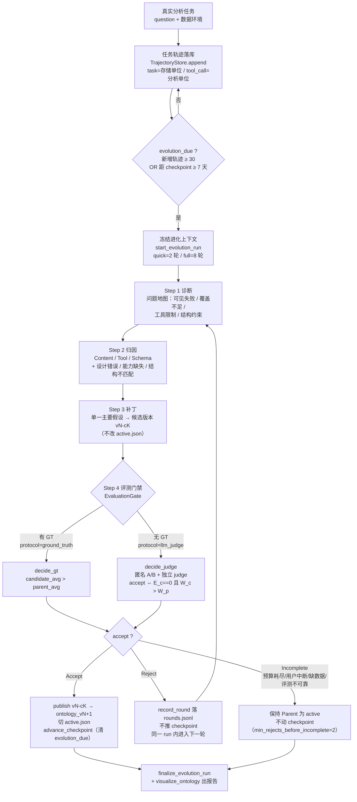

# OntoMind 本体建模 —— 前后端实现走读（代码级）

> **仓库**：`D:\projects\github\ontomind`
> **入口**：`frontend/src/pages/dataops/ontology/OntologyPage.tsx`
> **范围**：页面动作 → `services/ontology.service.ts` → `/api/v1/ontology/*` → Service → Repository → ORM → 后台任务 / LLM / 规则 → 落库 / 返回
> **方法**：纯静态代码阅读（未运行、未修改任何代码）。凡属"运行时推断"单独标注为「待实测」或「待核实」。
> **一句话结论**：链路每一环都有真实实现，但 **LLM 分支全部因参数缺陷不可用**、**delta 迭代构建在二次运行时撞唯一键**、**rejected 元素不落库**、**错误体与前端解析不匹配**——即"能跑通 happy path 的规则版本体管道 + 名义上的 hybrid"。

---

## 0. 一页速览

| 维度 | 事实 | 证据 |
|---|---|---|
| 页面规模 | 单文件 862 行，12 个 tab / 抽屉 / 轮询 | `OntologyPage.tsx` |
| 后端 | 1 个 router（~30 端点）+ 3 个 Service + 9 张表 | `api/v1/ontology.py`、`services/ontology_*.py`、`models/ontology_model.py` |
| 异步 | `threading.Thread` + 独立 Session，非 Celery / 非 FastAPI BackgroundTasks | `services/job_runner.py:14-22` |
| 真实可用路径 | `mode=rules` 全链路；`mode=hybrid` 会被强制要求配置 LLM，然后**仍然执行规则** | `ontology_build_service.py:501-507, 684-689` |
| 领域知识注入 | 硬编码 `consumer_finance` 片段（14 类 / 11 关系 / 6 簇） | `services/ontology_fragments.py` |
| LLM 调用点 | 7 处，其中 6 处必抛 `TypeError`（缺 `schema_hint`），1 处（元数据标注）正常 | 见 §5.3 |
| 置信度闸门 | `≥0.85 accepted` / `0.65~0.85 draft` / `<0.65 或 fail rejected`，rejected 不入库 | `ontology_build_service.py:64-65, 109-117` |

---

## 1. 架构总览

### 1.1 分层与路由注册

```
OntologyPage.tsx（862 行）
  └─ services/ontology.service.ts        baseURL = http://localhost:8000/api/v1（api.ts:3-7）
       └─ /api/v1/ontology                 api_router prefix（main.py:91）+ router prefix（ontology.py:46）
            ├─ OntologyBuildService        本体 CRUD / 构建任务 / 审阅 / 关系推断 / 发布导出 / 图
            ├─ OntologyCQService           CQ 生成与校验（独立 service + 独立 Depends）
            └─ OntologyMetricService       指标（页面未接入任何 metric 入口）
                 └─ db/repositories/ontology_repo.py   仅 add/get/list/delete + flush
                      └─ db/models/ontology_model.py   9 张表
```

依赖注入（`api/v1/ontology.py:49-58`）：

```python
def get_build_svc(db: Session = Depends(get_db)) -> OntologyBuildService: return OntologyBuildService(db)
def get_cq_svc(db: Session = Depends(get_db)) -> OntologyCQService: return OntologyCQService(db)
def get_metric_svc(db: Session = Depends(get_db)) -> OntologyMetricService: return OntologyMetricService(db)
```

鉴权：每个端点都有 `_user_id: int = Depends(get_current_user_id)`（`api/v1/auth.py:20-33`），只做"登录即可用"，**没有按本体的权限隔离**——任何人可改任何本体（`_user_id` 全部以下划线命名、未参与业务判断）。

三层约束核对：`api → service → repository(只 flush) → model` 成立；Service 内用 `self.db.commit()`，无 `with self.db.begin()`（符合 `AGENTS.md` 硬约束）。唯一例外是后台线程自己 `open_job_session()` 开新 Session（`ontology_build_service.py:527-533`）。

### 1.2 页面实际打到的 16 个接口

| # | service 函数 | 方法与路径 | 后端处理函数 | Service 方法 |
|---|---|---|---|---|
| 1 | `listOntologies` | GET `/ontologies` | `list_ontologies` (67-74) | `ontologies.list`(140-141) |
| 2 | `createOntology` | POST `/ontologies` | `create_ontology` (77-83) | (143-157) |
| 3 | `createBuildJob` | POST `/ontologies/{oid}/build-jobs` | `create_build_job` (117-124) | (499-525) |
| 4 | `getBuildJob` | GET `/build-jobs/{id}` | `get_build_job` (127-133) | (535-539) |
| 5 | `listObjectTypes` | GET `/ontologies/{oid}/object-types` | (138-145) | (251-253) |
| 6 | `listLinkTypes` | GET `/ontologies/{oid}/link-types` | (221-228) | (345-347) |
| 7 | `listMappings` | GET `/ontologies/{oid}/mappings` | (273-280) | (396-398) |
| 8 | `getOntologyGraph` | GET `/ontologies/{oid}/graph` | (425-433) | (1752-1813) |
| 9 | `listCQs` | GET `/ontologies/{oid}/cqs` | (366-372) | `OntologyCQService.list_cqs`(71-73) |
| 10 | `generateCQs` | POST `/ontologies/{oid}/cqs/generate?mode=` | (385-392) | (89-151) |
| 11 | `verifyAllCQs` | POST `/ontologies/{oid}/cqs/verify-all` | (404-410) | (245-257) |
| 12 | `reviewOntologyElements` | POST `/ontologies/{oid}/review` | (415-422) | (444-493) |
| 13 | `inferRelations` | POST `/ontologies/{oid}/infer-relations` | (261-268) | (1260-1435) |
| 14 | `publishOntology` | POST `/ontologies/{oid}/publish` | (436-443) | (1503-1526) |
| 15 | `listVersions` | GET `/ontologies/{oid}/versions` | (446-452) | (1528-1530) |
| 16 | `exportOntology` | GET `/ontologies/{oid}/export?fmt=` | (475-484) | (1652-1669) |

**已实现但页面未接入**：`GET/PUT/DELETE /ontologies/{oid}`、properties CRUD、link-types CRUD、mappings CRUD、metrics CRUD + `POST /metrics/suggest`、`POST /cqs/{id}/verify`、`GET /versions/{v}`、`POST /rollback`。
前端 service 层同样备着未使用函数：`getOntology`、`listProperties`、`listMetrics`、`rollbackOntology`（`ontology.service.ts:67-70,82-85,113-116`）。

### 1.3 前端上下文持久化

`localStorage['ontomind_ontology_ctx']` 存 `{oid, sourceId, database}`（`OntologyPage.tsx:54-68`），三个 effect 分工：
- 167-181：首屏并发拉 `listOntologies` + `listDataSources`，用 ctx 恢复 `oid/sourceId`（带存在性校验），有 oid 则 `refresh`；
- 183-196：`sourceId` 变化 → 拉库列表，优先级 `prev → ctx.database → dbs[0]`；失败**静默** `setDatabases([])`；
- 198-200：三者任一变化 → `saveCtx`。

`refresh(id)`（150-165）并发 6 个请求：graph / object-types / link-types / mappings / cqs / versions，任一失败整体 reject（无局部容错）。

---

## 2. Mermaid：时序与闭环

### 2.1 构建任务端到端时序



### 2.2 构建后闭环（页面真正串起来的链路）



---

## 3. 页面动作 × 后端实现（逐条细节）

> 行号：左列 `OntologyPage.tsx`，右列 `services/ontology_build_service.py`（下称 **SVC**）。

### 3.1 本体列表 / 新建 / 切换

| 项 | 内容 |
|---|---|
| 触发 | `useEffect` 167-181；`onCreate` 230-250；Select `onChange` 526-529 |
| 请求 | `GET /ontologies`；`POST /ontologies {name, slug, domain:'consumer_finance'}` |
| slug 生成 | `` `${newName.toLowerCase().replace(/[^a-z0-9]+/g,'-')}-${Date.now().toString().slice(-4)}` ``（233）→ 中文名被正则吃掉，退化成 `--1234`，后端 `_slugify` 去掉首尾 `-` 得 `1234` |
| 后端 | `create_ontology`（143-157）：`_slugify` → 查 `slug` 唯一 → `Ontology(current_version=0)` → commit → refresh |
| 表 | `ontologies` |
| 返回 | `OntologyResponse`（schema 25-35） |
| 前端副作用 | 重新 `listOntologies`（不复用返回值排序）、`setOid`、`refresh`、`tab=guide` |

### 3.2 数据源 / 库选择

- `GET /dataops/sources` → `DataOpsService.list_sources`（`dataops_service.py:55`），返回 `DataSource[]`（无 `{code,data}` 包装）。
- `GET /dataops/sources/{id}/databases` → `DataOpsService.list_databases`（150-152）→ `DataSourceConnector.list_databases()`：**真实 pymysql 连接**（`dataops_connector.py:451-462`，`connect_timeout=8`）。前端 service 兼容两种形状：`res.data?.data ?? res.data`（`dataops.service.ts:45`）。
- 失败静默：`.catch(() => setDatabases([]))`（195），用户只看到空下拉。

### 3.3 元数据表数探测（构建门槛）

- `GET /metadata/tables?source_id&database`（`metadata.service.ts:49-56`）→ `MetaScanService.list_tables`。
- ⚠️ **默认 `limit=100`**（`meta_scan_service.py:276`，路由 156 行 `Query(100, ge=1, le=500)`）→ 大库时 `metaTableCount` 恒为 100，"已发现 N 张元数据表"（`OntologyPage.tsx:855`）与真实参与构建的表数不一致（构建侧 `meta_tables.list_by_source_db` 无 limit）。
- 前端只用它做两件事：Step 提示 + `metaTableCount===0 && !useFragment` 时拦截（257-260）。

### 3.4 打开构建抽屉 / 启动构建

| 项 | 内容 |
|---|---|
| 触发 | 顶栏「构建」544、引导区「开始构建」473、Drawer extra「启动」791-793 → `onBuild` 252-278 |
| 入参 | `{mode, batch_size: 8, reuse_domain_fragment: useFragment?'consumer_finance':null, scope: sourceId&&database?{source_id,database}:undefined}`（263-268） |
| 校验 | 无库只 warning 不 return（254-256）；`metaTableCount===0 && !useFragment` 才 return（257-260） |
| Schema | `OntologyBuildJobCreate`（schema 40-45）：`mode: Literal["rules","llm","hybrid"]="rules"`、`scope: dict`、`batch_size: 1..50=8`、`reuse_domain_fragment: Optional[str]` |
| 后端 | `create_build_job`（499-525）：404 校验 → hybrid/llm 强制查 LLM 配置 → `scope["reuse_domain_fragment"]=...` → `INSERT`(pending/extract/0) → commit → `run_in_background` |
| 返回 | `OntologyBuildJobResponse.model_validate(job)`（`_job_resp` 61-62） |

前端抽屉与引导区**共用同一组 state**（`sourceId/database/mode/useFragment`），两个下拉是同一份状态的两个视图。

### 3.5 作业进度轮询

```ts
useEffect(() => {
  if (!job || job.status === 'succeeded' || job.status === 'failed') return;
  const t = window.setInterval(() => { void getBuildJob(job.id).then(async (j) => {
    setJob(j);
    if (j.status === 'succeeded' && oid) { await refresh(oid); setTab('review'); message.success(...); }
    if (j.status === 'failed') message.error(j.error_detail || '构建失败');
  }).catch(() => undefined);
  }, 2000);
  return () => window.clearInterval(t);
}, [job, oid, refresh, message]);
```
（`OntologyPage.tsx:212-228`）

特性与缺陷：
- `setJob` 在 deps 里 → 每次轮询都会重挂 interval（旧 interval 被 clear），能工作但每秒重建一次定时器；
- `.catch(() => undefined)`：网络抖动**完全静默**；
- 只有 succeeded/failed 才停止——若后端作业卡在 `running`（见 §8 R2），轮询永不终止；
- 响应体含**全量 `delta_json`**（schema:56），每 2s 传一次；
- 刷新页面后 job 状态丢失：没有 `GET /build-jobs?ontology_id=` 列表接口，只能重新发起构建。

### 3.6 draft 审阅

前端聚合（102-138）只覆盖 3 类元素：

| kind | 来源 | key |
|---|---|---|
| 类 | `types.filter(status==='draft')` | `object_type-{id}` |
| 关系 | `links.filter(status==='draft')` | `link_type-{id}` |
| 映射 | `mappings.filter(status==='draft')` | `mapping-{id}` |

- 采纳所选/驳回所选（592-626）：把选中行映射成 `{element_type, element_id, action}`，调 `reviewOntologyElements`；
- 全部采纳（627 + 547）：`{accept_all_drafts:true}`；
- 后端 `review`（444-493）：
  ```python
  if data.accept_all_drafts or data.reject_all_drafts:
      action = "accept" if data.accept_all_drafts else "reject"
      for row in object_types.list(oid, status="draft"): ...              # 449-452
      for row in properties.list_by_ontology(oid, status="draft"): ...     # 453-456
      for row in link_types.list(oid, status="draft"): ...                 # 457-460
      for row in mappings.list(oid, status="draft"): ...                   # 461-464
      for row in metrics.list(oid, status="draft"): ...                    # 465-468
  ...
  if not row or getattr(row, "ontology_id", None) != oid: continue         # 越权/跨本体保护
  row.status = status
  row.source = OntologyElementSource.HUMAN                                 # 488-489（驳回也标 human）
  ```
- ⚠️ 不一致点：UI 只列 3 类，`accept_all_drafts` 却动 5 类 → toast「已采纳 N 条」中的 N 大于用户看到的行数；**属性/指标在 UI 上不可见、不可逐条审**。
- 页面无「驳回全部」按钮，但后端支持 `reject_all_drafts`。

### 3.7 关系推断

| 项 | 内容 |
|---|---|
| 触发 | 关系 tab 内按钮 685-687 → `onInfer` 367-383 |
| 前置 | `oid && sourceId && database` 缺一即 warning return（368-371） |
| 请求 | `POST /infer-relations {scope:{source_id,database}}`（无 tables → 全库） |
| 后端 | `infer_relations`（1260-1435），返回 `candidates[]` |
| 副作用 | 仅当 `from_key/to_key` **精确命中**已有 OT key 且关系 key 不重复时 `INSERT ontology_link_types`（1415-1433） |
| 前端 | 忽略返回值 → `refresh` → toast「关系推断完成」→ tab=links |

### 3.8 映射查看

只读表格（709-728），数据来自 `refresh` 的 `listMappings(oid)`；空态文案「带 scope 构建后，物理表列会映射到本体元素」。映射由构建阶段产生（见 §4.3），页面无新增/编辑入口（`create_mapping` 存在但未接线）。

### 3.9 CQ 生成与校验

```ts
await generateCQs(oid, 'rules');      // 354 —— 模式写死
const r = await verifyAllCQs(oid);    // 355
setPassRate(typeof r.pass_rate === 'number' ? r.pass_rate : null);
setCQs(await listCQs(oid));
```
- `generateCQs` 走 query string：`POST /cqs/generate?mode=rules`，请求体 `null`（service 124-127）；
- 后端 `generate_cqs`（89-151）：`mode=='llm'` 才会调 LLM（见 §5.4-D），失败或非 llm → `_DEFAULT_CQS` 硬编码 10 条过滤后落库；**不清理不查重**；
- `verify_all`（245-257）逐条 `verify_cq`：`_match_concepts` → `_bfs_reachable(depth=3)` → `_mapping_coverage`，返回 `{total,passed,failed,pass_rate,results}`；
- `passRate` 只存在于前端内存（93），刷新即丢；CQ 行的 `verify_status` 已持久化。

### 3.10 发布

```ts
const accepted = types.filter(t => t.status === 'accepted').length;   // 311
if (!accepted) { warning; tab='review'; return; }                     // 311-316
if (drafts.length) { modal.confirm({ okText:'采纳全部并发布', cancelText:'仅发布已采纳',
    onOk: async () => { await acceptAllDrafts(); await doPublish(); },   // 323-326
    onCancel: () => void doPublish() }); return; }
await doPublish();
```
`doPublish`（334-348）→ `POST /publish {change_note:"发布 <toLocaleString>"}` → 重拉列表 + `refresh` + `tab=versions`。

后端 `publish_version`（1503-1526）：`_build_snapshot(accepted_only=True)` → `new_ver = current_version+1` → 与上一版快照 `_diff_snapshots` → `INSERT ontology_versions` → `ontologies.current_version = new_ver`。**后端无任何"必须有 accepted 元素"的校验**，前端拦不住直接调 API 的场景。

### 3.11 Turtle 导出

```ts
const text = await exportOntology(oid, 'turtle');   // 558
await navigator.clipboard.writeText(text);
```
`GET /export?fmt=turtle`，`responseType:'text'`（service 135-138）。后端返回 `PlainTextResponse`，`media_type="text/turtle"`（475-484）。
注意：`navigator.clipboard` 需要安全上下文（https/localhost），失败会被 catch 成「导出失败」。

### 3.12 版本查看

只读表格（764-779）：`version / change_note / created_at`。**不展示 `snapshot_json` / `diff_json`，也没有回滚按钮**——尽管 `OntologyVersionResponse` 会返回整份快照（schema 311-322），且 `POST /rollback` 已实现（1539-1650）。

---

## 4. 构建 pipeline 深拆

### 4.1 参数如何进入后端

```
前端                                    Pydantic                         落库/运行期
mode ─────────────────────────────────► Literal["rules","llm","hybrid"] ─► job.mode  (String(16))
batch_size ───────────────────────────► int 1..50                          ─► job.batch_size
reuse_domain_fragment ────────────────► Optional[str] ──┐
scope ────────────────────────────────► dict[str,Any] ──┴► scope['reuse_domain_fragment']=...  ─► job.scope_json (JSON)
```

关键点（SVC:508-520）：**`reuse_domain_fragment` 没有独立列**，被塞进 `scope_json`；运行期再读回（560-565）：

```python
scope = job.scope_json if isinstance(job.scope_json, dict) else {}
source_id = scope.get("source_id"); database = scope.get("database")
tables_filter = scope.get("tables"); fragment_name = scope.get("reuse_domain_fragment")
fragment = get_domain_fragment(fragment_name)      # consumer_finance → dict；其它 → None
```

`get_domain_fragment`（`ontology_fragments.py:263-266`）只认 `DOMAIN_FRAGMENTS` 里的 key，未知名字**静默返回 None**（没有校验/报错）。

### 4.2 分批与表排序

```python
table_rows = self.meta_tables.list_by_source_db(int(source_id), str(database))   # 569
if tables_filter: table_rows = [t for t in table_rows if t.table_name in set(tables_filter)]
table_rows = self._sort_tables_for_extract(table_rows)                          # 573
batch_size = max(1, int(job.batch_size or 8))
batches = [table_rows[i:i+batch_size] for i in range(0, max(len(table_rows),1), batch_size)]
if not table_rows: batches = [[]]                                               # 579-580
```

排序打分（629-657）：

```python
def score(t):
    entity = 0
    try:   # 已采纳的 entity_candidate 标注 → +2
        anns = db.query(Annotation).filter(
            Annotation.target_type=="table", Annotation.target_id==t.id,
            Annotation.label_kind==AnnotationLabelKind.ENTITY_CANDIDATE,
            Annotation.status=="accepted").all()
        if anns: entity = 2
    except Exception: pass                     # 649-650 静默吞
    if any(x in name for x in ("dim_","dwd_","cust","user","party","product","contract")):
        entity = max(entity, 1)
    fact = 1 if any(x in name for x in ("fact_","dws_","txn","log","detail")) else 0
    return (-entity, fact, -row_count, name)   # 实体优先 → 维度先于事实 → 大表先 → 名称
```

> 待实测：`Annotation.status == "accepted"` 是对 **SAEnum 列做字符串比较**（`meta_model.py:207-212`），且整段包在 `try/except: pass` 内——如果绑定失败，实体候选加权从未生效，排序退化为"命名白名单 + 行数"。

### 4.3 extract（规则版，实际生效路径）

伪代码（`_extract_via_rules`，691-817）：

```python
frag_keys = {ot["key"].lower(): ot for ot in fragment.object_types}      # 705-707
for table in batch:
    key = _normalize_key(table.table_name)                               # "dwd_cust_info"
    for prefix in ("dwd_","dim_","ods_","dws_","tmp_","fact_"):
        if key.startswith(prefix): key = key[len(prefix):]; break         # → "cust_info"
    display = table.biz_name or table.table_comment or tname
    conf = 0.8; aligned = None
    for fk, fot in frag_keys.items():                                     # 片段对齐
        if fk in key or key in fk or fk.replace("_","") in key.replace("_",""):
            aligned, key, display, conf = fot, fot["key"], fot["display_name"] or display, 0.9
            break
    ot = {"key": aligned["key"] if aligned else _normalize_ot_key(key),
          "display_name": display,
          "definition": table.biz_description or table.table_comment or (aligned or {}).get("definition"),
          "parent_key": (aligned or {}).get("parent_key"),
          "aliases": (aligned or {}).get("aliases") or [],
          "confidence": conf, "source": "rule"}
    delta["new_object_types"].append(ot)
    if source_id:                                                          # 748-760
        delta["mappings"].append({"element_type":"object_type","element_key":ot["key"],
            "source_id":int(source_id),"database":database,"table_name":tname,
            "column_name":None,"confidence":conf,"source":"rule"})
    for col in meta_columns.list_by_table(table.id):                        # 762-788
        pkey = _normalize_key(col.column_name)
        delta["new_properties"].append({"object_type_key":ot["key"],"key":pkey,
            "display_name":col.biz_name or col.column_comment or col.column_name,
            "data_type":col.data_type,
            "definition":col.biz_description or col.column_comment,
            "confidence":0.75,"source":"rule"})
        if source_id:
            delta["mappings"].append({"element_type":"property","element_key":f"{ot['key']}.{pkey}", ...})
# 无表时用片段播种（790-816）
if not batch and fragment:
    for fot in fragment["object_types"]: delta["new_object_types"].append({..., "confidence":0.9})
    for fl  in fragment["link_types"]:   delta["new_link_types"].append({..., "confidence":0.9})
```

要点：
- **规则版不产出 `new_link_types`**（除非走"空表 + 片段"分支）→ 有库时关系只能靠 §3.7 推断或片段播种；
- 片段命中是**子串匹配**（`fk in key` / 去下划线后包含），按片段声明顺序取第一个命中 → `party_person_info` 会先命中 `Party`；
- 片段命中 conf 直接 0.9 → **跳过人审变 accepted**；
- 每个表都会产出 1 条 OT 级 mapping + N 条属性级 mapping，**无任何查重**。

### 4.4 extract（LLM 版，实际不可用）

`_extract_delta`（677-689）：

```python
if mode in ("llm","hybrid"):
    try:    return self._extract_via_llm(job, batch, fragment)
    except Exception as exc:
        logger.warning("LLM extract fallback to rules: %s", exc)     # 688
return self._extract_via_rules(job, batch, fragment)
```

`_extract_via_llm`（819-878）构造：

```python
tables_ctx = [{"table": t.table_name, "comment": t.table_comment, "biz_name": t.biz_name,
               "columns": [{"name": c.column_name, "type": c.data_type, "comment": c.column_comment}
                           for c in cols[:40]]} for t in batch]
messages = [ {"role":"system","content":( ...见 §5.4-A... )},
             {"role":"user","content": json.dumps({"core_summary": summary[:50],
                                                   "domain_fragment": fragment,
                                                   "tables": tables_ctx}, ensure_ascii=False)} ]
data = client.chat_json(messages)          # ← 866：缺 schema_hint，必抛 TypeError
if not isinstance(data, dict): raise BusinessException("LLM 返回非对象", code="LLM_BAD_DELTA")
for k in (6 个字段): data.setdefault(k, [])
```

`summary` 来自 `_core_summary(ontology_id)`（659-675）：当前非 rejected 的 OT（key/display_name/definition[:120]/status）+ 关系（link_key/from/to）。**这是 PRD 里"批次间回流类级摘要"的唯一实现，且只在 LLM 分支存在。**

### 4.5 align（`_align_delta`，880-973）

做了什么：
1. `existing = {ot.key.lower(): ot}`；`frag_by_alias` 同时索引片段 key 与 aliases；
2. OT key 归一：片段 key 保 PascalCase，其余 `_normalize_ot_key`（保留大小写、去非法字符）；
3. **同义合并**：`frag_by_alias[key.lower()] or frag_by_alias[display.lower()] or 任一 alias` 命中 → 用片段 key/display，补 parent/aliases，记 `aligned_to_existing{reason:"domain_fragment"}`；
4. 已存在于本体的 key → 记 `aligned_to_existing{reason:"core_key_match"}`；
5. **parent 校验**：parent 不在 existing/片段中 → 置 None 且 `confidence *= 0.85`（924-935）；
6. 属性 key 归一；`object_type_key` 若对不上则 `_normalize_key`；
7. 关系 key 一串分支（956-971），其中
   ```python
   if link["key"] != link.get("key"):
       pass                                  # 966-967 死代码
   ```
   最终落到"属于片段 link key 则保留，否则 `_normalize_key`"。

### 4.6 judge（规则版，`rule_judge`，975-1084）

| 检查 | target 形式 | 失败条件 | verdict / adjust |
|---|---|---|---|
| OT 组内重复 key | `object_type:{key}` | 同 delta 第二次出现 | `fail` / -1.0 |
| OT 已存在 | 同上 | `key in existing_ot` | `warn` / -0.05 |
| OT 正常 | 同上 | — | `pass` / 0 |
| 属性孤儿 | `property:{otk}.{key}` | `otk` 缺失或不在 existing∪proposed | `fail` / -1.0 |
| 关系端点缺失 | `link_type:{key}` | `from_key`/`to_key` 不在集合内 | `fail` / -1.0 |
| 映射完整性 | `mapping:{element_key}` | 缺 `source_id/database/table_name` | `fail` / -1.0 |
| 映射物理表 | 同上 | `meta_tables.get_by_uq` 查不到表 | `fail` / -1.0 |
| 映射物理列 | 同上 | 列名不在 `meta_columns.list_by_table` | `fail` / -1.0 |

`_verdict_for`（1110-1117）：同 target 多条时 **worst wins**（fail < warn < pass）；无记录 → `{"verdict":"pass","confidence_adjust":0,"reason":"no_verdict"}`。

单测覆盖：`tests/test_ontology.py::test_rule_judge_checks`（97-141）。

### 4.7 judge（LLM 版，实际永远返回 []）

```python
def _llm_judge_optional(self, mode, delta):
    if mode not in ("llm","hybrid"): return []
    client = resolve_llm_client(self.db)
    if not client.is_configured(): return []
    try:
        data = client.chat_json([...])          # 1093：缺 schema_hint → TypeError
        return list((data or {}).get("verdicts") or [])
    except Exception as exc:
        logger.warning("LLM judge skipped: %s", exc); return []     # 1106-1108
```

### 4.8 merge（`_merge_delta`，1119-1242）

```python
source = "llm" if mode in ("llm","hybrid") else "rule"      # 1127 ← 即使实际走的是规则抽取
for ot in delta["new_object_types"]:
    conf = clamp(ot.confidence + verdict.confidence_adjust)
    status = confidence_tier(conf, verdict.verdict)
    stats[status] += 1
    if status == "rejected": continue                        # 1139-1140 ← 不入库
    existing = object_types.get_by_key(oid, ot.key)
    if existing:
        if existing.confidence < conf:                       # 1143
            existing.confidence, existing.status = conf, status
            existing.definition = ot.definition or existing.definition
            existing.display_name = ot.display_name or existing.display_name
        ot_id_by_key[existing.key] = existing.id; continue    # 1149-1150 ← 属性不走这里
    row = OntologyObjectType(...); object_types.add(row); db.flush()
for prop in delta["new_properties"]:                         # 1166-1190
    ...
    ot_id = ot_id_by_key.get(otk);  if not ot_id: continue
    row = OntologyProperty(...); properties.add(row)          # ← 无查重
for link in delta["new_link_types"]:
    if link_types.get_by_key(oid, link.key): continue          # 1201-1202 ← 有关系去重
    link_types.add(OntologyLinkType(... evidence_json=link.evidence))
for mp in delta["mappings"]:                                  # 1218-1239
    row = OntologyMapping(... source_id=int(mp["source_id"]) ...)  # KeyError 风险
    mappings.add(row)                                          # ← 无查重
db.commit()
```

三条硬差异：
1. **OT 是 upsert**（存在则提置信度/覆盖 definition+display），但 **status 可能被新值降级**（1145）；
2. **属性无 upsert**：`UQ(object_type_id, key)`（`ontology_model.py:127-130`）+ `repository.add()` 立即 `flush()` → **二次构建必 `IntegrityError`**；
3. **映射既无 upsert 也无唯一约束** → 重复构建无限追加；且 llm 分支若 mapping 缺 `source_id` → `int(mp["source_id"])` KeyError → 作业失败。

### 4.9 进度与 `delta_json`

```python
self._set_phase(job, "extract", bidx / total * 0.9)           # 587
self._set_phase(job, "align",   (bidx + 0.3) / total * 0.9)   # 591
self._set_phase(job, "judge",   (bidx + 0.6) / total * 0.9)   # 595
self._set_phase(job, "merge",   (bidx + 0.8) / total * 0.9)   # 601
job.delta_json = {"batches": all_batch_results}               # 612
self._set_phase(job, "done", 1.0)                             # 616
```
`_set_phase`（541-545）只改 `phase/progress` 并 commit，**不改 `status`**；状态只在开头置 `running`、结尾置 `succeeded/failed`。
每批 `batch_result = {batch_index, tables:[名], delta, verdicts, merge}`（604-610）→ `delta_json` 单调膨胀，且随 `GET /build-jobs/{id}` 全量下发。

### 4.10 分阶段总表

| 阶段 | 输入 | 实际处理 | 输出 | 代码 | 状态 |
|---|---|---|---|---|---|
| 预处理 | `meta_tables(source_id,database)` | `tables` 过滤 + 实体优先排序 | 有序表列表 | 567-583、629-657 | ✅（标注加权待实测） |
| extract(rules) | 一批表 + fragment | 前缀剥离 → 片段对齐 → OT / 属性 / mapping | delta | 691-817 | ✅ 主路径 |
| extract(llm) | 一批表 + 全量 fragment + core_summary | 调 LLM 出 delta | delta | 819-878 | ❌ 必抛 TypeError → 降级 |
| align | delta | key 归一 / 别名合并 / parent 降级 / link key 清洗 | delta | 880-973 | ⚠️ 生效，含死代码 |
| judge(rules) | delta + scope | 8 类机械校验 | verdicts | 975-1084 | ✅ 有单测 |
| judge(llm) | delta | LLM 复核 | `[]` | 1086-1108 | ❌ 恒空 |
| merge | delta + verdicts | 置信度分级 → OT upsert / 属性 / 关系 / 映射 | 行 + stats | 1119-1242 | ⚠️ 见 §8 R1/R2 |
| 收尾 | — | done/1.0/succeeded/duration_ms；异常→failed | job | 616-627 | ⚠️ 无 rollback |

### 4.11 置信度与元素状态（唯一真源）

```python
CONF_AUTO_ACCEPT = 0.85
CONF_SUGGEST_MIN = 0.65
def confidence_tier(confidence, judge_verdict="pass"):
    if verdict == "fail" or conf < 0.65: return "rejected"
    if verdict == "warn" or conf < 0.85: return "draft"
    return "accepted"
```
（64-65、109-117；单测 `test_confidence_tiers`）

推导出的实际分布：

| 产物 | 初始 conf | 二次构建 judge | 最终 status |
|---|---|---|---|
| OT（未命中片段） | 0.8 | 已存在 → warn(-0.05)=0.75 | `draft` → `draft` |
| OT（命中片段） | 0.9 | 首次 `pass` | **`accepted`（免审）** |
| 属性 | 0.75 | — | `draft` |
| OT/属性映射 | 0.8 / 0.75 | 表列存在 → pass | `draft` |
| 推断关系 | 0.4+0.4=0.8（最高） | — | `draft` |

---

## 5. LLM 调用全景（含完整提示词）

### 5.1 `LLMClient` 契约（`services/llm_client.py`）

```python
def __init__(self, base_url=None, api_key=None, model=None, timeout=None):
    self.base_url = (base_url or settings.LLM_BASE_URL).rstrip("/")   # 默认 https://ark.cn-beijing.volces.com/api/v3
    self.api_key  = api_key if api_key is not None else settings.LLM_API_KEY
    self.model    = model or settings.LLM_MODEL
    self.timeout  = timeout or settings.LLM_TIMEOUT or 120

def is_configured(self) -> bool:
    return bool(self.api_key)          # 40-41：只看 api_key，不看 model

def chat(self, messages, temperature=0.2, max_tokens=4096, response_format=None) -> str
def chat_json(self, messages, *, schema_hint: str, temperature=0.1, max_retries=2) -> dict
```

`chat_json` 行为链（104-157）：
1. 拼 `system_extra = "只输出 JSON，不要 markdown 代码块，不要解释文字。\nJSON schema:\n" + schema_hint`，并**追加到已有 system 消息末尾**（首条不是 system 才新建一条）；
2. 循环调用 `chat(..., temperature=temperature, response_format={"type":"json_object"})`；
3. `chat` 内部：HTTP 400/422 且带了 `response_format` → **去掉该字段重试一次**（兼容不支持的服务端）；≥400 → `BusinessException(code="LLM_HTTP_ERROR")`；
4. 解析失败 → 追加 `assistant`(上次原文) + `user`("上一次输出不是合法 JSON object，请严格按 schema 只输出修正后的 JSON。")，总调用次数 = `max_retries + 1` = 3；
5. 仍失败 → `BusinessException(code="LLM_INVALID_JSON")`，消息带 `last_raw[:400]`；
6. 成功前 `_strip_json_fence`：去掉 ``````json ... `````` 包裹；根必须是 object。

**两个前置校验**：`is_configured()` 只看 `api_key`（40-41）；但 `_require_configured()`（42-53）同时要求 **model 非空**，二者任一缺失都在本地抛 `LLM_NOT_CONFIGURED`，不会发 HTTP。

**关键**：`schema_hint` 是 **keyword-only 且无默认值** → 不传即 `TypeError`，与 API key 是否配置无关，也不会走到 HTTP 请求。

### 5.2 配置解析：DB 优先，`.env` 兜底

```python
# llm_settings_service.py:73-90
def resolve_llm_client(db):
    row = PlatformLlmSettingRepository(db).get_default()   # is_default=True 且 enabled
    if row and api_key and model:
        return _build_client(base_url, model, _decrypt(api_key), timeout)
    return LLMClient()                                     # .env: LLM_BASE_URL/LLM_API_KEY/LLM_MODEL/LLM_TIMEOUT
```
- API key 在 DB 里用 `Fernet`（密钥 = `sha256(SECRET_KEY)`）加密存储（33-47）；
- `LLM_MAX_CONCURRENCY=4`（config:93）只在 settings 接口回显，**本体/标注链路没有任何并发闸门**。

### 5.3 7 个调用点清单

| # | 位置 | 用途 | 构造 client | 传 `schema_hint` | 结果 |
|---|---|---|---|---|---|
| A | `ontology_build_service.py:866` | 本体 delta 抽取 | `resolve_llm_client` | ❌ | `TypeError` → 降级 rules |
| B | `ontology_build_service.py:1093` | delta 审稿 | `resolve_llm_client` | ❌ | `TypeError` → `[]` |
| C | `ontology_build_service.py:1346` | 关系推断投票 | `resolve_llm_client` | ❌ | `TypeError` → `llm_w=0` |
| D | `ontology_cq_service.py:100` | CQ 生成 | `LLMClient()`（忽略 DB 配置） | ❌ | `TypeError` → 硬编码 10 条 |
| E | `ontology_metric_service.py:171` | 指标建议 | `LLMClient()`（忽略 DB 配置） | ❌ | `TypeError` → 纯规则 |
| F | `annotation_service.py:413` | 元数据标注 | `resolve_llm_client` | ✅ `TABLE_ANNOTATE_SCHEMA_HINT` | **唯一可用** |
| G | `glossary_service.py:127` | 术语表生成 | `resolve_llm_client` | ✅ | 可用（不属于本体链路） |

结论：**本体侧 5 个 LLM 调用点 100% 抛 `TypeError`，被 `except Exception` 静默吞掉**，日志里只出现 `LLM extract fallback to rules: chat_json() missing 1 required keyword-only argument: 'schema_hint'` 一类 warning。因此线上从未有真实 LLM 输出参与本体建模。

### 5.4 Prompt 原文

#### A. 本体 delta 抽取（`_extract_via_llm`，845-866）

system：
```text
你是本体工程师。根据表结构生成本体 delta JSON。只输出 JSON，字段: new_object_types, new_properties, new_link_types, mappings, aligned_to_existing, conflicts。
```
user（`json.dumps(..., ensure_ascii=False)`）：
```json
{
  "core_summary": [ /* 最多 50 条：已存在的 OT/关系摘要，见 _core_summary 659-675 */ ],
  "domain_fragment": { /* 整个 consumer_finance 片段：14 个 objects + 11 个 links + clusters + 片段级说明 */ },
  "tables": [
    { "table": "dwd_cust_info", "comment": "客户基础信息", "biz_name": "客户",
      "columns": [ { "name": "cust_id", "type": "bigint", "comment": "客户号" } ] }
  ]
}
```
缺省参数（`chat_json` 默认值）：`temperature=0.1`、`max_tokens=4096`、`max_retries=2`、`timeout=120`。
注意：`tables[].columns` **只取前 40 列**（841），无截断提示；`domain_fragment` 每批**完整重发**。

#### B. delta 审稿（`_llm_judge_optional`，1093-1104）

system：
```text
你是本体审稿人。检查 delta 是否合理，输出 {"verdicts":[{"target","verdict":"pass|warn|fail","reason","confidence_adjust"}]}
```
user：`json.dumps(delta, ensure_ascii=False)[:12000]` —— **按字符硬截断**，可能在 JSON 中间切断。
期望回包直接喂给 `_verdict_for`，与 `rule_judge` 的 verdict 合并取值（worst wins）。

#### C. 关系推断投票（`infer_relations`，1346-1365，**每个候选列对调用一次**）

system：
```text
输出 JSON: {"relation":str,"cardinality":"1-1|n-1|1-n|n-n","confidence":float}
```
user：
```json
{"from_table":"dwd_loan_contract","from_col":"cust_id","to_table":"dwd_cust_info","to_col":"cust_id"}
```
解析：`llm_w = 0.2 * float(j.get("confidence") or 0.5)`；`llm_card = j.get("cardinality")` **原样入库**（`1:1`/`1-N` 等非法取值不会被拦截）；`j["relation"]` 归一后当 link key。

#### D. CQ 生成（`ontology_cq_service.py:100-123`）

system：
```text
基于本体生成 10~15 个 Competency Questions。输出 JSON: {"cqs":[{"question","category","related_keys"}]}。分类参考: 存在性/计数/关系遍历/聚合/时间/条件
```
user：
```json
{"object_types":[{"key":"Customer","display_name":"客户"}]}
```
（`ots[:40]`，无属性/关系上下文 → 生成的 CQ 不可能包含关系路径细节）

#### E. 指标建议（`ontology_metric_service.py:171-185`）

system：
```text
根据候选术语与数值列，提出业务指标及 sql_expr 草稿。输出 JSON: {"metrics":[{"key","display_name","definition","sql_expr","unit","confidence"}]}
```
user：`{"candidates": hints[:30]}`（规则候选：术语名含 `率|额|数|占比|逾期|不良|余额|金额|次数`，或数值列 + 注释命中）

#### F. 元数据标注（`annotation_service.py:413-419`，唯一可用的 LLM 调用）

system（`annotation_prompts.py:3-26` 全文）：
```text
你是资深数据仓库建模专家，精通消费金融业务。
你的任务：为给定的数仓表和字段推断准确的业务语义。

严格规则：
1. 只输出 JSON，不要 markdown 代码块，不要任何解释文字。
2. 每个推断必须给 confidence（0~1）和 evidence（你依据了什么：列名/注释/数据分布/术语表）。
3. 不确定就给低 confidence，禁止编造。宁可 confidence 0.3 也不要瞎猜高分。
4. biz_name 用简洁中文业务名（≤12字），biz_description 说明业务含义与口径（≤80字）。
5. 只能引用「已提供的术语表」里的术语，禁止发明新术语。
6. semantic_type 从固定枚举里选：identifier / person_name / phone / id_card / email /
   address / amount / rate / count / date / timestamp / status_code / category /
   boolean_flag / free_text / json / unknown
7. pii_level：L3(直接身份标识:身份证/手机/银行卡) / L2(可间接识别:姓名/地址/邮箱) /
   L1(敏感业务:金额/额度/评分) / L0(非敏感)
```
schema_hint（19-26）：
```json
{
  "table": {"biz_name": str, "biz_description": str, "domain": str,
            "is_entity_table": bool, "confidence": float, "evidence": str},
  "columns": [{"column_name": str, "biz_name": str, "biz_description": str,
               "semantic_type": str, "pii_level": "L0"|"L1"|"L2"|"L3",
               "glossary_term": str|null, "is_join_key": bool,
               "confidence": float, "evidence": str}]
}
```
user（28-46）：
```text
请标注以下数仓表的业务语义。

## 当前表
- 表名: {table_name}
- 表注释: {table_comment}
- 行数估计: {row_count}
- 已有 domain: {domain}

## 列清单
{columns_block}

## 相关术语表（最多 20 条，只能引用这些）
{glossary_block}

## 同库其它表名（命名体系参考）
{sibling_tables}

请严格按 schema 输出 JSON。
```
填参细节（`annotation_service.py:374-411`）：`columns_block` 每列带 `data_type/comment/nullable/key/null_rate/distinct_ratio/top_samples`（前 5 个值，PII 列经 `_mask_sample` 脱敏）；`glossary_block` 最多 20 条；`sibling_tables` 最多 80 个表名。

> **与本体链路的关系**：构建只在 `_sort_tables_for_extract` 里消费 `Annotation(status="accepted", label_kind=ENTITY_CANDIDATE)` 做排序加权；标注产出的 `biz_name/biz_description` 则被规则抽取直接当作 `display_name/definition`（`_extract_via_rules` 的 `table.biz_name or ...`）。因此"标注质量 → 本体命名质量"这条链**是真实存在**的，而"LLM 生成本体"这条链**不存在**。

#### G. 未被使用的共享模板（`annotation_prompts.py:48-69`）

```text
RELATION_INFER_SYSTEM = """你是资深数仓建模专家。根据表/列命名与画像，推断可能的表间关联（join）。
只输出 JSON，不要解释。不确定则给低 confidence。禁止编造不存在的列。"""
RELATION_INFER_SCHEMA_HINT = {"relations": [{from_table, from_column, to_table, to_column, cardinality: "1:1"|"1:N"|"N:1"|"N:M", confidence, evidence}]}
RELATION_INFER_USER_TMPL = "根据以下表结构推断可能的关联关系。## 表与列 {tables_block} ## 已知 overlap 信号 {overlap_block}"
```
全仓 Grep 只命中定义处，**本体 `infer_relations` 完全另写了一套内联 prompt**（§5.4-C）——两套 cardinality 枚举（`1:1|1:N|N:1|N:M` vs `1-1|n-1|1-n|n-n`）不一致，且后者没有 `evidence` 字段要求。

### 5.5 失败矩阵（实际运行时看到什么）

| mode | 抽取 | 审稿 | 关系 LLM 票 | 入库 source 标记 | 用户可见 |
|---|---|---|---|---|---|
| `rules` | 规则 | 规则 | 不调 | `rule` | 正常 |
| `hybrid` | 规则（LLM 抛错） | `[]` | 0 | **`llm`（错标）** | 正常，但日志有 warning |
| `llm` | 规则（LLM 抛错） | `[]` | 0 | **`llm`（错标）** | 正常，但日志有 warning |
| 任意 mode + 未配 LLM | 创建即 400 `LLM_NOT_CONFIGURED`（仅 llm/hybrid） | — | — | — | 前端 toast |

### 5.6 Prompt 工程问题清单

| # | 问题 | 影响 | 位置 |
|---|---|---|---|
| P1 | `schema_hint` 6/7 处缺失 | 本体侧 LLM 全不可用 | 866/1093/1346/100/171 |
| P2 | 指标、CQ 用 `LLMClient()` 直连 .env | 忽略 GovOps 里配置的模型 | `ontology_cq_service.py:97`、`ontology_metric_service.py:168` |
| P3 | `domain_fragment` 每批全量重发 | 片段越大 prompt 越贵；14 类 + 11 关系 + 描述文本 | 859 |
| P4 | 列截断 40 且无提示 | 宽表后半列永不参与抽取 | 841 |
| P5 | judge 用 `[:12000]` 字符截断 | 可能切断 JSON，审稿结果噪声 | 1102 |
| P6 | 关系推断按列对逐个调用 | N×M 次请求、无缓存/并发控制/去重 | 1346 |
| P7 | 无 few-shot、无 key 风格约束 | LLM 产出的 key 与片段 PascalCase 风格冲突 | A 段 system |
| P8 | `temperature` 固定 0.1 全局不可配 | 抽取/审稿/CQ/指标同一温度 | `llm_client.py:104` |
| P9 | `llm_card` 原样入库无枚举校验 | `cardinality` 可能出现 `1:1`/`N:M` 等非法值 | 1367、1426 |
| P10 | 无 token 预算/截断保护 | 大表 + 全片段可能超上下文，只靠 120s 超时兜底 | A 段 |

---

## 6. 闭环细节（关系 / CQ / 发布 / 导出 / 图）

### 6.1 关系推断：三路投票的实际算法

```python
pk_map: 每表第一个 PRI 列，或名为 id / {table}_id 的列                       # 1282-1288
for 表 t, 列 col:
  m = _ID_SUFFIX_RE.match(col)          # ^(?P<root>.+?)_id$   ← 只认 *_id 结尾
  root = m.group('root').lower()
  target_table = 第一个满足 tn==root / endswith(_root) / 去下划线相等 / root in tn 的表   # 1301-1311
  if 无目标 or 目标==自身: continue
  naming_w = 0.4                                                                # 1314
  overlap  = connector.overlap_ratio(db, from_t, from_c, to_t, to_pk)            # 1319-1327
  if overlap < 0.5: veto（跳过）                                                # 1331-1332、1373-1374
  overlap_w = 0.4 / 0.25 / 0.1  （>0.95 / >=0.8 / 其余）                        # 1333-1338
  llm_w = 0.2 * conf（LLM 抛错 → 0）                                            # 1340-1371
  conf = naming_w + overlap_w + llm_w                                           # 1382
  distinct_ratio = getattr(col,'distinct_ratio',None) or 0.5 → card 'n-1'        # 1377-1380
```

落库条件（1415-1433）：`from_key in ot_keys and to_key in ot_keys` 且 `link_types.get_by_key(oid,key)` 为空。

**两个隐藏断点**：
1. `from_key/to_key = _normalize_key(表名去前缀)`（1383-1389，全小写蛇形），而构建产出的 OT key 若命中片段则是 **PascalCase**（如 `Customer`）→ `from_key='cust_info' ∉ {Customer}` → **片段对齐过的表永远推不出关系**；未命中片段的表两个域都是蛇形，能对上。
2. `cand['key'] = llm_rel = f"{_normalize_key(from_table)}_to_{_normalize_key(target_table)}"`（1342）**保留 `dwd_` 前缀**，与 from/to key 不同域；显示为 `dwd_x_to_dwd_y`。
3. `ot_keys` 取 `list(oid)` 未过滤 status（1415）→ rejected 的 OT 也会被当作端点。
4. `overlap_ratio` 内部异常 `return 0.0`（`dataops_connector.py:349-350`）→ 全部 veto → 接口 **200 + 空数组**，前端提示"关系推断完成（0 条）"。

### 6.2 CQ 校验（`verify_cq`，216-243）

```python
concepts = _match_concepts(question, object_types, properties)   # 153-169：子串命中即算，related_keys 原样保留
reach    = _bfs_reachable(from_key, to_key, link_types, depth<=3, status∈{accepted,draft})   # 171-201
coverage = _mapping_coverage(element_key, mappings)              # 203-214：只认 object_type 级映射
passed   = bool(related_keys) and all(reachable paths)           # 未匹配到的 key 直接判失败
```
- 默认 CQ 的 `related_keys` 是片段 PascalCase key（`Customer`/`LoanContract`），与本体 key 一致时才能命中；
- 关系必须已 `accepted|draft` 且路径 ≤3 跳；
- `pass_rate` 是**弱指标**：一条 CQ 只要所有 related_keys 间两两可达即 pass，不校验语义正确性、不校验是否可被 SQL 表达。

### 6.3 发布 / 快照 / diff

```python
snapshot = _build_snapshot(oid, accepted_only=True)      # 1441-1482：OT(含 parent/aliases)、properties、links、mappings、metrics、cqs(全部)
new_ver  = (ontology.current_version or 0) + 1            # 1513
prev     = versions.get_latest(oid)                      # 1514-1516
diff     = _diff_snapshots(prev.snapshot_json, snapshot) # 1484-1501：按 key 集合算 added/removed/changed 计数
```
- **CQ 不受 accepted 过滤**（快照里带全部 CQ）；
- `diff_json` 只存计数，不存明细；
- `rollback_version`（1539-1650）存在但前端无入口，且回滚会**重建元素行**（实现复杂度高、未在 UI 暴露）。

### 6.4 导出（`export_ontology`，1652-1669）

```python
if ontology.current_version:  data = 最新版本的 snapshot_json     # 只含 accepted
else:                         data = _build_snapshot(oid, accepted_only=False)   # 含 draft
fmt == 'json'   → json 序列化
fmt == 'jsonld' → _to_jsonld（@context owl/rdfs/skos，OT→owl:Class，link→owl:ObjectProperty）
fmt == 'turtle' → _to_turtle（手写，不引 rdflib；属性用裸 key、无 rdfs:domain）
```
→ **同一个本体在"未发布 / 已发布"两种状态下导出内容不同**，这是最容易被误读为"导出丢数据"的地方。

### 6.5 图数据（`graph_data`，1752-1813）

```python
types = [ot for ot in ... if status != rejected]                     # 排除 rejected
nodes = [{"id": str(ot.id), "key": ot.key, "label": display_name, ...}]
edges = [{"id": str(lk.id), "source": lk.from_key, "target": lk.to_key, ...}]
```
前端 `OntologyGraph.tsx:40` 用 `id: n.key` 重建节点、`62-63` 直接用 `e.source/e.target` 连边 → **后端 `node.id` 是死字段**；`focus`/`depth` 做同 key 域内的 BFS。

---

## 7. 数据模型与状态流转

### 7.1 9 张表（`db/models/ontology_model.py`）

| 表 | 关键字段 | 约束 / 备注 |
|---|---|---|
| `ontologies` | name, slug, domain, current_version | slug 唯一（隐含），`current_version=0` 表示未发布 |
| `ontology_build_jobs` | mode, status, phase, progress, batch_size, **scope_json**, **delta_json**, error_detail, duration_ms | 无 ontology_id 索引之外的约束 |
| `ontology_object_types` | key, display_name, definition, parent_key, aliases_json, confidence, source, status | **UQ(ontology_id, key)** |
| `ontology_properties` | object_type_id, key, display_name, data_type, confidence, status | **UQ(object_type_id, key)**（127-130）← R1 根源 |
| `ontology_link_types` | key, display_name, from_key, to_key, cardinality, evidence_json, status | UQ(ontology_id, key)；**无外键校验端点存在** |
| `ontology_mappings` | element_type, element_key, source_id, database, table_name, column_name | **无唯一约束** ← 重复构建无限追加 |
| `ontology_metrics` | key, display_name, definition, sql_expr, unit | UQ(ontology_id,key)（接口层查重） |
| `ontology_cqs` | question, category, related_keys_json, verify_status | 生成时**不查重** |
| `ontology_versions` | version, change_note, **snapshot_json**, diff_json | **UQ(ontology_id, version)** |

枚举：`OntologyElementStatus{accepted,draft,rejected}`、`OntologyElementSource{rule,llm,human}`、`OntologyBuildStatus{pending,running,succeeded,failed}`、`OntologyBuildPhase{extract,align,judge,merge,done}`、`OntologyCQVerifyStatus{pending,passed,failed}`。

### 7.2 状态机



元素侧：`draft → accepted | rejected`（人审 / accept_all），`accepted ↔ rejected` 可反复；`draft` 永不被"自动发布"，只有 `accepted` 进快照。

---

## 8. 设计 vs 实现差异 / 风险 / 待核实

### 8.1 差异表（`docs/prd/ontology.md` ↔ 代码）

| # | PRD 说法 | 代码事实 | 证据 |
|---|---|---|---|
| D1 | delta 迭代：每批把类级摘要回流下一批 | 仅 LLM 分支有 `core_summary`，而该分支不可用 → 规则路径**批次间零上下文** | 826/858、691-817 |
| D2 | LLM 抽取 + LLM 审稿 | 两者均抛 `TypeError` | 866、1093 |
| D3 | 三路投票 0.4/0.4/0.2 | 实际 0.4 + (0/0.1/0.25/0.4) + 0 | 1314-1382 |
| D4 | 低置信度进 rejected 供人复盘 | rejected **不落库**，只在 `stats` 计数后丢弃 | 1139-1140 |
| D5 | 人工标注不被机器覆盖 | OT upsert 时若新 conf 更高会覆盖 `display_name/definition`，且 `status` 可降级 | 1143-1150 |
| D6 | CQ 由本体生成并校验语义 | CQ 固定 `rules` → 硬编码 10 条；校验只做可达性 | 354、26-37 |
| D7 | 17 张表规划 | 实际 9 张（无 proposal/audit/quality 等） | `ontology_model.py` |

### 8.2 风险清单

| ID | 严重度 | 现象 | 根因 | 证据 |
|---|---|---|---|---|
| **R1** | 🔴 高 | 同 scope 二次构建必 `IntegrityError` | `ontology_properties` UQ + merge 无属性查重 + repo 立即 flush | 127-130、1166-1190、`ontology_repo.py` add |
| **R2** | 🔴 高 | 作业永久 `running`，前端 2s 轮询永不停止 | `_run_build` except 分支无 `db.rollback()` → `PendingRollbackError` 逃出线程 | 620-627、`job_runner.py:14-22` |
| **R3** | 🟠 中 | 业务错误在前端退化为 `Request failed with status code 400` | 后端 `{code,message,data}` vs 前端只读 `detail` | `exceptions.py:61-70`、`ontology.service.ts:19-27` |
| **R4** | 🟠 中 | LLM 永远不参与，但数据标 `source=llm` | `schema_hint` 缺失 + `source` 按 mode 而非实际路径赋值 | 866/1093/1346、1127 |
| **R5** | 🟠 中 | 关系推断 200 + 0 条，无任何报错 | `overlap_ratio` 异常 `return 0.0` → 全 veto | `dataops_connector.py:349-350` |
| **R6** | 🟠 中 | 片段对齐过的表推不出关系 | `from_key` 蛇形 vs OT key PascalCase | 1383-1389、87-92 |
| **R7** | 🟠 中 | `cardinality` 恒为 `n-1` | `MetaColumn` 无 `distinct_ratio` 字段，`getattr` 恒 None → 0.5 | 1377-1380、`meta_model.py:140-163` |
| **R8** | 🟡 低 | 映射无限重复 | 无唯一约束 + 无查重 | 1218-1239 |
| **R9** | 🟡 低 | 重复点"生成 CQ"→ 重复 CQ | 生成前不清理不查重 | 89-151 |
| **R10** | 🟡 低 | 前端"已采纳 N 条"与实际不符 | UI 只列 3 类，接口动 5 类 | 102-138、449-468 |
| **R11** | 🟡 低 | 元数据表数上限 100 | `list_tables` 默认 `limit=100` | `meta_scan_service.py:276` |
| **R12** | 🟡 低 | 导出内容随发布状态变化 | `accepted_only` 二态 | 1652-1669 |
| **R13** | 🟡 低 | 中文名建本体 slug 变 `1234` | 前端正则只留 `a-z0-9` | 233、72-75 |
| **R14** | 🟡 低 | 图节点 `id` 字段无意义 | 后端 `str(ot.id)` vs 前端用 `key` | 1760、`OntologyGraph.tsx:40` |
| **R15** | 🟡 低 | 死代码 | `link["key"] != link.get("key"): pass` | 966-967 |

### 8.3 待核实（未实测，不做断言）

1. **R1 是否 100% 触发**：需"同 scope 连建两次"。现有 `tests/test_ontology.py` 只有单次构建用例（`test_build_job_rules_mode`），无二次构建；建议实测。
2. `Annotation.status == "accepted"` 对 SAEnum 列的字符串比较是否生效（整段被 `except: pass` 吞掉，失败也不报错）。
3. `DataSourceConnector` 用 pymysql 拼 `overlap_ratio` SQL（`SELECT COUNT(DISTINCT ...) / COUNT(*)`）在 Doris/Hive 上的语法兼容性。
4. 是否存在其它入口也会创建 build job（如脚本/测试/其它页面）——已确认只有 `POST /ontologies/{oid}/build-jobs`。

---

## 9. 附录

### 9.1 关键证据索引

| 主题 | 文件:行 |
|---|---|
| 页面入口 / 构建参数 | `OntologyPage.tsx:252-278` |
| 轮询 | `OntologyPage.tsx:212-228` |
| draft 聚合 | `OntologyPage.tsx:102-138` |
| 前端错误解析 | `ontology.service.ts:19-27` |
| 构建入口校验 + 建任务 | `ontology_build_service.py:499-525` |
| 主循环 | `ontology_build_service.py:547-627` |
| 表排序 | `ontology_build_service.py:629-657` |
| 规则抽取 | `ontology_build_service.py:691-817` |
| LLM 抽取 | `ontology_build_service.py:819-878` |
| 对齐 | `ontology_build_service.py:880-973` |
| 规则审稿 | `ontology_build_service.py:975-1084` |
| LLM 审稿 | `ontology_build_service.py:1086-1108` |
| 合并落库 | `ontology_build_service.py:1119-1242` |
| 关系推断 | `ontology_build_service.py:1260-1435` |
| 快照 / 发布 / 回滚 / 导出 / 图 | `ontology_build_service.py:1441-1813` |
| CQ 生成 / 校验 | `ontology_cq_service.py:89-257` |
| 指标建议 | `ontology_metric_service.py:112-224` |
| 标注 prompt | `annotation_prompts.py:3-70` |
| LLM 客户端 | `llm_client.py:30-157` |
| LLM 配置解析 | `llm_settings_service.py:58-90,121-140` |
| 后台线程 | `job_runner.py:14-28` |
| 业务异常体 | `core/exceptions.py:61-70` |
| 单测 | `tests/test_ontology.py`（498 行，无二次构建用例） |

### 9.2 key 生成规则速查

| 场景 | 函数 | 输入 → 输出 |
|---|---|---|
| 本体 slug | `_slugify` (72-75) | `客户本体-A` → `-a` → 去首尾 → `a`（前端已加时间戳） |
| 蛇形 key | `_normalize_key` (78-84) | `CustInfo` → `cust_info`；非 `[a-z0-9_]` → `_` |
| OT key | `_normalize_ot_key` (87-92) | 保留大小写，`Cust Info` → `Cust_Info` |
| 表前缀剥离 | `_extract_via_rules` (711-716) | `dwd_cust_info` → `cust_info` |
| 关系 key（推断） | 1342 | `dwd_a` + `dwd_b` → `dwd_a_to_dwd_b` |
| 属性 mapping key | 785 | `Customer.cust_id` |

### 9.3 领域片段（`ontology_fragments.py`）

14 类：`Party(→Person/Organization)`、`Person`、`Organization`、`LoanApplication`、`LoanContract`、`CreditProduct`、`LoanAccount`、`Transaction`、`RepaymentBehavior`、`RiskEvent`、`Collateral`、`AcquisitionChannel`、`ScorecardModel`、`RiskFeature`；11 关系：申请-合同、合同-账户、账户-交易、合同-还款、合同-抵押、客户-申请、产品-合同、事件-合同、渠道-申请、评分卡-申请、特征-评分卡（key 皆 PascalCase）；另有 `clusters` 分组与片段级 description。`get_domain_fragment(name)` 未命中返回 `None`。

### 9.4 判断优先级建议（若后续修复）

1. **R2**（作业卡死）→ 2. **R1**（二次构建失败）→ 3. **R4**（补 `schema_hint`，让 LLM 真正生效）→ 4. **R3**（错误契约对齐）→ 5. **R7/R5**（画像字段与 veto 语义）→ 6. **R8/R9**（幂等）。

---

## 10. 对标 EvoOntology：评测与自进化能力

> **本章读法（事实 / 差距 / 建议 三块严格分离）。**
>
> - **§10.1 是事实**：`EvoOntology` 仓库里**已经存在**的评测与进化机制，逐条给 `文件:行号`。
> - **§10.2 是现状与差距**：`OntoMind` 侧**当前代码**是什么样；差距条目指回本文档 §5 / §8 或 `backend/app/` 的具体行。
> - **§10.3 是建议**：**尚未实施**的改造方案与优先级，不含任何「已落地」断言。
>
> 路径约定：`EvoOntology` 以 `evoontology/` 为根——`plugins/claude-code/`、`plugins/evoontology-codex/` 是同一套核心的镜像副本，只作说明材料，**不**作为独立代码证据。`OntoMind` 后端以 `backend/app/` 为根。
>
> **红线：** 下文中 EvoOntology 的任何机制在 OntoMind 中**一律未实现**，除非显式标注「已实现」。凡未读到代码印证的写「待核实」。

### 10.1 参考实现拆解（事实：EvoOntology 到底做了什么）

#### 10.1.0 进化闭环总图

图里每个节点在后文 §10.1.1~§10.1.7 都有代码位置。注意两处反直觉设计：**Reject 不结束 run**（回到诊断继续下一轮）、**Incomplete 不切 active**（保持 Parent 线上可用）。



#### 10.1.1 数据契约：五类记录 + 三个横切字段

`evoontology/ontology/models.py` 用 5 个 `@dataclass(frozen=True)` 定义本体语义，不可变、可序列化：

| 记录 | 位置 | 关键字段 |
|---|---|---|
| `Term` | `models.py:57-79` | `id / name / type / definition / scope / aliases / evidence_refs / lifecycle_state` |
| `Mapping` | `models.py:82-120` | `term_id / database_source / table / column / semantic_filter / aggregation_semantics / grain / validation / confidence_level` |
| `Relation` | `models.py:123-145` | `source / relation_type / target / connection_condition / description` |
| `Constraint` | `models.py:148-175` | `target / constraint_type / trigger_keywords / severity / scope / confidence_level` |
| `Evidence` | `models.py:178-196` | `source / query / result / validation_method / timestamp` |

三个横切字段贯穿全部记录：`lifecycle_state` 默认 `"active"`（`models.py:38-43`）、`confidence_level` 默认 `"medium"`（`models.py:46-51`）、`severity` 归一化表（`models.py:54`）。**`Evidence` 是一等公民**，其余四类通过 `evidence_refs` 指向它——这是「语义声明必须可复核」的落地形态。

`from_dict` 普遍做旧字段名容错（如 `label/kind/from_term/to_term/target_term`），说明该契约已迭代过多轮。

#### 10.1.2 版本化存储：候选与正式物理隔离

| 方法 | 位置 | 语义（已核对源码） |
|---|---|---|
| `VERSION_FILES` | `store.py:23-29` | 版本目录固定 5 个 JSON：`terms/mappings/relations/constraints/evidence` |
| `load` / `load_version` | `store.py:64` / `:70` | 读 active 版本 / 读**任意显式版本**（含未激活候选） |
| `active_version` | `store.py:110-120` | 读 `active.json` 的 `active_version`，兼容 legacy `version` 字段 |
| `save_version` | `store.py:125-150` | 5 文件原子写（`.tmp` → `replace`） |
| `set_active` | `store.py:153-164` | 只改指针 |
| `promote` | `store.py:167-189` | 复制并**覆盖**目标 |
| `publish` | `store.py:192-214` | **不覆盖**：同内容视为幂等重试，不同内容抛 `FileExistsError` |
| `_same_version_content` | `store.py:246-257` | 5 文件逐字节比较，幂等判据 |

命名与切换规则（`plugins/claude-code/docs/versioning.zh-CN.md:9-31`）：正式版本 `ontology_vN`、候选 `vN-cK`，accept 时映射 `vN-cK → ontology_vN+1`；**候选在正式 Gate 前不得修改 `active.json`**（`:18-19`）。Reject 保留 Parent 为 Active 且不推 checkpoint，Incomplete 既不切 Active 也不推 checkpoint（`:27-31`）。

配合 `runtime/runtime.py:62-76` 的 `SemanticLayer.load(store_path, version=...)`——它显式支持「读未激活版本」，这正是**同一进程内并行评测 Parent 与 Candidate** 的前提（注释原文：*Explicit version selection lets Candidate evaluations run without switching `active.json`*）。

#### 10.1.3 任务轨迹：task 是存储单位，tool call 是分析单位

| 机制 | 位置 | 说明 |
|---|---|---|
| 截断常量 | `trajectory.py:23-24` | `_RESULT_MAX_CHARS=2000`、`_RESULT_MAX_LINES=20`（防轨迹膨胀） |
| `truncate_result` | `trajectory.py:31-50` | 工具结果按字符/行双限截断 |
| `from_message_trace` | `trajectory.py:53-102` | 从消息流水投影轨迹；语义工具调用与 native 工具调用**分列** |
| `TrajectoryStore.append` | `trajectory.py:112-126` | 按 `task_id` 落盘 |
| `list_since` / `count_since` | `trajectory.py:134-159` | 供 `evolution_due` 计数 |

轨迹的**生产端**在 `workflow.py`：`start_task`（`:168-187`）把任务绑定到具体 `ontology_version`；`record_event`（`:189-212`）用 `event_id` 保证幂等；`finish_task`（`:214-230`）要求 `completed` 至少有一条成功的 native tool result，才写轨迹。轨迹只存**可观测**的 tool input/result 与 `final_answer`，不存思维链。

#### 10.1.4 触发条件：evolution_due（数量 OR 时间）

```python
DEFAULT_MIN_TRAJECTORIES = 30      # trigger.py:20
DEFAULT_MIN_DAYS = 7               # trigger.py:21
```

`check()`（`trigger.py:104-158`）读 `state.json` 的 `checkpoint_trajectory` / `checkpoint_time`，算 `new_count = TrajectoryStore.count_since(...)`，再判 `due_by_count = new_count >= min_new`、`due_by_time = days_since >= min_days`，最终 `evolution_due = due_by_count or due_by_time`（`:140`）。返回值含 `reason` 与 `thresholds`，便于审计。`advance_checkpoint`（`:160-185`）只在 accept 之后调用，并把 `evolution_due` 置回 `false`。

**关键边界：`evolution_due` 只是「该进化了」的信号，不会自动开 run。** 开 run 由 skill 侧显式调 `start_evolution_run`（`runtime/ops.py:117-124`）。这条边界让「何时进化」与「怎么进化」解耦。

#### 10.1.5 状态机：EvolutionSession

| 要素 | 位置 | 内容 |
|---|---|---|
| 状态常量 | `session.py:43-47` | `RUNNING / ACCEPTED / INCOMPLETE`；`TERMINAL_STATES = {ACCEPTED, INCOMPLETE}` |
| 轮次预算 | `session.py:48` | `DEFAULT_MAX_ROUNDS = 8`（quick profile = 2，由 `ops.py:122` 注入） |
| 拒绝阈值 | `session.py:49` | `DEFAULT_MIN_REJECTS_BEFORE_INCOMPLETE = 2` |
| 合法中止理由 | `session.py:53-62` | `budget_exhausted / user_interrupted / missing_data / missing_permissions / unreliable_evaluation / external_block` |
| `start_run` | `session.py:108-153` | 已有 `running` run 则拒绝并要求 `resume`（`:125-129`） |
| `begin_round` | `session.py:202-226` | 超预算 → 自动 `mark_incomplete("budget_exhausted")` 并抛 `EvolutionBudgetExhausted`（`:210-215`） |
| `record_round` | `session.py:249-283` | **只记 reject**；`decision != "reject"` 直接 `ValueError`（`:263-267`） |
| `extend_budget` | `session.py:285-296` | 只能增大，不能缩减 |
| `record_evaluation` | `session.py:300-335` | 落 `evaluations/round{R}_{role}_{subject}.json`，含 `metrics/cases/artifact_paths/provenance/gate_input` |
| `confirm_trajectory_sources` | `session.py:339-363` | **只存引用，不复制轨迹** |
| `accept` | `session.py:403-430` | `validate` → `_publication_gate` → `publish` → `advance_checkpoint` → 置 `ACCEPTED` |
| `_publication_gate` | `session.py:432-463` | 五道校验，见 §10.1.6 |
| `mark_incomplete` | `session.py:465-502` | 缺数据/评测不可靠/外部阻塞**需先拒满 2 次**（`:479-490`）；预算耗尽需轮次确已用光（`:491-498`） |
| `finalize` | `session.py:186-198` | `running` 状态拒绝 finalize |
| `_next_official_version` | `session.py:604-610` | `ontology_v{最高版本+1}` |

三条设计要点：

1. **单次 Reject 绝不结束 run。** `record_round` 的签名层面就只接受 `reject`，run 保持 `running`，必须在同一 frozen batch 内继续下一个候选（`session.py:263-267`；`skills/evolve-ontology/SKILL.md:245-252`）。
2. **Incomplete 有「资格门槛」。** 不允许因为「这轮不太顺」就中止；只有外部条件才合法，且缺数据/评测不可靠要先证明自己试过至少 2 个候选。
3. **门禁在 accept 内部重算，不信任 agent 自报。** `accept` 先 `validate` 再读已落盘的 `gate_input` 复算（`session.py:414-419`）。

#### 10.1.6 评测门禁：EvaluationGate

**分界点按「是否有 GT」切，不按「是否用 LLM」切**（`docs/evaluation-protocol.zh-CN.md:23-25`）：有 GT 走绝对评分；无 GT 走 LLM Judge 的相对比较。

```python
# evoontology/evaluation/evaluation.py
@staticmethod
def decide_gt(parent_scores, candidate_scores):           # :28-39
    return {"accept": candidate_avg > parent_avg, ...}    # 绝对分对比

@staticmethod
def decide_judge(verdicts):                               # :44-71
    accept = (e_c == 0) and (w_c > w_p)                   # 双重条件
    return {"accept": accept, "candidate_wins": w_c, "parent_wins": w_p,
            "ties": ..., "candidate_critical_errors": e_c, "protocol": "llm_judge"}
```

`accept` 判据是**合取**：候选必须**零 critical_error** 且**胜场严格多于父版本**。平局不算赢——这一条挡住了「靠平局刷 accept」。

防偏差两件套：`anonymize`（`:76-89`）把 Parent/Candidate 随机映射为 A/B 并返回 `{A_is, B_is}`；`decode`（`:92-118`）再把 judge 的 `winner` 还原成 `candidate/parent`，并把 `critical_error` 归到候选侧。judge 输出契约为 `{winner, reason, critical_error}`（protocol 文档 `:38-47`）。第一版明确**不**叠加 swap 双向消偏（`:76-77`）。

`_publication_gate`（`session.py:440-462`）对 `gate_input` 做五道硬校验：

1. 必须存在 `gate_input`，否则 `EvolutionError`（`:440-441`）；
2. `unacceptable_regressions is False`——必须是**显式**排除回归（`:442-443`）；
3. `protocol` 必须等于 run 启动时冻结的 `acceptance.protocol`（`:444-447`）；
4. `ground_truth`：`parent_scores`/`candidate_scores`/`case_ids` 三者等长、`case_ids` 唯一、分数为有限数值（`:448-456`）；
5. `llm_judge`：`verdicts` 非空、`winner ∈ {parent, candidate, tie}`、`critical_error` 为 `bool`（`:457-462`）。

#### 10.1.7 对外入口：MCP 工具族与 build / evolve / explore 分工

三个 skill 的职责边界是**互斥**的，值得单独记：

| skill | 触发场景 | 允许写什么 | 明确禁止 |
|---|---|---|---|
| `build-ontology` | 冷启动建 `ontology_v0` | `save_version` → `annotate_ontology_version` → `publish_ontology_build`（`SKILL.md:242-249`） | 已有 active 时**不得重建/覆盖**，必须转 evolve（`:47`） |
| `evolve-ontology` | 已有本体自进化 | 候选版本、run 记录、`accept_evolution` | 改 benchmark / GT / labels / Evaluator / split / acceptance（`SKILL.md:327-342`） |
| `explore-ontology` | 只读浏览与对比 | 只渲染 | 改 `active.json` / `versions/` / 任何 evolution state（`SKILL.md:32-40`） |

MCP handler 注册表在 `runtime/ops.py:238-259`（19 个：`publish_ontology_build / validate_semantics / visualize_ontology / evolution_status / list_versions / save_version / set_active_version / start_evolution_run / resume_evolution_run / evolution_run_status / begin_evolution_round / record_evolution_round / record_evolution_evaluation / confirm_trajectory_sources / accept_evolution / mark_evolution_incomplete / extend_evolution_budget / finalize_evolution_run` + 兼容别名 `visualize_semantics`），另有 9 个 workflow 工具动态注册（`:261-272`）。

**容易找错的地方：`browse_semantics` / `resolve_semantics` 不在 `ops.py` 里。** 它们属于 `SemanticLayer`（`runtime/runtime.py`）：`browse:155-219`、`resolve:262-329`、分发 `execute:485-497`。上限分别是 6 条和 5 条（`:18-19`）；空 query 返回 `needs_query` 而**拒绝全量枚举**（`:185-192`）。这是「给 agent 的受限语义导航面」，与 REST 全量查询是两种东西。`manifest()`（`:96-151`）会把当前版本对象计数、按 severity 分组的约束数量、以及工具用法说明拼成一段可直接喂给 agent 的系统提示。

### 10.2 OntoMind 现状与差距

#### 10.2.1 概念映射表

「状态」三档口径：**已实现且有对应** / **有字段无逻辑** / **无对应需新建**。

| EvoOntology 概念 | 定义位置 | OntoMind 对应 | 状态与差异 |
|---|---|---|---|
| `Term` | `models.py:57` | `ontology_object_types`（`ontology_model.py:97`）+ `ontology_properties`（`:125`） | **已实现且有对应**。粒度不同：Term 扁平，OntoMind 是 OT→Property 两级 |
| `Mapping` | `models.py:82` | `ontology_mappings`（`ontology_model.py:188`） | **有字段无逻辑（部分）**。有 `element_type/element_key/database/table_name/column_name`，但**无** `semantic_filter` / `grain` / `aggregation_semantics` / `validation`——即「同一个概念在什么过滤条件下、按什么粒度、怎么聚合」这一层语义缺失 |
| `Relation` | `models.py:123` | `ontology_link_types`（`ontology_model.py:158`） | **有字段无逻辑（部分）**。有 `from_key/to_key/cardinality/evidence_json`，但**无受控 `relation_type`**（`definition` 是自由文本，实际写入 `"inferred relation"`，`ontology_build_service.py:1427`）、**无** `connection_condition` |
| `Constraint` | `models.py:148` | 无 | **无对应需新建**。`ontology_metrics.sql_expr` 是计算式、`ontology_cqs.related_keys_json` 是关联键，都不表达「适用范围/取值解释/业务规则」 |
| `Evidence` | `models.py:178` | `ontology_link_types.evidence_json`（`:185`） | **有字段无逻辑**。该列只存关系推断的三路投票权重（`ontology_build_service.py:1400-1410` 写入 `:1431`），没有 `query/result/timestamp/validation_method`，不可复核；OT / Property / Mapping **完全没有证据字段** |
| `Trajectory` | `trajectory.py:105` | `harness_sessions` + `harness_messages`（`harness_model.py:9,20`）+ `kanban_tasks.session_id`（`kanban_model.py:48`） | **有原料无投影**。消息以 `parts_json` 原始 parts 存（`harness_model.py:28`），能按 session 取回，但没有 task 边界、没有成功/失败判定、没有 `final_answer`、没有截断策略、没有 `count_since` |
| `Evaluation` / `gate_input` | `evaluation.py:24`、`session.py:432` | 无 | **无对应需新建**。`rule_judge`（`ontology_build_service.py:975-1084`）是**逐元素质量判定**，不是版本对比，二者不可混用 |
| `lifecycle_state` | `models.py:38-43` | 元素 `status` 枚举（`ontology_model.py:118`：`draft/accepted/rejected`） | **有字段无逻辑**。`rejected` 不落库（§8.1 D4，`ontology_build_service.py:1139-1140`），所以无法表达 `deprecated` / `validated` / `retired` |
| `confidence_level` | `models.py:46-51` | 元素 `confidence: float` + `confidence_tier()`（`ontology_build_service.py:109-118`） | **已实现且有对应**（OntoMind 更细：0–1 连续值 + 四档归并） |
| 版本目录 + `active.json` | `store.py:23,110` | `ontology_versions` 表 + `ontologies.current_version`（`ontology_model.py:265-279`、`:68`） | **有字段无逻辑**。只有「快照表 + 单指针」，没有候选目录，也没有「候选不可影响 active」的物理隔离 |
| `evolution_due` | `trigger.py:104` | 无 | **无对应需新建** |
| `run` / `round` | `session.py:108,202` | `ontology_build_jobs`（phase 见 §4.10） | **无对应需新建**。`phase` 是单向进度条（`extract→align→judge→merge`），不是「假设 → 候选 → 决策」的轮次 |

#### 10.2.2 差距清单（G1–G12）

共 **12 条**。每条都给出「OntoMind 现在的代码事实」与「EvoOntology 的对照位置」。

| # | 差距 | OntoMind 现状证据 | EvoOntology 对照 |
|---|---|---|---|
| **G1** | 发布无门禁 | `publish_version` 无条件成功：建快照 → `current_version+1` → `commit`（`ontology_build_service.py:1503-1526`），中间没有任何判定 | `session.py:417-419` 先过 gate 再 publish |
| **G2** | 无 Parent/Candidate 并行版本 | 只有 `ontologies.current_version` 单指针（`ontology_model.py:68`）；构建/审阅/关系推断直接写实体表，候选改动**立刻影响线上本体** | `store.py:192` 仅 accept 时落正式版本；`runtime.py:62-76` 可读未激活版本 |
| **G3** | 无评测数据契约 | 全仓无 `evaluations` / `verdicts` / `scores` 表或字段；CQ 只有 `pass/fail/pending`（`ontology_model.py:54-58,256-261`），且校验只做可达性（§6.2） | `session.py:440-462` 五道校验 + `evaluation.py:24-71` |
| **G4** | 无任务轨迹 | `harness_messages.parts_json` 是原始 parts 数组（`harness_model.py:20-29`）；终态只回写为卡片字段 `run_status/summary`（`harness_service.py:318-338` → `kanban_sync.py:11-28`），**tool 调用序列被丢弃** | `trajectory.py:105-174`、`workflow.py:214-230` |
| **G5** | 无 evolution_due 触发 | 构建只由用户点「开始构建」触发（§3.4，`OntologyPage.tsx:252-278` 是唯一入口）；无 checkpoint、无阈值、无时间窗 | `trigger.py:20-21,104-158` |
| **G6** | 无进化状态机与轮次预算 | `ontology_build_jobs` 只有单向 phase（§4.10 分阶段总表）；无 `running/accepted/incomplete`，无 `max_rounds` | `session.py:43-49,202-226` |
| **G7** | 无假设/归因/问题地图的结构化产物 | 无 `hypothesis` / `dimension` / `problem_map` 字段；失败与低置信度只进 `stats` 与日志（§4.9） | `session.py:249-283`（rounds.jsonl）、`SKILL.md:119-164` |
| **G8** | 无匿名 A/B 与 judge 防偏差 | 无 judge 概念（`rule_judge` 是逐元素规则判定，`ontology_build_service.py:975-1084`）；无 `anonymize/decode` | `evaluation.py:76-118` |
| **G9** | 证据不可复核 | 只有 `ontology_link_types.evidence_json` 存投票权重（`ontology_build_service.py:1400-1431`）；OT/Property/Mapping/Metric 无任何证据字段 | `models.py:178-196` |
| **G10** | 无元素生命周期 | `rejected` 不落库（§8.1 D4，`ontology_build_service.py:1139-1140`）；`status` 只有三值，且 OT upsert 时高置信度会覆盖人工值（§8.1 D5，`:1143-1150`） | `models.py:38-43` |
| **G11** | 无 agent 侧受限语义导航面 | 本体只暴露 REST（§1.2 的 16 个接口）+ `graph_data`（§6.5）；agent 无法「按需 browse / 定点 resolve」，也没有等价于 `manifest()` 的版本自述 | `runtime.py:96-151,155-329` |
| **G12** | 发布 diff 不做回归判定 | `_diff_snapshots` 只算 `added/removed` 两类 key（`ontology_build_service.py:1490-1501`），不区分「新增一条错关系」与「删掉一条对关系」 | `session.py:442-443` 强制显式 `unacceptable_regressions is False` |

#### 10.2.3 三条前置阻塞（不修则闭环一开始就失真）

即便把 G1–G12 全补上，下面三条现有缺陷会让「进化 round 1」直接产出**不可信评测**，从而被 Incomplete 规则反复拦下：

| 阻塞 | 依据 | 对进化的具体影响 |
|---|---|---|
| **R2** 作业永久 `running` | §8.2 R2（`ontology_build_service.py:620-627`、`job_runner.py:14-22`） | 轨迹永远等不到终态 → 无法 `finish_task` 等价判定 |
| **R1** 同 scope 二次构建必 `IntegrityError` | §8.2 R1（`:127-130,1166-1190`） | 进化 = 反复构建候选，必然撞上二次构建 |
| **R4** `schema_hint` 缺失导致 LLM 分支恒抛 `TypeError` | §5.3 / §5.6 P1–P10（`:866,1093,1346`） | LLM Judge 若要复用现有客户端与 prompt 体系，会继承同一批 prompt 缺陷 |

结论：**进化能力的 P0 顺序不应独立于 §9.4 的修复顺序**。建议先把 R2 / R1 / R4 处理掉，再谈门禁——否则门禁只会稳定地判出「不可靠」。

### 10.3 可落地改造建议（建议：均未实施）

以下全部是**设计建议**，代码零改动。11 项能力覆盖 12 条差距（G1 与 G3 合并为 P0-3）。

#### 10.3.1 优先级表

| 优先级 | 能力项 | 覆盖差距 | 需新建 / 可复用 | 依赖 | 预估改动面 |
|---|---|---|---|---|---|
| **P0-1** | 任务轨迹投影 | G4 | **需新建** `ontology_trajectories` 表 + `trajectory_service`；**可复用** `harness_messages.parts_json`、`kanban_tasks.session_id`、`harness_service.py:318-338` 已有的终态分支 | 无 | 1 表 + 1 service + 1 处挂钩 ≈ 400 行 |
| **P0-2** | 候选版本隔离 | G2 | **需新建** `ontology_versions.stage`（`candidate`/`official`）+ 候选快照写入；**可复用** 现有 `snapshot_json` 结构与 `_build_snapshot` | 无 | 1 列 + publish/rollback 改造 ≈ 200 行 |
| **P0-3** | 评测门禁 + 评测记录 | G1, G3 | **需新建** `ontology_evaluations` 表 + `evaluation_gate_service`；**可复用** `platform_llm_settings`（§5.2）作为 judge 模型源 | P0-1（要有 case）、P0-2（要有候选快照） | 1 表 + 1 service + 1 接口 ≈ 500 行 |
| **P0-4** | 回归判据 | G12 | **需新建** 语义快照的「降级」分类；**可复用** `_diff_snapshots`（`ontology_build_service.py:1490-1501`） | P0-3 | ≈ 150 行 |
| **P1-5** | `evolution_due` 触发 | G5 | **需新建** `ontology_evolution_state`（单行表）+ `check()`；**可复用** `job_runner.run_in_background`（§4.9） | P0-1 | 1 表 + 1 service ≈ 200 行 |
| **P1-6** | 进化 run 状态机 + 轮次预算 | G6 | **需新建** `ontology_evolution_runs` 表 + `evolution_session_service`；状态机语义照 `session.py:43-49` | P0-2, P0-3, P1-5 | 1 表 + 1 service ≈ 500 行 |
| **P1-7** | 轮次 / 假设 / 归因记录 | G7 | **需新建** `ontology_evolution_rounds` 表（替代 EvoOntology 的 `rounds.jsonl`） | P1-6 | 1 表 + 写入点 ≈ 150 行 |
| **P1-8** | 元素生命周期 | G10 | **可复用** `status` 枚举扩展（补 `deprecated` / `retired`）；**需新建** rejected 落库开关（§8.1 D4） | 无 | 枚举 + merge 改造 ≈ 200 行 |
| **P2-9** | 匿名 A/B + 独立 judge | G8 | **需新建** `anonymize` / `decode`；**可复用** P0-3 的 LLM 客户端 | P0-3 | ≈ 150 行 |
| **P2-10** | Evidence 一等公民 | G9 | **需新建** `ontology_evidence` 表 + 各元素 `evidence_refs` JSON 列；**可复用** 现有 `evidence_json` 写入点（`:1431`） | P0-1 | 1 表 + 5 处写入点 ≈ 300 行 |
| **P2-11** | 只读语义导航接口 | G11 | **需新建** `GET /api/v1/ontologies/{oid}/semantics/browse` 与 `.../resolve`；**可复用** 现有三层架构与 `graph_data` 的邻近遍历 | P0-2 | 2 接口 + 1 service ≈ 250 行 |

#### 10.3.2 P0 详细设计（逐项）

**P0-1 轨迹投影。** OntoMind 已经有一个天然的「finish_task」等价位置：`harness_service.py:318-338` 的 `finally` 块已经算出 `run_status ∈ {failed, waiting, completed}`（`:321-326`），但只把摘要回写到卡片（`kanban_sync.py:11-28`）。改造只需在同一处追加一次投影：

```sql
-- 需新建
CREATE TABLE ontology_trajectories (
  id            BIGINT PRIMARY KEY AUTO_INCREMENT,
  ontology_id   INT NOT NULL,
  task_id       INT NULL,              -- 可复用 kanban_tasks.id
  session_id    INT NULL,              -- 可复用 harness_sessions.id
  question      TEXT NOT NULL,
  ontology_version INT NOT NULL,       -- 对应 workflow.start_task 的版本绑定
  events_json   JSON NOT NULL,         -- 截断后的 tool 调用序列
  final_answer  TEXT NULL,
  status        VARCHAR(16) NOT NULL,  -- completed / failed / waiting
  provenance    VARCHAR(16) NOT NULL,  -- real / synthetic
  recorded_at   DATETIME NOT NULL,
  KEY idx_onto_recorded (ontology_id, recorded_at)
);
```

要点：`events_json` 必须复用 `trajectory.py:31-50` 的「2000 字符 / 20 行」双限截断思路；`status` 直接复用已有的 `run_status` 三值，避免新增判定逻辑；`provenance` 区分真实任务与合成题（对应 `SKILL.md:108` 的真实/合成隔离要求）。

**P0-2 候选版本隔离。** 最小改法是给 `ontology_versions` 加 `stage`，并让「候选」走独立的快照不动线上实体表：

```sql
ALTER TABLE ontology_versions
  ADD COLUMN stage VARCHAR(16) NOT NULL DEFAULT 'official',   -- candidate / official
  ADD COLUMN parent_version INT NULL,                          -- 对应 vN-cK 的 N
  ADD COLUMN gate_status VARCHAR(16) NULL;                     -- pending / accept / reject / incomplete
```

语义对齐：`stage='candidate'` 的快照**不参与** `accepted_only` 导出（§6.4），也不改 `ontologies.current_version`；只有 `gate_status='accept'` 时才写正式行并推进指针。这对应 `store.py:18-19` 的「候选不得改 active.json」。

**P0-3 评测门禁。** 表设计（对齐 `session.py:440-462` 的 `gate_input` 契约）：

```sql
-- 需新建
CREATE TABLE ontology_evaluations (
  id            BIGINT PRIMARY KEY AUTO_INCREMENT,
  ontology_id   INT NOT NULL,
  run_id        BIGINT NULL,           -- P1-6 之后填
  round_no      INT NOT NULL DEFAULT 0,
  subject       VARCHAR(64) NOT NULL,  -- parent / candidate
  protocol      VARCHAR(16) NOT NULL,  -- ground_truth / llm_judge
  gate_input    JSON NOT NULL,         -- 见下
  accept        BOOLEAN NOT NULL,
  parent_score  DOUBLE NULL,
  candidate_score DOUBLE NULL,
  delta         DOUBLE NULL,
  candidate_wins INT NULL, parent_wins INT NULL, ties INT NULL,
  candidate_critical_errors INT NULL,
  recorded_at   DATETIME NOT NULL,
  KEY idx_eval_subject (ontology_id, round_no, subject)
);
```

`gate_input` 的结构建议直接照抄（字段名保持一致，便于将来对拍）：`{protocol, unacceptable_regressions, parent_scores[], candidate_scores[], case_ids[]}` 或 `{protocol, unacceptable_regressions, verdicts[{winner, reason, critical_error}]}`。服务层要做三件事：① 校验（五道，同 `_publication_gate`）；② 用 `platform_llm_settings` 取 judge 模型（§5.2，DB 优先于 `.env`）；③ 把 `accept` 结果写回 `ontology_versions.gate_status`，并**在 `publish_version` 入口加前置断言**——这是 G1 的收口点。

**P0-4 回归判据。** 在现有 `_diff_snapshots` 的 `added/removed` 之上加一层「降级」分类：`removed` 中原本 `status='accepted'` 且被关系引用的元素（如某 OT 被 `link_types.from_key/to_key` 指向）判为 `regression`；`added` 中 `confidence < CONF_SUGGEST_MIN(0.65)` 判为 `low_confidence_addition`（阈值见 §4.11）。只有 `regressions == []` 才允许 `unacceptable_regressions: false`。

#### 10.3.3 前端入口建议

现状：本体页面是 `frontend/src/pages/dataops` 下的 `OntologyPage.tsx`（§3 全部动作入口）。建议**不新建顶栏模块**，而是在本体详情内加两个抽屉，理由是与现有「构建抽屉」的交互形态一致（§3.4）：

| 入口 | 位置 | 读什么 | 写什么 |
|---|---|---|---|
| 「进化」抽屉 | 本体详情页顶部按钮 | `ontology_evolution_runs` + `ontology_evolution_rounds`（P1-6/P1-7） | 触发 run / 接受 / 拒绝 / 中止（对应 `start_evolution_run` 等 handler） |
| 「评测」抽屉 | 版本列表行内 | `ontology_evaluations`（P0-3） | 只读；含 parent/candidate 双列对比与 verdict 明细 |

`page-enter` 根节点、`var(--*)` 颜色、`AntApp.useApp()` 取 message 等约定沿用 `frontend/STANDARDS.md`（见 AGENTS.md「前端约定」）。

#### 10.3.4 不建议照搬的三点

1. **别先做 GT 绝对评分。** `decide_gt` 要求 `parent_scores` / `candidate_scores` / `case_ids` 三者等长（`session.py:452`），前提是有**冻结基准题集**。OntoMind 当前 `ontology_cqs` 是 10 条硬编码规则生成的（§8.1 D6），拿它当 GT 等于自己给自己打分。**建议先只实现 `llm_judge` 分支**，`ground_truth` 留接口不启用（OntoMind 侧无 GT 时 protocol 应判为 `llm_judge`，与 protocol 文档 `:23-25` 的分界一致）。
2. **别把 `promote` 的覆盖语义直接搬过来。** `promote` 允许覆盖（`store.py:167-189`），适合人工调试；自动化闭环应只用 `publish`（不覆盖 + 幂等重试，`store.py:192-214`），否则一次跑错就能毁掉正式版本。
3. **别让「文件级版本目录」替代数据库版本表。** EvoOntology 是单机文件工作区（`versions/<name>/` 五个 JSON），OntoMind 是多用户 MySQL + 三层架构。正确映射是「表 + 快照 JSON」，而不是引入第二个存储介质——否则会同时破坏事务边界与 §7.1 的九表模型。

### 10.4 待核实

以下 4 条我**没有读到可确证代码**，不做断言：

1. `trajectory.py:53-102` 的 `from_message_trace` 对「语义工具 vs native 工具」的分列规则是否依赖具体 adapter（`adapter` 字段在 `session.py:108` 传入，取值来源未见清单）。
2. `workflow.py:239-286` 的 `execute_query` 用 SQLite 只读 URI + authorizer + 1000 步 progress limit；OntoMind 是 MySQL（`§1`），该只读保护语义无法直接平移，需在应用层另建。
3. OntoMind 侧 `ontology_versions.snapshot_json` 的完整键集合只从 `_build_snapshot` 间接推断（§6.3），未逐字段枚举；P0-2/P0-4 的字段级 diff 需先确认该结构。
4. `docs/trajectory-format.zh-CN.md` 中轨迹的完整字段契约未逐行核对（本轮只读了 `trajectory.py` 实现）。

### 10.5 本章证据索引

| 主题 | EvoOntology 证据 | OntoMind 对照 |
|---|---|---|
| 五类记录契约 | `evoontology/ontology/models.py:57-196` | `backend/app/db/models/ontology_model.py:97-262` |
| 版本化存储 | `evoontology/ontology/store.py:23-257` | `backend/app/services/ontology_build_service.py:1503-1537` |
| 命名与切换 | `plugins/claude-code/docs/versioning.zh-CN.md:9-31` | — |
| 轨迹 | `evoontology/trajectory/trajectory.py:23-174` | `backend/app/db/models/harness_model.py:9-29` |
| 轨迹生产端 | `evoontology/workflow.py:168-230` | `backend/app/services/harness_service.py:318-338`、`kanban_sync.py:11-28` |
| 触发 | `evoontology/trigger/trigger.py:20-185` | — |
| 进化状态机 | `evoontology/evolution/session.py:43-62,108-502` | — |
| 评测门禁 | `evoontology/evaluation/evaluation.py:24-118`、`session.py:432-463` | — |
| 发布门禁记录 | `plugins/claude-code/skills/evolve-ontology/SKILL.md:361-371` | — |
| 评测协议 | `plugins/claude-code/docs/evaluation-protocol.zh-CN.md:12-77` | — |
| 三 skill 分工 | `skills/build-ontology/SKILL.md:47,242-249`；`skills/evolve-ontology/SKILL.md:198-261,327-342`；`skills/explore-ontology/SKILL.md:32-40` | — |
| MCP 入口 | `evoontology/runtime/ops.py:238-272` | `backend/app/api/v1/ontology.py` |
| 只读语义面 | `evoontology/runtime/runtime.py:96-329,485-497` | `ontology_build_service.py:1752-1813`（`graph_data`） |
| 快照 diff | — | `ontology_build_service.py:1490-1501` |
| 发布 = accepted-only 快照 | — | `ontology_build_service.py:1505`（§6.3） |


