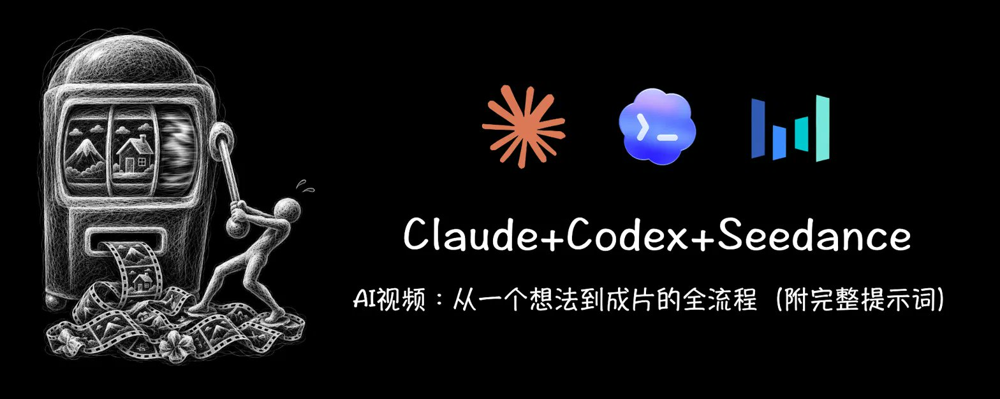
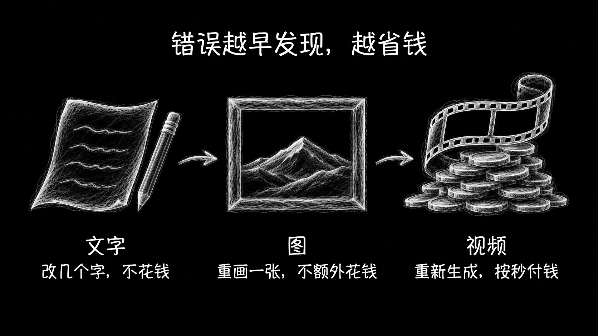
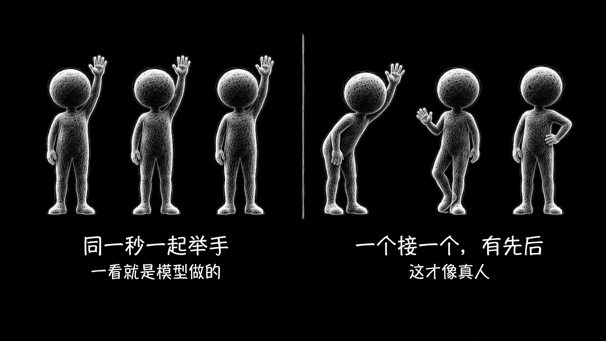
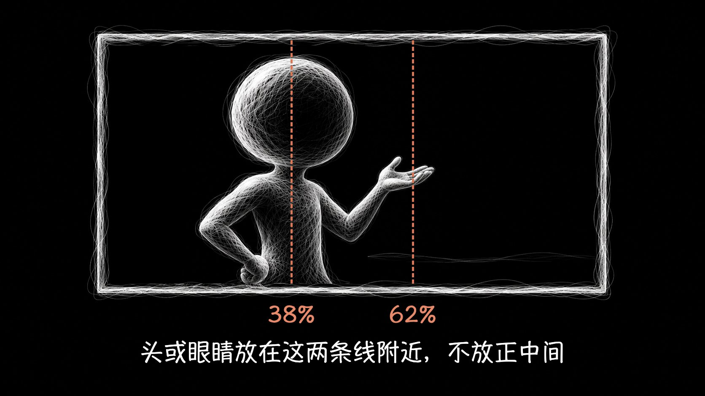
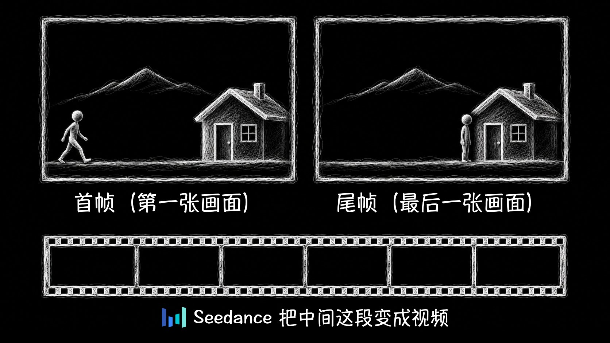
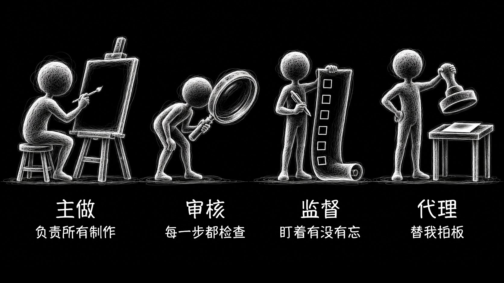

# Claude code/Codex+Seedance AI视频：从一个想法到成片的全流程

> 作者：Eian（@EianLu） · 发布时间：Thu Nov 05 12:20:06 +0000 2026 · [原推文](https://x.com/EianLu/status/2118317430665613741) · [X 长文](https://x.com/i/article/2118298893238845441)



这篇文章只解决一个问题：**怎么靠一套多模型工作流和实际操作过程中需要注意的事项，用尽量少的钱、尽量低的抽卡率，做出一条自己满意的AI视频。**

前几天我发了一条帖子，简单分享了一下我做视频会用到哪些AI，分别是Claude code、Codex、Seedance。

但其实我觉得会用工具其实不是最难的部分，相反还可能是最简单的。

从一个想法开始到做出一部片子，这中间会遇到非常多的问题，比如：模型之间的配合、剧情构思、画面构图、机位摆放、镜头运动，提示词写法、视频抽卡等等一系列问题。

而这些问题我都实际遇到过，也把这些东西总结下来了，写成这篇文章，所以几乎你在视频制作中遇到的绝大部分问题应该都能从这篇文章中找到答案！

文章分为2个部分一个是工具层面，一个是实际操作层面，主要内容是第二部分，从一个想法开始然后一步一步到做出一支完整片子，并给出完整的提示词。

---

## 一、工具层：让 Claude 当总导演，我只和它沟通

我用到的一共有3个模型，Claude code、Codex、Seedance，外加两个工具：ffmpeg 和 Python。

模型之间的分工都是各不相同的，最主要的就是Claude code，它是总导演，而其他2个都接入到Claude中，让Claude去调用就行。


这样设置的一个好处就是全程我就只需要和Claude沟通就好，不需要切窗口，或者到处复制粘贴，非常省事，而且效率很高。

如果暂时没有Claude，那就用Codex也可以，只是我感觉Claude会更聪明一点，然后审美高一些，但具体干的活codex都可以干。

然后就是如何把Seedance和Codex接入Claude Code，非常简单，如果你的电脑上本来就安装有Claude和Codex，你就直接给Claude说图片你去调用Codex生成就行，而Seedance就去火山引擎注册一个账号，然后申请API key，然后你就让Claude自己去把该写的脚本写好，按照它的要求填好Key就可以了，剩下的事情它帮你搞定。

各个模型的分工可以看这张表：

| 角色 | 负责 |
| --- | --- |
| 我 | 选方向、确认画风、批准花钱；看动态、听声音 |
| Claude（导演） | 写故事和分镜，写所有提示词，检查每张图和每段视频，写代码做后期 |
| Codex（画师） | 画设定图、样帧和每个镜头的首尾帧 |
| Seedance（动画师） | 把首尾帧变成几秒钟的视频 |

这种设计的一个重要原则就是：

提示词只要改几个字，重画一张图也不额外花钱，但是重新生成视频却要按秒付钱（都知道seedance有多贵吧！）。

所以能在文字里发现的错，就不要留到图上。

能在图上发现的错，不要留到视频上。



**我把这种协作模式，写成了完整提示词，做视频前先把这段发给 Claude/codex就行：**

```
你当这支短片的总导演，全程负责，我只和你沟通。
开工前先做两件事：
1. 问我：片长、画幅、总预算、要不要配乐和字幕。
2. 检查 Codex、ffmpeg、Python 和 ARK_API_KEY 能不能用，缺什么告诉我。

记住所有文件都放在一个新的项目文件夹里。

分工：
- 你：写故事和分镜，写所有提示词，调用其他模型，抽帧放大检查每张图和每段视频，用 ffmpeg 和 Python 写代码做后期。
- Codex（画师）：画设定图、样帧和每个镜头的首尾帧。你不自己画。

如果你就是 Codex，就用你自己的生图工具。

- Seedance（动画师）：把首尾帧变成几秒钟的视频。

- 我：选方向、确认画风、批准花钱、看动态、听声音。

调用 Codex：
codex exec --skip-git-repo-check -s read-only -i 参考图.png - < 提示词.txt
提示词开头写：Use your image generation tool to create exactly ONE image. Do not run shell commands.
画好的图在 ~/.codex/generated_images/<日志里的 session id>/。

调用 Seedance：
POST https://ark.cn-beijing.volces.com/api/v3/contents/generations/tasks
key 在环境变量 ARK_API_KEY 里，不要打印出来。请求格式查火山方舟文档。
模型选 doubao-seedance-2-5-260628（720p 约 ¥1.5/秒）或 doubao-seedance-2-0-mini-260615（720p 约 ¥0.5/秒），价格以账单为准。

总原则：把错误挡在花钱之前。文字里能发现的错，不留到图上；图上能发现的错，不留到视频上。

规矩：
1. 我确认故事前，不画任何图。
2. 我确认画风前，不画正式镜头。
3. 提交视频生成前，另开一个 agent 审核提示词和图片的每个细节，它只挑错，不改文件。通过后报价，我同意才提交。
4. 视频有问题，先想能不能用代码修，修不了才重拍，只拍这一镜。
5. 新版本存新文件，不覆盖、不删除旧文件。
6. 你看不到真正的动态，也听不到声音。没看过、没听过的东西，要明确告诉我。
7. 不充值，不买额度。接口返回欠费就停，把已有的片段先粗剪给我看。
```

---

## 二、从一个想法到完整视频的全流程

### 1、从一个想法到完整剧情

首先勒你要做一个视频，你自己肯定得有一个想法，就是这大概是个什么样的故事，大概的剧情什么的，然后你就把这个想法或者这个初步的剧情讲给AI听，不用太详细，然后你就和AI聊，让他帮你完善剧情，直到把完整的剧情和故事脉络定稿。

然后我认为一个完整的好故事其实是有标准的，至少需要满足以下几个要求：

**1.1、故事要符合现实逻辑**

故事初稿写出来后，每个转折都要按现实追问一遍：为什么会这样？东西从哪来？够得着吗？现实里真会这样吗？除非你做的视频本来就不要考虑现实逻辑。

**1.2、能用一句话说清想表达什么**

写完问自己：这支片子到底想说什么？剧情哪些地方设计的最好？如果自己都说不出来，那这支片子很可能剧情很平淡，这种情况就在改改。

**1.3、开头就要抓人**

现在我们看一个视频，看几秒就有可能直接划走，所以最抓眼球的画面要放在前面。

**1.4、旁人的反应要像真人**

这其实是非常重要的一点，建议剧情里每个包袱或转折都分3段来写：问题 → 主角怎么解决 → 旁人什么反应。

特别要注意的是反应要有先后，像几个人同一秒举手这种一看就是模型做的，在现实世界里不可能出现好几个人同时举手，非常不真实。



还有些细节也要注意，比如真人吃惊时身体会往后缩这种的。

**1.5、设计的剧情画面要AI拍得出来，或者容易拍出来。**

AI 视频有一些固定的弱点，比如：人物交叉、手拿小东西、文字、镜子和倒影、左右不对称的特征、一镜内换光、一人连做三个动作、俯拍看不到脸、配角太多。这些画面都是非常容易抽卡的，也就是不容易一次到位，所以这些在第一步写故事时就要尽量避开。

还有就是故事结构也要考虑，首选就是片段式，这是最稳的，因为每个镜头之间都不用接戏。而像连贯式的这种剧情结构感觉是最容易穿帮的，也更需要注意每一个片段之间的连接。

**同样整理好提示词，直接发给AI：**

```
我想做的片子：[一句话，或者我的初步剧情]。片长：[秒]。
配歌：[歌名、时长、BPM；不配歌就删掉]。
参考片：[有就写，没有就删掉]。

先帮我把这个想法完善成一个完整的故事。有不清楚的地方就问我，我们一起聊，等我确认了再往下写。
故事结构首选片段式，因为每个镜头之间都不用接戏，最稳。连贯式最容易穿帮，除非我要求，否则不要用。

故事确定以后，展开成逐镜头的故事，要满足下面这些要求：
1. 符合现实逻辑。每个转折都按现实追问一遍：为什么会这样？东西从哪来？够得着吗？现实里真会这样吗？
2. 能用一句话说清想表达什么。先把这句话写出来，说不出来就说明故事还要改。
3. 开头就要抓人。最抓眼球的画面放在前面，写清楚第几秒出现什么。
4. 旁人的反应要像真人。每个包袱或者转折都分 3 段写：问题 → 主角怎么解决 → 旁人什么反应。反应要有先后，不能几个人同一秒做同一个动作。细节也要真实，比如人吃惊时身体会往后缩。
5. 要让 AI 拍得出来。避开这些弱点：人物交叉、手拿小东西、文字、镜子和倒影、左右不对称的特征、一个镜头里换光、一个人连做三个动作、俯拍看不到脸、配角太多。

如果配歌，转折对副歌，关键动作对重拍。
```

到了这个时候，你的故事应该也就差不多定稿了，但是还是不能开始下一步。

强烈建议这个时候再开另开一个 agent 来再次审核一下这个故事，直接对 Claude 说“新开一个 agent 来审这个故事”就可以了，记住只给审核定稿故事就行，其他文件都不要给。

这主要是因为主 agent 已经和你聊了很久，它知道你想说什么，看故事时就会自动脑补。而新开的 agent 什么都不知道，就像第一次看片的观众，哪里看不懂，就说明哪里真的没讲清楚，这对改剧情非常有帮助哈哈。

后面几步的审核步骤也是一样的，只给它故事，不给任何结论，让他根据要求看一遍，给出修改结论。

**可以用这个提示词：**

```
这是一支短片的逐镜头故事。你是第一次看，只负责挑错，不改文件。
1. 只按镜头顺序读，先写出你看懂的故事。
2. 按顺序追问每个转折：为什么会这样？东西从哪来？够得着吗？现实里真会这样吗？
3. 能用一句话说清想表达什么吗？
4. 开头抓人吗？最抓眼球的画面放在前面了吗？
5. 旁人的反应像真人吗？有没有先后？
6. 哪些镜头 AI 视频模型容易拍错？（人物交叉、手拿小东西、文字、镜子和倒影、左右不对称的特征、一个镜头里换光、一个人连做三个动作、俯拍看不到脸、配角太多）
每条写：镜头、问题、建议改法。没把握的写“可能”。最后写“通过”或“不通过”。
```

等到这一步也完成了，写完整剧情这一步就可以彻底定稿了。

### 2、分镜：定镜头语言、构图和配色

这是整个前期准备工作最重要的一步，因为它决定了这个视频的质量，我甚至觉得构图和配色比剧情还要更重要。

故事再好，但是镜头没有设计好，画面就非常平淡。

但是勒镜头语言这个东西对很多人来说其实是很难直接用语言描述出来的，推拉横移机位摆放都是很专业的东西，如果描述不清楚咋办？

最有效的方法就是找参考片。没吃过猪肉还没见过猪跑吗！

然后让 Claude 逐帧看参考片，让它把机位、进出画比例这些都量出来，然后学习模仿。

没有参考片也没关系，那就让claude按下面的要求自己构思。

但是每个镜头都要写清：景别、机位、运镜、谁往哪走（写画面左右）、靠什么表情推进、怎么转到下一镜。

具体可以参考一下下面这些要求：

**2.1、每镜换角度**

我的经验是全片平视正面最多两次，其余就用俯拍、仰拍、从背后、过肩、透过东西拍这些机位来拍。

机位越多，画面就越丰富。

**2.2、画面里要一直有东西在动**

如果一个镜头里人站着不动，东西也不动，观众看起来就像在看一张图片，

这就是我说的画面死了的意思。

所以大多数镜头里，最好都有人或者东西从画面外面走进来，或者从画面里走出去，这就要求需要把每个镜头中人怎么走设计清楚。

如果这个镜头里的人就是不走动，比如这个镜头的设计就是他一直坐着，那就让别的东西动起来，比如飘过去的一张纸，或者从他身后走过的路人。

还有一种情况是摄影机从头到尾都不动，这种就叫固定机位。

但我觉得固定机位很难用，如果用不好，画面就非常容易变得呆板，所以更要让人在画面里走动，比如从远处走到近处。

另外也不要连着好几个镜头都是一样大小的画面，比如连着几个都是拍全身。全身、半身、脸部特写这些都要换着来。

**2.3、每个镜头都要写清楚具体是什么在运动**

写每个镜头之前，先问自己一句：这个镜头里到底是什么在动？可以是摄影机在动，可以是焦点从一个人换到另一个人，可以是光线在变，也可以是镜头前面有东西飘过，或者只是人物的一个小动作，比如手在抖这种。

这些里面至少要有一样。如果一样都写不出来，说明这个镜头还没想好，要重新构思。

但也不是动得越多越好，全片一直晃、一直动也不行。

该动的地方动，该静的地方静，这样才有对比。

**2.4、镜头运动要有理由，不能为了动而动。**

摄影机动一下，一定是因为有东西想给观众看。最常用的有三种：

第一种是跟着一个东西走或者一个人物走，比如一封信飞到哪，镜头就跟到哪。

第二种是慢慢推近给特写。

第三种是一开始拍得很近，再慢慢拉远，由近到远。

**2.5、每一秒截图都要好看**

片子停在任何一秒，截下来的图都应该好看。

最简单的办法就是用黄金比例构图法，简单点说勒就是让人的头或者眼睛落在画面从左往右大约 38% 或者 62% 的位置，而不是放在画面正中间。不理解也没是，给你的AI说尽量用黄金比例构图就行。



**2.6、配色要单独设计**

配色不要交给模型自己发挥，要在画第一张图之前就确定好。

这里就自己按照自己的喜好来。

这里有一个小窍门，设计好配色后一定要让 Claude 把每一场用什么颜色单独列成一张色表。

最后再把画面转成黑白让claude看一遍，如果转成黑白以后人和背景区分不开，就说明明暗对比不明显，这个时候就要重新调配色。

**这些要求我也整理成了提示词：**

```
把定稿的故事写成分镜表。每个镜头一行，写清楚：片中时间（配歌就按小节算）、生成秒数（片中时长向上取整，尽量多留 0.5 秒）、景别、机位、运镜、谁往哪走（写画面的左右）、靠什么表情推进、这个镜头是什么在动、怎么转到下一个镜头。

如果有参考片，先逐帧看参考片，把机位、进出画比例这些都量出来，然后学习模仿。没有参考片就按下面的要求自己构思。

要求：
1. 每个镜头换角度。全片平视正面最多两次，其余用俯拍、仰拍、从背后、过肩、透过东西拍。
2. 画面里要一直有东西在动。大多数镜头都要有人或者东西走进画面，或者走出画面。人不走动的镜头，就让别的东西动起来，比如飘过去的一张纸，或者身后走过的路人。固定机位更要让人在画面里走动，比如从远处走到近处。
3. 不要连着好几个镜头都是一样大小的画面，全身、半身、脸部特写要换着来。
4. 每个镜头都要写清楚是什么在动：摄影机、焦点、光线、镜头前面飘过的东西，或者人物的小动作，至少要有一样。也不要一直动，该动的地方动，该静的地方静。
5. 镜头运动要有理由：跟着一个东西走，慢慢推近给特写，或者从近处慢慢拉远。
6. 每一秒截图都要好看。人的头或者眼睛落在画面从左往右大约 38% 或者 62% 的位置，不要放在正中间。

配色要单独设计，在画第一张图之前定好。我想要的配色：[我的喜好；没想好就给我几个方案选]。
把每一场用什么颜色单独列成一张色表。

最后用代码给每个镜头画一张 1920×1080 的色块草图，标出 38% 和 62% 的位置和主要的东西，拼成一张总表给我确认。再把草图转成黑白看一遍，如果人和背景区分不开，就说明明暗对比不明显，要重新调配色。
```

### 3、定画风，画设定图

分镜定好以后，接下来就是要确定画风了。

画风就是这部动画的绘画风格，比如宫崎骏的动画就是手绘、柔和、颜色温暖这种的。

也有线条简单，像剪纸的风格，或者写实的画风，看起来就比较像真的照片，然后还有美国动画这种的，手绘线条感。

这个还是有参考图最好，发给ai就行。

这一步由Claude 负责写提示词，Codex 负责画，我们自己负责看是不是想要的这种风格就好。

画风定下来以后，再给每个角色和固定的道具画一张设定图。

一般来说就是这个人的正面、侧面和几个表情，这一步就相当于把他的长相定下来。

人物身上固定的东西一定要写清楚位置，比如纹身在左手臂上，不然后面每张图的纹身位置都可能不一样。

### 4、出每个视频片段的首尾帧图片

画风和设定图都确定了之后，就可以开始画每个镜头的首尾帧了。

首尾帧就是这个镜头的第一张画面和最后一张画面。



这是降低抽卡率最关键的一步。

因为如果只靠文字生成视频，模型很容易出逻辑错误。

而且有些东西，比如雨、帽子、纹身，只写在文字里的根本不行，经常拍着拍着就没了，所以这些小物件必须在首帧和尾帧都画上才稳当。

画的时候按这个顺序来：

- 不要一上来就开画，让AI把每个镜头的首帧画什么、尾帧画什么、中间发生什么都写出来，让审核agent审核过了再画，这样能省很多 Codex 额度。（一个非常离谱的事情是自从openai合并额度之后，我感觉生成不了几张图片就没有额度了）

- 先画内容最多的那张，一般就是尾帧，然后在尾帧上改出首帧，这样可以保证两张图的摄影机位置和构图是一样的。

- 画同一个地点、同一个机位的镜头，直接在前一张图上改，不需要重新画，codex支持图片的局部改动。

- 如果镜头的运动设定是要慢慢推近，那尾帧可以直接把首帧裁一块然后放大。因为如果首帧和尾帧的构图完全一样，那这个镜头就等于不动，再生成视频的时候就没有慢慢推进的效果。

- Codex 出的图不一定正好是 16:9，提交给 Seedance 之前要检查一遍，有问题要提前让ai裁好，首帧和尾帧的尺寸也要保持一样。

**还有这些地方很容易出错，画完也要让ai检查一遍，我整理成了提示词，发给AI，让他照着检查：**

```
首尾帧画完了，帮我按下面这些逐条检查，每张图都要放大看。有问题就告诉我是哪张图、哪里不对，我同意了再改。
材料：[首帧]、[尾帧]、[设定图]、[这个镜头的分镜]

1. 动作要用到的东西，首帧里必须有。比如后面要拿杯子，首帧里就要看得到杯子，否则杯子会凭空冒出来。
2. 别人的反应要提前摆好。一段视频就是一个镜头，没法中途切过去拍别人，所以首帧里要安排好：一个人在前面做事，另一个人在后面，脸朝着镜头。
3. 很多人一起出现时，不能摆同一个姿势，不然模型会让所有人同时动。
4. 给动作留出空间。东西要落到、飘到的地方要提前空出来，人的头顶也要留点空。
5. 风往哪边吹要统一，不能围巾往左飘，床单却往右飘。
6. 缩小到手机大小看一遍，远处的人太小、看不清就要改。
7. 放大看有没有多余的东西，比如多一个水壶，或者多一条奇怪的细线。
8. 把首帧和尾帧叠在一起看有没有错位。不该变的地方两张图必须一样。比如墙的颜色不一样，视频里墙就会慢慢变色；杯子大了一点，视频里杯子就会慢慢变大。

要改图的时候注意两点：
- Codex 就算只改一小块，也会把整张图重新处理一遍。所以只改一小块时，要把改好的那一块贴回原图。
- Codex 的额度用完了就等它恢复，不要买额度，也不要一次同时画太多张。
```

### 5、写视频提示词，提交前审核

首尾帧画好以后，就可以写视频提示词了。

我之前每次遇到生成的画面有问题，我就觉得是视频模型不行，但后来我发现很多时候都是提示词的问题。

所以出了问题要先怀疑提示词，然后再去怀疑模型，当然了怀疑了也没撒用，还是得老实重新拍，但是无论如何都要把提示词写精细。

这里我强烈推荐固定用七段式的提示词，把每一秒发生什么都写下来：

```
【画风】[一句话写画风，比如：干净的现代 2D 手绘动画，平涂色块，线条利落，没有颗粒和纹理]。整段的画风、颜色、人物设计与首帧和尾帧完全一致。
【镜头】整段 [X] 秒，[景别]，[机位]，[运镜；不动就写“不推不拉不摇，不切镜”]。
【构图与配色】[人和东西在画面哪里，墙和光是什么颜色。要和首帧对得上]
【人物】[每个人的长相、衣服、固定道具，写死]
【逐秒】
0–0.2 秒：画面完全静止，和首帧一模一样。
[每一段：谁做什么，表情怎么变，手放在哪、不能碰什么，往画面哪边]
最后 0.3 秒：所有人完全停住，画面与尾帧完全一致。
【声音】只有 [看得见原因的声音]。人物不说话。
【约束】画面里一直只有首帧这几个人和这些东西，脸和身形全程不变，一镜到底。画面干干净净，没有文字、字幕、水印。

```

下面这张表是模型最容易犯的错，以及我试过的有用的写法，写提示词的时候可以对着查一下：

| 模型容易犯的错 | 应该怎么写 |
| --- | --- |
| 一群人同时做同一个动作 | 写清楚谁先谁后：“老爸第一个……过一两秒老奶奶才……小女孩最后……”，首帧也不要摆同一个姿势 |
| 本来该风做的事，人自己动手做了，比如邮差用手掀开邮包 | 写清楚原因，再写上“两只手从头到尾都没有碰邮包” |
| 云、月亮、植物长出眼睛和嘴巴 | 不要写“卡通云”，要写“蓬松的灰白色积云，只有棉絮一样的纹理和阴影”，动作也只写它怎么移动 |
| 人往反方向走 | 方向要按画面来写：“朝画面左边走，跨过左边的店门” |
| 一句话有两种意思，比如写“窗户后面的老人”，结果车里冒出了人 | 写得更具体：“左上角石头房子的窗口里”，再加上“驾驶座一直空着” |
| 东西的数量变了 | 把数量直接写出来：“只有一封黄信封，之后他怀里全是白信封” |
| 写“不要怎么样”经常没用，比如写了“壶嘴不出水”还是出水 | 尽量改成正面的说法：“画面里一直只有首帧这几个人” |
| 模型会自己联想道具的用法，比如壶总是出水 | 干脆不让这个道具出现在有动作的镜头里 |
| 东西凭空出现 | 只用首帧里已经有的东西 |
| 东西突然飞走或者瞬间移动 | 写清楚它是怎么动的：“顺着后脑勺往后一滑，接住，扣回头上” |
| 雨、帽子、纹身拍着拍着就没了 | 首帧和尾帧都画上 |
| 闪电画得太写实 | 写“云里闪一下白光”，再把开头剪掉 |
| 一个镜头动作太多就乱了 | 每个镜头只写一两个主要动作 |
| 动作的时间和写的不一样 | 写的时间只能算大概，多留一点时间，后期再用剪辑和变速对上节拍 |
| 镜头推得没有写的那么明显 | 后期让 Claude 用代码再推一点 |
| 人的嘴自己在动 | 写明“人物不说话”，还动就用代码修 |
| 写了“没有音乐”还是混进了音乐（Seedance 2.5） | 片段自带的声音不用，后期另外加 |
| 结尾几帧突然跳到尾帧的样子（Seedance 2.5） | 后期选一张没问题的画面，后面都停在这一张 |
| 第一张画面特别锐（Seedance 2.5） | 直接把这一张去掉 |
| 视频越到后面越暗越冷（Seedance 2.0 mini） | 每条视频都按它自己的首帧把颜色调回来 |

还有一个我经常用的方法就是：每条视频提交之前，都要另开一个 agent，把提示词和图片的每个细节核对一遍。它审核通过之后才能提交给seedance。

这一步非常有用，我用这个方法帮我查出过很多问题，比如两张图里的杯子大小差了 13%，帽檐一张有一张没有，左右写反了。

这也是我的抽卡率极低的原因。

**提交前审核的提示词，新开一个 agent 发给它：**

```
你是审核，只读不改。这个镜头马上要提交视频生成，花的是真钱。
材料：[提示词文件]、[首帧]、[尾帧]、[设定图]、[分镜表]、[配色规则]。
逐项核对，放大看图：
1. 提示词的每句话和两张图对得上吗？（位置、左右、颜色、人数、道具数量、衣服、表情）
2. 两张图的机位、大小、背景一致吗？
3. 和设定图、配色规则、前后镜头对得上吗？
4. 动作现实吗？每个动作的原因写了吗？手放在哪？
5. 模型可能在哪里出错？（同时动作、凭空出现、长脸、走反方向、歧义词）
最后只写“通过”或“不通过”。不通过就逐条列出要改什么。
```

### 6、生成视频

这一步就很简单了，都是ai自动完成的，我们不用管。

**但是有一些省钱小技巧可以发给你的ai：**

- 用 720p 生成，后期再放大到 1080p。

- 不用专门拍测试片，直接拍第一个正式镜头，如果能用就赚了。

- 新的做法先拿一两个最难的镜头试一下，行得通再全部提交。

- 想清楚要不要用 Seedance 2.5。它的价格差不多是 2.0 mini 的 3 倍，预算紧的话就用 2.0 mini。（我感觉只要不是特别复杂的镜头，很考验模型的能力，用2.0mini就很够用了）

- 声音要听过再用。2.0 mini 自带的音效经常能直接用。2.5 就算写了“没有音乐”，有时候还是会混进音乐，这种就不要用了，音效后期可以另外在加。

发现问题也不要马上重拍，因为重拍又得花钱，可以从下面几个方面看看能不能处理一下：

1. 能不能剪掉？如果问题只出现在开头或者结尾那几帧，直接剪掉就行。

2. 能不能用代码修？让 Claude 尝试一下写代码修，修不好再考虑重拍。

3. 如果要重新拍就要先改提示词或者首尾帧图片，不然原样再拍一次大概率还是错的。重新拍完之后，旧片段也不要删。重拍的新片段不一定比旧的好，都留着，最后放在一起挑，都是花钱拍出来的，可以用就都用上。

### 7、拼接、转场、调色、放大

由于我们的视频是一段一段生成的，生成完了之后就要开始把每个段拼在一起然后生成完整的视频，然后加转场、调色、放大这些。

建议全部用代码做，让 Claude 来做就行。

**这些同样整理成提示词，发给 ai：**

```
用代码做后期：
1. 转场：[哪一镜到哪一镜，用什么东西盖屏或带过去]。运动模糊切 8–16 份，半帧快门。
2. 调色：按故事分段。只调彩度和亮度，不动色相，强调色受保护，肤色不变。不加颗粒、柔光、暗角。
3. Seedance 的 mp4 按 BT.601 解码，中间文件用无损格式，交付标 BT.709。
4. 放大：720p 用 lanczos 放大到 1080p，加轻微锐化。不用整段插帧。
5. 按小节卡点：拍点只从原曲上测，不要在剪过的文件上测。
做完抽查切点前后 3 帧。
```

### 8、全片复核和交付

这一步勒就是再新开一个审核 agent，只给它成片，不告诉它任何结论，让它像观众一样从头看一遍。

然后就是让AI写一份总结，把画风、提示词、犯过的错误都存好，就是把你每一次做视频的经验沉淀下来。

**全片复核的提示词，新开一个 agent 发给它：**

```
这是成片：[文件]。你第一次看，我不告诉你任何结论。
1. 全部解码，每镜取多张全分辨率帧，切点前后各取 3 帧。
2. 先写你看懂的故事，再列看不懂的地方。
3. 逐镜查：重复的动作、道具数量、穿帮、突跳、颜色跳变、脸变形、字的问题。
4. 明确写出你查不了的东西（动态手感、声音）。
每条写：时间、帧号、问题。分“硬伤”和“小问题”。
```

## 最后再分享一下我的四线程工作模式

这个主要是针对claude或者codex的，也就是导演。

简单来说就是开四个 agent 一起配合着让Claude把导演这个活干好。



分别是下面4个：

| 角色 | 负责什么 |
| --- | --- |
| 主做 | 负责所有制作 |
| 审核 | 每一步都检查，提交生成视频之前必须写“通过” |
| 监督 | 把我说过的所有话列成清单，盯着大家有没有忘记 |
| 代理 | 按我平时的选择替我做决定，在我事先同意的预算内批准提交 |

另外三个 agent 都是 Claude 自己开子agent的，你只要把下面这段提示词发给它就行。

**四线程的提示词：**

```
这支片子用四线程来做。你当主做，再开三个子 agent，四个一起配合，一直做到片子做完，或者账户欠费为止。
我说过的话在：[对话记录或者要求文件的路径；Claude Code 的记录在 ~/.claude/projects/ 下]。
总预算：¥[金额]。

分工：
- 主做：就是你，负责所有制作。
- 审核：开一个子 agent，只挑错，不改文件。每一步都要查，提交生成视频之前必须明确写“通过”。
- 监督：开一个子 agent，读完我说过的所有话，整理成要求清单。每一步都查有没有人忘了要求，包括你。
- 代理：开一个子 agent，读完我说过的所有话，整理成我的偏好。你和审核拿不准，或者要提交生成视频时，由它按我的偏好来决定，并写明依据和把握。它只能在总预算内批准提交，超过预算就停下来等我。

配合的顺序：
1. 你每做完一步，先交给审核，再交给监督。
2. 有分歧就交给代理决定。
3. 所有决定和花费都记进审核记录，我回来可以推翻任何决定。

不充值，不买额度。欠费就停，先把已有的片段粗剪出来给我看。
```

---

最后，我觉得做视频是一件非常有意思的事情，

但是如何把一支片子做好其实是非常难的，

我也一直在学习，希望这篇文章对你有用。

我是 Eian，谢谢支持！

---

*来源：<https://x.com/EianLu/status/2118317430665613741>；公开内容存档，版权归原作者所有。*
