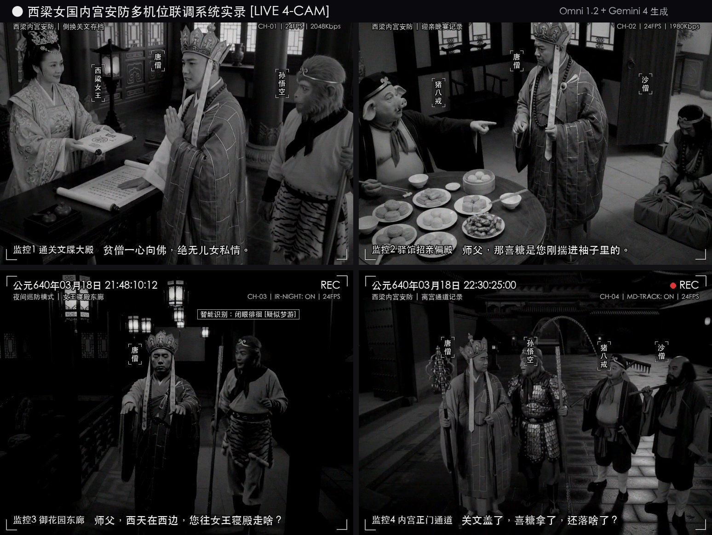
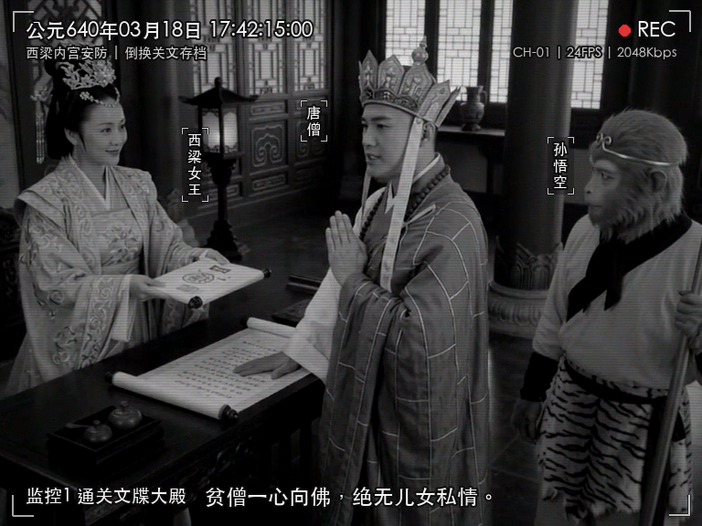
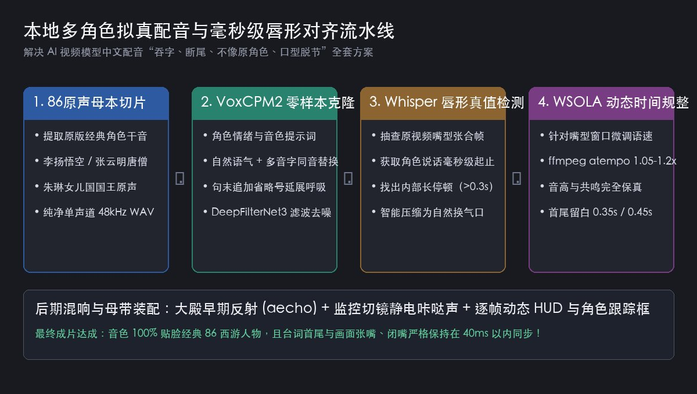
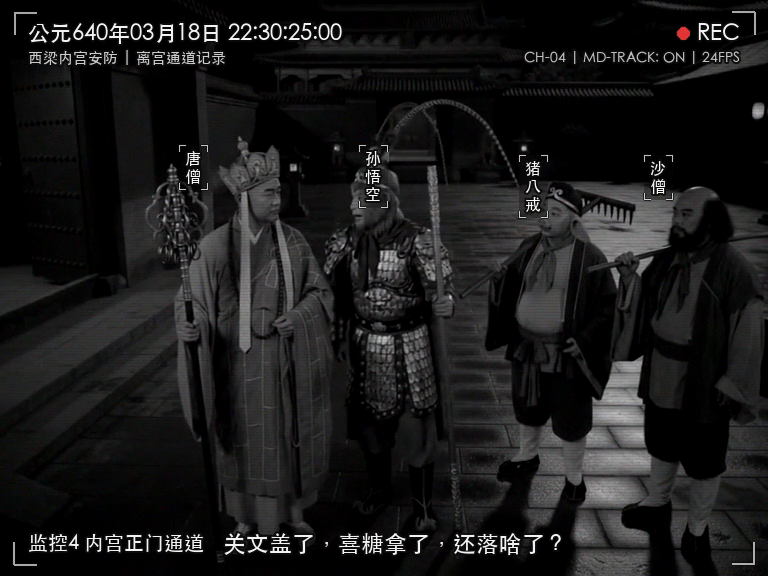

# 一个人指挥一支 AI 剧组：Gemini 4 + Omni 1.2 剧情短片制作保姆级教程

> 作者：刘老板（@leo_xiaolei） · 发布时间：Wed Nov 11 03:11:49 +0000 2026 · [原推文](https://x.com/leo_xiaolei/status/2120353779455512776) · [X 长文](https://x.com/i/article/2120347590797778944)


脑子里只有一个模糊的点子，怎么用 AI 把它拍成一支画面稳又好笑的完整成片？这篇文章就聊透这件事。

现在 AI 视频很火，特别是 Omni 1.2 出来之后，大家都在聊怎么写提示词、怎么抽卡。

但我做完几支片子下来，感触很深。会用视频生成工具，反而是整件事里最简单的部分。

真正让人头疼的是后面的全套制作：怎么把一句话点子扩成有反转的剧本，怎么让五六个镜头里的人物长相和衣服不串戏，怎么解决视频模型说中文容易吞尾音、读错多音字的老毛病，以及怎么用代码把后期字幕、界面和混音做干净。

前几天我用 Gemini 4 配合 Omni 1.2，做了一系列古装监控视角的西游记喜剧（比如《真假美猴王》和《西梁国留婚》）。



图：成片《西梁国留婚 · 监控实录》四机位安防监控画面

很多朋友问这支片子是怎么做出来的，配音咬字不准是怎么修的，画面上的监控框和时间戳又是怎么加的。

今天我就把这套从零到成片的制作流程全部摊开讲清楚。每一个步骤我都整理成了现成的提示词，你可以直接复制发给你的 AI 照着做。

整套流程一共分 7 步：

想法 → 剧本 → 分镜 → 视频提示词 → 浏览器自动生成 → 本地模型重配音 → 代码后期与全片复核

在进正题之前，我们先花两分钟把用到的工具和各自的分工理清楚。

## **一、先说一下用到的工具和它们各自干什么**

做一支片子，我一共用到四个工具：

1. **Gemini 4（在 Antigravity 里使用）**：总导演兼程序员

2. **Omni 1.2（在 Google Flow 里使用）**：摄影师兼演员

3. **VoxCPM2 + Whisper（本地运行）**：配音师兼台词质检员

4. **Python + ffmpeg**：剪辑师兼后期特效师

为什么要这么搭配？

因为我太讨厌在十几个网页和软件之间来回切了。我最理想的工作方式，就是只跟 Gemini 4 一个人说话，剩下的脏活累活全由它去调度别的工具干完。

**它们四个具体是这么配合的：**

| 工具 | 扮演角色 | 具体干什么活 |
| --- | --- | --- |
| **Gemini 4** | 总导演 | 帮我把想法扩写成剧本，拆好分镜，写出精确到秒的视频提示词。接着它自己连上浏览器去点 Google Flow 生成视频，生成完自己抽帧检查画面，调本地语音模型重配台词，最后写 Python 和 ffmpeg 脚本把成片拼好交给我。 |
| **Omni 1.2** | 摄影师 + 演员 | 接收分镜提示词，在浏览器里生成单段 8 到 12 秒的视频片段，把人物动作、表情神态和环境声音演出来。 |
| **VoxCPM2 + Whisper** | 配音 + 质检 | 视频模型直出的中文配音经常有口音、吞尾字或者读错多音字。VoxCPM2 负责按角色生成 48kHz 高清干音，Whisper 负责把每个字的时间戳对齐到毫秒，检查有没有漏字错字。 |
| **Python + ffmpeg** | 后期剪辑 | 用代码给画面逐帧画上监控边框、动态时间码和底部大字幕，给台词加上大殿空间混响，做切镜音效和最终拼接。 |

你看。在这套配合里，你不需要自己去 Google Flow 里一条一条粘贴提示词，也不用打开剪映去手动对齐十几条音轨。

你只管坐着当出品人。看 Gemini 4 交上来的阶段成果，告诉它哪里好、哪里要改就行。

## **二、全流程：从一个想法到完整成片**

下面我们按实际做片子的顺序，一步一步拆开看。

### **1、从一个想法到完整剧情**

很多人做 AI 视频，第一步是直接写提示词去生成画面。

必翻车。因为没有剧本支撑，生成的只是一堆好看但没头没尾的空镜头，观众看三秒就划走了。

那刚开始只有一个模糊的想法（比如“想用现代监控视角拍西游记女儿国留婚”），怎么把它变成一个能拍的好故事？

我总结了 5 条实战经验：

**1.1、学参考片的思路，不抄它的皮肉**

看到一支好片子，不要去照搬它的台词和老梗。

你要让 Gemini 4 帮你拆出它的结构。它为什么好笑？是因为极其现代严肃的画幅（比如监控录像或执法记录仪），装进了极其古典荒诞的人物关系。

把这个反差逻辑抽出来，换上你自己的故事和包袱，长出来的就是你自己的作品。

**1.2、选模型最稳的“多机位片段式”结构**

现在的视频模型，最怕长镜头里连续走位还要接上下一个镜头的动作。

怎么破？直接从剧本结构上绕开。

比如做成 5 个固定监控机位，从“迎宾大殿”切到“后花园凉亭”，再到“偏殿耳房”、“夜间寝殿走廊”和“城门通关处”。

每个镜头都有独立的机位和场景，自己就能撑起一个小高潮。镜头之间靠切镜咔哒声连接，根本不需要硬接上一个镜头的动作，模型生成的成功率直接翻倍。

**1.3、每个镜头内部都要有“正经场面 → 动作穿帮 → 旁人点破”**

一段 12 秒的视频，如果三个人只是站着聊天，画面会非常无聊。

好笑的喜剧镜头，一定是嘴上说得冠冕堂皇，手脚却在干相反的事。

举个例子。唐僧嘴上念着“贫僧一心向佛，绝不留恋红尘”，结果左手单掌行礼，右手却死死按住桌上的通关文牒和婚书不撒手，连指节都用力发白了。旁边孙悟空凑近一指：“师父，那你先把婚书松开呀！”

这种用动作戳穿台词的设计，AI 演出来特别有戏。

**1.4、写剧本时就要避开视频模型的短板**

有些戏写出来很容易，但视频模型拍出来必崩。写剧本阶段就要直接砍掉：

- 不要写多人打斗、手脚缠在一起的戏，手脚大概率会穿模。

- 不要写角色当着镜头往嘴里塞东西吃、倒水喝水，液体和吞咽动作很容易假。

- 不要让画面里的角色超过 3 个人，人一多，模型就分不清谁在说话，嘴型会乱配到别人脸上。

- 尽量让同一个时间点只有一个人开口说话，不要写两个人同时抢话。

**1.5、让 AI 换个身份给剧本挑刺**

Gemini 4 顺着你的意思写完剧本后，如果你直接问它“写得好不好”，它肯定夸自己写得好。

这时候你要让它切换到“挑刺审核”的角色，专门找逻辑硬伤、包袱不响或者模型拍不出来的地方。

**写剧本的提示词，可以直接复制发给 Gemini 4：**

```markdown
我想做一支 AI 视频，初步想法是：[填写你的想法，比如：用现代高清监控视角拍西游记女儿国留婚，共 5 个机位，总长约 60 秒]。
参考片亮点：[如有参考片，写明你想借鉴的节奏或反差感，要求学思路不抄袭剧情]。

请你先不要写分镜，先帮我打磨剧本大纲和分场剧情：
1. 故事结构：采用 5 个独立机位的片段式结构，每段 11-12 秒，段与段之间自然推进，最终在最后一镜完成大反转。
2. 戏剧反差：每一镜都要遵循“表面一本正经 → 手上小动作穿帮 → 旁人一句话点破”的喜剧节奏，用具体的肢体动作制造笑点，不要靠干聊。
3. 规避模型弱点：每镜画面不超过 3 人，同一时刻只有 1 人开口说话，不出现打斗缠抱、吃喝吞咽或复杂手指特写。
4. 台词要求：口语化、接地气、符合人物性格，每镜台词控制在 2-3 句（总字数 28-36 字以内），留出动作和反应时间。

请先输出 5 镜的剧情梗概、每镜核心包袱和台词初稿。
```

**审核剧本的提示词：**

```markdown
现在请你忘掉刚才创作者的身份，扮演一个挑剔的喜剧导演兼 AI 视频技术总监，审视上面这份剧本：
1. 哪一镜的包袱太老套或者只靠嘴说、缺少可视化的动作反差？
2. 哪一句台词字数太多，放进 12 秒视频里会导致语速过快或结尾被截断？
3. 哪一镜的动作设计超出了当前视频模型的能力边界，容易出现穿模或乱动？
4. 角色每一镜的动机是否连贯？
请直接列出问题清单并给出修改后的剧本定稿。
```

### **2、分镜：定机位、人物特征和动作反差**

剧本定下来之后，先别急着去生成视频，得先把分镜表拆出来。

很多人觉得分镜就是把剧本切成一段一段。其实拆分镜主要就干两件事，一是定好**机位怎么摆**，二是**让五段视频里的人物看起来是同一拨人**。



图：分镜构图与动作反差设计（金銮殿婚书拉扯）

**2.1、固定机位比运镜更好用**

如果你做的是剧情喜剧或者监控题材，强烈建议全程用固定机位（比如天花板右上角 35 度斜俯拍广角镜头）。

为什么？

因为一旦让模型同时处理“推拉摇移运镜”和“多人物精细表情动作”，画面边缘很容易扭曲变形。

把机位锁死在墙角高处，模型就能把全部算力花在人物的眼神、手部小动作和衣服褶皱上，出来的画面扎实得多。

**2.2、用“固定外貌词”锁死跨镜头人物一致性**

如果你不提供参考图、纯靠文生视频，怎么让第一镜的唐僧和第五镜的唐僧长一样？

办法很直接。给每个角色写一段 30 字左右的“外貌服装死描述”，在每一镜的提示词里原封不动地复制粘贴进去。

比如唐僧，在所有镜头里都固定写：身披大红织金锦襕袈裟，内穿素白僧衣，头戴五佛宝冠，面容白净端庄但眼神慌乱的年轻唐僧。

哪怕换了场景，只要这段描述一字不改，Omni 1.2 生成出来的角色辨识度就会非常统一。

**2.3、加一镜“红外夜视黑白画面”拉开视觉节奏**

五个镜头如果全是白天差不多的宫殿暖光，观众看到第三镜就会审美疲劳。

我们在第四镜（夜间走廊偷塞御弟金印）专门设计成了**黑白高对比度的红外夜视监控画面**，人物眼珠在红外补光灯下微微反光，画面带一点点夜视噪点。

到了第五镜城门送别，再切回清晨明亮的阳光画面。这一暗一亮，整支片子的节奏感一下就活了。

**写分镜表的提示词，直接复制发给 Gemini 4：**

```markdown
剧本已经确认。现在请为这 5 个镜头编写详细的《分镜设计表》，用表格加分镜卡片的形式输出，每一镜必须包含：
1. 镜号与场景名称（含时间、地点、光照模式：白天常规彩色 / 夜间红外黑白）。
2. 机位与构图（固定高角度斜俯拍监控广角，明确画面左、中、右分别站着谁，前景和背景有什么核心道具）。
3. 角色外貌锁死词（为每个出场角色编写固定的服装、头饰和长相特征词，跨镜头保持完全一致）。
4. 动作时间轴：按 [00:00-00:04]、[00:04-00:08]、[00:08-00:12] 三段，写清每个角色的具体肢体动作（手放在哪、眼神看哪、身体往哪偏）。
5. 精确台词与开口顺序（标明谁先说、谁后说、说话时的微表情）。
```

### **3、写视频提示词：按时间轴卡死动作与台词**

分镜表是给人看的，视频提示词是给 Omni 1.2 看的。

我们在实测 Omni 1.2 的过程中踩了不少坑，先给你看一张总结好的避坑表，能帮你省下一半的废片算力：

| 常见翻车现象 | 为什么会这样 | 提示词里怎么解决 |
| --- | --- | --- |
| **最后一句话没说完视频就停了** | 12 秒视频如果把台词排到第 11 秒，模型稍微慢半拍就会在最后半秒被硬生生腰斩 | `[00:08-00:12]` 的台词必须在第 10 秒前说完，最后 1.5 秒明确写成“保持表情定格与眼神对视，不再开口说话” |
| **长句子中间莫名其妙吞掉半句** | 一口气写三四个分句，模型来不及换气，会跳过中间分句直接念结尾 | 单句台词拆短，中间多用句号和感叹号断句，每段台词控制在 10 到 14 个字以内 |
| **多音字、现代词在古装戏里读错** | 比如古装画面里说“监控”，模型会受古装语境影响读成“中宫”，说“为师”容易读成四声“喂师” | 提示词里直接用同音单音字替换（比如把“为师”写成发音唯一的“维师”），或者留到后面用本地语音模型重配 |
| **画面上自己长出乱码英文字母** | 提示词里写了“监控画面、带时间戳和字幕”，模型就会自己画一堆扭曲的假字 | 提示词末尾必须加死命令：`画面纯净，不带任何文字和水印，也没有字幕或监控边框`（所有监控界面留到后期用代码画） |
| **没说话的人嘴巴也在跟着乱动** | 没写清楚谁在说话、谁在闭嘴听 | 每次有人开口时，明确写上：`仅A开口说：“……”，B与C全程紧闭双唇不说话，只做表情反应` |

摸清这些脾气之后，我们的视频提示词就有了非常清楚的模板结构：

**【画风与机位】+【场景与固定人物外貌】+【0-4秒动作台词】+【4-8秒动作台词】+【8-12秒动作与定格留白】+【声音与纯净画面要求】**

给你看一段我们拍《西梁国留婚》第一镜实际用到的提示词：

```markdown
固定高角度监控广角俯拍镜头，真实古装影视质感，86版西游记美术风格，光线明亮清晰。
场景为西梁女国金銮宝殿内部，红柱金砖，中央摆放一张雕花长案，案上放着明黄色的通关文牒与大红婚书。
画面左侧站着女王（头戴九凤朝阳金冠，身穿大红绣金凤袍，容貌端庄华贵）。画面中央坐着唐僧（头戴五佛宝冠，身披大红织金锦襕袈裟，内着白僧衣，面容白净）。画面右侧站着孙悟空（金冠金甲，毛脸雷公嘴，手持金箍棒）。

[00:00-00:04] 女王面带温柔笑意，双手捧起案上的大红婚书推向唐僧，仅女王一人开口用清晰标准普通话温柔说道：“御弟哥哥，留下成亲，这江山都是你的。”唐僧与孙悟空紧闭双唇不说话。
[00:04-00:08] 唐僧立刻脸色微红，左手竖在胸前单掌行礼，但右手却死死按住桌上的大红婚书往自己怀里拽，指节用力，仅唐僧一人开口用清晰标准普通话急促说道：“陛下使不得！贫僧刚才没说清楚！”女王与孙悟空闭嘴观看。
[00:08-00:12] 孙悟空往前凑近一步，低头盯着唐僧按住婚书的右手，伸手指着婚书，仅孙悟空一人开口用清脆标准普通话调侃道：“师父，那你手先松开呀！”说完后最后1.5秒三人保持动作定格与眼神交锋，不再开口说话。

环境音为安静的宫殿室内自然混响与衣料摩擦声，无背景音乐，画面纯净无任何文字，无字幕无水印，无监控UI边框。
```

**让 Gemini 4 批量写视频提示词的模板：**

```markdown
请根据确认好的分镜表，为全部 5 个镜头编写可直接提交给 Omni 1.2 的中文视频提示词。
严格遵守以下 5 条铁律：
1. 结构按【画风与机位】【场景与人物位置外貌】【00:00-00:04】【00:04-00:08】【00:08-00:12】【声音与画面纯净度要求】分段。
2. 每个时间段内只允许 1 个角色开口说话，必须写明“仅X一人开口用清晰标准普通话说道：‘……’，其余人紧闭双唇不说话”。
3. 台词里的易错多音字直接替换成同音单音字（例如“为师”写为“维师”），单句不搞复杂长从句。
4. [00:08-00:12] 段落必须在第 10.5 秒前说完台词，最后 1.5 秒写明角色保持表情与动作反应，不再说话，防止尾音被切。
5. 结尾统一写明：无背景音乐，画面纯净无任何文字，无字幕无水印，无UI界面。
```

### **4、浏览器全自动生成：让 Gemini 4 接管 Flow**

提示词写好之后，以前的做法是人坐在电脑前，打开 Google Flow 网页，选好模型改好设置，先粘贴第一条，等它跑完了点下载，再接着粘第二条……

太累了。现在完全不用这么干。

你可以直接给 Chrome 浏览器开一个远程调试端口（比如 9222 端口），让 Gemini 4 通过 Chrome DevTools 协议自己接管浏览器。

**怎么开启？非常简单：**

在启动 Chrome 时带上调试参数（或者用已开启远程调试的浏览器窗口登录好 Google Flow），然后把下面这段话发给 Gemini 4，它就会自己去网页里把活干完。

**让 Gemini 4 自动操作浏览器生成视频的提示词：**

```markdown
我的 Chrome 已经开启了远程调试端口，里面打开了 Google Flow 页面。
请你直接接管浏览器，帮我把这 5 个镜头的视频全部生成并下载回本地项目目录：
1. 先检查生成配置：确认模式设为 Video，单次生成数量设为 x1，模型选择 Omni 1.2（或当前可用的高质量视频模型），画幅设为 16:9 横屏。
2. 按顺序提交第 1 到第 5 镜的提示词，等待生成完成。
3. 每生成完一条，自动获取高清原片直链下载到本地，按 `raw_scene_01.mp4` 到 `raw_scene_05.mp4` 命名保存。如果需要重拍某一条，新文件按 `_v2`、`_v3` 递增命名，绝对不要覆盖旧文件。
4. 下载完成后，自动用 ffmpeg 对每段视频每秒抽 1 帧图片，并检查画面是否符合分镜要求、头尾有没有废帧。
```

**这一步有几个非常实用的经验：**

- **旧文件千万别删**：有时候重拍了第 2 版，结果发现第 1 版的前半段表情更好，第 2 版的后半段动作更稳，留着历史文件还能拼着用。

- **小毛病先别急着重拍**：如果只是开头半秒人物还没站稳，或者结尾半秒嘴型多动了一下，直接让 Gemini 4 用代码裁掉那几帧就行，不用浪费算力重抽。

- **首尾留白不够用 tpad 补**：如果模型一开场第 0.1 秒就开始说话，切镜过去会显得特别赶。让 Gemini 4 用 ffmpeg 的 tpad 滤镜把第一帧往前克隆静止 0.35 秒，把最后一帧往后克隆静止 0.45 秒，镜头的呼吸感立马来。

### **5、解决配音顽疾：用 VoxCPM2 + Whisper 重制多角色人声**

如果你用视频模型直接生成带中文台词的片段，大概率会踩到下面这三个坑：

1. **咬字发飘、有怪异口音**：有些字像含在嘴里说的，听不清。

2. **多音字和专有名词乱读**：比如把“监控”读成“中宫”，把“为师”读成“喂师”。

3. **句尾莫名其妙断掉**：最后一个字刚发出一半声音就戛然而止。

怎么彻底解决？

在监控俯拍、远景或者中景喜剧里，人物脸部在画面里占比本来就不大。最干净的办法，就是**保留原视频的动作和环境底噪，把人声台词用本地语音大模型全部重配一遍**！

我们在本机装了 **VoiceStudio** 和 **VoxCPM2（48kHz MLX 量化版）**，配合 **DeepFilterNet3**（降噪净音）和 **mlx-whisper**（词级时间戳对齐），跑通了一套全自动多角色配音流水线。



图：本地多角色拟真配音与毫秒级唇形对齐流水线

这套配音方法有 4 个关键细节，决定了配出来的声音假不假：

**5.1、用文字描述给每个角色定好专属音色与情绪**

VoxCPM2 支持直接用自然语言控制音色，不需要找参考音频克隆，还能随着剧情实时改语气。

比如在《西梁国留婚》里，我们给四个角色设定的音色指令是这样的：

| 角色 | 音色与年龄基底 | 随剧情变化的表演指令 |
| --- | --- | --- |
| **女儿国女王** | 30岁成熟尊贵古装女性，声线温婉磁性，普通话字正腔圆 | 第一镜温柔深情，略带羞涩笑意。第四镜压低声音威严质问。第五镜柔中带刚，干脆霸气 |
| **唐僧** | 28岁年轻俊朗古装书生僧人，嗓音温润清亮，吐字清晰 | 嘴上礼貌克制，但语气心虚慌乱，语速偏快，急着辩解 |
| **孙悟空** | 机灵洒脱的青年男性声线，音色清脆明亮，富有穿透力 | 语气俏皮，一眼看穿一切，说话干脆利落，带一点看热闹的笑意 |
| **太师 / 猪八戒** | 45岁精明干练女官 / 憨厚喜感偏低沉男声 | 太师一板一眼冷面拆台。八戒慢半拍，憨直委屈 |

**5.2、给台词末尾加省略号，防模型吞尾音**

语音生成模型在读到句号或感叹号时，有时会提前收气，导致最后一个字（特别是“清楚”的“楚”、“松开呀”的“呀”这种轻声字）声音变轻甚至被切掉。

实测下来最管用的一招，就是**在送给语音模型的文本末尾加上 ……**（比如写成 "贫僧刚才没说清楚……"）。

就这么一个小改动，模型在读完最后一个字后会自然留出 0.25 秒的气息衰减，尾音无比完整。

**5.3、用 Whisper 做两遍质检，反切保护塞擦音**

每生成一条配音，Gemini 4 会自动调 mlx-whisper 听写一遍：

- 先查文字对不对：有没有漏字、多字或者多音字读歪，不对就换种子重生成。

- 再查首尾时间边界：注意中文里的 c / ch / q / x / s / sh（比如“清楚”的“楚”），在发音前会有大约 50 毫秒的无声闭塞段。如果裁静音时顺着往后找静音点，很容易把“楚”字整个切掉！所以代码里必须从 Whisper 识别出的最后一个字结束时间往回倒查最后一个发声帧，再往后多留 0.26 秒余音淡出。

**5.4、干音不能直接贴，必须加一层空间早期反射混响**

刚从语音模型出来的声音是非常干的录音棚贴脸声，直接放进大殿监控画面里会像画外音。

让 Gemini 4 在合成音轨时，用 ffmpeg 给配音轨加一层轻微的大殿早期反射（aecho=0.85:0.82:22|48:0.14|0.07），再把原视频压低后的环境底噪垫在底下，人声就像真的是从大殿柱子之间传出来的一样。

**5.5、为什么会出现口型脱节？毫秒级唇形对齐技巧**

不少朋友把配音贴回画面之后，发现演员嘴型和声音容易脱节，甚至嘴闭上了声音还在响。

排查下来有两个主要原因。一是生成音频在分句之间留下了长达 1 秒以上的无声死寂停顿，导致整句被拉长。二是前面的句子超时拖堂，直接把后面角色的开口时间往后挤。

解决办法很直接：

先用 Whisper 提取原视频里角色张嘴与闭嘴的时间真值。接着用代码把分句之间大于 0.25 秒的长空白收窄成自然的 0.14 秒换气口。如果时长还是稍长，用 ffmpeg 的 atempo 滤镜做 1.05 到 1.15 倍微幅无损变速。不改变音调和音色，就能让每一句台词的首尾与唇动开合完全贴牢。

**让 Gemini 4 自动完成全片重配音与对齐的提示词：**

```markdown
原视频的画面已经就绪，但模型直出的中文配音有咬字不清和尾音截断问题。
请调用我本机的 VoxCPM2（或 VoiceStudio）+ DeepFilterNet3 + Whisper，编写脚本为全部 5 镜生成多角色配音并替换合成：
1. 角色音色设计：为每个角色设定固定的年龄、声线基底，并根据每句台词的剧情处境写入具体的情绪语气描述。
2. 多音字与防吞尾处理：把容易读错的多音字替换为同音单音字（如“为师”改为“维师”），每句送入模型的文本末尾加上“……”延长尾音呼吸，并在音频末尾拼接 0.45 秒静音缓冲。
3. Whisper 自动质检与防误切：每条语音生成后用 Whisper 识别校验字准，裁剪尾部静音时必须以 Whisper 最后一个词的结束时间为基准向后保留 0.26 秒自然衰减，严禁在塞擦音（如“清楚”的“楚”）前的闭塞段提前切断。
4. 时间轴对齐与空间混响：对照原视频角色开口的时间窗口，将配音精准落位（语速偏差超过 8% 时微调语速或延长镜头首尾静止帧），加入轻微的室内早期反射混响与监控频段滤波，与低音量环境底噪混合输出。
```

### **6、代码做后期：画监控界面、补留白与合成母带**

很多人做监控风格或者特效包装，会试图在视频提示词里让 AI 画出来，结果字全是歪的，框也是乱跳的。

凡是涉及到**文字字幕、监控边框与动态时间码**的地方，全部交给 Gemini 4 写 Python（PIL 图像库）和 ffmpeg 代码来做。代码画出来的东西，清晰度是 100% 稳定的。



图：Python + PIL 逐帧绘制的高清监控 HUD、行为识别框与双层字幕

以我们的《西梁国留婚 · 监控实录》为例，Gemini 4 写了不到 200 行 Python 代码，一次性把下面这些后期活全包了：

- **监控四角边框与暗角**：画面四周加上半透明白色直角取景框，配合轻微的监控镜头暗角和扫描线。

- **左上角机位名与右上角动态时间码**：左上角闪烁红点 ● REC | 西梁女国·金銮殿 [CAM-01]，右上角跳动精确到帧的日期时间码。

- **画面内的搞笑智能识别框**：在人物身上画一个半透明跟踪框，比如唐僧头顶标着 [目标：御弟哥哥 | 心率：148 bpm | 状态：嘴硬手诚实]，喜剧效果直接拉满。

- **底部高对比度字幕**：黑底半透明衬底条 + 带角色名字的清晰大字号中文字幕，精确跟随 Whisper 算出来的每句台词起止时间显示。

- **切镜静电咔哒声**：两个监控镜头切换的那 0.15 秒，自动合成一段老式监控切换的静电咔哒音效，把 5 段视频自然粘成一个整体。

**让 Gemini 4 用代码做后期包装与母带合成的提示词：**

```markdown
请用 Python（PIL / numpy）配合 ffmpeg 为这 5 段视频编写全自动后期包装与母带合成脚本：
1. 镜头首尾呼吸留白：检查每段视频第一句台词的开口时间与最后一句台词的结束时间，使用 `tpad` 滤镜克隆首尾帧，确保每镜开头至少有 0.35 秒环境铺垫、结尾至少有 0.45 秒表情定格余韵。
2. 逐帧绘制高清 UI 图层（1920x1080）：
   - 左上角绘制闪烁红点 `REC` 与当前机位名称、画面模式（常规彩色 / 红外夜视）。
   - 右上角绘制按帧递增的实时监控时间戳与帧率标识。
   - 四角绘制监控取景直角线与轻微扫描线质感。
   - 画面底部绘制圆角半透明深色字幕条，严格按照每句配音的真实起止时间显示“角色名：台词内容”，无台词时段不显示空字幕条。
3. 切镜转场与成片拼接：在每两镜交界处加入 0.12 秒的监控切镜静电咔哒声，将 5 段单镜母带（`master_cut_01.mp4` - `05.mp4`）无损拼接为最终成片 `final_master.mp4`。
4. 完成后在成片的关键台词切点和转场处抽帧，检查字幕是否对齐、画面有无黑帧。
```

### **7、全片复核和经验沉淀**

成片拼出来之后，不要马上发布。

因为你在做片子的过程中看了几十遍分镜，脑子会自动脑补剧情，很多穿帮或者字幕错位你自己已经看不出来了。

这时候，让 Gemini 4 切换成“第一次看片子的挑剔观众”，对最终的 final_master.mp4 做一次全片抽帧和音画体检。

**全片复核的提示词：**

```markdown
这是刚合成出来的最终成片：[成片路径]。请你当作第一次看到这支视频，对它做一次全面体检：
1. 从头到尾按每秒 2 帧抽图，并在每次切镜前后各取 3 帧，同时读取音频波形与字幕时间轴。
2. 逐镜核查：
   - 画面：有没有废帧、黑帧、人物脸部崩坏、多余的手指或画面边缘畸变？
   - 声音：有没有哪句台词结尾被切半截、音量忽大忽小、或者两句台词之间撞车重叠？
   - 字幕与UI：字幕出现的时间和人声开口时间是否严丝合缝？文字有没有错别字或压住人物关键动作？
3. 把发现的问题分为“必须修的硬伤”和“可优化的细节”，修完后再把这次做片子踩过的坑整理成一份经验文档存进项目目录。
```

## **最后再分享一下我的“导演 + 质检”双角色工作流**

很多人用 AI 做视频，习惯开一个对话框从头聊到尾。聊到后面上下文越来越长，AI 很容易忘了你最开始定的规矩（比如忘了画面不能有字，或者忘了某个角色的衣服颜色）。

我自己在用 Gemini 4 做片子时，最喜欢用**“主创制作 + 独立质检”**的配合方式。

简单点说勒，就是在定剧本、审提示词以及查验音画成片这几个关键节点，都让 AI 按下面这四个职责去跑：

| 职责角色 | 具体负责什么 |
| --- | --- |
| **总导演（主做）** | 负责写剧本和分镜，操控浏览器生成视频，最后写代码完成配音与后期合成 |
| **剧本与画面审核** | 只挑刺不改文件，在提交生成视频前逐条核对提示词有没有漏掉角色外貌特征、有没有触碰模型弱点 |
| **声音与字幕质检** | 专门用 Whisper 和音频能量分析查配音：有没有吞尾音或读错多音字，以及语速和字幕对不对得上 |
| **需求备忘监督** | 把我提过的所有偏好（比如“学思路不抄袭”和“保留所有历史版本”）列成清单，每一步对照检查 |

你可以直接把下面这段话发给你的 Gemini 4，让它按这个规矩帮你盯完整支片子：

**多角色协同制作提示词：**

```markdown
这支视频我们按“主创制作 + 独立质检”的流程来跑，请你统筹完成，直到最终成片交付：

1. 需求清单常驻：先把我交代过的所有创作要求整理成一份《项目铁律清单》存在项目目录下，每推进一个阶段都对照核查一遍，防止遗忘。
2. 提交生成前必审：写好分镜和视频提示词后，先按审核标准自查一遍（人物外貌词是否统一、同一时间是否只有一人说话、结尾是否留出 1.5 秒定格、是否写明无字幕无UI），确认无误再去浏览器提交生成。
3. 声音字字过关：每一句后期配音生成后，必须跑一遍 Whisper 识别与尾音能量检测，确保没有错字、漏字和尾音截断，达标后才能进入合成。
4. 留存全部资产：生成的所有视频片段、配音干音、分镜稿和后期脚本全部按版本号归档保存在项目文件夹里，方便随时回退或微调。
```

最后我想说，AI 视频工具迭代得非常快。今天是 Omni 1.2，明天可能又有更新的模型出来。

但不管工具怎么变，**怎么讲好一个有反差的故事，怎么用分镜控制画面节奏，以及怎么用代码补齐模型的短板**，这套导演思路是一直通用的。

希望这篇全流程实战总结对你有启发，祝你也能做出好玩又有质感的 AI 视频！

---

**好啦，这就是今天的全部内容，如果你喜欢这篇推文，一定要记得按赞和关注！**

> 我是 刘老板([@leo_xiaolei](https://x.com/@leo_xiaolei)) 
>
> 头部安全公司 AI 研发 | 讲师  
> 北京xx大学计算机硕士 ｜ 多篇专利& SI 论文  
> 探索 AI | 创造价值 | 开源分享  
> AI充值小店：https://d956.aivip1688.com
> PPT 制作系统：[https://apsdeck.com](https://apsdeck.com/)
> 联系方式(咨询&合作，注明来意) ➡ [https://threerocks.xyz/me](https://threerocks.xyz/me)

---

*来源：<https://x.com/leo_xiaolei/status/2120353779455512776>；公开内容存档，版权归原作者所有。*
