# 一个人指挥一支 AI 剧组

> **实战手册 · AI 视频｜全 3 页**
> 由 `djzz.jpg`、`djzz2.jpg`、`djzz3.jpg` 三张长图识别整理，共 13 个小节、24 幅插图、5 张表格与一份执行清单。
> 内容来源：刘老板（@leo_xiaolei）《一个人指挥一支 AI 剧组：Gemini 4 + Omni 1.2 剧情短片制作保姆级教程》，X 文章，2026-11-11。框架标签、表格与清单由原图编者整理；插图仅作示意。

刘老板用 Gemini 4 配合 Omni 1.2，做了《西梁国留婚》等古装监控视角的西游记喜剧。他的结论是：**会用视频生成工具，是整件事里最简单的部分**，难的是后面的全套制作。全流程 7 步：想法 → 剧本 → 分镜 → 视频提示词 → 浏览器自动生成 → 本地模型重配音 → 代码后期与全片复核。

---

## 第一部分 · 分工与剧本

> 这一页讲分工和剧本。核心判断是：先把模型和工具调度好，再在剧本阶段就绕开视频模型拍不好的戏。

### 01 / 分工：只跟一个 AI 说话，剩下的由它调度

他一共用四个工具，但只和 Gemini 4 沟通：**它扩写剧本、拆分镜、写提示词，再自己去调度其他工具**，最后把成片交回来。

他说自己讨厌在十几个网页和软件之间来回切。人只当出品人：看阶段成果，说哪里好、哪里要改。

- Omni 1.2 在 Google Flow 里生成 8 到 12 秒的片段。
- VoxCPM2 和 Whisper 在本地跑，重配台词并质检。

**你当出品人，脏活累活交给总导演。**

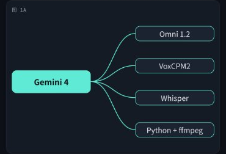

*图 1A · 人只对接 Gemini 4，其余三个由它调度。*

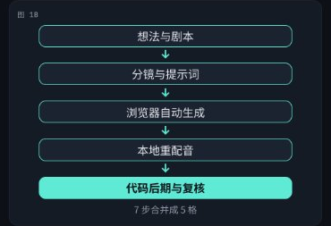

*图 1B · 从想法到成片，一共 7 步（7 步合并成 5 格）。*

**四个工具的角色 · 他的分工**

| 工具 | 分工 |
| --- | --- |
| Gemini 4 | 总导演兼程序员：写剧本、分镜、提示词，操控浏览器，写后期脚本 |
| Omni 1.2 | 摄影师兼演员：演出人物动作、表情神态和环境声音 |
| VoxCPM2 + Whisper | 配音兼质检：生成 48kHz 干音，把每个字的时间戳对齐到毫秒 |
| Python + ffmpeg | 后期剪辑：画监控边框、时间码和字幕，加混响，拼接成片 |

### 02 / 结构：用多机位片段，绕开模型的短板

他说直接写提示词出画面必翻车：没有剧本，生成的只是一堆没头没尾的空镜头。而视频模型最怕**长镜头里连续走位，还要接上下一镜的动作**。

他的办法是从剧本结构上绕开：做成 5 个固定监控机位，每个镜头有独立的场景，自己撑起一个小高潮，镜头之间靠切镜咔哒声连接。

- 看参考片只拆结构：严肃的现代画幅，装进荒诞的古典人物关系。
- 他说这样做，模型生成的成功率直接翻倍。

**先在剧本里绕开模型做不好的事。**

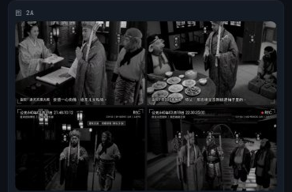

*图 2A · 成片《西梁国留婚 · 监控实录》的四机位画面。*

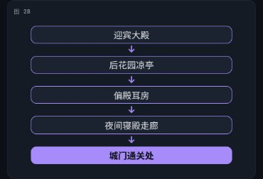

*图 2B · 五个机位，一镜一个场景：迎宾大殿 → 后花园凉亭 → 偏殿耳房 → 夜间寝殿走廊 → 城门通关处。*

### 03 / 包袱：嘴上一本正经，手上露出马脚

他认为 12 秒里三个人站着聊天，画面会很无聊。好笑的镜头是**嘴上说得冠冕堂皇，手脚却在干相反的事**。

他举的例子：唐僧念着"绝不留恋红尘"，右手却死死攥住婚书不撒手。孙悟空凑近一指："师父，那你先把婚书松开呀！"

**用动作戳穿台词，AI 演出来才有戏。**

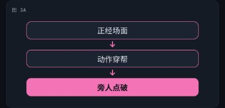

*图 3A · 每个镜头内部都走这三拍：正经场面 → 动作穿帮 → 旁人点破。*

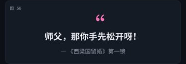

*图 3B · 第一镜里孙悟空点破的那句台词："师父，那你手先松开呀！" ——《西梁国留婚》第一镜。*

### 04 / 避坑：模型拍不好的戏，写剧本时就砍掉

他说有些戏写出来容易，模型拍出来必崩，要在剧本阶段直接砍掉。写完之后再让 Gemini 4 换成"**挑刺审核**"的身份，因为直接问它写得好不好，它只会夸自己。

审核只找三类问题：逻辑硬伤、包袱不响、模型拍不出来。

- 每镜台词 2 到 3 句，总字数 28 到 36 字以内。
- 每段 11 到 12 秒，最后一镜完成大反转。

**让写剧本的 AI 换个身份给自己挑刺。**

*图 4A · 他在剧本阶段砍掉的四类戏：多人打斗缠抱、吃东西喝水、画面超过 3 人、两人同时抢话。*

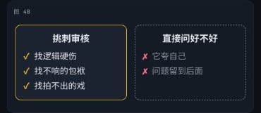

*图 4B · 同一个 AI，两种身份，结论不同：换成"挑刺审核"才找得出逻辑硬伤、不响的包袱和拍不出的戏。*

**为什么要砍 · 他的解释**

| 要砍的戏 | 原因 |
| --- | --- |
| 打斗缠抱 | 手脚大概率会穿模 |
| 吃喝吞咽 | 液体和吞咽动作很容易假 |
| 超过 3 人 | 模型分不清谁在说话，嘴型会配到别人脸上 |
| 抢话 | 同一个时间点只让一个人开口 |

> **承上启下**：没有剧本，画面再好看也留不住人。第二页讲分镜、提示词和自动生成。

---

## 第二部分 · 分镜、提示词与自动生成

> 剧本定稿后先拆分镜，不急着生成。拆分镜主要干两件事：定好机位怎么摆，让五段视频里的人物看起来是同一拨人。然后才是写给 Omni 1.2 的提示词，和让 Gemini 4 接管浏览器。

### 05 / 机位：机位锁死，算力留给表演

他建议剧情喜剧和监控题材全程用固定机位，比如天花板右上角 35 度斜俯拍的广角镜头。

原因是模型同时处理运镜和多人物的精细表情时，**画面边缘很容易扭曲变形**。机位锁在墙角高处，算力就都花在眼神、手部小动作和衣服褶皱上。

- 第四镜做成黑白红外夜视，第五镜切回清晨阳光。
- 一暗一亮，免得观众看到第三镜就审美疲劳。

**少一个运镜，多一分表演。**

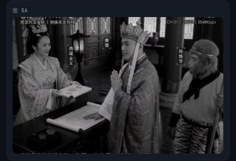

*图 5A · 分镜构图与动作反差设计：金銮殿婚书拉扯。*

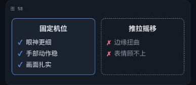

*图 5B · 他为什么不让模型运镜：固定机位换来的眼神、手部与画面稳定性，优于推拉摇移。*

### 06 / 一致：一段外貌描述，每一镜原样粘贴

不给参考图、纯靠文生视频时，怎么让第一镜和第五镜的唐僧长一样？他的办法是给每个角色写一段 30 字左右的"**外貌服装死描述**"，每一镜的提示词都原封不动粘贴进去。

他说哪怕换了场景，只要这段描述一字不改，Omni 1.2 生成的角色辨识度就很统一。

**描述一字不改，人物才不串戏。**

*图 6A · 约 30 字的外貌服装死描述，所有镜头原样复用。*

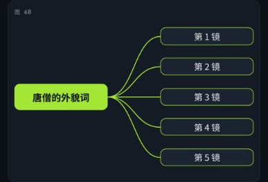

*图 6B · 同一段文字，贴进全部五镜。*

**唐僧的固定描述 · 他的原话**

> 身披大红织金锦襕袈裟，内穿素白僧衣，头戴五佛宝冠，面容白净端庄但眼神慌乱的年轻唐僧。

### 07 / 提示词：按时间轴写，最后 1.5 秒不说话

他把 12 秒切成三段，每段写清动作和台词，**同一时刻只允许一个人开口**，其余人写明"紧闭双唇不说话"。

最后一段的台词要在第 10.5 秒前说完，剩下 1.5 秒写成表情定格。否则模型慢半拍，最后一句就会被腰斩。

- 每段台词控制在 10 到 14 个字以内。
- 易错多音字换成同音字："为师"写成"维师"。
- 结尾写明画面纯净，无文字、无字幕、无水印。

**台词说完，留 1.5 秒给表情。**

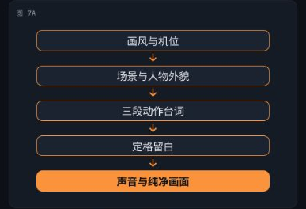

*图 7A · 一条 12 秒提示词，按这个顺序写：画风与机位 → 场景与人物外貌 → 三段动作台词 → 定格留白 → 声音与纯净画面。*

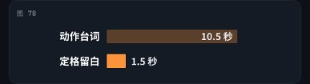

*图 7B · 12 秒里，动作台词占 10.5 秒，最后 1.5 秒只留给表情。*

**常见翻车与解法 · 他的避坑表**

| 问题 | 解法 |
| --- | --- |
| 尾句被截断 | 台词在第 10 秒前说完，最后 1.5 秒写明不再开口 |
| 中间吞半句 | 长句拆短，多用句号和感叹号断句 |
| 多音字读错 | 换成同音单音字，或留给本地模型重配 |
| 画面长出乱码 | 写明不带文字和水印，监控界面留到后期用代码画 |
| 不说话的人动嘴 | 写清仅谁开口，其余人只做表情反应 |

### 08 / 生成：让 Gemini 4 接管浏览器

以前是人坐在 Google Flow 前一条条粘贴、等待、下载。他现在给 Chrome 开一个远程调试端口（比如 9222），**让 Gemini 4 通过 Chrome DevTools 协议自己操作**。

它按顺序提交 5 镜，下载原片，再用 ffmpeg 每秒抽 1 帧，检查画面是否符合分镜、头尾有没有废帧。

- 重拍的文件按 `_v2`、`_v3` 命名，不覆盖旧文件。
- 开头结尾的小毛病先用代码裁掉，不急着重拍。

**旧文件别删，两版能拼着用。**

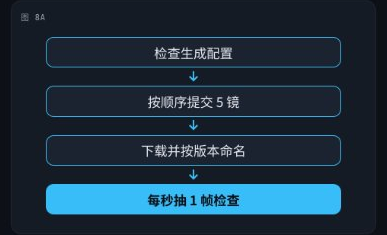

*图 8A · 接管浏览器之后的四步：检查生成配置 → 按顺序提交 5 镜 → 下载并按版本命名 → 每秒抽 1 帧检查。*

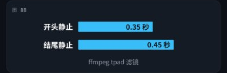

*图 8B · 用 ffmpeg `tpad` 滤镜克隆首尾帧（开头静止 0.35 秒 / 结尾静止 0.45 秒），补出呼吸感。*

> **承上启下**：分镜管住人物和机位，提示词管住每一秒。第三页讲重配音、后期和复核。

---

## 第三部分 · 重配音、后期与复核

> 视频模型直出的中文台词常有三个毛病：咬字发飘、多音字乱读、句尾断掉。他的做法是保留原视频的动作和环境底噪，**人声全部用本地模型重配**，字幕和监控界面交给代码，最后换个身份复核全片。

### 09 / 配音：人声全部重配，每句都过 Whisper

他说监控俯拍和中远景里，人脸在画面中占比不大，所以最干净的办法是重配。**VoxCPM2 用文字描述定音色和情绪**，不需要参考音频。

每条配音都让 mlx-whisper 听写一遍：先查有没有漏字、读歪，不对就换种子重生成；再查首尾的时间边界。

- 文本末尾加"……"，尾音会留出 0.25 秒的气息。
- 裁静音时从最后一个字往回查，再留 0.26 秒余音。
- 干音加一层大殿早期反射混响，垫上环境底噪。

**配音逐句过质检，达标才进合成。**

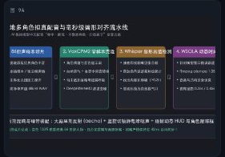

*图 9A · 本地多角色拟真配音与毫秒级唇形对齐流水线。*

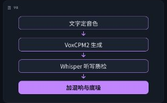

*图 9B · 一句台词从生成到合成：文字定音色 → VoxCPM2 生成 → Whisper 听写质检 → 加混响与底噪。*

**四个角色的音色设定 · 他的指令**

| 角色 | 音色指令 |
| --- | --- |
| 女儿国女王 | 30 岁成熟尊贵，声线温婉磁性；第四镜压低声音威严质问 |
| 唐僧 | 28 岁年轻书生僧人，嗓音温润；语气心虚慌乱，语速偏快 |
| 孙悟空 | 机灵洒脱的青年声线，清脆明亮；语气俏皮，看穿一切 |
| 太师 / 猪八戒 | 太师一板一眼冷面拆台；八戒慢半拍，憨直委屈 |

### 10 / 口型：收窄停顿，声音才贴得上嘴

配音贴回画面后，常见嘴闭上了声音还在响。他排查出两个原因：**分句之间留了 1 秒以上的空白**，把整句拉长；前一句超时，把后面角色的开口时间往后挤。

他先用 Whisper 提取原视频里张嘴和闭嘴的时间，再用代码收窄停顿，还长就微幅变速。

**先收停顿，再微调语速。**

*图 10A · 分句之间的长空白，收成换气口：收窄前大于 0.25 秒，收窄后 0.14 秒。*

*图 10B · 变速范围 1.05–1.15 倍，不改变音调和音色；还偏长，就用 `atempo` 微调变速。*

### 11 / 后期：字和框都用代码画，别让模型画

他说在提示词里让 AI 画监控界面，字全是歪的，框也乱跳。凡是涉及**文字字幕、监控边框和动态时间码**，全部交给 Gemini 4 写 Python（PIL）和 ffmpeg 代码。

《西梁国留婚》的全部后期包装，Gemini 4 写了不到 200 行 Python。

- 字幕按 Whisper 算出的每句起止时间显示。
- 切镜的 0.15 秒里合成一段静电咔哒声。
- 识别框写着"心率：148 bpm ｜ 状态：嘴硬手诚实"。

**代码画出来的字，每一帧都清楚。**

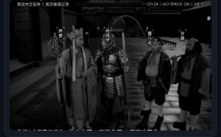

*图 11A · Python 逐帧绘制的监控界面、识别框和字幕。*

*图 11B · 不到 200 行代码包下的后期活：四角边框与暗角、机位名与时间码、智能识别框、底部字幕、切镜咔哒声、拼接成片。*

### 12 / 复核：换成第一次看片的挑剔观众

成片拼好后他不马上发布。分镜看了几十遍，**脑子会自动脑补剧情**，穿帮和字幕错位自己已经看不出来。

他让 Gemini 4 当第一次看片的观众：每秒抽 2 帧，切镜前后各取 3 帧，同时读音频波形和字幕时间轴，把问题分成硬伤和可优化的细节。

- 全程按"主创制作 + 独立质检"四个职责跑。
- 把提过的要求存成《项目铁律清单》，每步对照。

**做的人看不出的错，让新观众来看。**

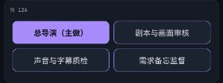

*图 12A · 他给 AI 分的四个职责：总导演（主做）、剧本与画面审核、声音与字幕质检、需求备忘监督。*

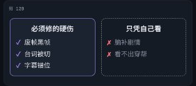

*图 12B · 审核结果分成两类处理：必须修的硬伤（废帧黑帧、台词被切、字幕错位）与只凭自己看会漏掉的（脑补剧情、看不出穿帮）。*

**四个职责各管什么 · 他的分工**

| 职责 | 分工 |
| --- | --- |
| 总导演 | 写剧本和分镜，操控浏览器生成，写代码完成配音与后期 |
| 画面审核 | 只挑刺不改文件，提交前逐条核对提示词 |
| 声音质检 | 用 Whisper 和音频能量分析查吞尾音、错读和字幕对齐 |
| 备忘监督 | 把提过的偏好列成清单，每一步对照检查 |

---

## 13 / 执行：一支 AI 剧情短片的执行清单

按他做片子的顺序排列。前一步过了审核，再进下一步。

### 第 1 阶段 · 剧本

- [ ] 定 5 个独立机位，每段 11 到 12 秒。
- [ ] 每镜一个"正经、穿帮、点破"的包袱。
- [ ] 让 AI 换成审核身份挑刺后定稿。

> **做完的标准**：每镜不超过 3 人，同一时刻只有 1 人说话。

### 第 2 阶段 · 分镜与提示词

- [ ] 给每个角色写一段固定外貌词。
- [ ] 按 0-4、4-8、8-12 秒写动作和台词。
- [ ] 结尾写明画面纯净，无字幕无界面。

> **做完的标准**：台词在第 10.5 秒前说完，留 1.5 秒定格。

### 第 3 阶段 · 自动生成

- [ ] 开远程调试端口，让 AI 接管浏览器。
- [ ] 重拍按 `_v2`、`_v3` 命名，不覆盖旧文件。
- [ ] 每秒抽 1 帧检查，小毛病用代码裁掉。

> **做完的标准**：5 段原片都对得上分镜，头尾没有废帧。

### 第 4 阶段 · 重配音

- [ ] 用文字给每个角色定音色和情绪。
- [ ] 文本末尾加省略号，防止吞尾音。
- [ ] 收窄分句停顿，必要时微幅变速。

> **做完的标准**：每句都过了 Whisper，没有错字和截断。

### 第 5 阶段 · 后期与复核

- [ ] 字幕、边框、时间码全部用代码画。
- [ ] 每镜补首尾静止帧，加切镜音效。
- [ ] 让 AI 当新观众，抽帧体检全片。

> **做完的标准**：硬伤修完，踩过的坑写成经验文档。

### 护栏 · 该避开什么

- ✗ 没有剧本，直接写提示词出画面。
- ✗ 在提示词里让模型画字幕和监控框。
- ✗ 一个对话从头聊到尾，规矩越聊越忘。
- ✗ 成片拼好就发，不做全片复核。

*步骤和数字是他的；阶段划分出自编者。*

---

**工具会变，讲好反差的故事、用分镜控制节奏、用代码补齐短板，这套思路一直通用。**

> 来源：刘老板（@leo_xiaolei），《一个人指挥一支 AI 剧组：Gemini 4 + Omni 1.2 剧情短片制作保姆级教程》，X 文章，2026-11-11。原长图 3 页（第 1/3、2/3、3/3 页）；框架标签、表格与清单由图卡编者整理，插图仅作示意。本文由长图识别转写，插图从原图裁切。
