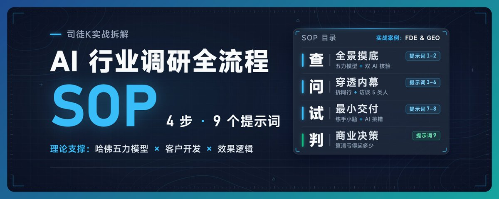
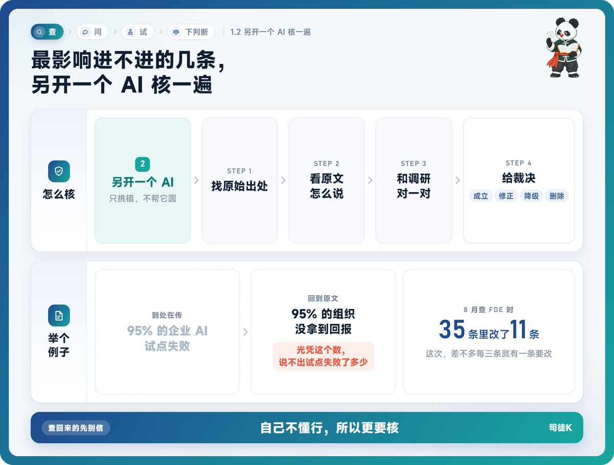
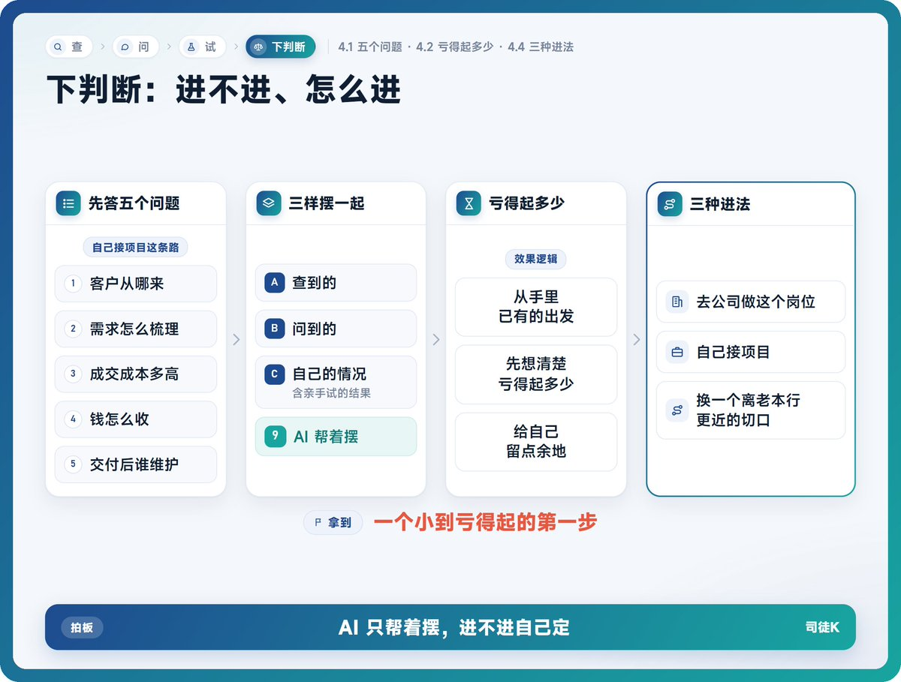
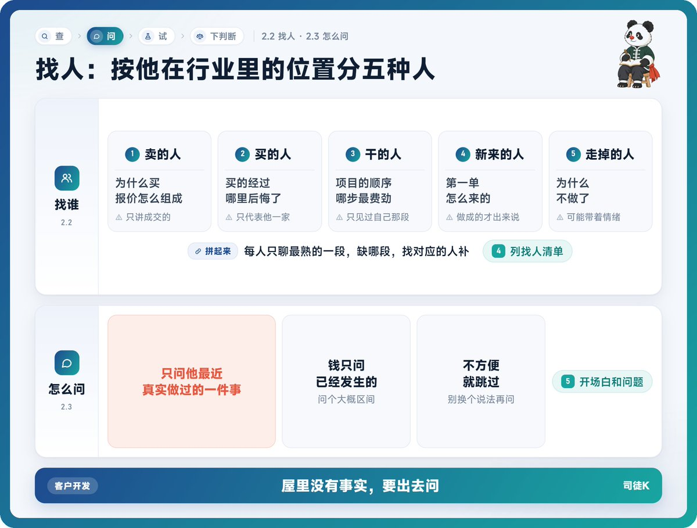
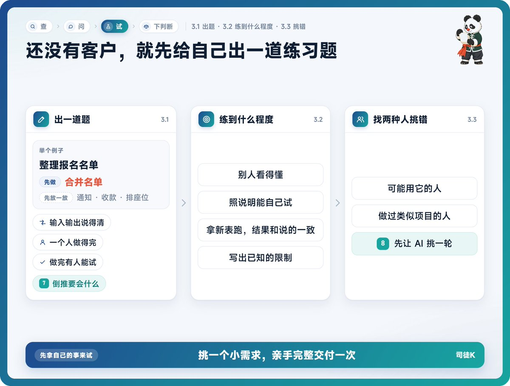
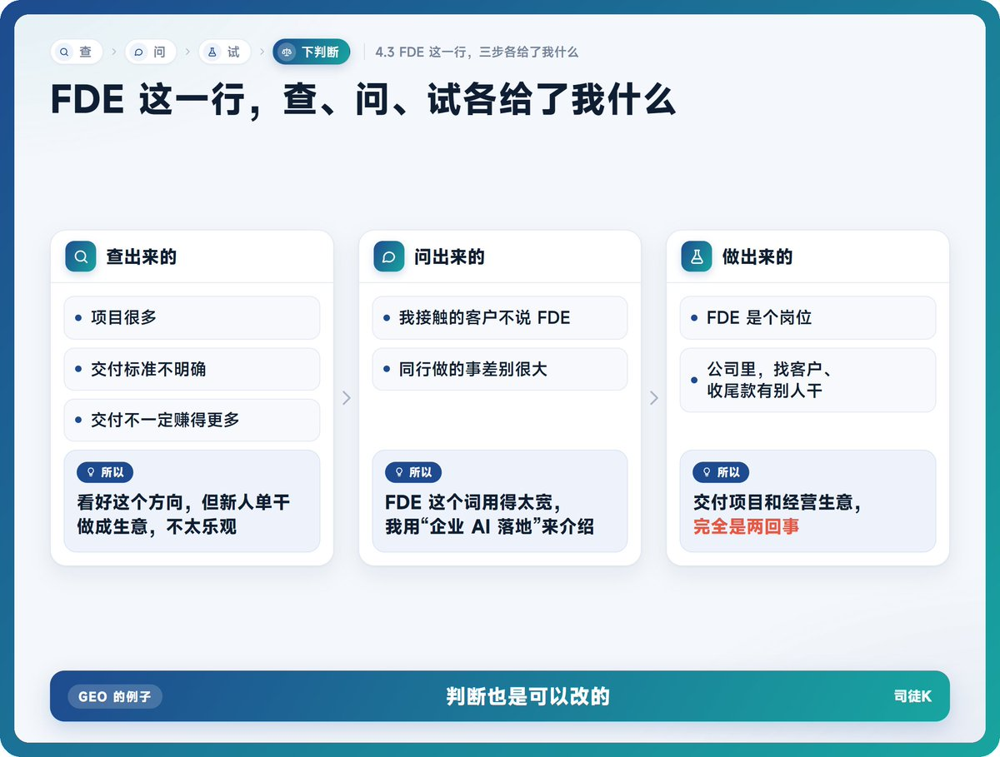
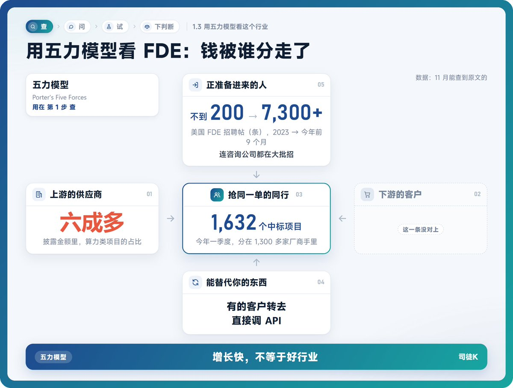
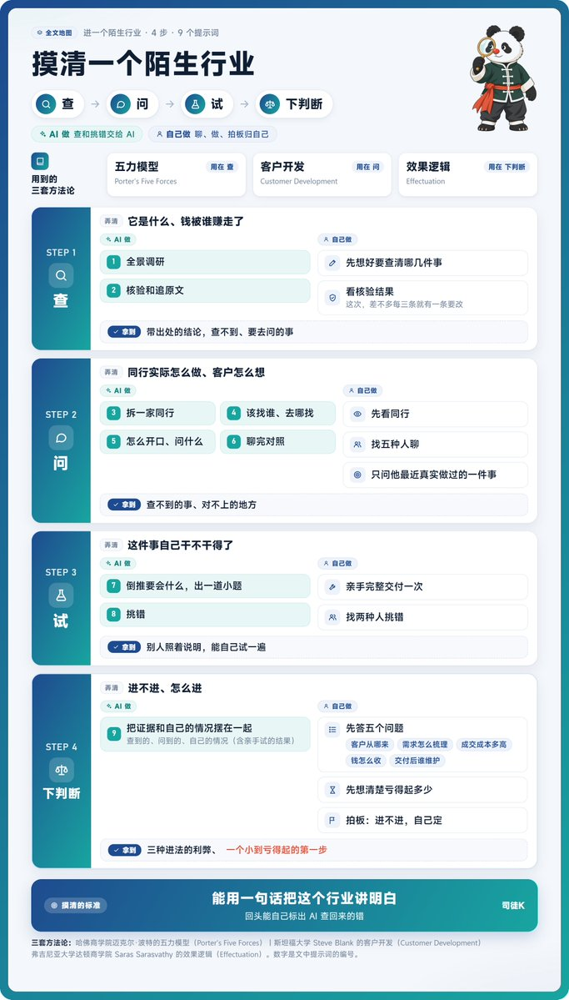
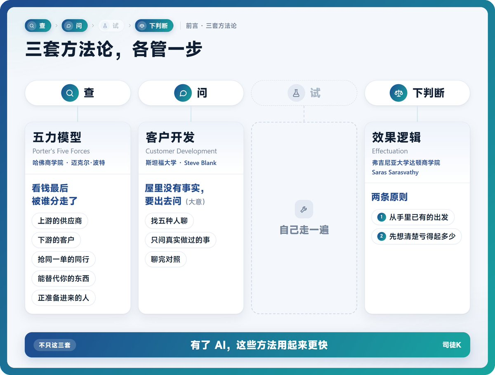

# 如何快速进入一个陌生行业？我把哈佛五力模型拆成 9 个 AI 提示词，3 天摸清任何行业底细

> 作者：司徒K（@situking）  
> 来源：X 长文（Article）  
> 发布时间：2026-11-13  
> 原文链接：https://x.com/situking/status/2121085951648903357  
> 文章链接：https://x.com/i/article/2121077695069184000  
> 互动数据：👍 218 · 🔁 24 · 💬 84 · 👁 15883

---



大家好，我是司徒K。

我现在主要做的是企业 AI 落地，海外做这件事的岗位叫 FDE（前沿部署工程师）。我跟一些从业者交流的时候发现，有些人其实并不了解整个行业，聊起来要花很多时间讲行业的基本知识。

所以我来分享一下，我是如何摸清一个行业的。这篇文章写给想进某个行业求职的新人，也写给想在某个行业创业的人。这是一篇深度文章，希望大家可以有收获。

这些年我一直在创业一线。每进一个新行业，我都要在很短的时间里摸清它的大概情况，弄清楚不同从业者的方案、报价这些细节。我的做法是先做一次全景调研，了解宏观的情况，再去找同行、找有真实需求的人聊，最后自己走一遍。

我做过不少不同的行业，但进任何一个新行业，我都会这样做，企业 AI 落地是这样，GEO 大体上也是这样。那么我是如何做到的呢？

这篇文章我会分享两件事：

1. 怎么快速调研一个陌生领域，并进入这个行业。

2. 把 FDE 业务作为一个案例，每一步怎么做都写出来。

本文的这套做法，我用了三种成熟的方法论，分别是：

1. 哈佛商学院迈克尔·波特的五力模型（Porter's Five Forces）

2. 斯坦福大学 Steve Blank 的客户开发（Customer Development）

3. 弗吉尼亚大学达顿商学院 Saras Sarasvathy 的效果逻辑（Effectuation）

我在调研一个行业的时候，主要也会用这几个方法，但不局限于此。本文的调研过程和案例，就以这三个方法论做理论支撑。感谢 AI，让我们可以更快地使用这些科学的方法论去做调研。

```
<!-- 作者：司徒K｜转载请保留署名 -->

# 1. Role & Identity（角色与身份）
你是【行业】里做了多年的老手，
现在帮我挑毛病，不用客气。

# 2. Context（背景）
- 我做的东西：【贴内容或说明】
- 它要解决的问题：【一句话】

# 3. Workflow（思维链，按顺序挑）
Step 1 它解决的是不是真问题
Step 2 换一批材料还能不能用
Step 3 出了错，我能不能查到原因
Step 4 交给别人，他能不能接着用
Step 5 哪些地方只是演示时好看

# 4. Output Format（输出格式）
每条写三样：问题、依据、怎么改

# 5. Self-Check（输出前自检）
最后告诉我：
哪些毛病你看不出来，
必须找真人、真客户来试
```

全文分两部分：

一、先说分工：哪些交给 AI，哪些自己来

二、全流程：查、问、试三步，最后下判断

1. 查：先让 AI 把这个行业查一遍，弄清它是什么、钱被谁赚走了（提示词 1、2）

2. 问：再去看同行，找人把查不到的问出来（提示词 3 到 6）

3. 试：然后自己走一遍，看这件事自己干不干得了（提示词 7、8）

4. 下判断：查完、问完、试完，再定进不进、怎么进（提示词 9）

文章里一共有 9 个提示词，把【】里的内容换成你自己的，就可以直接用了。这套做法不是标准答案，你可以按自己的情况来调整。

## 一、先说分工：查和挑错交给 AI，聊、做、拍板归自己

整套做法里，我是这样分工的：

自己：定查什么、写调研提示词；看核验结果；找同行和客户聊；动手做；最后拍板

能联网的 AI：按提示词把行业查一遍，查不到的列出来

另开的一个 AI：只挑错，把最影响进不进的几条拿回原文去核

平时用的 AI：拆同行的资料、列找人清单、准备问题、聊完做对照、出练习题、做完先挑一轮错、把证据摆在一起

```
<!-- 作者：司徒K｜转载请保留署名 -->

# 1. Role & Identity（角色与身份）
你是一位访谈教练，
擅长让人把一件真事从头讲到尾。

# 2. Core Objective（核心目标）
我要去找一个人聊，
帮我准备开场白和要问的问题。

# 3. Context（背景）
- 时间：大概【15 或 30】分钟
- 对方：
  【是谁、做什么的、怎么认识的】
- 我的身份和目的：【如实写】

# 4. Workflow（思维链，按顺序执行）
Step 1 写一段开场白，60 字以内，
       说明我是谁、为什么找他
Step 2 定最想弄清的 3 个问题
       只问他最近真实做过的一件事：
       怎么开始的、先后做了什么、
       卡在哪、最后怎么样
Step 3 每个问题配一句追问，
       用在他答得太笼统的时候
Step 4 准备一个问钱的问法
       只问已经发生的，问大概区间，
       并说明不方便可以不答

# 5. Constraints（约束）
不该问的，替我列出来：
❌ 官网上查得到的
❌ 让他猜以后会怎样的
❌ 涉及他客户机密的
```

## 二、全流程：查、问、试，最后下判断

## 1. 查：先让 AI 把这个行业查一遍

一个行业还没查过的时候，我知道的都是听别人说的。所以第一步，我会先让 AI 把整个行业查一遍，了解宏观的情况。

**1.1 先想好要查清哪几件事**

查之前，我会先想好，要判断进不进这一行，得弄清哪几件事。我查 FDE 的时候，要查的分六路：这个行业从哪来、标杆是谁，头部公司怎么做、怎么收费，客户那边到底成没成，钱怎么赚，国内的情况，岗位和人才。其中最要紧的是客户那一路，正面和反面的证据，我都要求找出来。

查的时候，规矩只有一条底线：每个数字都要带出处和日期，查不到的就写查不到，绝不编。

当然，大家自己调研的时候，查到够判断这个行业了，就可以停下，没必要做成一份给客户看的报告。我把这套做法写成了一个通用的提示词：

**提示词 1｜全景调研**



这个调研最好用 Codex 或者 Claude 来跑，没有的话，至少要用能联网的 AI。

**1.2 最影响进不进的几条，要另开一个 AI 核一遍**

AI 查回来的东西是不能直接信的。调研一个陌生行业，自己不懂行，AI 说什么都像是对的，所以更要核。

举个例子。“95% 的企业 AI 试点失败”这个数字到处有人在说，不少方案里都在引用。但是回到原文去看，它出自 MIT 一个项目组 2025 年 7 月的一份初步报告，没有经过同行评审。报告摘要里说的是 95% 的组织没有拿到回报，光凭这个数，说不出一百个试点里到底失败了多少个。

所以查完以后，我会另外开一个 AI 当核验员，把最影响进不进的那几条结论拿回原文核一遍。要另开一个，是因为它没参与前面的调研，这样才能做好交叉验证。

**提示词 2｜核验和追原文**



8 月查 FDE 的时候，我一共核了 35 条要紧的结论，其中有 11 条被修正或者降级了。也就是说，这次 AI 第一遍查回来的重要结论，差不多每三条就有一条要改。

```
<!-- 作者：司徒K｜转载请保留署名 -->

# 1. Role & Identity（角色与身份）
你是一位带过很多新人的老手，
习惯从要交的东西倒推该学什么。

# 2. Core Objective（核心目标）
我想在【行业】里做【哪一种活】。
帮我倒推要会什么，
再给我出一道练手的小题。

# 3. Context（背景）
- 我查到的招聘要求和公开案例：
  【贴内容】
- 我的情况：【我会什么】

# 4. Workflow（思维链，按顺序执行）
Step 1 先分清这些材料里
       哪些搬得到我要做的这种活上，
       哪些搬不到
Step 2 一份合格的交付，
       客户最后拿到的是什么
Step 3 做出它要会哪些事，分三类
       能自学的 / 要有人带的 /
       只能在真项目里练出来的
Step 4 对照我的情况，我缺哪几样
Step 5 出一道练习题

# 5. Constraints（约束）
练习题必须满足：
- 输入和输出都说得清
- 范围小到一个人能做完
- 做完有人能试用、能挑毛病
价格、工期这类你自己估的数，
标明是估的
```

**1.3 用五力模型看这个行业**

下面这几条结论，用的都是 11 月能查到原文的数据。想入行的朋友，我觉得应该先看看：

- 国内大模型相关的中标项目，今年一季度有 1,632 个，是去年同期的 3 倍多。但是披露了金额的项目里，中位数是 98.8 万元，也就是一半的单子不到 100 万元。把披露的金额加起来，算力类项目占了六成多。

- 美国的 FDE 招聘帖，2023 年还不到 200 条，今年前 9 个月已经超过了 7,300 条。不过数的是招聘帖的条数，不是招到了多少人。发帖最多的两家是德勤和埃森哲，都是做咨询的。

- 国内的 AI 上市公司，收入涨了，交付这块也不一定赚得更多。智谱今年上半年的收入是去年同期的 5 倍，主要靠 API；给企业做本地化部署的那块，收入反而降了两成，毛利率从 59.1% 降到了 37.9%。也有回升的，讯飞医疗做区域项目的那块，毛利率从 25.9% 回升到了 48.6%。

很多人以为，增长快的行业就一定是好行业。波特讲五力模型的时候提醒过，这是一个常见的错误。按他的说法，一个行业赚不赚钱，要看钱最后被谁分走了，可以分五个方向来看：上游的供应商，下游的客户，抢同一单的同行，能替代你的东西，还有正准备进来的人。

拿这五个方向看一下上面这几条。上游这一头，披露的金额里，算力类项目占了六成多。同行这一头，一千六百多个项目分在一千三百多家中标厂商手里，做的人很多。能替代的也有了，有的客户已经转去直接调 API。美国那边，连咨询公司都在大批招 FDE。

查到的只是公开的那部分。FDE 这一行，一个 FDE 能同时服务几个客户，这个岗位的人员流失率有多高，我翻过的公开资料里都没找到能核实的数。同行实际是怎么做的，客户是怎么想的，也都查不到，这些要去问。



## 2. 问：再去看同行，找人把查不到的问出来

**2.1 先看同行**

杨涛分享过一个 4 个小时法则：拿出 4 个小时，沉浸式地去看所有平台上的头部同行，看这个行业最顶尖的是谁，他们用什么方式获客，获客以后怎么转化，怎么产生价值。

看一个陌生的行业，还有一个办法是我从一位同行那里听来的：先找到这个行业唯一的业务对象。比如货代的业务对象是订单，电商的业务对象是商品，其他的东西都是挂在它上面的。

我自己做 GEO 的时候，基本上每周都会调研一两家同行，有的代理别家的系统，有的卖自家品牌的系统。我会跟他们聊一聊，然后把他们的方案蒸馏一下，看看是怎么做的。

同行的公开资料其实很多，官网、公开的文章、报价页、招聘信息都是。把这些贴给 AI，让它来拆：

**提示词 3｜拆一家同行**



光看公开资料还不够，我还会买一些同行的产品，当一次他的客户，看他从获客到交付是怎么做的。比如说 GEO，我会买不同竞品的系统来研究，也会看一些开源的东西。当然，各家的服务不一样，价钱也不一样，有的卖得很便宜，买哪几家，大家根据自己的预算量力而行。

再就是直接找同行聊。FDE 这边，我跟一些真实的从业者聊过以后发现，同样叫 FDE，大家做的事情差别特别大，培训、咨询、定制开发、驻场交付，都在用这个词。

**2.2 找人：按他在行业里的位置分五种人**

同行能讲的是他自己做的那一段。客户那边是怎么想的，要去问有真实需求的人。

我开始做 GEO，其实就是问出来的。2023、2024 年的时候，我们有媒介和公关的业务，有一些客户来找我们发稿，我们发现这些稿件和常规的新闻稿、软文都不太一样。我在跟客户聊的时候才知道，他们是在做 GEO 这件事。后来我们就去研究各个平台的收录规则，开始做 GEO。

Steve Blank 讲客户开发的时候有一句话，大意是屋里没有事实，要出去问。

该找哪些人，我会按他在这个行业里的位置来分：

- 卖的人。能讲客户为什么买、报价是怎么组成的，不过他只讲成交了的，效果也会往好里说。

- 买的人。能讲上一次买这类服务的经过，哪里后悔了。他说的只代表自己那一家公司。

- 干的人。能讲一个项目从签约到验收的顺序，哪个环节最费劲。他只见过自己那一段，容易把习惯当成标准。

- 新来的人。能讲第一单是怎么来的。要注意的是，做成了的人才会出来说。

- 走掉的人。能讲为什么不做了。他可能带着情绪，也可能有新的生意要推。

每个人只聊他最熟悉的那一部分就可以了，不用要求一个人把整个行业讲一遍。把几个人讲的拼起来，缺哪一段，再找对应的人去补。

具体该找谁、去哪里找，可以让 AI 先列一张清单：

**提示词 4｜该找谁、去哪找**



AI 列出来的大会、社群和平台，有的是它凭印象写的，可能早就没有了，用之前要自己核一下。

**2.3 只问他最近真实做过的一件事**

聊的时候，我会请对方直接拿最近特别费事的一笔业务出来，从头走一遍：谁处理的，查了哪些表，等了多久。见客户的时候我就是这么问的，调研一个行业去找人聊，用的也是这个问法。

钱也要问。但是只问已经发生的，问一个大概的区间，还要先说一句，不方便可以不回答。比如可以这么问：“最后问个钱的事，不方便说就跳过。刚才这一单总共收了多少，大概是几万、十几万，还是几十万往上？”对方说不方便，就回一句没事，接着往下聊，别换个说法再问。

**提示词 5｜怎么开口、问什么**



```
<!-- 作者：司徒K｜转载请保留署名 -->

# 1. Role & Identity（角色与身份）
你是一位研究助理，
只摆证据，不替人下结论。

# 2. Core Objective（核心目标）
我在考虑要不要进【行业】。
把一次聊天的内容和我之前的结论
逐条对照，告诉我哪里对得上、
哪里对不上，影响了我哪个判断。

# 3. Context（背景）
- 我和【对方身份】的聊天记录：
  【贴记录，隐去姓名】
- 我之前的调研结论：【贴结论】

# 4. Workflow（思维链，按顺序执行）
Step 1 把他说的每句话分成四类
  他亲身做过的事 / 他听说的事 /
  他的看法 / 他的猜测
Step 2 找出和调研对得上的
Step 3 找出对不上的，
       逐条说更该信哪边、为什么
Step 4 列出他提到、
       调研里完全没有的事
Step 5 指出这些会影响我对
       进不进、怎么进的哪个判断
Step 6 要定进不进还缺哪条信息，
       该找谁、问什么

# 5. Constraints（约束）
❌ 不要替我下结论，只摆出来
```

**2.4 聊完做对照**

聊完以后要做对照。查到的东西能让我先知道这个行业的大概，但是具体怎么做，要以对方实际的做法为准。两边的说法对不上的时候，我会把同一件事拿出来，两边摆在一起看，不会自己默默选一边。对完以后，我还会看一下，这次聊天改了我哪个判断。

这一步也可以让 AI 帮忙，把聊天记录和之前的调研结论一起给它：

**提示词 6｜聊完对照**

```
<!-- 作者：司徒K｜转载请保留署名 -->

# 1. Role & Identity（角色与身份）
你是一位做了多年竞品研究的分析师，
只根据材料说话。

# 2. Core Objective（核心目标）
我在调研【行业】，
帮我把一家同行拆清楚：
他靠什么赚钱，我能学走哪些。

# 3. Context（背景）
- 他的公开材料：
  【贴官网介绍、公开文章、报价页、
  招聘信息，各自注明来源】
- 我买过他的产品，这是我的记录：
  【从看到他、咨询、付款到交付，
  每一步发生了什么。没买过就删掉】
- 我的情况：【我会什么、有什么】

# 4. Workflow（思维链，按顺序执行）
Step 1 他卖什么，卖给谁
Step 2 客户是怎么找到他的
Step 3 怎么报价、怎么收钱
Step 4 怎么交付，
       交付到哪一步算完
Step 5 从招聘和团队看，
       他接下来想做什么
Step 6 对照我的情况：
       哪些我学得了，哪些学不了

# 5. Constraints（约束）
- 只用我给的材料，不要自己补
- 他自己说的成绩，标明是自述
- 材料里看不出来的，写“看不出来”

# 6. Output Format（输出格式）
按 Step 1 到 6 分六段，
最后列出我还该去找哪些材料
```

FDE 这个行业，有几件事是我问出来的，查是查不到的。

我跟一些真实的从业者聊的时候发现，有一些客户的钱非常多，可以支付很高的费用。另外，客户从来没有用 FDE 这个词问过我。很多客户并不知道自己想要的是什么，也不知道业务该怎么拿到 AI 上去做，基本上得老板或者业务负责人来定。

## 3. 试：然后自己走一遍

查到的、问到的，都是别人的事。这件事我自己干不干得了，要做一遍才知道。

我从 2023 年开始，尝试过好几种用 AI 变现的做法，后来才找到 GEO 这个方向。企业 AI 落地也是这样，我在一次分享里说过，FDE 都是跑出来的，不是先定好一个流程再照着去做，而是一直在做，在做当中调整。

**3.1 还没有客户，就先给自己出一道练习题**

选题的标准我在《FDE 百问百答》里写过：找一件做完就有人能试、能说出哪里好用哪里不好用的事。这个人可以是朋友、同事，也可以是你自己。比如朋友每周组织活动，要从几份表格里整理报名名单，就可以先做合并名单这一小段。自动发通知、收款、排座位这些，可以先放一放。练习的时候用脱敏以后的材料，或者照着格式自己造一份模拟数据就可以了，不用等有了付费客户才开始。

题目也可以让 AI 帮你出，把查到的招聘要求和公开案例贴给它：

**提示词 7｜倒推要会什么，出一道小题**



招聘要求里有一块是不会写的：找客户、报价、签约、收尾款。在公司里这些有别人干，自己接项目，这些都归你。

**3.2 练到什么程度就够了**

练习做到这个程度就可以了：别人能看懂你解决了什么问题，按照说明也能自己试一遍。演示的时候，拿一份没有提前整理好的新表来跑，看看结果和你说的是不是一致。知道的限制也写出来，比如目前只支持约定的表头，手机号填错了还需要人工确认。

**3.3 做完找两种人挑错**

我会找两种人，一种是可能用它的人，一种是做过类似项目的人。拿报名名单来说，组织活动的人能看出名单的顺序对不对、有没有漏掉信息、结果还要不要手工重排。换一批文件还能不能跑，处理重复报名的规则有没有漏洞，这两样，做过项目的人能帮你看。

找人帮忙，事情提小一点，对方更容易答应，比如请他拿一份新的表试一试。先让他照着说明操作，我在旁边看，他停在哪里，我就记在哪里。一直替他解释，反而看不出哪里不好用。

找真人之前，可以先让 AI 挑一轮：

**提示词 8｜挑错**

```
<!-- 作者：司徒K｜转载请保留署名 -->

# 1. Role & Identity（角色与身份）
你是一位冷静的参谋，
只把证据摆清楚，决定由我自己做。

# 2. Core Objective（核心目标）
我在考虑要不要进【行业】。
把我查到的、问到的和我自己的情况
摆在一起，帮我看清几条路。

# 3. Context（背景）
A 调研结论：【贴要点】
B 找人聊到的、看同行看到的：
  【贴要点】
C 我自己的情况：
  【我会什么、认识谁、
  亲手试了什么、结果怎样、
  手里有哪些老客户和老本行、
  最多能投入多少时间和钱、
  亏到多少我必须停】

# 4. Workflow（思维链，按顺序执行）
Step 1 用一句话说清
       这个行业是怎么赚钱的，
       钱主要被谁赚走了
Step 2 摆出三种进法各自的利弊
  去公司做这个岗位
  自己接项目
  换一个离我老本行更近的切口
  （从 C 里帮我找一个）
Step 3 每种进法最可能败在哪
       自己接项目这一种，
       按五件事过一遍：
       客户从哪来、需求怎么梳理、
       成交成本多高、钱怎么收、
       交付后谁维护
Step 4 我还缺哪条关键信息，
       该去查，还是该去问
Step 5 给一个小到我亏得起的第一步

# 5. Constraints（约束）
❌ 不要替我做决定
- 你自己算的、推的，标出来，
  和 A、B 里的原话分开
```



**3.4 从哪个领域开始**

从哪个领域开始做，我听几位同行说的都一样：先从自己最熟悉的领域做起。

我自己做下来，体会也是这样。以我做的一单外贸行业的交付为例，对方一开始觉得，是不是要上一套新系统，我们进去一看，资料其实都有。这一单做下来，最费时间的不是 AI，是等客户确认业务信息。

给自己做就不一样了：资料我熟，我自己就能拍板。我有一个外贸业务的网站，先把资料整理成知识库，网站两三天就上线了。把这个过程做成 Agent 以后，第二个站一天就建出来了。

所以先拿自己的事来试，从身边挑一个输入输出明确的小需求做起来，亲手完整交付一次，比在岸上准备几个月更有用。

## 4. 下判断：查完、问完、试完，再定进不进、怎么进

**4.1 先答五个问题，再把三样摆在一起**

下判断之前，如果是打算自己接项目，我会先回答五个问题：客户从哪来，需求怎么梳理，成交成本多高，钱怎么收，交付后谁维护。这些经营上的问题，不会因为项目跑通了就自动解决。如果是想找工作，可以挑一个想投的岗位，把招聘要求和自己做过的练习对一遍，看看哪几项已经有作品能拿给面试官看。

然后把三样东西摆在一起：查到的，问到的，还有我自己的情况，包括试下来自己干不干得了。这一步可以让 AI 帮着摆，但是决定要我自己来做。

**提示词 9｜把证据和自己的情况摆在一起**

```
<!-- 作者：司徒K｜转载请保留署名 -->

# 1. Role & Identity（角色与身份）
你是一位资深的行业研究员，
只认一手证据，查不到的绝不编。

# 2. Core Objective（核心目标）
我在考虑要不要进【行业】。
帮我把这个行业查一遍，
弄清决定进不进、怎么进之前，
必须知道的那几件事。

# 3. Context（背景）
- 这个行业指的是：
  【它包括什么、不包括什么】
- 我的背景：
  【我是谁、现在做什么、为什么想进】

# 4. Workflow（思维链，按顺序执行）
Step 1 拆题
  把下面六路各自要回答的问题列出来
  1）这行从哪来，标杆是谁
  2）头部公司怎么做、怎么收费
  3）客户那边到底成没成（最重要）
  4）钱怎么赚：谁付钱、毛利多少、
     一个人能服务几家客户
  5）国内的情况：价格、合同、岗位
  6）人才：招什么人、给多少钱、
     要会什么
Step 2 逐路去查
  每个数字记下来源和日期
Step 3 看钱最后被谁分走
  按五力模型的五个方向过一遍：
  上游供应商、下游客户、
  抢同一单的同行、能替代的东西、
  正准备进来的人
Step 4 列出查不到的
  哪些事查不到公开数据，
  要去问做这行的人

# 5. Constraints（约束）
- 每个数字都带来源和日期
- 公司自己说的，标明是自述
- 正反两面的证据都要找
- 查不到就写“查不到”，不许编
❌ 没有权威出处的市场规模
❌ 找不到原文的流行数字

# 6. Output Format（输出格式）
- 六路：每路先写三句话结论，
  再列关键数字和出处
- 钱被谁分走：五个方向各一两句
- 最后一节：查不到、要去问的事

# 7. Self-Check（输出前自检）
- 每个数字后面都有来源和日期吗
- 有没有哪条结论只靠公司自己的说法
- 查不到的事，是不是都列出来了
```

**4.2 先想清楚亏得起多少**

效果逻辑是 Saras Sarasvathy 研究创业者以后提出来的，里面有两条原则在这里用得上：从手里已经有的东西出发，也就是我是谁、我会什么、我认识谁；先想清楚亏得起多少，不按预期能赚多少来做决定。

落到这个行业上，To B 的成交周期往往比较长。如果把它当主业，手里又没什么积蓄，每个月的开支都指着它，风险就比较大。所以有其他收入也好，留一些备用金也好，先给自己留点余地。

```
<!-- 作者：司徒K｜转载请保留署名 -->

# 1. Role & Identity（角色与身份）
你是一位做过很多行业访谈的研究员。

# 2. Core Objective（核心目标）
我在考虑要不要进【行业】，
已经查过一轮，结论附在后面。
帮我列一张找人清单，
把影响我进不进、
又查不到的事问出来。

# 3. Context（背景）
- 我的背景和已有的人脉：【如实写】
- 查到的结论和查不到的事：
  【贴在这里】

# 4. Workflow（思维链，按顺序执行）
Step 1 分两类人列
  同行：正在做的、刚入行的、
        做过又不做了的
  有真实需求的人：买过的、正想买的
Step 2 每类人写清三件事
  他最能回答什么
  他的话可能偏在哪
  在哪些公开场合能找到
  （大会、社群、公开文章、招聘）
Step 3 结合我的情况排先后，
       说明为什么这么排

# 5. Constraints（约束）
- 找陌生人只走公开渠道
- 你拿不准的场合和平台，
  标出来，我自己去核
```

**4.3 FDE 这一行，三步各给了我什么**

查出来的是，项目很多，所以我很看好企业 AI 落地这个方向。但是如果是新人作为 OPC 进入这个行业，交付标准不明确，客户资源没有优势，交付这块也不一定赚得更多。一个人想把 FDE 做成一门独立的生意，我并不太乐观。

问出来的是，我接触的客户不说 FDE 这个词，同行做的事情差别又特别大。我觉得 FDE 这个词被用得太宽了，所以我更喜欢用企业 AI 落地来介绍这个业务。

自己做了交付以后我才知道，FDE 是个岗位，在公司里，找客户、收尾款这些有别人干。能把一个项目交付出来，和能把一门生意持续经营下去，完全是两回事。

判断也是可以改的。GEO 这件事，我最早的判断是它的周期不会特别长，所以今年 3 月以后，我把自己大部分的精力放到了企业 AI 落地上。但是做到现在，它的确能挣到钱，对客户也的确有效果，这个周期我现在是看不明白了，我最初的判断可能不太对。

```
<!-- 作者：司徒K｜转载请保留署名 -->

# 1. Role & Identity（角色与身份）
你是一位独立核验员，
没有参与过前面的调研。
你的任务是挑错，不是帮它圆。

# 2. Core Objective（核心目标）
从调研里挑出最要紧的 5 条结论，
也就是最影响“进不进这行”的那几条，
逐条回到原始出处核一遍。

# 3. Context（背景）
要核验的调研结论：
【贴在这里，或者上传文件】

# 4. Workflow（思维链，逐条执行）
Step 1 找到原始出处，不看转述
Step 2 看原文到底怎么说
       分母是谁、哪一年、怎么统计的
Step 3 和调研里的写法对一对
Step 4 给裁决
       成立 / 需要修正 / 降级 / 删除

# 5. Constraints（约束）
- 到处在传的数字要特别查：
  原文在哪、说法有没有被改过、
  现在还查不查得到
- 找不到原文，就写“找不到原文”
❌ 用另一篇转述来证明这一篇转述

# 6. Output Format（输出格式）
每条一行：
结论｜原文怎么说｜裁决｜理由
```

**4.4 三种进法**

具体怎么进，一般有三种进法：去公司做这个岗位，自己接项目，或者换一个离自己老本行更近的切口。如果还没有完整做过一个企业项目，我更建议先跟团队做一轮，了解需求怎么问、资料怎么拿、系统怎么上线、出了问题怎么处理，再决定自己能包多大的一段。如果你已经熟悉一个行业，手边又有明确的小需求，也可以先从兼职合作开始，完整做好一个小项目以后，再决定要不要继续往下做。GEO 我走的就是第三种，所以顺一些：GEO 的一部分业务，就是我们以前的媒介业务。

怎么做也要看自己的情况。GEO 有的同行走的是低价、量大的路子，一个人服务很多客户。我们的客户资源没有那么多，所以宁可少接一些客户，每一家赚得多一点，也不想那样干得很累。刚开始自己接项目的时候，一个人靠专业能力卖时间、服务少量的客户，没什么丢人的，甚至是很了不起的事情。但是如果只拿个人的时间去硬扛非标的交付，结果往往是越做越忙，最后把自己困在项目里。

## 做完以后，怎么知道自己摸清了

怎么才算把一个行业摸清楚了，我自己有一个标准，就是能不能用一句话把它讲明白。我习惯把很多业务说得简单一点，比如 GEO，其实就是 SEO 的一个分支。

还有一个办法可以验一下。一开始拿到 AI 查回来的东西时，你还不懂行，AI 说什么都像是对的。等问过人、亲手做过一遍，再把它翻出来看，哪里说错了、哪些地方说得太浅，不用 AI 帮忙，你自己就能标出来。

你能标出来的那些，都是问出来、做出来的，AI 查不到。整个做下来，最要紧的成果，是最后定下的那个小到亏得起的第一步。接下来不管是求职还是创业，就从这一步开始。

如果今天只做一件事，就把提示词 1 里的行业换成你想进的那个，发给 AI。

**我是司徒K | 企业服务创业者，专注 GEO 与企业 AI 落地。**

如果你也在调研一个新的行业，遇到了卡壳的地方，欢迎在 X 上找我交流。
