# 淘宝直播数字人互动 Harness-Aware Training 实践：让 Agent Model 随 Harness 一起进化

> 来源：大淘宝技术（微信公众号）  
> 作者：语瀚（淘天集团-直播AIGC团队）  
> 发布时间：2026-10-09 14:04  
> 原文：https://mp.weixin.qq.com/s/ajL2P5PY1HcQnJt_RFalnw  
> 技术报告：https://arxiv.org/pdf/2608.15763  
> Hugging Face：https://huggingface.co/papers/2608.15763

---


本文提出Harness-Aware Training (HAT)方法，解决直播电商数字人Agent在低延迟要求下适应业务规则频繁变化的挑战。HAT将动态执行环境(Harness)状态显式纳入训练分布，通过三阶段训练：在多样化Harness配置下进行监督微调(HSA-SFT)提升工具调用能力；通用指令蒸馏(OPD)恢复领域训练中损失的通用能力；强化学习(HSA-RL)在模拟环境中学习真实交互。该方法使Qwen3.6-35B-A3B轻量模型在直播问答任务上达到94.8分，超越千亿参数级通用大模型，同时在Harness变化场景下保持94.6分的鲁棒性，端到端延迟仅为P50 3.407秒。HAT已成功应用于淘宝直播数字人业务，实现了业务快速迭代与低延迟响应的平衡，无需重新训练即可适应Harness进化。


## 摘要

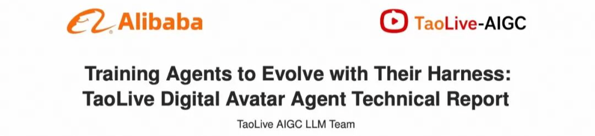

Technical Report：https://arxiv.org/pdf/2608.15763

Hugging Face Paper：https://huggingface.co/papers/2608.15763

直播电商中的数字人Agent，通常需要在几秒内理解观众弹幕，结合当前商品、直播间状态和历史对话调用工具，并生成可公开口播的回复。它不仅要答得准确有效，还要跟上频繁变化的SOP规则、合规要求和商家策略。

为了缩短业务策略的迭代周期，我们将容易变化的能力从模型权重中拆出，构建了由Skills、Hooks、System Prompt Pipeline和Tools组成的可迭代Harness，而迭代的过程通常被称作Harness Evolution（Harness自进化），许多问题可以通过修改运行时配置解决，不必等待下一轮模型训练。

但这也带来了一个容易被忽略的新问题：Harness Evolution让直播数字人Agent可以在不更新模型权重的情况下快速调整业务行为，也使模型面对一个持续变化的执行环境，通常来说DeepSeek-V4这种通用大模型是最好的选择，但是由于直播延迟要求我们难以直接使用这种通用大模型，而小模型通常能力不足以达到工业上线要求，因此系统必须使用经过领域训练的小模型，固定Harness下进行训练又会使模型过拟合当前配置。因此，我们将Harness状态显式纳入训练分布，训练时故意暴露多种Harness配置，让模型学到如何读懂当前Harness而不是背下某一版Harness。这种将Harness状态显示纳入训练分布的训练方式被我们称作Harness-Aware Training，完整方案包含三个阶段：

- HSA-SFT：小模型直接去学习强模型在多样化环境中产生并通过质量过滤的trajectory来直接提升任务下的tool call与reasoning理解能力；
- General OPD：在通用指令数据上进行On-Policy Distillation，恢复领域训练中容易损失的通用指令遵循能力；
- HSA-RL：让模型在增强后变化的Harness模拟环境中，通过自己的多轮工具调用、失败和恢复轨迹中学习到对Harness的真实理解能力。

最终，基于Qwen3.6-35B-A3B 训练的模型在Live-Stream QA上达到94.8，在Harness-Variant QA上达到94.6，同时将IFEval Prompt 维持在83.5，在业务集指标超过顶尖通用大模型的同时，没有出现固定Harness SFT所表现出的明显通用能力下降。在单张NVIDIA H20、开启MTP的部署测试中，端到端延迟为P50 3.407秒、P95 8.114秒。

工作覆盖Harness设计、训练评测、低延迟部署及线上验证，现已落地淘宝直播数字人业务，本文内容较长，可挑选感兴趣的章节进行阅读：

- 第一章：数字人业务背景：互动Agent算法在整个数字人系统中作用的位置；
- 第二章：Harness Agent设计：我们所设计的数字人Harness Agent及其非训练自进化机制；
- 第三章：Harness-Aware Training训练：我们将Harness变化分布显式引入模型训练的方法；
- 第四章：评测体系：介绍了我们所构建的超过4500条测评集的Benchmark以及一个可通过自进化自动与人工标注校准的Judge Harness Agent；
- 第五章：实验结果与部署：主要测评结果、消融实验以及进化适应性实验，并介绍了我们如何在RL阶段进行的domain内MTP训练与部署加速以及最终的部署推理测评结果。

## 业务背景介绍：淘宝直播数字人

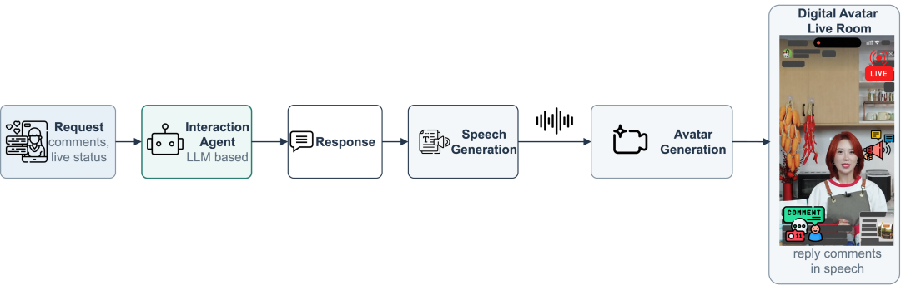

## 图1 直播数字人系统及互动Agent在链路中工作的位置

在直播电商场景中，数字人主播需要：

- 实时回答观众弹幕中的商品问题（价格、优惠、规格对比等）；
- 执行运营策略（调整讲品顺序、触发优惠话术、处理售后问题等）；
- 公开口播到整个直播间（回复会通过 TTS 合成为语音，由数字人公开说出）；

整体流程如图1所示，观众请求与直播间上下文由交互智能体处理；生成的文本回复被转换为语音，经由数字人生成器渲染后，广播至直播间。我们的互动Agent算法主要作用为接受弹幕请求（如果是多个弹幕在同一时间段内发送会合并为同一请求），理解观众意图，并通过业务工具获取能够回复的信息，最终按照业务SOP进行回复。

数字人主播的每次回复是面向整个直播间的公开发言，这意味着一次错误回复（比如虚假承诺、价格错误）可能引发客诉。这对算法的准确性要求极高。

直播数字人Agent接入Harness的核心矛盾是：Harness配置需要高频迭代，而传统 SFT 会过拟合到训练时的单一配置，使模型无法跟随演进。顶尖通用大模型虽然泛化好但延迟不可接受。我们需要一种方法，让轻量模型同时具备低延迟和 Harness 适应能力。

## Harness架构设计与自进化机制

## ▐**3.1 淘宝直播数字人Harnesss Agent设计**

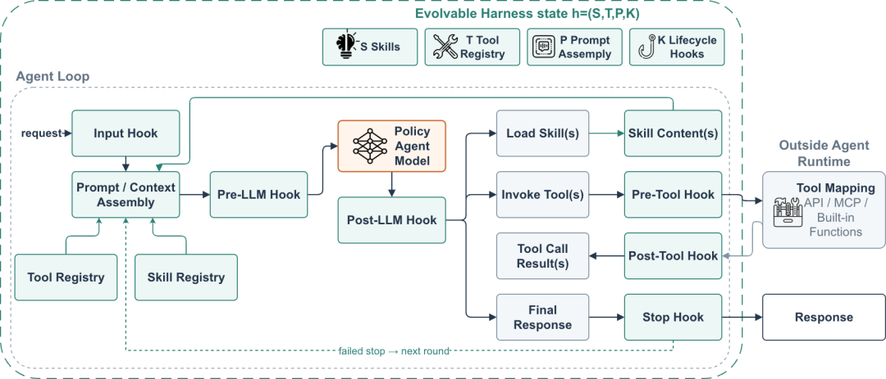

## 图2 数字人互动Agent整体Harness架构

我们将Agent的执行环境定义为一个Harness状态，它由四个独立可更新的模块组成：

每个模块的职责如下：


这四个模块独立于模型权重版本化管理。 修改一个Skill或新增一个Hook，不需要重新训练模型即可完成系统的迭代。每个 Skill 是一个带有Skill描述和渐进式披露完整内容的Markdown 模块。运行时规定：在产生最终回复前必须加载至少一个 Reply Skill；Strategy Skill是可选的，用于组合专门的工具调用链。Harness工作架构如图2所示。

## ▐**3**.2 运行时控制流

一个完整的请求经过以下阶段：

1. 加载与规范化上下文：校验请求，组装商品/FAQ/直播间/对话状态
2. 组装Prompt：结合基础指令、商品配置、检索上下文和已加载 Skills
3. 运行Agent Loop：在可配置的轮次限制下，策略模型可以加载 Skill、发起工具调用、处理返回结果、提出最终回复
4. 应用Hook检查：覆盖输入校验、工具参数、Skill 加载要求、回复格式、事实风险、重试控制
5. 提取与分发回复：移除内部推理字段，保留结构化轨迹，路由到下游通道

一个典型的轨迹记录如下：

- 
- 
- 
- 
- 
- 

```
input.danmaku = "3号链接多少钱？"context.current_link_id = 1call[1] = get_product_info_by_link_id(link_id=3)result[1] = {name: "防晒霜SPF50", price: 89}call[2] = load_skill(skill="item_qa")reply = "3号链接是防晒霜SPF50，现在券后价89元哈。"
```

## ▐**3**.4 Harness Evolution：非训练优化机制

Harness Evolution：在模型权重完全固定的情况下，通过修改 Skills、Prompts、Hooks 和 Tools 来改善 Agent 表现。它是人机协同的，而非全自动：

- 

```
Diagnose → Confirm → Edit Harness → Evaluate → Regression Check
```

五步循环详解：

1. AI 诊断（Diagnose）：分析最新评测结果，聚类主要失败原因，附上代表性 bad case，提出根因假设；
2. 人工确认（Confirm）：开发者审查提议的 Skill/Prompt/Hook/Tool 修改，接受、修改或拒绝；
3. AI 辅助编辑（Edit）：执行确认的修改，保留版本化配置快照；
4. 人工触发评测（Evaluate）：在dev-set上运行推理和评分；
5. 回归检查与规划（Regression）：对比变更效果，检查新引入的回归，由人决定是发布、回滚、继续迭代还是停止；

停止规则： 当剩余错误是稀疏的长尾case，且局部规则添加更可能导致跨类别回归而非系统性改善时，停止迭代。

## ▐**3**.5 Harness自进化迭代详细过程


## 图3 Harness自进化流程，纵坐标是准确性/有效性分数，横坐标是自进化迭代轮数

从Baseline的82.40%准确性/87.16有效性到Evolution 2的92.55准确性/92.75有效性，Harness Evolution带来了+12.15/+5.59分的限制提升——全程固定模型权重，仅对Harness组件进行非训练优化。

但这个过程也暴露了一个关键教训："更多规则" ≠ 更好的效果。Evolution 3-4 中的长尾修复在 Skills、Hooks 和全局指令之间产生了交互效应，反而导致了双指标回归。这也是我们设定早停规则的原因。

💡TAKEAWAY：

- Harness Evolution非单调性：更多规则不一定更好，长尾 fix 容易引发跨类别回归；
- 早停很重要：当剩余 bad case 都是稀疏长尾时，继续加规则的边际收益为负；
- 人机协同：AI 负责诊断和编辑，人负责确认和决策——全自动Harness自进化目前尚不成熟；
- 版本绑定：每个发布必须绑定Harness commit，否则朝错误方向自进化后无法进行恢复。

## Harness-Aware Training：训练能随Harness自进化的模型

## ▐**4**.1 问题定义：固定单一Harness训练导致过拟合退化

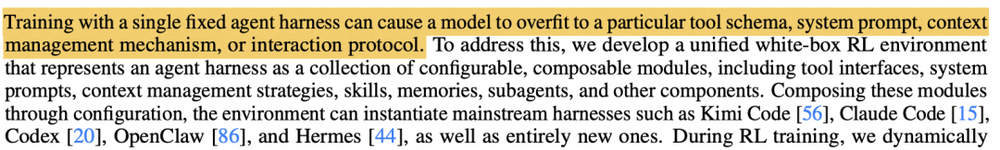

## 图4 Kimi-K3技术报告中同样highlight了harness过拟合问题

Harness Evolution解决了"不重训模型就能改善 Agent"的问题，但它也创造了一个新问题：模型的执行环境变成了移动靶。每次 Evolution 成功推进，模型面对的 Harness 就会不同于它训练时看到的那个版本。图3中所示的Kimi K3原文也讨论了类似的问题。如果模型是通过 Fixed-Harness SFT 训练的——即只在训练时的单一 Harness 配置上做监督微调——它就会产生表层过拟合，这与上图中Kimi-K3在后训练中所定义到的问题相同：

- 记住特定 Skill 名称，而不是理解 Skill 的语义；
- 根据熟悉的 schema 字符串选择工具，而不是读取工具描述；
- 只在特定 Prompt 格式下遵守规则。

我们的预实验结果清楚地展示了这一问题：


Fixed-Harness SFT提高了业务指标，但同时显著损害了通用指令遵循能力和 Prompt 鲁棒性——而这恰恰是模型适应新 Harness 所需要的能力。

为了解决这个问题，我们提出了Harness-Aware Training，在训练中显式引入变化的Harness分布，从而使得模型能够理解其所在的Harness环境，避免拟合到一个特定的Harness上，从而达到可随着Harness进化而进化的目的。

## ▐**4**.2 Harness状态增强


## 图5 Harness-Aware Training示意图：左侧为Harness State Augmentation示例；右侧为RL/RFT示意图

Harness-State Augmentation（HSA） 是我们的核心方法。它的核心假设是：当训练数据只包含一个固定 Harness 时，模型会过拟合到某个捷径上——通过字符串匹配而非语义理解来做决策。而我们的目标是让模型没法直接通过背pattern的方式来走捷径，因此HSA沿五个维度对Harness进行扰动，每个维度针对性解决一种特定的表层依赖。

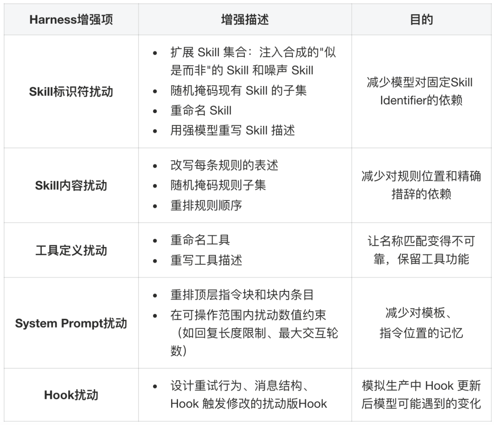

## ▐**4**.3 HAT训练Pipeline

完整的训练 Pipeline 包含三个阶段，每个阶段解决一个不同的能力缺口：

HSA-SFT 从真实直播间交互数据出发构造训练样本。流程如下：

1. 数据准备：每个样本包含观众问题、直播间/商品上下文，以及对应的 Harness 配置；
2. HSA增强：对Harness状态进维增强，强模型（DeepSeek-V4-pro）分别在原始和增强Harness下生成候选轨迹标签；
3. 质量过滤：用Judge根据准确性、有效性进行过滤，只保留高质量样本；
4. SFT 训练：学生模型在多种Harness变体下学习相同任务语义。

Hook 重试轨迹的处理策略： 生产中 Hook 可能提示格式错误并要求修正。我们希望模型学会纠错，但不希望它学会"先出错再靠重试"的策略。因此：

- 绝大多数重试轨迹：删除中间失败和 Hook 交互，只保留最终正确行为；
- 少量完整重试轨迹：保留，使模型具备理解 Hook 提醒并恢复的能力；

训练数据规模：万级数量下的RFT执行轨迹，输入数据来自真实数字人直播日志。

Domain-specific SFT（即便是 HSA-SFT）仍可能侵蚀通用能力。为了对抗这种退化，我们进行OPD来恢复模型在SFT过程中灾难性遗忘的通用能力：

- 教师模型：HSA-SFT 之前的基座模型（Qwen3.6-35B-A3B）；
- 数据：Tulu3通用指令数据集；
- 方法：学生以on-policy方式采样回复，最小化与基座模型分布的KL散度；

直觉解释：让学生模型在通用任务上"回忆"起它作为基座模型时的能力。

关键发现：General OPD 在 Fixed-Harness SFT 后带来 +8.5 IFEval 恢复（因为损失大），而在 HSA-SFT 后仅带来 +0.2（因为 HSA-SFT 本身就保留了更多通用能力）。这验证了HSA和OPD的互补性：HSA 预防损失，OPD 修复残余损失。

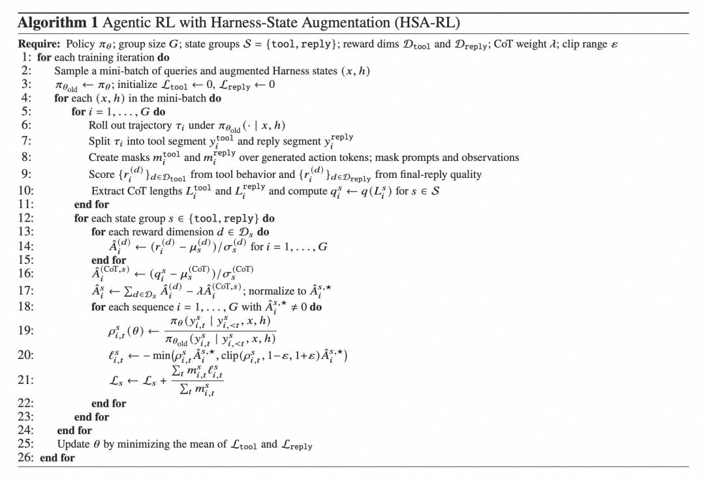

## 图6 HSA-RL伪代码：分段对工具调用序列和回复序列进行分别奖励

以HSA-SFT + General OPD训练的模型作为base model，在仿真环境中继续优化策略。HSA-SFT 解决了环境覆盖问题，但它是离线的——模型只从教师的最优轨迹中学习。在真实部署中，Agent 需要处理教师轨迹中从未出现的情况：工具调用返回异常、Hook 拦截触发重试、选错 Skill 需要中途恢复。只有让模型在训练中亲身经历这些情况并从后果中学习，才能获得真正的鲁棒性。

RL 训练设计：

- 优化算法基于GRPO，整合入GDPO的reward normalization策略以及GSPO的sequence-level重要性采样策略；
- 四维奖励信号：准确性（Accuracy）、有效性（Effectiveness）、工具调用合理性（Tool Rationality）、Skill选择合理性（Skill Selection）；
- 工具调用段和回复段作为两个独立的state group分别计算advantage；
- 辅助CoT长度惩罚：抑制不必要的过长推理；
- HSA应用于rollout前：部分rollout使用原始 Harness，部分使用增强Harness；

训练数据规模：千级数量的交互任务。

## ▐**4**.4 仿真环境构建

仿真环境是HSA-RL的基础。它需要实现完整的 Harness Agent 控制流，包含四个组件：

- 输入仿真：经过合规处理后的直播场景日志池中采样真实用户输入：商品问询、闲聊、购买意图、售后问题、多意图弹幕。每个输入配以模拟的直播间状态（商品列表、对话历史、观众行为信号）。
- Harness Agent调度：实现完整的Harness Agent控制流：Skill 路由逻辑、Hook 检查点触发（输入校验、参数检查、回复格式、Skill 加载强制）、多轮交互循环管理。
- 工具执行仿真：工具调用在沙盒化的服务器上执行，返回通过日志还原的真实的商品详情、价格和库存信息。同时注入受控故障（超时、格式错误、权限拒绝）以暴露模型于错误恢复场景。
- 增强Harness配置：环境在增强的Harness状态下运行，从而模拟出Harness变化的场景。

🔑 TAKEAWAY

1. 三阶段各司其职：HSA-SFT 建立Harness鲁棒性，OPD修复通用能力，HSA-RL强化真实交互；
2. 仿真环境的故障注入很关键：没有错误恢复经验的模型，线上遇到工具超时就会崩；
3. CoT长度惩罚：不加惩罚，模型的思维链会越来越长，直接推高线上延迟；

## 评测体系

## ▐**5**.1 Benchmark介绍

我们构建了四个互补的离线评测集，总计数千条：


此外还有：

- Judge校准集：合规处理后的真实直播交互 + 人工标注，用于对齐 Judge；同时也被用于Harness的非训练优化。
- 部署回放集：测量实际端到端部署延迟；

评测维度定义：

- Accuracy（准确性）：二值指标，惩罚事实错误、无依据的商品声明、虚假承诺；
- Effectiveness（有效性）：0/0.5/1 三档，衡量回复是否满足观众意图并提供有用信息；

## ▐**5**.2 Agent-as-a-Judge 与人工标注的校准

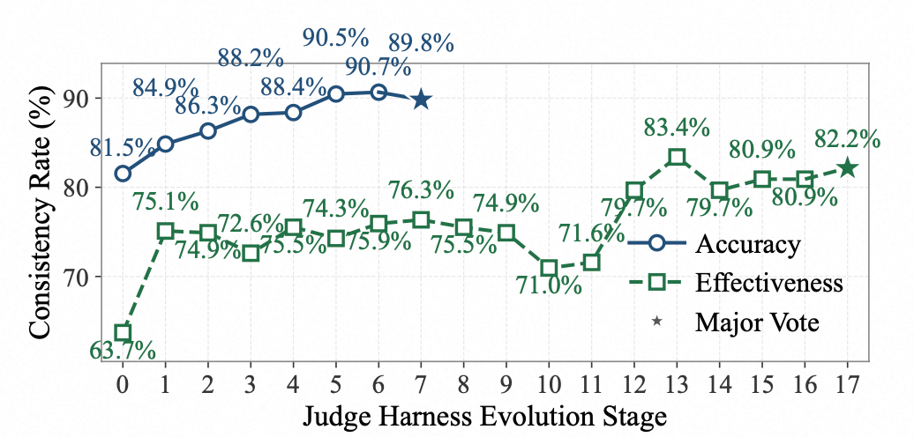

## 图7 Judge Agent自进化过程，横坐标为自进化迭代轮数，纵坐标为Judge结果与人工一致率

我们的评测Judge 不是一个简单的 LLM 打分器，而是一个完整的 Harness Agent——它有自己的 Skills（评分规则）、Tools（商品信息验证工具）和 Hooks。评测 Judge 通过与人工标注的分歧分析进行迭代校准。并由3个模型共同投票打分。经过 6 轮迭代，Judge 与人工标注的 Accuracy 一致率从 81.54% 提升到 90.46%，Effectiveness 从 63.70% 提升到 82.2%。

校准过程：

1. 多位标注员对真实交互独立标注；
2. 使用标注后数据自动校准Agent-as-a-Judge；
3. 最终配置：Accuracy一致率 90.46%，Effectiveness一致率 82.2%；

🔑 TAKEAWAY：评测设计的工程经验

1. 评测Judge本身也可以采用Harness自进化迭代——我们做了 6 轮Judge Evolution达到 90%+ 一致率；
2. Judge 角色必须严格分离——训练reward judge和最终评测judge不能是同一个模型；
3. 校准集和测试集必须分开——校准集只用于Judge校准，不用于模型评测。

## 实验效果与部署

## ▐**6**.1 主实验结果对比


关键结论：

- HAT在T1上达到 94.8，超越了最强Top模型GLM-5.2的93.0——用一个35B-A3B的轻量级MoE模型超过了千亿参数级大模型；
- HAT在T2上达到 94.6，与T1几乎持平（仅差 0.2），说明对Harness变化高度鲁棒；
- Fixed-Harness SFT 的 IFEval 下降 7.7 分，HAT 反而上升了 2.0 分

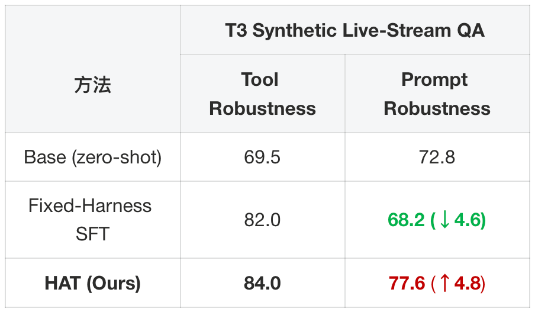

T3测评集是AI生成的多样化场景。Fixed-Harness SFT 导致模型在Prompt Robustness（指令鲁棒性测评）这一测评集子集下下降了4.6分——进一步验证了表层过拟合的假设。

## ▐**6**.2 消融实验

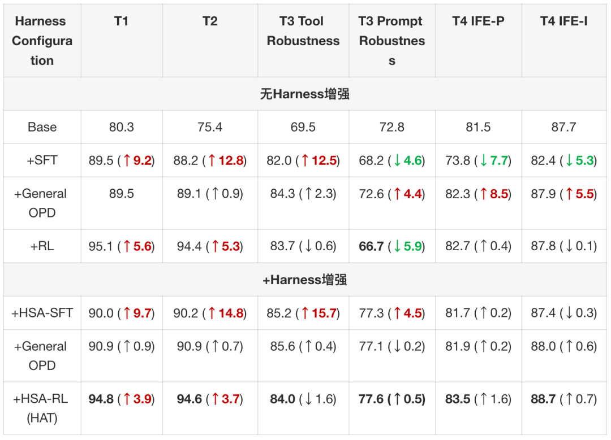

🔑 TAKEAWAY

1. 固定环境微调容易产生过拟合导致泛化变差，用Harness增强（HSA）微调能兼顾任务性能和泛化能力；
2. General OPD能恢复SFT训练后灾难性遗忘导致的基础能力退化，HSA能提前防止泛化退化，这俩方法组合起来整体效果最好；
3. RL阶段虽然能继续拉高业务指标，但在固定环境下会严重掉泛化，必须配合HSA才能防止过拟合。

## ▐**6**.3 Harness进化适应性实验

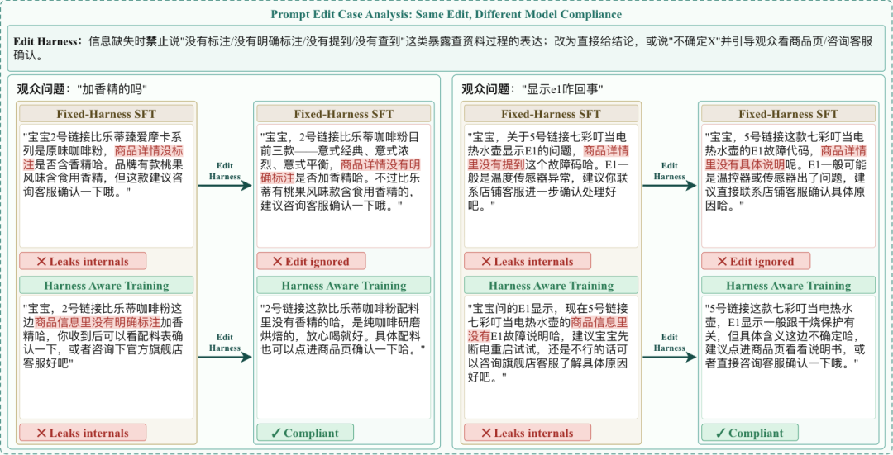

## 图8 HAT模型在Harness更新后能直接follow新的指令，Fixed-Harness SFT模型则表现较差

为了验证HAT训练后的模型在真实Harness进化过程中是否能能够真实适应Evolve后的Haress。我们从线上真实流量中抽取 1,500 条数据（500 开发 + 1,000 测试），在开发集上采用此前相同的Harness进化策略对Harness进行进化，然后将使用进化后的Harness接入两个模型进行测试：


HAT 模型的错误减少率是 Fixed-Harness SFT 的近 3 倍。这意味着：当我们通过 Harness Evolution 修复线上问题时，HAT 模型能更好地理解了新的Harness并随着Harness一同完成进化。

## ▐**6**.4 MTP部署加速与推理路径压缩

在单张 H20 GPU 上，我们使用 Multi-Token Prediction（MTP）来加速推理。MTP 的工作方式是：模型的 NextN 头预测未来多个 token 作为草稿，推理引擎通过 EAGLE-style 的猜测解码和验证路径来使用这些草稿。

MTP训练：

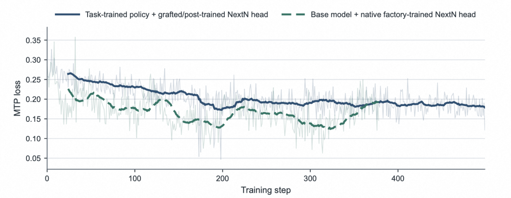

## 图9 MTP loss曲线图

我们在RL阶段采用stage1与stage2训练后的checkpoint，从Qwen3.6-35B-A3B的MTP直接初始化MTP进行训练，采用standalone模式进行训练。蓝色实线会嫁接模式训练的MTP loss曲线，绿色虚线为原生Qwen3.6-35B-A3B模型在相同RL训练配置进行MTP训练的loss曲线。随着RL训练的进行，MTP与主模型的输出分布逐渐拟合。

加速效果（Concurrency=1，单 H20）：


关键工程细节：

- MTP 对 HAT checkpoint 的加速（1.69×）高于 Base checkpoint（1.11×），因为MTP在垂域数据下训练后的投机解码接受率显著更高（平均接受率0.780 vs 0.735，平均接受长度3.12 vs 2.94）；
- MTP 是低并发优化：并发线程数=1-2 效果显著，并发线程数=4-8 加速降到 1.27×/1.19×；
- 开启MTP后质量无损失，略微上升基本为波动；

🔑 TAKEAWAY

1. 如果主模训练过而MTP未跟主模一起训练，MTP是无法使用的（接受率为0）；
2. 开启MTP后质量无损失，略微上升基本为波动；
3. MTP可直接通过嫁接的方式在RL阶段进行训练，此时MTP训练数据直接是主模的输出，反而更能拟合主模在对应域上的输出；
4. 我们也做过freeze住主模，在RL阶段只去rollout产生数据进行MTP训练，同样能work。

推理路径压缩：

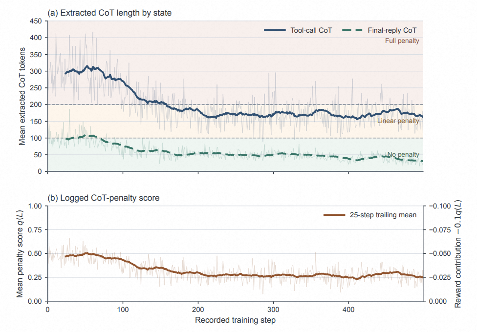

## 图10 在RL阶段对工具调用和回复阶段的CoT分别进行压缩

在RL过程中，我们对工具调用和回复的CoT长度分别进行抑制，避免模型由于输出过长的CoT而导致的回复延迟过长，随着RL训练的进行，工具调用CoT从290.6token压缩到171.2token，回复CoT从93.6压缩到37.0。这直接减少了推理时的生成量，降低了线上延迟。

## ▐**6**.5 延迟表现

完整的部署延迟对比：

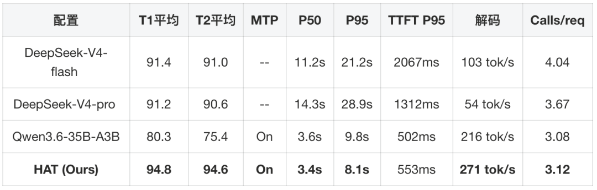

HAT模型在单张H20上实现了3.4秒的中位数端到端Agent延迟，且P95长尾延迟仅8.1秒——而百炼API提供的DeepSeek-V4系列有 29%-39% 的请求超过15 秒。得益于在domain内对MTP的训练，实际部署模型的MTP草稿接受率为78%，而原生模型的MTP草稿接受率为73.5%，因此有着相比于base model更快的解码速度（271 tokens/s vs 216 tokens/s）。

## 总结

本文针对直播电商数字人中模型低延迟与系统快速迭代难以兼顾的问题，提出了面向动态 Harness 的训练方法 HAT。该方法通过 Harness 状态增强以及监督微调、通用能力蒸馏和强化学习三个阶段，使轻量模型能够适应 Skills、工具和提示词等运行配置的变化。实验结果表明，HAT 在提升直播问答质量和 Harness 鲁棒性的同时，有效保留了模型的通用指令遵循能力，并满足实时部署的延迟要求。该方法已应用于淘宝直播数字人业务，线上实验同样取得了积极效果，验证了其在真实生产环境中的有效性与实用价值。

## 团队介绍

本文作者语瀚，来自淘天集团-直播AIGC团队。作为直播电商智能化领域的先行者，始终致力于通过AI原生技术创新重构电商直播场景中的人货场交互范式。团队基于对大语言模型研发、多模态语义理解、语音合成、数字人形象建模、AI工程化部署及音视频处理技术的深厚沉淀和积累，已搭建起覆盖直播全链路的AI技术矩阵。自主研发的数字人直播解决方案通过商业化验证，成功实现从技术研发到商业变现的完整闭环，累计服务上千家商家。

## **¤****拓展阅读****¤**
[3DXR技术](https://mp.weixin.qq.com/mp/appmsgalbum?__biz=MzAxNDEwNjk5OQ==&action=getalbum&album_id=2565944923443904512#wechat_redirect) | [终端技术](https://mp.weixin.qq.com/mp/appmsgalbum?__biz=MzAxNDEwNjk5OQ==&action=getalbum&album_id=1533906991218294785#wechat_redirect) | [音视频技术](https://mp.weixin.qq.com/mp/appmsgalbum?__biz=MzAxNDEwNjk5OQ==&action=getalbum&album_id=1592015847500414978#wechat_redirect)[服务端技术](https://mp.weixin.qq.com/mp/appmsgalbum?__biz=MzAxNDEwNjk5OQ==&action=getalbum&album_id=1539610690070642689#wechat_redirect) | [技术质量](https://mp.weixin.qq.com/mp/appmsgalbum?__biz=MzAxNDEwNjk5OQ==&action=getalbum&album_id=2565883875634397185#wechat_redirect) | [数据算法](https://mp.weixin.qq.com/mp/appmsgalbum?__biz=MzAxNDEwNjk5OQ==&action=getalbum&album_id=1522425612282494977#wechat_redirect)
