# 淘宝闪购本体平台：让人与 AI Agent 共用一份实时可信的业务知识

> 来源：阿里技术（微信公众号）  
> 作者：王浩迪  
> 发布时间：2026-11-18 18:29  
> 原文：https://mp.weixin.qq.com/s/YRzW4duU_YQxl3WRTvedqA

---

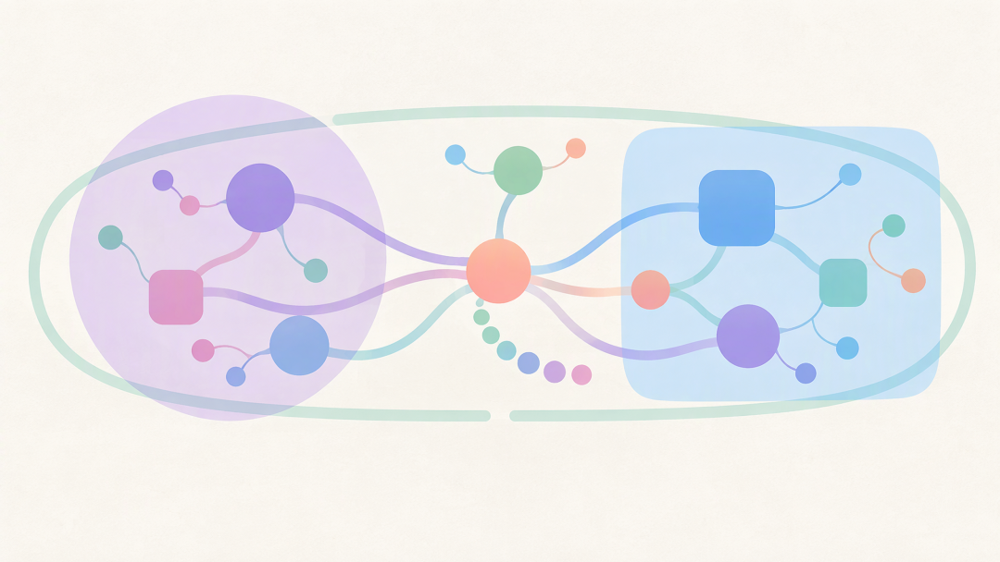

**这是2026年的第****83****篇文章**

（ 本文阅读时间：约 25 分钟 ）

摘要

数据团队做周报，最头疼的是对齐口径。譬如这周到底有多少订单，按下单时间算还是按支付时间算，一笔周日下单、周一付款的订单会落进不同的周。这两种算法都说得通，只是报表说明里写死了一种，业务负责人脑子里记的却是另一种；**写下来的总是少数，多数口径还得靠人记。**

分析师遇到这个问题，找人问一句就能解决，但 Agent 没有这个渠道。它拿到一列数字，无法知道来自哪个指标、哪个版本、谁确认过。同一个问题，人得到的是“这次按支付时间算”，Agent 得到的只能是一次猜测。

淘宝闪购本体平台要解决的就是这件事：把业务对象、关系、术语、分析方法和约束组织成一份可版本化的知识，经确认与审批发布，再通过 Web、OpenAPI、HSF 与 MCP 交给人和 Agent。

光把口径写下来还不够，定义有没有被确认过、变更有没有被留住、查询跟不跟得上，这三件事才决定它能不能用。前两件在治理链路，第三件在查询链路，我们得先看清平台由哪几块组成。

01

平台架构：三层元模型与单向派生链路

淘宝闪购本体平台的核心，建立在两样东西之上：**元模型**规定了业务知识能表达成哪几类对象、彼此怎么连、受什么约束；**治理链路**则决定了哪一版最终生效、由谁确认过。在这两者共同作用下，生效的那一版定义被统一存放在 MySQL 里，作为全平台唯一的事实源；下游所有的读模型全由它派生，最终通过四个入口对外提供服务。目前，这份事实源的规模已经达到了万级的节点与关系。

在平台的架构设计上，我们将整体能力拆解为五个核心模块。很多人在看这套架构时，最常问的一个问题就是：挖掘和质量、场景和服务，这两组模块的功能看起来有交集，为什么不直接合并成一块？

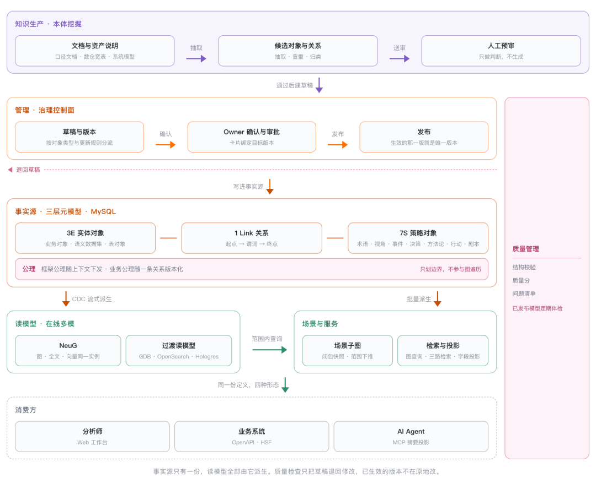

原因在于职责的隔离。挖掘模块只负责产出候选，不判断对错；而质量模块是在候选变成草稿之后才介入的，命名不规范、缺归属、关系指向已废弃对象这几类问题，都会在这一步被退回。如果真的合并了，最常见的后果就是挖掘模块会开始“自我审查”：它知道自己产出的东西马上要被同一套规则卡住，就会只抽那些肯定能过的，覆盖面会先垮掉。

场景和服务也是同理。场景产出的是“范围”，服务产出的是“形态”。如果把范围硬塞进接口，就会长出一堆业务参数；如果把形态硬塞进场景，它就会退化成一份固定的查询模板。

管理模块则负责建模与治理，决定什么能最终生效。为了支撑这套体系，平台把元模型压缩到了三层，每层只用很少的几种类型。

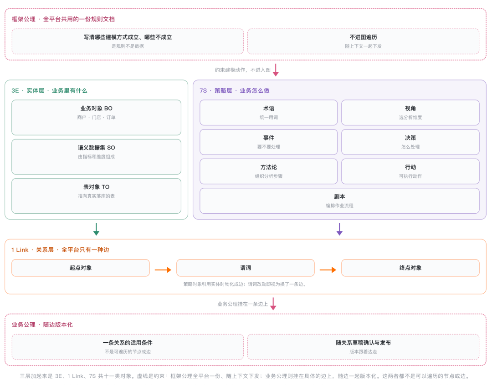

第一层是实体层，定义业务里有什么。业务对象是商户、门店、订单这样的业务名词；语义数据集由指标和维度组成；表对象指向真实落库的表；指标则引用业务对象，再落到具体的表。

第二层是关系层，全平台只有一种边。起点、谓词、终点三样确定一条边。谓词取自受控词表，因此改谓词就等于换了一条边。

第三层是策略层，定义业务怎么做。包含了术语、视角、事件、决策、方法论、行动、剧本七类。它们各自回答一个问题，彼此不能替代。比如，事件是"单店退款率连续三天超过 5%"，决策是"把它放进复核名单"；前者判断要不要处理，后者决定怎么处理。

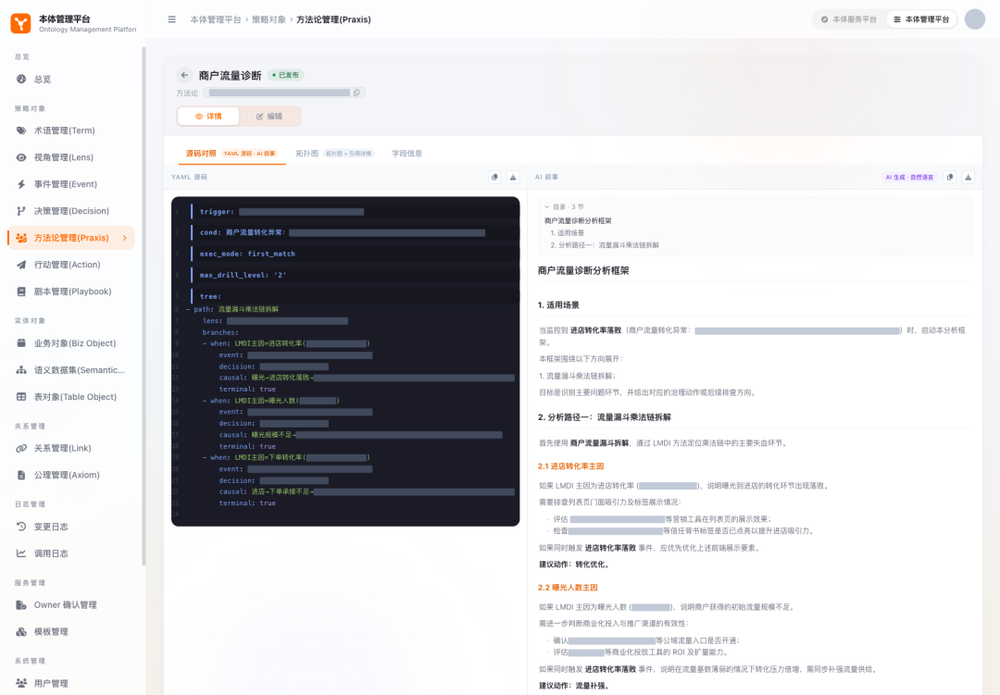

在这三层之外，还有一类特殊的约束：公理。公理只划边界，不参与图遍历。

3E、1 Link、7S 的划分方式本身并不新鲜。如下所示，在业界，目前已经有四类主流做法（各自解决了一段问题，但也各自留下一段空白）。

| **方案** | **长于** | **落不到的地方** |
| --- | --- | --- |
| 通用知识图谱（OWL + 图数据库） | 类型与约束可形式化，标准成熟，校验与推理都有现成工具链 | 规范管得住怎么建模，管不住谁确认的、引用还对不对、范围外答不答 |
| GraphRAG | 把文本切成图再召回，能回答跨段落的问题 | 抽取结果由模型生成，校验落在抽取质量上，没有业务确认这一关 |
| BI 语义层 | 指标口径稳定，取数与报表一致 | 只管指标，不管对象、关系与做法 |
| 商业本体平台（如 Palantir Ontology） | 对象、关系、动作、权限一体，工程化最完整 | 实施重、绑定深，上线前要先把对象与权限的建模规范定下来 |

闪购本体平台选择了后两类方案的融合路径，即定义交给本体管理，关系交给图库做读模型，生效交给治理链管控。这套划分思想源头可以追溯到 W3C 的 OWL 与语义网体系。我们真正做的改动，是把“谁确认过”嵌入主链路，不只停留在规范层面。

三层结构确定之后，还需要三条流程将结构与分工串联起来：

**•**知识生产：从文档到候选，再到草稿；

**•**变更发布：从草稿经确认与审批，最终发布；

**•**查询消费：从场景经检索与投影，最终交付给人、业务系统或 Agent。

这三条流程共用同一份数据与同一套权限点。落到数据层面，它们共同构成一条单向链路：上游是唯一的事实源，下游全是派生的读模型。

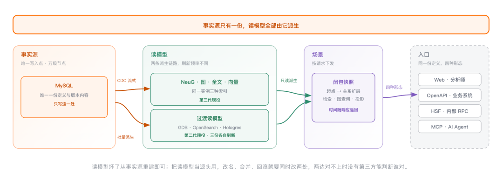

图数据库、倒排索引或向量索引损坏，都可以从事实源重建。但只要把读模型当源头用，改名、合并、回滚就得同时改两处；两边对不上时，没有第三方能判断谁对。所以平台只把读模型当派生物：按哪个口径算，仍由业务决定；平台负责让这个决定被写下来、被确认、被查到。这件事，最终靠治理链路兜底。

02

生产与治理环节：从变更留痕到发布对账

审批只是治理链路的一个环节，真正的难点在于流程走完后的异常处置：回调丢失、并发修改同一字段、发布中途宕机。

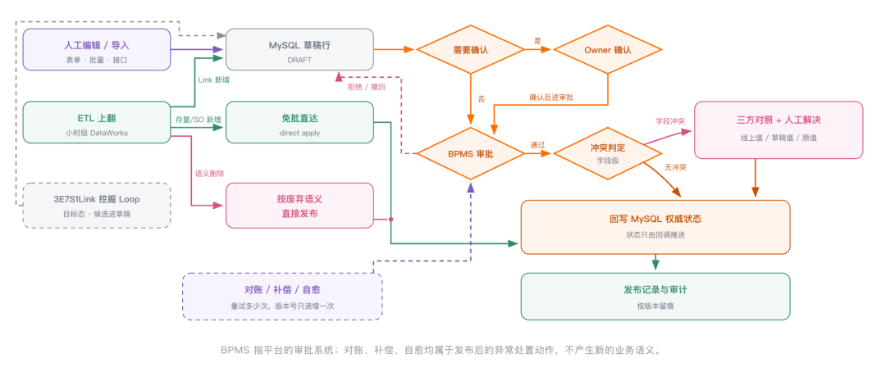

变更主要来自两个方向，一是人工发起（表单、批量导入或接口提交），二是上游语义变更（如数据集换来源、指标改口径）。平台按影响面与规则明确程度分流，影响面小、规则清晰的字段受控自动更新；需人工判断的就转入草稿流程。

变更入口一多，语义冲突随之而来。我们以“有效订单”为例，它在数仓中是一个字段，在接口文档中是一段参数说明，在指标定义中是一串公式，在业务人员认知中则是一套未成文的约定。名称相同，边界与责任人却无法对齐。人工评审尚可拍板，但 Agent 拿到任何一份都会全盘接收。因此，草稿提交前必须查重，平台将已发布定义与在途草稿放在一起，按标识和名称双向比对。如果等发布后再合并，成本极高，脏数据也早已流入下游。

查重解决的是“是否为同一对象”，接下来要明确“本次变更的归属”。Owner 通过互动卡片确认，卡片绑定的是该变更最终生效的版本，而非草稿编号。绑错则确认记录挂错版本。

责任人明确后，方可进入审批，通过才能发布。这里有一条隐蔽但关键的时序约束：先落审批记录，再启动流程。若顺序颠倒，流程启动成功但记录写入失败，就会产生一张找不到对应变更的审批单，事后只能人工清理。平台的策略是：记录写入失败直接终止。

发布前还有一道合并校验。同一字段可能同时被线上、草稿和上游同步修改。平台将线上值、草稿值与基线值进行三方比对：三方一致直接放行；仅草稿变更则取草稿值；若线上与草稿均变更且不一致，则列出冲突交由人工裁决，绝不静默覆盖任何一侧。在并发场景下，字段级合并是唯一能清晰界定"改动意图归属"的工程手段。

需要注意的是，发布之后的环节容易被忽略。审批系统会掉回调，网络会超时，数据库会抖动。平台的做法是：状态仅由回调推进，拒绝前端轮询猜测；同时对未收到回调的单据进行定期对账，对审批通过却停滞在中间态的单据执行发布补偿。对账与补偿必须保证幂等——无论重试多少次，版本号只递增一次。

除了并发合并，改名的处理也同样棘手。业务对象改名后，引用它的关系、场景和接口说明极易断裂。平台将稳定标识与外部标识分离：稳定标识终身不变，外部标识可修改。改名时仅更新外部标识，引用方无需重写。

这里以门店周报的“有效订单数”为例，需将算法从按下单时间改为按支付时间，并排除测试门店。改动先入草稿，经责任人确认与审批通过后，发布前合并发现上游同步也修改了同一指标的过滤条件。两处变更不冲突但均需保留，最终由人工确认合并结果。上线以来，这套机制已累计处理 1477 张确认单，从提交到闭环平均耗时 3 个自然日；未确认单据每日晨间自动催办，因为领域 Owner 精力有限，等待必须有上限。在质量把控上，已纳入评分的对象覆盖率达 99.6%，其中 A 级占 98.3%。

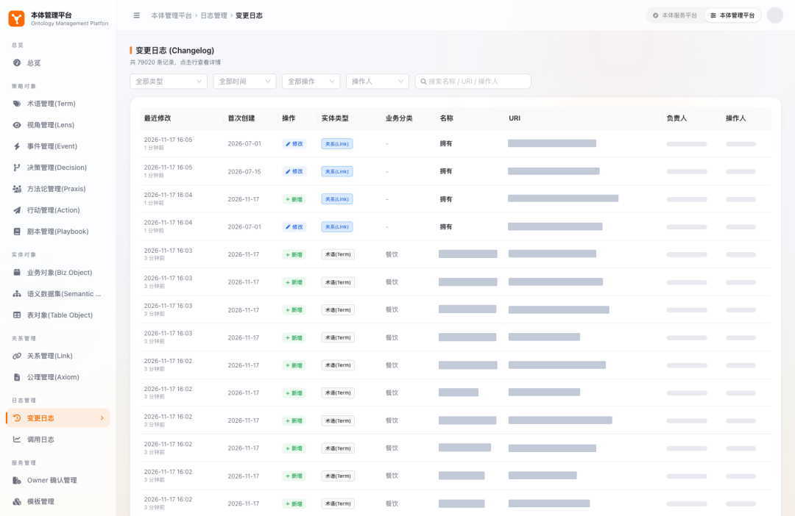

走完这一圈，人与 Agent 才算真正拿到了同一份定义。人在管理页看到定义、版本与责任人，Agent 通过接口读取同一条定义的已发布版本，差别仅在投影格式。发布前则不然：人能在草稿中预览新算法，Agent 只能读到旧版本。治理链路能厘清改动由谁发起、依据哪次审批、何时生效，但它不保证改动绝对正确，审批通过仅代表有人为此次变更负责。这条链路的责任止于发布那一刻，当事实源已更新为新版本，查询侧需等待同步完成后才能读取。

03

查询与消费环节：从架构演进到可用性边界

**3.1 查询与消费架构演进：跨越三代的架构取舍**

发布只是把数据写入了事实源，如果想要让业务和 Agent 真正查得到，查询侧还需要一套对应的架构支撑。从事实源到查询侧，底层引擎经历了三次迭代，但治理内核始终未变。第一代解决数据有无的问题，第二代关注排序的准确性，第三代才着手处理跨引擎拼装。理清了这条演进脉络，具体用的是哪个引擎，反而不那么重要了。

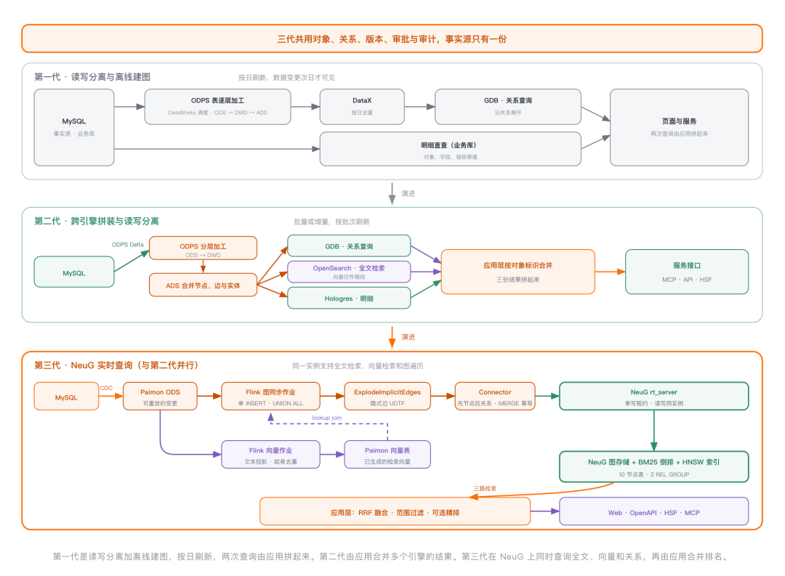

评价一代架构的优劣，主要看四个维度：从发布到可查的延迟；能否按名称、语义或关系进行检索；多个读模型是否会导致数据新旧混杂；以及排障与容量成本。这四者有明确的优先级——新鲜度最核心，它决定了人与 Agent 看到的是否为同一份数据；表达力次之，决定业务能提出多复杂的问题；一致性再次之，决定出错时能否快速定位；排障与容量排最后，因为前三个是架构底线，而容量可以通过资源投入和工程手段解决。

3.1.1 第一代：读写分离与离线建图

第一代的架构最直接，MySQL 既是事实源也是取数入口，DataWorks 在 ODPS 上按 ODS、DWD、ADS 逐层加工，DataX 按日将对象与关系批量同步至 GDB。取数查 MySQL，关系查 GDB，两个库各司其职，互不越界。

这一代解决的是数据有无的问题。业务需要查对象、看关系，用两个成熟组件拼装是最快的路径；读写分离、按日分区，出了问题也能逐层回溯到具体批次。

代价集中在新鲜度与表达力上，数据变更次日才可见，图库与业务库独立刷新，时间点还需额外对齐。查询仅支持名称与精确字段，业务口语、简称、同义词基本无法匹配：业务说"订单量"，系统里叫"有效订单数"，库里搜不到。更麻烦的是两库缺乏统一的身份体系。若要查询"这个指标关联了哪些对象"，需先在图库定位节点，再回业务库捞取明细，两次查询由应用层拼接，任一侧未刷新就会导致结果错误。

3.1.2 第二代：跨引擎拼装与读写分离

第二代补充了检索与明细两路读模型。MySQL 经 ODPS 分层加工后，同步至 GDB、OpenSearch、Hologres 三个读模型。OpenSearch 承担全文检索，由 BM25 倒排索引负责召回，精排表达式负责打分；GDB 承担关系查询，Hologres 承担明细与宽表，三份结果由应用层按对象标识拼接。这一代无需等待统一引擎成熟，召回与排序便能先行运转。

但补齐引擎不等于打通语义。OpenSearch 的召回仅有稀疏检索这一路：名称与 URI 进入 BM25 倒排索引，向量相似度仅作为精排表达式中的打分项，不参与候选生成。对于语义相近但字面对不上的查询，这一代没有召回路径，问题在于缺少稠密向量召回（dense retrieval）这一通路。

以一次"先搜名称、再展开关系"的查询为例，需同时访问搜索和图库两个引擎。若指标改名、数据集更换，搜索索引先刷新，而图库的下一批次尚未到达，两边数据对不上，用户查到的就是新旧混杂的说明。缩短批次间隔只能收窄窗口，无法消除。只要窗口存在，两个引擎各自都报成功，结果拼起来却对不上，核对就只能由应用层承担，最终靠人工比对索引、图库和应用层合并三处不同源的日志来定位。

3.1.3 第三代：实时多模与流式同源

第三代将拼装逻辑收回数据层。MySQL 变更经 CDC 进入 Paimon，Flink 分两条作业处理向量与图同步，连接器将节点、关系和向量 MERGE 写入 NeuG。图遍历、BM25 全文、HNSW 向量三种索引共存于同一实例，应用层仅负责融合、范围过滤和可选精排。

在这条路径上，检索结果直接成为图节点：命中后无需换库、无需重新对齐身份，可直接从命中节点沿关系扩展，跨引擎拼装环节就此消失。

但复杂度并未消失，只是从应用层转移到了数据链路。流式投递带来至少一次语义，下游必须自行吸收重复数据；受图结构约束，节点必须严格先于边写入；一旦发生删除，变更需沿链路传播；若作业从检查点恢复，还需额外核对漏写与重复。向量与图的刷新节奏不一致，这种时间差会导致读取时的数据不同步；加上写入压力直接作用于读侧，容量存在硬上限。读写同实例还带来额外开销：批量回填与重建索引会占用查询的 CPU 和内存，用户能感知到变慢。平台目前的策略是接受这一现状，将重负载任务调度至低峰期。

第三代是设计上的终态，落地策略是双跑：同一批查询同时发往两套链路，比对对象集合与排序，差异收敛后再放量。双跑期间两套链路均需承担成本，换来的是切量阶段一旦出现问题，退回上一代只需修改一次路由。

三代架构演进下来，真正未变的是治理内核：对象、关系、版本、审批、审计始终只有一份。改变的只是查询链路：数据刷新频率、检索任务执行方、结果合并位置。换引擎不换治理，知识可信度也就不再依赖任何一代引擎。

| **维度** | **第一代** | **第二代** | **第三代** |
| --- | --- | --- | --- |
| 更新频率 | 按日 | 批量或增量，按批次 | 流式增量，图谱秒级更新，按场景启用 |
| 关系查询 | GDB | GDB | NeuG 图遍历 |
| 全文检索 | 无 | OpenSearch BM25 | NeuG BM25 |
| 向量检索 | 无 | 仅参与精排打分 | NeuG HNSW+外部 embedding 服务 |
| 明细 | MySQL 直查 | Hologres | NeuG 明细 |
| 结果合并 | 页面按需 | 应用层编排 | 融合检索内一次出结果，主链路仍应用层编排 |
| 主要代价 | 新鲜度、表达力单一 | 多副本一致性、排障 | 流式复杂度、读写同实例、容量上限 |
| 现状 | 已退出主链路，GDB 在第二代继续使用 | 现役 | 部分替代，按场景并行 |

表里第三代的现状写的是部分替代，边界落在接口上。已经切过去的是三块：管理台的融合检索，三路召回都打 NeuG，融合在应用层做；场景发布后的闭包重算，走影子模式，固化结果仍以 MySQL 为准；明细查询，按标识直接在图上取行。还没切的是检索与关系查询两条主干：OpenAPI 的检索、MCP 与 HSF 的读接口仍然打 OpenSearch 与 GDB，宽表仍然打 Hologres。所以第三代当下只承担一部分查询，把这两条主干逐条切过去，才是这一代剩下的工程量。

前面提到，第三代把复杂度从应用层挪到了数据链路。这意味着，这一代的难点不在选型，而在如何把一条变更安全地写进图。引擎可以换，但写入路径换不了，这条路径必须跟底层数据库的变更节奏、幂等能力和恢复方式严格对齐。

**3.2 第三代引擎：实时写入时序与三路多模协同**

这一代在写入侧的目标，是一个单实例的多模图数据库。这里的"多模"，指的是三种索引建在同一份在线数据上：图遍历、BM25 全文、HNSW 向量，各对应一种查法。

一份节点数据同时进入图存储、倒排索引与向量索引，平台不再维护三份派生数据，也就不存在各刷各的、刷到一半状态不一致的问题。写入侧一致，是查询侧一致的前提。代价是链路变长：这条链路必须可重放、写入必须幂等、并且能从检查点恢复。这三个工程约束，不仅决定了故障之后能不能把数据补对，也直接卡死了容量到顶时能不能平滑扩容。

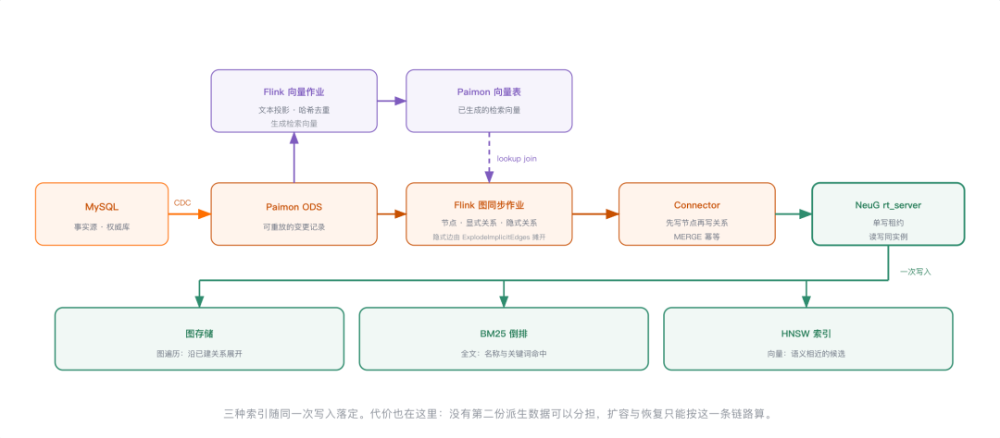

3.2.1 写入链路：节点先于边

在这条长链路上，第一处容易踩坑的是写关系的顺序。一条关系要落到图上，必须先找到两端节点；缺了任何一端，写入语句可能正常结束，实际什么都没写进去。这类失败不报错，只表现为“这条关系查不到”。平台的规避办法是让节点和边共用一个写入端，同一批写入里先处理节点，再处理关系。

3.2.2 写入的幂等与时序挑战

与顺序问题相伴的，是重试带来的重复投递。平台依赖 MERGE 来吸收这部分冗余：基于固定标识重复写入后，图上仍然只有一个节点；如果是修改属性后再写入，按原标识也能读回新值；同一对端点重复写入，最终也只会保留一条边。因此，幂等不是一句口号，它必须在节点、属性、边这三个层面上同时成立。

解决了写入的正确性，下一个挑战是时序的一致性。索引与图不在同一刻就绪，所以平台给不出“发布即一致”的承诺。这种时序上的错位同样影响删除操作：源库物理删除后，不仅要确认删除事件传到了图里，还要检查原先指向它的关系是否被妥善处理。

除了上述的时序错位，数据漏写也是必须防范的隐患。漏写不只出现在故障恢复环节，日常作业同样会踩坑：如果作业跳过首次全量快照、直接从增量起点消费，监控会一直显示有进度，早已发布的对象却查不到。这类“看着在跑、其实漏了一截”的问题，比直接报错难排查得多。

为了守住上述所有环节的底线，部署层面还有一条独立约束：同一时刻只能有一个写入端持有“写租约”（即独占写入权限），避免两个写入端同时 MERGE 导致版本错乱。**旧端一旦故障失联，从租约超时作废到新端接管之间，会有一段变更进不来的空窗期，长短取决于续期与检测策略。**因此，平台只承诺写入最终会恢复，不承诺写入过程不中断。写租约解决的是双写冲突，而接管之后的容量与恢复速度则是另一回事。

3.2.3 查询链路：三路协同与降级

一次查询牵动三段协同，而非三条通道各自为战：关键词与向量并行召回候选，图扩展以两者的候选集为种子，融合之后再进行可选精排。

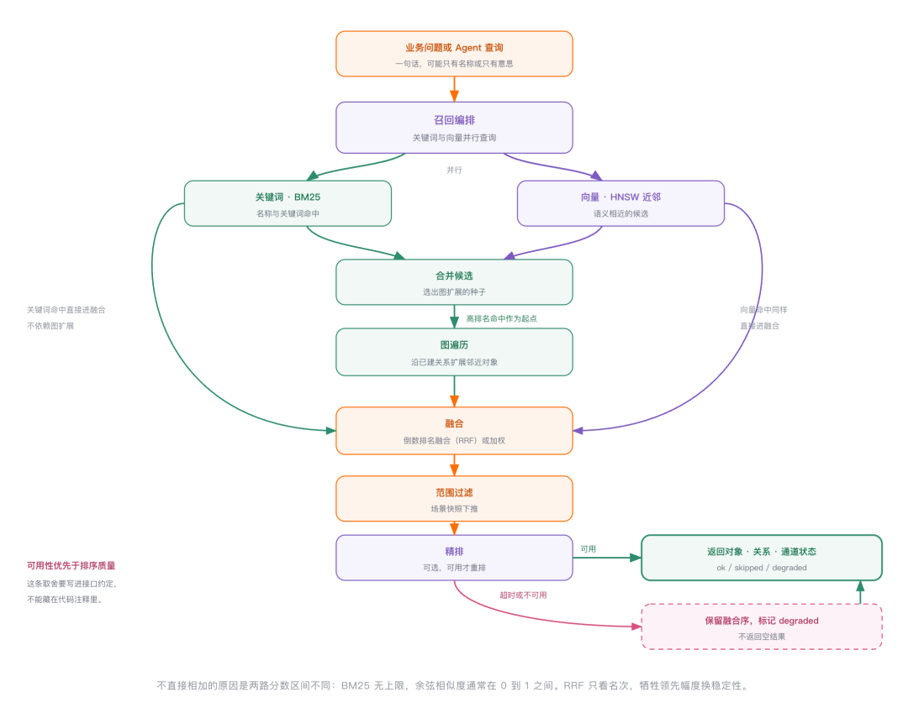

在融合环节，平台采用倒数排名融合（RRF）。三路通道的原始分处于不同尺度：BM25 随查询长度与语料分布漂移且无上限，余弦相似度限定于 [0,1]，图扩展分则按跳数衰减。若采用加权求和，需为每路设计固定的映射与权重，且这组参数往往只适配特定问法，泛化成本极高。RRF 仅依赖名次，三路各自排名后直接按倒数名次累加，无需额外标定；代价则是舍弃了绝对分差，换取了跨查询的稳定性。当然，系统并未废弃加权求和，而是将其作为对比基线保留，支持按请求动态切换。

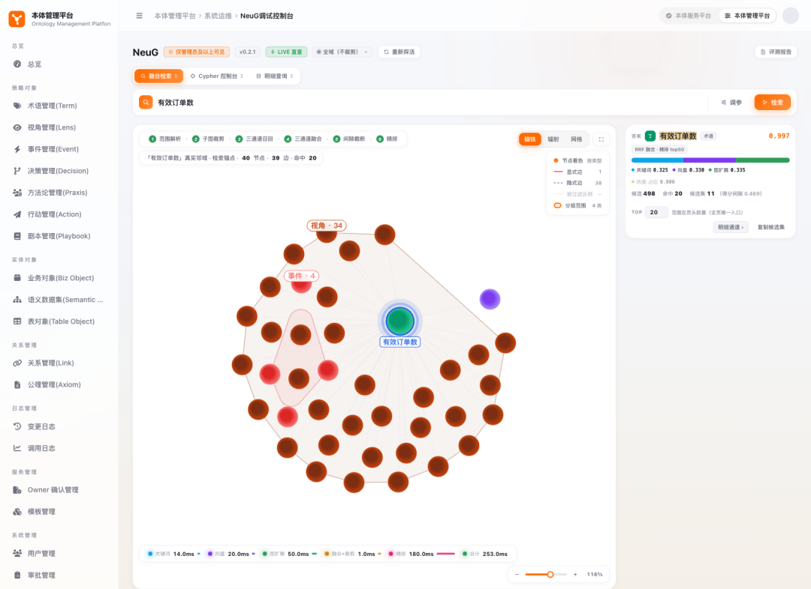

融合之后最容易出问题的是精排环节：一旦超时或失败，直接返回空结果会让用户误以为平台没有这份知识。因此，平台会保留融合顺序，并在响应中标记降级状态。这个状态字段并非可有可无的备注，而是接口契约的一部分，它向调用方显式声明了“可用性优先于排序质量”的取舍，确保下游能基于真实的降级情况做兜底，而不是去盲猜。

精排决定了结果的排序质量，却决定不了查询延迟——后者在更底层的图存储设计时就已确定。由于命中的标识直接对应图里的节点，平台无需在应用层做 ID 映射，这不仅省掉了一次网络调用，更规避了"两个引擎指代不同对象"的潜在风险。以一次两跳的关联查询为例：如果放在应用层做广度优先，应用层需要不断向图库发起 RPC 调用，6 次网络往返加上序列化开销，累计耗时超过 5 毫秒；而把这段逻辑下推到图引擎内部，变成一次变长遍历后，应用层只需 1 次网络往返，总耗时仅需 1.58 毫秒，性能提升 3 倍。

然而，引擎内的遍历虽然快，但一旦在过滤逻辑上出偏差，就会带来更隐蔽的灾难。此前的排查中曾遇到一个典型案例：业务人员在图谱页面选择相邻对象查关联表时，能看到 381 个表对象；但调用方通过接口查同样两跳、目标类型设为表对象时，拿到的却是空列表。原因在于，接口当时只在最后一跳按类型过滤。交易订单连出的关系很多，系统先按返回条数截断了一部分，再往外查时，恰好截掉了通往表对象的路径。

这种“看着有路，实则截断”的返回，对 Agent 存在严重误导。给 Agent 一个空列表，它无从判断是图里确实没有这样的表，还是路径根本没有查完。原本是为了控制返回条数的性能保护，最终却变成了知识检索的盲区。

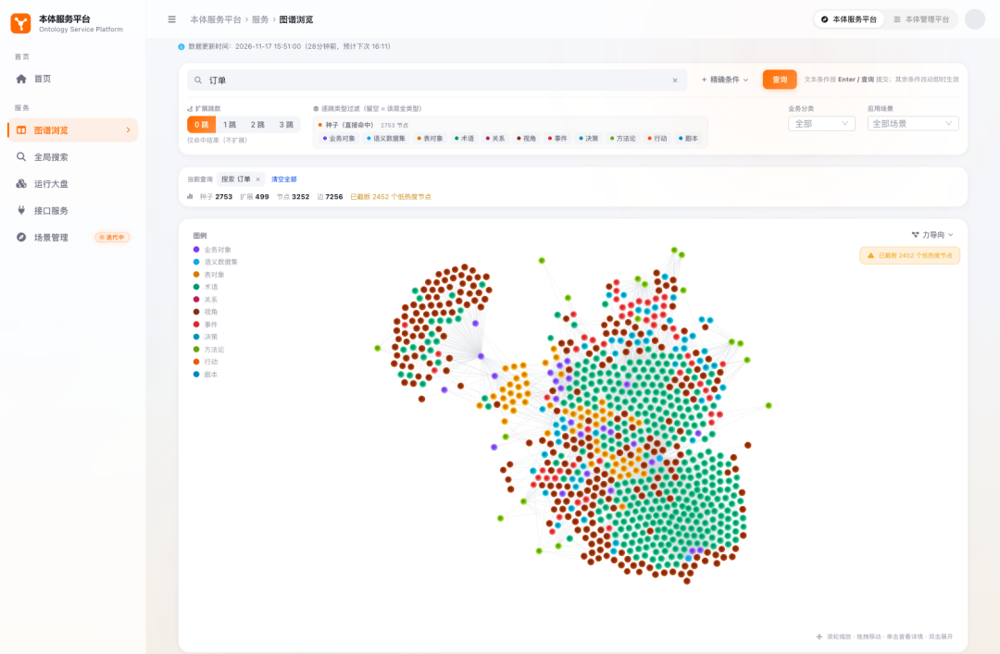

每一种检索路径都有其能力边界（刚才的截断就是一例）。我们按不同的提问方式对照来看：

| **读者的问题** | **用到的能力** | **能保证** | **不能保证** |
| --- | --- | --- | --- |
| 我知道名称 | BM25 全文检索 | 名称与关键词匹配 | 关键词相近不等于业务含义相同 |
| 我只知道大概意思 | HNSW 向量近邻 | 找到语义相近的候选 | 相似不等于相关，仍需排序与人工核验 |
| 我想知道它和什么有关 | 图遍历 | 沿已建关系找到邻近对象 | 路径存在不等于因果，也不等于逻辑推理 |
| 我想一次查全 | 多模索引同实例 | 结果直接是图节点，免去跨引擎关联开销 | 多模同源不等于跨作业强一致快照 |

3.2.4 效果评测：9511 条真实回放

三条路径组合起来效果如何，我们用线上真实查询回放来量化：将 2026 年 10 月生产环境里出现过的查询原样重放，比较融合检索与全局搜索基线的排序结果。回放集共 9511 条，分为两段：395 条页面检索与 9116 条 MCP 检索词。

评测首先暴露的是可用性差异。在 395 条页面检索中，旧链路有 16 条返回空列表，而融合链路为 0。这意味着在使用旧链路时，大约每 25 次提问就有一次拿不到任何结果。连结果都无法返回，排序质量便无从谈起。

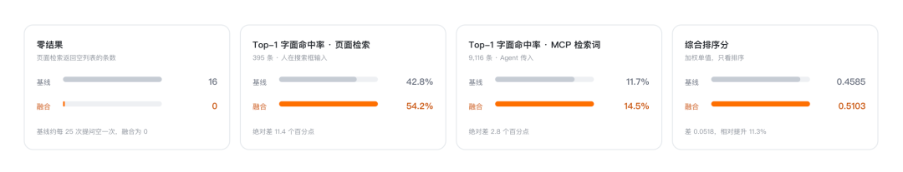

在可用性达标的前提下，排序质量提升同样显著。回放数据显示，在页面检索的 Top-1 字面命中率上，融合链路达到 54.2%，全局搜索基线为 42.8%；在 MCP 检索段，两者分别为 14.5% 和 11.7%。最终，融合链路的综合评分为 0.5103，优于基线的 0.4585。

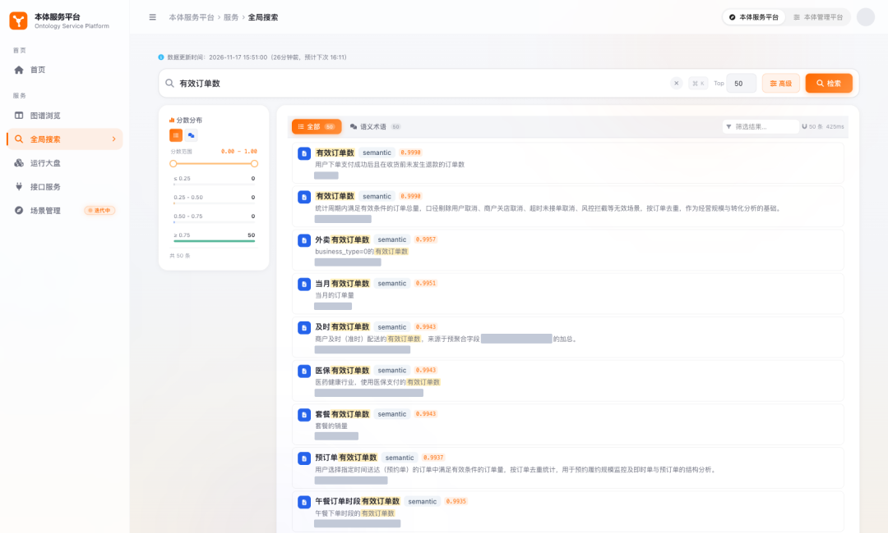

但只看排序分，会掩盖另一层真相：失败样本并非均匀分布。在 395 条页面检索中，有 181 条在两套链路的候选里都没有字面命中，占比高达 45.8%。对于这批样本，排序策略是无效的，因为两侧本来就没有召回候选。

进一步拆解这 181 条样本，问题集中在四类场景：

**•**中文短语与行业口头叫法（137 条）

**•**含空格混排（18 条）

**•**技术串与表名（14 条）

**•**拉丁缩写代号（12 条）

由此可见，归因不在排序，而在语料——别名没有归一、指标定义缺失。这类问题只能回到本体去补充内容，单靠调权重是解决不了的。

3.2.5 系统边界与当前上限

系统的边界首先体现在部署与容量层面。

读写干扰是第一个约束。写入对读取的实际影响，只能通过混合负载压测来量化。数据显示：空载时详情查询的 p99 为 54 毫秒；当起两个写入端持续做节点与边的 MERGE、每秒处理 11.6 条语句时，p99 升至 119 毫秒。读取性能并未被拖垮，但余量仅剩一倍多。在写入量翻倍之前，容量必须先行扩容。

单点瓶颈是第二个约束。单实例架构没有在线只读副本，容量到顶时，既无法通过增加副本分摊压力，也无法通过降级查询来绕过。

除了容量约束，数据语义上的时序错位同样无法回避。向量与图不在同一刻就绪：向量由另一条作业先算，再并回同一次写入；并回之前，节点要么没有向量，要么还是上一版文本的向量，要等下一次变更或回填才补上。因此，系统对外只能承诺“发布后可见”，无法承诺“发布即一致”。此外，删除与恢复机制决定了运维动作不能只盯着源库：源库删除了，图里可能依然存在；检查点恢复后，也可能出现漏写或重复。

这些约束共同构成了当前系统能力的真实上限。

3.2.6 后续演进：容灾底座与规则评估

读写同进程且缺乏在线只读副本，是这一代架构的固有短板。下一步优先落地周期检查点与冷备，待恢复路径跑通后，再评估引入只读副本。在没有恢复机制的前提下直接上副本，只会将风险延后，而非消除。

在规则挖掘侧，挖掘规则一旦修改，产出的候选就会随之变化。目前全靠人工预审兜底，尚未建立明确的准入标准。下一步需要建立一套评估集与准入规范。评估题目应从线上真实问题中抽取，因为自造题只能验证已知场景。同样地，检索侧的首版人工标注集已经就位，足以支撑回归测试，但尚不足以作为上线准入的依据，目前主要缺失的是负样本与同义改写问法。

这两项基础工作，直接决定了系统能在多大程度上交由机器自动决策。而系统最终是否"用得对"，则取决于业务语义本身的完备度。

**3.3 第三代引擎：子图的可用性边界与场景圈选**

跨过“查得到”这道门槛后，一次查询要真正“用对”，还需满足四个要求：范围准确、顺序合理、证据完整、上下文可控。这些要求不能交由调用方自行拼装，在架构上分三处落地：范围由场景对象管理，顺序由检索策略约束，证据与上下文则由响应契约来承载。

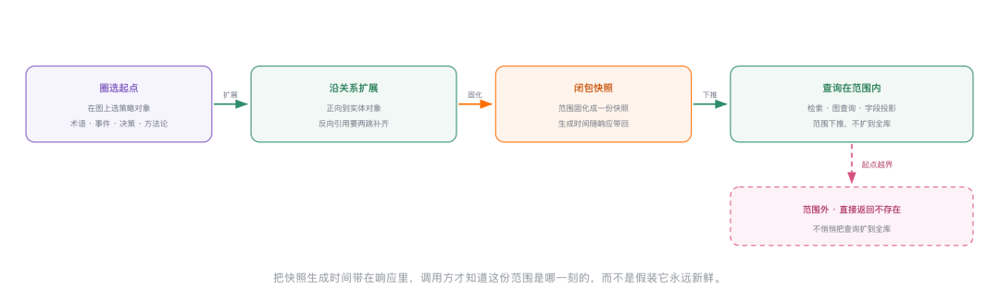

3.3.1 圈定范围：用子图快照对抗模型变更

查询范围由场景决定，而场景在平台上是可管理的对象。服务页中设有场景管理模块，一个场景即一份范围配置：包含圈选条件、子图快照，以及仅限该子图的访问凭证。具体做法是，先在图上圈选策略对象作为种子，沿关系扩展至实体对象，最后固化为子图快照。快照的核心价值在于稳定性，同一个场景今天和下周查到的必须是同一批对象，不能因为底层模型被他人修改，导致范围发生无声偏移。以零售商品定价场景为例：圈选起点 35 个，边界将 907 个实体对象收窄至 51 个，10709 个策略对象收窄至 1488 个，快照内合计 1539 个节点、4398 条关系。

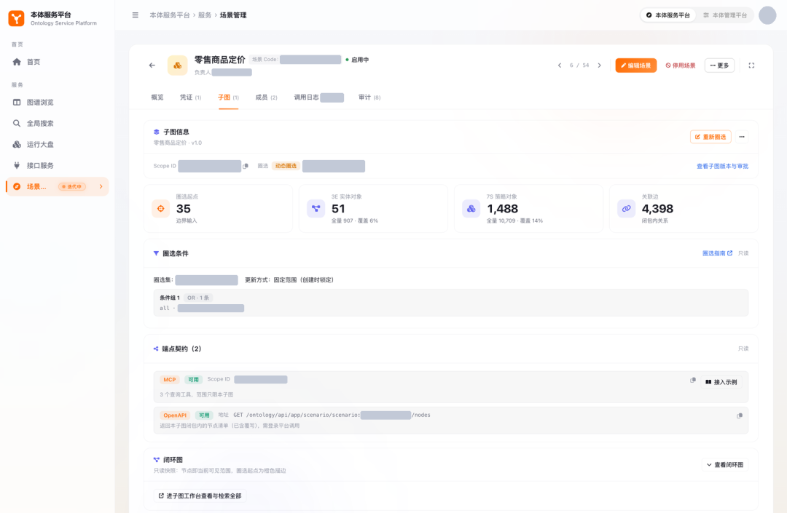

圈选最容易出错的地方不在算法，而在条件逻辑。一个场景常由“所有对象”与“某业务线”两个条件组构成，组间是并集（OR），组内才是交集（AND）；若将两条限制写进同一组，交集会把方法论、行动等整批切掉，而预览里仍保留着几百个节点，极难察觉。另一处是遍历方向：正向扩展不会带入反向引用，需用两跳反向查询补齐，而反向侧存在 20000 个节点的封顶限制，超限即会静默截断。因此，圈选必须算尽完整的子图，预览也必须能直观看出封顶是否被触发。

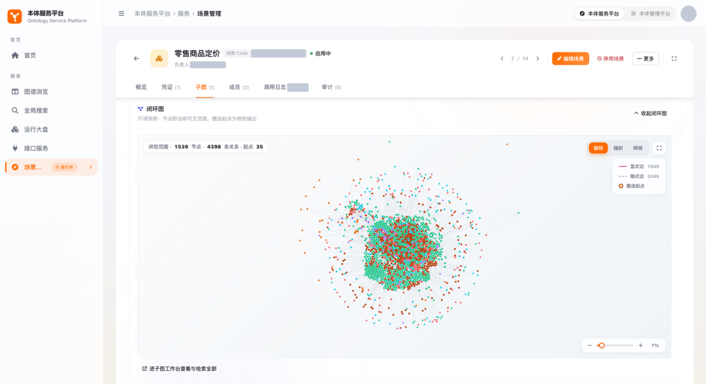

快照的代价体现在时效性上。底层模型一旦修改，快照不会自动跟随更新。在重算的空档期内，新加的对象查不到，删掉的对象却依然存在。为此，平台将快照的生成时间一并带入响应，让调用方明确知晓这份范围的时间截面。

3.3.2 守住边界：范围约束优先于召回数量

超出范围的查询会直接返回不存在，平台绝不会隐式将查询扩大到全库。因为 Agent 拿到范围外的答案会直接信以为真，人至少能在页面上通过场景标识判断这条知识的来源。

在范围内，检索顺序是固定的：先按名称或语义定位对象，再沿关系展开，最后获取明细；顺序倒置，后一步便失去可靠输入。这个顺序并非主观臆断。在 395 条页面检索中，纯关键词有 258 条无结果，加入向量召回后全部找回（找回指候选集中有结果，不等于原词出现在结果中）；而在此基础上叠加图扩展，找回数为 0，甚至会将被命中的目标挤出前列。这说明图扩展解决的是覆盖面，而非召回率，绝不能将其作为兜底方案。

3.3.3 上下文交付：证据链无损传递

拿到准确的定义，不代表调用方就能“用对”。一条结果至少要能回答四个问题：这是哪个对象、生效的是哪一版、上一次由谁确认、当前由谁维护。这四项在底层库中都是现成字段，难点在于如何将它们无损地传递到响应中。中间任何一层如果为了压缩响应体积将其裁剪，调用方就只剩一个名称加一段描述，看似完整，实则无从核对。

因此，Agent 侧必须多做一件事：按上下文预算裁剪返回。默认仅提供摘要，全量字段由调用方显式声明；响应中需附带提示，说明还有哪些字段未取、下次如何补全。模型上下文存在硬性预算，若单次返回包含数百个字段的对象，不仅会耗尽预算，还会挤占其他关键证据。以门店周报为例，Agent 的读取顺序是：先读基础约束，再读指标定义，然后读对应的表对象与取数口径，最后展开相关对象。而人打开页面时，看到的是定义、版本、责任人、引用它的报表与接口。入口不同，路径不同，但最终指向的实体是一致的。

平台能保证 Agent 拿到已生效版本，并知晓自身所处的检索范围；但无法保证 Agent 一定用对，也无法保证模型不会将定义解释歪。要解决后两个问题，需依靠提示词、评测与业务复核。平台能做且必须做的，是将可核对的证据链完整交付。

04

架构盘点：落地成果与演进决策

至此，可以对整体架构做一次盘点：平台落地了什么，各自付出了什么代价，哪些事不该由它接手，哪些经验可以沉淀复用。

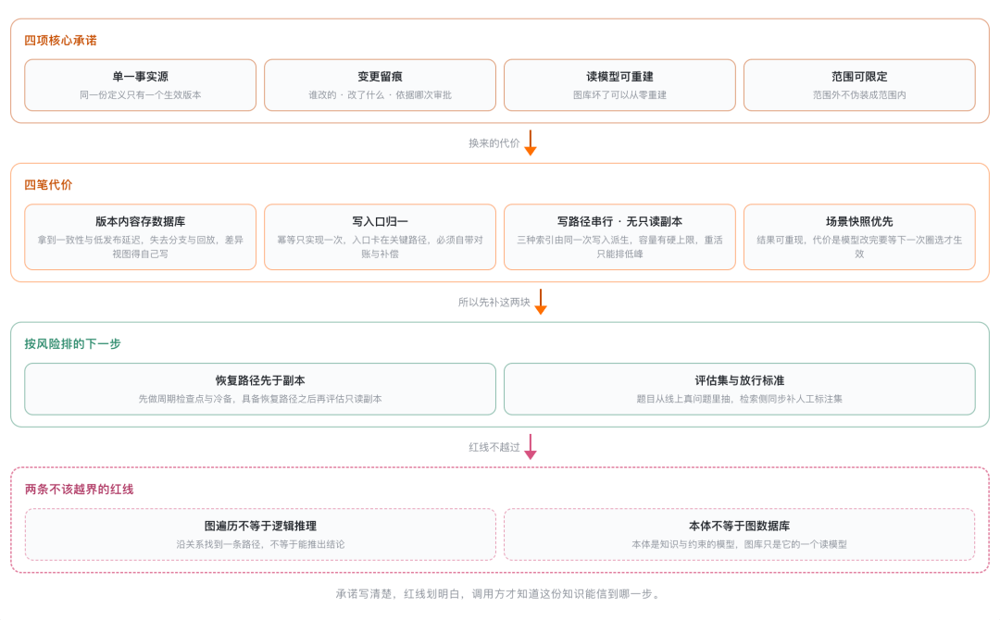

**4.1 接口账目：只提供定义，不承担计算**

对外的四个入口，对内是一张严格对齐的能力清单：18 个方法在四端一一对应，其中 7 个只读、11 个写入。同一份定义从四个入口输出，内容、权限点与审计必须完全一致，差异仅存在于三处：鉴权、参数解析与响应投影。

在这套接口的定位上，平台做了一个刻意的取舍：只保证定义和版本的准确性，在计算能力上做收敛。平台可以返回指标的定义、维度和取数口径，但不会直接给出“这周的有效订单数是多少”这样的最终结果。因为一旦接口开始承担计算，口径变更、上游回刷、时区差异这类问题，最终都会变成平台的责任就要为算出的结果负责，如口径变更、上游回刷、时区差异，最终都会变成平台的问题。将计算留给业务系统，责任边界才足够清晰。

这种边界感，从实际的调用数据中也能得到印证。在同一个 28 天窗口里，12 个业务应用接入了生产环境，业务侧调用合计 29637 次，占平台总调用量的 5.4%。其中，头部两个应用（销售侧的智能洽谈助手和区域经营分析助手）合计调用 19929 次，占业务侧调用的 67%；再往后是商家营销与商品定价方向的两个应用，分别为 5402 次与 3661 次；其余八个应用最多的也仅有 158 次。

这组数据反映出两个事实：一方面，真实需求高度集中在少数几个分析场景，长尾极薄；另一方面，业务侧仅占总调用的 5.4%，说明平台当下的流量主体仍是上游语义平台的自动同步。而在业务侧这批成功率 99.5%（29483 次）的调用中，近 28 天最高频的 12 个检索词里，有 7 个是补贴与价格口径。其中，单品到手价目标匹配 1892 次，出资 628 次，阶梯暴涨 600 次，门槛 494 次。被高频检索的，恰恰是业务口径中最容易产生歧义的部分。

**4.2 核心承诺与工程代价**

回到架构设计本身，能力账目图列出了平台的四条核心承诺，每一条都有其必须支付的代价。

**•**单一生效版本（单一事实源）：同一份定义只有一个生效版本，人与 Agent 读到的绝对是同一份。代价是版本内容从 Git 仓改存数据库，换取了强一致性与低发布延迟，但失去了分支与回放能力，差异视图需自行实现。

**•**每次变更留痕：谁改的、改了什么、何时生效、依据哪次审批，全部可追溯。代价是写入口收敛为一个，幂等仅需实现一次，但该入口位于关键路径上，必须自带对账与补偿机制。

**•**读模型可重建：事实源只有一份，图库损坏可从零重建。代价是图、倒排、向量三种索引均由同一次写入派生，写路径只能串行，且缺乏在线只读副本，容量存在硬上限，高负载任务只能排至低峰期。

**•**范围可限定：查询被限制在场景内，范围外的答案绝不会伪装成范围内的结果返回。代价是场景快照优先，模型修改后需等待下一次圈选才生效。

四笔代价中，第三笔的约束最强。前两笔的代价尚可接受，第三笔付出的却是硬性的运维限制，前文提及的 p99 数据即是印证。

此外，有两项能力平台不予覆盖：其一，图遍历不等于逻辑推理，沿关系找到路径不等于能推出结论，形式化推理需单独实现；其二，本体建模虽属于平台的核心建设范畴，但模型本身并不直接等同于业务判断。平台负责定义知识与约束，并保障其准确性与可追溯性；而能否让使用者（或 Agent）将这些知识转化为实际的业务价值，则需要平台与业务侧共同完善、持续迭代。

**4.3 避坑指南与选型标准**

尽管上述代价与边界是当前平台的具体约束，但沉淀下来的这四条经验，换一套系统同样成立。

**•**身份与地址分离：不可变标识做身份，可读地址做引用，这在任何具有引用关系的系统中均成立。

**•**将约定做成构建门禁：在构建时检查能力是否已真实接入，而不只是检查代码语法。在产物出口拦截静默退化，成本比上线后排查低一个数量级。

**•**数字必须带口径：数据在哪运行就标注哪，生产库就写生产库；代理指标不能写成相关性结论；平台只输出自己能归因的量，不认领业务侧的收益。

**•**选型先看场景窗口，再看引擎能力：变更到可查能容忍多久、查询是否需要跨引擎拼装、是否出现过跨引擎数据不一致的事故，这三个问题应排在引擎性能之前。

前文的评估维度与治理原则，加上这四条经验，构成了下文这棵决策树。架构升级的触发条件应当是观测到的真实事故，而非新引擎的跑分。

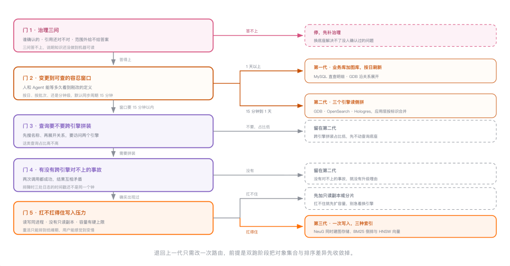

05

结语

过去，业务知识以文档为载体，这背后隐藏着一个默认假设，即只要打开，就是最新版本。在人读文档的年代，这个假设可以成立，因为人会自动核对版本与上下文。但眼下 Agent 不会，它可能读到了上一版的定义，却对此毫无察觉，这个默认假设彻底失效。知识必须从“文档”演变为“可引用、可追溯的定义”。

判断一套知识是否具备“机器可读性”，只需追问三个问题：这一版是谁确认的？发生变更后，引用的上下游是否能感知？超出范围时，它会不会给出错误答案？这三个问题能答上几个，就决定了这套知识能被信任到哪一步；如果一问三不知，那不过是把静态文档搬进了数据库而已。

回到门店周报的场景，业务逻辑本身并没有变。Agent 现在能精准查到口径、版本、确认人和场景范围，但它依然查不到“这周该看哪个口径”。这个边界并非能力不足，而是系统分工的必然。业务口径必须由业务侧拍板，而平台的核心职责，在于让每一次拍板都留下清晰的审计痕迹：生效的是哪一版、由谁确认、从何时开始生效。

欢迎留言一起参与讨论~
