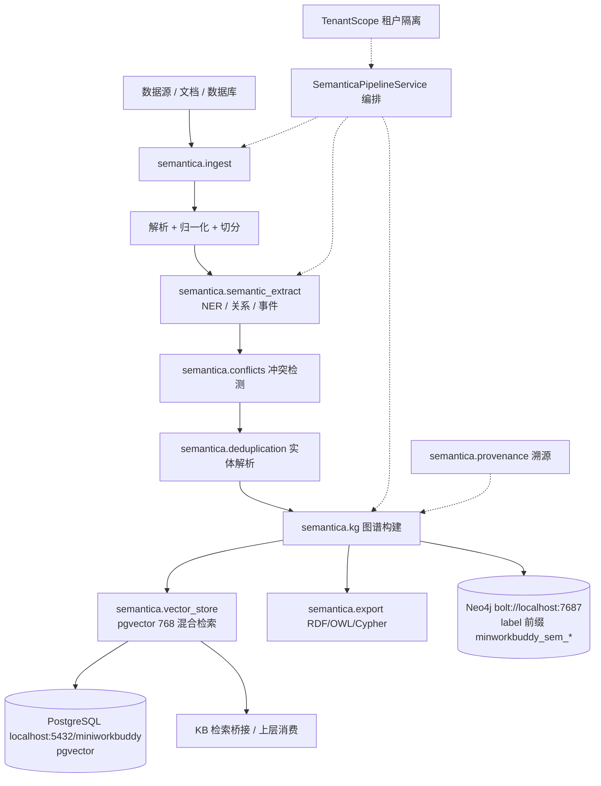

## 产品概述
将 MinWorkBuddy 现有的「本体 / 语义层」从自研实现（rdflib + 自研 service + ontology_* 自建表）整体切换到 PyPI 公共包 `semantica`，以进程内 `import semantica.*` 的方式提供语义能力，并彻底清理"仿 semantica 设计、但用 rdflib + 自研 service 实现"的代码、前端页面、测试、数据库表与文档。

## 核心特性
- **语义能力改由 semantica 提供**：接入（ingest）→ 解析/归一化 → 语义抽取（NER / 关系 / 事件）→ 冲突检测 → 实体去重 → 图谱构建 → 向量化存储 → 导出，全部调用 semantica 模块，不再自研 OWL/TTL 内核。
- **全量清理自研本体层**：删除 `WikiOwlEngine`（rdflib 内核）、`OntologyRepository`、建模/评审/检索过滤三个 service、ontology 模型与 19 个 REST 端点、`wiki_owl` 路由、Agent 工具 `ontology_tools`、前端 ontology 视图与 API、相关测试与菜单/字典 SQL。
- **数据库表全部 DROP**：新增迁移 drop 全部 `ontology_*` 表（9 张），并把 004 / 005 两个迁移脚本标记为 no-op 弃用节点（不可物理删除，否则 alembic revision 图断裂）。
- **semantica 持久层双后端**：PostgreSQL（pgvector 向量）+ Neo4j（图存储，`NEO4J_ENABLED=true`），连接参数由 `SEMANTICA_*` / `NEO4J_*` 配置，与 graphiti 记忆共用同一 Neo4j 实例但按 `GRAPHITI_GROUP_ID=minworkbuddy` 分组隔离。
- **文档改写**：`docs/superpowers/specs/2026-09-10-ontology-knowledge-integration-design.md` 由"评估 Semantica / 计划引入"改写为"semantica 集成实施规范"；相关历史文档加废弃 banner 并更新引用。
- **新集成层为薄适配**：只做配置、租户隔离、编排与对外接口，不重新实现本体算法；对外提供健康检查与能力探测，semantica 不可用时显式报错而非静默降级。

## 一、技术栈
- 后端：既有 FastAPI + SQLAlchemy 2.x + Alembic + PostgreSQL(pgvector) + Redis（沿用，不引入新框架）
- 语义组件：**PyPI `semantica`**（用户指定公共包）。依赖声明用 `semantica[vectorstore-pgvector]`，避免使用 `[all]` 拉入与既有栈冲突的可选重依赖；确需更多能力时再加 extras
- 存储（用户指定参数，全部启用）：
  - **PostgreSQL**：`DB_HOST=localhost` / `DB_PORT=5432` / `DB_USER=ai-user` / `DB_PASSWORD=admin123` / `DB_NAME=miniworkbuddy`（semantica 关系 + 向量存储后端）
  - **Neo4j**：`NEO4J_URI=bolt://localhost:7687` / `NEO4J_USER=neo4j` / `NEO4J_PASSWORD=neo4j@2026!` / `NEO4J_ENABLED=true` / `GRAPHITI_GROUP_ID=minworkbuddy`（semantica 图存储后端；与 graphiti 记忆共用实例，按 GROUP_ID + 命名空间前缀隔离）
  - 向量维度必须与 pgvector 物理列一致（`settings.GPUSTACK_EMBEDDING_DIMENSION=768`），与 kb 模块同库同构，避免既有"expected 1536/1024 dimensions"故障模式复现
- 配置：pydantic-settings 扩展 `backend/app/core/config.py`，新增 `SEMANTICA_*` 与 `NEO4J_*` 两组，同步 `backend/.env` 与 `.env.example`
- 测试：pytest（沿用）；semantica 相关用 monkeypatch 假客户端，禁止真实网络/模型调用

### 配置项清单（落点：`backend/app/core/config.py` SemanticaSettings + `.env`）

| 环境变量 | 默认值 | 说明 |
|---|---|---|
| `SEMANTICA_DB_HOST` | `localhost` | semantica PostgreSQL 主机 |
| `SEMANTICA_DB_PORT` | `5432` | 端口 |
| `SEMANTICA_DB_USER` | `ai-user` | 用户 |
| `SEMANTICA_DB_PASSWORD` | *(必填)* | **仅写入 `backend/.env`（已 gitignore）**，`.env.example` 与文档一律用占位符 |
| `SEMANTICA_DB_NAME` | `miniworkbuddy` | 库名 |
| `SEMANTICA_VECTOR_BACKEND` | `pgvector` | 向量后端 |
| `SEMANTICA_VECTOR_DIM` | `768` | 必须等于 `GPUSTACK_EMBEDDING_DIMENSION`，启动期校验不一致即 fail-fast |
| `NEO4J_ENABLED` | `true` | 图存储开关；为 true 时启动期探测连通性，不可用则 semantica 路由 fail-closed |
| `NEO4J_URI` | `bolt://localhost:7687` | Neo4j 地址 |
| `NEO4J_USER` | `neo4j` | 用户 |
| `NEO4J_PASSWORD` | *(必填)* | 同上，只进 `.env` |
| `GRAPHITI_GROUP_ID` | `minworkbuddy` | 图分组 id：semantica 命名空间与 graphiti 共用此前缀做实例内隔离 |

## 二、实现方案（总体策略）
**策略**：先立新（semantica 适配层）→ 再拆旧（自研本体层）→ 最后断奶（drop 表 + 清文档）。每一阶段都可独立编译/启动通过，避免"删完跑不起来"的空窗期。

**三条关键决策**：
1. **适配层而非重写**：`backend/app/services/semantica/` 只做「配置 + 租户隔离 + 编排 + 对外接口」，语义算法一律委托 semantica。这样 semantica 升级或换后端时只动适配层。
2. **延迟导入 + 能力探测，fail-closed**：沿用工程 `HAS_RDFLIB` 的写法但改为**显式失败**——`/health` 与构建入口在 `semantica` 或其存储后端（PG/Neo4j）不可用时返回明确错误（不像旧 rdflib 那样 warning 后继续），避免"半可用"状态。
3. **迁移链不动骨、只摘肉**：004 / 005 保留文件（006、`011_rename_legacy_tables` 的 `down_revision` 指向 `005_add_ontology_modeling_tables`，已升级库的 `alembic_version` 也依赖该节点），把 upgrade/downgrade 改成 no-op + 弃用 banner；真正的 DROP 放在链尾新迁移。

**性能与可靠性**：
- semantica 的 ingest / 抽取 / 建图属重 CPU-IO 操作，一律走后台任务（沿用工程 ARQ + APScheduler 模式：`services/kb/table_sync_service.py` 的 IntervalTrigger 注册方式），API 只返回 job_id，不阻塞请求。
- 向量维度必须与 pgvector 物理列一致（768），`SemanticaSettings` 启动期与 `GPUSTACK_EMBEDDING_DIMENSION` 比对，不一致直接拒绝启动。
- Neo4j 与 graphiti 记忆共用实例：隔离方式为「label/命名空间前缀 `minworkbuddy_sem_*`」+ graphiti 自己的 group id，禁止两者写同一 label 空间；semantica 建图与检索全部走带前缀的命名空间。
- 租户隔离在适配层强制：所有 semantica 命名空间/集合名形如 `minworkbuddy_{tenant_id}_{ontology_code}`（前缀取 `GRAPHITI_GROUP_ID`），读取侧二次校验，禁止裸集合名直查（对标旧 `_require_tenant_id` / `_owned_ontology`）。

## 三、架构设计



**分层**：`routers/semantica`（HTTP 契约） → `services/semantica/*`（适配/编排/租户） → `semantica` 包 → PostgreSQL(pgvector, miniworkbuddy) / Neo4j(bolt://localhost:7687)。方向单向：semantica 层可消费 kb 检索，kb 不反向依赖 semantica（沿用旧 `search_filter.py` 的依赖方向约定）。

## 四、目录结构

```
backend/
├── requirements.txt                          # [MODIFY] 新增 semantica[vectorstore-pgvector]；移除 rdflib（已确认仅 ontology 使用）；owlready2/pyswip/scikit-fuzzy 标注待确认后清理
├── app/
│   ├── core/config.py                        # [MODIFY] 新增 SemanticaSettings（PG 连接、pgvector 维度、Neo4j 连接与开关、GROUP_ID 前缀、job 开关），启动期校验
│   ├── services/semantica/
│   │   ├── __init__.py                       # [NEW] 导出适配层公开 API 与 SemanticaUnavailable 异常
│   │   ├── settings.py                       # [NEW] SemanticaSettings 读取与校验（维度与 pgvector 列一致、Neo4j 开关与连通、必填项 fail-fast）
│   │   ├── scope.py                          # [NEW] TenantScope：tenant_id + ontology_code → 命名空间/集合名（前缀 GRAPHITI_GROUP_ID=minworkbuddy），越权即拒（替代旧 _require_tenant_id/_owned_ontology）
│   │   ├── client.py                         # [NEW] semantica 延迟导入与能力探测（HAS_SEMANTICA / capability() / storage health），封装 ingest/extract/kg/dedup/conflicts/vector/export 的工厂方法
│   │   ├── pipeline_service.py               # [NEW] SemanticaPipelineService：分步编排（ingest→extract→conflicts→dedup→kg→vector→export），失败带步骤名（沿用 kb pipeline_runner 的 PipelineStepError 风格）
│   │   ├── retrieval_service.py              # [NEW] 语义检索与概念/类过滤桥接（替代 OntologyDrivenRetriever）
│   │   └── export_service.py                 # [NEW] RDF/OWL/Cypher/Parquet 导出与 PROV-O 溯源封装
│   ├── routers/semantica/semantica.py        # [NEW] /api/v1/semantic：health（含 PG/Neo4j 连通）、build(异步 job)、entities/relations 查询、search、export；租户强校验
│   ├── core/router_registry.py               # [MODIFY] 移除 ontology 与 wiki_owl 两个 RouterSpec，注册新的 semantica RouterSpec
│   ├── ai/knowledge/owl_engine.py            # [DELETE] rdflib 自研 OWL 内核
│   ├── repositories/ontology/                # [DELETE] OntologyRepository / InMemoryOntologyStore / StoreProtocol
│   ├── services/ontology/                    # [DELETE] modeling_service、review_service、search_filter
│   ├── models/ontology/                      # [DELETE] ontology.py（3 表）、model.py（6 表）
│   ├── routers/ontology/                     # [DELETE] /api/v1/ontology 19 端点
│   ├── routers/wiki/wiki_owl.py              # [DELETE] wiki 侧 OWL 路由
│   ├── ai/tools/ontology_tools.py            # [DELETE] ontology_query/answer_cq/suggest
│   ├── ai/tool_manager/seed_tools.py         # [MODIFY] 移除 ontology 工具种子，注册新的 semantica 工具
│   ├── db/init_models.py, db/migrate.py      # [MODIFY] 移除 ontology 模型导入与建表引导
│   ├── services/kb/pgvector_store.py         # [MODIFY] 移除 class_uris 过滤参数（列随迁移 DROP）
│   ├── services/kb/retrieval_service.py      # [MODIFY] 移除 class_uris 参数
│   └── models/kb/kb_segment.py               # [MODIFY] 移除 class_uris 列（该列从未被摄取侧赋值）
├── alembic/versions/
│   ├── 2026_09_10_0000-004_add_ontology_tables.py        # [MODIFY] 保留 revision 节点，upgrade/downgrade 改 no-op + DEPRECATED banner
│   ├── 2026_09_10_0001-005_add_ontology_modeling_tables.py # [MODIFY] 同上（006/011 的 down_revision 指向它，禁止物理删除）
│   └── 2026_10_18_0001_drop_ontology_tables.py           # [NEW] 链尾新增；按子→父顺序 DROP 9 张 ontology_* 表 + DROP COLUMN kb_segment.class_uris；幂等 IF EXISTS；downgrade 标注不可回滚
├── tests/
│   ├── ontology/                             # [DELETE] 13 个测试文件整体移除
│   ├── semantica/                            # [NEW] 适配层单测：scope 租户隔离（minworkbuddy 前缀）、pipeline 分步失败、settings 校验（维度 768/Neo4j 开关）、PG/Neo4j health 探测（monkeypatch 假客户端）
│   ├── unit/test_kms_unify_phase1.py         # [MODIFY] 去除 ontology 依赖
│   ├── kb/conftest.py, agent/conftest.py     # [MODIFY] 去除 ontology 夹具
├── .env / .env.example                       # [MODIFY] 新增 SEMANTICA_*（DB miniworkbuddy/pgvector 768）与 NEO4J_*（bolt localhost:7687、ENABLED=true、GROUP_ID=minworkbuddy）；真实密码只进 .env
└── docker-compose.*.yml                      # [MODIFY] 后端服务补充 NEO4J_ENABLED/NEO4J_URI 等环境变量透传（Neo4j 实例已存在，不新增容器）

frontend/src/
├── views/ontology/                           # [DELETE] OntologyList / OntologyPanel / ClassHierarchy / ModelingWorkbench / ReviewVersion
├── api/ontology.ts                           # [DELETE]
├── views/admin/componentMap.ts               # [MODIFY] 移除 ontology 组件映射
├── api/dictionary.ts                         # [MODIFY] 移除 ontology_rel_type 相关项
└── i18n/                                     # [MODIFY] zh-CN/zh-TW/en-US/ja-JP、_kb_keys.json、_pending/knowledge.json 移除 ontology 相关 key

docs/
├── superpowers/specs/2026-09-10-ontology-knowledge-integration-design.md  # [MODIFY] 改写为 semantica 集成实施规范（架构/模块/配置含 PG miniworkbuddy + Neo4j 参数表/API/pipeline/租户隔离/迁移/回滚/验收）
├── superpowers/specs/2026-09-10-ontology-layer-design.md                  # [MODIFY] 加 DEPRECATED banner 指向新规范
├── superpowers/plans/2026-09-10-p4-ontology.md                            # [MODIFY] 加 DEPRECATED banner
├── kms-9-27.md                                # [MODIFY] 更新 :385 等"用 Semantica 重新实现"表述
├── sql/init.sql                               # [MODIFY] 移除 ontology 全套建表与 kms_segment.class_uris 注释
├── sql/sys_menu.sql                           # [MODIFY] 移除菜单 2405「本体」与权限点 kg:ontology:read
├── sql/menu_knowledge_governance.sql          # [MODIFY] 移除 2405 本体菜单条目
└── sql/sys_dictionary.sql                     # [MODIFY] 移除 ontology_rel_type 字典(132) 及 6 个字典项（确认无其它消费方后）
```

## 五、实施要点（防回归）
- **存储连通性预检**：`SemanticaSettings` 在 app 启动期（lifespan）做一次连通探测——PostgreSQL（`localhost:5432/miniworkbuddy`，用户 `ai-user`）与 Neo4j（`bolt://localhost:7687`，`NEO4J_ENABLED=true` 时必检）；探测失败时 `/api/v1/semantic/health` 返回明确错误，semantica 写路径直接拒绝，不做静默降级。
- **Neo4j 隔离**：与 graphiti 记忆共用实例（`bolt://localhost:7687`）。graphiti 用 `GRAPHITI_GROUP_ID=minworkbuddy` 分组，semantica 全部读写走 label/命名空间前缀 `minworkbuddy_sem_*`；两者不写同一 label 空间，检索侧显式带前缀过滤。
- **凭据安全**：`ai-user/admin123`、`neo4j/neo4j@2026!` 属敏感信息——真实值只写入 `backend/.env`（确认已在 .gitignore），`.env.example`、docker-compose、文档、代码注释一律用占位符；提交前 `git diff` 检查无明文密码入库。
- **依赖冲突预案**：`requirements.txt:38` 钉了 `numpy>=1.24,<2`；若 semantica 要求 numpy>=2，先在本地 venv 试装观察 resolver，二选一：① 升级 numpy 并验证 pandas 3.0.6 / agentscope 2.0.9 兼容；② 退到 `semantica` 最小安装 + 自供向量适配。禁止为装 semantica 而放宽 agentscope 固定版本（`agentscope==2.0.9` 是硬钉）。
- **删除顺序**：先删注册（router_registry / init_models / seed_tools）再删模块，避免"模块已删但注册仍在"导致启动 ImportError；每删一批跑一次 `python -c "import app.main"` 冒烟。
- **迁移链**：新迁移的 `down_revision` 必须取当前链尾真实 revision id（工作区存在未提交的 `2026_10_18_0000_add_kb_document_collection_id.py`，实施前先读其 `revision` 字段），避免双 head；执行前用 `alembic heads` 校验只有一个 head。
- **日志**：沿用 loguru，pipeline 每步记录耗时与产出计数；失败日志带步骤名与 job_id，不落原始文档正文与连接串密码。
- **不越界**：工作区 kb 相关的 20+ 未提交改动不得覆盖；`frontend/src/styles/tokens.css` 的 Semantica 皮肤注释**不动**；graphiti 记忆（`ai/middleware/graphiti_memory.py`）保持现状，仅在配置层面共用 Neo4j 实例参数。

## 六、关键代码结构（适配层接口骨架）
```python
# backend/app/services/semantica/scope.py
class TenantScope:
    """租户隔离：一切 semantica 读写必须经此解析命名空间，禁止裸集合名。"""
    def __init__(self, tenant_id: int, ontology_code: str = "default", *, group_id: str = "minworkbuddy") -> None: ...
    @property
    def namespace(self) -> str: ...          # minworkbuddy_{tenant_id}_{ontology_code}
    def collection(self, kind: str) -> str: ...   # 向量集合名（实体/关系/文档）
    def label(self, kind: str) -> str: ...        # Neo4j label 前缀 minworkbuddy_sem_{kind}
    def assert_owned(self, namespace: str) -> None: ...   # 越权抛 PermissionError

# backend/app/services/semantica/pipeline_service.py
class SemanticaPipelineService:
    """分步编排 semantica 能力；每步失败抛 PipelineStepError(step, cause)。"""
    def __init__(self, db, scope: TenantScope, settings: "SemanticaSettings") -> None: ...
    def run(self, source, *, steps: list[str] | None = None) -> "PipelineReport": ...
    def status(self, job_id: str) -> "PipelineReport": ...
    def search(self, query: str, *, top_k: int = 10, concept_uris: list[str] | None = None): ...
    def export(self, fmt: str) -> str: ...
```
> 说明：semantica 的真实 API 以安装后 `import semantica` 探测为准；上述为**我方适配层**接口，用 Protocol/工厂隔离 semantica 具体实现，便于测试替换与后续升级。

## 七、验收标准
- `pip install semantica[vectorstore-pgvector]` 成功且 `python -c "import semantica"` 通过。
- 存储连通：semantica 可连 `localhost:5432/miniworkbuddy`（用户 `ai-user`，pgvector 维度 768 与 `GPUSTACK_EMBEDDING_DIMENSION` 一致）与 `bolt://localhost:7687`（`NEO4J_ENABLED=true`，label 前缀 `minworkbuddy_sem_*` 可读写且不污染 graphiti 的 `minworkbuddy` 分组数据）。
- `alembic heads` 单 head，`alembic upgrade head` 后库中无 `ontology_*` 表、`kb_segment` 无 `class_uris` 列。
- 后端 pytest：删除 `tests/ontology` 后全量结果与既有基线对比（历史基线 629 passed / 4 failed，其中 `tests/integration/test_api_context.py` 的 ai_context 鉴权 4 失败为既有遗留，不算回归）；新增 `tests/semantica` 全员通过。
- 前端：`npm run build` 输出按改动路径过滤确认无新增错误（`npm run lint` 工具链本身坏了、vue-tsc 全仓既有报错，不做为验收项）。
- 全仓 grep `ontology` / `WikiOwlEngine` / `rdflib` 无残留引用（历史文档中的 DEPRECATED banner 除外）。
- 安全：`git diff` 中无明文数据库/Neo4j 密码，`.env.example` 为占位符。