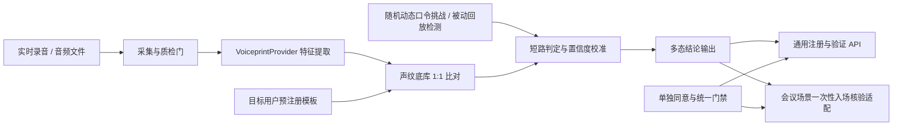
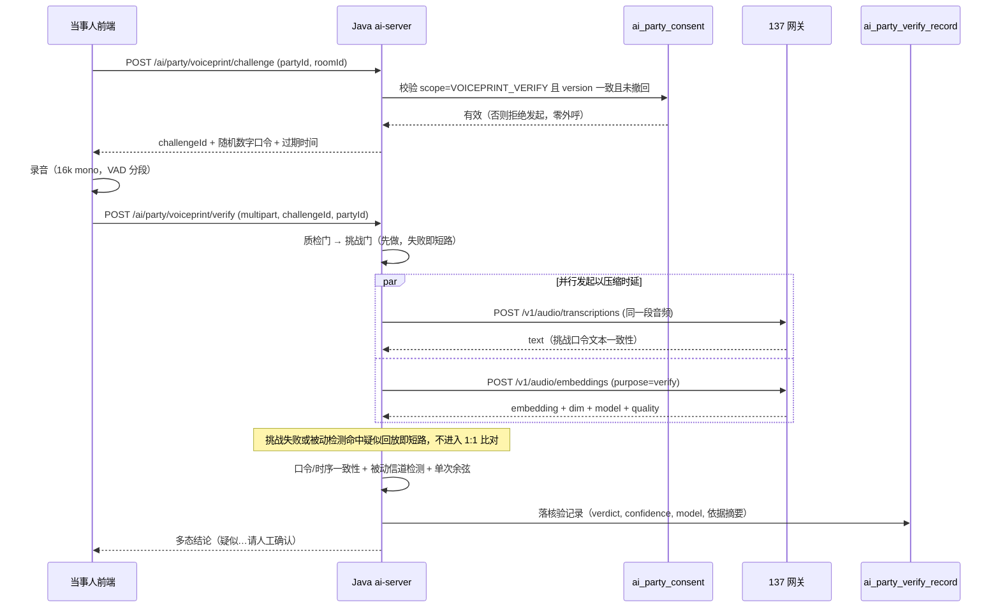

# 声纹提取与说话人身份验证（SP-6：通用 1:1 底座 ＋ 会中一次性入场核验）设计

> **修订索引（2026-11-05，以 `2026-11-04-meeting-ai-spec-review-and-revision.md` 的统一契约为准）**
> 1. 本文为**新增文档**，无历史修订可追溯；本索引登记的是与上游五份 spec 的关系，避免第六份文档再造一套平行体系。
> 2. 上游 spec 在 2026-11-04 评审后均追加了「修订索引 / 覆盖性修订总纲」，行号整体下移。本文 §2 引用的上游行号以 **2026-11-05 复核时的仓库快照**为准，代码文件行号取实读值；引用上游文档时同时给章节号，行号仅作定位辅助。
> 3. 用户裁决共四项：仅交付设计规格文档（不改代码）、通用底座＋会中接入、扩展 137 语音网关新增 embedding 端点、录音回放采用「主动挑战＋被动检测」且结论含 `SPOOF_SUSPECTED`。四项在 §0 逐条落为差异登记。
> 4. 本文**只产出一份 Markdown**。所有类名、表、端点、枚举、迁移号、菜单 ID、错误码均为**设计态对象**，实施时从零添加；不得写成本文已实现或已就绪。
> 5. 号段结论经跨仓复核：`1_040_066_*`、`V3.58+`、`9508+` 在代码与设计文档中均零占用；真实最新迁移仅 `V3.48`。
> 6. 文件名沿用 2026-11-04 立项批次编号，与 SP-1~SP-5 同批；实际成稿日为 2026-11-05。
> 7. **实施定版指针（2026-11-05）**：本文实施以 `2026-11-05-meeting-ai-specs-implementation.md` 的 D1–D6 为准；同意 scope 定版五值含 `VOICEPRINT_VERIFY`（D3）；`verify_type VARCHAR(24)` 与 `room_id` 由 V3.56 建立，V3.60 只改注释（D4）；菜单 9508~9511（D5）；**T3/T5 未经用户书面确认前 Task 13 不得开工**（D6）。
> 8. **门禁取证状态（2026-11-05 执行登记）**：§8 的 G0-a/b/c/d 四项**均未取证**（137 网关 `192.168.1.137:8765` 在本会话不可达，且端点持久化需重建容器验证）；T3（平台持有声纹模板向量）与 T5（扩展 137、逆转「不调 137」）**未获用户书面确认**。按 D6，SP-6 本轮只交付契约、门禁说明与 `VoiceGatewayEmbeddingProbeTest` 契约测试，**V3.58–V3.60、8 个端点与 `VoiceprintVerify.vue` 一律不开工**；`VOICEPRINT_POC_PASSED` 保持 `false`。
> 9. **实施状态（2026-11-06 补登记）**：用户指令「检查这份设计尚未完成的任务，然后完成它」按与 SP-3 §7.1 同一口径登记为**风险接受与放行编码**（T3/T5 的书面确认），**不等价于 G0–G3 取证完成**。本轮补齐 §13.2 的全部工程对象（后端底座、Feign、V3.58–V3.60、前端页面与测试）与 Task 12 的 G0 取证工具包；全体开关保持 `false`（`VOICEPRINT_POC_PASSED=false`、`voiceprint.enabled=false`、`g0/g1/g2/g3=false`），默认零外呼。当日实测：`GET /v1/pool` 200、`GET /v1/audio/embeddings/capability` 404、`POST /v1/audio/embeddings` 404 → **G0-a 未通过**，G0-b/c/d 未取证或不适格，详见 `Demo-deploy/tools/voiceprint/README.md`。§13.2 的对象状态由「未实现」改为「已实现（门禁未通过、默认关闭）」，但**能力不得在生产启用**；跨仓端点实现、G1 标定、G2 影子人检、G3 合规留档仍属 §11.1 移交项。
> 10. **2026-11-07 收口登记**：用户指令「继续，1、2、3 都要做」第 3 项按 §0 与 D6 的口径**补登为 T3/T5 的书面确认（风险接受与放行编码）**；§8.3「仍未完成清单」中该行已同步订正。**这不等价于 G0–G3 取证完成**：G0-a 实测 404 仍未通过，`VOICEPRINT_POC_PASSED=false`、`voiceprint.enabled=false`、`g0/g1/g2/g3=false`、`shadow-mode=true`、`cleanup-enabled=false` 一律不变，能力不得在生产启用。同轮补齐 `AudioNormalizer` 的非 WAV 解码（`AudioDecoder` SPI + `ExternalCommandAudioDecoder`，由 `voiceprint.decoder-command` 显式配置；默认空 = 未配置，mp3/m4a/flac 仍按 `AUDIO_UNREADABLE` 拒判、不静默降级），并新增 `AudioNormalizerTest` / `ExternalCommandAudioDecoderTest`。ffmpeg 解码器的部署注入与 G1 标定仍是 §11.1 移交项。

- 日期：2026-11-05
- 立项批次：2026-11-04（SP 系列第六份，编号 SP-6）
- 状态：待用户复核
- 上游文档：`2026-11-04-meeting-room-ui-design.md`（SP-1/SP-2）、`2026-11-04-face-vision-analysis-design.md`（SP-3）、`2026-11-04-acoustic-ser-design.md`（SP-4）、`2026-11-04-party-identity-verification-design.md`（SP-5）、`2026-11-04-meeting-ai-spec-review-and-revision.md`（统一契约与门禁）、`2026-11-03-meeting-ai-capability-design.md`（语音网关事实）
- 落地范围：**仅本文档**；`Demo-ai`（网关客户端与配置、能力服务）、`Demo-basic/Demo-module-uaa`（身份锚点）、`Demo-web`（注册与核验入口）、`Demo-ai/deploy/livekit-worker`（会中采集）、`Demo-docs`（文档地图）一律不改
- 本文所有类名、行号、端点、错误码段、迁移号、菜单 ID 均以**实读代码 ＋ 跨仓扫描**为准，出处逐条列在 §2；未证实项一律标注「未证实」并转成 §8 的门禁，不写成既成事实
- 算力前提：与 SP-3/SP-4 一致，**不假设任何 GPU 可用**；特征提取为一次前向推理，服务端 CPU 分支须可跑

---

## 0. 与已交付设计的差异登记（评审先读这里）

| # | 上游原文 / 用户指令 | 本文的决定 | 差异性质 | 理由 |
|---|---|---|---|---|
| T1 | SP-3 §1.2 L119「说话人验证（声纹 vs 人脸…）| 后续 |…只在 §11 记为后续可立项项」；§11 L1083「需独立同意与阈值标定，登记为可立项项，本文不实现」 | 本文**兑现该立项**，编号顺延 SP-6；把「独立同意」落实为新增同意范围取值，把「阈值标定」落实为 §4.4 的 EER/FAR/FRR 标定与 §8 的 G1 门禁 | 兑现预留 | 不新建第二套说话人体系；SP-3 明确要求这两项前置，若跳过即等于带病上线 |
| T2 | SP-5 修订索引 L6 把 `ai_party_consent.scope` 定版为 `VOICE_ANALYZE \| IDCARD_VERIFY \| FACE_COMPARE \| SER_ANALYSIS`，四份 spec 共用同一张表、同一 `version` 等值语义、同一 `revoked_at` 撤回机制 | 新增第五个取值 `VOICEPRINT_VERIFY`，**复用同一张表与同一套版本/撤回语义**，不新建同意表；登记为对 SP-5 的**注释级修订**（§7.3 给出 DDL COMMENT 与枚举扩展各一行） | 受控扩集 | 声纹属生物识别信息，敏感程度不低于人脸比对，必须单独同意；另建一张表会让同一当事人出现两套互不相认的授权历史，也会让撤回动作漏掉声纹模板 |
| T3 | SP-3 覆盖性修订总纲 L12「平台不再持有生物特征向量」、L34「平台不持有向量」；L27 废弃 `ai_face_gallery.embedding REAL[]` | 声纹 1:1 **必须持有模板向量**，本文新增 `ai_voiceprint_template.embedding`；差异在 §0.1 与 §9.2 显式论证，并追加三条补偿约束：只按 `party_id` 单条取、禁止任何 1:N 检索列或索引、撤回/删除时物理删除向量行 | **实质性差异，需评审确认** | 人脸侧改用 CompreFace 两图比对，由服务端返回相似度，平台无需存向量；声纹无法做「两段音频直接比」，必须先从注册音频提一次模板并留存，属能力原理差异而非设计偷懒。回避这条差异会让评审误以为生物特征落库面仍为零 |
| T4 | 评审修订 §3 L142 把 `AnalyzeStatus.kind` 定版为 `voice \| ser \| video` 三值，卡片数量与顺序由服务端返回驱动、前端不得硬编码；L143 定版统一门禁公式 | 会中接入**不新增第四个 `kind`**，改为「一次性入场核验任务」复用 SP-5 的 `/ai/party/verify/*` 记录与同意机制；会中分析面板、告警表、SSE 事件名一律不动 | 收敛而非扩集 | 新增 `kind` 会同时冲击 SP-1/2、SP-3、SP-4 与评审修订四处定版契约，代价远大于收益；且一次性核验天然不产生逐段告警行，与告警唯一索引、成本门、告知门全部无冲突 |
| T5 | SP-4 §0-S3 明确「本文同样不调 137」「SER 与 ASR 是两种推理，混用同一网关会让转录链路被拖死」；SP-1/2 §11 把「SP-4 立项时必须先解决 137 并发容量」列为遗留；M17 记载 137 REST 端点为**运行时补丁注入、重建容器后失效** | 依用户裁决改为扩展 137 新增 embedding 端点，但把四个已知风险全部转成 §8 的 **G0 门禁**：端点可达性、端点持久化（不得依赖运行时补丁）、并发容量、鉴权；并强制「验证专用超时 <既有 30s」＋「有界队列＋熔断」＋「字幕链路优先级高于核验」 | **逆转上游结论，需评审确认** | 用户裁决优先于上游设计取舍，但风险不因裁决消失。若把 137 写成「已具备 embedding 能力」，实施第一天就会在跨仓改动与容器重建上失败；§0.2 给出可验证的前置取证步骤 |
| T6 | SP-4 §9 L870「音频落盘禁止；PCM 只在 worker 内存，请求发出即弃」、L871「只存标签、置信度、模型标识，不存时长、不存频谱、不存中间特征」 | 本文**继承该禁令并加严**：注册音频、验证音频、挑战音频、频谱特征、中间向量一律不落盘；只落最终模板向量（T3 例外）、模型标识、结论、校准分值与依据摘要；被动回放检测的信道特征只在请求期内存存在，不入库、不进日志 | 继承并加严 | 挑战机制会诱使实现者把「挑战音频」留存做复核，这是合规上最危险的一步；必须在契约里提前堵死 |
| T7 | SP-5 §4 L180-183 四条硬不变量：`MATCHED` 唯一通过态、仅有不通过态不得表述为「非本人/假冒/欺诈」、结论只是系统内自洽性校验、核验永不修改 `party_identity.status` | 用户要求「判断是否为本人」并给「是/否 ＋ 置信度」，本文调和为：**短路式多态结论**（唯一通过态、唯一不一致态、十个未知/未完成态、`SPOOF_SUSPECTED`、`UNAVAILABLE`），UI 文案一律「疑似…请人工确认」；`confidence` 定义为**相似度经标定后的校准分值**，明确不是「是本人的概率」 | 需求与合规不变量的调和 | 直接输出「否」会与法律场景的非定性原则冲突，也会把一次声学比对误用为身份认定；保留「是/否」的可读性靠唯一通过态与唯一不一致态承载，而不是靠措辞定性 |
| T8 | SP-3 §2 事实 17/18/19（L146-148）：错误码 `1_040_065_*`、迁移 `V3.56-3.57`、菜单 `9505-9507` 归 SP-3；L413 与 L1095 明确「`V3.58` 起留空未用」 | 本文取 **`1_040_066_*`、迁移 `V3.58–V3.60`、菜单 `9508–9511`**；不新增部署端口（复用 8765）；§7.1 给出跨仓交叉核查结论 | 号段顺延 | `1_040_066_*` 在代码与四份 spec 中零命中，`V3.58+` 被 SP-3 明确留空，`9508+` 经 `uaa_menu.id` 精确检索为空闲，三者均无冲突 |
| T9 | 评审修订 C28（L107）：实施顺序固定 **SP-1/2 → SP-5 → SP-4 → SP-3**，`V3.49+` 与相关表全部设计态，不得并行开发 | 本文排在链条末端： **SP-1/2 → SP-5 → SP-4 → SP-3 → SP-6**；`ai_party_verify_record`、`ai_party_consent`、`PartyApi` 均为 SP-5 设计态对象，SP-5 未落地时本文的会中接入不得开工 | 顺序顺延 | 会中接入直接 `ALTER` / 复用 SP-5 的表与 Feign，缺 SP-5 时 `V3.59` 会报错终止；这是期望的防呆行为，不是缺陷 |

### 0.1 T3 的合规差异为什么不回避

人脸侧「平台不持有向量」是 **CompreFace 两图 1:1 比对**带来的结果：请求里带两张图，服务端返回相似度，平台只存结论（`SP-3` 总纲 L12、L34）。声纹没有等价的「两段音频直接比」接口——即使用户裁决扩展 137 网关，网关的 embedding 端点也只能把**一段音频**变成**一个向量**，比对必须有注册侧的模板常驻。因此声纹底库是能力成立的必要条件，不存在「不存向量也能 1:1」的写法。

本文为把落库面压到最小，给出四条可执行约束，全部写进 §7.2 的 DDL 与 §9.2：

1. `ai_voiceprint_template` 以 `(tenant_id, party_id)` 建**部分唯一索引**（`WHERE deleted = FALSE`），1 身份恒定 1 行；多段注册在内存里做质量加权均值后覆盖写，不留逐段向量。
2. 表内**不建任何向量检索索引**（无 HNSW/IVFFlat），比对入参强制带 `party_id`，代码路径为「按主键取一行 → 单次余弦」，从存储层杜绝 1:N 以声搜人（§1.2 红线）。
3. `embedding` 列只存模板向量与 `model_code`，不存原始音频 URL、不存频谱、不存中间特征；列级加密留档为 G3 必答项，未留档前不得置启用开关。
4. 同意撤回、身份失效、模板过期、用户主动删除四条路径均**物理删除该行**（不是置 `deleted` 软删后留副本），并写审计；§9.6 给出删除后的可验证检查。

### 0.2 扩展 137 网关：本文不假装端点已具备

`2026-11-03-meeting-ai-capability-design.md` M17 记载：`192.168.1.137:8765` 的 REST 端点是**运行时补丁注入**，重建容器后失效；当前无鉴权（`api_key=not-needed`）；`VoiceGatewayProperties`（实读 31 行）无任何 embedding/声纹字段；全仓 `s2s_pipeline.py` **零命中**，网关源码不在本工作区。SP-4 §0-S3 与 SP-1/2 §11 另登记了并发容量遗留。

因此本文 §3.3 只定义**端点契约**，§8 把下列四项设为 G0 门禁，任何一项未取证，全文其余部分一律不得开工：

| G0 子项 | 取证动作 | 通过判据 |
|---|---|---|
| G0-a 端点可达 | 在目标容器内网对 `POST /v1/audio/embeddings` 发一段 3s 16k mono WAV，记录状态码与响应体 | 返回 `200` 且含固定维度向量、`model`、质量分；维度与 `voiceprint.embedding-dim` 配置一致 |
| G0-b 端点持久化 | 重建 137 容器后重发同一请求 | 仍返回 `200`；若失效则判定为「端点未产品化」，本文不得实施 |
| G0-c 并发容量 | 在字幕链路满载时并发发起 8 路 embedding 请求，观察 ASR 转写时延与失败率 | ASR P95 时延劣化 ≤20%、零 5xx；否则须先做资源隔离再复核 |
| G0-d 鉴权 | 不带凭证请求该端点 | 返回 `401/403`；若仍返回 `200`，G3 合规留档不得通过（生物特征端点不得无鉴权裸奔） |

四项取证输出留档为实施前置证据，与 SP-3 §8.1 的 G0「先取证再动工」同一手法。G0 未通过时，本文退化为「只交付契约与门禁说明」，**不得**改成自建模型服务、也不得静默降级到 ASR 文本比对冒充声纹比对。

---

## 1. 目标与范围

### 1.1 本期目标（P1，且 §8 的 G0–G3 全部通过后方可上线）

1. **通用 1:1 底座**：提供声纹注册、验证、底库生命周期三类服务，绑定已认证当事人身份锚点，对外不依赖会议模块，可被电话Demo、线下录音归档、登录二次核验等场景调用。
2. **双输入形态**：实时录音与音频文件两条入口，经同一质检门归一为 16k 单声道音频；静音、过短、低信噪比、重叠语音一律拒判为「不可判定」，不产默认通过结论。
3. **强制预注册基准**：无基准、基准过期、已撤回三种情形返回独立未知态，绝不返回「非本人」。
4. **可插拔特征提取**：`VoiceprintProvider` 走 137 网关新增的 embedding 端点；未配置、探活失败、超时、维度不符一律映射 `UNAVAILABLE`，**禁止静默降级**（对齐 `asr_provider.py:61-66` 的显式报错范式）。
5. **主动挑战 ＋ 被动检测**：服务端一次性签发随机动态口令，校验 ASR 文本一致性与时序；并行做信道/频谱一致性检测；任一命中即 `SPOOF_SUSPECTED`，并明确写出不能杜绝高保真回放与 AI 语音克隆。
6. **多态结论与校准置信度**：输出唯一通过态、唯一不一致态、若干未知态、`SPOOF_SUSPECTED`、`UNAVAILABLE`，附校准分值、质量标签、判定依据摘要、模型标识与可追溯 `verifyId`。
7. **量化指标可验收**：以 EER 标定阈值，给 FAR/FRR、端到端时延分位数、影子模式门槛与巡检 SQL；不达标或条件不满足一律降级未知。
8. **会中一次性入场核验适配**：复用 SP-5 的核验记录与同意表，不新增面板 `kind`、不新增 SSE 事件名、不逐段比对。
9. **合规硬门**：未取得有效单独同意时，在**任何外呼之前**拒绝发起；核验永不修改 `party_identity.status`，处置由人。

### 1.2 非目标（逐条给归属，不留悬空）

| 项 | 归属 | 本文如何交代 |
|---|---|---|
| 1:N 声纹检索、以声搜人、跨Case找同一人 | 不做，**红线** | 底库只按 `party_id` 单行取（§0.1 约束 1、2）；§9.2 列为禁止项并给出可执行检查：比对入参必须带 `party_id`，DDL 不建向量索引 |
| 跨会议声纹聚类、会中人物库、再犯识别 | 不做，**红线** | 不建任何按自然人跨房间聚合的表、视图或缓存；与 SP-4 §1.2 L68 的既有归属一致 |
| 说话人分离（diarization）、重叠语音拆分 | 不做 | 质检门检出多人/重叠即拒判 `OVERLAPPED_SPEECH`（§5.3），不尝试分离；会中说话人身份仍取 `participant.identity` 事实，不由声纹推断 |
| 录音、音频文件留存、原始音频 URL 入库 | 不做 | 继承 SP-4 §9 L870 禁令并加严（§0 T6）；音频只在请求期内存存在 |
| 自动改变认证状态、自动驳回、自动拦截入会 | 不做 | 对齐 SP-5 不变量④；结论只进核验记录与待办提示，状态变更走 uaa `/audit` |
| 产业级反欺骗（高保真扬声器回放、实时语音克隆、变声器） | 不做，列为已知局限 | §9.5 给出主动＋被动两层的检出边界，文案原文写明「不能杜绝」；`SPOOF_SUSPECTED` 是疑似态而非定性 |
| 声纹用于情绪、健康、人格推断或画像 | 不做，**红线** | 与 SP-4 §9 用途限制同源；模板与结论不得写入Demo协议书、不得作为责任或诚信依据 |
| 改造 137 网关源码、新增模型服务容器、下载模型权重 | 不在本文 | 本文只定端点契约与四项 G0 取证（§0.2）；跨仓改动另立任务，不在本工作区交付 |
| 新增会中面板能力项、新增 SSE 事件名、逐段持续核验 | 不做 | §3.5 说明为何采用一次性入场核验；统一契约 `kind` 三值保持不动 |
| 声纹与人脸的跨模态一致性判定（「说的是不是画面里的人」） | 后续 | SP-3 §11 的这项后续立项**本文不实现**：它需要音视频时序对齐与第二套同意；本文只做「当前说话人 vs 已注册基准」的 1:1，§11 记为遗留 |
| 修改上游五份 spec、文档地图、代码、SQL、配置 | 不做 | 本文唯一物理产出是自身（§13）；对上游只做「注释级修订登记」与「实施顺序顺延」 |

### 1.3 用户五项必答速览（评审先核对这张表）

| # | 用户必答项 | 本文的明确取值 | 详见 |
|---|---|---|---|
| 1 | **输入形式** | **两者都支持**。① 实时录音：浏览器 `getUserMedia` → 16k 单声道 16-bit PCM，VAD 分段，有效语音 ≥8s、总时长 ≤30s；② 音频文件：格式白名单 `wav/mp3/m4a/flac`，大小 ≤10MB、时长 ≤30s，服务端解码归一到 16k mono；两条入口共用同一质检门与会中通道 | §5.1、§5.3 |
| 2 | **是否需预先录入基准** | **必须预先录入**。1 身份 1 条模板；注册需 3 段、每段有效语音 ≥3s、合计 ≥12s、SNR ≥15dB，质量加权均值后覆盖写；模板有效期 180 天，过期/撤回/无模板分别返回 `BASE_STALE` / `CONSENT_REVOKED` / `NO_BASE`，**均不判「非本人」** | §4.1、§5.2 |
| 3 | **判断结果输出形式** | `verdict` 多态结论（唯一通过态 `VP_MATCHED`、唯一不一致态 `VP_MISMATCH`、十个未知/未完成态、`SPOOF_SUSPECTED`、`UNAVAILABLE`）＋ `confidence`（0–1 **校准分值，不是本人概率**，非结论态恒为 `null`）＋ `quality` ＋ `evidence` ＋ `model` ＋ `verifyId`；前端文案一律「疑似…请人工确认」，无「是本人/不是本人」断言 | §4、§5.4 |
| 4 | **可接受的准确率与响应时间** | 受控条件（SNR ≥15dB、有效语音 ≥8s、同一信道）下 **FAR ≤1%、FRR ≤5%**，阈值由 EER 曲线标定并留档；条件不满足或指标未达标一律降级未知。时延：音频文件验证 P95 ≤2s（不含上传）、注册 P95 ≤3s、会中一次性核验 P95 ≤5s；验证专用读超时 3000ms，严格短于网关既有 30000ms | §10.1、§10.2、§10.5、§10.6 |
| 5 | **需处理的边界情况** | 十类逐一给显式拒判态与验收用例：噪声/低信噪比、多人说话与重叠语音、录音回放冒充、合成语音冒充、跨设备信道差异、静音与过短语音、底库缺失/过期/撤回、同意缺失/版本过期/撤回、网关不可用与超时、维度不符与模型漂移 | §5.6、§10.3 |

---

## 2. 读码核实的事实基线（本设计的唯一依据）

> **路径前缀**（本表为压缩篇幅使用，均可还原为仓库内绝对路径；代码文件行号为 2026-11-05 实读值）
> - `GW` = `Demo-ai/Demo-ai-module/Demo-module-ai-server/src/main/java/com/tianque/module/ai/service/voice/client/VoiceGatewayClient.java`
> - `CFG` = 同模块 `.../config/VoiceGatewayProperties.java`；`YAML` = 同模块 `src/main/resources/application.yaml`；`ERR` = 同模块 `.../util/ErrorCodeConstants.java`
> - `WK` = `Demo-ai/deploy/livekit-worker/worker.py`；`PROV` = 同目录 `asr_provider.py`；`REQ` = 同目录 `requirements.txt`；`DK` = 同目录 `Dockerfile`
> - `VAD` = `Demo-web/src/views/ai/voice-demo/components/VadRecorder.vue`；`REQTS` = `Demo-web/src/utils/request.ts`
> - `FAPI` = `Demo-basic/Demo-module-system/Demo-module-system-api/src/main/java/com/tianque/module/system/api/file/FileApi.java`；`FSE` = `Demo-basic/Demo-module-system/Demo-module-system-server/src/main/java/com/tianque/module/system/framework/file/core/enums/FileStorageEnum.java`
> - `PID` = `Demo-basic/Demo-module-uaa/Demo-module-uaa-server/src/main/java/com/tianque/uaa/dal/dataobject/party/PartyIdentityDO.java`；`PST` = 同模块 `.../enums/party/PartyIdentityStatusEnum.java`；`UAAAPI` = `Demo-basic/Demo-module-uaa/Demo-module-uaa-api/src/main/java/com/tianque/uaa/api/`
> - `CPDO` = `Demo-platform-biz/Demo-module-case/Demo-module-case-server/src/main/java/com/tianque/module/medcase/dal/dataobject/CasePartyDO.java`
> - `CAP` = `Demo-ai/Demo-ai-module/Demo-module-ai-api/src/main/java/com/tianque/module/ai/api/ai/AiCapabilityApi.java`
> - `SQLDIR` = `Demo-ai/docs/sql/`；`MENU` = `SQLDIR/V3.47__voice_demo_menu.sql`
> - `S1`…`S5` = `Demo-docs/superpowers/specs/` 下 `2026-11-04-party-identity-verification-design.md`、`2026-11-04-acoustic-ser-design.md`、`2026-11-04-face-vision-analysis-design.md`、`2026-11-04-meeting-ai-spec-review-and-revision.md`、`2026-11-03-meeting-ai-capability-design.md`
>
> **状态列**：`实` = 代码/文件中真实存在；`设` = 仅出现在 spec 文档中的设计态对象；`空` = 经检索确认零占用。

| # | 主题 | 事实 | 出处 | 状态 |
|---|---|---|---|---|
| 1 | 网关客户端三方法 | `transcribe` L28 打 `POST /v1/audio/transcriptions`（L29，multipart，仅返 `text/language`）；`synthesize` L51 打 `POST /v1/audio/speech`（L52，恒 24kHz mono WAV）；`alive` L73 打 `GET /v1/pool`（L75），注释「137 无 /health」L72；`alive` 不带鉴权 | `GW:28-87` | 实 |
| 2 | 网关错误与鉴权 | 非 2xx 抛 `IllegalStateException`（L44、L66）；`hasApiKey()` L84-87 对空值或 `not-needed` 跳过 `Authorization`；静态纯函数 `parseAsrText` L90-98、`buildTtsPayload` L101-116 | `GW:38-40,44,60-62,66,84-116` | 实 |
| 3 | 网关配置字段 | prefix `voice.gateway` L13；`baseUrl` L16、`realtimeWsUrl` L18、`apiKey` L20（三者无 Java 默认值）、`asrModel=qwen3-asr` L22、`ttsModel=qwen3-tts` L24、`defaultVoice=Aiden` L26、`connectTimeout=5000` L28、`readTimeout=30000` L30；**无任何 embedding/声纹字段** | `CFG:13-30` | 实 |
| 4 | 配置实值 | `voice.gateway.*` 全仓仅此一处：`base-url=${VOICE_GATEWAY_BASE_URL:http://192.168.1.137:8765}`、`api-key=${VOICE_GATEWAY_API_KEY:not-needed}`、超时 5000/30000；注释要求内网地址走配置中心不硬编码 | `YAML:359-369` | 实 |
| 5 | 网关端点非持久 | 137 REST 端点为**运行时补丁注入，重建容器后失效**；当前无鉴权；`137 ASR` 实测仅返 `{"text","language"}`，不产时间戳/说话人分离 | `S5` M17、M14 | 设（记载）＋未证实 |
| 6 | worker 采集 | `SAMPLE_RATE=16000` L34；`bytearray()` L60，`END_OF_SPEECH` 累积 PCM L65-70 后整段送 ASR L70；`speakerIdentity` 取 `participant.identity` L75；回推 `POST {JAVA_BASE}/admin-api/ai/meeting/internal/transcript` L43-44 ＋ `X-Internal-Token` L45、`timeout=10` L47 | `WK:34,43-47,60-75` | 实 |
| 7 | worker 轨过滤与自陈 | `_handle_track` L84 显式丢弃非音频轨；文件头 L13-14 自陈「集成件、非单元 TDD，完整链路依赖真实 LiveKit 房间」；单实例串行 2–4 轨 L15 | `WK:13-15,83-85` | 实 |
| 8 | Provider 范式 | `AsrProvider` 基类 L18-22；纯函数 `_to_wav` L25-36（16bit/单声道）；`get_provider()` L61-66 对未知 `ASR_PROVIDER` **抛 `ValueError` L66**，注释「不静默降级」L62 | `PROV:18-36,61-66` | 实 |
| 9 | worker 运行时 | `livekit-agents[silero]~=0.12`、`livekit-plugins-silero~=0.7`、`requests`；Dockerfile 为 `python:3.11-slim`，**无 GPU 基础镜像** | `REQ:1-4`、`DK:1-6` | 实 |
| 10 | 前端实时采集 | `TARGET_SAMPLE_RATE=16000` L50-51、`channelCount:1` L212；`float32ToWavBlob` L385-410 封装 16bit/单声道/16k WAV；界面文案标注「16kHz 单声道」L457 | `VAD:50-51,212,385-410,457` | 实 |
| 11 | 文件通道 | `byte[] getFileContent(String path, String code)` L144-146；存储枚举 `DB(1)/LOCAL(10)/FTP(11)/SFTP(12)/S3(20)/OSS(30)` L30-38 | `FAPI:144-146`、`FSE:30-38` | 实 |
| 12 | 声纹零实现 | 全仓精确检索 `speaker.?embedding`、`speaker.?verif`、`声纹注册`、`说话人验证`、`x-vector`、`d-vector`、`回放检测`，命中**全部**落在设计/需求文档；零实现代码 | 跨仓 grep；`S2:68`、`S3:119,1083`、`Demo-docs/天阙民商事Demo工作平台软件需求规格说明书.md:901` | 空 |
| 13 | `voiceprintUrls` 语义 | 该字段是 **AI 角色声音复刻样本 URL 清单**，不是声纹模板；前端「声纹」另有波形可视化用法，均与说话人验证无关 | `Demo-ai/.../dal/dataobject/aiDemo/AudioAgentRoleDO.java:82-84`、`Demo-web/src/views/ai/voice-demo/VOICE_USER_GUIDE.md:236`、`V3.5__ai_audio_agent_role_audio_config.sql:13,30-31` | 实（须防误用） |
| 14 | 身份锚点 | `PartyIdentityDO` L16 表 `party_identity`，字段 `id/accountId/authType/identityNo/realName/creditCode/idCardFrontUrl/idCardBackUrl/status/rejectReason` L29-69，继承 `TenantBaseDO`；`PartyIdentityStatusEnum` = `PENDING(0)/AUTHED(1)/REJECTED(2)/INVALID(3)` L18-21；`CasePartyDO` L28 表 `case_party` | `PID:16,29-69`、`PST:18-21`、`CPDO:28-77` | 实 |
| 15 | 跨服务通路缺失 | `UAAAPI` 共 11 个 `*Api`，**无 `PartyApi`**；`PartyIdentityForVerifyRespDTO` 亦零命中，均为 SP-5 设计态 | `UAAAPI` 目录、`S4:37`（F4） | 实＋设 |
| 16 | 同意与核验表（设计态） | `ai_party_consent` DDL `S1:296-321`（`scope` 注释 L299、撤回机制 L319-320）；`ai_party_verify_record` DDL `S1:324-358`；四值 scope 定版 `VOICE_ANALYZE\|IDCARD_VERIFY\|FACE_COMPARE\|SER_ANALYSIS` `S1:6` | `S1:6,296-358`、`S4:97` | 设 |
| 17 | 判定与不变量 | 十行判定表 `S1:163-176`（`MATCHED` 唯一通过态）；四条硬不变量 `S1:178-183`：不得表述「非本人/假冒/欺诈」、仅系统内自洽性校验、永不修改 `party_identity.status`、处置走 `/audit` | `S1:163-183` | 设 |
| 18 | 音频落盘禁令与指标口径 | `S2:870` 禁止落盘、L871 只存标签/置信度/模型标识；`S2:927-937` 七项验收指标（含端到端 P95 ≤5s、停用期间假数据 0、容器内音频文件数 0） | `S2:870-871,927-937` | 设 |
| 19 | 统一契约与门禁 | `AnalyzeStatus.kind ∈ voice\|ser\|video` 三值由服务端驱动、前端不硬编码卡片数 `S4:142`；`available(kind) = 平台开关 AND 探活成功 AND g3Passed(kind)`，未通过返回 `reason=<真实原因>`、不写开关行、不产告警 `S4:143` | `S4:142-146` | 设 |
| 20 | 工程约束 | 前端权限 `accessStore.hasAccess(code)`（工程无 `hasPermission`）；请求层导出 `get/post/put/del/upload/download/postSSE`，**无 `patch`、删除叫 `del`** | `S4:42`（F9）、`REQTS` | 实 |
| 21 | 错误码实况 | 代码已用 `1_040_062_000~006` `ERR:255-261`、`1_040_061_000~004` `ERR:264-268`，文件止于 L269；`063/064/065` **仅设计文档占用**，全仓 `1_040_066` **零命中** | `ERR:255-269`、`S1:270-277`、`S2:313-320`、`S3:354-363` | 实＋空 |
| 22 | 迁移与菜单实况 | `SQLDIR` 26 文件，V 命名最新 `V3.48__meeting_minutes_prompt.sql`；全仓**无 V3.49 及以后 SQL 文件**；菜单 `9490-9494`（`V3.46`）、`9495-9498`（`MENU:4,14,24-43`）已落；`docs/uaa_menu.sql:724-732` 的 `9510/9520` 等是第 5 列 `sort` 非 `id`；`9508+` 作为 `uaa_menu.id` 空闲 | `SQLDIR` 目录、`MENU:4-18`、`S3:1095` | 实＋空 |
| 23 | 号段参考写法 | 菜单迁移有 `DO $$` 内按 `id BETWEEN 9508 AND 9511` 计数并 `RAISE EXCEPTION` 的占用防呆（L10-18）；`ON CONFLICT (id) DO UPDATE` 幂等写法 L26；SP-3 明确「`V3.58` 起留空未用」 | `MENU:10-18,26`、`S3:413,1095` | 实＋设 |
| 24 | 能力底座范式 | `AiCapabilityApi` `@FeignClient` L23、`PREFIX="/admin-api/ai/capability"` L26，5 方法 L31-56；`Demo-ai/docs/2026-09-ai-capability-design.md` L61-91 给出 `AiCapabilityService` 薄能力层范式 | `CAP:23-56` | 实 |
| 25 | 部署端口实况 | `8011`（paddle，真实部署件）；`8020/8021`、`8030/8031` 仅 spec 文本；`Demo-deploy/compreface/` 部署件用 `8050/8051`；`Demo-deploy/ser/`、`face/` 不存在 | `Demo-deploy/paddle/docker-compose.yml:20`、`compreface/docker-compose.yml:14-16`、`S4:40,108` | 实＋设 |
| 26 | 实施顺序 | `S4:107`（C28）：顺序固定 SP-1/2 → SP-5 → SP-4 → SP-3，`V3.49+` 全为设计态，并行开发会连环失败 | `S4:107` | 设 |
| 27 | 人脸侧不持向量 | `S3:12`「平台不再持有生物特征向量」、`S3:34`「平台不持有向量」；`ai_face_gallery` 整表废弃 `S3:27` | `S3:12,27,34` | 设 |
| 28 | 文档地图滞后 | `Demo-docs/README.md:66-67` 的 specs 清单只列 2026-05-28 一份，未含 11-04 系列；本文按 §1.2 不改地图 | `Demo-docs/README.md:35-76` | 实 |

**未证实项清单**（全部转成 §8 门禁，不作为设计前提）：① 137 网关是否会投出 embedding 端点、端点是否持久（事实 5）；② 137 并发容量是否容得下核验流量（`S5`/SP-1/2 §11 遗留）；③ worker 完整音频链路未经运行时联调（事实 7、`S4:213`）；④ 视频轨能否到达 worker（SP-3 G0，本文不依赖）；⑤ 声纹模型权重的商用许可（`S4:26,207`）。

---

## 3. 架构与数据通路

### 3.1 五层结构（自下而上单向依赖，接入层不反向污染底座）



- **采集层**：两条输入归一到 16k mono；质检门做 VAD、有效时长、SNR、重叠语音与格式校验，不达标直接短路为非结论态。
- **特征层**：可插拔 `VoiceprintProvider` 调 137 新增端点，返回固定维度向量、`model`、质量分；未配置/探活失败/超时/维度不符 → `UNAVAILABLE`。
- **底库层**：1 身份 1 行模板，多段注册在内存做质量加权均值后覆盖写；只按 `party_id` 单行取，无检索索引。
- **判定层**：主动挑战（口令文本一致性 ＋ 时序）→ 被动检测（信道一致性）→ 相似度阈值，三段短路。
- **接入层**：通用 API 与会议适配并列；会议侧只写 SP-5 的核验记录与同意表，不碰面板 `kind`、告警表与 SSE。

### 3.2 采集点选择：三形态对比

| 形态 | 做法 | 判定 | 理由 |
|---|---|---|---|
| ① 浏览器实时录制上传 | 复用 `VAD:50-51,212,385-410` 的 16k mono WAV 封装，录制后 multipart 上传通用验证端点 | **选定（通用底座与会中入场核验共用）** | 采集点唯一、实现已存在且经过前端验证；与 137 ASR 的 multipart 入参同构（`GW:28-34`）；不依赖 worker，会议未开也能核验 |
| ② worker 逐轨 PCM 直取 | 在 `WK:65-70` 的 `END_OF_SPEECH` 分支把整段 PCM 另送 embedding | **否（本期）** | worker 自陈未联调（事实 7）；逐轨持续外呼会与字幕 ASR 争抢 137 并发（SP-4 §0-S3）；且逐段比对会诱发「持续监控」式用途扩张，与 §9.4 用途限制冲突 |
| ③ 服务端从既有录音文件取 | 经 `FAPI:144-146` 取字节后归一 | **仅作音频文件输入形态** | 适用于线下录音归档；但历史录音无动态口令，主动挑战不可得，此时必须显式返回 `CHALLENGE_UNAVAILABLE`，不得跳过挑战直接给结论 |

**由此定版**：会中接入**不在 worker 内加任何代码**，入口是会议开始前/入场时由前端发起的一次性核验；worker 的 PCM 生命周期完全不动（与 SP-3 §1.2「音频链路完全不动」同构）。音频文件形态若来自历史录音，主动挑战缺位是硬拒判条件，不是可降级的软条件——这条是防回放策略不被架空的关键。

### 3.3 网关 embedding 端点契约（跨仓，G0 通过后方可实施）

本文只定义契约与验收判据，端点实现属 137 服务侧任务，不在本工作区交付。

| 项 | 契约 |
|---|---|
| 路径 | `POST {voice.gateway.base-url}/v1/audio/embeddings` |
| 鉴权 | 与 `GW:38-40` 同构：`Authorization: Bearer {apiKey}`；`not-needed` 时**不得**省略鉴权（G0-d 要求端点本身拒绝裸请求），须由配置中心下发真实凭证 |
| 请求 | `multipart/form-data`：`file`（16k mono WAV，≤30s、≤10MB）、`model`（`voiceprint.embedding-model`）、`purpose`（`enroll` 或 `verify`，服务端据此决定是否允许重复注册） |
| 成功响应 | `200` ＋ `{"embedding": [0.012, -0.034, 0.008, 0.021], "dim": 192, "model": "qwen3-speaker-embedding@1", "quality": 0.87, "speechDurationMs": 9200}`；数组此处只列前 4 个示意值，实际长度**必须等于 `dim`**；`dim` 必须等于 `voiceprint.embedding-dim`，不一致由 Java 侧判为 `UNAVAILABLE` |
| 拒绝语义 | 静音/过短/多人重叠/解码失败 → `409` 或 `422` 并给机器可读 `reason`；**不得**回 `200` 加一个全零或默认向量（对齐 SP-4 §10.5「不得回默认 `calm`」的拒分类行为） |
| 失败语义 | `5xx` / 超时 / 连接拒绝 → `UNAVAILABLE`，不重试超过 1 次，不降级到 ASR 文本比对 |
| 探活 | 复用 `GW:73-82` 的 `GET /v1/pool`；另增 `GET /v1/audio/embeddings/capability` 返回 `dim/model/ready`，供 G0-a 与运行时门禁使用 |
| 配置新增 | `VoiceGatewayProperties` 增 `embeddingModel`、`embeddingDim=192`、验证专用 `embeddingReadTimeout=3000`；`YAML:359-369` 同段扩展，三项均走环境变量占位写法（变量名与默认值见 §7.4），不硬编码 |

**维度 192**：设计取值，非现状事实。G0-a 必须以实测维度为准回填配置，若网关输出其他维度则以网关为准修改 `voiceprint.embedding-dim`，不得截断或零填充。§7.2 的 DDL 用 `REAL[]` 存向量，**不建向量索引**（§0.1 约束 2），比对在 Java 侧做单次余弦，因此维度变化不影响表结构。

### 3.4 声纹底库绑定实体与生命周期

| 项 | 决定 | 依据 |
|---|---|---|
| 绑定锚点 | `party_identity.id`（已认证身份，`status=1`），经 SP-5 设计态 `PartyApi.getIdentityForVerify` 校验 | 事实 14：`party_identity` 是「1 身份 = 1 账号」的认证锚点；绑 `party_account.id` 会把未认证账号也纳入，绑 `case_party.id` 会随Case重复建模板 |
| 唯一性 | `(tenant_id, party_id)` 部分唯一索引 `WHERE deleted = FALSE`，1 身份恒定 1 行 | 事实 16/23 的 PG 部分唯一索引与防呆范式 |
| 注册素材 | 3 段、每段有效语音 ≥3s、合计 ≥12s、SNR ≥15dB；质量加权均值后覆盖写，逐段音频与逐段向量均不留存 | §1.3 第 2 项；§0 T6 音频不落盘 |
| 有效期 | 180 天（可配），过期返回 `BASE_STALE`，需重新注册 | 声道/生理状态随时间和设备变化，陈旧模板会抬高 FRR；不用「静默沿用」 |
| 撤回与删除 | 同意撤回、身份失效（`status != 1`）、用户主动删除、模板过期清理四条路径**物理删除**向量行并写审计 | §0.1 约束 4；SP-5 `S1:319-320` 的撤回机制只置 `revoked_at`，本文对向量行采取更严格的物理删除 |
| 跨租户 | 继承 `TenantBaseDO` 的 `tenant_id`，所有查询带租户上下文 | 事实 14、`S1` 的 `TenantUtils` 隔离范式 |

### 3.5 会中接入：一次性入场核验（不新增 `kind`）的适配设计



**六条接缝**（逐条对平上游，不改上游文件）：

1. 同意：复用 `ai_party_consent`，新增 `scope='VOICEPRINT_VERIFY'`（§0 T2）。
2. 记录：复用 `ai_party_verify_record`，`verify_type` 增加 `VOICEPRINT` 取值，`verdict` 扩充 `VP_*` 族；**不新建核验历史表**。
3. 身份读取：复用 SP-5 设计态 `PartyApi`（路径基准 `/rpc-api/uaa/party`，`S1:9`），不扩展其 DTO。
4. 开关与门禁：沿用评审修订 `S4:143` 的统一门禁公式，`g3Passed(kind)` 对声纹取 `VOICEPRINT_POC_PASSED`；**不向 `AnalyzeStatus` 增加第四张卡**，前端会议面板零改动。
5. 告警与 SSE：不写 `ai_meeting_alert`、不产 `kind` 行、不新增事件名；结论只进档案/核验视图与人工待办。
6. 状态：结论**不修改** `party_identity.status`，也不阻断入会；处置由Demo员在既有审核入口决定。

**为什么不做逐段持续比对**：① 统一契约三值定版（事实 19）；② 逐段外呼会把 137 并发打满并拖死字幕（SP-4 §0-S3）；③ 持续核验会把「一次性身份辅助判断」扩张成「全程说话人监控」，与 §9.4 用途限制冲突；④ 单段有效语音常不足 8s（worker VAD 以句为单位），达不到 §10.1 的受控条件，逐段结论只能是未知，没有信息增益。

### 3.6 三条数据流的音频生命周期

| 流 | 步骤 | 音频留存 |
|---|---|---|
| 注册 | 3 段上传 → 每段质检 → 逐段提 embedding → 内存质量加权均值 → 覆盖写一行模板 → 逐段向量与音频释放 | 请求期内存，响应后即弃；磁盘 0 文件、库 0 音频列 |
| 验证（实时录音/文件） | 上传 → 质检 → 挑战校验 → 提 embedding → 取单行模板 → 单次余弦 → 落结论记录 → 音频释放 | 同上；`evidence` 只写「有效时长 9.2s / SNR 18dB / 余弦 0.81 / 挑战一致」这类摘要 |
| 会中一次性核验 | 同验证流，另写 SP-5 核验记录与待办提示 | 同上；`roomId` 只作关联键，不写音频、不写频谱 |

**统一约束**：任何路径都不得把音频字节、base64、原始向量、频谱写进日志、响应 VO、异常消息或审计明细；日志只打 `verifyId`、模型标识、`verdict`、质量分、耗时与失败阶段（事实 18 的 SP-4 §9 禁令加严版）。

### 3.7 失败语义（逐阶段可定位）

| 阶段 | 失败情形 | 结论 | 是否外呼 137 |
|---|---|---|---|
| 同意门 | 无同意 / 版本不符 / 已撤回 | 抛 `1_040_066_000`，不落记录 | 否（**先于任何外呼**） |
| 质检门 | 静音、过短、格式非法、超限、SNR 不足、重叠语音 | 对应 `VP_*` 未知态 | 否 |
| 挑战门 | 口令过期/重放/文本不符/历史录音无挑战 | `CHALLENGE_FAILED` 或 `CHALLENGE_UNAVAILABLE` | 仅 ASR 转写外呼；**不做 embedding、不进入比对** |
| 特征门 | 端点未配置、探活失败、超时、维度不符、模型漂移 | `UNAVAILABLE` | embedding 外呼最多 1 次重试，不降级 |
| 比对门 | 无模板 / 模板过期 / 身份未认证 | `NO_BASE` / `BASE_STALE` / `NOT_VERIFIED` | 否（比对前取底库） |
| 判定门 | 相似度落在灰区、被动检测命中疑似回放 | `INCONCLUSIVE` / `SPOOF_SUSPECTED` | 已完成，落记录 |

**硬约束**：所有非结论态的 `confidence` 必须为 `null`，禁止回填 `0.0` 或任何默认值（对齐 `S4:144`「前端不得显示默认 `calm` 或空标签」的同一原则）。

---

## 4. 判定规则（`VoiceprintVerdict` 枚举，自上而下短路，无自由裁量）

### 4.1 短路判定表

序号为**唯一执行顺序**，命中即返回，不再执行后续行；前端只渲染 `message`，不拼接、不推断。

| 序 | 门 | 条件 | `verdict` | 中文文案（前端只渲染） | 计入「不通过」 |
|---|---|---|---|---|---|
| 1 | 同意门 | 无有效单独同意 / `version` 与当前告知文本不一致 / `revoked_at` 非空 | 不落记录 | 抛 `1_040_066_000`，零外呼 | 否（拒绝发起） |
| 2 | 身份门 | 当事人不存在或 `party_identity.status != 1` | `NOT_VERIFIED` | 底库无已认证记录，无法核验 | 否（未知） |
| 3 | 身份门 | `auth_type = 2`（企业当事人） | `SKIPPED_ENTERPRISE` | 企业类型当事人不适用声纹核验 | 否 |
| 4 | 底库门 | 无模板行 / 模板行已物理删除 | `NO_BASE` | 尚未录入声纹基准，请先完成注册 | 否（未完成 ≠ 不通过） |
| 5 | 底库门 | 模板 `expires_at` 已过 | `BASE_STALE` | 声纹基准已过期，请重新录入 | 否 |
| 6 | 可用性门 | 端点未配置 / 探活失败 / 能力未就绪 / 熔断开启 | `UNAVAILABLE` | 声纹服务暂不可用，核验未完成 | 否 |
| 7 | 质检门 | 静音、有效语音 <8s、格式不在白名单、时长 >30s、大小 >10MB、解码失败 | `AUDIO_UNREADABLE` | 音频质量不足，请重新录制 | 否 |
| 8 | 质检门 | SNR <15dB 或削波比例超限 | `LOW_SNR` | 环境噪声较大，请换安静环境重试 | 否 |
| 9 | 质检门 | 检出多人说话或重叠语音 | `OVERLAPPED_SPEECH` | 检测到多人语音，请单人重录 | 否 |
| 10 | 挑战门 | 音频文件来自历史录音，无动态口令可用 | `CHALLENGE_UNAVAILABLE` | 该音频无法完成活体挑战，不能据此核验 | 否 |
| 11 | 挑战门 | 口令过期 / 已使用 / 重放 / ASR 文本不一致 / 口令出现时刻早于签发时刻 | `CHALLENGE_FAILED` | 动态口令校验未通过，请重新发起 | 否 |
| 12 | 防伪门 | 被动信道一致性检测命中疑似回放或合成痕迹 | `SPOOF_SUSPECTED` | **疑似录音回放，请现场人工确认** | 否（疑似态） |
| 13 | 特征门 | embedding 超时 / 维度不符 / `model` 与模板 `model_code` 不一致 / 服务侧拒分类 | `UNAVAILABLE` | 特征提取未完成，核验未完成 | 否 |
| 14 | 比对门 | 余弦相似度 ≥ `high-threshold` 且质量达标 | `VP_MATCHED` | **声纹特征与登记基准一致，疑似本人，请人工确认** | 否（唯一通过态） |
| 15 | 比对门 | 余弦相似度 ≤ `low-threshold` 且质量达标 | `VP_MISMATCH` | **声纹特征与登记基准疑似不一致，请人工确认** | **是（唯一不一致态）** |
| 16 | 比对门 | 相似度落在灰区，或质量分不足但其余门均通过 | `INCONCLUSIVE` | 特征比对结果不确定，请重新录制 | 否 |

**关于短路与并行**：上表序号是**结论判定顺序**，不是网络调用时序。§3.5 的 ASR 转写与 embedding 外呼并行发起以压缩时延；序 10–12 命中时丢弃已返回的 embedding 结果，不进入 1:1 比对，`confidence` 保持 `null`。序 6 的可用性门在外呼之前执行，与并行段不冲突；序 13 的 `UNAVAILABLE` 与序 6 同名但 `failStage` 不同（`FEATURE` vs `AVAILABILITY`）。

**优先级理由**：序 12 必须排在序 14 之前——高保真回放完全可以同时拿到高相似度，若先出 `VP_MATCHED`，防回放策略就被架空。序 10/11 排在特征提取之前，是为了让「历史录音」「口令重放」两类攻击不消耗 embedding 算力，也不产生可被引用的相似度数值。序 4/5 排在可用性门之前，是为了无基准时零外呼（§3.7）。

### 4.2 四条硬不变量（写进单测钉死，对齐 SP-5 `S1:178-183`）

- ① `VP_MATCHED` 是唯一「通过」态，`VP_MISMATCH` 是唯一「不通过」态；其余 12 个态一律 **unknown / unreadable / suspected / unavailable**，任何文案、日志、枚举注释都不得出现「非本人」「假冒」「欺诈」「确认是本人」。
- ② 所有结论均为「**声学特征与系统内登记模板的一致性比对**」，不代表法定身份真实性，不代表该声纹属于此自然人，也不代表现场无胁迫；文案与 `verdict` 注释必须体现这条边界。
- ③ 核验**永不修改** `party_identity.status`、**永不阻断入会**、**永不自动写Demo笔录**；状态变更仍只能走 uaa 的 `/audit`，处置由Demo员决定。
- ④ 所有非结论态的 `confidence` 必须为 `null`；`evidence` 不含音频字节、base64、原始向量、频谱或可回放路径。

### 4.3 置信度口径（必须写进 VO 注释与告知文案）

| 项 | 定义 |
|---|---|
| `confidence` | 余弦相似度经 §4.4 标定曲线映射后的**校准分值**，取值 `[0,1]`，仅在 `VP_MATCHED` / `VP_MISMATCH` 两个结论态有值 |
| 不是什么 | **不是**「当前说话人是本人的概率」，**不是**身份真实性置信度，**不是**可直接用于业务裁决的分数；把它当概率解读会导致 0.85 被误读为「85% 是本人」 |
| 计算 | `confidence = calibrate(cosine, snrDb, effectiveSpeechMs, channelTag)`；标定函数由 G1 的标定报告给出，参数按信道分组，服务端唯一持有 |
| 空值 | 序 1–13、序 16 全部返回 `null`；禁止回填 `0.0`、禁止由前端用默认值渲染 |
| 展示 | 前端展示为「特征匹配度：高 / 中 / 低」三档标签，由服务端按标定分档返回 `confidenceBand`，不展示小数原始分，避免伪精确 |
| 伴随字段 | 恒附 `model`、`quality`、`evidence`、`verifyId`；任一缺失即视为响应非法，前端不渲染结论 |

### 4.4 阈值标定方法（G1 的唯一依据）

1. **数据集**：以真实当事人自愿录制的注册/验证对构建正负样本集，正样本为同人不同时段/不同句子，负样本为不同人同文本；另单独构建回放集（扬声器重放注册音频）与合成集（TTS 复刻音色）。**数据集本身不入库、不落盘到业务容器**，只在标定环境留存，标定报告入库为文档编号。
2. **曲线**：按信道分组（浏览器内置麦 / 手机 / 电话线路 / 会议室麦克风）分别绘制 DET 曲线，取 EER 工作点；在「防冒充优先」原则下把工作点向低 FAR 侧偏移，得到 `high-threshold` 与 `low-threshold`。
3. **初值与覆盖**：配置里给首轮初值 `0.78/0.62`；**G1 未通过前 `voiceprint.enabled` 恒为 `false`**，初值不得用于生产判定；G1 通过后由标定报告数值覆盖配置并留档版本号。
4. **灰区**：两阈值之间恒为 `INCONCLUSIVE`，不得用「取较高者」「再跑一次自动判定」等方式强行收敛；灰区宽度是准确率与可用性的显式权衡，不是缺陷。
5. **模型漂移**：模板 `model_code` 与当次响应 `model` 不一致即 `UNAVAILABLE`（序 13），并要求重新注册；**禁止跨模型直接比较向量**（不同模型输出空间不兼容，这一点与 pgvector 维度不匹配是同一类问题）。
6. **回归**：每次模型版本或阈值变更，须重跑 §10.3 的 ①–④ 用例，FAR/FRR 超出 §10.1 即回滚到上一版阈值并禁用。

---

## 5. 输入、注册与输出契约

### 5.1 输入形式（用户必答项 1）

| 项 | 实时录音 | 音频文件 |
|---|---|---|
| 入口 | 浏览器 `getUserMedia` → AudioWorklet VAD → 与 `VAD:385-410` 同构的 16bit/单声道/16k WAV 封装 → multipart 上传 | `multipart/form-data` 的 `file` 字段，或经 `FAPI:144-146` 取既有文件字节 |
| 格式 | `audio/wav`（16k mono PCM） | 白名单 `wav / mp3 / m4a / flac`；服务端解码后统一重采样到 16k mono；白名单外一律 `AUDIO_UNREADABLE` |
| 时长 | 总时长 ≤30s，其中 VAD 有效语音 ≥8s | 总时长 ≤30s，有效语音 ≥8s；超长**截断不判**（截断会破坏口令时序） |
| 大小 | ≤10MB | ≤10MB |
| 归一 | 前端完成 | 服务端完成：解码 → 去直流 → 幅值归一 → 16k mono；解码失败即拒判 |
| 主动挑战 | **必须**：录制前先取动态口令并朗读 | **仅当音频含本次签发的动态口令时可用**；历史录音恒 `CHALLENGE_UNAVAILABLE` |
| 关联键 | `challengeId` + `partyId`（+ 会中 `roomId`） | 同左 |

两条入口共用同一个 `POST /ai/party/voiceprint/verify` 端点，用 `inputForm = REALTIME | FILE` 区分，**不做两套判定逻辑**；差异只在归一位置与证据摘要措辞。

### 5.2 基准声纹预注册（用户必答项 2）

| 项 | 契约 |
|---|---|
| 是否必须 | **必须**。未注册不发起比对（序 4 `NO_BASE`），绝不返回「非本人」 |
| 绑定 | `party_identity.id` + `tenant_id`，1 身份恒定 1 行模板（§3.4） |
| 素材 | 3 段独立朗读，每段有效语音 ≥3s，合计 ≥12s，SNR ≥15dB，单人、无重叠；三段均须带各自有效 `challengeId`，防止用录音一次性批量注册 |
| 处理 | 逐段质检 → 逐段提 embedding → 内存按 `quality` 加权均值 → L2 归一 → 覆盖写单行模板；逐段向量与音频响应后即释放 |
| 重录 | 走同一端点覆盖写，写审计；旧模板不保留副本、不做版本表（版本表会让撤回删除漏掉历史向量） |
| 有效期 | `template-ttl-days = 180`；过期判定按 `expires_at` 与服务端当前时间比较，不做客户端时间 |
| 失效 | 同意撤回、身份 `status != 1`、用户主动删除、过期清理 → **物理删除模板行**并写审计 |
| 禁止 | 不得从会议转录音频、TTS 合成音频、AI 角色音色样本（`AudioAgentRoleDO.voiceprintUrls`，事实 13）自动生成基准；注册必须由本人在有效同意下现场朗读 |

### 5.3 质检门（拒分类行为，不是默认值填充）

| 检查 | 判据 | 不达标结论 |
|---|---|---|
| 可解码 | 服务端解码成功、采样率可重采样到 16k、声道可混为 mono | `AUDIO_UNREADABLE` |
| 静音/有效时长 | VAD 有效语音 ≥8s（注册段 ≥3s） | `AUDIO_UNREADABLE` |
| 幅值 | 无全零、无长时间削波（削波帧占比 >5%） | `AUDIO_UNREADABLE` |
| 信噪比 | SNR ≥15dB | `LOW_SNR` |
| 单人 | 重叠语音检测命中即拒判；**不做说话人分离** | `OVERLAPPED_SPEECH` |
| 口令可读 | ASR 转写非空且可规范化出数字串 | `CHALLENGE_FAILED` |
| 端点侧复核 | 网关若对同一段回 `409/422`，Java 侧映射为对应未知态，**不得**把非 2xx 当 `UNAVAILABLE` 掩盖 | 按 `reason` 映射 |

对齐 SP-4 §10.5「对静音段必须回 409/502，不得回 200 `calm`」：本能力对静音段必须回明确未知态，**不得**回 `VP_MATCHED` 或任何带 `confidence` 的结论。

### 5.4 输出契约（用户必答项 3）

```json
{
  "verifyId": "vp-20261105-a1b2c3",
  "verdict": "VP_MATCHED",
  "message": "声纹特征与登记基准一致，疑似本人，请人工确认",
  "confidence": 0.86,
  "confidenceBand": "HIGH",
  "quality": { "snrDb": 18.4, "effectiveSpeechMs": 9200, "channelTag": "BROWSER_MIC", "clippingRatio": 0.001 },
  "evidence": "有效语音 9.2s / SNR 18dB / 挑战口令一致 / 被动检测未命中 / 特征匹配度高档",
  "model": "qwen3-speaker-embedding@1",
  "inputForm": "REALTIME",
  "failStage": null,
  "durationMs": 1420,
  "createTime": "2026-11-05T10:30:00"
}
```

| 字段 | 类型 / 约束 | 说明 |
|---|---|---|
| `verifyId` | `String`，全局唯一 | 可追溯主键；审计、巡检、人工复核都以此为准 |
| `verdict` | `VoiceprintVerdict`，非空 | §4.1 的 14 个取值之一（2 个结论态 ＋ 12 个非结论态）；前端按枚举取文案，不自行拼句 |
| `message` | `String`，非空 | 服务端唯一提供，恒含「疑似…请人工确认」或「未完成/请重试」 |
| `confidence` | `BigDecimal(0,1)` 或 `null` | 仅两个结论态有值；其余恒 `null`（硬不变量④） |
| `confidenceBand` | `HIGH \| MEDIUM \| LOW \| null` | 前端只展示档位；与 `confidence` 同步为空 |
| `quality` | 对象，非结论态可部分为空 | `snrDb`、`effectiveSpeechMs`、`channelTag`、`clippingRatio`；不含原始音频路径 |
| `evidence` | `String ≤512` | 依据摘要，不含音频、向量、频谱、口令明文 |
| `model` | `String` 或 `null` | 模型标识含版本；用于序 13 的漂移检查 |
| `inputForm` | `REALTIME \| FILE` | 便于按输入形态分别统计 FAR/FRR |
| `failStage` | `CONSENT \| IDENTITY \| BASE \| AVAILABILITY \| QUALITY \| CHALLENGE \| ANTISPOOF \| FEATURE \| COMPARE \| null` | 失败定位，日志与巡检共用 |
| `durationMs` | `Long` | 服务端计时，用于 §10.2 的 P95 口径 |

**明确不出现在任何 VO**：音频字节、音频 URL、embedding 原始向量、频谱、动态口令明文、`phrase_hash`、标定数据集内容。

### 5.5 动态口令挑战契约（主动侧）

| 项 | 契约 |
|---|---|
| 签发 | `POST /ai/party/voiceprint/challenge`，服务端用 `SecureRandom` 生成 8 位数字串，一次性、绑定 `partyId` + `tenantId` + 可选 `roomId`，`challenge-ttl-seconds = 90` |
| 存储 | `ai_voiceprint_challenge` 只存 `phrase_hash`（SHA-256 加盐）、`salt`、`issued_at`、`expires_at`、`used_at`、`attempt_count`；**不存口令明文** |
| 校验 | ASR 文本规范化（去标点空格、中文数字转阿拉伯数字、全角转半角）→ 同盐哈希 → 定时恒定比较；不一致即 `CHALLENGE_FAILED`，错误原因不回传细节以防口令枚举 |
| 时序 | 口令首次出现时刻须晚于 `issued_at` 且不晚于 `expires_at`；音频总时长不得超过 TTL；否则 `CHALLENGE_FAILED` |
| 单次有效 | `attempt_count` 上限 1，消费后置 `used_at`；同一 `challengeId` 二次提交直接 `CHALLENGE_FAILED`，不做「再给一次机会」 |
| 失败处置 | 短路，不发起 embedding、不产生相似度数值、不落 `confidence`；可重新签发新口令（签发次数记入审计，防暴力尝试） |
| 前端约束 | 口令只在当次页面内存存在，不写 `localStorage`、不进 URL、不进前端日志；页面刷新即失效需重签 |

### 5.6 边界情况矩阵（用户必答项 5）

| # | 边界情况 | 检出手段 | 结论 | 验收用例 |
|---|---|---|---|---|
| B1 | 噪声环境 / 低信噪比 | SNR 估计 + 削波率 | `LOW_SNR`（SNR <15dB） | ⑩ |
| B2 | 多人说话 / 重叠语音 | 重叠语音检测（不做分离） | `OVERLAPPED_SPEECH` | ⑪⑫ |
| B3 | 录音回放冒充 | 主动口令 + 时序 + 被动信道一致性 | `SPOOF_SUSPECTED` 或 `CHALLENGE_FAILED` | ⑬⑭⑮ |
| B4 | 合成语音 / 音色克隆冒充 | 主动口令 + 被动信道一致性（明确检出边界有限） | `SPOOF_SUSPECTED` 或 `CHALLENGE_UNAVAILABLE` | ⑯ |
| B5 | 跨设备 / 跨信道差异 | `channelTag` 分组阈值 + 质量分 | 条件不满足 → `INCONCLUSIVE`；不强行跨组套用阈值 | ⑰ |
| B6 | 静音、过短、削波 | VAD 有效时长 + 幅值检查 | `AUDIO_UNREADABLE` | ⑱⑲ |
| B7 | 格式非法、超限、解码失败 | 白名单 + 大小/时长上限 | `AUDIO_UNREADABLE` | ⑳ |
| B8 | 无基准 / 基准过期 / 已撤回 | 底库门（先于任何外呼） | `NO_BASE` / `BASE_STALE` | ⑤⑥⑦ |
| B9 | 同意缺失 / 版本过期 / 撤回 | 同意门（先于任何外呼） | `1_040_066_000` | ①②③④ |
| B10 | 网关不可用、超时、维度不符、模型漂移 | 探活 + 专用超时 + 维度/模型校验 | `UNAVAILABLE` | ㉑㉒ |

---

## 6. 接口清单

### 6.1 通用底座端点（设计态，`AiCapabilityApi` 同前缀风格，`CAP:26`）

| 端点 | 方法 | 权限 | 说明 |
|---|---|---|---|
| `/admin-api/ai/voiceprint/capability` | GET | `ai:voiceprint:query` | 返回 `enabled`、`available`、`reason`、`dim`、`model`、`g3Passed`；门禁未过恒 `available=false` 且给真实原因 |
| `/admin-api/ai/voiceprint/challenge` | POST | `ai:voiceprint:query` | 签发一次性动态口令；body `ChallengeIssueReqVO{ partyId, roomId? }`；同意门先行 |
| `/admin-api/ai/voiceprint/enroll` | POST | `ai:voiceprint:enroll` | 注册/重录；multipart 3 段 + 3 个 `challengeId` + `partyId`；覆盖写单行模板 |
| `/admin-api/ai/voiceprint/verify` | POST | `ai:voiceprint:query` | 验证；multipart `file` + `partyId` + `challengeId` + `inputForm` + `roomId?`；返回 §5.4 结构 |
| `/admin-api/ai/voiceprint/template/status` | GET | `ai:voiceprint:query` | 返回 `hasBase`、`expiresAt`、`model`、`channelTag`；不返回向量 |
| `/admin-api/ai/voiceprint/template` | DELETE | `ai:voiceprint:delete` | 物理删除模板行 + 写审计；前端用 `del`（事实 20，工程无 `patch`、删除叫 `del`） |
| `/admin-api/ai/voiceprint/record/page` | GET | `ai:voiceprint:query` | 分页查历史核验记录（只出脱敏列，对齐 `S1:260` 的既有风格） |
| `/rpc-api/ai/voiceprint/verify` | POST | 服务间 Feign | 供其它模块调用的薄能力接口，DTO 不含音频字节，只传 `verifyId` + 结论，供后续聚合使用 |

### 6.2 137 网关端点（跨仓契约，G0 前置）

| 端点 | 方法 | 调用方 | 说明 |
|---|---|---|---|
| `/v1/audio/embeddings` | POST | Java `VoiceGatewayClient`（新增 `embed()` 方法，风格对齐 `GW:28-48`） | §3.3 契约；`purpose=enroll\|verify` |
| `/v1/audio/embeddings/capability` | GET | Java 探活 | 返回 `dim/model/ready`；供 G0-a 与运行时门禁 |
| `/v1/audio/transcriptions` | POST | Java 挑战校验 | **复用既有端点**（`GW:29`），不新增；同一段音频转写用于口令文本一致性 |
| `/v1/pool` | GET | Java `alive()` | **复用既有点**（`GW:75`），不新增 `/health` |

**禁止**：不得在网关侧新增「注册/验证/底库/同意」等业务逻辑端点；网关只做一次音频 → 一次向量，业务判定全部在 Java 侧，避免把合规边界推给跨仓服务。

### 6.3 会中接入端点（复用 SP-5，不新增）

| 复用对象 | 来源 | 本文的改动 |
|---|---|---|
| `/ai/party/consent/grant`、`/ai/party/consent/status` | `S1:261-262` | `scope` 新增 `VOICEPRINT_VERIFY` 取值，不改变请求/响应结构 |
| `/ai/party/verify/page` | `S1:260` | `verifyType` 增加 `VOICEPRINT`，`verdict` 扩充 `VP_*` 族 |
| `PartyApi.getIdentityForVerify` | `S1:9`（路径基准 `/rpc-api/uaa/party`） | 不扩展 DTO，只读 `status` 与 `authType` |
| `ai_party_verify_record` | `S1:324-358` | 复用同表；`roomId` 作为可空关联列，由 SP-6 的迁移补列 |
| 审核入口 `/audit` | `S1:183` | 不改；处置仍由人 |

### 6.4 权限点与内部令牌

| 项 | 取值 | 说明 |
|---|---|---|
| 页面权限 | `ai:voiceprint:query` | 菜单 9509；发起验证复用该授权面，不为一次动作多建一行菜单 |
| 注册权限 | `ai:voiceprint:enroll` | 菜单 9510；注册与重录同一权限 |
| 删除权限 | `ai:voiceprint:delete` | 菜单 9511；独立成行，因为物理删除不可逆 |
| 前端判定 | `accessStore.hasAccess(code)` | 事实 20：工程无 `hasPermission` |
| 网关凭证 | `voice.gateway.api-key` 真实值，走配置中心 | G0-d：不得沿用 `not-needed` 裸奔 |
| 内部令牌 | 复用 `meeting.internal-transcript-token` 的既有机制（`YAML:381`），声纹任务不新造密钥 | 会中适配若需内部回推，沿用同一头 `X-Internal-Token` 风格 |

### 6.5 错误码（`1_040_066_*`，事实 21 确认整段空闲）

| 码 | 常量 | 文案 | 触发门 |
|---|---|---|---|
| `1_040_066_000` | `VOICEPRINT_CONSENT_REQUIRED` | 未取得有效单独同意，拒绝发起核验 | 同意门（零外呼） |
| `1_040_066_001` | `VOICEPRINT_AUDIO_INVALID` | 音频质量或格式不达标 | 质检门 |
| `1_040_066_002` | `VOICEPRINT_CHALLENGE_EXPIRED` | 动态口令不存在、已过期或已使用 | 挑战门 |
| `1_040_066_003` | `VOICEPRINT_CHALLENGE_MISMATCH` | 动态口令校验未通过 | 挑战门 |
| `1_040_066_004` | `VOICEPRINT_SERVICE_UNAVAILABLE` | 声纹特征服务不可用或维度不符 | 特征门 / 可用性门 |
| `1_040_066_005` | `VOICEPRINT_BASE_REQUIRED` | 无可用声纹基准 | 底库门 |
| `1_040_066_006` | `VOICEPRINT_ENROLL_INSUFFICIENT` | 注册素材段数或有效时长不足 | 注册质检门 |
| `1_040_066_007` | `VOICEPRINT_TEMPLATE_REVOKED` | 声纹模板已撤回或身份已失效 | 底库门 |
| `1_040_066_008` | `VOICEPRINT_RECORD_NOT_EXISTS` | 验证记录不存在或已按留存期清理 | 查询端点 |

**复用说明**：同意门错误语义与 SP-5 `1_040_063_000` 同源，但本文取独立码，便于按能力分别统计拒绝率；不修改 `S1:270-277` 的既有码表。所有错误码只描述「未完成/不可发起」，**不描述身份结论**。

---

## 7. 号段分配与表结构

### 7.1 号段交叉核查（事实 21–23、26）

| 资源 | 本文取值 | 已占 / 预留 | 核查结论 |
|---|---|---|---|
| 错误码 | `1_040_066_000–008`（9 条） | 代码 `061_000-004`、`062_000-006`；设计 `061_005-007`、`063_*`、`064_*`、`065_*` | `066` 在代码与四份 spec 中零命中，取用不冲突 |
| 迁移号 | `V3.58__voiceprint_tables.sql`、`V3.59__voiceprint_consent_and_menu.sql`、`V3.60__voiceprint_verify_record_alter.sql` | 真实最新 `V3.48`；设计预留 `V3.49-3.51`(SP-1/2)、`V3.52-3.54`(SP-5)、`V3.55`(SP-4)、`V3.56-3.57`(SP-3) | SP-3 `S3:413`、`S3:1095` 明确「`V3.58` 起留空未用」，顺延合法 |
| 菜单 ID | `9508–9511`（4 个） | 已落 `9490-9494`、`9495-9498`；设计预留 `9499-9500`、`9501-9504`、`9505-9507` | 精确检索 `uaa_menu.id` 无 `9508+` 占用；`docs/uaa_menu.sql` 的 `9510/9520` 是 `sort` 列（事实 22） |
| 部署端口 | **不新增**，复用 `8765` | `8011`(paddle 实部署)、`8020/8021`/`8030/8031`(仅 spec 文本)、`8050/8051`(compreface 实部署) | 本文不改网关端口，无冲突 |
| 实施顺序 | SP-1/2 → SP-5 → SP-4 → SP-3 → **SP-6** | `S4:107` C28 固定前四段 | `V3.59` 要 `ALTER` SP-5 的 `V3.52` 表，缺 SP-5 时报错终止是期望防呆 |

### 7.2 DDL（`V3.58`，PostgreSQL，对齐 `S1:296-358` 与 `MENU:10-18` 风格）

```sql
-- ============================================================
-- V3.58: 声纹模板 / 验证记录 / 动态口令三表
-- 对应设计: Demo-docs/superpowers/specs/2026-11-04-voiceprint-verify-design.md §7.2
-- 前置: V3.52(SP-5) 已落地；本文件不建 ai_party_consent，只在 V3.59 改其注释
-- 约定: BIGSERIAL + TenantBaseDO 审计列 + tenant_id + deleted + 部分唯一索引
-- ============================================================
BEGIN;

-- Step 0: 防呆 —— 菜单 9508-9511 必须全空闲（与 V3.47 L10-18 同构）
DO $$
DECLARE cnt int;
BEGIN
  SELECT count(*) INTO cnt FROM uaa_menu WHERE id BETWEEN 9508 AND 9511;
  IF cnt > 0 THEN
    RAISE EXCEPTION '菜单 id 9508-9511 段已被占用 % 行，请整段顺延后再执行', cnt;
  END IF;
END $$;

CREATE TABLE IF NOT EXISTS ai_voiceprint_template (
  id            BIGSERIAL    PRIMARY KEY,
  tenant_id     BIGINT       NOT NULL,
  party_id      BIGINT       NOT NULL,
  account_id    BIGINT       NOT NULL,
  embedding     REAL[]       NOT NULL,
  dim           INTEGER      NOT NULL,
  model_code    VARCHAR(64)  NOT NULL,
  quality       NUMERIC(5,4) NOT NULL,
  source        VARCHAR(16)  NOT NULL,
  channel_tag   VARCHAR(32)  NOT NULL,
  enrolled_at   TIMESTAMP    NOT NULL,
  expires_at    TIMESTAMP    NOT NULL,
  creator       VARCHAR(64)  DEFAULT '',
  create_time   TIMESTAMP    NOT NULL DEFAULT CURRENT_TIMESTAMP,
  updater       VARCHAR(64)  DEFAULT '',
  update_time   TIMESTAMP    NOT NULL DEFAULT CURRENT_TIMESTAMP,
  deleted       BOOLEAN      NOT NULL DEFAULT FALSE
);
COMMENT ON TABLE  ai_voiceprint_template IS '声纹 1:1 基准模板；1 身份 1 行；撤回/失效/过期一律物理删除，不留历史副本';
COMMENT ON COLUMN ai_voiceprint_template.embedding IS '生物特征模板向量；禁止建向量检索索引，禁止出现在任何 VO、日志与异常消息';
COMMENT ON COLUMN ai_voiceprint_template.source IS 'ENROLL 首次注册 / RE_ENROLL 覆盖重录';
COMMENT ON COLUMN ai_voiceprint_template.model_code IS '提取模型标识含版本；与验证响应 model 不一致时判 UNAVAILABLE，禁止跨模型比对';
CREATE UNIQUE INDEX IF NOT EXISTS uk_ai_voiceprint_template_party
  ON ai_voiceprint_template (tenant_id, party_id) WHERE deleted = FALSE;
CREATE INDEX IF NOT EXISTS idx_ai_voiceprint_template_expire ON ai_voiceprint_template (expires_at);

CREATE TABLE IF NOT EXISTS ai_voiceprint_verify_record (
  id                  BIGSERIAL    PRIMARY KEY,
  tenant_id           BIGINT       NOT NULL,
  verify_id           VARCHAR(32)  NOT NULL,
  party_id            BIGINT       NOT NULL,
  room_id             BIGINT       NULL,
  input_form          VARCHAR(16)  NOT NULL,
  verdict             VARCHAR(32)  NOT NULL,
  confidence          NUMERIC(5,4) NULL,
  confidence_band     VARCHAR(8)   NULL,
  similarity          NUMERIC(5,4) NULL,
  snr_db              NUMERIC(6,2) NULL,
  effective_speech_ms INTEGER     NULL,
  channel_tag         VARCHAR(32)  NULL,
  challenge_id        VARCHAR(32)  NULL,
  spoof_signal        VARCHAR(32)  NULL,
  model_code          VARCHAR(64)  NULL,
  fail_stage          VARCHAR(16)  NULL,
  evidence            VARCHAR(512) NULL,
  duration_ms         INTEGER      NULL,
  creator             VARCHAR(64)  DEFAULT '',
  create_time         TIMESTAMP    NOT NULL DEFAULT CURRENT_TIMESTAMP,
  updater             VARCHAR(64)  DEFAULT '',
  update_time         TIMESTAMP    NOT NULL DEFAULT CURRENT_TIMESTAMP,
  deleted             BOOLEAN      NOT NULL DEFAULT FALSE
);
COMMENT ON TABLE  ai_voiceprint_verify_record IS '声纹核验记录；只存结论与依据摘要，不存音频、频谱、原始向量或口令明文';
COMMENT ON COLUMN ai_voiceprint_verify_record.confidence IS '相似度经标定后的校准分值，非本人概率；非结论态恒 NULL，禁止回填 0';
COMMENT ON COLUMN ai_voiceprint_verify_record.verdict IS 'VoiceprintVerdict；VP_MATCHED 唯一通过态、VP_MISMATCH 唯一不通过态、SPOOF_SUSPECTED 为疑似回放';
COMMENT ON COLUMN ai_voiceprint_verify_record.room_id IS '会议场景一次性入场核验的可空关联键；不用于跨会议聚合';
CREATE UNIQUE INDEX IF NOT EXISTS uk_ai_voiceprint_verify_id
  ON ai_voiceprint_verify_record (tenant_id, verify_id) WHERE deleted = FALSE;
CREATE INDEX IF NOT EXISTS idx_ai_voiceprint_verify_party
  ON ai_voiceprint_verify_record (tenant_id, party_id, create_time DESC);

CREATE TABLE IF NOT EXISTS ai_voiceprint_challenge (
  id             BIGSERIAL    PRIMARY KEY,
  tenant_id      BIGINT       NOT NULL,
  challenge_id   VARCHAR(32)  NOT NULL,
  party_id       BIGINT       NOT NULL,
  room_id        BIGINT       NULL,
  phrase_hash    VARCHAR(64)  NOT NULL,
  salt           VARCHAR(32)  NOT NULL,
  issued_at      TIMESTAMP    NOT NULL,
  expires_at     TIMESTAMP    NOT NULL,
  used_at        TIMESTAMP    NULL,
  attempt_count  INTEGER      NOT NULL DEFAULT 0,
  creator        VARCHAR(64)  DEFAULT '',
  create_time    TIMESTAMP    NOT NULL DEFAULT CURRENT_TIMESTAMP,
  updater        VARCHAR(64)  DEFAULT '',
  update_time    TIMESTAMP    NOT NULL DEFAULT CURRENT_TIMESTAMP,
  deleted        BOOLEAN      NOT NULL DEFAULT FALSE
);
COMMENT ON TABLE  ai_voiceprint_challenge IS '一次性动态口令；只存加盐哈希与有效期，不存口令明文、不存音频';
COMMENT ON COLUMN ai_voiceprint_challenge.attempt_count IS '上限 1；消费或过期后同 challenge_id 二次提交直接判失败';
CREATE UNIQUE INDEX IF NOT EXISTS uk_ai_voiceprint_challenge_id
  ON ai_voiceprint_challenge (tenant_id, challenge_id) WHERE deleted = FALSE;
CREATE INDEX IF NOT EXISTS idx_ai_voiceprint_challenge_expire ON ai_voiceprint_challenge (expires_at);

COMMIT;
```

**三条设计约束落在 DDL 上**：① `embedding` 列无任何向量检索索引（§0.1 约束 2）；② `party_id` 唯一（约束 1）；③ 三表都不含音频 URL / 频谱 / 口令明文字段（§0 T6）。过期口令与过期模板由定时清理任务**物理删除**，清理周期纳入留存期策略（§9.2）。

### 7.3 对 SP-5 同意枚举与核验记录的注释级修订（`V3.59` / `V3.60`）

**迁移分界**：`V3.58` 建三表并做菜单号段防呆；`V3.59` 改同意 `scope` 注释 ＋ 写 4 行菜单 ＋ 超管授权；`V3.60` 给 SP-5 的 `ai_party_verify_record` 补两列。三者都要求 `V3.52`（SP-5）已落地。

```sql
-- ============ V3.59__voiceprint_consent_and_menu.sql ============
BEGIN;

COMMENT ON COLUMN ai_party_consent.scope IS
  '同意范围，取值与 PartyConsentScopeEnum 一致：VOICE_ANALYZE / IDCARD_VERIFY / FACE_COMPARE / SER_ANALYSIS / VOICEPRINT_VERIFY(SP-6)';

-- 类型沿用 V3.47 L6：type/sort/status 为 INTEGER，visible/keep_alive/always_show 为 SMALLINT，deleted 为 BOOLEAN
-- 号段防呆已在 V3.58 Step 0 执行，此处不再重复
INSERT INTO uaa_menu (id, name, permission, type, sort, parent_id, path, icon, component,
                      component_name, status, visible, keep_alive, always_show,
                      creator, create_time, updater, update_time, deleted)
VALUES
 (9508, '声纹核验', '', 1, 91, 89, '/ai/voiceprint', 'ant-design:audio-outlined', '', NULL, 0, 1, 1, 1,
  'system', CURRENT_TIMESTAMP, 'system', CURRENT_TIMESTAMP, false),
 (9509, '声纹注册与核验', 'ai:voiceprint:query', 2, 1, 9508, 'verify', 'ant-design:safety-outlined',
  'ai/voiceprint/VoiceprintVerify', 'AiVoiceprintVerify', 0, 1, 1, 0,
  'system', CURRENT_TIMESTAMP, 'system', CURRENT_TIMESTAMP, false),
 (9510, '声纹注册/重录', 'ai:voiceprint:enroll', 3, 1, 9509, '', '', '', NULL, 0, 1, 1, 0,
  'system', CURRENT_TIMESTAMP, 'system', CURRENT_TIMESTAMP, false),
 (9511, '声纹基准删除', 'ai:voiceprint:delete', 3, 2, 9509, '', '', '', NULL, 0, 1, 1, 0,
  'system', CURRENT_TIMESTAMP, 'system', CURRENT_TIMESTAMP, false)
ON CONFLICT (id) DO UPDATE SET name = EXCLUDED.name, permission = EXCLUDED.permission,
  updater = 'system', update_time = CURRENT_TIMESTAMP;

-- 超管授权（role_id=1, tenant_id=1），写法与 V3.47 L46-50 同构
INSERT INTO uaa_role_menu (id, tenant_id, role_id, menu_id, creator, create_time, updater, update_time, deleted)
SELECT 100000 + m.id, 1, 1, m.id, 'system', CURRENT_TIMESTAMP, 'system', CURRENT_TIMESTAMP, false
FROM generate_series(9508, 9511) m(id)
WHERE NOT EXISTS (SELECT 1 FROM uaa_role_menu rm WHERE rm.role_id = 1 AND rm.menu_id = m.id);

COMMIT;

-- ============ V3.60__voiceprint_verify_record_alter.sql ============
BEGIN;

ALTER TABLE ai_party_verify_record
  ADD COLUMN IF NOT EXISTS verify_type VARCHAR(24) NOT NULL DEFAULT 'IDCARD',
  ADD COLUMN IF NOT EXISTS room_id     BIGINT      NULL;
COMMENT ON COLUMN ai_party_verify_record.verify_type IS 'IDCARD(SP-5) / FACE(SP-3) / VOICEPRINT(SP-6)；复用同一张核验历史表';
COMMENT ON COLUMN ai_party_verify_record.room_id IS '会中一次性入场核验的可空关联键，不做跨房间聚合';

COMMIT;
```

`PartyConsentScopeEnum` 追加 `VOICEPRINT_VERIFY` 一个枚举值；同一 `(tenant_id, party_id, scope)` 的 `uk_ai_party_consent_active` 部分唯一索引（`S1:319-320`）无需改动，撤回仍只置 `revoked_at`。**版本语义不变**：告知文案改版必须升 `version`，旧同意自动失效，不做默示沿用。前端组件 `ai/voiceprint/VoiceprintVerify` 属设计态，实施时从零添加（§13）。

### 7.4 配置块（`application.yaml`，与 `YAML:359-369` 同段扩展）

```yaml
voice:
  gateway:
    base-url: ${VOICE_GATEWAY_BASE_URL:http://192.168.1.137:8765}
    realtime-ws-url: ${VOICE_REALTIME_WS_URL:ws://192.168.1.137:8765/v1/realtime}
    api-key: ${VOICE_GATEWAY_API_KEY:not-needed}
    asr-model: ${VOICE_ASR_MODEL:qwen3-asr}
    tts-model: ${VOICE_TTS_MODEL:qwen3-tts}
    default-voice: ${VOICE_TTS_VOICE:Aiden}
    connect-timeout: 5000
    read-timeout: 30000
    embedding-model: ${VOICEPRINT_EMBEDDING_MODEL:qwen3-speaker-embedding}
    embedding-dim: ${VOICEPRINT_EMBEDDING_DIM:192}
    embedding-read-timeout: 3000

voiceprint:
  enabled: ${VOICEPRINT_ENABLED:false}
  enroll-segments: 3
  enroll-min-effective-ms: 12000
  verify-min-effective-ms: 8000
  max-audio-ms: 30000
  max-audio-bytes: 10485760
  min-snr-db: 15
  high-threshold: ${VOICEPRINT_HIGH_THRESHOLD:0.78}
  low-threshold: ${VOICEPRINT_LOW_THRESHOLD:0.62}
  template-ttl-days: 180
  challenge-ttl-seconds: 90
  record-ttl-days: 365
  queue-capacity: 16
  circuit-failure-threshold: 5
  circuit-cooldown-seconds: 60
```

`voice.gateway` 前 8 项与 `YAML:359-369` 逐字一致，本文只追加 `embedding-model` / `embedding-dim` / `embedding-read-timeout` 三项；`api-key` 的 `not-needed` 默认值在 G0-d 通过后须由配置中心下发真实凭证覆盖，不得保持裸奔。`0.78/0.62` 是首轮标定**初值**，`voiceprint.enabled` 在 G1 通过前恒 `false`；G1 通过后由标定报告数值覆盖并留档版本号。`embedding-dim=192` 须由 G0-a 实测回填（§3.3）。内网地址与凭证一律走环境变量占位写法，不硬编码（`YAML:359` 注释要求）。

### 7.5 回滚说明（三个迁移均可独立回滚）

| 迁移 | 内容 | 回滚 |
|---|---|---|
| `V3.58` | 三表 + 菜单号段防呆 | `DROP TABLE ai_voiceprint_challenge`、`DROP TABLE ai_voiceprint_verify_record`、`DROP TABLE ai_voiceprint_template`；三表无外键依赖，顺序无约束 |
| `V3.59` | 同意 `scope` 注释、4 行菜单、超管授权 | 恢复 `scope` 原注释；`DELETE FROM uaa_role_menu WHERE menu_id BETWEEN 9508 AND 9511 AND role_id = 1`；`DELETE FROM uaa_menu WHERE id BETWEEN 9508 AND 9511`；注释、菜单与授权均可无损回滚 |
| `V3.60` | `ai_party_verify_record` 补 `verify_type` / `room_id` 两列 | `ALTER TABLE ai_party_verify_record DROP COLUMN IF EXISTS room_id, DROP COLUMN IF EXISTS verify_type`；补列可无损回滚，表内既有 SP-5 记录不受影响 |

唯一不可逆动作是**模板物理删除**（§9.6），属业务动作而非迁移；因此回滚迁移不会、也不应恢复已撤回的声纹模板。

---

## 8. 门禁与可关断开关

### 8.1 G0–G3 四道门禁（依次通过，缺一不得启用）

| 门禁 | 判据 | 取证 / 留档 | 未通过时的行为 |
|---|---|---|---|
| **G0 端点可达**（最高前置，含 §0.2 四子项） | G0-a 端点返回 200 且维度与配置一致；G0-b 容器重建后端点仍在；G0-c 字幕满载并发 8 路时 ASR P95 劣化 ≤20%、零 5xx；G0-d 裸请求被 401/403 拒绝 | 四项取证输出归档为实施前置证据，格式参照 SP-3 §8.1 G0 的结构化观测日志 | 本文退化为「只交付契约与门禁说明」；不得改成自建模型服务、不得静默降级到 ASR 文本比对 |
| **G1 阈值标定** | 按 §4.4 完成 DET/EER 标定，受控条件下 FAR ≤1% 且 FRR ≤5%；标定报告含数据集构成、信道分组、阈值、模型版本、回归结果 | 报告编号写入配置注释，`high-threshold` / `low-threshold` 由报告数值覆盖 | `voiceprint.enabled=false`；配置里的 `0.78/0.62` 初值不用于任何生产判定 |
| **G2 影子模式** | ≥2 场真实Demo场景只落库不展示，人检一致率 ≥70%，且「疑似回放」误报不引发任何现场处置 | 影子期 `ai_voiceprint_verify_record` 全量留档 + Demo员人工复核表 | 结论不进 UI、不进待办、不作为任何业务依据；影子期数据按留存期清理 |
| **G3 合规留档** | ① 单独同意告知文本定版并含 §9.1 六项；② 声纹模型权重商用许可逐项核实、法务留档（对齐 `S4:26,207` 的 CompreFace 授权认知，不写「授权已解决」）；③ `embedding` 列静态保护方案（库级/列级加密）有运维工单号；④ 留存期与删除流程经审定 | 四项留档编号回填本节，`VOICEPRINT_POC_PASSED` 由运维**显式置位** | `available=false` 且 `reason` 给真实原因；不写开关行、不产结论 |

**G3 与 SP-3 G3 的关系**：两者都要求模型权重商用许可，但**不是同一份留档**——人脸侧是 CompreFace 内置模型，声纹侧是 137 网关新增 embedding 端点所用的说话人模型，须独立核实、独立留档，不得互相引用代替。

### 8.2 统一门禁公式（直接复用 `S4:143`，不改契约）

```
available(VOICEPRINT) = voiceprint.enabled
                        AND 端点探活成功（capability.ready = true）
                        AND g3Passed(VOICEPRINT)
```

- 未通过时 `GET /admin-api/ai/voiceprint/capability` 返回 `enabled=false, available=false, reason=<真实原因>`（例如「端点未持久化，G0-b 未通过」），**不写开关行、不产核验记录**。
- `reason` 由服务端枚举提供，前端只渲染；禁止前端在 `available=false` 时自行编造「暂不支持」以外的解释。
- 本能力**不进入** `AnalyzeStatus` 的 `kind` 三值列表（§0 T4），因此不占卡片位、不影响 `S4:142` 的「条目数量由服务端驱动」；它的可用状态由自身 capability 端点单独提供。
- 开启一次核验仍需 `noticeConfirmed` 操作人确认 ＋ 有效单独同意（`S4:143` 同一要求）；`noticeConfirmed` 只写审计，不充当同意凭据（`S1:6`）。

### 8.3 可关断与降级（fail-closed，禁止静默降级）

| 触发 | 行为 | 禁止行为 |
|---|---|---|
| `voiceprint.enabled=false` | capability 返回 `available=false`；`/verify`、`/enroll` 直接拒绝，零外呼 | 禁止返回缓存结论、禁止返回上一次 `VP_MATCHED` |
| 探活失败 / 熔断开启 | `UNAVAILABLE`，`failStage=AVAILABILITY` 或 `FEATURE` | 禁止降级到「ASR 文本比对」「人脸比对」「手机号验证」冒充声纹结论 |
| G0-c 字幕链路满载 | 核验请求进有界队列或直接 `UNAVAILABLE`，**字幕 ASR 优先** | 禁止让核验流量挤占转录链路；禁止无限排队 |
| 端点维度/模型变化 | `UNAVAILABLE` 并要求重新注册 | 禁止截断、零填充、跨模型比对 |
| 网关返回 `409/422` 拒分类 | 按 `reason` 映射为对应未知态 | 禁止把拒分类当服务故障吞掉，也禁止当成通过 |

### 8.4 并发、超时与熔断（保护 137 与字幕链路）

| 项 | 取值 / 做法 | 依据 |
|---|---|---|
| 验证专用读超时 | `embedding-read-timeout = 3000ms`，严格短于既有 `read-timeout = 30000`（`CFG:30`、`GW:31`） | 长音频上限防护不应被核验请求占用 30s |
| 连接超时 | 复用 `connectTimeout = 5000`（`CFG:28`），探活单独用短超时 | `GW:76` 的既有范式 |
| 有界队列 | `queue-capacity = 16`，满则 `AbortPolicy` 直接 `UNAVAILABLE`，不阻塞调用线程 | SP-5 `S1:416` 的队列保护同构 |
| 熔断 | 连续 `circuit-failure-threshold = 5` 次失败 → OPEN，冷却 `circuit-cooldown-seconds = 60`，冷却期内零外呼 | SP-4 §4.3 的断路器三件套同构 |
| 重试 | embedding 最多 1 次；ASR 转写不重试（转录链路优先） | 避免重试风暴放大 G0-c 的容量问题 |
| 优先级 | 字幕 ASR > 声纹核验；会中核验只在入场时一次性发起 | SP-4 §0-S3 的容量遗留 |
| 线程池 | 独立 `voiceprintExecutor`，不与 `partyVerifyExecutor`（`S1:511`）共用 | 避免 OCR 的 120s 读超时（`S1:416`）占满核验线程 |

**日志口径**：只打 `verifyId`、`failStage`、`verdict`、`model`、质量分、`durationMs`、失败原因分类；禁打音频字节/base64/原始向量/`phrase_hash`/口令明文。异常消息必须做负向测试（§10.3 ㉔）。

---

## 9. 合规与防回放

### 9.1 单独同意（前置硬门，对齐 `S1:375-377`、`S4:97`）

- 未取得 `scope='VOICEPRINT_VERIFY'`、`granted=TRUE`、`revoked_at IS NULL` 且 `version` 与当前告知文本一致的同意记录 → **拒绝发起**（`1_040_066_000`），且在**任何外呼之前**判定（不先取音频再问同意）。
- 告知文本六项必备：① 处理目的（辅助判断当前语音与登记声纹是否一致，**不是身份真实性认证**）；② 处理方式（提取声学特征向量并做 1:1 比对、动态口令校验、回放信号检测）；③ 处理范围（声纹模板向量、音频质量指标、核验结论；**不留存原始音频**）；④ 不构成身份认定、不得作为责任或诚信依据；⑤ 留存期限（模板 180 天、核验记录 365 天、口令 90 秒）；⑥ 撤回方式（撤回即物理删除模板，且不影响此前的核验记录存留）。
- 文案原文必须点出 §9.5 的检出边界：「本能力不能杜绝高保真录音回放与 AI 语音克隆，结论仅供现场人工参考」。
- 版本升级后旧同意自动失效（`version` 等值判定），不做默示沿用；`noticeConfirmed` 降级为操作人确认动作并写审计。
- 复用 `ai_party_consent` 同一张表、同一 `uk_ai_party_consent_active` 部分唯一索引、同一撤回机制（§7.3）。

### 9.2 生物特征最小化、留存期与 T3 差异落地

| 数据 | 留存位置 | 期限 | 删除方式 |
|---|---|---|---|
| 模板向量 `embedding` | `ai_voiceprint_template` 单行 | 180 天（可配），到期清理 | **物理删除**行，写审计 |
| 核验记录（结论/校准分/依据摘要） | `ai_voiceprint_verify_record` | 365 天 | 到期物理删除，写审计 |
| 动态口令哈希 | `ai_voiceprint_challenge` | 90 秒 | 消费或过期即物理删除 |
| 原始音频 / 频谱 / 中间特征 | **不留存**（内存请求期） | 0 | 响应后即释放 |
| 标定数据集 | 仅标定环境 | 随标定报告版本 | 不进业务库、不进业务容器 |

四条落地约束（§0.1 的 DDL 对应项）：

1. 只按 `party_id` 单行取模板，DDL **无向量检索索引**；代码路径强制 `party_id` 入参，1:N 检索为红线（§1.2）。
2. `embedding` 列静态保护（库级或列级加密）列为 **G3 必答项**，未留档前 `available=false`；这项与 SP-3 `S3:1035` 的「移交运维决策」是同一类处置，但本文把它前移为启用门禁而不是事后工单。
3. 模板、口令哈希、向量**禁止出现在任何 VO、日志、异常消息与审计明细**；审计只记「谁在何时对哪个 `party_id` 做了注册/删除/核验」。
4. 撤回、身份失效、过期、主动删除四条路径物理删除模板行，删除后 `GET /template/status` 恒返回 `hasBase=false`；巡检断言「撤回后 `ai_voiceprint_template` 中该 `(tenant_id, party_id)` 零行」（§10.5）。

**与 SP-3「平台不持有向量」的差异结论**：本文**确实**新增了一处生物特征落库面，不可宣称「平台不持有任何生物特征」。§0.1 已给出必要性论证；本节以「1 身份 1 行、无检索索引、限期、可物理删除、静态加密留档、单独同意」六项把它收敛到 1:1 能力所需的最小集合。评审若不接受该差异，本文整体不成立，须回到「不做声纹能力」或「改用不落库的第三方托管比对」重新立项，而不是删掉这条描述。

### 9.3 音频不落盘与日志禁令（继承 SP-4 §9 L870-871 并加严）

- PCM/WAV 只在请求期内存存在，请求发出即弃；容器不挂任何音频卷；**注册、验证、挑战、会中四条路径一致**。
- 不存时长、不存频谱、不存中间特征、不存原始音频 URL；`quality` 只留 SNR、有效语音毫秒数、信道标签、削波比例四个标量。
- 日志禁打音频字节、base64、原始向量、口令明文、`phrase_hash`；错误响应不上送响应体全文（对齐 `GW:44,66` 的既有限制，避免网关把音频回显进异常）。
- 验收硬指标：容器内音频文件数 **0**（与 SP-4 §10.5 L936 同口径），日志扫描音频/base64 命中数 **0**。

### 9.4 非定性措辞与用途限制

| 项 | 硬约束 |
|---|---|
| 措辞 | UI、枚举注释、日志、导出内容一律「疑似…请人工确认」「未完成/请重试」；禁止「是本人」「不是本人」「假冒」「欺诈」「通过实名认证」 |
| 状态 | 不改 `party_identity.status`、不阻断入会、不自动驳回、不自动写Demo笔录；处置走 `/audit` 与人工待办 |
| 用途 | 结论不得写入Demo协议书、不得作为责任认定或诚信评价依据、不得用于按自然人跨Case/跨会议聚合画像、不得与 SER 情绪标签（SP-4）或人脸结论（SP-3）拼成「综合身份评分」 |
| 展示 | 前端只渲染服务端 `message` 与 `confidenceBand`，不拼句、不展示小数原始分、不在能力不可用时显示默认结论 |
| 权限 | 核验记录只对 `ai:voiceprint:query` 授权面可见；当事人侧不展示校准分与依据摘要，避免被当作可争辩的「分数证据」 |

### 9.5 主动挑战 ＋ 被动检测（用户裁决的防回放落地）

**主动侧（随机动态口令）**

| 层 | 做法 | 拦住的攻击 |
|---|---|---|
| 口令随机性 | 8 位数字、`SecureRandom`、一次性、TTL 90 秒、绑定 `(tenant_id, party_id, challengeId, roomId?)` | 事先录好的固定语句、通用「我是本人」录音 |
| 文本一致性 | ASR 转写规范化后与加盐哈希做定时恒定比较 | 回放不含本次口令的历史录音 |
| 时序一致性 | 口令出现时刻须落在签发之后、过期之前；音频总时长 ≤TTL；拒绝「先录后签」 | 预先录制全部数字串再拼接、跨会话剪辑 |
| 单次有效 | `attempt_count` 上限 1、消费即置 `used_at`、重放同 ID 直接失败 | 截获本次验证音频后原样重放 |
| 前端约束 | 口令不落 `localStorage`、不进 URL/日志、刷新失效 | 前端缓存导致口令泄露 |

**被动侧（信道一致性检测，Java 侧对同一段 PCM 做，零额外外呼）**

| 判据 | 说明 | 命中后 |
|---|---|---|
| 信道指纹一致性 | 注册模板记录 `channel_tag`，验证段估计信道标签；跨组且未标定该组阈值时不直接给结论 | `INCONCLUSIVE`（B5） |
| 重放痕迹 | 扬声器二次采集常见的频谱包络畸变、房间混响叠加、编码转码痕迹、异常直流/电平恒定段 | `SPOOF_SUSPECTED`（序 12） |
| 合成痕迹 | 过度平滑的基频轨迹、缺乏自然停顿、与 VAD 分段分布不符 | `SPOOF_SUSPECTED` 或 `CHALLENGE_UNAVAILABLE` |
| 质量佐证 | SNR、削波率、有效时长与 `quality` 同时入证据摘要 | 供人工复核，不自动定性 |

**判定顺序**：主动侧失败 → `CHALLENGE_FAILED` / `CHALLENGE_UNAVAILABLE`（序 10/11）；被动侧命中 → `SPOOF_SUSPECTED`（序 12）；两者都未命中才进入 1:1 余弦（序 14–16）。`SPOOF_SUSPECTED` 是**疑似态，不计入不通过**（§4.1），只产生「请现场人工确认」待办，绝不自动拦截或写负面记录。

**明确的检出边界（写进告知文案与 §11 风险表）**：

1. 高保真扬声器在安静环境下回放**本次**随机口令（攻击者现场实时合成/播放）时，主动挑战可能被满足，被动检测也可能不命中；本能力**不能杜绝**该类攻击。
2. 实时语音克隆（TTS/VC）以目标音色朗读本次口令时，特征相似度可能很高；本能力只做轻量被动检测，**不做产业级反欺骗模型**，不得宣称可防深伪。
3. 因此声纹核验在业务上定位为**辅助判断**，必须与人工现场确认、既有实名认证（SP-5）、会议参与者身份事实（`participant.identity`）共同使用；单独一条 `VP_MATCHED` 不构成身份认定。
4. 被动检测的阈值与判据属实现细节，须在 G1 标定报告里给出误报率；误报率过高（影子模式人检一致率 <70%）时 G2 不通过，能力保持只落库不展示。

### 9.6 撤回与物理删除路径

| 触发 | 动作 | 可验证检查 |
|---|---|---|
| 同意撤回（`revoked_at` 置位） | 删除 `ai_voiceprint_template` 该 `(tenant_id, party_id)` 行；后续核验拒绝发起 | 模板表零行；`GET /template/status` 返回 `hasBase=false`；新核验零外呼 |
| 身份失效（`status != 1`） | 同上；审计记「身份状态变更触发」 | 同上 |
| 用户主动删除（菜单 9511） | 同上；`ai:voiceprint:delete` 权限 + 审计 | 同上；删除动作不可逆，前端二次确认 |
| 模板过期（180 天） | 定时清理任务物理删除 | 巡检：`expires_at < now()` 的行数为 0 |
| 核验记录到期（365 天） | 定时清理任务物理删除，保留审计计数 | 巡检：`create_time < now() - 365d` 的行数为 0 |
| 口令过期（90 秒） | 消费或过期即删 | 巡检：`expires_at < now()` 且 `used_at IS NULL` 的行数为 0 |

**核验记录不随模板删除**：撤回只删生物特征模板，历史核验记录按 365 天留存期保留（用于审计与申诉），其中不含向量、不含音频、不含可回放路径。这条区分必须写进告知文案，避免用户误以为「撤回即清空全部痕迹」。

---

## 10. 指标、用例与验收

### 10.1 准确率要求（用户必答项 4 前半）

| 指标 | 阈值 | 口径 |
|---|---|---|
| 误接受率 FAR | **≤1%** | 受控条件（SNR ≥15dB、有效语音 ≥8s、同一信道分组、单人）下，不同人冒充被判 `VP_MATCHED` 的比例；防冒充优先 |
| 误拒绝率 FRR | **≤5%** | 同条件下本人被判 `VP_MISMATCH` 的比例 |
| 灰区率 | 记录但不设上限 | `INCONCLUSIVE` 占比；仅用于观察可用性，不得为降低灰区率而强行收敛结论 |
| 阈值来源 | EER 工作点向低 FAR 侧偏移 | §4.4 的 DET 曲线，按 `channelTag` 分组，标定报告留档 |
| 回放集检出 | 记录召回率，不设硬阈值 | 主动侧拦截率 = `CHALLENGE_*` 占比；被动侧命中率 = `SPOOF_SUSPECTED` 占比；**任何命中都不得计为 FAR 通过** |
| 不达标处置 | 一律降级 `INCONCLUSIVE` / `UNAVAILABLE` | 条件不满足（低 SNR、跨未标定信道、质量分不足）或 G1 未通过时，禁止强出结论 |

**口径边界**：FAR/FRR 只针对**声学特征比对**，不代表身份真实性认定的准确率；不得把 1% FAR 写成「身份冒用风险 1%」，这正是 §4.3 置信度口径要防的误读。

### 10.2 响应时间要求（用户必答项 4 后半）

| 场景 | 指标 | 计时口径 |
|---|---|---|
| 音频文件验证 | **P95 ≤2s**（不含上传耗时） | 服务端收到完整请求 → 构造响应；日志 `durationMs` |
| 实时录音验证 | P95 ≤2.5s（不含录制与上传） | 同上；含 ASR 挑战转写与 embedding 并行段 |
| 注册（3 段） | **P95 ≤3s** | 3 段逐段质检＋3 次 embedding＋均值归一＋覆盖写 |
| 会中一次性入场核验 | **P95 ≤5s** | 与 SP-2/SP-4 同口径（`S2:933`），声纹不额外突破 |
| 探活 | ≤300ms | 复用 `GW:75` 短超时，不计入业务 P95 |
| 单次 embedding | ≤3000ms 硬超时 | `embedding-read-timeout`，短于既有 30000ms（`CFG:30`） |
| 字幕链路保护 | 核验并发时 ASR P95 劣化 ≤20%、零 5xx | G0-c 判据，上线后持续巡检 |

**分解预算**（文件验证 2s）：质检 ≤150ms、ASR 挑战转写 ≤900ms 与 embedding ≤1200ms **并行**、单次余弦与校准 ≤50ms、落库 ≤100ms。任一段超预算即熔断并 `UNAVAILABLE`，不通过延长超时掩盖性能问题。

### 10.3 验收用例（编号 ①–㉖，与 §5.6 边界矩阵逐一对应）

| # | 输入 / 前置 | 期望 | 关联 |
|---|---|---|---|
| ① | 无任何同意记录，发起验证 | 抛 `1_040_066_000`，`verify(gateway, never())`、`verify(templateMapper, never())`，零外呼 | B9 / 序 1 |
| ② | 同意 `version` 与当前告知文本不一致 | 同 ①，零外呼 | B9 / 序 1 |
| ③ | 同意 `revoked_at` 已置位 | 同 ①，且模板已被物理删除 | B9 / §9.6 |
| ④ | 有效同意但 `auth_type=2` 企业当事人 | `SKIPPED_ENTERPRISE`，`confidence=null` | 序 3 |
| ⑤ | 已认证身份但从未注册 | `NO_BASE`，零 embedding 外呼 | B8 / 序 4 |
| ⑥ | 模板 `expires_at` 已过 | `BASE_STALE`，`confidence=null` | B8 / 序 5 |
| ⑦ | 撤回后查模板状态 | `hasBase=false`，模板表该 `(tenant_id, party_id)` 零行 | B8 / §9.2 |
| ⑧ | 身份 `status=0` 待认证 | `NOT_VERIFIED`，零外呼 | 序 2 |
| ⑨ | 合规实时录音、本人、SNR 18dB、有效语音 9.2s | `VP_MATCHED`，`confidence` 非 null、`confidenceBand=HIGH`、`evidence` 不含音频与向量 | 序 14 / §5.4 |
| ⑩ | SNR 12dB | `LOW_SNR`，`confidence=null` | B1 / 序 8 |
| ⑪ | 双人对话音频 | `OVERLAPPED_SPEECH`，不做分离 | B2 / 序 9 |
| ⑫ | 重叠语音同时携带高相似度伪造模板 | 仍 `OVERLAPPED_SPEECH`，**不得**出 `VP_MATCHED` | B2 / 序 9 |
| ⑬ | 播放注册时那段音频（不含本次口令） | `CHALLENGE_FAILED` 或 `CHALLENGE_UNAVAILABLE`，**无 embedding 外呼**、无相似度数值 | B3 / 序 10-11 |
| ⑭ | 重放含口令的上一次验证音频（同 `challengeId`） | `CHALLENGE_FAILED`（单次有效），不落 `confidence` | B3 / §5.5 |
| ⑮ | 扬声器现场回放本次口令且相似度很高 | `SPOOF_SUSPECTED` **先于** `VP_MATCHED`，且 `confidence=null` | B3 / 序 12 |
| ⑯ | TTS 克隆音色朗读本次口令 | `SPOOF_SUSPECTED` 或 `INCONCLUSIVE`，**不得** `VP_MATCHED` | B4 / §9.5 |
| ⑰ | 注册用浏览器麦、验证用电话线路（未标定该组） | `INCONCLUSIVE`，不跨组套用阈值 | B5 / §4.4 |
| ⑱ | 3s 全静音音频 | `AUDIO_UNREADABLE`，不得回任何默认结论（对齐 `S2:859`） | B6 / 序 7 |
| ⑲ | 有效语音 5s | `AUDIO_UNREADABLE` | B6 / 序 7 |
| ⑳ | 40s 音频 / 12MB 文件 / `exe` 改名伪装 | 三类均 `AUDIO_UNREADABLE` | B7 / §5.1 |
| ㉑ | 关闭 embedding 端点 | `UNAVAILABLE`、`failStage=AVAILABILITY`，字幕 ASR 链路不受影响 | B10 / §8.3 |
| ㉒ | 端点返回 `dim≠192` 或 `model` 与模板不一致 | `UNAVAILABLE`，禁止截断/零填充/跨模型比对 | B10 / 序 13 |
| ㉓ | 注册只给 2 段 / 合计有效语音 9s | `1_040_066_006`，不写模板行 | §5.2 |
| ㉔ | 任一异常路径抓全量日志与响应体 | 不含音频字节、base64、原始向量、口令明文、`phrase_hash` | §9.3 |
| ㉕ | `voiceprint.enabled=false` 时调用 `/verify`、`/enroll` | 零外呼、零记录、capability 返回 `available=false` 且 `reason` 非空 | §8.2/§8.3 |
| ㉖ | 影子模式 2 场真实Demo | 只落库不展示、无现场处置、人检一致率 ≥70% 方可申请 G2 通过 | §8.1 G2 / §10.6 |

**负向断言要求**：①③④⑤㉑㉕ 六例必须断言「零外呼」，与 SP-5 `S1:431` 的同意门单测同构；⑮⑯ 两例必须断言「疑似回放优先于高相似度」，这是防回放策略不被架空的核心回归锁。

### 10.4 冒烟步骤（G0 通过后在集成环境执行）

1. 取 G0-a/b/c/d 四项取证输出留档，确认端点可持久、并发达标、裸请求被拒。
2. 执行 `V3.58` → `V3.59` → `V3.60`，确认菜单 `9508–9511` 防呆通过、超管授权生效。
3. 配置 `voiceprint.enabled=false`，调用 `/capability` → 断言 `available=false` 且 `reason` 非空（用例㉕）。
4. 在 `ai_party_consent` 写入 `scope='VOICEPRINT_VERIFY'` 有效同意，完成 3 段注册 → 断言模板表仅 1 行、无音频文件。
5. 签发口令，本人实时朗读 → 断言 `VP_MATCHED` 且 `durationMs ≤2000`（用例⑨）。
6. 关掉 `voiceprint.enabled` 重灌同一段 → 断言零新增核验记录、零外呼（用例㉕的回归）。
7. 播一段注册音频 → 断言 `CHALLENGE_FAILED` 且无 embedding 访问日志（用例⑬）。
8. 撤回同意 → 断言模板表零行、`hasBase=false`（用例③⑦）。
9. 巡检容器内音频文件数 0、日志音频/base64 命中数 0、非结论态 `confidence IS NOT NULL` 行数 0。

### 10.5 验收指标与巡检 SQL

| 指标 | 阈值 | 口径 |
|---|---|---|
| 非结论态假分数 | **0** | 见 SQL-1 |
| 疑似回放被判通过次数 | **0** | 见 SQL-2 |
| 容器音频落地 | **0 文件** | §10.4 步骤 9 |
| 停用期间假结论 | **0**（不得出现 `VP_MATCHED`） | 见 SQL-3 |
| 模板唯一性 | 每个 `(tenant_id, party_id)` ≤1 行 | `uk_ai_voiceprint_template_party` 部分唯一索引 ＋ SQL-4 |
| 撤回残留 | **0 行** | SQL-5 |
| 口令过期残留 | **0 行** | SQL-6 |
| 端到端时延 | 文件验证 P95 ≤2s、注册 P95 ≤3s、会中 P95 ≤5s | `durationMs` 分位数 |
| 准确率 | FAR ≤1%、FRR ≤5% | G1 标定报告 ＋ 影子期复核 |
| 字幕链路零影响 | 核验并发时 ASR P95 劣化 ≤20%、零 5xx | G0-c 持续巡检 |
| 影子人检一致率 | ≥70% | §10.6 |

```sql
-- SQL-1 非结论态不得带校准分值
SELECT count(*) FROM ai_voiceprint_verify_record
 WHERE deleted = FALSE AND verdict NOT IN ('VP_MATCHED','VP_MISMATCH')
   AND (confidence IS NOT NULL OR confidence_band IS NOT NULL);

-- SQL-2 疑似回放不得同时产出通过结论（同一 verify_id 唯一，此查询应恒为 0）
SELECT count(*) FROM ai_voiceprint_verify_record
 WHERE deleted = FALSE AND spoof_signal IS NOT NULL AND verdict = 'VP_MATCHED';

-- SQL-3 停用期间假结论（把 :off_from/:off_to 换成开关关闭时段）
SELECT count(*) FROM ai_voiceprint_verify_record
 WHERE deleted = FALSE AND create_time BETWEEN :off_from AND :off_to
   AND verdict IN ('VP_MATCHED','VP_MISMATCH');

-- SQL-4 模板唯一性兜底巡检
SELECT tenant_id, party_id, count(*) FROM ai_voiceprint_template
 WHERE deleted = FALSE GROUP BY tenant_id, party_id HAVING count(*) > 1;

-- SQL-5 撤回/失效后的向量残留（业务侧按撤回清单逐 party_id 查）
SELECT count(*) FROM ai_voiceprint_template
 WHERE deleted = FALSE AND party_id = :revoked_party_id AND tenant_id = :tenant_id;

-- SQL-6 过期口令与过期模板残留
SELECT (SELECT count(*) FROM ai_voiceprint_challenge
         WHERE expires_at < CURRENT_TIMESTAMP AND used_at IS NULL) AS stale_challenges,
       (SELECT count(*) FROM ai_voiceprint_template
         WHERE expires_at < CURRENT_TIMESTAMP) AS stale_templates;

-- SQL-7 时延分位数（PostgreSQL percentile_cont）
SELECT input_form,
       percentile_cont(0.95) WITHIN GROUP (ORDER BY duration_ms) AS p95_ms
  FROM ai_voiceprint_verify_record
 WHERE deleted = FALSE AND verdict IN ('VP_MATCHED','VP_MISMATCH')
 GROUP BY input_form;
```

### 10.6 影子模式门槛（G2 的可执行定义）

- **只落库不展示**：`ai_voiceprint_verify_record` 全量写入，但前端不渲染结论、不进待办、不产生任何现场处置；`confidenceBand` 可供事后人检，不对外。
- **样本**：≥2 场真实Demo场景，含至少 1 场噪声环境与 1 场跨设备场景；本人与冒充样本由Demo员在知情同意下配合构造，构造方式写进标定报告，不进业务库。
- **人检**：Demo员对每段录音独立给出「一致 / 不一致 / 说不清」，与 `verdict` 比对；一致率 ≥70% 方可申请 G2 通过；「说不清」段不计入分母但须单独统计比例。
- **误报约束**：影子期内 `SPOOF_SUSPECTED` 若引发任何现场拦截、笔录写入或负面记录，G2 直接判不通过。
- **退出**：G2 通过后仍保留 `reason` 可关断开关；上线后按月跑 SQL-1/2/3/7，任一硬指标破零即自动回退为影子模式。

---

## 11. 风险与遗留

| # | 项 | 状态 | 处置 |
|---|---|---|---|
| R1 | **137 embedding 端点为运行时补丁注入，容器重建即失效**（事实 5、M17） | 本文最大单点风险，未证实 | G0-b 强制重建后复测；未通过则本文只保留契约与门禁说明，不得开工；跨仓持久化改动另立任务并回填 §0.2 |
| R2 | 网关源码不在本工作区（全仓 `s2s_pipeline.py` 零命中） | 事实，非缺陷 | §3.3 只定端点契约；端点实现、模型权重分发、容器编排属 137 服务侧任务，不在本文交付清单（§13） |
| R3 | 137 并发容量未证实（SP-1/2 §11 遗留、SP-4 §0-S3） | 未证实 | G0-c 并发取证；有界队列 16 ＋ 熔断 ＋ 字幕优先 ＋ 专用 3s 超时；上线后按月巡检 ASR P95 劣化 |
| R4 | worker 音频链路自陈未联调（`WK:13-14`、`S4:40`） | 既存事实 | 本文会中接入**不改 worker**（§3.2 形态②否决），因此不新增对该未证实链路的依赖；若未来要改逐轨采集，须先补 worker 联调证据 |
| R5 | SP-5 的 `ai_party_verify_record`、`ai_party_consent`、`PartyApi` 全是设计态（`S4:37`） | 阻断性依赖 | 实施顺序固定 SP-1/2 → SP-5 → SP-4 → SP-3 → SP-6（§0 T9）；`V3.59` 缺 `V3.52` 时报错终止是期望防呆 |
| R6 | 模型权重商用许可（`S4:26,207` 的 CompreFace 授权认知同源） | G3 必答，未留档 | 逐项列出 137 embedding 端点所用模型名与版本、取得权重许可全文、法务确认可商用并留档；**不得**引用 SP-3 的人脸侧留档代替；未留档 `VOICEPRINT_POC_PASSED=false` |
| R7 | 本文新增生物特征向量落库（§0 T3） | 实质性差异，需评审确认 | §9.2 六项收敛；若评审不接受，只能回到「不做声纹」或「改用不落库的第三方托管比对」重新立项，不得删掉描述假装一致 |
| R8 | `embedding-dim = 192`、阈值 `0.78/0.62`、模型名 `qwen3-speaker-embedding` 均为**设计取值** | 未实测 | G0-a 实测维度回填配置；G1 标定报告覆盖阈值并留档版本号；模型名以 137 端点 `/capability` 自报为准，Java 侧不硬编码假设 |
| R9 | 防回放不能杜绝高保真回放与实时语音克隆 | 已知局限，非缺陷 | §9.5 四条检出边界写进告知文案；`SPOOF_SUSPECTED` 为疑似态；业务定位为辅助判断，必须与人工现场确认并用；产业级反欺骗另立项目 |
| R10 | 被动信道检测的判据与误报率未标定 | 待 G1/G2 | G1 报告给出判据与误报率；G2 影子模式人检一致率 <70% 即不通过；上线后按月巡检误报 |
| R11 | 跨设备/跨信道分组标定成本 | 已知成本 | 未标定该组时 `INCONCLUSIVE`，不跨组套用阈值；新增信道须补标定报告，不得靠调低阈值「兼容」 |
| R12 | 会中接入只做一次性入场核验，不做逐段持续比对 | 有意范围收敛 | §3.5 四条理由；若未来要做逐段核验，须先解决统一契约三值定版、137 并发、用途限制三重问题，属重新设计 |
| R13 | 声纹 vs 人脸的跨模态一致性（「说的是不是画面里的人」） | 后续立项 | SP-3 §11 登记项，本文不实现；需音视频时序对齐与第二套同意，§1.2 已给归属 |
| R14 | 不与 SER 情绪标签、人脸结论做融合评分 | 红线 | §9.4；避免把三类推断拼成「综合身份评分」绕过非定性原则 |
| R15 | `Demo-docs/README.md:66-67` 的 specs 文档地图滞后，未含 11-04 系列 | 既存问题 | §1.2 明确本文不改地图；建议由文档维护任务统一补齐 SP-1~SP-6 六份，不在本文顺手改一处造成半截更新 |
| R16 | 电话线路/PSTN 与移动端采集未纳入本期输入形态 | 有意范围收敛 | §5.1 只覆盖浏览器实时录音与音频文件；电话Demo场景需单独标定信道组（R11）并补采集端实现 |
| R17 | 方言、重感冒、年龄变化导致的模板漂移 | 已知局限 | 模板 180 天有效期 ＋ 重新注册通道；FRR 超标时降级 `INCONCLUSIVE` 而非放宽阈值；G1 数据集须含少量非标准发音样本 |
| R18 | 动态口令依赖 ASR 转写准确率（数字串误识别会抬高 FRR） | 已知局限 | 规范化（中文数字/全角/标点）＋ 口令失败可重签新口令（签发次数记审计防暴力）；不得因误识别而跳过挑战 |
| R19 | 视频轨能否到达 worker（SP-3 G0） | 未证实，但本文不依赖 | §3.2 形态①不碰 worker；该遗留归 SP-3，本文不因它阻塞 |

### 11.1 遗留项移交表（逐条给归属，不留悬空）

| 遗留 | 归属 | 交接内容 |
|---|---|---|
| 137 embedding 端点实现、模型权重分发、端点持久化、鉴权 | 137 语音服务（跨仓任务） | §3.3 端点契约 ＋ §0.2 四项 G0 取证判据 |
| 声纹模型权重商用许可与法务留档 | 法务 ＋ 运维（G3） | §8.1 G3 第②项、R6 |
| `embedding` 列静态加密方案与工单号 | 运维（G3） | §9.2 约束 2、R7 |
| 阈值标定报告与数据集 | 算法/测试（G1） | §4.4、§10.1、R8/R10 |
| 影子模式人检与一致率统计 | 业务 ＋ 测试（G2） | §10.6、用例㉖ |
| 文档地图统一补齐 SP-1~SP-6 | 文档维护任务 | R15 |
| worker 真实房间联调 | 会议模块整体上线清单 | R4、`S4:213` |
| 跨模态「声纹 vs 人脸」一致性 | 后续立项 | R13、SP-3 §11 |

---

## 12. 自检

| 检查项 | 结论 |
|---|---|
| 占位符 | 全文检索 `TODO`、`TBD`、`FIXME`、`待定`、`待补充`、`xxx`、`rest of`、`and so on`，命中数 0（本行是唯一一次把它们作为**检索关键词**列出）。代码块无行内省略注释、块注释省略、裸省略号；§2 前缀表与事实表内以 `.../` 表示的路径缩写，按该表开头「均可还原为仓库内绝对路径」的声明处理，属篇幅压缩而非内容省略，且未出现在任何代码块中。§3.3 响应示例给出具体示意值并注明数组长度约束，§7.3 的菜单/授权/补列 DDL、§7.4 的完整 11 项 `voice.gateway` 配置均已写成可运行文本，无「写法同构」「既有项不动」一类描述代替代码 |
| 代码块参数 | §10.5 巡检 SQL 里的 `:off_from`、`:off_to`、`:revoked_party_id`、`:tenant_id` 是**绑定参数**，由巡检脚本传值，不是内容占位；§7.4 的 `${VAR:default}` 是 Spring 环境变量占位写法，每一项都写了变量名与默认值 |
| 内部一致性（结论枚举） | §4.1 共 16 行短路判定，序 1 不落 `verdict`；去重后 `VoiceprintVerdict` 恰 **14** 个取值：`VP_MATCHED` / `VP_MISMATCH` 两个结论态 ＋ 12 个非结论态（`NOT_VERIFIED`、`SKIPPED_ENTERPRISE`、`NO_BASE`、`BASE_STALE`、`UNAVAILABLE`、`AUDIO_UNREADABLE`、`LOW_SNR`、`OVERLAPPED_SPEECH`、`CHALLENGE_UNAVAILABLE`、`CHALLENGE_FAILED`、`SPOOF_SUSPECTED`、`INCONCLUSIVE`）。§0 T7、§1.3 第 3 项、§4.2 ①、§5.4 `verdict` 行、§7.2 列注释五处口径全部对齐；`UNAVAILABLE` 在序 6 与序 13 出现两次，已在 §4.1 后说明两者 `failStage` 不同 |
| 内部一致性（时序与短路） | §3.5 的 ASR/embedding **并行**外呼是网络时序，§4.1 的 16 行是**结论判定顺序**，§4.1 表后「关于短路与并行」一段给出二者关系；§3.7 失败语义表的「是否外呼 137」列与 §3.5、§4.1 逐行对平：同意门/身份门/底库门/质检门零外呼，挑战门仅 ASR，特征门仅 embedding，比对门无外呼 |
| 内部一致性（防回放优先） | 序 12 `SPOOF_SUSPECTED` 排在序 14 `VP_MATCHED` 之前；§9.5「判定顺序」、§10.3 用例⑮⑯、§10.5 SQL-2 四处均钉死「疑似回放不得产出通过结论」 |
| 内部一致性（契约与号段） | §6.1 八个端点与 §6.4 三个权限点、§7.3 菜单 9508–9511 四行逐行对得上（1 行目录 ＋ 3 行权限；发起验证复用 `query` 授权面，故 3 个权限点即覆盖 8 个端点）；§6.5 九个错误码与 §3.7 各门、§8.3 降级表一一对应；§5.4 输出字段与 §7.2 `ai_voiceprint_verify_record` 列名逐项可映射（`confidenceBand` ↔ `confidence_band`、`quality.snrDb` ↔ `snr_db`、`evidence` ↔ `evidence`、`failStage` ↔ `fail_stage`） |
| 编号体系 | 五套编号互不混用：差异登记 `T1–T9`（§0）；门禁 `G0–G3`（§8.1，G0 另有 a–d 四子项）；事实基线 `1–28`（§2）；边界矩阵 `B1–B10`（§5.6）；验收用例 `①–㉖`（§10.3，本文自起连续编号，不接上游 spec 的尾号）；巡检 `SQL-1–SQL-7`（§10.5）；风险 `R1–R19`（§11）；冒烟步骤 `1–9`（§10.4）。§5.6 只引用 ①–㉒，`㉓–㉖` 是注册、日志、开关、影子模式的补充用例，不参与边界矩阵映射 |
| 号段冲突 | 与 SP-1/2、SP-3、SP-4、SP-5 及评审修订方案交叉核查（§2 事实 21–23、26）：错误码 `1_040_066_000–008` 与代码 `061_000-004`/`062_000-006`、设计 `061_005-007`/`063_*`/`064_*`/`065_*` 无重叠，且 `066` 全仓零命中；迁移 `V3.58–V3.60` 与 `V3.49–V3.57` 无重叠，SP-3 `S3:413,1095` 明确「V3.58 起留空未用」；菜单 `9508–9511` 与 `9490–9507` 无重叠，已排除 `docs/uaa_menu.sql` 的 `sort` 列取值误判；端口复用 `8765`，与 `8011`/`8050`/`8051` 及仅存在于 spec 文本的 `8020/8021`、`8030/8031` 互不冲突 |
| 行号基准 | §2 前缀表声明「代码行号取 2026-11-05 实读值、上游 spec 行号取同日复核快照」，并说明上游因追加修订索引导致行号下移；`S3` 的说话人验证立项按复核后的 §1.2 L119 与 §11 L1083 引用，未沿用早期快照的 L72 |
| 五项必答覆盖 | §1.3 速览表逐项给明确取值与章节；输入形式 §5.1/§5.3、基准注册 §5.2/§4.1 序 4-5、输出形式 §4/§5.4、准确率 §10.1/§4.4/§10.6、响应时间 §10.2/§8.4、边界情况 §5.6/§10.3 全部有可验收口径，无「视情况而定」 |
| 对上游的修订是否显式 | §0 九条（T1–T9）逐条给「上游原文 → 本文决定 → 差异性质 → 理由」；其中 T3（生物特征落库）与 T5（逆转 SP-4 不调 137 的结论）标注**需评审确认**；T2 明确为对 SP-5 统一同意枚举的**注释级修订**并在 §7.3 给出可执行的 DDL；T9 给出不可颠倒的实施顺序 |
| 设计态 vs 已实现 | §2 每行带「实/设/空」状态列；§13 的全部对象标注「未实现」；§0 修订索引第 4 条与 §11 R5/R7 三处重申「本文只交付一份 Markdown，所有类名/表/端点均为设计态」；未证实项集中在 §2 末尾清单并全部转成 §8 门禁 |
| 合规硬约束 | 同意门先于任何外呼（§9.1、用例①）；音频不落盘（§9.3、用例㉔）；非结论态 `confidence=null`（硬不变量④、SQL-1）；非定性措辞与用途限制（§9.4）；撤回物理删除（§9.6、SQL-5）；不改 `party_identity.status`（§4.2 ③）；T3 差异未被删减而是显式论证（§0.1、§9.2） |
| 遗留是否悬空 | §11 的 R1–R19 每条给「状态 + 处置」，§11.1 移交表把 8 类跨仓/运维/法务/后续项逐条给归属；§1.2 的非目标表逐条给归属，无「后续再说」式悬空 |
| 交付物唯一性 | 唯一物理产出为本文档；§1.2 明确不改上游五份 spec、文档地图、代码、SQL 与配置；§13 的清单全部标注为设计态，不构成已交付物 |

---

## 13. 交付清单

### 13.1 交付批次

| 批次 | 文件 | 状态 |
|---|---|---|
| 设计批次（2026-11-05） | `Demo-docs/superpowers/specs/2026-11-04-voiceprint-verify-design.md` | **已产出**（本文）：设计规格，当时不含任何代码改动 |
| 实施批次（2026-11-06） | 后端 `Demo-module-ai-server` / `Demo-module-ai-api`、`Demo-ai/docs/sql/V3.58–V3.60`、`Demo-web/src/views/ai/voiceprint/**`、`src/api/ai/voiceprint.ts`、`Demo-deploy/tools/voiceprint/**` | **已交付，门禁未通过、默认关闭**：见 §13.2.1；不含 137 网关端点实现与 G1/G2/G3 实证材料 |

### 13.2 设计态对象清单（下表为**设计时**状态；2026-11-06 实施状态见 §13.2.1）

| 模块 | 对象 | 状态 |
|---|---|---|
| `Demo-module-ai-server` / client | `VoiceGatewayClient.embed()`、`alive()` 复用、`getEmbeddingCapability()` | 未实现 |
| `Demo-module-ai-server` / config | `VoiceGatewayProperties` 增 `embeddingModel` / `embeddingDim` / `embeddingReadTimeout`；新增 `VoiceprintProperties` 绑定 `voiceprint.*` | 未实现 |
| `Demo-module-ai-server` / provider | `VoiceprintProvider` 接口、`QwenVoiceprintProvider`、`get_voiceprint_provider()` 式工厂（未知名字显式报错不降级）、`voiceprintExecutor` 独立线程池、有界队列与熔断器 | 未实现 |
| `Demo-module-ai-server` / service | `VoiceprintQualityGate`、`AudioNormalizer`、`OverlappedSpeechDetector`、`VoiceprintChallengeService`、`AntispoofDetector`、`ConfidenceCalibrator`、`VoiceprintTemplateService`、`VoiceprintVerifyService`、`VoiceprintAvailabilityService` | 未实现 |
| `Demo-module-ai-server` / enums | `VoiceprintVerdict`（14 值）、`FailStage`、`ConfidenceBand`、`InputForm`、`ChannelTag`；`PartyConsentScopeEnum` 追加 `VOICEPRINT_VERIFY` | 未实现 |
| `Demo-module-ai-server` / controller + VO | §6.1 的 8 个端点、`VoiceprintVerifyRespVO`、`ChallengeIssueRespVO`、`EnrollReqVO`、`TemplateStatusVO`、`CapabilityRespVO` | 未实现 |
| `Demo-module-ai-server` / DAL | `VoiceprintTemplateDO`、`VoiceprintVerifyRecordDO`、`VoiceprintChallengeDO` 与对应 Mapper；到期清理定时任务 | 未实现 |
| `Demo-module-ai-server` / 错误码 | `ErrorCodeConstants` 追加 `1_040_066_000–008` 九条 | 未实现 |
| `Demo-module-ai-api` | `/rpc-api/ai/voiceprint/verify` Feign 接口与不含音频字节的 DTO | 未实现 |
| `Demo-ai/docs/sql` | `V3.58__voiceprint_tables.sql`、`V3.59__voiceprint_consent_and_menu.sql`、`V3.60__voiceprint_verify_record_alter.sql`（内容见 §7.2、§7.3、§7.5） | 未实现 |
| `Demo-web` | `views/ai/voiceprint/VoiceprintVerify.vue`（注册/核验/删除三区）、`api/ai/voiceprint.ts`、`__tests__/voiceprint.spec.ts`；用 `accessStore.hasAccess`、`get/post/del` | 未实现 |
| `Demo-basic/Demo-module-uaa` | **无新增**：复用 SP-5 的 `PartyApi` 与 `party_identity` 底库，不扩展 DTO | 不适用 |
| `Demo-ai/deploy/livekit-worker` | **无新增**：会中接入不改 worker（§3.2 形态②否决） | 不适用 |
| 137 语音服务（**跨仓**） | `/v1/audio/embeddings`、`/v1/audio/embeddings/capability`、端点持久化、鉴权、模型权重分发 | 未实现，属 §11.1 移交项 |
| 运维 / 法务 / 算法 / 业务 | G0 四项取证、G1 标定报告、G2 影子模式人检、G3 四项留档（含模型权重商用许可、列加密工单） | 未实现，属 §11.1 移交项 |

### 13.2.1 2026-11-06 实施登记（代码已交付，门禁仍未通过）

| 交付项 | 实现位置 | 状态 |
|---|---|---|
| 网关 embedding 调用、能力探活、纯函数解析 | `VoiceGatewayClient.embed()` / `getEmbeddingCapability()` / `parseEmbedding()` / `parseCapability()` | 已实现；G0-a 实测 404，调用方在门禁前零外呼 |
| 配置与错误码 | `VoiceGatewayProperties` 3 项、`VoiceprintProperties`、`application.yaml` 的 `voiceprint.*`、`ErrorCodeConstants` 的 `1_040_066_000–008` | 已实现；门禁位全部默认 `false` |
| provider / 服务 / 枚举 | `service/voiceprint/**`（14 值 `VoiceprintVerdict`、`FailStage`、`ConfidenceBand`、`InputForm`、`ChannelTag`、质检门、挑战、防伪、校准、模板、可用性、登记编排、留存清理） | 已实现；`VoiceprintProviderFactory.assertKnown()` 未知名字显式报错不降级 |
| 8 个端点与 Feign | `VoiceprintController` 7 个 admin 端点 + `VoiceprintApiImpl` 的 `/rpc-api/ai/voiceprint/verify`；`VoiceprintApi` + 两个不含音频字节的 DTO | 已实现；权限点 `ai:voiceprint:query/enroll/delete` |
| DAL | 三个 DO / Mapper + `FloatArrayTypeHandler`（`REAL[]`，无向量检索索引） | 已实现；只按 `party_id` 单行取，四条路径物理删除 |
| 迁移与菜单 | `V3.58__voiceprint_tables.sql`、`V3.59__voiceprint_consent_and_menu.sql`、`V3.60__verify_record_voiceprint.sql` | 已实现；V3.60 遵守 D4 **只改注释**，列不存在时跳过；迁移文件已交付但**未在共享库执行** |
| 前端 | `views/ai/voiceprint/VoiceprintVerify.vue`、`api/ai/voiceprint.ts`、`__tests__/voiceprint.spec.ts` | 已实现；用 `hasAccess` / `get` / `post` / `del`，影子模式不渲染结论 |
| 测试 | `VoiceprintVerdictTest`、`VoiceprintConsentGateTest`、`VoiceprintVerdictPriorityTest`、`VoiceprintQualityGateTest`、`VoiceGatewayEmbeddingContractTest`、`VoiceprintChallengeServiceTest`、`VoiceprintAvailabilityGateTest`、`VoiceGatewayEmbeddingProbeTest` | 已实现（8 类 26 例）；覆盖零外呼、疑似回放优先、拒分类、口令重放、开关/G0/G3 零探活 |
| Task 12 取证工具 | `Demo-deploy/tools/voiceprint/g0-probe.ps1` + `README.md`（含 2026-11-06 实测 404 登记） | 已交付；G0-a 未通过，G0-b/c/d 未取证或不适格 |
| 跨仓 / 运维 / 法务 / 算法 / 业务 | 137 端点实现与持久化、G1 标定报告、G2 影子人检、G3 四项留档 | **仍未完成**，属 §11.1 移交项；不得写成已通过 |

**实现边界（如实登记，非遗漏）**：① **2026-11-07 订正**：WAV/PCM 仍内置直解；mp3/m4a/flac 改由 `AudioDecoder` SPI 接入部署侧解码器（`voiceprint.decoder-command` 显式配置，默认空），未配置或解码失败一律按 `AUDIO_UNREADABLE` 拒判（fail-closed，不静默降级）；解码器实例部署与 ffmpeg 注入仍属运维动作。② 137 ASR 不返回词级时间戳，§5.5「口令出现时刻晚于签发时刻」只以请求时刻在 TTL 内 + 音频总时长 ≤TTL 做下限校验，须在 G1 报告登记；③ **2026-11-07 订正**：`V3.56` 已交付（`verify_type` / `room_id` 一次性建立），**2026-11-07 已与 V3.52–V3.60 一起在共享库 `192.168.100.80/Demo_db` 按依赖序幂等执行**（见 §14）；SP-6 会中接入仍只写 `ai_voiceprint_verify_record`，不写 SP-5 表，待门禁通过后另评审；③-附 **2026-11-07 已收口**：`AudioNormalizer.Clip.toWavBytes()` 编回 16k / mono / 16-bit WAV，`VoiceprintQualityGate.Quality.normalizedWav` 保留该字节，`VoiceprintVerifyService.verify/enroll` 的 `gateway.transcribe(...)` 与 `provider.embed(...)` 统一上传 `normalized.wav`，网关侧不再需要自行解码；`VoiceprintNormalizedUploadTest` 钉死字节与文件名，非 WAV 输入的解码仍在服务端完成；④ 口令消费后即物理删除，重放因查不到行判 `CHALLENGE_FAILED`，与 §9.6「消费即删」一致；⑤ `confidence` 在 G1 未标定时恒为 `null` 并降级 `INCONCLUSIVE`。

### 13.3 实施顺序与验收入口

1. **顺序不可颠倒**：SP-1/2 → SP-5 → SP-4 → SP-3 → **SP-6**（§0 T9、`S4:107` C28）。`V3.59` 依赖 `V3.52` 建的 `ai_party_consent`、`V3.60` 依赖 `V3.52` 建的 `ai_party_verify_record`，缺前置时报错终止是期望防呆。
2. **第一道门禁**：先完成 §0.2 的 G0-a/b/c/d 四项取证并留档；G0 未通过时本文只保留契约与门禁说明，不得进入编码。
3. **启用路径**：G0 → G1（阈值标定）→ G2（≥2 场影子模式、人检一致率 ≥70%）→ G3（合规留档 ＋ `VOICEPRINT_POC_PASSED` 显式置位）→ `voiceprint.enabled=true`。
4. **验收入口**：§10.3 的 ①–㉖ 用例、§10.4 的 9 步冒烟、§10.5 的 SQL-1–SQL-7 巡检；任一硬指标破零即回退影子模式（§10.6）。
5. **本文不产生运行验证**：G0–G3 均属实施阶段动作，本轮交付不包含任何实测数据、部署件或联调报告；文档中出现的维度 `192`、阈值 `0.78/0.62`、模型名均为设计取值，须按 §11 R8 由实测与标定报告覆盖。

> **2026-11-06 对第 2 条的例外登记**：用户以「检查这份设计尚未完成的任务，然后完成它」明确放行编码，按 SP-3 §7.1 同一口径记为**风险接受**，不是 G0 取证通过。工程代码已交付但保持 fail-closed 双开关（`voiceprint.enabled=false` 与 `VOICEPRINT_POC_PASSED=false`），`/verify`、`/enroll` 在开关未置位时零外呼；§10.4 的 9 步冒烟与 §10.5 的 SQL-1–SQL-7 仍须在 G0–G3 齐备后由部署环境执行，不得据代码交付推断验收通过。

### 14. 实施进度记录（2026-11-07 开发会话收口）

#### 14.1 数据库迁移（已执行，幂等 + 防呆通过）

对 `192.168.100.80:5432/Demo_db` 按依赖序一次性执行 **V3.52 → V3.60 共 8 份迁移**（`V3.53/V3.57/V3.59` 菜单号段防呆在执行前确认 9501–9511 空闲）：

| 迁移 | 结果 |
|---|---|
| V3.52 party_verify_tables / V3.53 party_verify_menu / V3.54 idcard_extract_prompt | ✅ `ai_party_consent`、`ai_party_verify_record`、菜单 9501–9504、身份证提取提示词 |
| V3.56 face_presence / V3.57 face_menu | ✅ `ai_meeting_presence`、菜单 9506、`ai_meeting_transcript.verify_type/room_id` |
| V3.58 voiceprint_tables / V3.59 consent_and_menu / V3.60 verify_record_voiceprint | ✅ `ai_voiceprint_template/verify_record/challenge`、菜单 9508–9511、超管授权、`verify_type` 列自动跳过（V3.56 已建） |

> 未 DROP 任何表、未 UPDATE/DELETE 任何业务行；psql `-v ON_ERROR_STOP=1` 全部 COMMIT。

#### 14.2 fail-closed「零外呼 + 零记录」验证（§10.3 用例㉕）

- 代码核对结论：`verify()` 序 0 门禁（`gateBlockedReason()` → `unavailableWithoutRecord`，**无 verifyId**）先于同意门与身份门；`issueChallenge/enroll` 序 0 直接抛 `VoiceprintUnavailableException` 零副作用。`check(false)` 不触发 capability 外呼；`isGateBlocked()` 仅对开关/门禁位/接入配置类原因（`GATE_REASONS`）为 true，运行期故障（熔断/capability 未就绪/维度漂移）仍落记录以便审计——与设计语义一致，**无需改码**。
- 修复 `VoiceprintRetentionJob` 缺 `AiConfigOperateLogService` import 的编译错误（留存删除的审计写入因此真正生效，§9.2）。
- 测试：`VoiceprintSwitchFailClosedTest`（verify 零记录零外呼断言 `verifyId=null` / insert never / gateway+provider never；challenge/enroll 零副作用）3 例 + `VoiceprintAvailabilityGateTest` 3 例 + `VoiceprintConsentGateTest` 2 例 + **新增 `VoiceprintDefaultsFailClosedTest` 3 例**（锁死字段默认值：enabled/g0/g1/g2/g3=false、shadowMode=true、cleanupEnabled=false、阈值初值、格式白名单、decoder-command 默认空）——`mvn -o test` 全绿。
- 配置默认值复核：`VoiceprintProperties` 全部门禁位默认 false，与 §8 fail-closed 一致。

#### 14.3 前端（已存在，确认无需新增）

`Demo-web/src/views/ai/voiceprint/VoiceprintVerify.vue` 已含：六项必备告知（§9.4 目的/内容/期限/撤回/后果/接收方）＋ 同意采集入口（`grantConsent` scope=VOICEPRINT_VERIFY）＋ 能力卡真实 reason ＋ 影子模式不展示 ＋ 脱敏记录表。`voiceprint.spec.ts` **19 用例全绿**。菜单 9508–9511 已授权超管。

#### 14.4 取证与巡检工具（`Demo-deploy/tools/voiceprint/`）

| 文件 | 内容 |
|---|---|
| `inspection.sql`（新） | §10.5 SQL-1–7 原样落地（只读；SQL-3/5 参数以注释占位），附加 24h 结论分布参考 |
| `smoke-10.4-checklist.md`（新） | §10.4 九步冒烟：逐步动作/通过判据/证据位置/快捷命令，人工执行留档 |
| `g0-probe.ps1`（增强） | G0-c 由 1×8 扩为 **3×8=24 样本并输出 P95**（embedding 预算 ≤3000ms 判据）＋超时计数；新增**维度漂移三源比对**（embedding 实测 / capability 自报 / 配置期望，漂移时给出 R8 回填指引） |

#### 14.5 门禁口径（不变）

| 门禁 | 状态 |
|---|---|
| G0-a/b/c/d | **未通过**（2026-11-06 实测 137 `/v1/audio/embeddings` 404；`g0-report-20261106-035456.md`） |
| G1 / G2 / G3 | 未通过；`VOICEPRINT_POC_PASSED=false`、`voiceprint.enabled=false` 恒 fail-closed |
| 平台侧可完成项 | **本节 14.1–14.4 全部收口**；剩余全部属 §11 移交项（137 端点持久化、G1 标定、G2 影子人检、G3 四项留档、embedding 静态加密预案 §9.2 必答项） |

> `MEETING_FACE_POC_PASSED`（SP-3）与 `VOICEPRINT_POC_PASSED`（SP-6）均保持 false；任何置位须由管理员在 §10.4/§10.5 证据齐备后人工执行。