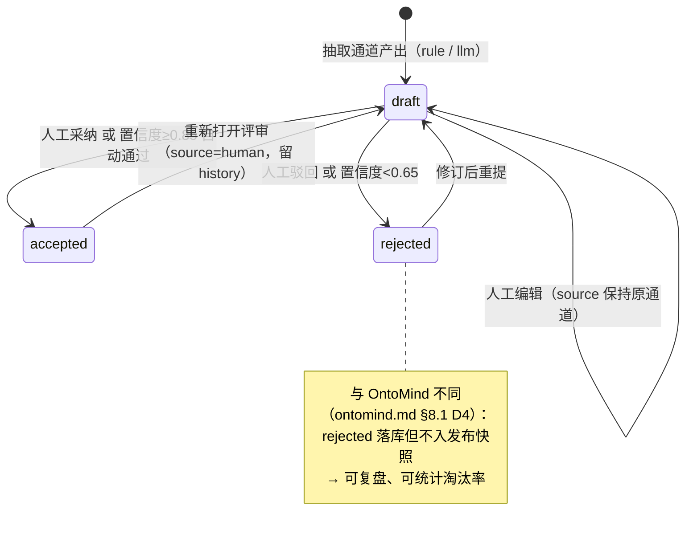
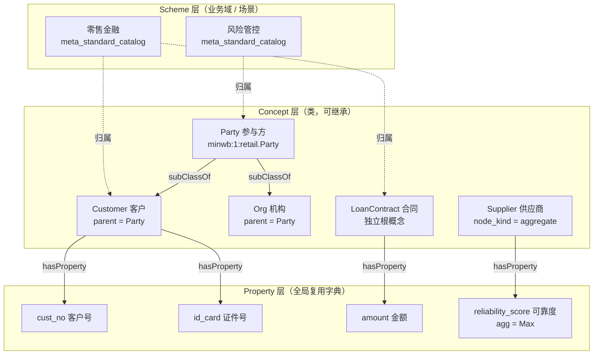
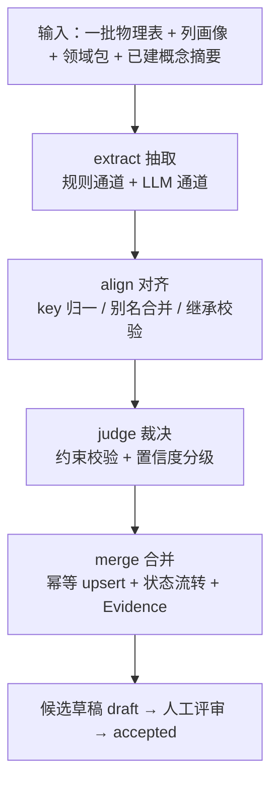

# MinWorkBuddy 本体能力方案（CDMD 本体化 + 三投影）

> 日期：2026-10-31
> 状态：设计已确认（3 项遗留决策已裁决，见 §14.3），待实施计划
> ⚠️ 本文件为 2026-10-31 的**并行早期草案**，未同步后续立项。主规格为
> `2026-10-31-ontology-capability-design.md`；推演沙盘与孪生应用的现状以
> `2026-11-01-simulation-sandbox-design.md` 与 `2026-11-01-digital-twin-app-design.md` 为准。
> 本文件内的 N3（`:43`）、D−2（`:610`）、P4 远期表（`:1099`）、D2 范围行（`:1140`）、
> §15 远期展望（`:1176`）**不再回写**，仅作历史快照。实测：该文件自 2026-10-31 提交后未再修改。
> 影响范围：backend `models/dataops` + `services/dataops` + `routers/dataops` + 新增 `services/ontology` + `routers/ontology` + `ai/tools/ontology_tools`；frontend `views/data-source/standard` 扩展 + 新增本体建模工作台；alembic 新增迁移
> 对标产品：OntoFlow（本体智能应用开发平台）—— `docs/ontoflow/ontoflow.md`
> 对标实现：OntoMind（本体建模前后端走读）—— `docs/ontoflow/ontomind.md`
> 核心原则：**纯增量演进**——现有 CDM 三层语义模型（目录 / 对象标准 / 属性标准 / 关系标准）全部保留并原地升格为本体核心，不新建平行本体库，不推翻既有 API 与前端。

---

## 1. 背景与目标

### 1.1 背景

MinWorkBuddy 已经具备一条完整的"数据 → 语义 → 知识 → 智能"链路：数据源接入（`meta_data_source` + 12 种方言连接器）、元数据扫描与画像（`meta_table` / `meta_column` / `meta_scan_job`）、数据标准三层语义模型（`meta_standard` / `meta_object_standard` / `meta_object_relation` / `meta_standard_catalog`）、标准与物理列的绑定评审（`meta_column_standard` / `meta_table_standard`）、知识库与混合检索（`kms_segment` + pgvector 768 + 中文 trigram）、知识图谱（`kg_entity` / `kg_triple` + Neo4j）、Agent 工具体系（`ai/tool_manager`）。

但它**缺一个本体层**：

1. **概念无继承**——`meta_object_standard.catalog_id` 只是单一目录归属，没有 `subClassOf` 语义，无法表达"客户是参与方的一种"。
2. **元素无治理**——对象/关系/目录的 `status` 只有 `draft|published`，把"评审态"与"发布态"混在一个字段；除映射层外没有 `confidence` / `source` / 不可复核的证据。
3. **概念无版本**——`meta_object_standard.current_version` 只是个整数，没有快照、没有 diff、没有回滚。
4. **约束不存在**——没有任何"这个概念必须有哪张表、这条关系两端必须存在、这个属性值域是什么"的声明式载体。
5. **本体无处可消费**——`/api/v1/semantic` 6 个端点**无任何前端页面消费**；`ai/tools/semantica_tools.py` 的工具注册因字段错误从未成功入库；`kms_segment.class_uris`（注释自述"P4 本体驱动检索"预留）过滤链没有填充值。
6. **建模无画布**——前端是"表单 + 只读图"两条割裂的路径，无法像 OntoFlow 那样在画布上把"物理表 → 数据标准 → 概念"三层串起来看与建。

同时，仓库里**曾经**有过自研本体层，但已被整体拆除：`routers/ontology`（19 端点）、`ai/knowledge/owl_engine.py`（rdflib 内核）、`models/ontology`（9 张表）、`tests/ontology`（13 个测试文件）均已删除，`ontology_*` 9 张表已由迁移 `alembic/versions/2026_10_18_0001_drop_ontology_tables.py:22-32` DROP（不可回滚，`:40-43`）。取而代之的是 PyPI 公共包 `semantica==0.7.0` 的适配层（`backend/app/services/semantica/`、`backend/app/routers/semantica/semantica.py`），但该层目前**只做语义抽取与图/向量存储**，不承担本体元模型职责。

### 1.2 目标

| 层级 | 目标 | 可度量结果 |
|---|---|---|
| **G1 语义统一** | 把"物理元数据 → 数据标准 → 业务概念"收敛为**一套可继承、可追溯、可复核**的概念体系 | 概念支持单父继承与属性继承；每个元素携带 `review_status` / `confidence` / `source` / `evidence_refs` |
| **G2 治理可复核** | 任何一条概念/关系/映射都能回答"谁说的、有多确信、依据是什么" | Evidence 独立表；约束 10 类可执行；发布快照 + diff + 回滚 |
| **G3 能力可发布** | 一条本体查询同时供给页面、接口、Agent 工具、MCP 四个出口 | OntoQL 编译器 + 三执行器（SQL / Cypher / Vector）；本体 Skill 是一等元数据资产 |

### 1.3 非目标（本期明确不做）

| # | 非目标 | 理由 |
|---|---|---|
| N1 | OWL DL 描述逻辑推理、open-world 假设、reasoner | 本体面向数据治理，非逻辑推理；SHACL 式闭世界校验足够 |
| N2 | 完整推演沙盘（世界模型克隆、行动注入、因果传导、检查点/分支对比） | 依赖规则/因果推理引擎。**本期只做"推演验证"= 静态影响面分析**（§10.3） |
| N3 | 数字孪生应用（组件绑定本体查询、智能问数、BI 下钻、发布独立页） | 属本体之上的可视化产品层，列 §15 远期 |
| N4 | 评测门禁（匿名 A/B judge）+ 自动进化（`evolution_due`） | 前置依赖：可执行 CQ 用例集（P3）尚未就绪 |
| N5 | 跨租户本体联邦 / 本体市场 / `owl:imports` 跨本体合并 | 命名空间隔离机制已具备，但无真实需求 |
| N6 | "视野（field of view）"与脱敏传播的完整语义 | 现有 `security_level` + `mask_rule` 已覆盖属性级脱敏；视野暂不需要 |
| N7 | 派生属性的**执行引擎**、行动（Action）的**执行器** | 元模型本期**预留**（`derived_expr` / `meta_ontology_action`），执行留 P4 |

### 1.4 设计基线与口径声明（**先说清什么是已知、什么是推断**）

> 需求方要求"参考现有本体标准（若相关文档或定义未提供，请明确说明）"。本节即为该声明。

| 类别 | 状态 |
|---|---|
| OWL 2 / RDF 1.1 / SKOS / JSON-LD **标准正文** | **仓库内未提供**。本方案以 W3C SKOS Reference（ConceptScheme / Concept / broader / mapping）与 OWL 2 概览（Class / ObjectProperty / subClassOf）为基线，每处对齐点与偏离点在 §6 逐条标注 |
| OntoFlow **后端实现** | **未提供**，仅有产品文档 `docs/ontoflow/ontoflow.md` 与 17 张截图。故只对标其**能力链路与产品形态**，不对标其内部算法 |
| OntoMind **内部实现** | **已提供**（`docs/ontoflow/ontomind.md`，含行级证据）。作为 pipeline 设计与缺陷规避的直接参照 |
| `docs/semantica/` | **PyPI 公共包 `semantica` 的官方文档镜像**（`index.md:2` `source: https://docs.getsemantica.ai/`），**不是**标准本体文档，也**不是**自研文档 |
| 仓库内"事实本体标准" | 仅三处残留：① `backend/app/models/sys/sys_dictionary.py:172` 的 `ONTOLOGY_REL_TYPE`（继承/实现/关联/聚合/组合/依赖 6 词）；② `backend/app/models/wiki/wiki_article.py:31` 的 `owl_class_uri` / `owl_class_uris`；③ `backend/app/models/kb/kb_segment.py:39-41` 的 `class_uris`（注释自述"P4 本体驱动检索"预留） |
| MinWorkBuddy 现状 | 已做代码级勘察（4316 文件），字段级证据见 §2 与附录 §16.3 |

**结论**：仓库内**不存在**任何可作为"现有本体标准"的文件。本方案的标准基线取自 W3C 常识 + 上述三处仓库残留，并在 §6.3 标注每处偏离。若贵方另有企业本体规范文档，§6 需按其重校。

---

## 2. 现状勘察结论（基线事实）

### 2.1 现有 CDM 三层语义模型（本体化的地基）

| 表 | 关键字段 | 约束 | 本方案角色 |
|---|---|---|---|
| `meta_standard_catalog` | `parent_id`（self FK, RESTRICT）、`code`、`name`、`icon`、`sort_order`、`status(draft\|published)` | `UQ(tenant_id, code)` | → **Concept Scheme**（业务域/场景分组） |
| `meta_object_standard` | `catalog_id`、`code`、`name`、`aliases_json`、`description`、`domain`、`status(draft\|published)`、`current_version` | `UQ(tenant_id, code)` | → **Concept**（类） |
| `meta_standard` | `code`、`name`、`aliases_json`、`semantic_type`、`data_type_expect`、`length_rule_json`、`security_level`、`quality_rule_json`、`mask_rule`、`domain`、`status(draft\|published)`、`current_version` | `UQ(tenant_id, code)` | → **Property**（全局复用属性字典） |
| `meta_object_standard_attribute` | `object_id`、`standard_id`、`required`、`sort_order`、`security_level_override` | `UQ(object_id, standard_id)` | → Concept↔Property（M2M，全局复用） |
| `meta_object_relation` | `catalog_id`、`code`、`from_object_id`、`to_object_id`、`relation_type(1:1\|1:N\|N:1\|N:N)`、`via_attribute_ids`、`status(draft\|published)` | `UQ(tenant_id, code)` | → **Relation**（`ObjectProperty`） |
| `meta_table_standard` | `table_id`、`object_standard_id`、`standard_version`、`status(suggested\|accepted\|rejected)`、`source(rule\|llm\|human)`、`confidence`、`evidence_json`、`reviewed_by/at` | **`UQ(table_id)`** ← 表侧 1:1 | → **Mapping**（物理表 ↔ 概念）**主表绑定** |
| `meta_column_standard` | `column_id`、`standard_id`、`status(suggested\|accepted\|rejected)`、`source`、`confidence`、`evidence_json` | **`UQ(column_id)`** ← 列侧 1:1 | → **Mapping**（物理列 ↔ 属性） |
| `meta_table_standard_history` / `meta_column_standard_history` | `action(bind\|unbind\|accept\|reject\|override)`、`snapshot_json`、`actor_user_id` | — | 变更留痕（已有） |
| `meta_relation_check` | `standard_relation_id`、`source_id`、`database`、`inferred_relation_id`、`verdict(hit\|missing\|conflict)`、`confidence`、`evidence_json` | `UQ(standard_relation_id, source_id, database)` | → 关系一致性校验（已有） |
| `meta_standard_version` | `standard_id`、`version`、`snapshot_json`、`change_note` | `UQ(standard_id, version)` | 版本快照机制（已有，**本体级需另建**） |

证据：`backend/app/models/dataops/standard.py:16-130`、`backend/app/models/dataops/standard_cdm.py:16-174`。

### 2.2 元数据与数据源

| 表/服务 | 关键内容 |
|---|---|
| `meta_table` | `db_name`、`database`、`table_name`、`table_type`、`table_comment`、`biz_name`、`biz_description`、`domain`、`row_count`、`profiled_at`；`UQ(source_id, db_name, database, table_name)` |
| `meta_column` | `column_name`、`ordinal`、`data_type`、`nullable`、`column_key(PRI\|UNI\|MUL)`、`column_comment`、`biz_name`、`biz_description`、**`semantic_type`**、**`pii_level`**、`profile_json` |
| `meta_relation` | 推断血缘：`left/right` 表列、`vote_key` / `vote_name` / `vote_overlap` **三路投票**、`confidence`、`status` |
| `meta_scan_job` | 扫描任务与进度 |
| `backend/app/ai/dataops/connection.py:23` | `FAMILY_BY_TYPE`；`:30` URL 映射；`dialects/` 12 种方言（mysql/postgres/oracle/sqlserver/clickhouse/dm/es/excel_pg/starrocks/kingbase/doris）——**强于** OntoFlow 的 9 类 |
| `backend/app/ai/dataops/rule_engine.py:71-111` | 语义类型 / PII 规则字典；`:190` standard 匹配 |

证据：`backend/app/models/dataops/meta.py:19-163`、`meta_relation.py:19`、`backend/app/ai/dataops/connection.py:23-30`。

### 2.3 检索、知识库与图谱

| 能力 | 落点 | 与本体的关系 |
|---|---|---|
| 向量存储 | `kms_segment.embedding` `Vector(768)`（`models/kb/kb_segment.py:35`）；`kg_entity` 因 2048 维超 HNSW2000 上限改用 `halfvec` 生成列 + HNSW（`models/kb/kg_entity.py:65-78`） | 维度受 `GPUSTACK_EMBEDDING_DIMENSION=768`（`backend/app/config/_embedding.py:11`）约束 |
| 混合检索 | `services/kb/pgvector_store.py:14-17` 余弦 + HNSW + 中文 trigram 关键词 RRF | — |
| **概念过滤（预留）** | `kms_segment.class_uris`（`models/kb/kb_segment.py:39-41`，注释自述"P4 本体驱动检索"）+ `pgvector_store.py:307,389,426` `_class_uris_any` + `services/kb/retrieval_service.py:48-98` | **过滤链已存在，缺填充值** → 本体 URI 天然成为填充值 |
| 图谱 | `kg_entity` / `kg_triple` / `kg_*_mention`；`services/kb/kg/kg_neo4j_store.py` 等 9 个模块；`routers/kb/kg.py`（prefix `/api/v1/kb/knowledges`，约 30 端点） | 图存储与检索底座可复用 |
| Wiki OWL 残留 | `models/wiki/wiki_article.py:31` `owl_class_uri(s)`；`routers/wiki/wiki.py:65,86,475` | 命名需与本体 URI 统一或明确隔离 |

### 2.4 semantica 适配层现状

| 端点 | 位置 | 状态 |
|---|---|---|
| `GET /health` | `routers/semantica/semantica.py:74` | ✅ 可用 |
| `POST /extract/entities` | `:85` | ✅ 可用（`semantic_extract.named_entity_recognizer`，`services/semantica/client.py:62`） |
| `POST /extract/relations` | `:97` | ✅ 可用（`relation_extractor` `:66` / `triplet_extractor` `:70`） |
| `POST /build` | `:110` | ⚠️ `pipeline_service.py:98` 关系恒为空；`:100-108` 只建索引不写向量 |
| `POST /search` | `:129` | ✅ 可用（`concept_uris` 过滤，`retrieval_service.py:31-36`） |
| `POST /export` | `:146` | ✅ 可用（turtle/rdf/nt/xml/owl） |
| 租户隔离 | `TenantScope`（`services/semantica/scope.py:31-41`）：namespace `{group_id}_{tenant_id}_{ontology_code}`；Neo4j label 前缀 `{group_id}_sem_*`；`assert_owned` 二次校验 `:43-48` | ✅ 可直接复用 |

**Agent 工具链断点（必须先修）**：
- `ai/tools/semantica_tools.py:130-138` 构造 `AiToolDefinition(tool_key=..., name=key, ...)`，但模型 `models/ai/ai_tool_definition.py:20-46` **没有 `name` 字段**且 `display_name` 非空 → 构造即 `TypeError`，被 `ai/tool_manager/seed_tools.py:31-34` 吞掉 → 3 个 `semantic_*` 工具**从未入库**。
- 三个工具类未声明 agentscope `ToolBase` 必需的 `name` / `description` / `parameters`（对比 `ai/tools/kg_tools.py:63-90`），也未设 `class_name` → `ai/tool_manager/manager.py:198-229` 无法实例化。

### 2.5 残留与待清理清单

| # | 残留 | 位置 | 处置 |
|---|---|---|---|
| R-1 | 本体层已删但迁移链仍 stamp 旧节点 | `backend/app/db/migrate.py:67-70`（stamp `005_add_ontology_modeling_tables`） | P0 清理 |
| R-2 | `ONTOLOGY_REL_TYPE` 字典存在但无人消费 | `models/sys/sys_dictionary.py:172` | **复活**为 `relation_semantic_type` 词表（§4.4） |
| R-3 | wiki `owl_class_uri` 与本体 URI 两套命名 | `models/wiki/wiki_article.py:31` | P0 定义统一规则 |
| R-4 | `docs/semantica-replace-ontology.md` 的 todos 仍全 `pending`（实际已落地） | 该文件 `:7-41` | P0 同步状态 |
| R-5 | 两份 rdflib 路线 spec 仍标"待评审" | `specs/2026-09-10-ontology-layer-design.md`、`specs/2026-09-10-ontology-knowledge-integration-design.md` | P0 加 DEPRECATED banner |
| R-6 | `.env.example` 缺 `SEMANTICA_*` / `NEO4J_*` / `GRAPHITI_GROUP_ID` | `backend/env.example` | P0 补占位符 |
| R-7 | `config/_semantica.py` 的 `SEMANTICA_DB_*` 未被使用（`client.py:110` 用 `settings.db_url`） | 同上 | P0 收敛为单一来源 |

---

## 3. 领域概念与命名

### 3.1 八类元记录

| # | 本体概念 | SKOS 对应 | 权威存储 | 状态 |
|---|---|---|---|---|
| 1 | **Concept Scheme** 业务域 / 场景 | `skos:ConceptScheme` | `meta_standard_catalog` | 现状，语义升格 |
| 2 | **Concept** 概念 / 类 | `skos:Concept` / `owl:Class` | `meta_object_standard` | 现状，扩列 |
| 3 | **Property** 属性 / 属性字典 | `skos:Property` / `owl:DatatypeProperty` | `meta_standard` | 现状，扩列 |
| 4 | **Relation** 关系 | `owl:ObjectProperty` | `meta_object_relation` | 现状，扩列 |
| 5 | **Mapping** 映射 | `skos:exactMatch` / `owl:sameAs` | `meta_table_standard`（主表）+ `meta_column_standard`（列↔属性）+ **🆕 `meta_object_standard_source`（合段）** | 现状 + 新增 |
| 6 | **Constraint** 约束 | `sh:` SHACL 形状（简化） | **🆕 `meta_ontology_constraint`** | 新建 |
| 7 | **Evidence** 证据 | `prov:` PROV-O（简化） | **🆕 `meta_ontology_evidence`** | 新建 |
| 8 | **Version** 发布快照 | `owl:Ontology` 版本 / `a owl:imports` | **🆕 `meta_ontology_version`** | 新建 |

配套新增：**🆕 `meta_object_standard_source`**（合段：多表 → 一概念）、**🆕 `meta_ontology_action`**（行动节点预留）、**🆕 `meta_ontology_cq`**（可执行断言）、**🆕 `meta_ontology_domain_package`**（可插拔领域包）、**🆕 `meta_asset_tag` + `meta_table_tag`**（资产标签体系）。

### 3.2 标识规范：Concept URI —— 三方投影的公共键

```
Concept URI:  minwb:{tenant_id}:{scheme_code}.{concept_code}
Property URI: minwb:{tenant_id}:attr.{standard_code}
Relation URI: minwb:{tenant_id}:rel.{relation_code}
Instance URI: minwb:{tenant_id}:inst.{source_id}.{database}.{table}#{pk}
Scheme  URI:  minwb:{tenant_id}:scheme.{scheme_code}
```

三个用途，**必须一致**：
1. Neo4j 节点 `uri` 属性（`minworkbuddy_sem_*` 命名空间内）
2. `kms_segment.class_uris` 的填充值 → 激活现有向量检索的概念过滤链
3. `meta_table_standard` / `meta_column_standard` / `meta_object_standard_source` 的 `class_uri` 列 → 供 REST / MCP / Agent 工具返回稳定引用

> **关键决策**：URI 由**元模型产出**，不由投影层生成。这样"改概念 code"就是一次显式的 URI 迁移（需双写过渡），而不是三处投影各自漂移。

### 3.3 元素生命周期



**置信度闸门**（沿用 ontomind.md §4.11 的阈值，修正其"rejected 不落库"缺陷）：

| 置信度 | 评审态 | 是否入发布快照 | 是否进图谱投影 |
|---|---|---|---|
| `≥ 0.85` | `accepted` | ✅ | ✅ |
| `0.65 ~ 0.85` | `draft` | ❌ | 仅 `_draft` 视图 |
| `< 0.65` | `rejected` | ❌ | ❌ |

**四字段规约**（每个本体元素统一携带）：

| 字段 | 取值 | 语义 |
|---|---|---|
| `review_status` | `draft \| accepted \| rejected` | 评审态（拆自现有 `status`） |
| `confidence` | `0.0 ~ 1.0` | 机器通道给出；人工采纳后置 `1.0` 且 `source=human` |
| `source` | `rule \| llm \| human` | **按实际执行通道赋值**（修正 ontomind.md R4：按 `mode` 错标为 `llm`） |
| `evidence_refs` | `int[]` → `meta_ontology_evidence.id` | 证据引用（修正 ontomind.md G9：证据不可复核） |

### 3.4 枚举双轨的裁决（现状代码的真实矛盾）

现状两套并存：`meta_standard` / `meta_object_standard` / `meta_standard_catalog` / `meta_object_relation` 用 `status = draft|published`；`meta_column_standard` / `meta_table_standard` 用 `status = suggested|accepted|rejected`。

**裁决：拆成两个正交字段。**

| 字段 | 取值 | 语义 |
|---|---|---|
| `review_status` | `draft \| accepted \| rejected` | **评审态**（机器产出 → 人工裁决） |
| `release_status` | `unreleased \| released` | **发布态**（是否已随某个 `meta_ontology_version` 发布） |

存量迁移口径（§4.6）：`published` → `review_status=accepted, release_status=released`；`draft` → `review_status=draft, release_status=unreleased`；`suggested` → `draft`；`accepted` → `accepted`；`rejected` → `rejected`。

---

## 4. 数据模型

### 4.1 新增表（11 张；其中 Skill 两张见 §11.1）

#### 4.1.1 `meta_ontology_evidence`（证据，一等公民）

```sql
CREATE TABLE meta_ontology_evidence (
    id                BIGINT PRIMARY KEY,
    tenant_id         BIGINT NOT NULL,
    kind              VARCHAR(32)  NOT NULL,  -- naming_rule|column_profile|join_overlap|llm_extract
                                                   -- |human_note|query_result|cq_assert|asset_validation
    source_ref        VARCHAR(512) NOT NULL,  -- 如 meta_table:123 / meta_column:45 / asset://x
    method            VARCHAR(64)  NOT NULL,  -- rule_engine|relation_inference|llm|sql|human
    payload_json      JSONB        NOT NULL,  -- 判定依据（命中规则、样本值、SQL、LLM 原文片段）
    validation_method VARCHAR(64)  NULL,      -- overlap_ratio|not_null_check|value_domain|llm_judge
    confidence        FLOAT        NULL,
    author_user_id    BIGINT       NULL,
    created_at        TIMESTAMP    NOT NULL DEFAULT now()
);
CREATE INDEX idx_meta_evidence_tenant ON meta_ontology_evidence(tenant_id, kind, created_at);
```

> 相对 EvoOntology `Evidence`（`source/query/result/validation_method/timestamp`）的差异：把 `query` 与 `result` 合并进 `payload_json`，因为判定依据形态高度异构（规则命中是 dict，overlap 是 float + SQL，LLM 是原文）。**代价**：失去"可 SQL 复算"的强形式；**收益**：不引入第二套 SQL 存储。

#### 4.1.2 `meta_ontology_constraint`（约束）

```sql
CREATE TABLE meta_ontology_constraint (
    id              BIGINT PRIMARY KEY,
    tenant_id       BIGINT NOT NULL,
    code            VARCHAR(64)  NOT NULL,   -- 租户内唯一
    name            VARCHAR(200) NOT NULL,
    constraint_type VARCHAR(32)  NOT NULL,   -- 见 §4.3 的 10 类
    target_type     VARCHAR(32)  NOT NULL,   -- concept|property|relation|mapping|action
    target_key      VARCHAR(128) NOT NULL,   -- 目标 code 或 URI
    expression      JSONB        NULL,       -- 约束参数（字段集合、阈值、依赖）
    severity        VARCHAR(16)  NOT NULL DEFAULT 'error',  -- error|warning
    scope_json      JSONB        NULL,       -- 限定数据源/库/时间窗
    binding_kind    VARCHAR(16)  NULL,       -- group|action|none（img09「选择分组/选择行动」）
    binding_ref     VARCHAR(128) NULL,
    evidence_refs   JSONB        NULL,
    enabled         BOOLEAN      NOT NULL DEFAULT TRUE,
    created_at      TIMESTAMP    NOT NULL DEFAULT now(),
    UNIQUE (tenant_id, code)
);
```

#### 4.1.3 `meta_ontology_version`（发布快照）

```sql
CREATE TABLE meta_ontology_version (
    id            BIGINT PRIMARY KEY,
    tenant_id     BIGINT NOT NULL,
    scope_code    VARCHAR(64)  NOT NULL,   -- 本体作用域（= scheme_code 或独立本体 code）
    version       INTEGER      NOT NULL,
    stage         VARCHAR(16)  NOT NULL DEFAULT 'candidate',  -- candidate|released
    snapshot_json JSONB        NOT NULL,   -- 全量冻结（概念/属性/关系/映射/约束/CQ/覆盖率）
    diff_json     JSONB        NULL,       -- {added:[],removed:[],changed:[]} 明细
    coverage_json JSONB        NULL,       -- 映射覆盖率快照（供查询验证与发布门禁）
    change_note   TEXT         NULL,
    author_user_id BIGINT      NULL,
    published_at  TIMESTAMP    NULL,
    created_at    TIMESTAMP    NOT NULL DEFAULT now(),
    UNIQUE (tenant_id, scope_code, version)
);
```

> 相对 OntoMind `ontology_versions` 的改进：① `stage` 支持候选 / 正式**物理隔离**（候选不影响线上，对齐 EvoOntology `store.py:18-19`）；② `diff_json` 存**明细**而非计数（修正 ontomind.md §6.3）；③ 快照**始终基于指定版本**，导出内容不随"当前是否有发布"变化（修正 ontomind.md R12）。

#### 4.1.4 `meta_object_standard_source`（合段：多表 → 一概念）⭐

> 由 §14.3 决策 1 引入。原 `meta_table_standard` 的 `UQ(table_id)` 使"一表只能绑一个概念、一个概念只能绑一张表"，无法表达 OntoFlow 画布上"3 张表 → 1 个对象"的合段结构。

```sql
CREATE TABLE meta_object_standard_source (
    id             BIGINT PRIMARY KEY,
    tenant_id      BIGINT NOT NULL,
    object_id      BIGINT NOT NULL REFERENCES meta_object_standard(id) ON DELETE CASCADE,
    table_id       BIGINT NOT NULL REFERENCES meta_table(id) ON DELETE CASCADE,
    role           VARCHAR(32) NOT NULL DEFAULT 'primary',  -- primary|detail|lookup|history
    segment_mode   VARCHAR(16) NOT NULL DEFAULT 'union',   -- union|join
    join_condition JSONB,       -- {left:[cols], right:[cols], type: inner|left}
    weight_hint    FLOAT,       -- 合段权重（聚合时占比）
    review_status  VARCHAR(16) NOT NULL DEFAULT 'draft',
    confidence     FLOAT, source VARCHAR(16), evidence_refs JSONB,
    class_uri      VARCHAR(256),
    created_at     TIMESTAMP NOT NULL DEFAULT now(),
    UNIQUE (tenant_id, object_id, table_id, role)
);
CREATE INDEX idx_meta_obj_src_table ON meta_object_standard_source(tenant_id, table_id);
```

**语义变更（对现有 API 的影响，必须显式记录）**：

| 现状 | 变更后 |
|---|---|
| `meta_table_standard` = "表 ↔ 对象的绑定"，表侧 1:1 | `meta_table_standard` = **主表绑定**（一个概念的主表唯一；一张表可作为多个概念的主表 → **去掉 `UQ(table_id)`，改为 `UQ(table_id, object_standard_id)`**） |
| `standard_binding_service.bind_source`（`:385`）语义 = "绑定一张表到一个对象" | 扩展为"绑定一个**合段方案**"：主表 + N 个明细表 + 合段方式 + 连接条件 |
| `BindingWorkbench.vue` 表侧 1:1 交互 | 表侧支持多对多（一表可映射多概念，多表可合成一概念），需展示合段结构 |

**迁移策略**：存量 `meta_table_standard` 行全部迁移为 `meta_object_standard_source` 的 `role='primary', segment_mode='union'` 记录；`meta_table_standard` 保留为"主表视图"（可物化成视图，也可保留表并由服务层双写 —— **实施时二选一，优先保留表 + 服务层双写**，改动面最小）。

#### 4.1.5 `meta_ontology_action`（行动节点，本期仅元模型）

```sql
CREATE TABLE meta_ontology_action (
    id            BIGINT PRIMARY KEY,
    tenant_id     BIGINT NOT NULL,
    scope_code    VARCHAR(64)  NOT NULL,
    code          VARCHAR(64)  NOT NULL,
    name          VARCHAR(200) NOT NULL,
    description   TEXT,
    trigger_spec  JSONB,        -- 触发条件表达式
    target_kind   VARCHAR(32),  -- concept|relation|external|mcp
    target_ref    VARCHAR(256),
    executor_kind VARCHAR(32)  NOT NULL DEFAULT 'reserved',  -- reserved|skill|workflow|mcp|http
    executor_ref  VARCHAR(256),
    review_status VARCHAR(16)  NOT NULL DEFAULT 'draft',
    confidence    FLOAT, source VARCHAR(16), evidence_refs JSONB,
    created_at    TIMESTAMP    NOT NULL DEFAULT now(),
    UNIQUE (tenant_id, scope_code, code)
);
```

> 本期**不实现执行器**。`executor_kind='reserved'` 的行动在 UI 上可见、可编辑、可随本体发布，但调用时返回 `501 executor_not_implemented`（**fail-closed，不静默忽略**）。

#### 4.1.7 `meta_ontology_cq`（可执行断言 / Competency Question）

```sql
CREATE TABLE meta_ontology_cq (
    id            BIGINT PRIMARY KEY,
    tenant_id     BIGINT NOT NULL,
    scope_code    VARCHAR(64)  NOT NULL,
    code          VARCHAR(64)  NOT NULL,
    question      TEXT         NOT NULL,   -- 自然语言表述（业务方视角）
    category      VARCHAR(32)  NULL,       -- 存在性|计数|关系遍历|聚合|时间|条件
    ontoql        TEXT         NOT NULL,   -- 可执行断言（编译后与物理表结果比对）
    expect_json   JSONB        NULL,       -- 期望值 / 容差 / 断言方式
    related_keys  JSONB        NULL,       -- 涉及的概念 / 属性 URI 列表
    verify_status VARCHAR(16)  NOT NULL DEFAULT 'pending',  -- pending|passed|failed
    last_run_at   TIMESTAMP    NULL,
    last_result   JSONB        NULL,
    created_at    TIMESTAMP    NOT NULL DEFAULT now(),
    UNIQUE (tenant_id, scope_code, code)
);
```

> 与 OntoMind `ontology_cqs` 的关键差异：其 CQ **只做可达性校验**（`_bfs_reachable` + `_mapping_coverage`，ontomind.md §6.2），`pass_rate` 只存在于前端内存；本表的 CQ 是**可执行断言**（编译为 SQL / Cypher 并与物理表比对），随版本快照冻结，作为发布门禁与回归集。

#### 4.1.8 `meta_ontology_domain_package`（可插拔领域包）

```sql
CREATE TABLE meta_ontology_domain_package (
    id           BIGINT PRIMARY KEY,
    tenant_id    BIGINT NOT NULL,
    code         VARCHAR(64)  NOT NULL,   -- 如 retail_finance
    name         VARCHAR(200) NOT NULL,
    version      INTEGER      NOT NULL DEFAULT 1,
    package_json JSONB        NOT NULL,   -- {objects:[],relations:[],clusters:[],description:""}
    source       VARCHAR(16)  NOT NULL DEFAULT 'builtin',  -- builtin|tenant|market
    enabled      BOOLEAN      NOT NULL DEFAULT TRUE,
    created_at   TIMESTAMP    NOT NULL DEFAULT now(),
    UNIQUE (tenant_id, code, version)
);
```

#### 4.1.9 `meta_asset_tag` + `meta_table_tag`（资产标签体系）

```sql
CREATE TABLE meta_asset_tag (
    id        BIGINT PRIMARY KEY,
    tenant_id BIGINT NOT NULL,
    name      VARCHAR(64) NOT NULL,
    color     VARCHAR(16),
    category  VARCHAR(32) NOT NULL DEFAULT 'business',  -- business|domain|pii|status|owner|custom
    UNIQUE (tenant_id, name)
);
CREATE TABLE meta_table_tag (
    id        BIGINT PRIMARY KEY,
    tenant_id BIGINT NOT NULL,
    table_id  BIGINT NOT NULL REFERENCES meta_table(id) ON DELETE CASCADE,
    tag_id    BIGINT NOT NULL REFERENCES meta_asset_tag(id) ON DELETE CASCADE,
    UNIQUE (tenant_id, table_id, tag_id)
);
```

### 4.2 现有表扩列清单

| 表 | 新增列 | 类型 | 用途 |
|---|---|---|---|
| `meta_standard_catalog` | `scheme_uri` | VARCHAR(256) | Concept Scheme URI |
| | `review_status` | VARCHAR(16) | `draft\|accepted\|rejected` |
| `meta_object_standard` | `parent_object_id` | BIGINT FK self | **概念继承**（SKOS broader / OWL subClassOf） |
| | `uri` | VARCHAR(256) | Concept URI |
| | `review_status` / `confidence` / `source` / `evidence_refs` | — | 治理四字段 |
| | `depth` | INTEGER | 继承深度缓存（防环 + 快速闭包） |
| | `node_kind` | VARCHAR(16) | `type\|aggregate\|action\|derived`（img09 节点类型） |
| | `object_role` | VARCHAR(32) | 角色分类（img10 的 Router/Transaction/Merchant/Customer/Device 类） |
| `meta_standard` | `uri` / `review_status` / `confidence` / `source` / `evidence_refs` | — | 属性纳入治理 |
| | `value_selector` | JSONB | 取值选择器：`{"enum":[...]}` / `{"range":[min,max]}` / `{"pattern":"..."}`（img09 属性表"选择"列） |
| | `agg_semantics` | VARCHAR(16) | 聚合语义：`none\|first\|last\|max\|min\|sum\|avg\|count\|concat`（img09 的 `Last` / `Max`） |
| | `derived_expr` / `derived_from` | JSONB / VARCHAR(256) | 派生属性定义（**预留**，本期不执行） |
| `meta_object_standard_attribute` | `review_status` / `confidence` / `source` / `evidence_refs` | — | 属性引用纳入治理 |
| | `inherit_mode` | VARCHAR(16) | `inherit\|override`：子类对父类属性必填性的覆盖 |
| `meta_object_relation` | `uri` / `relation_semantic_type` / `inverse_of` | — | 关系语义与基数分离；逆关系 |
| | `review_status` / `confidence` / `source` / `evidence_refs` | — | 治理四字段 |
| `meta_table_standard` | `class_uri` | VARCHAR(256) | 概念 URI（与 `evidence_json` 并存，后者保留兼容） |
| `meta_column_standard` | `class_uri` | VARCHAR(256) | 属性 URI → `class_uris` 过滤值 |
| `meta_table` | `structure_snapshot` | JSONB | 资产结构自描述（DDL 预览，img08 卡片） |
| | `preview_json` | JSONB | 抽样预览结果 |
| | `validation_status` | VARCHAR(16) | `unknown\|pass\|warn\|fail` |

### 4.3 约束族（10 类）

| 类型 | 目标 | 表达 | 基础 |
|---|---|---|---|
| `existence` | 概念 / 属性 | 必填属性存在 | 已有 `meta_object_standard_attribute.required` |
| `value_domain` | 属性 | 类型 / 长度 / 枚举 / 质量规则 | 已有 `meta_standard.data_type_expect` / `length_rule_json` / `quality_rule_json` / `semantic_type` |
| `cardinality` | 关系 | 两端基数 | 已有 `meta_object_relation.relation_type` |
| `referential` | 关系 | `via_attribute_ids` 必须在两端存在**且已映射到物理列** | 新增 |
| `uniqueness` | 属性 | 单值 / 组合唯一 | 新增 |
| `cross_object` | 概念对 | 跨对象口径一致（表达式） | 新增 |
| **`selector_check`** | 属性 | 值必须落在 `value_selector` 内 | 🆕（img09「属性检验」） |
| **`invalid_rule`** | 概念 / 属性 | 失效规则（如"合同到期即失效"） | 🆕（img09「失效规则」） |
| **`action_binding`** | 概念 / 属性 | 约束触发时绑定某行动 | 🆕（img09「选择行动 receiverSupply +1」） |
| **`group_binding`** | 概念 / 属性 | 约束归属分组（分组 = `meta_standard_catalog` 子树） | 🆕（img09「选择分组」） |

> OntoFlow 截图显示"推演过的约束 5 项可配置 → 展开"，说明约束是**可枚举、可展开、可配置**的一等公民，且**属性级为一等目标**——这是 v1 设计的遗漏，由 v2 修正。

### 4.4 关系语义与基数的分离（现状冲突裁决）

现状 `meta_object_relation.relation_type` 存**基数**（`1:1|1:N|N:1|N:N`），而 `sys_dictionary.ONTOLOGY_REL_TYPE`（`models/sys/sys_dictionary.py:172`）想存**关系语义**（继承/实现/关联/聚合/组合/依赖）。二者挤在一个字段。

**裁决**：
- `relation_type` **保留基数**（不动存量）
- 新增 `relation_semantic_type` 引用 `ONTOLOGY_REL_TYPE` 词表（**复活该字典**）
- 新增 `inverse_of`（逆关系，指向对端关系 code）

> **重要边界**：`ONTOLOGY_REL_TYPE` 里的"继承 / 实现"是**业务语义关系**（如"合同实现产品"），与结构继承 `parent_object_id` 是两回事。**结构继承只走 `parent_object_id`；"继承/实现"仅作业务关系语义；两者互不推导。**（§14.3 决策 1 同批确认）

### 4.5 派生与行动：从"不做"改为"预留"

> 由 v2 修正。img09 的节点类型切换含 `行动` / `派生` / `合段`，说明这是本体建模的核心差异点之一。若元模型不留位，后续接入需要二次重构。

| 能力 | 元模型 | 执行 | 本期状态 |
|---|---|---|---|
| 派生属性 | `meta_standard.derived_expr` + `derived_from` | 无 | 记录并展示，读取时返回 `derived=true, executable=false` |
| 行动节点 | `meta_object_standard.node_kind='action'` + `meta_ontology_action` | 无 | 可编辑、可发布；调用返回 `501 executor_not_implemented` |
| 合段节点 | `meta_object_standard.node_kind='aggregate'` + `meta_object_standard_source` | ✅ SQL 侧可编译（union/join） | **本期实现**（v2 决策 1） |
| 安全节点 | `meta_standard.security_level` + `mask_rule` + `security_level_override` | ✅ 已有 | 沿用 |

### 4.6 存量数据迁移

| 迁移项 | 口径 |
|---|---|
| `status` 双枚举 | 见 §3.4 |
| `uri` 回填 | `uri = minwb:{tenant_id}:default.{code}`（`scheme_code` 缺省 `default`） |
| `parent_object_id` | 全部为 NULL（存量无继承）；`depth = 0` |
| `meta_table_standard` → `meta_object_standard_source` | 存量行迁为 `role='primary', segment_mode='union'` |
| `UQ(table_id)` 放宽 | 改为 `UQ(table_id, object_standard_id)`（见 §4.1.4） |
| `class_uris` 回填 | `meta_column_standard.class_uri = minwb:{tenant}:attr.{standard.code}`；`kms_segment.class_uris` **不回填**（需按绑定关系重算，避免错配） |
| `node_kind` | 全部 `type` |
| `object_role` | 全部 NULL（待人工标注） |

**迁移原则**：只加列不删列（吸取 ontomind.md §10.3.4 第 3 点：不要用"文件级版本目录"替代数据库版本表，也不要在迁移期破坏事务边界）。新增迁移挂在**链尾**，`down_revision` 取当前真实链尾，执行前用 `alembic heads` 校验单 head。

---

## 5. 概念层级与继承结构

### 5.1 三层结构



### 5.2 继承规则（明确、可判定，不引入 OWL DL）

| 规则 | 定义 | 实现 |
|---|---|---|
| **R-1 单父** | 一个 Concept 至多一个 `parent_object_id` | 表级非唯一 FK + 服务层校验 |
| **R-2 防环** | 沿 `parent_object_id` 上溯不得回到自身 | 写入前 DFS 检测（复用 `object_relation_service._catalog_root` 的 `seen` 模式，`services/dataops/object_relation_service.py:131-148`） |
| **R-3 深度上限** | 继承链 ≤ 5 层 | `depth` 列 + 校验 |
| **R-4 属性继承** | 子类**隐式拥有**父类全部属性 | 查询期闭包展开（沿 `parent_object_id` 上溯合并） |
| **R-5 属性覆盖** | 子类可对继承属性改 `required` | `inherit_mode=override` + `required` 生效；`inherit` 表示跟随父类 |
| **R-6 关系继承** | 父类上的关系对子类实例同样成立 | 路径查询时两端按"类及其子类"展开 |
| **R-7 映射不继承** | 父类的表绑定**不自动复制**给子类 | 显式设计：避免笛卡尔式映射爆炸；子类查询时聚合"类 + 全部子类"的绑定 |
| **R-8 类型兼容** | 子类覆盖属性时 `semantic_type` 须与父类兼容 | 由 `value_domain` 约束族校验 |
| **R-9 端点特化** | 关系的 `from_object_id` 指向父类 → 实际匹配子类实例 | 匹配时按子类展开（与 R-6 一致） |
| **R-10 合段继承** | 父类的合段方案对子类同样成立（父表 + 子表分别参与） | 查询时按"类 + 全部子类"聚合合段源 |

### 5.3 与标准的对应

| 本方案 | SKOS | OWL 2 | 说明 |
|---|---|---|---|
| Scheme | `skos:ConceptScheme` | `owl:Ontology`（弱） | 目录 = 概念方案，**不是类** |
| Concept | `skos:Concept` | `owl:Class` | 对象标准 = 概念 |
| 概念继承 | `skos:broader` | `rdfs:subClassOf` | **同构**，本方案取 OWL 命名语义 |
| Property | `skos:Property` | `owl:DatatypeProperty` | 属性字典全局复用 = 方案无关的属性池 |
| 类↔属性 | `skos:hasTopConcept` 反向 | `rdfs:domain` + `owl:DatatypeProperty` | 本方案是 M2M 引用，**不是** OWL 的 domain 约束 |
| 关系 | — | `owl:ObjectProperty` | 本方案关系**带方向、可带连接键**（`via_attribute_ids`），比 OWL 更接近对象关系映射 |
| 映射 | `skos:exactMatch` / `owl:sameAs` | — | 表/列 ↔ 概念/属性 |
| 约束 | — | `sh:Shape`（简化） | 只做可执行校验，不做开放世界推理 |
| 合段 | — | — | **OntoFlow / SKOS / OWL 均无对应概念**，本方案自定义（§6.3 D+8） |

---

## 6. 与现有本体标准的对应与差异

### 6.1 对应关系总表

| 本方案元素 | SKOS | OWL 2 | SHACL | PROV-O | OntoMind 对应 | OntoFlow 对应 |
|---|---|---|---|---|---|---|
| Scheme | `ConceptScheme` | `Ontology` | — | — | `domain` 片段 | 数据源表 / 场景 |
| Concept | `Concept` | `Class` | `NodeShape` | — | `ontology_object_types` | 子图建模的对象 |
| Property | `Property` | `DatatypeProperty` | `PropertyShape` | — | `ontology_properties` | 对象属性 |
| Relation | — | `ObjectProperty` | — | — | `ontology_link_types` | 派生规则 / 关系 |
| Mapping | `exactMatch` | `sameAs` | — | — | `ontology_mappings` | 数据源表绑定 |
| 合段 | — | — | — | — | **无** | 画布"合段"节点 |
| Constraint | — | — | `sh:Shape` | — | **无** | 规则 |
| Evidence | — | `prov:wasDerivedFrom` | — | `Entity`/`Activity` | `evidence_json`（弱） | — |
| Version | `owl:imports` | `Ontology` 版本 | — | — | `ontology_versions` | 本体库版本 |
| 发布快照 | — | — | — | — | `_build_snapshot` | 本体库入库 |
| Skill | — | — | — | — | **无** | 本体应用 / Skill |
| CQ | — | — | — | — | `ontology_cqs`（弱） | — |

### 6.2 现状代码与标准的差异（**必须裁定的偏离点**）

| # | 偏离 | 现状 | 本方案裁决 |
|---|---|---|---|
| S-1 | 属性不是 OWL 的 domain 约束 | `meta_object_standard_attribute` 是 M2M 引用 | **保留 M2M**。OWL 的 `rdfs:domain` 语义（"所有实例必有该属性"）由 `existence` 约束族 + `required` 承载，而非元数据层 |
| S-2 | 基数与关系语义混用 | `relation_type` 存基数 | 拆为 `relation_type`（基数）+ `relation_semantic_type`（语义） |
| S-3 | 枚举双轨 | `draft\|published` vs `suggested\|accepted\|rejected` | 拆为 `review_status` + `release_status`（§3.4） |
| S-4 | 属性字典无层级 | `meta_standard` 全局扁平 | **保持全局**（这是本方案相对 OWL 的**增强**：属性可跨方案复用），但 `domain` 字段承担主题归类 |
| S-5 | 概念 URI 不规范 | `code` 直接当标识用 | 引入 §3.2 的 URI 规范，`code` 只作显示与业务编码 |
| S-6 | 无 `owl:sameAs` 等价 | — | 本期不提供概念等价（`sameAs`）——多场景同一概念用**同一 code + 多 scheme 归属**表达（§4.6 注：多对多归属表留 P2 评估） |

### 6.3 差异清单（三方向）

#### （a）本方案有、OntoMind / OntoFlow 缺（我们的增强）

| # | 差异 | 依据 |
|---|---|---|
| D+1 | **约束为一等公民**（10 类可执行 + severity + 发布门禁） | ontomind.md §7.1 的 9 张表无约束表；OntoFlow 仅"推演过的约束 5 项可配置"的 UI 形态 |
| D+2 | **Evidence 可复核**（独立表，含 `method` / `validation_method`） | ontomind.md §10.2.1 G9：其 `evidence_json` 只存三路投票权重 |
| D+3 | **rejected 落库**（可复盘、可统计淘汰率） | ontomind.md §8.1 D4 |
| D+4 | **关系语义与基数分离** | ontomind.md §8.2 R7 / P9：cardinality 甚至允许 `1:1` 非法值 |
| D+5 | **继承单父 + 防环 + 深度上限** | ontomind.md §4.5：`parent_key` 无任何校验 |
| D+6 | **三投影 + OntoQL 编译器** | ontomind.md §6.5：只有 `graph_data` 一个只读接口 |
| D+7 | **CQ 可执行门禁**（OntoQL 写成断言） | ontomind.md §6.2：其 CQ 校验只做可达性，`pass_rate` 只在前端内存 |
| D+8 | **合段（多表合成概念）** 的显式元模型（union/join + 角色 + 权重） | OntoFlow 只在画布上呈现（img09 三蓝表 → 一青对象），未给元模型语义 |
| D+9 | **资产层标签体系 + 未映射反查**，把"数据资产目录"与本体建模闭环 | img08 与 img09 在 OntoFlow 里是两个独立章节 |
| D+10 | **属性选择器 + 聚合语义**（`Last`/`Max`）显式建模 | img09 属性表第三/四列；直接支撑"智能问数"的正确聚合 |
| D+11 | **节点种类**（type/aggregate/action/derived）预留 | img09 节点类型切换；后期接入需二次重构元模型 |
| D+12 | **轻量影响面分析**（推演验证） | OntoFlow 有完整推演沙盘，但无"建模期静态影响面" |
| D+13 | **约束 10 类 + 属性级一等目标 + 可绑定分组/行动** | img09「推演过的约束」「属性检验」「失效规则」「选择分组/选择行动」 |

#### （b）OntoFlow / OntoMind 有、本方案本期不做

| # | 缺失项 | 理由 |
|---|---|---|
| D−1 | 完整推演沙盘（世界模型克隆、行动注入、因果传导、检查点/分支对比） | 依赖规则推理引擎；本期只做静态影响面（§10.3） |
| D−2 | 孪生应用（组件绑定本体查询、智能问数、BI 下钻、发布独立页） | 本体之上的可视化产品层，列远期 |
| D−3 | OWL DL / open-world 推理 | 见 §1.3 N1 |
| D−4 | 评测门禁 + 匿名 A/B judge + `evolution_due` 自动进化 | 需先有可执行 CQ 用例集 |
| D−5 | 硬编码领域片段 | OntoMind 硬编码 `consumer_finance`（14 类 / 11 关系，ontomind.md §9.3）；本方案改为**可插拔领域包**（§7.5） |
| D−6 | 视野（field of view）/ 脱敏传播 | 已有属性级 `security_level` + `mask_rule` |
| D−7 | 行动 / 派生的**执行引擎** | 元模型已预留，执行器留 P4 |
| D−8 | `MCP服务` / `调度` 作为本体应用 tab 的完整形态 | P3 只做 REST + Agent + MCP 出口；定时调度留后续 |

#### （c）本方案与 OntoMind 的"同构但更名"对照（迁移心智模型用）

| OntoMind | 本方案 | 说明 |
|---|---|---|
| `ontology_object_types` | `meta_object_standard` | 表级"对象标准" = 概念 |
| `ontology_properties` | `meta_standard` | 本方案属性是**全局字典**（M2M），OntoMind 挂在 OT 下 —— 更规范 |
| `ontology_link_types` | `meta_object_relation` | 一致 |
| `ontology_mappings` | `meta_table_standard` + `meta_column_standard` + `meta_object_standard_source` | 我们拆成主表 / 列级 / 合段三级，且带评审态 |
| `ontology_versions` | `meta_ontology_version` | 一致 + 增 `stage` / `coverage_json` / diff 明细 |
| `ontology_cqs` | `meta_ontology_cq`（新增，模式同 `meta_standard_version`） | 把 CQ 做成**可执行断言** |
| `ontology_build_jobs` | 复用 `meta_scan_job` + 新增本体建模任务 | 避免重造任务表 |
| `ontology_fragments` | `services/ontology/domain_packages/` + 租户级 DB 装载 | 修掉硬编码 |
| `rule_judge`（8 类机械校验） | `services/ontology/constraint_service.py` | 升级为可配置约束族 |
| `confidence_tier` | `services/ontology/review_service.py` | 阈值一致，rejected 改为落库 |
| `_build_snapshot` / `_diff_snapshots` | `services/ontology/version_service.py` | diff 存明细 |

### 6.4 互操作出口

复用 `backend/app/services/semantica/export_service.py` 的 `export(data, path, fmt=...)`（已支持 turtle / rdf / nt / xml / owl），额外提供：

- **JSON-LD**：带 `@context`（skos / owl / rdfs 混合）
- **对齐锚点**：每个 Concept 附 `skos:exactMatch` → 物理表 URI；`skos:closeMatch` → 领域包概念
- **一致性规则**：导出**始终基于指定版本快照**，与"当前是否有发布"解耦（修正 ontomind.md R12）

---

## 7. 建模 Pipeline

### 7.1 六段链路（对标 OntoFlow 五段 + 资产层独立成章）


| 段 | OntoFlow | 现状 | 缺口（本期要做） |
|---|---|---|---|
| ⓪ **数据资产** | 四章独立章节 | `meta_data_source` / `meta_table` / `meta_scan_job` | **资产目录升格**：标签体系、结构快照、抽样预览、质量校验、**未映射反查** |
| ① 数据源表 | 元数据摄取 | `meta_scan_job` + `MetaScanService` + 12 方言 | 无 |
| ② 数据处理 | 清洗 / 关联 / 标准化 + 试运行 | `meta_column.profile_json`、`rule_engine`、`quality_rule_json`、`sql_guard`、`write_request` | **合段建模**（`meta_object_standard_source` 的 union / join） |
| ③ 子图建模 | 子图建模（画布） | `relation_inference_service`（三路投票）、`standard_binding_service`、`object_relation_service` | **核心缺口**：候选概念抽取通道、align / judge / merge 流水线、评审工作台、**画布** |
| ④ 本体库 | 合并入库 + 权限 / 视野 / 脱敏 | `tenant_id` + `security_level` + `mask_rule` | 发布快照、Evidence、Constraint、覆盖率 |
| ⑤ 本体应用 | Skill / 接口 / MCP / 调度 | `ai/tool_manager` + `routers/kb/kg.py` | **核心缺口**：`semantica_tools` 注册断点、OntoQL 查询层、**Skill 一等资产** |

### 7.2 ③ 子图建模的四阶段



**与 OntoMind 的关键差异（逐条修其缺陷）**

| 缺陷（ontomind.md 章节） | 本方案做法 |
|---|---|
| R1 同 scope 二次构建必 `IntegrityError`（§8.2） | merge 层**全表幂等 upsert**；DB 侧补 `ON CONFLICT` 语义 |
| R2 作业永久 `running`（§8.2） | 任务状态机 `pending→running→succeeded/failed`；异常路径**必** `rollback()` + 落 `failed` + `error_detail` |
| R3 错误体不匹配（§8.2） | 新端点统一错误契约 `{code,message,data}`，前端统一解析层 |
| R4 `source` 按 mode 错标为 `llm`（§8.2） | `source` **按实际执行分支赋值**；LLM 失败降级记 `source=rule` + warning |
| D4 rejected 不落库（§8.1） | rejected **落库**，不发布、不投影 |
| R8 映射无限重复（§8.2） | 补唯一约束 + 服务层查重 |
| R7 cardinality 恒为 `n-1`（§8.2） | 基数来自 `meta_object_relation.relation_type`（人工权威）；机器推断只作**候选**，不直接写基数 |
| D1 批次间零上下文（§8.1） | `core_summary` 提到**规则通道**也生效：每批回流已建概念摘要 |
| P4 列截断 40 无提示（§5.6） | 列分片 + 显式标记未覆盖列，计入 `coverage_report` |
| P5 judge 用 `[:12000]` 字符硬截断（§5.6） | 结构化分片：按元素分批送审再合并 |
| P6 关系推断按列对逐个调 LLM（§5.6） | 先规则三路投票出候选，再对 Top-K 批量送 LLM 复核 |
| 关系 key 命名空间错位（§6.1） | **统一 URI 规范**（§3.2），所有映射用 URI 而非 key 字符串连接 |
| 合段不可表达（§6.3 D+8） | `meta_object_standard_source` 承载 union / join |

**extract 双通道**

| 通道 | 实现 | 证据 | 置信度区间 |
|---|---|---|---|
| 规则 | `ai/dataops/rule_engine.py:71-111`（语义类型 / PII / standard 匹配）+ `services/dataops/relation_inference_service.py` 三路投票（`_vote_key:70` / `_vote_name:87` / `_overlap_vote:127`） | 命中规则名 + 画像统计 | `0.6 ~ 0.85` |
| LLM | `services/semantica/client.py:62` `named_entity_recognizer` / `:66` `relation_extractor`（处理列注释 + 表注释文本） | LLM 原文 + schema | `0.3 ~ 0.8` |

两条通道产出**统一进 draft**，由人评审合并。

### 7.3 judge 阶段：约束族落地

| 约束 | 校验时机 | 失败后果 |
|---|---|---|
| `existence` / `value_domain` / `selector_check` | 建模时（属性级） | `draft` 不可发布 |
| `referential` | 建模 + 发布前 | `error` 阻断发布 |
| `cardinality` | 建模 + 发布前 | `error` 阻断发布 |
| `uniqueness` | 抽样验证（查询验证） | `warning` |
| `cross_object` | 查询验证 | `warning` |
| `invalid_rule` | 规则登记 + 发布前静态检查 | `warning` |
| `action_binding` / `group_binding` | 登记时 | `warning`（行动执行器未实现） |

### 7.4 合段建模（v2 新增）

| 场景 | 表达 |
|---|---|
| 供应商 = 3 张表合并 | `meta_object_standard_source` 3 行：`role=primary/detail/lookup`，`segment_mode=union`，`weight_hint` |
| 合同 = 主表 + 明细表 join | `segment_mode=join`，`join_condition={left:["contract_id"], right:["contract_id"], type:"inner"}` |
| 查询编译 | OntoQL 编译器把合段源编译为 `UNION` 或 `JOIN` 片段（§9.2） |
| 映射覆盖度 | 合段方案的所有源表都需已映射；覆盖率按"合段后可用列 / 概念所需列"计算 |

### 7.5 领域包（Domain Package）—— 替代 OntoMind 的硬编码片段

```
backend/app/services/ontology/domain_packages/
├── __init__.py       # 注册表：load(name) / list_packages() / register()
├── base.py           # DomainPackage 协议：objects / relations / clusters / description
├── retail_finance.py # 消费金融领域包（对标 ontomind.md §9.3 的 14 类 / 11 关系，但可扩展）
└── <tenant>.py       # 租户自定义（DB 装载，meta_ontology_domain_package）
```

- 领域包 = **概念的候选模板**，采纳后落到 `meta_object_standard`（`source=llm|human`）
- 分片匹配修复 ontomind.md §4.3 的"按声明顺序取第一个命中"缺陷 → **全量打分 + 最优匹配**，记录分数与竞争者
- 领域包命中 `confidence` **上限 0.9**，且**不允许自动 accepted**（最多进 draft）——修正 ontomind.md §4.11 中"片段命中 conf 0.9 直接跳过人审"

---

## 8. 本体建模工作台（画布）设计 ⭐ v2 新增

> 对标 OntoFlow img09「架构本体设计」与 img10「本体应用 / Skill」。

### 8.1 三区布局

```
┌─────────────┬──────────────────────────────────────┬──────────────────────┐
│ ① 资产视图   │ ② 建模画布（可编辑）                  │ ③ 属性与规则面板      │
│ （img08 化） │                                      │ （img09 右侧）        │
│             │  蓝 = 物理表 / 加工节点               │                      │
│ 源树（按类型）│  绿 = 数据标准节点                     │ 节点类型切换          │
│ 搜索         │  青 = 概念节点 / 关系节点              │  属性 类型 属性 选择  │
│ 标签筛选      │  灰 = 本体聚合节点                     │  ─────────────       │
│ 资产卡片      │                                      │  约束（可展开）        │
│  DDL 预览    │  边：maps_to / has_property /          │  派生规则             │
│  测试·预览·校验│      sub_class_of / instance_of        │  失效规则             │
│ [未映射 12]  │                                      │  属性检验             │
│             │  顶部：业务模式▾ | 流程|架构 | 保存 | 发布 │  ─────────────       │
└─────────────┴──────────────────────────────────────┴──────────────────────┘
                                                    AI工作台 | 查询验证 | 推演验证
```

### 8.2 节点与边类型

| 节点 | 视觉 | 落点 | 关键字段 |
|---|---|---|---|
| 物理表节点 | 蓝 | `meta_table` | 表名、库、行数、DDL 摘要 |
| 数据标准节点 | 绿 | `meta_standard` | 属性码、语义类型、选择器、聚合语义 |
| 概念节点 | 青 | `meta_object_standard` | code、name、`node_kind`、`object_role`、父概念 |
| 关系节点 / 边 | 青标签 | `meta_object_relation` | 语义类型、基数、`inverse_of` |
| 合段节点 | 深青 | `meta_object_standard_source` | union / join、连接条件 |
| 本体聚合节点 | 灰 | `meta_ontology_version` | 版本快照指针 |

| 边 | 语义 | 落点 |
|---|---|---|
| `maps_to` | 物理表 → 概念 | `meta_object_standard_source` / `meta_table_standard` |
| `maps_attr_to` | 物理列 → 属性 | `meta_column_standard` |
| `has_property` | 概念 → 属性 | `meta_object_standard_attribute` |
| `sub_class_of` | 概念 → 概念 | `meta_object_standard.parent_object_id` |
| `derives` | 属性 → 属性（派生，预留） | `meta_standard.derived_from` |
| `triggers` | 概念 / 属性 → 行动（预留） | `meta_ontology_action` |

### 8.3 核心交互闭环

```
① 从资产视图拖物理表节点到画布
② 拖到概念节点上 → 自动提议 maps_to（按别名 / 注释 / 规则打分，可改判）
③ 选中概念节点 → ③ 区编辑属性表（属性 / 数据类型 / 选择器 三列可编辑）
④ ③ 区「约束」折叠面板 → 展开列出该节点的约束（来自 meta_ontology_constraint）
⑤ 点「查询验证」→ dry-run：显示编译出的 SQL / Cypher + 覆盖率 + 抽样 5 行
⑥ 点「推演验证」→ 影响面分析（§10.3）
⑦ 「保存」= 存 draft；「演示开发策略」= 沙箱跑一次；「发布」= 生成版本快照
```

### 8.4 与现有前端的关系（**重要取舍**）

现状前端是"表单 + 只读图"两条割裂路径：`StandardManagement.vue`（`activeTab='catalog'`，`:299`）、`standard/StdCatalogTree.vue:37`（纯展示 `id/name/children`）、`standard/ObjectFormModal.vue:16-69,199-220`、`standard/RelationFormModal.vue:32-34,102-104`、`standard/StdGraphView.vue:55-71`（ECharts graph，无边 label）、`standard/StdInspector.vue:38-48,73-87`。

| 需求 | 方案 | 复用 |
|---|---|---|
| 只读图谱视图 | ECharts graph（现状即可） | `StdGraphView.vue:55-71` 已有 node/edge 装配；**需补边 label 渲染** |
| **可编辑画布** | **AntV X6**（或 LogicFlow）。**不建议**用 ECharts graph 硬改（无编辑能力、无自定义节点、无边标签布局） | 需新增前端依赖，需评估与 `frontend/package.json` 现有依赖体积 |
| 属性表编辑 | 复用 `ObjectFormModal.vue` 的表单模式，改为**内嵌可编辑表格** | `standard/attrDict.ts` 的 `AttrRow{code,name,aliases,usage}`（`:7-19`）需扩 `dataType / selector / aggSemantics` |
| 资产视图 | 复用 `MetadataExplorer.vue` + `SourceManagement.vue` | 需加标签筛选、DDL 预览、测试 / 预览 / 校验三按钮 |
| 目录树 | 复用 `StdCatalogTree.vue` | 加计数与拖拽源 |
| 对象 / 关系弹窗 | `ObjectFormModal.vue` / `RelationFormModal.vue` **保留为非画布路径** | — |

> **取舍结论**：OntoFlow 全画布化要求用户强依赖空间记忆；MinWorkBuddy 已有成熟表单 + 图视图双路径。**画布与表单双入口并存**，画布承担"关系与映射的可视化编排"，表单承担"精确编辑"。二者共享同一套 service 与 API。

### 8.5 建模范式双轨

OntoFlow 顶部有 `本体工作流程` / `架构本体设计` 两条路线 + `业务模式: 画布模式`。MinWorkBuddy 实有两条链路：

| 范式 | OntoFlow | MinWorkBuddy 对应 | 本方案处理 |
|---|---|---|---|
| 流程式 | 本体工作流程（线性加工链路） | 元数据扫描链路（`meta_scan_job` → 抽取 → 评审） | **不新增范式**，在画布中体现为"表 → 处理 → 概念"的纵向链路 |
| 架构式 | 架构本体设计（图结构） | CDM 标准建模（对象 / 属性 / 关系） | 画布的横向展开 |

→ **画布是两条链路的汇合点**：扫描产出的资产（纵向）在此挂接到概念结构（横向）。

---

## 9. 三条消费通路

### 9.1 通路一：图谱投影（Neo4j）

| 本体元素 | Neo4j 表达 |
|---|---|
| Concept | `(:minworkbuddy_sem_Concept {uri, code, name, scheme, review_status, node_kind, object_role})` |
| 概念继承 | `(:Concept)-[:minworkbuddy_sem_SUB_CLASS_OF]->(:Concept)` |
| Relation | `(:minworkbuddy_sem_Relation {uri, code, cardinality, semantic_type})` |
| 关系实例 | `(:Concept)-[:minworkbuddy_sem_REL {uri, via_attrs}]->(:Concept)` |
| Property | `(:minworkbuddy_sem_Property {uri, code, semantic_type, security_level, agg_semantics})` |
| 类↔属性 | `(:Concept)-[:minworkbuddy_sem_HAS_PROPERTY {required, inherit_mode}]->(:Property)` |
| 物理表 | `(:minworkbuddy_sem_Table {uri, table, database, source_id})` |
| 表↔类 | `(:Table)-[:minworkbuddy_sem_INSTANCE_OF {confidence, source, role}]->(:Concept)` |

**规则**：
- 投影**只含 `review_status='accepted'`**；未发布时投影"草稿视图"用独立 label 后缀 `_draft`，不污染正式图
- 投影是**派生数据**，源永远是 MySQL；`POST /api/v1/ontology/{scope}/reproject` **幂等全量重建**（先删后建，按 `uri` 而非内部 id，避免残留）
- 命名空间复用 `TenantScope`（`services/semantica/scope.py:31-41`）与 label 前缀 `minworkbuddy_sem_*`（与 graphiti 记忆隔离，沿用 `docs/semantica-replace-ontology.md` 的约定）
- 复用 `services/kb/kg/kg_neo4j_store.py` / `kg_graph_store.py` + `services/semantica/client.py:89` `Neo4jStore` 工厂

### 9.2 通路二：OntoQL 查询层（三执行器）

**语法草案**

```
FIND <Concept | Concept[attr=value | attr op value]>
  [WHERE <filter>]
  [TRAVERSE <relation>[, <relation>]* MAXDEPTH n]
  [IN <scheme>]
RETURN <field>[, ...] [AGGREGATE count|sum|avg|distinct]
[WITH mapped_only | all]
```

**三执行器**

| 执行器 | 适用 | 依赖映射 | 实现要点 |
|---|---|---|---|
| `sql` | 概念已绑定物理表，查询可下推 | `meta_table_standard` + `meta_object_standard_source` + `meta_column_standard` | 把概念 → 合段源 → 表 → 列 → 生成 SQL；**必须过 `services/dataops/sql_guard.py`**（只读校验） |
| `cypher` | 多跳关系路径、存在性、计数 | 图谱投影 | 编译到 Cypher，跑 Neo4j |
| `vector` | 语义相似检索 | KB 集合 + `class_uris` | pgvector + 中文 trigram 混合，RRF 融合 |

**编译决策树**

```
解析 OntoQL
  ├─ 仅概念 + 属性过滤，且映射覆盖 ≥ 阈值（默认 80%） → SQL 执行器
  │     └─ 概念含合段源 → 生成 UNION / JOIN 片段
  ├─ 含 TRAVERSE 或存在性 / 计数 → Cypher 执行器
  ├─ 语义相似 / 开放域 → Vector 执行器
  └─ 映射覆盖不足 → 明确报错「概念 X 未绑定物理表（覆盖率 43%，低于阈值 80%）」
        并提示：可走 Cypher 在概念层查询，或先完成绑定
```

> **不做静默降级** —— 与仓库既有约定一致（`docs/semantica-replace-ontology.md`："fail-closed 而非静默降级"）。

**出口**

| 出口 | 形态 | 落点 |
|---|---|---|
| REST | `POST /api/v1/ontology/query` | `routers/ontology/ontology.py`（新） |
| MCP | `ontology_query` / `ontology_traverse` / `ontology_cq` | 复用现有 MCP server 挂载点（实施时确认具体挂载位置） |
| Agent Tool | `ontology_query` / `ontology_traverse` / `ontology_validate` / `ontology_cq` / `ontology_impact` / `ontology_add_concept` / `ontology_map_table` / `ontology_add_constraint` | `ai/tools/ontology_tools.py`（新）；**必须先修** `ai/tools/semantica_tools.py:130-138` 的 `AiToolDefinition` 字段断点与 `ToolBase` 契约缺失 |
| 前端 | 本体中心（画布 / 资产 / 概念 / 属性 / 关系 / 映射 / 约束 / 证据 / 版本 / CQ / Skill 共 11 个页签） | `frontend/src/views/data-source/standard/` 原地扩展 |

### 9.3 通路三：检索投影（pgvector + class_uris）

**现状伏笔**：`kms_segment.class_uris`（`models/kb/kb_segment.py:39-41`）+ `services/kb/pgvector_store.py:307,389,426` 的 `_class_uris_any` + `services/kb/retrieval_service.py:48-98` 的 `class_uris` 贯通 —— **过滤链已存在，只缺填充值**。

```
摄取时：kms_segment.class_uris ← 文档所属 KB 集合绑定的 Concept URI 集合
检索时：retrieval(query, concept_uris=[...]) → 向量路 + 关键词路 双路都带概念过滤
```

**要做的**：
1. 概念 URI 由 §3.2 产出，填充到 `class_uris`
2. KB 集合（`kms_collection`）↔ Concept 多对多绑定（新增 `meta_kb_collection_concept`）
3. 统一检索入口：Concept URI → 命中 KB 集合 → 双路召回；与 semantica 的 `search_by_vector(concept_uris=...)`（`services/semantica/retrieval_service.py:31-36`）**合并为一个入口**

---

## 10. 建模闭环：三验证

> 对标 img09 右侧的 `AI工作台 | 查询验证 | 推演验证` 三 tab。

### 10.1 AI 工作台

- 复用 MinWorkBuddy 已有 Agent / harness 底座，实现"自然语言 → 建模动作"：新增概念 / 建映射 / 加约束 / 生成 CQ / 跑验证
- 需暴露的 Agent 工具见 §9.2
- 与 `ai/tool_manager` 现有注册机制对接（**先修 §2.4 的两处断点**）

### 10.2 查询验证（Validate Query）

| 项 | 内容 |
|---|---|
| 输入 | OntoQL（可由 NL 生成，走已有 `services/dataops/standard_query_service.py` 的 `nl_query` 通道，对应端点 `routers/dataops/dataops.py:1279`） |
| 执行 | **dry-run**：编译出 SQL / Cypher，**不真正执行**（或仅 LIMIT 5 抽样执行） |
| 输出 | ① 编译计划（SQL 文本 + 命中映射表列）② 映射覆盖率 ③ 未映射告警 ④ 抽样 5 行 |
| 价值 | "建模是否正确"的**即时反馈**，远优于事后校验 |
| 依赖 | OntoQL 编译器（P2）→ 故查询验证排 P2 |

### 10.3 推演验证（轻量影响面分析）⭐ 决策已确认纳入 P2

| 项 | 内容 |
|---|---|
| 语义 | **不是**世界模型克隆与行动注入，而是"**如果改动 X，会影响什么**"的**静态影响面计算** |
| 输入 | 一个待变更元素（概念 / 关系 / 属性 / 映射 / 约束） |
| 输出 | ① 受影响的 CQ ② 受影响的下游映射（表 / 列）③ 将被违反的约束 ④ 受影响的 Skill / Agent 工具 ⑤ 受影响的发布版本 |
| 实现 | 依赖映射图 + CQ 依赖图 + 约束图，做**有界深度可达性遍历**，不需要规则引擎 |
| 与 P4 完整沙盘的差异 | P4 = 克隆世界状态 + 注入行动 + 因果传导 + 检查点对比（需规则引擎与状态快照）；本项 = 静态影响面（纯图遍历） |
| 排期 | **P2**（依赖 CQ 与映射图就绪） |

> 价值判断：静态影响面分析对建模质量的提升是**直接的**（"改这个属性会打断哪些问数"），成本却只有图遍历。完整沙盘等本体稳定后再做。

---

## 11. 本体应用层（Skill / MCP / 调度）⭐ v2 新增

> 对标 img10 的 `基本信息 | 本体应用 | Skill | MCP服务 | 调度` 五 tab。

### 11.1 Skill 是一等元数据资产

```sql
CREATE TABLE meta_ontology_skill (
    id            BIGINT PRIMARY KEY,
    tenant_id     BIGINT NOT NULL,
    scope_code    VARCHAR(64)  NOT NULL,   -- 归属本体
    code          VARCHAR(64)  NOT NULL,
    name          VARCHAR(200) NOT NULL,
    description   TEXT,
    tags_json     JSONB,         -- ["workflow","ai_role_ops","2-1 Test"]
    run_mode      VARCHAR(16) NOT NULL DEFAULT 'readonly',  -- auto_execute|readonly
    query_json    JSONB,         -- 绑定的 OntoQL / 技能定义
    visibility    VARCHAR(16) NOT NULL DEFAULT 'private',   -- private|tenant|publishable
    review_status VARCHAR(16) NOT NULL DEFAULT 'draft',
    version       INTEGER NOT NULL DEFAULT 1,
    author_user_id BIGINT,
    created_at    TIMESTAMP NOT NULL DEFAULT now(),
    UNIQUE (tenant_id, scope_code, code)
);

CREATE TABLE meta_ontology_skill_run (
    id           BIGINT PRIMARY KEY,
    tenant_id    BIGINT NOT NULL,
    skill_id     BIGINT NOT NULL REFERENCES meta_ontology_skill(id) ON DELETE CASCADE,
    run_mode     VARCHAR(16) NOT NULL,
    status       VARCHAR(16) NOT NULL,   -- succeeded|failed|running
    query_text   TEXT,
    result_json  JSONB,
    duration_ms  INTEGER,
    actor_user_id BIGINT,
    created_at   TIMESTAMP NOT NULL DEFAULT now()
);
```

**Skill 三要素**（对齐 img10 卡片）：名称 + 描述 + tags；**两种运行模式**（`auto_execute` 自动执行 / `readonly` 可查看）；分页管理（"管理可复用的 Skill，3 个"）。

**tags 三类**（从 img10 归纳）：
| tag 类 | 示例 | 用途 |
|---|---|---|
| 形态 | `workflow` | 技能形态（工作流 / 单查询 / 报表） |
| AI 角色 | `ai_role_ops` / `ai_model_ops` | 操作类角色 / 模型类角色 |
| 测试标记 | `2-1 Test` / `4-1 Test` | 灰度 / 验收批次 |

### 11.2 与 OntoFlow 的差异

| 项 | OntoFlow | 本方案 |
|---|---|---|
| Skill 归属 | 本体下的一个 tab | 本体下的一个 tab（**一致**） |
| Skill 定义载体 | 平台内部 | **元数据表**（可被 API / MCP / Agent 直接引用与执行） |
| Skill 与 CQ | 无关联 | Skill 引用的 OntoQL 可**注册为 CQ 断言**（§12.2），发布门禁自动包含 |
| 调度 | 有独立 tab | 本期不做（列 §15） |

---

## 12. 使用场景

### 12.1 数据建模

```
扫描数据源 → meta_table / meta_column + profile_json
   ↓ 规则通道：rule_engine 语义类型 / PII + relation_inference_service 三路投票
   ↓ LLM 通道：semantica NER / 关系抽取（处理注释文本）
候选概念（draft，附 evidence + confidence）
   ↓ align：key 归一 / 别名合并 / 父概念存在性校验（防环 + 深度）
   ↓ judge：约束族校验（existence / value_domain / referential / cardinality / selector_check）
   ↓ merge：幂等 upsert
本体草稿 → 评审工作台（逐条采纳 / 驳回 / 编辑）→ accepted
   ↓ 合段：主表 + 明细表 union / join
   ↓ 绑定：表↔概念、列↔属性
本体库 v1 → 发布快照 → 三投影
```

**产出物**：每条概念带 `source` / `confidence` / `evidence_refs`，评审界面可点开证据看到"因为 `dwd_cust_info.cust_id` 与 `dim_cust.cust_no` 值域重合度 0.93 + 命名同根 `cust`"。

### 12.2 检索

| 检索类型 | 现状 | 本方案 |
|---|---|---|
| 文档语义检索 | KB + pgvector 768 + 中文 trigram + RRF | 加 `class_uris` 概念过滤（激活预留链） |
| 概念层检索 | 无 | Neo4j 图路径查询（"某客户有哪些合同"） |
| 结构化问数 | `standard_query_service.nl_query` | 升级为 OntoQL 后端，NL 只做 OntoQL 前端 |
| 混合检索 | 无 | SQL + Cypher + Vector 三路结果按 Concept URI 归并去重 |

### 12.3 推理（三层，严格区分"推理"的三种含义）

| 层 | 含义 | 机制 | 可判定性 |
|---|---|---|---|
| **结构推理** | 子类蕴含父类的属性与关系 | 继承闭包展开（R-4 / R-6 / R-10） | 完全可判定，规则化 |
| **一致性推理** | 映射与约束是否自洽 | 约束执行器（10 类） | 完全可判定 |
| **语义辅助推理** | 从元数据"猜"出候选概念与关系 | 规则 + LLM 双通道 | 不确定，带 confidence，走 draft |
| ~~因果 / 时序推演~~ | OntoFlow 推演沙盘 | — | **本期不做**；轻量影响面见 §10.3 |

> 明确声明：本方案**不做 OWL DL 描述逻辑推理**（无 reasoner、闭世界假设），也不做 OntoFlow 的世界模型推演。避免"推理"一词在不同产品文档里被混用。

### 12.4 校验（四类）

| 校验 | 检查内容 | 落点 |
|---|---|---|
| **映射覆盖度** | 概念是否绑定物理表 / 合段源、属性是否绑定物理列、覆盖率 | 复用 `standard_query_service.object_bindings`（`:144`）+ 新增覆盖率计算（写入 `meta_ontology_version.coverage_json`） |
| **关系一致性** | 标准关系 vs 推断血缘（`meta_relation`）的 `hit/missing/conflict` | **已有** `meta_relation_check` + `relation_inference_service`，本体化后加 `class_uri` 维度 |
| **约束校验** | 10 类约束的执行结果（error / warning） | 新增 `meta_ontology_constraint` + 执行器 |
| **发布门禁** | 有 `error` 级约束失败 → 拒绝发布 | 与 `meta_ontology_version` 联动 |

**CQ（Competency Questions）作为可执行回归集**：把业务问题写成 OntoQL 断言（如 `FIND LoanContract WHERE status='overdue' RETURN count` 应等于物理表 count），随版本快照冻结，发布时全量跑通才允许发布。这是 OntoMind 的 CQ（只做可达性，`pass_rate` 只在前端内存）→ EvoOntology 的 `EvaluationGate`（有 GT 绝对评分 / 无 GT 匿名 A/B judge）之间的**中间态：先有可执行断言，再谈评测门禁**。

### 12.5 资产发现（新增场景，v2）

| 能力 | 说明 |
|---|---|
| 未映射反查 | "这 12 张表还没有对应概念" → 驱动建模待办 |
| 资产卡片三动作 | 测试（连接）/ 预览（抽样）/ 校验（质量） |
| 标签筛选 | 按业务域 / 密级 / 状态 / 责任人筛选资产 |
| DDL 自描述 | 资产卡片内直接展示结构摘要 |

---

## 13. 可扩展点与后续维护方式

### 13.1 可扩展点清单

| # | 扩展点 | 注册位置 | 机制 |
|---|---|---|---|
| E1 | **属性类型词表** | `meta_standard.semantic_type` 受控词表 | 复用 `ai/dataops/rule_engine.py:71-111` 的字典，扩词即扩本体属性类型 |
| E2 | **关系语义类型** | `sys_dictionary.ONTOLOGY_REL_TYPE`（**复活**） | 6 词（继承 / 实现 / 关联 / 聚合 / 组合 / 依赖）；`relation_semantic_type` 引用之 |
| E3 | **约束类型注册** | `meta_ontology_constraint.constraint_type` + 执行器注册表 | 新增类型 = 加一个执行器函数 + 词表项，不改表结构 |
| E4 | **投影 Sink** | `services/ontology/projectors/` | 每个 sink 实现 `project(scope)` / `unproject(scope)`；Neo4j 之外可加其它图库 / BI 语义层 |
| E5 | **OntoQL 函数与执行器** | `services/ontology/query/compiler.py` + `executors/` | 新增函数 / 后端不改协议 |
| E6 | **领域包** | `services/ontology/domain_packages/` + 租户级 DB 装载 | 行业模板可插拔，替代 OntoMind 硬编码 |
| E7 | **Agent 工具 / MCP** | `ai/tools/ontology_tools.py` + `ai/tool_manager/seed_tools.py` | 走既有 `AiToolDefinition` 注册机制（需先修断点） |
| E8 | **CQ 用例集** | `meta_ontology_cq` | 业务方自助编写断言，作为回归与门禁 |
| E9 | **证据生产者** | `services/ontology/evidence/` | 任何通道产出证据都写同一张表 → 可复核性不被单点垄断 |
| E10 | **导入 / 导出格式** | `services/ontology/export_service.py` | 复用 semantica 的 turtle / rdf / nt / xml / owl + 新增 JSON-LD |
| E11 | **合段方式** | `meta_object_standard_source.segment_mode` | 新增方式 = 加一个编译分支（`union` / `join` 已有；未来可加 `pivot` / `model`） |
| E12 | **画布节点种类** | `meta_object_standard.node_kind` | 新增 kind = 加一种节点渲染 + 一种投影映射 |

### 13.2 维护方式

| 事项 | 机制 |
|---|---|
| **版本与发布** | `meta_ontology_version`：`candidate`（草稿快照，不影响线上）→ `released`（正式版）；`diff_json` 存明细；支持回滚（元模型层重建元素行，**不重建物理映射**） |
| **回归保护** | CQ 用例集随版本冻结；发布前必跑；`class_uris` 过滤链改动需跑检索回归 |
| **元素废弃** | `review_status` 增 `deprecated`（对标 EvoOntology `lifecycle_state`）：deprecated 保留在历史快照、不入新快照、图谱投影带 `_deprecated` 标记 |
| **元模型演进** | 只加列不删列；语义变更走新列 + 迁移脚本 + **术语映射文档**（`docs/ontoflow/ontology-terminology-map.md`，映射「数据标准术语 ↔ 本体术语 ↔ SKOS/OWL 术语」） |
| **文档同步义务** | ① `docs/semantica-replace-ontology.md` 的 todos 仍全 `pending`（实际已落地）→ 同步为 `completed`；② 两份 rdflib 路线 spec 加 DEPRECATED banner；③ **本文为唯一权威本体文档** |
| **残留清理** | §2.5 的 R-1 ~ R-7 逐项清理 |

### 13.3 分期路线（**已按决策调整**）

| 期 | 范围 | 交付物 | 依赖 |
|---|---|---|---|
| **P0 元模型地基** | 11 张新表（Evidence / Constraint / Version / 合段 / Action / CQ / 领域包 / 资产标签 / Skill×2，Skill 两张见 §11.1）+ 8 张表扩列 + Alembic 迁移 + URI 规范 + 术语映射文档 + **修 `semantica_tools` 注册断点 + `ToolBase` 契约** + 残留清理 R-1/R-3/R-4/R-6/R-7 | 本体可建模、可评审、可发布 | 无 |
| **P1 建模 Pipeline + 画布** | extract（规则 + LLM 双通道）/ align / judge / merge + 幂等 + 任务状态机 + 领域包 + **资产目录（标签 / 结构快照 / 预览 / 校验 / 未映射反查）** + 属性选择器与聚合语义 + 10 类约束 + 合段建模 + **画布式建模工作台（X6）+ 三区布局 + 拖拽建映射 + 属性表内嵌编辑** + 评审工作台 | 从元数据到本体草稿的全链路 + 画布 | P0 |
| **P2 消费通路 + 三验证** | Neo4j 图谱投影 + 幂等重建 + 漂移检测 + `class_uris` 检索过滤 + OntoQL 编译器与三执行器（SQL / Cypher / Vector）+ **查询验证（dry-run）** + **推演验证（轻量影响面）** | 本体可查、可验证、可问数 | P1 |
| **P3 应用发布层** | REST `/api/v1/ontology/*` + 8 个 Agent 工具 + MCP + **本体中心前端 11 页签** + `meta_ontology_skill` 一等资产 + Skill 管理页 + CQ 可执行断言与发布门禁 | 对标"查询即应用" | P2 |
| **P4 远期** | 评测门禁 + 匿名 A/B judge + `evolution_due` 触发 + 完整推演沙盘 + 孪生应用 + 行动 / 派生执行器 + 视野与脱敏传播 + 本体联邦 | — | P3 + 新引擎 |

> **排期说明**：画布已按决策并入 **P1 同批交付**（不设 P1.5）。为控制风险，P1 的画布采用"**双入口并存**"策略 —— 表单路径保留且功能等价，画布承担可视化编排与映射操作；画布的图编辑库选型（X6）在 P1 启动前先做一次体积与许可评估。

### 13.4 前置修复清单（本期必须先做）

| # | 问题 | 依据 | 归属 |
|---|---|---|---|
| F1 | `semantica_tools` 的 `AiToolDefinition(name=…)` 字段不存在 → 工具从未入库 | `ai/tools/semantica_tools.py:130-138` vs `models/ai/ai_tool_definition.py:20-46` | P0 |
| F2 | 工具类未实现 `ToolBase` 的 `name/description/parameters`、未设 `class_name` | `ai/tools/kg_tools.py:63-90`、`ai/tool_manager/manager.py:198-229` | P0 |
| F3 | `pipeline_service.py:98` 关系恒为空、`:100-108` 只建索引不写向量 | 代码勘察 | P0 / P2 |
| F4 | `config/_semantica.py` 的 `SEMANTICA_DB_*` 未被使用 | `services/semantica/client.py:110` | P0 |
| F5 | `.env.example` 缺 `SEMANTICA_*` / `NEO4J_*` / `GRAPHITI_GROUP_ID` | `backend/env.example` | P0 |
| F6 | 错误契约不匹配（后端 `{code,message,data}` vs 前端只读 `detail`） | ontomind.md R3 | P0 |
| F7 | 后台任务异常路径缺 rollback → 永久 `running` | ontomind.md R2 | P1 |
| F8 | 映射 / 属性无唯一约束 → 重复构建 `IntegrityError` | ontomind.md R1 / R8 | P1 |
| F9 | `/api/v1/semantic` 无任何前端页面消费 | 代码勘察 | P2 / P3 |
| F10 | `meta_table_standard` 的 `UQ(table_id)` 与合段需求冲突 | `models/dataops/standard_cdm.py:132-134` | P0（迁移 + 双写） |

### 13.5 风险登记

| ID | 风险 | 影响 | 缓解 |
|---|---|---|---|
| RK1 | 概念 URI 变更导致三处投影不一致 | 检索过滤错配、图谱孤立 | URI 变更走显式迁移（双写 + 别名表），禁止直接改 code |
| RK2 | 存量数据缺 `uri` / `review_status` | 投影与过滤大面积失效 | 迁移脚本回填（§4.6） |
| RK3 | 抽取通道误报率高 → 评审疲劳 | 采纳率低，治理空转 | 领域包命中上限 0.9 且不自动通过；规则通道上限 0.85；首期只对**已人工确认的目录**做抽取 |
| RK4 | OntoQL 编译器语义歧义 | 同一查询多解释 | 编译器单测 + 每条 OntoQL 落 `compiled_plan` 快照，可回放审计 |
| RK5 | 三投影与源表最终一致 | 图谱与检索漂移 | 投影幂等全量重建 + **漂移检测任务**（对比源表 accepted 集合 vs 投影节点集合） |
| RK6 | 放宽 `UQ(table_id)` 引发既有绑定工作台回归 | 绑定数据不一致 | 服务层**双写**（`meta_table_standard` 保留 + `meta_object_standard_source` 同步），迁移期加一致性校验任务 |
| RK7 | 画布引入新依赖（X6）导致前端包体膨胀 | 构建变慢 | P1 启动前做体积评估；必要时按需懒加载 |
| RK8 | 行动 / 派生元模型预留但无执行器 | 用户误以为可用 | UI 明示 `executable=false`；调用返回 `501`，**不静默忽略** |

---

## 14. 决策记录

### 14.1 已确认的架构决策（brainstorming 阶段）

| # | 决策 | 选项 | 结论 |
|---|---|---|---|
| D1 | 本体元模型落点 | 演进 CDM / 独立本体库 / 托管 semantica | **演进现有 CDM 三层为本体核心**（catalog→Scheme、object→Concept、attribute→Property、relation→Relation），新增约束 / 证据 / 版本三表 |
| D2 | 方案范围 | 本体核心 / 核心 + 应用层 / 全量对标 | **本体核心 + 应用发布层**；推演沙盘与孪生列远期 |
| D3 | 概念层级实现 | 对象自引用 / 目录即层级 / 双层 | **对象自引用继承（`parent_object_id`）+ 目录降为场景分组** |
| D4 | 治理与版本深度 | 轻量 / 三态 + 证据 + 版本 / 全量含门禁 | **统一三态 + Evidence 一等公民 + 发布快照版本**（不含评测门禁与自动进化） |
| D5 | 消费通路 | 三条全开 / 只图谱 / 不消费 | **三条通路全开**（图谱投影 / 检索投影 / 应用发布层） |
| D6 | 架构切分 | A / B / C | **方案 A：CDMD 本体化 + 三投影** |

### 14.2 v2 修正（基于 OntoFlow 四、五章截图）

| # | 修正 |
|---|---|
| M1 | 概念↔物理表 **1:1 → 1:N + 合段语义**（新增 `meta_object_standard_source`） |
| M2 | 属性定义 **+ 取值选择器 + 聚合语义 + 派生来源** |
| M3 | 派生 / 行动从"远期"改为**元模型预留、执行引擎远期** |
| M4 | 约束 **6 类 → 10 类**，属性级为一等目标 |
| M5 | 新增**对象角色** `object_role`（独立于 `domain`） |
| M6 | **资产目录升格为本体第 0 层**（标签 / 结构快照 / 预览 / 校验 / 未映射反查） |
| M7 | **Skill 升为一等元数据资产**（`meta_ontology_skill`） |
| M8 | 新增**三验证闭环**（AI 工作台 / 查询验证 / 推演验证） |
| M9 | 新增**画布式建模工作台**（§8） |

### 14.3 最终遗留决策（已裁决）

| # | 问题 | 裁决 |
|---|---|---|
| 1 | `meta_table_standard` 的 1:1 限制是否放宽 | **放宽**。语义从"绑定表"改为"**主表绑定**"，新增 `meta_object_standard_source` 承载多表合段；接受对 `BindingWorkbench.vue` 与 `standard_binding_service.bind_source`（`:385`）的语义与 API 改动；迁移期服务层**双写**（RK6） |
| 2 | 画布排期 | **与 P1 同批交付**（取消 P1.5）；采用"表单 + 画布双入口并存"策略 |
| 3 | 推演验证（轻量影响面）排期 | **纳入 P2**（不留在 P4） |
| 4 | `relation_semantic_type` 与结构继承的关系 | **结构继承只走 `parent_object_id`；"继承 / 实现"仅作业务关系语义；两者互不推导** |
| 5 | 多场景归属 | 本期**保持单 `catalog_id`**（不动存量）；多场景需求用"同 code + 多 scheme 别名视图"表达；真多对多表留 P2 评估 |
| 6 | `status` 双枚举迁移口径 | `published` → `review_status=accepted + release_status=released`；`draft` → `draft + unreleased`；`suggested` → `draft` |

---

## 15. 远期展望（不在本期，仅列方向）

- **推演沙盘（P4）**：引入规则 / 因果推理引擎 + 对象克隆 + 行动注入，产出"影响传导图"。本体层为其提供**可推演的世界状态底座**（概念 + 关系 + 派生属性），引擎不在本体层。
- **孪生应用**：本体查询作为组件数据源 + 智能问数（NL → OntoQL）+ 一键发布独立页；本体层提供稳定 URI 与查询协议。
- **评测门禁**：在 CQ 可执行断言之上引入匿名 A/B + 独立 judge（对标 EvoOntology `EvaluationGate`），前置是 P3 的 CQ 集与候选 / 正式快照隔离。
- **行动 / 派生执行器**：消费 `meta_ontology_action` 与 `meta_standard.derived_expr`，让 `action_binding` / `invalid_rule` 约束真正可执行。
- **本体联邦**：`owl:imports` 跨本体合并 + 命名空间前缀隔离（复用 `GRAPHITI_GROUP_ID` 前缀范式）。

---

## 16. 附录

### 16.1 截图功能点解构对照（OntoFlow → MinWorkBuddy）

| 图 | 界面元素 | 功能点 | 现状 | 本方案落点 |
|---|---|---|---|---|
| img07 | 9 类数据源卡片 | 分类接入 | 12 方言连接器（更强） | 沿用 |
| img08 | 按类型分组的源树 + 计数 | 资产目录分层 | 部分（`meta_data_source`） | §7.1 段⓪ |
| img08 | 标记筛选 + 新增标签 | 资产标签体系 | **缺** | `meta_asset_tag` + `meta_table_tag` |
| img08 | 卡片内 DDL 预览 | 资产自描述 | **缺** | `meta_table.structure_snapshot` |
| img08 | 测试 / 预览 / 校验 | 资产三动作 | **缺**（仅配置校验） | `preview_json` + `validation_status` + 预览端点 |
| img08 | 分页 | 资产检索 | 有 | 沿用 |
| img09 | 画布三层节点 | 画布式建模 | **缺** | §8 画布工作台 |
| img09 | 3 蓝表 → 1 青对象 | **合段** | **1:1 限制阻塞** | `meta_object_standard_source`（M1） |
| img09 | 属性表「数据类型 + 选择(Last/Max)」 | 选择器 + 聚合语义 | **缺** | `value_selector` + `agg_semantics` |
| img09 | 节点类型：属性/类型/合段/行动/派生/安全 | 节点种类 | **缺** | `node_kind` + `meta_ontology_action` |
| img09 | 推演过的约束 5 项可配置 | 约束一等公民 | **缺** | `meta_ontology_constraint`（10 类） |
| img09 | 选择分组 / 选择行动 / 失效规则 / 属性检验 | 规则绑定 | **缺** | `binding_kind` + 约束族扩展 |
| img09 | AI工作台 / 查询验证 / 推演验证 | 三验证 | **缺** | §10 |
| img09 | 业务模式▾ / 本体工作流程 / 架构本体设计 | 双建模范式 | 隐含（两条链路） | §8.5 |
| img09 | 保存 / 流式消息 / 演示开发策略 / 发布 | 草稿→演示→发布 | 有发布，无演示 | `meta_ontology_skill_run` 承载演示记录 |
| img10 | 基本信息/本体应用/Skill/MCP服务/调度 | 本体应用作为 tab | **缺** | §11 |
| img10 | 管理可复用的 Skill，3 个 + 新建 + 分页 | Skill 一等资产 | **缺** | `meta_ontology_skill` |
| img10 | Skill tags（workflow/ai_role_ops/2-1 Test） | tags 三类 | **缺** | `tags_json` |
| img10 | 自动执行 / 可查看 | 两种运行模式 | **缺** | `run_mode` |
| img10 | 关系边带 label + 方向 | 边标签可视化 | 无边 label | `StdGraphView.vue` 补 label 渲染 |
| img10 | 节点按类型用不同图标 | 角色分类 | `domain` 粗粒度 | `object_role` |

### 16.2 术语映射（数据标准 ↔ 本体 ↔ 标准）

| 数据标准（现状用语） | 本体用语 | SKOS / OWL |
|---|---|---|
| 目录 / 场景 | Concept Scheme 业务域 | `skos:ConceptScheme` |
| 对象标准 | Concept 概念 | `skos:Concept` / `owl:Class` |
| 属性标准 / 标准项 | Property 属性 | `skos:Property` / `owl:DatatypeProperty` |
| 对象-属性引用 | 概念的属性集合 | `rdfs:domain`（语义近似） |
| 关系标准 | Relation 关系 | `owl:ObjectProperty` |
| 表↔对象绑定 | Mapping（主表） | `skos:exactMatch` |
| 列↔属性绑定 | Mapping（属性） | `skos:exactMatch` |
| （无） | 合段 Aggregation | **本方案自定义** |
| （无） | Constraint 约束 | `sh:Shape`（简化） |
| `evidence_json` | Evidence 证据 | `prov:`（简化） |
| `current_version` | Version 发布快照 | `owl:Ontology` 版本 |

### 16.3 关键证据索引

| 主题 | 位置 |
|---|---|
| 目录 / 场景树 | `backend/app/models/dataops/standard_cdm.py:16-37` |
| 对象标准（概念） | `backend/app/models/dataops/standard_cdm.py:40-62` |
| 对象↔属性 M2M | `backend/app/models/dataops/standard_cdm.py:65-81` |
| 关系标准 | `backend/app/models/dataops/standard_cdm.py:84-109` |
| 表↔对象绑定（1:1 限制） | `backend/app/models/dataops/standard_cdm.py:112-134`（UQ 在 `:132-134`） |
| 关系校验结论 | `backend/app/models/dataops/standard_cdm.py:156-174` |
| 属性标准 | `backend/app/models/dataops/standard.py:16-48` |
| 标准版本快照 | `backend/app/models/dataops/standard.py:51-69` |
| 列↔属性绑定（三态评审） | `backend/app/models/dataops/standard.py:72-110` |
| 三路投票关系推断 | `backend/app/services/dataops/relation_inference_service.py:70,87,127,138` |
| 图谱 / 统计 / 关系校验 / 绑定查询 | `backend/app/services/dataops/standard_query_service.py:51,91,123,144` |
| 跨场景软提醒（`_catalog_root` 防环模式） | `backend/app/services/dataops/object_relation_service.py:131-148,150` |
| 表绑定服务（语义将变更） | `backend/app/services/dataops/standard_binding_service.py:385` |
| DataOps 端点（prefix `/api/v1/dataops`） | `backend/app/routers/dataops/dataops.py:23`（standard 端点 `:737-1320`） |
| 元数据表 / 列 | `backend/app/models/dataops/meta.py:53,90` |
| 推断血缘 | `backend/app/models/dataops/meta_relation.py:19` |
| 数据源连接器（12 方言） | `backend/app/ai/dataops/connection.py:23,30`；`ai/dataops/dialects/` |
| 语义类型 / PII 规则字典 | `backend/app/ai/dataops/rule_engine.py:71-111,190` |
| `class_uris` 预留 | `backend/app/models/kb/kb_segment.py:39-41` |
| 概念过滤 SQL | `backend/app/services/kb/pgvector_store.py:307,389,426` |
| KB 检索 `class_uris` 贯通 | `backend/app/services/kb/retrieval_service.py:48-98` |
| 向量维度 768 | `backend/app/config/_embedding.py:11`；`models/kb/kb_segment.py:35` |
| halfvec + HNSW（2048 维上限规避） | `backend/app/models/kb/kg_entity.py:65-78` |
| KG 路由（prefix `/api/v1/kb/knowledges`） | `backend/app/routers/kb/kg.py:26` |
| semantica 端点 | `backend/app/routers/semantica/semantica.py:30,74,85,97,110,129,146` |
| TenantScope 命名空间 | `backend/app/services/semantica/scope.py:31-41,43-48` |
| semantica 能力工厂 | `backend/app/services/semantica/client.py:62,66,70,80,83,89,99-107,110,118,125` |
| Agent 工具注册断点 | `backend/app/ai/tools/semantica_tools.py:130-138`；`ai/tool_manager/seed_tools.py:31-34` |
| `ToolBase` 正确范式 | `backend/app/ai/tools/kg_tools.py:63-90`；`ai/tool_manager/manager.py:179,198-229` |
| `ONTOLOGY_REL_TYPE` 字典 | `backend/app/models/sys/sys_dictionary.py:172` |
| wiki `owl_class_uri` 残留 | `backend/app/models/wiki/wiki_article.py:31` |
| 旧本体表 DROP 迁移 | `backend/alembic/versions/2026_10_18_0001_drop_ontology_tables.py:22-32,40-43` |
| 迁移链残留 stamp | `backend/app/db/migrate.py:67-70` |
| 前端标准中心 | `frontend/src/views/data-source/StandardManagement.vue:299` |
| 前端目录树 / 对象表单 / 关系表单 | `frontend/src/views/data-source/standard/StdCatalogTree.vue:37`；`ObjectFormModal.vue:16-69,199-220`；`RelationFormModal.vue:32-34,102-104` |
| 前端属性字典 / 图 / 检视 | `frontend/src/views/data-source/standard/attrDict.ts:7-19,28,34`；`StdGraphView.vue:55-71`；`StdInspector.vue:38-48,73-87` |
| 前端 API | `frontend/src/api/dataops.ts:122,140,144,157,161,167,170,173,176,183,189,193` |
| 前端元数据浏览（tag 临时借用） | `frontend/src/views/data-source/MetadataExplorer.vue:181` |
| OntoMind pipeline / 缺陷证据 | `docs/ontoflow/ontomind.md` §4.3-§4.11、§5.3、§6.1-§6.5、§8.1-§8.2、§9.3、§10.1-§10.3 |
| semantica 迁移计划（状态待同步） | `docs/semantica-replace-ontology.md:7-41` |
| 设计 tokens（原型配色依据） | `frontend/src/styles/tokens.css:8-13,58-115,120-174` |

### 16.4 参考原型

| 原型 | 说明 |
|---|---|
| `docs/prototypes/ontology-capability-preview.html` | 既有**本体能力工作台**原型（概览 / 构建 / 审阅队列 / 图谱 / 版本 / Agent），覆盖治理与版本视角 |
| `docs/prototypes/ontology-modeling-workbench-preview.html` | 本方案新增：**本体建模工作台（画布）**原型 —— 三区布局、画布节点与边、属性与规则面板、三验证、Skill 视图 |
