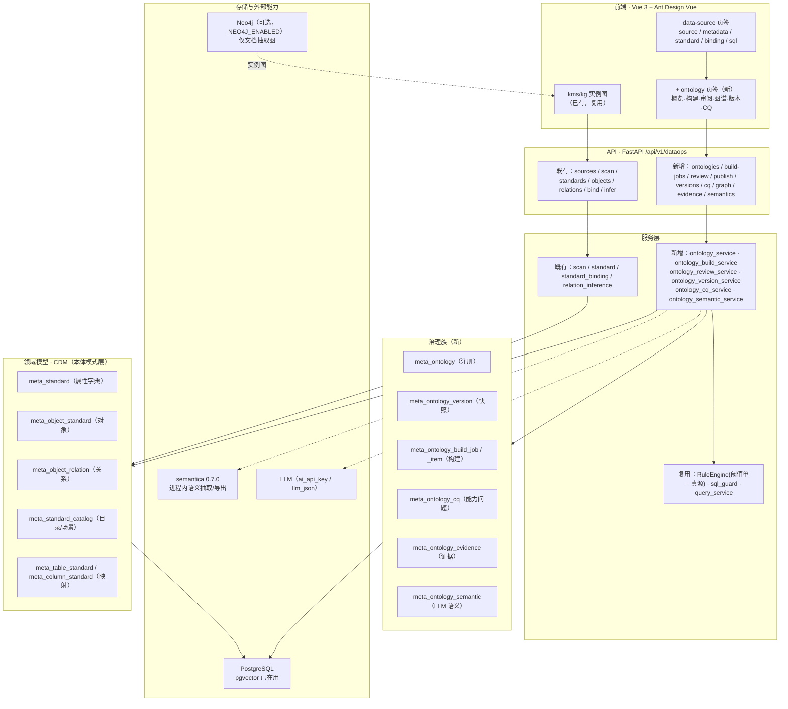
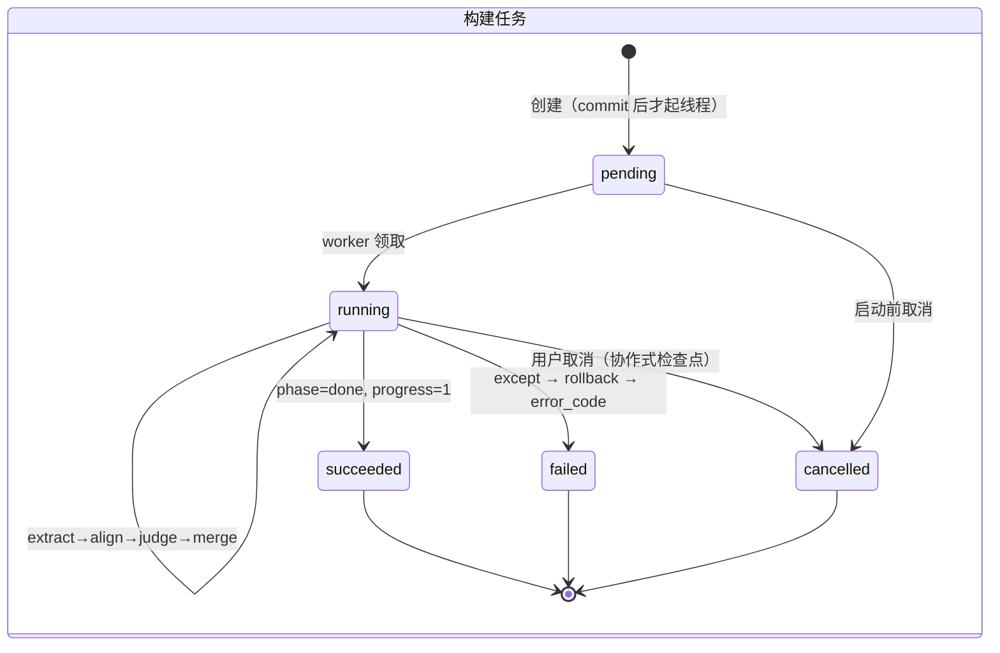
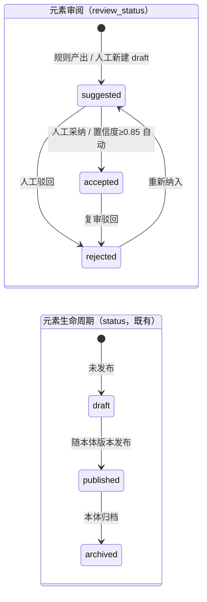
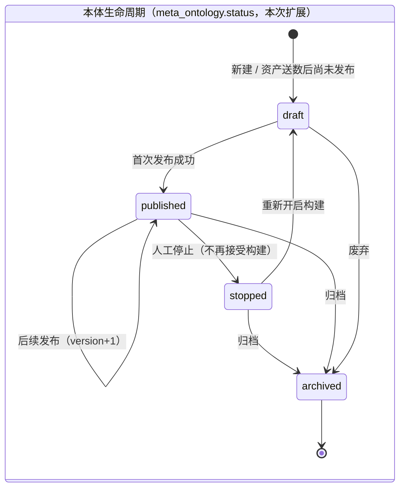
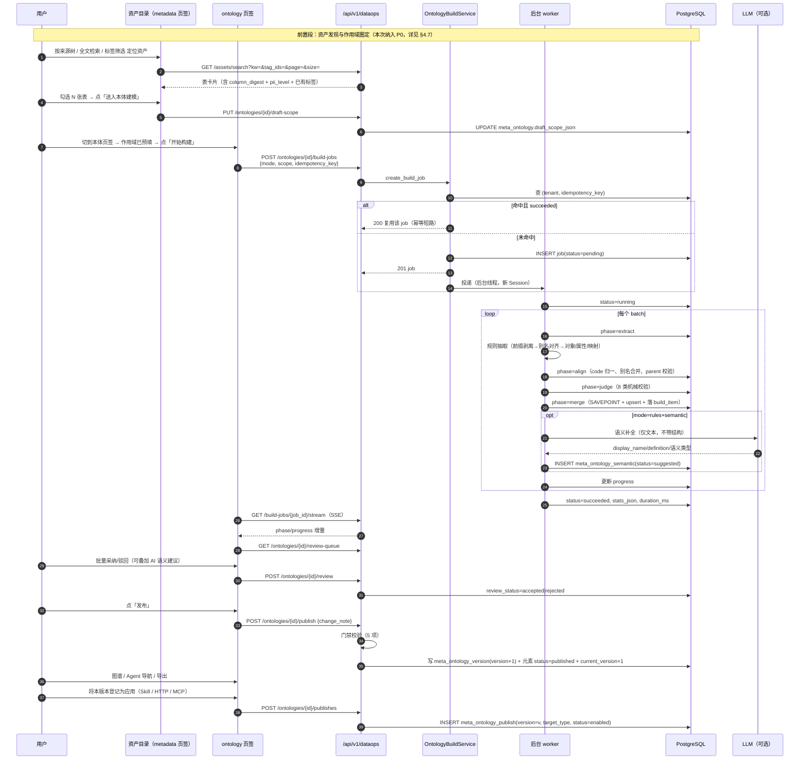
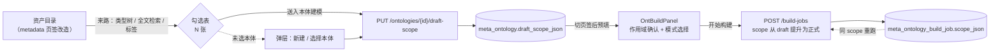
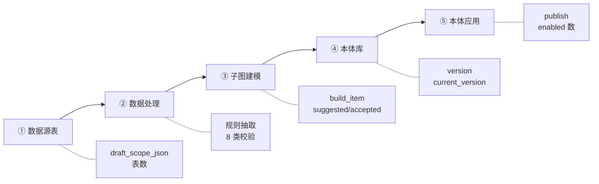
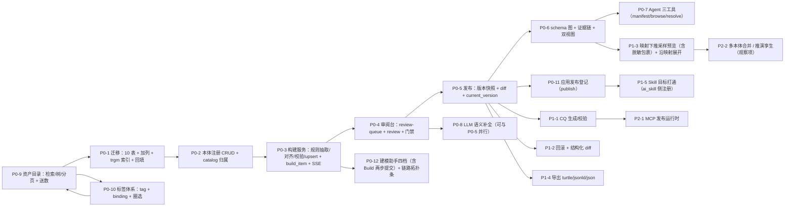

# MinWorkBuddy 本体能力设计方案

> 日期：2026-10-31 · 状态：**待评审**
> 基准：`docs/ontoflow/ontoflow.md`（OntoFlow 产品定位与端到端流程）
> 参考：`docs/ontoflow/ontomind.md`（OntoMind 代码级走读，含 15 条风险与 12 条差距）
> 原型：`docs/prototypes/ontology-capability-preview.html`
>
> **阅读约定**：全文对现状描述一律标注依据；凡属推断、假设、未验证的内容，集中在 §8 并显式标记，正文不做断言。

---

## 0. 已定调的四个决策

| # | 决策 | 内容 | 影响 |
|---|---|---|---|
| D1 | **CDM 升格为本体模式层** | 不重建 `ontology_object_type / ontology_property / ontology_link_type`，以既有 `meta_object_standard / meta_standard / meta_object_relation` 作为本体模式层 | 规避本工程**第三次**重复建设（第一次：2026-09-10 自研九表；第二次删除见 §8.1-F2） |
| D2 | **实例不落库，映射下推源库** | 本体只描述结构与映射，不复制业务数据；图与问数由映射驱动下推 SQL | 消除 PII 驻留与同步一致性风险；代价是跨源大图遍历受限 |
| **D3**<br>**(rev.2)** | **LLM 可产出结构候选，但只能以未采纳态进审阅台** | 除语义补全外，LLM 可经助手 **Build 档**生成对象/属性/关系/映射**候选**，一律落 `meta_ontology_build_item(origin='llm', status='suggested')`；**不得自动 accepted、不得进发布快照、不得绕过人审** | 保留 rev.1 的原意图（结构质量不得由 LLM 静默决定）；代价是 `source` 取值域必须从两值扩为**三值**，且需三层防线替代原有的“物理不可能”（§5.7） |
| D4 | **P0 = 可演示闭环 + 最小 Agent 读面** | 扫描→候选→审阅→发布 v1→图查看→1 个只读语义导航接口 | `docs/superpowers/specs/` 期即可验收，不拖到二期 |

> **D3 修订记录（全文唯一一次决策变更）**：四个决策原于 2026-10-31 定调。§10 Q4（对话式 Build 档）暴露出“三档助手无法演示一句话建完”与“引入 Build 会触碰 D3”的取舍，**用户当日明确选择“加 Build 档”并授权修改 D3**；同时 §10 Q5 选择 **P0 不降档**。D1 / D2 / D4 **未作任何变更**。
>
> 被替代的原表述（保留可追溯）：
>
> ~~D3（rev.1）：LLM 只做语义补全 + 审阅提示——候选**结构** 100% 来自规则；LLM 只产出 display_name / definition / 语义类型 / 同义词 / 审阅风险提示；`source` 字段天然不会错标，从根上规避 OntoMind R4。~~
>
> **变更带来的新风险面**：rev.1 的价值在于“LLM 不碰结构 → 物理上不可能错标”。rev.2 取消该前提后，同一保证必须改由三层机制提供：① `source` 三值枚举 + CHECK 约束；② 人工采纳时**改写** `source` 为 `human`；③ 发布门禁断言快照内无 `llm_draft`。详 §5.7。
>
> **仍然保留的不变量**（修订前后均成立）：结构候选不会自动变为已采纳；发布快照只含 `accepted`；助手不得触发构建/审阅/发布三类写操作。

---

## 1. 目标与范围

### 1.1 目标

把 MinWorkBuddy 已有的"数据接入 + 标准中心 + 关系推断 + 实例图谱"补成一条**可运行的本体资产链路**：

> 资产发现 → 作用域圈定 → 规则产出候选 → 人工审阅 → 发布版本 → 图 / 查询 / Agent / 应用 消费

> **修订说明（2026-10-31 增量）**：原链路从「数据源扫描」起步，跳过了 OntoFlow 「四、数据资产」承担的**发现与圈定**环节。经功能点比对（见 §1.4），MinWorkBuddy 现有的资产浏览与建模入口**方向相反**——只有「标准检视 → 元数据浏览」的反向下钻，没有「资产勾选 → 建模作用域」的正向送数。本次将前置两段纳入 P0。

一句话验收标准：**给定一个新接入的库，可在同一页面内从扫描走到"发布 v1"，并让 Agent 通过一个只读接口问到"这个本体里有什么对象、哪些对象之间有映射关系"。**

### 1.2 能力边界

| 做（本期） | 不做（明确排除） | 原因 |
|---|---|---|
| 本体注册（多本体、租户隔离、命名空间） | **跨本体**合并入库（多个本体合成一个本体库） | 跨本体合并涉及冲突仲裁与命名空间改写，P2 再议。**修订**：原表述「多本体合并入库」误把 AF-19 的「同本体多子图汇入本体库」当作跨本体操作，故把子树选择性发布移入「做」列 |
| 同本体内按 catalog 子树**选择性发布**（= AF-19「子图合并入库」的等价实现） | 逐字段级差异审阅（filediff） | 收益低于成本，版本 diff 用计数+变更清单 |
| **资产全文检索（表名/字段/注释）+ 标签体系 + 跨源统一目录**（AF-01/02/03/04） | 数据湖式全量元数据爬虫 | 只覆盖已接入源，不新增采集通道 |
| **资产勾选 → 建模作用域**（AF-08，正向送数） | 可视化算子编排画布（拖拽 DAG 数据处理） | AF-10 的「数据处理」节点；MWB 走规则+SQL，不做通用 ETL 编排。以 §6.6 只读链路拓扑图补偿观测 |
| 构建任务（分批、断点、幂等、取消、**单表重跑**） | 算子级「执行节点 / 单独执行」试跑 | 同上；单表重跑已由 `scope.tables[]` 支持，本期仅补前端入口 |
| 规则候选 + LLM 语义补全 + **LLM 结构候选（Build 档）** | LLM 候选被**自动采纳**或**直接进入发布快照** | 决策 **D3 rev.2**；LLM 候选一律 `origin=llm, status=suggested`，见 §5.7 |
| **嵌入式建模助手（Ask / explain / propose-scope / build 四档）** | 助手自行触发构建、审阅或发布 | D3 rev.2；`build` 档只产出**未采纳候选**，前三档零结构写入 |
| 统一审阅台（对象/属性/关系/映射四类同台，**六类元素筛选**） | 候选版本与正式版本物理隔离（EvoOntology `vN-cK` 目录） | 见 §3.2 说明：用 `review_status` 等效隔离，不做双真源 |
| 版本快照 + 发布门禁（**5 项**）+ 回滚 | 开发态一键丢弃（`discard-draft`） | 误删风险高，P2 评估 |
| **映射继承脱敏**（下推 SQL 按 `mask_rule` 包裹列） | 行列级**视野**引擎、资产**可见性**开关 | 需接入 `sys_*` 角色体系；§10 Q1 **已裁决 A：本期不做** |
| 图可视化（schema 图 + **流程拓扑双视图**，可选下推采样预览） | 全量实例大图 / 千万节点图遍历 | 决策 D2 |
| CQ 生成 + 可执行性校验 | CQ 自动生成 SQL 并执行 | 问数走既有 `query_service` + `sql_guard`，CQ 只做覆盖度与可达性校验 |
| Agent 只读语义导航（browse / resolve / manifest） | 本体写操作对 Agent 开放 | 写操作必须人审 |
| **本体应用发布登记（Skill 目标落地）** | 类型转换函数、派生属性、可执行行动 | AF-13/AF-15 的 `Last/Max/GeoshapeLast` 与 `recoverSupply` 需实例物化才能求值，与 D2 冲突；§10 Q3 **已裁决：本期非目标，P1 评估声明式派生属性，行动永久不做** |
| Turtle / JSON-LD / JSON 导出 | OWL 推理机、完整 SHACL 校验 | 需要 `pyshacl` 与形状语言，收益不足 |
| — | **推演沙盘、孪生应用** | 依赖实例物化 + 世界模型，与 D2 冲突；列为 P3 观察项 |
| — | 本体发布为 **MCP Server** 运行时 | `meta_ontology_publish.target_type` 预留 `mcp` 取值，P2 实现 |

### 1.3 与 OntoFlow 的对标关系

| OntoFlow 模块（§） | OntoFlow 关键能力 | MinWorkBuddy 本期 | 差异与理由 |
|---|---|---|---|
| 三、数据摄取 | 多源接入、自动采集表结构/字段/关系 | **已具备**：`meta_data_source` / `meta_scan_job` / `meta_table` / `meta_column`，方言适配器 + 画像 | 复用，不改 |
| 四、数据资产 | 按来源浏览、全文检索、字段说明/样例/关联 | **已具备**：`MetadataExplorer.vue` + `scan_service` 画像 | 复用 |
| 五、本体建模 | 数据源表 → 数据处理 → 子图建模 → 本体库 → 本体应用 | **本期补全**：CDM 三层已有，缺"子图建模→本体库"的作业与版本 | 不做"数据处理"画布，规则即处理 |
| 五、本体库（权限/视野/脱敏） | 映射数据时带权限、视野、脱敏 | **部分**：`security_level` / `pii_level` / `mask_rule` 已在标准与字段上 | 本期只做"映射继承脱敏标记"，不做行列级视野引擎 |
| 五、本体应用（Skill/接口/MCP） | 一条查询同时给页面/接口/Skill/MCP | **P2**：先落地只读语义导航；Skill/MCP 发布仅留签名 | Agent 侧已有工具注册体系（`ai_tools` / `ai_skill`），P2 接入 |
| 六、推演沙盘 | 克隆世界状态、施加行动、检查点/分支 | **不做** | 需实例物化 + 因果传导引擎 |
| 七、孪生应用 | 拖拽指标/告警/图表、绑定本体查询 | **不做** | 依赖推演与实时物化 |
| 八、知识库 | 文档解析、混合检索、挂到探索/智能体 | **已具备且更强**：`kms_*` + `kg_*` + 多模态 + 混合检索 | 已有，不属本方案 |
| 九、图可视化 | 节点/关系筛选、点选属性、沿关系展开 | **本期补**：schema 图 + 映射展开；实例图复用 `views/kms/kg/` | 实例图已有，schema 图为新增 |
| 十、系统设置 | 多模型、MCP、角色、令牌、定时任务 | **已具备**：`ai_api_key` / `ai_mcp` / `sys_*` | 复用 |
| 一、二、探索与智能体 | 统一 AI 工作台、可发布智能体 | **已具备**：AgentScope 2.x 原生 + `agent_*` / `assistant` | 复用；本期只新增只读语义工具 |

### 1.4 OntoFlow 功能点清单（「四、数据资产」+「五、本体建模」）

> **证据等级说明**：`docs/ontoflow/images/` 下 img08–img11 四张配图**均可直接读取**，因此本清单主体为「截图实证」。凡只能从正文条目或图注推出的，标为「正文实证」或「**依据文字描述推断，非截图实证**」，二者不得混用。

#### 板块四：数据资产（img08）

| # | 功能名称 | 用户可见操作与产出 | 上游依赖 | 下游影响 | 证据等级 |
|---|---|---|---|---|---|
| AF-01 | 按来源分类的资产目录 | 左侧类型树分 9 组（关系型/时序/数仓大数据/图数据库/NoSQL 键值/向量库/搜索引擎/文件资源/API-SaaS），组下挂具体连接（`MySQL-20260224`）带表数角标；点选切换右侧清单 | 三、数据摄取的连接注册与采集结果 | 决定可被建模圈选的资产全集 | **截图实证** img08 |
| AF-02 | 资产全文检索 + 重置 | 顶部「请输入搜索内容」+ 查询 / 重置；命中范围含表名与字段行内联的 `COMMENT` 文本 | 已入库的表名/字段名/注释 | 检索结果可直接进 AF-08 送数 | **截图实证** img08 |
| AF-03 | 标签体系（新建 + 按标签筛选） | 「按标签筛选」下拉 + 「新建标签」入口；卡片右上角 `测试`/`可见`/`编辑` 为独立操作 | 人工或规则打的资产标签 | 标签可作为建模作用域的圈选条件 | **截图实证** img08 |
| AF-04 | 来源维度过滤下拉 | 「全部」下拉（与标签筛选并列），推测为对象类型/来源类型维度 | AF-01 的分类树 | 收窄清单 | 控件**截图实证**；**下拉选项内容依据文字描述推断，非截图实证** |
| AF-05 | 表卡片：字段与注释内联摘要 | 每张卡片显示表名 + 一行拼接的 `字段名 类型 COMMENT '...'` 串，不展开即可初判语义 | `meta_column` 的列名/类型/注释 | 支撑 AF-02 的"不点开就能看懂" | **截图实证** img08 |
| AF-06 | 卡片级操作：测试 / 可见 / 编辑 | `测试`（仅 3/5 张卡片出现，推断为可读性探活）、`可见`（资产可见性开关）、`编辑`（改元数据/说明） | 连接凭据可用；权限体系 | `可见` 影响下游可发现性 | 三按钮**截图实证**；`测试` 语义**依据文字描述推断，非截图实证** |
| AF-07 | 清单分页 | 页码 + 「前往 N 页 / 共 5 条」 | — | 大规模目录下的可用性 | **截图实证** img08 |
| AF-08 | 资产直接作为建模数据来源 | 正文：「查看字段说明、样例与关联，**直接作为本体建模的数据来源**」 | AF-01~05 | 五、本体建模的作用域入参 | 正文**实证**；但**送数按钮/交互界面截图未见，其具体形态依据文字描述推断，非截图实证** |

#### 板块五：本体建模（img09 / img10 / img11）

| # | 功能名称 | 用户可见操作与产出 | 上游依赖 | 下游影响 | 证据等级 |
|---|---|---|---|---|---|
| AF-09 | **建模工程列表**（一个流程 = 一个软件） | 四页签 `工作流程 / 已发布 / 运行任务 / 数据接入`；搜索 + 全部 + 「更新时间（新到旧）」排序 + 右上「添加」；卡片带状态徽标（`已停止`/`草稿`）、描述、`设计`/`场景`/`任务(N)` 标签、`…` 菜单；分页「共 28 条 / 12条页」 | AF-08 的数据来源 | 每个工程是独立可发布对象 | **截图实证** img11 |
| AF-10 | 五步固定链路 | `数据源表 → 数据处理 → 子图建模 → 本体库 → 本体应用`，走完一条即交付 | AF-01/08 | 定义全流程契约 | 正文**实证**；画布节点（数据源/数据处理/本体建模）为 **截图实证** img09 |
| AF-11 | 可视化画布：节点与连线 | 左侧网格画布，四色节点（蓝=数据源表、绿=数据处理、紫/橙=对象与关系、灰=本体库汇聚节点），曲线连线带关系名（`TRIGGERS`/`USED_CARD`/`INITIATED_BY`/`LINKED_DEVICE`） | AF-10 | 结构可视可解释 | **截图实证** img09 / img10 |
| AF-12 | 双模式 + 三视图切换 | `业务模式 / 画布模式` 分段控件；`本体工作流程 / 架构本体设计 / 其他操作` 三个 pill | — | 同一工程两种读法 | **截图实证** img09（工作流程）/ img10（架构本体设计） |
| AF-13 | 属性映射表（含类型转换与聚合函数） | 四列表格 `属性 / 原类型 / 新类型 / 函数`；示例 `geo Geoshape → Geoshape(...) → GeoshapeLast`、`reliability_score Double → Max`、`supplier_id String → Last` | 数据源字段类型 | 产出派生属性与聚合语义 | **截图实证** img09 |
| AF-14 | 元素类型筛选 + 查看 Schema | chips `属性/类型/函数/行动/派生/安全…` + 「查看Schema」+「刷新」；上方还有「执行节点」「单独执行」 | AF-13 | 定位单类元素 | **截图实证** img09 |
| AF-15 | 行动 / 失效规则 / 属性脱敏规则配置 | 「推演过程约束 5 可配置」折叠区；`选择分组`、`选择行动`（已选 `recoverSupply × +1`）、`失效规则 添加失效规则…`、`属性脱敏规则 添加脱敏规则…` | 本体库权限/脱敏设置 | 可执行业务动作 + 敏感属性脱敏 | **截图实证** img09 |
| AF-16 | 画布内置 AI 工作台（四档） | 右侧 Dock：`AI工作台 / 查询验证 / 推演验证` 三页签；说明文「OntoFlow 会根据你的目标自动选择工作方式：**Ask 查询检查、Plan 规划拆解、Agent 完成当前任务、Build 完整构建**。也可在下方手动覆盖」；输入框 + 上下文 chip（`子图建模_Sup…`/`本体建模_信用…`）+ 底栏 `自动▾ 数据表 知识库 常用指令 发送` | 当前画布上下文 | 可反向生成配置与代码 | **截图实证** img09 / img10 |
| AF-17 | 本体应用 → Skills 管理 | `基本信息/本体应用/Skills/MCP服务/指南` 页签；「管理可复用的 Skill，共 3 个」+「创建 Skill」；Skill 卡片含名称、描述、`workflow` 标签、`cs_risk_ops · 2 个 Tool · 2026/09/13 23:20:43`、按钮 `自动判断`/`智能体`；分页 | 已发布本体版本 | 高频业务逻辑复用 | **截图实证** img10 |
| AF-18 | 本体应用 → MCP 服务 | 与 Skills 并列的 `MCP服务` 页签 | 已发布本体版本 | 对外供 MCP 工具 | 页签存在**截图实证**；页内内容未见，**能力细节依据文字描述推断，非截图实证** |
| AF-19 | 多子图合并入本体库（带权限/视野/脱敏） | 正文：「多子图合并入库，带上权限、视野与脱敏」 | AF-11 的子图 | 统一本体库 | 正文**实证**；`属性脱敏规则` 配置项**截图实证**，**权限与视野界面依据文字描述推断，非截图实证** |
| AF-20 | 顶部生命周期动作 | `保存` / `流式未启动▾` / `清空开发态` / `发布`（绿色主按钮） | 画布当前态 | 开发态→发布态 | **截图实证** img09 / img10 |
| AF-21 | 算子级试跑 | 「执行节点」「单独执行」按钮 | 单个处理节点 | 局部验证 | 按钮存在**截图实证**；**执行语义依据文字描述推断，非截图实证** |
| AF-22 | 一次查询多端消费 | 正文：「同一条查询可同时被探索、智能体、推演沙盘和孪生应用使用」 | 已发布本体 | 四端复用同一语义 | 正文**实证**，非截图 |

> **图注纠偏**：`ontoflow.md:95-97` 把 img11 写作「已落地/正在实施的本体项目概览」，但截图实际呈现的是**平台自身的本体建模工程列表页**（含 `工作流程/已发布/运行任务/数据接入` 四页签与「共 28 条」分页），不是对外案例汇总表。这条差异直接产出 AF-09——**建模工程本身是一等可检索、带状态、可发布的对象**，此前按图注理解时被整体漏掉。

### 1.5 三方对照矩阵（OntoFlow × MinWorkBuddy 现状 × 本设计）

现状依据均为本仓库可核查对象；`已具备 / 部分具备 / 不存在` 三档评定。

| OntoFlow 功能点 | MinWorkBuddy 现状（可核查依据） | 设计文档原覆盖 | 缺口性质 | 本次增强与落点 |
|---|---|---|---|---|
| AF-01 按来源分类的资产目录 | **部分具备**：`MetadataExplorer.vue` 为 `source → database → schema` 三级**级联下拉**（L4-L13），非跨源分类树；`sys_dictionary` 已有 `data_source_type` 字典（迁移 `2026_10_28_0001`） | §1.3 记「已具备」，未区分交互形态 | **已覆盖但深度不足** | §6.5 资产目录改为「类型分组 + 连接」双层树；§3.2 复用 `meta_data_source.external_type` 分组，不新建表 |
| AF-02 表/字段/注释全文检索 | **不存在**：`dataops.py` 47 个端点中无检索端点，仅 `GET /sources/{id}/tables`（按 source+db 全量列）；前端 `keywordSearch.ts` 只搜**标准中心**的 code/name/别名，不搜元数据 | 未覆盖 | **缺失** | §6.1 E28 `GET /assets/search`；§3.6 建 `pg_trgm` GIN 索引（**注意 §8.1-F19 的 CJK 约束**） |
| AF-03 标签体系 | **不存在**：全 `app/models` 下无任何 `*tag*` 表（已 grep 确认）；`MetadataExplorer.vue:181` 仅把 `table_comment` 塞进树节点的 `tag` 字段做展示 | 未覆盖 | **缺失** | §3.2 新增 `meta_asset_tag` + `meta_asset_tag_binding`；§6.1 E29-E32 |
| AF-04 来源维度过滤 | **部分具备**：`isPgFamily` 分支（L11）按方言族切 schema 选择器，但无「全部类型」下拉 | 未覆盖 | 部分覆盖 | §6.5 目录树节点即过滤维度，不单设下拉 |
| AF-05 字段与注释内联摘要 | **部分具备**：`meta_column.column_comment` 入库且列表面板可展开 `profile_json`（L42-45），但需先选中表，无列表内联串 | 未覆盖 | 部分覆盖 | §6.5 搜索结果卡片返回 `column_digest` 字段（服务端拼接） |
| AF-06 测试 / 可见 / 编辑 | **部分具备**：`POST /sources/test`、`/sources/{id}/test` 已有连接级探活，**无表级测试**；可见性无；编辑走 `PUT /standards/*` | 未覆盖 | 部分覆盖 | 表级探活列 P1；可见性涉权限体系 → **§10 Q1 已裁决 A：本期不做（不建 `visibility` 列）** |
| AF-07 分页 | **不存在**：`GET /sources/{id}/tables` 无分页参数，前端全量渲染 | 未覆盖 | 缺失 | §6.5 目录接口强制 `page/size`（默认 50，上限 200） |
| AF-08 资产 → 建模作用域 | **方向相反**：仅有 `StdInspector` → `MetadataExplorer` 的反向下钻（`DataSourcePanel` 的 `@drill-down`）；`focusScope.ts` 是**图视图聚焦**而非建模作用域 | §1.1 原链路从「数据源扫描」起步，跳过此段 | **缺失（主链路断点）** | §4.7 新增前置段；`meta_ontology.draft_scope_json` 承载作用域草稿；§6.5 送数动作 |
| AF-09 建模工程列表 | **不存在等价物**：`meta_ontology` 是注册表而非"流程实例"，无状态机/无排序检索/无四页签 | §3.2 只设计为注册表 | 部分覆盖 | §3.2 给 `meta_ontology.status` 补 `stopped` 取值；§6.3 本体切换器升级为带状态列表；E1 扩展 `?status=&keyword=&sort=`；**是否升格为独立“建模工程”实体 → §10 Q2 已裁决 A：不升格，并由此把“一个本体只有一份未发布作用域”升为显式约束** |
| AF-10 五步固定链路 | **部分具备**：五步中「数据源表/子图建模/本体库」有对应实现，「数据处理」无、「本体应用」无 | §1.2 明确「不做数据处理画布」 | 已覆盖但深度不足 | §6.6 只读**链路拓扑视图**呈现五步进度；数据处理以规则+SQL 等价实现 |
| AF-11 画布节点与连线 | **部分具备**：`StdGraphView.vue`（vue-echarts graph）+ `OntGraphView`（§6.3 设计）为 schema 图，**只读展示非编辑画布** | §6.3 已设计 | 已覆盖但深度不足 | 维持只读图；拖拽建对象列 P2（与 D1 无冲突，但收益低） |
| AF-12 双模式三视图 | **不存在** | 未覆盖 | 缺失 | §6.6 以「工作流程视图 / 架构视图」两档轻量实现（同一数据两套布局），不引入业务模式 |
| AF-13 类型转换与聚合函数 | **部分具备**：`meta_standard.data_type_expect` 有期望类型，`meta_column_standard` 有绑定；**无转换函数与聚合语义载体** | §1.2 列为非目标 | 明确列为非目标 | 维持非目标；**与 D2 的冲突与代价 → §10 Q3 已裁决 A：本期非目标，P1 评估声明式派生属性（闸门 U13）** |
| AF-14 元素筛选 + 查看 Schema | **已具备（等价）**：`/standards/graph`、`/standards/stats` 已有；§6.1 E16/E17 覆盖 | §6.1 已覆盖 | 已覆盖 | 补 chips 级筛选（前端过滤，不加端点） |
| AF-15 行动 / 失效规则 / 属性脱敏 | **部分具备**：`meta_standard.mask_rule String(200)`、`security_level L0-L3`、`meta_column.pii_level L0-L3`、`*_override` 三处齐备；**行动与失效规则无** | §1.3 只写「本期只做映射继承脱敏标记」 | 部分覆盖 | §4.5 新增**门禁第 5 项脱敏覆盖**；§4.6 下推 SQL 按 `mask_rule` 包裹列；行动列非目标（§10 Q3 已裁决：行动**永久不做**，与 D2 直接冲突） |
| AF-16 AI 工作台四档 | **部分具备**：`POST /standards/nl-query` 已有自然语言查询；`app/ai/` 有完整工具与 Agent 体系；**画布内无 Dock、无 Ask/Plan/Agent/Build 分档** | §5 只覆盖批量语义补全，未覆盖对话式 | 缺失 | §5.6 定义 **Ask / explain / propose_scope / build 四档**（Build 经 §10 Q4 用户授权引入，代价为修改 D3 → D3 rev.2）；**E37 单端点两步 commit**（预览→确认）；三层防线 §5.7 |
| AF-17 Skills 管理 | **已具备（平台级）**：`backend/data/skills/` 229 个技能目录 + `ai_skill` 体系；**但本体侧无发布登记** | §1.3 记「P2 仅留签名」 | 部分覆盖 | §3.2 新增 `meta_ontology_publish` 登记表；§6.1 E34-E36 登记/启停；**Skill 目标落地提前到 P0 登记、P1 打通** |
| AF-18 MCP 服务发布 | **已具备（平台级）**：`ai_mcp` 体系存在；本体侧无 | §1.2 预留 `target_type=mcp` | 已覆盖但深度不足 | 沿用预留；P2 实现 |
| AF-19 多子图合并入库 | **等价可实现**：`meta_standard_catalog` 树 + `ontology_id` 归属（§3.1）天然支持按子树选择性发布 | §1.2 已把「子树选择性发布」列入「做」 | 已覆盖 | 无需新增；§4.5 门禁补「子树内无 suggested」 |
| AF-20 保存/清空开发态/发布 | **部分具备**：发布与版本已设计（§4.5）；**清空开发态**无 | §1.2 明确不做 `discard-draft` | 明确列为非目标 | 维持不做；提供**按 job 撤销未发布候选**（P1，风险可控） |
| AF-21 算子级试跑 | **不存在**（无算子编排） | §1.2 列为非目标 | 明确列为非目标 | 以「单表重跑」（`scope.tables[]`）作为等价最小实现，本期仅补前端入口 |
| AF-22 一次查询多端消费 | **部分具备**：`query_service` + `sql_guard` + Agent 工具注册可复用；推演/孪生端不存在 | §4.6 覆盖 图/问数/Agent/导出 四端 | 已覆盖但深度不足 | §4.6 增「应用端」一行（经 `meta_ontology_publish`）；推演/孪生维持非目标 |

**汇总**：22 个功能点中，**缺失 6**（AF-02/03/07/08/12/16）、**部分覆盖 6**（AF-04/05/06/09/15/17）、**已覆盖但深度不足 5**（AF-01/10/11/18/22）、**已覆盖 2**（AF-14/19）、**明确列为非目标 3**（AF-13/20/21）。本次把 **AF-02/03/07/08/12/16 六项 + AF-15 脱敏门禁 + AF-17 发布登记** 共 8 项补入 P0，其余按 §7 分期或维持非目标。

---

## 2. 总体架构

### 2.1 分层



### 2.2 与既有体系的集成关系

| 集成对象 | 关系 | 落点 |
|---|---|---|
| 数据接入 | 构建任务的 `scope` = `{source_id, db_name, database, tables[]}`，直接读 `meta_table` / `meta_column` | `scan_service` 产出即候选来源，零改造 |
| 标准中心（CDM） | 本体**就是** catalog 子树下的一组对象/关系/属性标准；候选写入 CDM 表（`review_status=suggested`） | `standard_cdm.py` 加 1 列 `ontology_id`、2 列 `review_status` |
| 绑定链路 | 表→对象、列→属性绑定即"映射"；关系校验（hit/missing/conflict）作为发布门禁的一项证据 | `standard_binding_service.bind_source` 复用 |
| 关系推断 | `meta_relation` 三路投票即"关系候选"来源之一 | `relation_inference_service` 复用 |
| 实例图谱 | `kg_entity.type_code → meta_object_standard.code`、`kg_triple.relation_code → meta_object_relation.code` **保持不变** | 既有引用不需迁移 |
| semantica | 定位为**导出与可选抽取后端**，不再是本体真源；`TenantScope.ontology_code` 改为读 `meta_ontology.code` | `services/semantica/scope.py` 由裸字符串改注册表真源 |
| AgentScope / Agent | 新增 3 个只读工具（见 §6.4），走既有 `ai_tools` 注册体系 | `app/ai/tools/ontology_tools.py` |
| 权限 / 租户 | 所有新表继承 `TenantMixin`；服务构造要求 `tenant_id`，无租户拒绝（对齐 `MetaStandardCatalogService` 现状） | 见 §8.1-F12 |
| 图可视化 | schema 图用 `vue-echarts`（已在依赖，`StdGraphView` 已用）；实例图复用 `views/kms/kg` | 前端零新依赖 |

### 2.3 技术栈与分层约定（沿用现状，不新发明）

- **API**：`APIRouter` + 显式清单注册（`app/core/router_registry.py`），dataops 一组已注册，新端点并入同一 router，不新增挂载项。
- **服务层**：类式服务，构造注入 `db: Session` + `tenant_id`，服务内 `flush()`，事务边界由路由层控制。
- **模型**：`Base, TenantMixin`，`BigInteger` 主键、`JSONB` 扩展字段、`TIMESTAMP server_default=func.now()`、具名约束与索引（对齐 `standard_cdm.py` 风格）。
- **迁移**：Alembic，单 revision，建表前查 `information_schema` 保证幂等，`downgrade` 逆序 drop（对齐 `2026_10_28_0003`）。
- **前端**：`a-tabs` 内嵌视图、`vue-echarts` 图、i18n key 落 `kbMgmt.ontology.*`。

### 2.4 存储职责边界

| 存储 | 职责 | 不承担 |
|---|---|---|
| PostgreSQL | 本体结构、映射、治理元数据、版本快照、证据、CQ | 不存业务实例行（D2） |
| Neo4j（可选） | 仅文档抽取实例图（既有 `kg_neo4j_store`） | 不作为本体结构真源 |
| semantica | RDF 导出、可选 NER/关系抽取辅助 | 不作为本体结构真源、不承担版本与审阅 |

> **为什么不把本体放进 semantica/Neo4j**：CQ、审阅、版本、证据、幂等构建这些治理能力 semantica 均不提供（§8.3-U3），且引入第二套存储会破坏现有事务边界与 `kg_*` 引用链。

---

## 3. 领域模型与状态机

### 3.1 既有模型（复用，仅加列）

| 表 | 角色 | 本次改动 |
|---|---|---|
| `meta_standard` | 属性标准（全局复用字典） | 加 `review_status`、`reviewed_by/at` |
| `meta_object_standard` | 对象标准（本体类） | 加 `review_status`、`reviewed_by/at`、`confidence`、`evidence_ref`、**`source String(16) NOT NULL DEFAULT 'rule'` + CHECK**(rule\|human\|llm_draft) |
| `meta_object_standard_attribute` | 对象↔属性 M2M | 加 `review_status` |
| `meta_object_relation` | 关系标准（本体关系） | 加 `review_status`、`reviewed_by/at`、`confidence`、`evidence_ref`、**`source` 同上（D3 rev.2 新增）** |
| `meta_standard_catalog` | 目录/场景树 | **加 `ontology_id`**（可空 = 未归类） |
| `meta_table_standard` / `meta_column_standard` | 映射（表→对象 / 列→属性） | **不加列**，但需收敛：列注释由 `rule\|llm\|human` 改为 **`rule\|human\|llm_draft`** + 同枚举 CHECK + 服务入口断言（原“收敛为 `rule\|human`”方案因 D3 rev.2 作废） |
| `meta_relation` | 推断关系（三路投票） | 不改 |
| `meta_table` / `meta_column` | 资产元数据 | **不改列**，仅新增 4 个 `pg_trgm` GIN 索引（见 §3.6）以支撑 AF-02 全文检索 |
| `meta_data_source` | 数据源 | 不改；AF-01 的分类树直接复用其 `external_type` + `sys_dictionary.data_source_type`（已核：迁移 `2026_10_28_0001_seed_data_source_type_dict.py`） |

**为什么"加 `review_status` 而不是复用 `status`"**：现状三套词表并存（`draft|published`、`suggested|accepted|rejected`、`suggested|active|deprecated`，见各 model docstring）。`status` 已被标准中心与绑定链路当作**生命周期/可消费性**使用（如关系校验只认 `published` 的 `meta_object_relation`）。新增 `review_status` 表达**人审结论**，两轴解耦；`status` 语义不变，标准中心与绑定链路零回归。

> **本次核查修正（因 D3 rev.2 才暴露）**：原 §5.1 断言“`meta_object_standard.source` / `meta_object_relation.source` / `meta_column_standard.source` 的取值域固定为 `rule|human`”，但已核 `MetaObjectStandard`（`backend/app/models/dataops/standard_cdm.py:40-62`）与 `MetaObjectRelation`（同文件 `84-109`）**根本没有 `source` 列**（只有 `code/name/status/current_version/creator_id` 等）。即：这两张表上的来源约束是**不存在的列上的约束**，原表述不可执行。
>
> 已核存在 `source` 列且注释含 `llm` 的三张表：`meta_column_standard`（`standard.py:94`，`String(32)`，`server_default="human"`，注释 `来源: rule|llm|human`）、`meta_table_standard`（`standard_cdm.py:123`，注释 `rule|llm|human`）、`meta_standard`。**均无 DB 层 CHECK**，即当前任何人都可写入 `llm`。
>
> 后果：D3 rev.1 下只需“改注释”的轻方案不再成立 —— 要区分 LLM 来源，**必须先建列**（对象/关系两张表），再统一三值枚举与 CHECK（全部五张表）。这是本项决策变更的主要数据层代价。

### 3.2 新增 10 张治理表（原 7 张 + 本次因功能点比对补入 3 张）

> **本次新增的 3 张**：`meta_asset_tag`、`meta_asset_tag_binding`（补 AF-03 标签体系缺口）、`meta_ontology_publish`（补 AF-17/AF-18 本体应用发布登记缺口）。其余 7 张不变。

#### `meta_ontology`（本体注册）
| 列 | 类型 | 说明 |
|---|---|---|
| `id` | BigInteger PK | |
| `tenant_id` | BigInteger | TenantMixin |
| `code` | String(64) | 租户内唯一，同时作为 `TenantScope.ontology_code` |
| `name` / `description` | String(200) / Text | |
| `namespace_uri` | String(255) | RDF 导出用，默认 `urn:mwb:ontology:{code}` |
| `status` | String(16) | `draft` / `published` / `archived`；**本次补 `stopped`** 以承载 AF-09 的「已停止」徽标（停止=不再接受构建，但历史版本仍可消费） |
| `current_version` | Integer | 0 = 未发布 |
| `root_catalog_id` | BigInteger FK→`meta_standard_catalog.id` | 可空：本体的目录根（归属锚点） |
| `draft_scope_json` | JSONB | **本次新增**：AF-08 送数后的**作用域草稿**，形状同 `build_job.scope_json`；使“勾选资产 → 离开页面 → 回来仍能构建”成立 |
| `publish_targets_json` | JSONB | P2 预留：`["skill","mcp","http"]`，本期不实现运行时（发布登记本体已拆至 `meta_ontology_publish`，本列降为兼容缓存） |
| 审计 | | `creator_id / updater_id / created_at / updated_at` |

约束：`UniqueConstraint("tenant_id","code") uq_meta_ontology_code`；`Index("tenant_id","status")`。

#### `meta_ontology_version`（版本快照）
| 列 | 类型 | 说明 |
|---|---|---|
| `id` / `tenant_id` | | |
| `ontology_id` | FK→`meta_ontology.id` CASCADE | |
| `version` | Integer | 本体内自增 |
| `snapshot_json` | JSONB | 冻结：对象 / 属性 / 关系 / 映射 / CQ 全量 |
| `diff_json` | JSONB | `{added[], removed[], changed[], regressions[]}`（**含明细，不只是计数**，修 OntoMind §6.3 缺陷） |
| `gate_json` | JSONB | 发布门禁结论：`{passed, checks[], blocked_reasons[]}` |
| `change_note` | Text | |
| `author_user_id` | BigInteger | |
| `created_at` | TIMESTAMP | |

约束：`UniqueConstraint("ontology_id","version") uq_meta_ontology_version`。

> **不做 EvoOntology 式 `vN-cK` 物理隔离的理由**：候选已由 CDM 表的 `review_status=suggested` + `status=draft` 双重隔离——下游消费（导出、关系校验、Agent 导航）一律只读 `review_status=accepted AND status=published`。再加一层候选表会造成"两个真源"，与 D1 冲突。

#### `meta_ontology_build_job`（构建任务）
| 列 | 类型 | 说明 |
|---|---|---|
| `id` / `tenant_id` | | |
| `ontology_id` | FK CASCADE | |
| `idempotency_key` | String(128) | **幂等关键列**（见 §4.2） |
| `mode` | String(16) | `rules`（默认，结构来源 = 规则）/ `rules+semantic`（叠加 LLM 语义补全）。**D3 rev.2 不扩 `mode`**：助手 Build 档的 LLM 结构候选由助手端点直接产 `build_item(origin='llm')`，**不新建也不改写构建任务的 `mode`**（防线理由见 §5.7 约束①） |
| `scope_json` | JSONB | **本次扩展形状**：`{mode:"tables"|"tags"|"catalog", source_id, db_name, database, tables[], tag_ids[], catalog_ids[]}`；`mode=tags` 即 AF-03×AF-08 的“按标签圈范” |
| `status` | String(16) | `pending` / `running` / `succeeded` / `failed` / `cancelled` |
| `phase` | String(16) | `extract` / `align` / `judge` / `merge` / `done` |
| `progress` | Float | 0~1 |
| `stats_json` | JSONB | `{tables, objects_created, objects_updated, properties, relations, mappings, rejected, dropped}` |
| `error_code` / `error_detail` | String(64) / Text | `error_detail` 只存摘要（≤2000），完整轨迹放 item |
| `duration_ms` | Integer | |
| `started_at` / `finished_at` | TIMESTAMP | |

索引：`Index("tenant_id","ontology_id","status")`、`Index("idempotency_key")`。
**不再有 `delta_json` 大字段**（修 OntoMind §4.9 的"每 2s 全量下发膨胀 JSON"）。

#### `meta_ontology_build_item`（候选明细，替代 delta_json）
| 列 | 说明 |
|---|---|
| `job_id` FK CASCADE / `tenant_id` | |
| `batch_index` Integer | |
| `element_kind` String(24) | `object` / `property` / `relation` / `mapping` |
| `element_code` String(200) | 对象 code、`obj.prop`、关系 code |
| `action` String(16) | `insert` / `update` / `skip` / `reject` |
| `origin` String(8) | **本次新增（D3 rev.2）**：`rule` / `llm` —— 候选产出通道；LLM 候选固定 `origin='llm'` 且 `status` 只能为 `suggested`；与结构表 `source` 解耦，供审阅台筛选与丢弃率统计 |
| `delta_json` JSONB | 该条候选的完整载荷（含 display_name/definition/aliases/target） |
| `verdict` String(8) | `pass` / `warn` / `fail` / `no_verdict` |
| `verdict_reason` Text | 来自 8 类机械校验的具体原因 |
| `confidence` Float | 规则置信度（**不含 LLM**） |
| `status` String(16) | `suggested` / `accepted` / `rejected` / `dropped` |
| `element_id` BigInteger nullable | 落库后的元素主键（回填，便于跳转检视） |

约束：`UniqueConstraint("job_id","element_kind","element_code") uq_meta_ontology_build_item`（同任务内同元素只留最终态）。
> **关键**：`status=dropped`/`rejected` 的候选**照样落库**，修 OntoMind §8.1-D4「rejected 不落库、无法复盘」。

#### `meta_ontology_cq`（能力问题）
| 列 | 说明 |
|---|---|
| `ontology_id` / `tenant_id` / `version` | 生成时绑定的版本（0=未发布态） |
| `question` Text / `category` String(32) | 存在性/计数/关系遍历/聚合/时间/条件 |
| `related_codes_json` JSONB | 涉及的对象/关系 code |
| `verify_status` String(16) | `pending` / `passed` / `failed` |
| `verify_detail_json` JSONB | `{concept_hits[], path[], reachable, mapping_coverage}` |
| `source` String(16) | `rule` / `human`（**D3 rev.2 不扩展到 CQ**：Build 档只产结构候选，CQ 的文本表述仍由规则 + 模板生成，LLM 仅可做措辞润色并进 `meta_ontology_semantic`，见 §5.1） |

约束：`UniqueConstraint("ontology_id","version","question"(hash)) uq_meta_ontology_cq`——用 `question_hash String(64)` 列承载，修 OntoMind R9「重复生成 CQ」。

#### `meta_ontology_evidence`（证据，一等公民）
| 列 | 说明 |
|---|---|
| `ontology_id` / `tenant_id` | |
| `element_kind` / `element_code` | 指向对象/属性/关系/映射 |
| `evidence_kind` String(24) | `naming` / `comment` / `profile` / `overlap` / `binding` / `human` |
| `payload_json` JSONB | 可复核原始依据：`{rule, score, matched[], overlap_ratio, sample_tables[]}` |
| `confidence` Float | |
| `created_at` | |

索引：`Index("tenant_id","ontology_id","element_kind","element_code")`。
> 修 OntoMind G9「OT/Property/Mapping 完全没有证据字段」。元素表只存 `evidence_ref`（最新一条 id），全量证据在同表可追溯。

#### `meta_ontology_semantic`（LLM 语义产出，独立落表）
| 列 | 说明 |
|---|---|
| `ontology_id` / `tenant_id` / `build_job_id` | |
| `element_kind` / `element_code` | |
| `field` String(32) | `display_name` / `definition` / `semantic_type` / `aliases` / `review_hint` |
| `value` Text / `aliases_json` JSONB | |
| `confidence` Float | LLM 自评 |
| `model` String(128) / `prompt_version` String(32) | |
| `status` String(16) | `suggested` / `accepted` / `rejected` |
| `created_at` | |

> **这是 D3 的落地形态**：LLM 的输出**永远不写进 `meta_object_standard` 等结构表**，只落本表并由人工显式"采纳"后才回写对应字段。因此 `source` 列（rev.2 起为 `rule\|human\|llm_draft` 三值）中 **`llm_draft` 只允许出现在未发布元素上**：人工采纳时改写为 `human`，发布门禁再断言快照内无 `llm_draft`（§5.7 防线②③）。rev.1 的「物理上不可能错标」在 rev.2 改为「三层机制保证不错标」。

> **修订（本次）**：上述“永不出现 `llm`”是**设计约束而非现状事实**。已核：`meta_column_standard.source` 的列注释当前就写着 `来源: rule|llm|human`（`standard.py:94`），即**取值域定义上允许 `llm`**，只是 `standard_binding_service` 实际只写 `rule`/`human`。因此本方案需额外做一件事：把该列注释**收敛为 `rule\|human\|llm_draft`**（rev.2 取值域）并加同枚举 CHECK 约束 + 服务入口断言，否则后来者可以写入取值域外的 `llm`。详见 §8.1-F17。

#### `meta_asset_tag`（资产标签）——**本次新增**，补 AF-03
| 列 | 类型 | 说明 |
|---|---|---|
| `id` / `tenant_id` | | |
| `code` | String(64) | 租户内唯一，作圈选条件时写入 `scope_json.tag_ids` |
| `name` | String(64) | 展示名 |
| `color` | String(16) | 十六进制色值，前端徽章直接用 |
| `tag_kind` | String(16) | `biz`（主题）/ `security`（敏感分级）/ `quality`（质量）/ `custom` |
| `description` | Text | |
| 审计 | | `creator_id / created_at / updated_at` |

约束：`UniqueConstraint("tenant_id","code") uq_meta_asset_tag_code`；`Index("tenant_id","tag_kind")`。

#### `meta_asset_tag_binding`（标签↔资产绑定）——**本次新增**，补 AF-03
| 列 | 类型 | 说明 |
|---|---|---|
| `id` / `tenant_id` | | |
| `tag_id` | BigInteger FK→`meta_asset_tag.id` CASCADE | |
| `asset_kind` | String(16) | `table` / `column`（与 `meta_table` / `meta_column` 对齐） |
| `asset_id` | BigInteger | 资产主键；**不做外键**，允许元数据重扫后悬空（由 `tag_gc` 清理） |
| `source` | String(16) | `human` / `rule`（规则自动打标，如 `pii_level>=L2 → 敏感`） |
| `created_by` / `created_at` | | |

约束：`UniqueConstraint("tenant_id","tag_id","asset_kind","asset_id") uq_meta_asset_tag_binding`；`Index("asset_kind","asset_id")`（反查某表的全部标签）。
> 不为 `asset_id` 建外键的理由：`meta_table` / `meta_column` 在重扫时会被重建，强外键会连带删掉人工标签——这是 OntoMind 类型“证据随重建丢失”的同构问题，必须一开始就避开。

#### `meta_ontology_publish`（本体应用发布登记）——**本次新增**，补 AF-17/AF-18
| 列 | 类型 | 说明 |
|---|---|---|
| `id` / `tenant_id` | | |
| `ontology_id` | BigInteger FK CASCADE | |
| `version` | Integer | **钉在哪个发布版本**（=0 表示引用草稿态，仅允许 `status=disabled`） |
| `target_type` | String(16) | `skill` / `http` / `mcp`（`http` 为既有 REST 消费入口） |
| `code` | String(64) | 目标侧唯一标识（`ai_skill.code` / MCP 工具名） |
| `name` / `description` | String(200) / Text | |
| `payload_json` | JSONB | `{tools[], input_schema, output_schema, endpoint, usage_hint}` |
| `status` | String(16) | `enabled` / `disabled` |
| 审计 | | `creator_id / created_at / updated_at` |

约束：`UniqueConstraint("tenant_id","target_type","code") uq_meta_ontology_publish_code`；`Index("ontology_id","version")`。
> **不重复建设**：本表只做**登记与绑定**，Skill 运行时仍由既有 `ai_skill` / `ai_tools` 体系承载（已核：`backend/data/skills/` 下 229 个技能目录）。`target_type='mcp'` 本期只存不执行，P2 接 `ai_mcp`。

### 3.3 唯一约束与索引汇总

| 表 | 唯一约束 | 关键索引 |
|---|---|---|
| `meta_ontology` | `(tenant_id, code)` | `(tenant_id, status)` |
| `meta_ontology_version` | `(ontology_id, version)` | `(ontology_id, created_at desc)` |
| `meta_ontology_build_job` | `(tenant_id, idempotency_key)` | `(tenant_id, ontology_id, status)` |
| `meta_ontology_build_item` | `(job_id, element_kind, element_code)` | `(job_id, status)`；**本次新增 `(job_id, origin)`**（§5.7 代价清单最后一行：两路候选的丢弃率/重叠率需分开统计） |
| `meta_ontology_cq` | `(ontology_id, version, question_hash)` | `(ontology_id, verify_status)` |
| `meta_ontology_evidence` | —（允许同元素多证据） | `(tenant_id, ontology_id, element_kind, element_code)` |
| `meta_ontology_semantic` | `(ontology_id, element_kind, element_code, field, model)` | `(ontology_id, status)` |
| `meta_object_standard` | 既有 `(tenant_id, code)` | 新增 `(tenant_id, review_status)` |
| `meta_object_relation` | 既有 `(tenant_id, code)` | 新增 `(tenant_id, review_status)` |
| `meta_standard_catalog` | 既有 `(tenant_id, code)` | 新增 `(tenant_id, ontology_id)` |
| `meta_asset_tag` | `(tenant_id, code)` | `(tenant_id, tag_kind)` |
| `meta_asset_tag_binding` | `(tenant_id, tag_id, asset_kind, asset_id)` | `(asset_kind, asset_id)` |
| `meta_ontology_publish` | `(tenant_id, target_type, code)` | `(ontology_id, version)` |
| `meta_table` / `meta_column` | 不改 | **新增 4 个 `gin_trgm` 索引**（§3.6） |

### 3.4 状态机





**两轴关系**：`review_status=accepted` 是 `status` 从 `draft` 升为 `published` 的**必要条件**（发布门禁第 1 项）。二者正交，互不覆盖。

> **D3 rev.2 对审阅状态机的约束**：上图中「置信度≥0.85 自动」这一条**仅适用于 `build_item.origin='rule'` 的候选**。`origin='llm'` 的候选**永不自动跳 accepted**，即使其已通过 8 类机械校验：LLM 自评置信度不参与 `review_status` 计算（§5.4），只能由人工采纳。采纳时结构表 `source` 写 `human` 而非 `llm_draft`（详 §5.7）。



> **为何要补 `stopped`**：AF-09 的建模工程列表把「已停止」作为与「草稿」并列的一等状态，语义是**历史版本继续对外消费、但不再接受新构建**。本方案不引入独立“工程”实体（§10 Q2 **已裁决 A**），而是用 `status` 枚举扩展等效实现：`stopped` 本体上 `POST /build-jobs` 直接拒绝（`ONTOLOGY_STOPPED`），但 `/graph`、`/manifest`、`/export` 仍可读。

### 3.5 迁移策略

- 单 revision：`2026_10_31_0007_add_ontology_governance_tables`，`down_revision = "2026_10_31_0006"`。
  **已核实（U5 结案）**：`backend/alembic/versions/` 当前唯一 head 为 `2026_10_31_0006_add_kg_entity_embedding_half`，其 `down_revision` 为 `2026_10_31_0005_add_kms_segment_graph_columns`，链路无分叉。
- 内容：① **10 张新表**（原 7 + `meta_asset_tag` / `meta_asset_tag_binding` / `meta_ontology_publish`）；② 既有表加列（`meta_standard_catalog.ontology_id`、`meta_object_standard/relation/standard` 的 `review_status` 等、`meta_ontology.draft_scope_json`、**`build_item.origin`**）；③ **元数据检索索引**（§3.6）；④ **D3 rev.2 新增**：`meta_object_standard` / `meta_object_relation` **建 `source` 列**（当前无此列，已核 §3.1 注）；⑤ 已有 `source` 的三张表（`meta_standard` / `meta_table_standard` / `meta_column_standard`）**注释收敛为 `rule|human|llm_draft` 并加 CHECK**（原“收敛为 `rule|human`”方案作废；**不改存量数据**，已核存量只写 `rule`/`human`）。
- 幂等：建表/加列前查 `information_schema.tables` / `columns`（对齐 `2026_10_28_0003` 风格）；`CREATE INDEX` 一律 `IF NOT EXISTS`。
- 存量回填：`UPDATE ... SET review_status = CASE status WHEN 'published' THEN 'accepted' ELSE 'suggested' END`，使既有已发布元素不掉出门禁。
- 目录归属：`ontology_id` 允许 NULL；迁移内创建一个 `code='default'` 的「默认本体」，并把 `parent_id IS NULL` 的根目录挂到它下面（幂等：已存在即跳过）。
- `downgrade`：逆序 drop 10 表 + drop §3.6 的 4 个索引 + drop 新增列；**不删 `pg_trgm` 扩展**（已被迁移 006 与 `kb_*` 共用，删了会连带破坏关键词检索）。

### 3.6 元数据全文检索索引（本次新增，支撑 AF-02）

```sql
-- 扩展已由迁移 006 创建，此处幂等复用，不重复声明生命周期
CREATE EXTENSION IF NOT EXISTS pg_trgm;

CREATE INDEX IF NOT EXISTS ix_meta_table_name_trgm      ON meta_table  USING gin (table_name    gin_trgm_ops);
CREATE INDEX IF NOT EXISTS ix_meta_table_comment_trgm   ON meta_table  USING gin (table_comment  gin_trgm_ops);
CREATE INDEX IF NOT EXISTS ix_meta_column_name_trgm     ON meta_column USING gin (column_name    gin_trgm_ops);
CREATE INDEX IF NOT EXISTS ix_meta_column_comment_trgm  ON meta_column USING gin (column_comment gin_trgm_ops);
```

**硬约束（不得违反）**：排序与打分**禁止使用 `similarity()` / `word_similarity()`**。已核：本环境 `pg_trgm.similarity()` 对 CJK 文本**恒返回 0**，`pgvector_store.py:343` 已因此改用“trigram-GIN 加速的 `LIKE` + 命中位置升序”做中文关键词检索。资产检索沿用同一策略：

| 环节 | 做法 |
|---|---|
| 索引 | `gin_trgm_ops` **只用于加速 `LIKE '%kw%'`**，不用于算相似度 |
| 打分 | 三段确定性得分：① 精确/前缀匹配表名 ② 命中字段名 ③ 命中注释；同分按 `table_name` 字典序 |
| 范围 | `meta_table.table_name / table_comment` + `meta_column.column_name / column_comment`，`UNION ALL` 后按表聚合 |
| 隔离 | 必带 `tenant_id` 过滤（对齐 §8.1-F12 的“无 tenant 拒构造”约定） |
| 降级 | 若 `pg_trgm` 不可用，退回 `ILIKE` 全扫 + 强制 `LIMIT`，并在响应头记 `X-Asset-Search: degraded` |

---

## 4. 关键业务闭环

### 4.1 主链路



> **D3 rev.2 的增补路径（不改变上图）**：助手 **Build 档**产出的 LLM 结构候选，走 §5.7 的**两步提交**，直接落 `build_item(origin='llm', status='suggested')`，与规则候选**同台进入同一张审阅队列**（上图的 `review-queue` → `POST /review` 两步）。它**不新建 `build_job`、不改写 `mode`、不跳过门禁**，因此主链路拓扑不因 Build 档存在而变动。

### 4.2 幂等（重复构建）

| 场景 | 机制 | 结果 |
|---|---|---|
| 用户连点两次「构建」 | 前端生成 `idempotency_key = sha256(ontology_id + scope + mode + day)`；后端 `UniqueConstraint(tenant_id, idempotency_key)` | 第二次命中 → 返回首个 job，不重复启动 |
| 同一 scope 再构建一次（跨天） | 候选按 `(job_id, kind, code)` 唯一；落库按 code **upsert**（`ON CONFLICT DO UPDATE` 语义） | 属性/映射不再 `IntegrityError`（修 OntoMind R1） |
| worker 崩溃后人工重试 | 新 job 复用同一 scope；`meta_ontology_build_item` 按 job 隔离，互不污染 | 旧 job 标 `failed`，新 job 全量重跑 |
| 已 `accepted` 的元素被再次抽到 | merge 时判定 `review_status=accepted` → `action=skip`，**不覆盖人工结论** | 修 OntoMind §8.1-D5「高置信度覆盖人工值」 |

### 4.3 失败回滚

- **批次级 SAVEPOINT**：每 batch 的 merge 包在 `db.begin_nested()` 内；单条元素落库失败只回滚该条并记 `action=reject / verdict_reason`，不污染整批。
- **任务级**：`except` 分支**必须先 `db.rollback()` 再写 `failed`**，否则 `PendingRollbackError` 会逃出线程使 job 永久 `running`（OntoMind R2 的根因）。
- **幽灵任务兜底**：`running` 且 `started_at` 超过可配置阈值（默认 30 分钟）→ 健康检查任务标 `failed(error_code=JOB_TIMEOUT)`，前端轮询不会无限转。
- **不做事后整库回滚**：候选已落 `build_item`（可复盘），CDM 层只 upsert，人工可驳回；整库回滚代价高于收益。

### 4.4 LLM 不可用降级

| 情形 | 行为 |
|---|---|
| 未配置 LLM | `mode=rules+semantic` 仍可创建，任务按 `rules` 跑完；`stats_json.semantic="skipped"`，前端提示"AI 语义补全不可用，已按规则构建" |
| LLM 超时/非 200/非法 JSON | 该条目标记 `semantic.status=failed`（不落任何值），任务**不失败**；`stats_json.semantic_failed=n` |
| 部分成功 | 已成功的语义建议保留（`suggested`），失败的可单条重试 |
| 降级可观测 | job 上写 `degraded=true` + `degraded_reason`，审阅台顶部显示降级横幅 |

> **与 OntoMind 的关键差异**：OntoMind 用 `mode` 决定 `source` 字段（R4），本方案 `mode` 只决定"是否调用 LLM 语义补全"，**从不参与 `source` 计算**；来源标记由**产出通道**决定（规则通道 = `rule`，人工 = `human`，助手 Build 档 = `llm_draft` 且只落 `build_item`），因此 LLM 降级或缺席都不会污染来源标记。

### 4.5 审阅与发布门禁

**审阅台**（四类同台，修 OntoMind R10「UI 只列 3 类、接口动 5 类」）：

| 元素 | 展示 | 操作 |
|---|---|---|
| 对象 | code / 名称 / 定义 / 置信度 / 证据 / 绑定表 | 采纳、驳回、编辑、查看证据 |
| 属性 | 所属对象 / code / 类型 / 语义类型 / PII 等级 | 同上 |
| 关系 | from→to / 基数 / 置信度 / 证据（命名/重叠/校验） | 同上 + 反转方向 |
| 映射 | 元素 → 数据源/库/表/列 | 采纳、驳回、改绑 |

**发布门禁 5 项**（本次由 4 项扩为 5 项；任一项失败即拒绝，`gate_json.blocked_reasons` 给出原因）：

1. **无未决候选**：`review_status='suggested'` 的数量必须为 0（或用户显式勾选"忽略 N 条待审，仅发布已采纳"）。按 catalog 子树**选择性发布**时，只统计子树内的 suggested。
2. **结构完整性**：所有关系两端对象存在且 `review_status=accepted`；所有属性归属对象存在；所有映射的表/列在 `meta_table/meta_column` 中真实存在（复用 `rule_judge` 同类校验）。
3. **无回归**：对比上一版本，`removed` 中**被关系引用**的对象、或已绑定的表→对象映射消失 → 判 `regression`，阻断发布。
4. **CQ 覆盖度下限**：`verify_status=passed` 的 CQ 占比 ≥ 60%（阈值可配置，默认 0.6）；无 CQ 时允许发布但记 `warn`。
5. **敏感列脱敏覆盖**（**本次新增**，补 AF-15/AF-19）：所有已映射且 `pii_level >= L2` 或 `security_level >= L2` 的列，必须满足以下之一，否则阻断：
   - 已绑定标准项且该标准项 `mask_rule` 非空；
   - 或存在 `security_level_override` 且已显式降级至 `L1` 以下；
   - 或在审阅台被人工打上 `mask_exempt=true`（豁免必留痕，写进 `gate_json.exemptions[]`）。

   错误码 `PUBLISH_BLOCKED_MASK_COVERAGE`。理由：`meta_standard.mask_rule`、`meta_column.pii_level`、`*_security_level_override` 三列**均已存在但无任何链路消费它们**（见 §8.1-F16），不加入禁则它们永远是死字段。

**门禁附加强断言（D3 rev.2 新增，非第 6 项）**：发布快照的元素必须满足 `source ∈ {rule, human}`，**不得含 `llm_draft`**。该断言在第 1~5 项之前先行执行、**不参与 override**，触发即返回 `PUBLISH_BLOCKED_UNREVIEWED_SOURCE`。它与第 1 项不等价——第 1 项看 `review_status`，本断言看 `source`；即便某 `llm_draft` 元素被绕过审阅直接置为 `accepted`（例如有人直改 DB），本断言仍会阻断。防线原理与失效边界见 §5.7。

发布动作在一个事务内完成：写 `meta_ontology_version` → 元素 `status=published` → `meta_ontology.current_version` 自增。**先写快照再改指针**，保证快照存在的版本号才可能成为 `current_version`。

### 4.6 消费面（查询 / 图谱 / Agent）

| 消费方式 | 读取口径 | 实现 |
|---|---|---|
| schema 图 | `review_status=accepted` 的对象与关系；`status` 不参与（可在草稿态预览图） | `GET /ontologies/{id}/graph` |
| 映射下推预览 | 取 `meta_table_standard.accepted` + `meta_column_standard.accepted`，生成 `SELECT col... FROM tbl LIMIT n`，走 `sql_guard` 校验 | `POST /ontologies/{id}/sample`，`LIMIT ≤ 100` |
| 问数 | 复用既有 `query_service` + `sql_guard`，本体只提供 schema 上下文 | 不新建管道 |
| Agent 导航 | 只读 `browse`（≤6 条/次）/ `resolve`（≤5 条/次）/ `manifest`（版本自述） | 见 §6.4 |
| 导出 | 已发布版本读 `snapshot_json`；未发布读实时（**响应头标注 `X-Ontology-Stage: draft|published`**，修 OntoMind R12 的"导出随发布状态变化却不说明"） | `GET /ontologies/{id}/export` |
| **应用（Skill / HTTP / MCP）**（**本次新增**，补 AF-17/AF-18/AF-22） | 只读 `meta_ontology_publish` 中 `status=enabled AND version=current_version` 的登记项；版本落后时返回 `stale=true` | `GET /ontologies/{id}/publishes`；Skill 运行时复用既有 `ai_skill` / `ai_tools` |
| 下推采样时的脱敏（**本次新增**） | 生成采样 SQL 时，对命中门禁第 5 项的列按 `mask_rule` 包裹（如 `mask_left(mobile, 3, 4)`），无 `mask_rule` 则整列置 `'***'` 并在响应记 `masked_columns[]` | `POST /ontologies/{id}/sample` |

### 4.7 资产圈定与送数（前置段，本次新增）

> 补的是 §1.5 里评为「**缺失（主链路断点）**」的 AF-08。当前 MinWorkBuddy 只有「标准检视 → 元数据浏览」的**反向下钻**（`DataSourcePanel.vue` 的 `@drill-down`，已核），没有「资产勾选 → 建模作用域」的**正向送数**。



**三种圈定入口**（均归一到同一个 `scope_json` 形状，后端只维护一条构建路径）：

| 入口 | `scope_json.mode` | 产出 | 对应功能点 |
|---|---|---|---|
| 目录树 / 搜索结果手工勾选 | `tables` | `tables[]` 直接展开为表名列表 | AF-01 / AF-05 / AF-08 |
| 按标签圈选 | `tags` | 构建前解析 `tag_ids` → `tables[]`（**解析结果写回 scope_json，保证幂等键可复现**） | AF-03 |
| 按 catalog 子树 | `catalog` | 取 `meta_table_standard` 已绑定至该子树的表 | AF-19（选择性发布的前置） |

**关键约束**：

1. **送数不写结构表**。`draft-scope` 只改 `meta_ontology.draft_scope_json`，不产生任何 `meta_object_standard` 记录——避免“选了就是待审”的假候选污染审阅台。
2. **幂等键含解析后的表集合**。`tags` / `catalog` 模式在生成 `idempotency_key` 前**先解析为 `tables[]` 并排序**，否则同一标签在两次重扫间新增一张表就会破幂等（修 OntoMind 幂等键含可变输入的同构问题）。
3. **作用域为空即报错**：`BUILD_SCOPE_EMPTY`（已有错误码），不静默跑一个空任务。
4. **本体 `status=stopped` 时拒绝**：`ONTOLOGY_STOPPED`（本次新增错误码）。
5. **跨源不合并**：一个构建任务的 `scope` 仅允许**单一 `source_id`**（与 `meta_table_standard` 按 `table_id` 唯一、`meta_relation_check` 按 `(standard_relation_id, source_id, database)` 唯一的现状一致）；多源建模 = 多个任务，不发明新的作用域语义。

---

## 5. LLM 使用边界

### 5.1 允许 / 禁止

| 允许 | 禁止 |
|---|---|
| 为**已存在**的候选对象/属性/关系生成 `display_name`、`definition`、`semantic_type`、`aliases` | 使 LLM 结构候选**自动采纳或直接进发布快照**（rev.2 起允许生成结构候选，但只能以未采纳态进审阅台） |
| **经助手 Build 档生成对象/属性/关系/映射候选**（rev.2 新增）——只能落 `meta_ontology_build_item(origin='llm', status='suggested')`，且必须先预览后确认 | 由 Build 档直接 `INSERT/UPDATE` 任何 CDM 结构表，或直接创建 `build_job` |
| 生成审阅风险提示（如"该表疑似事实表，命名为对象可能不当"） | 修改结构、方向、基数、映射目标 |
| 对关系生成自然语言命名建议 | 直接写入任何 CDM 结构表列 |
| 生成 CQ 的**文本表述**（候选键仍来自规则） | 判断 CQ 是否通过（校验必须确定性） |
| **解释已有结构**（“为何 `obj_region` 只有 0.66”→ 读证据链并叙述） | 替用户做出**采纳/驳回**的决定 |
| **建议作用域**（propose-scope：把自然语言转成 `tables[]` 候选并回写 `draft_scope_json`） | 直接创建构建任务或触发构建（必须人点「开始构建」） |
| 将已 `accepted` 元素的定义润色为展示文案 | 修改已 `accepted` 元素的 `code` / 类型 / 基数 / 映射目标 |

**硬约束（D3 rev.2）**：`meta_object_standard.source` / `meta_object_relation.source` / `meta_column_standard.source` 的取值域为**三值** `rule | human | llm_draft`，均带 CHECK 约束；**`llm` 这个取值在任何时候都非法**（它是旧注释里的遗留写法，本次收敛取值域时一并消除）。三值之间的迁移规则：

| 取值 | 何时写入 | 何时消失 |
|---|---|---|
| `rule` | 规则引擎产出且自动 `accepted`（`tier() ≥ 0.85`） | 人工改写后变 `human` |
| `human` | 人工新建，或**人工采纳 LLM 候选时的改写结果** | 不会消失 |
| `llm_draft` | **仅**助手 Build 档的两步提交第二步，且 `review_status` 必为 `suggested` | 采纳→改写为 `human`；驳回→元素不入快照；**发布门禁断言快照内无此值**（§4.5） |

LLM 的一切**文本**产出（`display_name`/`definition`/`review_hint` 等）仍只落 `meta_ontology_semantic`，`status=suggested`；**结构**产出只落 `build_item`。两者均不直写结构表。完整防线与失效边界见 §5.7。

### 5.2 提示词契约

统一走已封装的 JSON 调用（`app/ai/research/llm.py::llm_json`，失败抛异常不静默返回空）。契约四要素，缺一不可：

| 要素 | 要求 |
|---|---|
| `system` | 角色 + 「只输出 JSON，不要 markdown 代码块」+ **key 风格约束**（本方案 code 为 snake_case，禁止 PascalCase） |
| `schema` | 显式 JSON Schema 字符串，**由 Python 常量定义并版本化**（`prompt_version`），不靠自然语言描述 |
| `input` | 表/列上下文**按 token 预算裁剪**（见 §5.5），超限先裁列再裁表，绝不静默截断 |
| `few_shot` | 至少 1 组正例 + 1 组"不确定就给低分"的负例 |

> 针对 OntoMind P1「6/7 处缺 `schema_hint` 致必抛 `TypeError`」：本方案把 `schema` 声明为**必填参数**并在服务入口断言，缺失即启动期单元测试失败，不可能进运行期。

### 5.3 结构化输出校验（三道）

1. **形态校验**：根必须是 `object`；必需键必须齐（`entities[]` 等）。
2. **枚举校验**：`semantic_type` ∈ 固定枚举；`confidence` ∈ `[0,1]` 且为有限数；越界即丢弃该条（不 clamp 后使用）。
3. **引用校验**：回传的 `element_code` 必须存在于本次请求的候选集合中；不存在的 code 一律视为幻觉丢弃并计数 `hallucination_dropped`。

> 针对 OntoMind P9「`cardinality` 原样入库出现 `1:1`/`N:M` 等非法值」：枚举由 Pydantic `Literal` 承载，非法值在校验层即被拒，不会进 DB。

### 5.4 置信度分级与人工复核

- **规则结构置信度**：沿用 `rule_engine.tier()` 单一真源（`≥0.85 accepted` / `≥0.65 suggested` / `<0.65 drop`），**不新增阈值**。
- **LLM 置信度**：仅作**排序与展示**，**不参与** `review_status` 计算。即 LLM 说 0.99 也不会自动采纳。
- **自动采纳例外的适用边界（rev.2 收紧）**：下条“`accepted` 由规则自动给的”仅指 `build_item.origin='rule'`。`origin='llm'` 的候选**无论置信度多高、无论是否通过 8 类机械校验，都不得自动置 `accepted`**（与 §3.4 状态机注释同一约束，单点定义于 §5.7 防线①）。
- **人工复核强制**：`suggested` 元素必须人工采纳方可进入发布快照；`accepted` 由规则自动给的，仍在审阅台可见、可驳回。

### 5.5 可观测性与成本控制

| 控制项 | 做法 |
|---|---|
| 并发闸门 | 复用配置项 `LLM_MAX_CONCURRENCY`（现状仅回显未生效，本方案在语义补全处真正实现信号量） |
| 批量 | 每批最多 20 个元素（不是每元素一次调用），修 OntoMind P6「按列对逐个调用」 |
| 缓存 | 键 = `sha256(model + prompt_version + 元素结构指纹)`，命中直接复用，跨构建共享 |
| Token 预算 | 单请求输入上限可配（默认 12k tokens）；超限**结构化裁剪**（先丢样例值，再丢无注释列，再分批）后记录 `truncated=true` |
| 成本记账 | 每次调用写 `meta_ontology_semantic`（含 model/prompt_version）+ 计数进 `job.stats_json.llm_calls / llm_tokens` |
| 可追溯 | `prompt_version` + `model` 双列，历史语义建议可解释、可重放 |

### 5.6 嵌入式建模助手（对应 AF-16 · **rev.2 定为四档**）

OntoFlow 画布内置的 AI 工作台提供 **Ask / Plan / Agent / Build** 四档（已核：`img09`/`img10` 右侧 Dock 文案）。本方案经 §10 Q4 用户授权，**引入四档**（不逐字对齐 OntoFlow 的 Plan/Agent 命名，而按写入副作用重新切分）：

| 档位 | 能做什么 | 写入范围 | 与 D3 rev.2 的关系 |
|---|---|---|---|
| **Ask**（查询检查） | 回答“这个本体里有什么 / 某对象映射到哪些表 / 某条关系证据是什么” | **零写入**，只调 §6.4 的 `browse`/`resolve`/`manifest` | 无副作用 |
| **explain**（审阅提示） | 对单条候选生成自然语言审阅提示（“`region` 仅 4 行且无外键，疑维表”） | 只写 `meta_ontology_semantic(field=review_hint, status=suggested)` | 无结构写入 |
| **propose_scope**（圈定建议） | 把“把销售相关的表都建进来”转成 `tables[]` 候选清单，带命中理由 | 只写 `meta_ontology.draft_scope_json`，**不建任务** | 不产生结构 |
| **build**（结构草拟）<br>★rev.2 新增 | 把“把 `sales_order` 建成订单对象，关联到客户”转成**对象/属性/关系/映射候选** | **只写 `build_item(origin='llm', status='suggested')`**；不落结构表、不建 `build_job` | 本档的存在即 D3 从 rev.1 改为 rev.2 的**唯一原因**；保证由 §5.7 三层防线提供 |

**实现约束**：

1. 四档共用一个端点 `POST /ontologies/{id}/assistant`（§6.1 E37），入参 `{intent, utterance, context, commit}`，`intent ∈ {ask, explain, propose_scope, build}`；**服务端白名单硬校**，未知 `intent` 直接 `ASSISTANT_INTENT_UNSUPPORTED`，不给默认分支。
2. `context` 由**前端显式携带**（当前页签、选中元素 code、当前 scope），服务端**不回查会话历史**，避免上下文不可控。
3. `propose_scope` 返回的 `tables[]` **必须逐个附命中理由**（`{table, reason, matched_on: name|comment|tag}`）且只能来自 `meta_table`/`meta_column` 的真实行；模型臆造的表名一律丢弃并记 `hallucination_dropped`（复用 §5.3 第三道校验）。
4. **`build` 档必须两步提交（§5.7 防线②）**：第一步 `commit=false` 仅返回**预览**（零写入，候选列表 + 每条的命中表/理由/置信度）；第二步 `commit=true` 且**回传的预览指纹与服务端重算一致**时才落 `build_item`。跳步提交或指纹不匹配 → `ASSISTANT_BUILD_PREVIEW_STALE`。`build` 档的表名/列名同样受第 3 条幻觉校验约束。
5. 助手**不得触发构建、不得调用 `review`、不得调用 `publish`**。这三类写操作在工具层根本不注册给助手，而非仅靠提示词约束；`build` 档的写面仅限 `build_item` 插入，**与“触发构建”是不同动作**（前者不产生 `build_job`）。
6. 降级：LLM 不可用时，`ask` 回退到关键词 `browse`，`explain` 返回“暂无 AI 提示” + 原始证据链，`propose_scope` 与 `build` 返回空清单 + `degraded=true`；**不阻断任何主链路**。

### 5.7 D3 rev.2 的三层防线（本次新增）

rev.1 的保证是“LLM 不碰结构 → **物理上不可能**错标”（单点、不可破坏）。rev.2 取消该前提后，同一个保证必须由**三层可验证机制**提供。三层各自失败时仍能兜住，是本次决策的**实质代价**，不是形式代价。

| 层 | 机制 | 实现位置 | 单独失效后果 |
|---|---|---|---|
| **① 入口层** | `build_item.origin` 为 `rule\|llm` 二值枚举；`origin='llm'` 的 `status` **写死 `suggested`**，且自动采纳分支（`tier() ≥ 0.85`）**只对 `origin='rule'` 生效** | `ontology_assistant_service` + `ontology_review_service` 的自动跳分支；单测断言（§7.3） | LLM 候选变 `accepted` → 由防线②拦住（仍需人点采纳才能进结构表） |
| **② 提交层** | 两步提交（预览指纹）+ **人工采纳时改写 `source` 为 `human`**，从不保留 `llm_draft` 进入 `accepted` | E37 的 `commit` 参数 + `POST /review` 的采纳分支（结构表 upsert 同时写 `source='human'`） | 元素带 `llm_draft` 且 `accepted` → 由防线③阻断发布 |
| **③ 出口层** | 发布事务内断言 `source ∈ {rule, human}`，快照含 `llm_draft` 即 `PUBLISH_BLOCKED_UNREVIEWED_SOURCE`，**不参与 override** | §4.5 附加强断言，写在 5 项门禁之前 | 无一环可绕过：直改 DB 也只能得到“发布失败”，拿不到已发布版本 |

**与 OntoFlow / OntoMind 的差异声明**：OntoMind R4 的根因是“`source` 由 `mode` 推导”，本方案 `source` 由**产出通道 + 审阅结果**共同决定，`mode` 不参与（§4.4）。因此即使同时开启语义补全与 Build 档，也不会出现一个元素被错标为 `rule`。

**代价清单（评审时应重点看的四行）**：

| 代价 | 量级 | 说明 |
|---|---|---|
| `source` 两值 → 三值 + CHECK | 迁移与断言面扩大 | 涉及 `meta_object_standard` / `meta_object_relation`（新建列）+ `meta_standard` / `meta_table_standard` / `meta_column_standard`（注释收敛），共 5 表 |
| 新增 LLM **结构**抽取通道 | 中 | 不只是提示词，还需与规则候选**去重**（同 `element_code` 时规则优先，LLM 变体归 `action=skip` + `verdict_reason='duplicated_by_rule'`） |
| 幻觉防护覆盖面从 code 扩展到**表名/列名** | 中 | §5.3 第三道校验需新增一份“候选参考集”= 当前 scope 内的真实表列，不能拿全库做集 |
| 审阅台需区分两种候选来源 | 小（前端） | `origin` 来源徽标 + 筛选，避免用户把 LLM 候选当规则结论；统计丢弃率时两路分开计 |

---

## 6. 接口与前端方案

### 6.1 REST 清单（前缀 `/api/v1/dataops`，并入既有 router；现共 40 个）

| # | Method | Path | 说明 | 阶段 |
|---|---|---|---|---|
| 1 | GET | `/ontologies` | 本体列表（含统计） | P0 |
| 2 | POST | `/ontologies` | 新建本体（code 唯一校验） | P0 |
| 3 | GET/PUT/DELETE | `/ontologies/{id}` | 详情/改/删（有版本则拒绝删） | P0 |
| 4 | POST | `/ontologies/{id}/build-jobs` | 创建构建任务（幂等） | P0 |
| 5 | GET | `/ontologies/{id}/build-jobs` | **任务列表**（修 OntoMind「刷新即丢任务」） | P0 |
| 6 | GET | `/build-jobs/{job_id}` | 任务详情（不含 delta 大字段） | P0 |
| 7 | GET | `/build-jobs/{job_id}/stream` | **SSE** 进度（phase/progress/log） | P0 |
| 8 | POST | `/build-jobs/{job_id}/cancel` | 协作式取消 | P0 |
| 9 | GET | `/ontologies/{id}/review-queue` | 待审队列（4 类统一分页） | P0 |
| 10 | POST | `/ontologies/{id}/review` | 批量采纳/驳回（`{items[], accept_all, reject_all}`） | P0 |
| 11 | POST | `/ontologies/{id}/publish` | 发布（门禁 + 版本） | P0 |
| 12 | GET | `/ontologies/{id}/versions` | 版本列表 | P0 |
| 13 | GET | `/ontologies/{id}/versions/{v}` | 版本快照 | P0 |
| 14 | POST | `/ontologies/{id}/versions/{v}/rollback` | 回滚（生成新版本，不删历史） | P1 |
| 15 | GET | `/ontologies/{id}/diff` | `?from=&to=` 结构化 diff | P1 |
| 16 | GET | `/ontologies/{id}/graph` | schema 图（nodes/edges） | P0 |
| 17 | GET | `/ontologies/{id}/evidence` | `?element_kind=&element_code=` 证据链 | P0 |
| 18 | POST | `/ontologies/{id}/cqs/generate` | 规则 + 模板生成 CQ（去重） | P1 |
| 19 | GET | `/ontologies/{id}/cqs` | CQ 列表 | P1 |
| 20 | POST | `/ontologies/{id}/cqs/verify` | 确定性校验（可达性 + 映射覆盖） | P1 |
| 21 | POST | `/ontologies/{id}/semantics/suggest` | LLM 语义补全（可指定元素子集） | P0 |
| 22 | POST | `/ontologies/{id}/semantics/{sid}/adopt` | 采纳一条语义建议 → 回写结构表 | P0 |
| 23 | POST | `/ontologies/{id}/sample` | 映射下推采样预览（`LIMIT≤100`） | P1 |
| 24 | GET | `/ontologies/{id}/manifest` | **Agent 自述**（版本/对象数/关系统计/工具用法） | P0 |
| 25 | POST | `/ontologies/{id}/semantics/browse` | **Agent 只读浏览**（≤6 条，空 query 拒绝全量枚举） | P0 |
| 26 | POST | `/ontologies/{id}/semantics/resolve` | **Agent 定点解析**（≤5 条） | P0 |
| 27 | GET | `/ontologies/{id}/export` | `?fmt=turtle|jsonld|json` | P1 |
| **28** | GET | `/assets/search` | **本次新增**（AF-02）：`?kw=&source_id=&tag_ids=&kind=table|column&page=&size=`；返回表卡片含 `column_digest` / `pii_level` / `tags[]`；必带 `tenant_id` | **P0** |
| **29** | GET | `/asset-tags` | **本次新增**（AF-03）：标签列表 + 每项绑定数 | **P0** |
| **30** | POST | `/asset-tags` | **本次新增**：新建标签（`{code,name,color,tag_kind}`） | **P0** |
| **31** | PUT/DELETE | `/asset-tags/{tag_id}` | **本次新增**：改/删（被引用时拒 `ASSET_TAG_IN_USE`） | **P0** |
| **32** | POST | `/asset-tags/bind` | **本次新增**：批量打标/摘标 `{tag_id, asset_kind, asset_ids[], op: bind|unbind}` | **P0** |
| **33** | GET/PUT/DELETE | `/ontologies/{id}/draft-scope` | **本次新增**（AF-08）：作用域草稿读/写/清空；PUT 为全量覆盖语义 | **P0** |
| **34** | GET | `/ontologies/{id}/publishes` | **本次新增**（AF-17）：应用发布登记列表，含 `stale` 标记 | **P0** |
| **35** | POST | `/ontologies/{id}/publishes` | **本次新增**：登记一个发布目标（`{target_type, code, name, payload}`）；仅允许 `version=current_version` | **P0** |
| **36** | PUT | `/ontologies/{id}/publishes/{pid}/toggle` | **本次新增**：`enabled` / `disabled` | **P0** |
| **37** | POST | `/ontologies/{id}/assistant` | **本次新增**（AF-16）：**四档**建模助手 `intent ∈ {ask, explain, propose_scope, build}`，见 §5.6。**`build` 为两步提交**：`commit=false` 仅返回预览（零写入），`commit=true` 且预览指纹匹配才落 `build_item(origin='llm', status='suggested')`，见 §5.7 防线② | **P0** |
| **38** | GET | `/ontologies/{id}/pipeline` | **本次新增**（AF-10）：五步链路各环节计数与状态，供 §6.6 拓扑图 | **P0** |
| 39 | POST | `/sources/{id}/tables/{table_id}/test` | 表级可读性探活（AF-06）；补齐现有仅连接级 `/sources/{id}/test` 的缺口 | P1 |
| **40** | GET | `/assets/tree` | **本次新增**（AF-01）：按 `external_type` 分组的数据源目录树（含每组表数角标），结构见 §6.5 | **P0** |

> **端点总数**：原 27 个 → **40 个**（P0 由 19 个增至 **31 个**）。新增均需在 `api/dataops.ts` 同步生成对应函数。
> 另：既有 **E1 `GET /ontologies`** 本次**扩展查询参数**（不新增行）：`?status=&keyword=&sort=updated_at_desc|name_asc`，以支撑 AF-09 的列表/检索/排序。

**错误契约**（修 OntoMind R3「后端 `{code,message}` vs 前端读 `detail`」）：统一 `{code, message, detail?}`，前端 `api/dataops.ts` 拦截器按 `code` 映射 i18n 文案，禁止只显示 `Request failed with status code 400`。

**主要 `code`**：`ONTOLOGY_NOT_FOUND` `ONTOLOGY_CODE_DUPLICATED` `BUILD_SCOPE_EMPTY` `BUILD_ALREADY_RUNNING` `REVIEW_ITEM_NOT_FOUND` `PUBLISH_BLOCKED_PENDING_REVIEW` `PUBLISH_BLOCKED_REGRESSION` `PUBLISH_BLOCKED_INTEGRITY` `PUBLISH_BLOCKED_MASK_COVERAGE` `SEMANTIC_UNAVAILABLE` `EXPORT_EMPTY`。

**本次新增 `code`**：`ONTOLOGY_STOPPED`（本体已停止，拒绝新构建） `DRAFT_SCOPE_EMPTY`（空作用域送数） `ASSET_TAG_IN_USE`（标签仍被绑定） `TAG_CODE_DUPLICATED` `PUBLISH_TARGET_NOT_FOUND` `ASSISTANT_INTENT_UNSUPPORTED`（非白名单 `intent`）。

**D3 rev.2 新增 `code`**：`ASSISTANT_BUILD_PREVIEW_STALE`（`build` 档未先预览、或预览指纹与服务端重算不一致，拒绝提交） `ASSISTANT_BUILD_EMPTY`（模型未产出可解析候选，归 `degraded` 而非 500） `PUBLISH_BLOCKED_UNREVIEWED_SOURCE`（快照含 `source='llm_draft'`，**不参与 override**，§4.5 附加强断言）。

> **拼写修正**：原表中 `PUBLISH_BLOCKED_REGESSION` 为拼写错误，本次统一为 `PUBLISH_BLOCKED_REGRESSION`。因尚未实现，无兼容代价；实现时以修正后拼写为准。

### 6.2 SSE 契约

```
event: phase      data: {"phase":"merge","progress":0.62,"batch":3,"total":5}
event: log        data: {"level":"warn","msg":"表 dwd_x 无注释，置信度降级","code":"NO_COMMENT"}
event: degraded   data: {"reason":"SEMANTIC_UNAVAILABLE"}
event: done       data: {"status":"succeeded","stats":{...},"duration_ms":8421}
event: error      data: {"code":"BUILD_FAILED","message":"..."}
```
心跳 15s（`event: ping`）；客户端断线重连时按 `job.progress` 全量对齐，不依赖事件序号。

### 6.3 前端改造点

现状：[DataSourcePanel.vue](file:///d:/projects/MinWorkBuddy/frontend/src/views/data-source/DataSourcePanel.vue) 五个页签 `source / metadata / standard / binding / sql`。

**新增第 6 个页签 `ontology`（本体工作台）**，不改动既有五页签：

```
ontology tab
├─ OntologyWorkspace.vue          容器：本体选择 + 7 个子视图（本次由 6 增为 7）
│  ├─ OntOverview.vue             统计卡 + 流水线阶段条 + 降级横幅（复用 StdOverviewView 风格）
│  ├─ OntPipelineBar.vue          ★本次新增：五步链路步骤条 + 双视图切换（AF-10/AF-12）
│  ├─ OntBuildPanel.vue           scope 选择 + 模式开关 + 启动 + SSE 进度 + 日志流
│  │  └─ OntScopePicker.vue       ★本次新增：作用域草稿展示/编辑（来自资产送数或助手建议）
│  ├─ OntReviewQueue.vue          4 类统一审阅表 + 批量操作 + AI 语义建议采纳 + ★脱敏列标记
│  ├─ OntGraphView.vue            ECharts schema 图（复用 StdGraphView 的 graph series 写法）
│  ├─ OntInspector.vue            节点/边检视：属性 / 映射 / 证据链 / AI 建议
│  ├─ OntVersionPanel.vue         版本时间线 + diff + 门禁结论（★5 项）+ 回滚
│  └─ OntPublishPanel.vue         ★本次新增：应用发布登记（Skill/HTTP/MCP）+ 启停
├─ OntAssistantDock.vue            ★本次新增：右下角常驻助手抽屉（Ask/explain/propose_scope/**build** 四档；build 带预览→确认两步）
└─ api/dataops.ts                 新增 40 个函数（按 §6.1）

metadata tab（既有页签，本次改造）
└─ MetadataExplorer.vue           新增：左侧类型分组树 + 搜索框 + 标签筛选 + 复选框 + 「送入本体建模」
   ├─ AssetTypeTree.vue           ★新增：按 `external_type` 分组 + 连接节点（AF-01）
   ├─ AssetSearchBar.vue          ★新增：全文检索 + 重置 + 标签筛选 + 新建标签（AF-02/03）
   └─ AssetCardList.vue           ★新增：表卡片（`column_digest` 内联）+ 分页 + 多选（AF-05/07/08）
```

> **为何把资产目录放在 `metadata` 页签而非 `ontology` 内**：`MetadataExplorer.vue` 已经是元数据浏览的唯一入口，在里面加“送数”比在本体页签重建一份目录更便宜，且与 OntoFlow「数据资产→本体建模」的方向一致（送数方向与页面拓扑一致）。

**复用清单（不改代码，只 import）**

| 资产 | 复用方式 |
|---|---|
| `StdGraphView.vue` / `StdOverviewView.vue` | 复制其 `vue-echarts` graph 配置与统计卡布局模式 |
| `StdCatalogTree.vue` | 本体左侧目录树（加 `ontology_id` 过滤） |
| `StdInspector.vue` | 检视面板骨架（属性列表 + 关系卡片 + 下钻按钮） |
| `MetadataExplorer.vue` | "映射下钻"落点（`@drill-down` 事件已在 `DataSourcePanel` 实现） |
| `views/kms/kg/KgGraphView.vue` | 实例图（P1 的"沿映射展开采样"直接挂此组件） |
| `RuleEngine.tier()` 语义 | 前端置信度着色与之对齐（0.85 / 0.65 两档色阶） |

**必须改造的 7 处**（本次由 4 处增至 7 处）：

1. `StandardManagement.vue` → 对象/关系表单加 `review_status` 徽标，`catalog` 树按 `ontology_id` 过滤。
2. `BindingWorkbench.vue` → 从"两个按钮 + 两栏只读列表"升级为"绑定结果 → 映射候选"，并展示 hit/missing/conflict 三态统计（后端 `BindReport` 已有这些字段，前端未渲染，见 §8.1-F9）。
3. `DataSourcePanel.vue` → 加 `ontology` 页签（1 处 `a-tab-pane`）；**本次追加**：向 `metadata` 页签传 `ontologyId` prop 以支撑送数回跳。
4. `api/dataops.ts` → 加 40 个函数 + 统一错误映射。
5. **`MetadataExplorer.vue`（本次新增）** → 从“三级级联下拉 + 单表详情”改为“类型分组树 + 搜索 + 标签筛选 + 多选 + 送数”；**保留现有 `@drill-down` 反向下钻不删**（两个方向共存）。
6. **`OntReviewQueue.vue`（本次新增）** → 属性行增加 `pii_level` / `mask_rule` 两列与未脱敏红标，使门禁第 5 项在审阅时可见可修。
7. **`StdInspector.vue`（本次新增）** → 在现有“下钻到元数据”旁反向加一个“加入当前本体作用域”按钮，补齐已有链路的另一半。

> 第 5 项是本次唯一改动**既有已完成页面**的项，因此单列验收（见 §7.2 P0-9）：现有级联筛选行为必须保持不变，树/搜索为**并列新增能力**而非替换。

### 6.4 Agent 只读语义导航（P0 的"最小消费面"）

新增 `app/ai/tools/ontology_tools.py`，注册 3 个只读工具：

| 工具 | 入参 | 出参 | 约束 |
|---|---|---|---|
| `ontology_manifest` | `ontology_code` | `{version, objects[], relations_count, cq_pass_rate, usage_hint}` | 单次 ≤ 2KB；无版本时返回 `needs_build` |
| `ontology_browse` | `ontology_code, query` | `{objects[], relations[]}` | 空 `query` **拒绝全量枚举**；≤6 条 |
| `ontology_resolve` | `ontology_code, codes[]` | `{objects[], properties[], relations[], mappings[]}` | ≤5 个 code；越权/不存在分别返回 `forbidden` / `not_found` |

三者只读 `review_status=accepted` 的元素；未发布本体返回 `stage=draft` 标记，由 Agent 决定是否提示用户。

### 6.5 资产目录与送数契约（本次新增）

**目录树结构**（AF-01，不新建表，完全由既有数据拼出）：

```jsonc
// GET /assets/tree
[
  { "kind": "type", "code": "rdbms", "label": "关系型数据库", "count": 1,
    "children": [ { "kind": "source", "id": 12, "label": "MySQL-20260224", "count": 5 } ] },
  { "kind": "type", "code": "file",  "label": "文件数据源", "count": 1, "children": [] }
]
```

分组依据：`meta_data_source.external_type` × `sys_dictionary.data_source_type`（已核：字典由 `2026_10_28_0001_seed_data_source_type_dict.py` 播种）。**不新增字典项**，OntoFlow 的 9 组分类映射到字典已有取值。

**搜索响应**（AF-02/05，`GET /assets/search`）：

```jsonc
{
  "total": 128, "page": 1, "size": 50,
  "items": [{
    "table_id": 904,
    "source_id": 12, "db_name": "sales", "table_name": "sales_order_item",
    "table_comment": "订单明细表",
    "column_digest": "order_id BIGINT '订单ID' · item_id BIGINT '行号' · sku_code VARCHAR(64) '商品编码' · qty INT '数量'",
    "column_count": 6, "row_count": 1280000,
    "pii_max_level": "L2",
    "tags": [{ "code": "core", "name": "核心表", "color": "#3371fc" }],
    "bound_object_code": "obj_order_item",   // 已有映射时回显，避免重复建模
    "score": 3                                // §3.6 的三段确定性得分
  }]
}
```

**送数请求**（AF-08，`PUT /ontologies/{id}/draft-scope`）：

```jsonc
{ "mode": "tables",
  "source_id": 12, "db_name": "sales",
  "tables": ["sales_order", "sales_order_item", "crm_customer"],
  "tag_ids": [], "catalog_ids": [],
  "origin": "asset_picker" }   // asset_picker | assistant | manual | tag | catalog
```

`origin` 仅用于**溯源与度量**（统计哪条入口用得最多），不参与业务判断。

**错误与边界**：`DRAFT_SCOPE_EMPTY`（空清单且非显式清空）；`ONTOLOGY_STOPPED`；跳源勾选时前端即拦截（一个作用域只允许一个 `source_id`，见 §4.7 约束 5）。

### 6.6 链路拓扑与双视图（本次新增，对应 AF-10 / AF-12）

不做可视化编排画布（§1.2 已定），但必须让用户看见“一条链路走到哪了”。以**只读**方式补齐：



| 环节 | 计数来源 | 完成判定 |
|---|---|---|
| ① 数据源表 | `meta_ontology.draft_scope_json.tables[]` 长度 | > 0 |
| ② 数据处理 | 最近一次 `build_job.stats_json.tables` | 任务 `succeeded` |
| ③ 子图建模 | `build_item` 按 `status` 分组计数 | `suggested = 0` |
| ④ 本体库 | `meta_ontology.current_version` | ≥ 1 |
| ⑤ 本体应用 | `meta_ontology_publish` 中 `status=enabled` 计数 | ≥ 1（未完成时显灰，不阻断发布） |

**双视图**（AF-12 的轻量等价物）：同一个 `GET /ontologies/{id}/graph` 加 `?view=workflow|architecture`：

| `view` | 节点集 | 布局 | 用途 |
|---|---|---|---|
| `workflow`（默认） | 数据源表节点 + 对象节点 + 汇聚节点，按 §4.7 方向连线 | 分层左→右（dagre 风格） | 回答“数据怎么走到对象” |
| `architecture` | 仅 `review_status=accepted` 的对象与关系 | 力导向 | 回答“本体本身长什么样” |

两视图共用同一份 `nodes/edges` 数据与同一个 `OntGraphView.vue`，**仅布局函数与过滤条件不同**，不新建第二套图组件。

> **明确不做**：拖拽改布局、画布上直接新建对象、连线建关系。这些属 OntoFlow 的编辑式画布，与 D1（不重建模式层编辑器）相悖，列为 P2 观察项。

---

## 7. 实施路线图

### 7.1 分期与依赖



> **依赖方向说明**：P0-9 排在最前，因为它是主链路的新入口（AF-08）；但它的**建索引部分依赖 P0-1**，故图中 P0-9 → P0-1 表示“先交付前端目录与送数（可用现有 `listTables`），索引随迁移一起落”。若拆得更细，可把 P0-9 归为 P0-1 的子任务。

### 7.2 P0 任务拆分（可直接转为开发任务）

| ID | 任务 | 交付物 | 验收标准 |
|---|---|---|---|
| P0-1 | 迁移 | `2026_10_31_0007_*.py` + **10** 模型文件 + §3.6 四个 trgm 索引 | upgrade/downgrade 往返通过；存量 `published` 回填为 `accepted`；重复执行不报错；**`downgrade` 不删 `pg_trgm` 扩展** |
| P0-2 | 本体注册 | `meta_ontology` service + 路由 1~3（含 E40 查询参数） | 同租户重复 code 返回 `ONTOLOGY_CODE_DUPLICATED`；跨租户不可见；有版本时删除被拒；`status=stopped` 时构建被拒 |
| P0-3 | 构建服务 | `ontology_build_service.py` + 路由 4~8 | **同 scope 连建两次不报错**；属性/映射不重复；failed 任务不卡 `running`；取消在 1 个 batch 内生效；**`tags`/`catalog` 模式解析后参入幂等键** |
| P0-4 | 审阅 | `ontology_review_service.py` + 路由 9~10 | 4 类元素均可见可审；`accept_all` 计数与列表一致；跨本体 item id 被拒 |
| P0-5 | 发布 | `ontology_version_service.py` + 路由 11~13 | **5 项**门禁逐项可触发；快照含 accepted-only；`current_version` 单调递增 |
| P0-6 | 图与证据 | 路由 16~17 + `OntGraphView`/`OntInspector` | 图排除 rejected；点节点出属性/映射/证据；证据可追到规则名与分数；**`?view=workflow|architecture` 两视图节点集不同但同一组件** |
| P0-7 | Agent 工具 | `ontology_tools.py` + 路由 24~26 | 空 query 被拒；≤6/≤5 上限生效；只返回 accepted |
| P0-8 | LLM 语义 | `ontology_semantic_service.py` + 路由 21~22 | 结构表 `source` 从不出现 `llm`（旧遗留取值），且 `llm_draft` **仅能由 Build 档写入 `build_item`、绝不出现在 `accepted` 元素上**；LLM 失败任务仍 succeeded 且 `degraded=true`；采纳后才回写 |
| **P0-9** | **资产目录与送数** | `asset_search_service.py` + 路由 28/33/40 + `AssetTypeTree`/`AssetSearchBar`/`AssetCardList` | 中文关键词能命中表名/字段名/注释（**不得依赖 `similarity()`**）；`page/size` 上限 200；勾选后 `draft_scope_json` 可读回；**现有级联筛选行为无回归** |
| **P0-10** | **标签体系** | `asset_tag_service.py` + 路由 29~32 + 两表 | 同租户 `code` 重复被拒；批量打标幂等（重复 bind 不报错不重复）；解标签不删资产；按标签圈选可生成 scope |
| **P0-11** | **应用发布登记** | `ontology_publish_service.py` + 路由 34~36 + `OntPublishPanel` | 只能登记 `version=current_version`；`toggle` 不删记录；`GET /publishes` 在版本落后时返回 `stale=true`；`target_type=mcp` 可存不可调用 |
| **P0-12** | **建模助手与链路拓扑** | `ontology_assistant_service.py` + 路由 37~38 + `OntAssistantDock`/`OntPipelineBar` | 非白名单 `intent` 被 `ASSISTANT_INTENT_UNSUPPORTED`；`propose_scope` 返回的表名 100% 存在于 `meta_table`（幻觉计数可断言）；**`build` 档未先预览即 `commit=true` 被 `ASSISTANT_BUILD_PREVIEW_STALE` 拒绝**；**`build` 档写完 `build_item` 后结构表行数零增长**；**助手无法触发构建/审阅/发布（工具层未注册）**；拓扑五环节计数与 DB 一致 |

> **P0 容量已定稿（§10 Q5 裁决为 A：不降档）**：P0 保持 **12 个任务 / 31 个端点**，P0-10（标签）与 P0-12（助手与拓扑）**不降为 P1**。原降幅方案（仅保留 P0-9/P0-11）作废并保留可追溯。
>
> 因此工期风险不再靠“砍范围”缓解，而靠**限定深度**缓解：
> 1. **P0-10 标签**只做到“建标签 / 打标 / 按标签圈选”三件事，**不做**标签层级、颜色管理 UI、批量智能打标。
> 2. **P0-12 助手**的 `build` 档只保证“预览→确认→进审阅台”这条最小路径，**不做**多轮会话记忆、不做一次生成跨多表的关系拓扑推导（仅单表内对象/属性，关系靠规则已有通道）。
> 3. 上两项均可**晚于**主链路（P0-1~P0-8/P0-11）交付，不阻断“扫描→审阅→发布 v1”演示；§7.1 图中 P0-12 仅依赖 P0-3，无后继依赖，具备最后交付的条件。
>
> **P1 范围与裁决挂钩**：P1 的已承诺任务为 §7.1 图中的 **P1-1~P1-5** 五项。另有一项只到“评估”粒度的条目：**声明式派生属性（§10 Q3 选项 B）**，它不占 P1 任务编号、不进 §7.1 依赖图，开工前置条件为 **U13** 核实通过。**可执行行动（Q3 选项 C）不在任何阶段**，因其与 D2 直接冲突。资产可见性与行列级视野（**Q1**）与独立“建模工程”实体（**Q2**）同样不在 P1/P2 清单内，重开条件见 §10 各节。

### 7.3 测试策略

| 层 | 重点 |
|---|---|
| 单元（pytest） | `tier()` 边界；抽取 key 归一（前缀剥离/别名命中）；8 类校验**逐类一例**；幂等键生成（**含 `tags`/`catalog` 解析后集合参与哈希**）；门禁 **5** 项各自阻断；**`propose_scope` 幻觉表名丢弃计数**；**§5.7 三层防线逐项单测：`origin='llm'` 不自动采纳、无预览即提交被拒、快照含 `llm_draft` 时发布被阻断** |
| 集成（pytest + 测试 PG） | **二次构建回归**（OntoMind R1 的对照用例）；job 失败后 `status=failed` 且 session 可用；发布后快照可读；回滚生成新版本；**元数据重扫后标签不丢（`asset_id` 悬空可观测）** |
| 契约 | **40** 个端点 OpenAPI 快照；错误体 `{code,message}` 一致；**错误码枚举与 §6.1 完全对齐（含 `PUBLISH_BLOCKED_REGRESSION` 修正后拼写，及 rev.2 新增的 `ASSISTANT_BUILD_PREVIEW_STALE` / `ASSISTANT_BUILD_EMPTY` / `PUBLISH_BLOCKED_UNREVIEWED_SOURCE`）** |
| LLM 打桩 | 正常/超时/非法 JSON/幻觉 code 四种走查；断言结构表 `source` 只会是 `rule\|human\|llm_draft` 且 **`llm_draft` 永不出现在 `review_status=accepted` 行上**；**断言 `build` 档写入前后结构表行数不变**；**断言助手四档均不产生 `build_job` / `review` / `publish` 调用** |
| 前端（vitest） | `OntReviewQueue` 批量操作计数；`OntVersionPanel` 门禁阻断渲染（**含第 5 项脱敏**）；`OntGraphView` nodes/edges 快照（**两视图各一份**）；**`AssetCardList` 多选→送数 payload 形状快照** |
| 迁移 | 空库 upgrade→downgrade→upgrade；存量数据回填校验；**`pg_trgm` 缺失时的降级路径（`X-Asset-Search: degraded`）** |

### 7.4 主要风险

| # | 风险 | 影响 | 缓解 |
|---|---|---|---|
| 1 | 规则抽取质量仍居主导（rev.2 后 LLM 可补位，但默认路径仍是规则） | 候选可用率低 → 审阅成本高 | P0 只做"表→对象/列→属性/关系→断言"三层，不追求语义完美；用 `build_item.action=skip` 统计覆盖率指导规则迭代；**Build 档只当“规则没命中时的补位”，不承诺它能替代规则** |
| 2 | `meta_standard_catalog.ontology_id` 归因不清导致跨本体串数据 | 权限与版本边界破 | 所有查询强制 `join catalog on ontology_id`；未归类元素只在 `code='default'` 本体可见 |
| 3 | 后台线程模型（无 Celery）在进程重启时丢任务 | 任务卡 `pending` | 启动时扫描 `pending/running` 超时任务标 `failed`；P1 评估迁到既有 `agent_async_task` 队列 |
| 4 | 发布门禁过严阻塞业务 | 用户绕过门禁直接改 CDM 表 | 门禁只拦"发布"，不拦"编辑"；提供 `force_publish` + 审计（记 `gate_json.override`） |
| 5 | LLM 语义建议或结构候选被当成结论 | 结构被间接污染 | 语义输出独立表 + 结构候选只落 `build_item`；**采纳动作留痕（`adopted_by`）且同时把 `source` 改写为 `human`**；审阅台显式区分"规则置信度 / AI 建议置信度"与 `origin` 来源徽标（§5.7） |
| 6 | 与 semantica 的职责再次混淆 | 重复建设第四次 | 明确 semantica 只做导出/可选抽取（§2.4），`routers/semantica` 保持不动 |
| **7** | **元数据重扫重建 `meta_table`/`meta_column` 行，导致标签与资产映射悬空**（本次新增） | 人工标签与已绑定映射集体失效 | `meta_asset_tag_binding.asset_id` **故意不建外键**；重扫后跑 `tag_gc` 任务按 `(source_id, db_name, table_name)` 重新对线并报告无法恢复项；集成测试覆盖（§7.3） |
| **8** | **`pg_trgm` 对 CJK 的 `similarity()` 恒返回 0**（已核，见 §8.1-F19） | 若直接拿相似度打分，中文注释检索永远零命中 | §3.6 已定为硬约束：只用 GIN 加速 `LIKE`，打分用三段确定性规则；单测用中文词例验证 |
| **9** | **P0 从 8 任务 / 19 端点涨到 12 任务 / 31 端点** | 一期做不完 → 闭环演示失败 | ~~§7.2 已给出降级方案~~ → **§10 Q5 已裁决为 A（不降档）**，改为**限定深度 + 允许晚于主链路交付**（见 §7.2 定稿说明） |
| **10** | **助手 `propose_scope` 幻觉不存在的表名** | 作用域带脏项 → 构建失败或静默丢表 | §5.6 约束 3：返回前逐个比对 `meta_table`，不存在的丢弃并计 `hallucination_dropped`；丢弃率 > 20% 时整次回退为空建议 + `degraded` |
| **11** | **rev.2 取消“物理上不可能错标”后，防线从 1 层变 3 层，任一实现遗漏即前功尽弃**（本次新增） | LLM 候选进了发布快照，本质上回到 OntoMind R4 | 三层防线逐项单测（§7.3）；**防线③（发布断言）必须首先实现**，即使①②未完成也能保底；Code review 检查项：“是否存在不经过 `PUBLISH_BLOCKED_UNREVIEWED_SOURCE` 就能写 `meta_ontology_version` 的路径” |
| **12** | **`build` 档候选与规则候选重叠，同一 `element_code` 进两条 `suggested`**（本次新增） | 审阅台重复条目 → 用户困惑、采纳计数失真 | §5.7 代价清单第 2 行：同 `element_code` 时**规则优先**，LLM 变体归 `action=skip` + `verdict_reason='duplicated_by_rule'`；依赖 `UniqueConstraint(job_id, element_kind, element_code)` 保证同任务内不重复（§3.3），助手候选挂到一个固定的 `assistant` 虚拟 job_id 上复用同一约束 |

---

## 8. 事实与推断分离

### 8.1 事实清单（均可核查）

| ID | 事实 | 依据 |
|---|---|---|
| F1 | 数据接入已有：数据源 CRUD、扫描任务、表/列元数据 + 画像 | `backend/app/models/dataops/data_source.py`、`meta.py`、`services/dataops/scan_service.py` |
| F2 | **自研本体九表已于 2026-10-18 删除**，理由为"改用 PyPI semantica" | `backend/alembic/versions/2026_10_18_0001_drop_ontology_tables.py`；`app/core/router_registry.py:20-22` |
| F3 | `semantica==0.7.0` 为真实依赖，封装 6 个文件，延迟 import + fail-closed | `backend/requirements.txt:47`、`app/services/semantica/*` |
| F4 | CDM 三层模型已落地：目录/对象/属性引用/关系/表绑定/关系校验 共 7 表 | `app/models/dataops/standard_cdm.py`、`alembic/versions/2026_10_28_0003_add_standard_cdm_tables.py` |
| F5 | 阈值单一真源已存在：`CONF_AUTO_ACCEPT=0.85`、`CONF_SUGGEST_MIN=0.65`、`tier()` | `app/ai/dataops/rule_engine.py:24-63` |
| F6 | 关系推断三路投票已落地并落 `meta_relation`（含评审状态） | `services/dataops/relation_inference_service.py`、`models/dataops/meta_relation.py` |
| F7 | 实例图谱已落地，且**已引用 CDM code**：`kg_entity.type_code → meta_object_standard.code`、`kg_triple.relation_code → meta_object_relation.code` | `models/kb/kg_entity.py:53-56`、`kg_triple.py:42-45` |
| F8 | 前端标准中心已拆 7 子组件 + 8 个单测，图用 `vue-echarts` | `frontend/src/views/data-source/standard/` |
| F9 | `BindReport` 后端已有 `hit/missing/conflict` 等字段，但前端 `BindingWorkbench.vue` 只渲染列绑定计数 | 对照 `standard_binding_service.py` 与 `BindingWorkbench.vue:14-18` |
| F10 | 三套评审词表并存：`draft|published`、`suggested|accepted|rejected`、`suggested|active|deprecated` | 各 model docstring：`standard.py:88-94`、`standard_cdm.py:52,122`、`kg_entity.py:79-82`、`kg_triple.py:74-77` |
| F11 | `TenantScope` 已用 `ontology_code` 拼命名空间 `{group_id}_{tenant_id}_{ontology_code}` | `app/services/semantica/scope.py:30-37` |
| F12 | 服务层"无 tenant 拒绝构造"是既有约定 | `standard_catalog_service.py:21-25`、`relation_inference_service.py:102-104` |
| F13 | `meta_object_standard` / `meta_object_relation` **没有** `confidence` 与 `evidence_json` 列（仅 `meta_table_standard` / `meta_column_standard` 有） | `models/dataops/standard_cdm.py:40-63,84-109` vs `112-135` |
| F14 | 对象标准版本快照表**不存在**（`meta_standard_version` 只覆盖属性标准） | `standard.py:51-69`；`2026-10-28-standard-cdm-graph-ui-design.md:24` 明确"本期不做" |
| F15 | `LLM_MAX_CONCURRENCY` 只在配置中回显、链路无并发闸门（OntoMind 侧事实，本工程尚未核到等价配置项） | `ontomind.md:618`（对方仓库事实）；**本工程适用性见 U4** |
| **F16** | **安全/脱敏三个字段已存在但全链路无消费者**：`meta_standard.security_level`（L0-L3）/ `mask_rule String(200)`、`meta_column.pii_level`（L0-L3）、三张表的 `security_level_override` | `models/dataops/standard.py:29,31`、`meta.py:109`、`standard_cdm.py:75,121`；grep 未发现服务层读取这些列做行为分支→ 发布门禁第 5 项的直接依据 |
| **F17** | **`meta_column_standard.source` 的列注释当前就允许 `llm`**（`comment="来源: rule|llm|human"`），但 `standard_binding_service` 实际只写 `rule`/`human` | `models/dataops/standard.py:94` vs `standard_binding_service.py:114,194`→ 所提“永不写 llm”是**待施加的约束**而非现状 |
| **F18** | **`bind_source` 已按 `table_id`/`column_id` 单行 upsert**，且 `source=="human" and status==TIER_ACCEPTED` 时**跳过不覆盖**；DB 层有 `UniqueConstraint("table_id")` 兜底 | `standard_binding_service.py:95-97,182-184,105-106,186-187`；`standard_cdm.py:133`→ **U2 结案**，§4.2 的幂等与“不覆盖人工结论”可直接沿用同一范式 |
| **F19** | **本环境 `pg_trgm.similarity()` 对 CJK 文本恒返回 0**，现有中文关键词检索已因此改用“trigram-GIN 加速 `LIKE` + 命中位置升序” | `services/kb/pgvector_store.py:325,343`、`services/kb/rag/economy_search.py:7`；`pg_trgm` 扩展由迁移 `2026_09_11_0000-006:20` 创建，`app/db/migrate.py:18-35` 有半注册态自修→ §3.6 硬约束的依据 |
| **F20** | **alembic 当前唯一 head = `2026_10_31_0006_add_kg_entity_embedding_half`**，链路无分叉 | 逐文件解析 `backend/alembic/versions/*.py` 的 `revision`/`down_revision` 所得→ **U5 结案**，§3.5 的 `down_revision` 写法正确 |
| **F21** | **`status="published"` 确实被下游当作“可消费”过滤**（三处） | `standard_binding_service.py:73`（构建属性标池）、`:158`（对象标池）、`:257`（关系校验）→ **U1 结案**，§3.1 “加列而非复用 `status`”的零回归论证成立 |
| **F22** | **前端已有 3 处 SSE 封装**，无需新建 | `frontend/src/composables/useSSE.ts:51,59`、`utils/sse.ts:17`、`utils/sseClient.ts:71`→ **U6 结案**，§6.2 的构建流可直接复用 |
| **F23** | **置信度阈值在两处重复定义**，§5.4 所称“单一真源”当前**不成立** | `app/ai/dataops/rule_engine.py:25,29`（含 `tier()`）与 `app/services/dataops/rule_engine.py:15,19`（仅常量，其 docstring 自称“单一事实来源”）→ 本次 P0-3 附带治理：后者改为从前者 import，不再自带字面量 |
| **F24** | **`dataops` 路由现共 47 个端点，无任何资产检索/标签/作用域/发布类端点**；已有 `POST /standards/nl-query`（自然语言查标准） | 逐文件 grep `@router.(get|post|put|delete)` 统计→ §1.5 中 AF-02/03/08 评为“不存在”的依据；也说明助手不必新建 LLM 管道 |
| **F25** | **全 `app/models` 下无任何 `*tag*` 表**；`MetadataExplorer.vue` 的树节点 `tag` 字段只是展示 `table_comment` | grep `__tablename__ = ".*tag"` 零命中；`MetadataExplorer.vue:181`→ AF-03 确认为缺失而非本方案漏看 |

### 8.2 推断与假设（未验证，不作为验收依据）

| ID | 推断 | 依据/风险 |
|---|---|---|
| A1 | 规则抽取的可用率足以支撑 P0 演示 | 基于 `rule_engine` + `relation_inference` 已能产出 suggested 级候选；但"对象命名质量"未实测 |
| A2 | 用户能接受"实例不落库"导致的大图不可用 | 决策 D2 已确认；若后续需要推演/孪生，须重新评估物化方案 |
| A3 | 后台线程模型足以支撑 P0 并发 | 现状无队列（`semantica`/kb pipeline 亦为进程内执行），假设单租户低并发 |
| A4 | CQ 覆盖率 60% 是合理默认阈值 | 无历史数据支撑，需 P1 实测后调整 |
| A5 | `meta_standard_catalog.ontology_id` 加列不影响既有树构建 | `list_tree()` 为内存组树（`standard_catalog_service.py:55-63`），加列不改变逻辑，但前端过滤需改 |
| **A6** | 资产目录的“类型分组”可直接用 `external_type` 映射到 OntoFlow 的 9 组 | `sys_dictionary.data_source_type` 已播种（迁移 `2026_10_28_0001`），但**其实际取值集合与 9 组是否一一对应未逐条核对**，可能需要补字典项 |
| **A7** | 元数据重扫不会频繁重建 `meta_table` 行（因此 §7.4 风险 7 可控） | 未实测 `scan_service` 的 upsert 还是 delete+insert；**已列为 U7** |
| **A8** | ~~助手三档足以支撑演示，不需 Build 档~~ | **已作废（§10 Q4 裁决为 B）**：用户选择加 Build 档并授权修改 D3。本行保留可追溯：该推断的前提（“三档够演示”）已被否定，`build` 档能否支撑演示转为**新的待验证项 U12**（见 §8.3） |

### 8.3 待核实（明确未读到/未实测）

| ID | 待核实项 | 状态 | 为什么重要 |
|---|---|---|---|
| U1 | `meta_object_standard.status='published'` 在既有前端/服务中是否被当作"可消费"使用（本方案依赖此假设做两轴解耦） | ✅ **已结案→ F21**：三处下游过滤确认存在 | 结论：假设成立，两轴解耦无需重定 |
| U2 | `standard_binding_service` 的 `bind_source` 是否已在 `meta_table_standard` 上按 `table_id` upsert（设计文档声称是，代码未逐行核对） | ✅ **已结案→ F18**：按 `table_id`/`column_id` 单行 upsert，且保护人工结论 | 结论：P0-3 的映射幂等可直接复用同一范式 |
| U3 | semantica 0.7.0 是否提供本体版本/CQ/审阅等价能力 | ⏳ **仍未核实**（未读包内源码） | 若无（本文按"无"设计），则治理族必须自建；若有则 P1 可缩减 |
| U4 | 本工程是否存在与 `LLM_MAX_CONCURRENCY` 等价的并发配置项及其实效 | ⏳ **仍未核实** | §5.5 的闸门实现方式取决于此 |
| U5 | `alembic` 当前 head 是否为 `2026_10_31_0006`（本文以文件清单推断） | ✅ **已结案→ F20**：逐文件解析 revision/down_revision 确认 | 结论：§3.5 的 `down_revision` 写法正确，P0-1 可直接拆 |
| U6 | 前端是否已有 `SSE` 通用封装 | ✅ **已结案→ F22**：三处（`useSSE.ts` / `utils/sse.ts` / `utils/sseClient.ts`） | 结论：P0-3 不新建流式封装；**但三处并存需选定一处为准（见 U8）** |
| **U7** | `scan_service` 重扫时对 `meta_table`/`meta_column` 是 **upsert** 还是 **delete+insert** | ⏳ **本次新增，未核实** | 直接决定 §7.4 风险 7 是否成立，以及 `meta_asset_tag_binding.asset_id` 悬空的修复频率 |
| **U8** | 三处 SSE 封装中哪一处是现行标准（是否共用、有无废弃项） | ⏳ **本次新增，未核实** | 选错会引入第二套流式实现，与“不重复建设”相悖 |
| **U9** | `meta_data_source.external_type` 的实际取值分布，与 OntoFlow 9 组分类的映射表 | ⏳ **本次新增，未核实** | 决定资产目录树能否直接复用字典，还是需要补 `sys_dictionary` 项（A6） |
| **U10** | 既有 `POST /standards/nl-query` 的内部实现（是否已接 LLM、能否作为助手 `ask` 档的底座） | ⏳ **本次新增，未核实** | 若能复用，§5.6 的 Ask 档不必新建调用链，成本降一档 |
| **U11** | `ai_skill` / `ai_tools` 的注册接口形态（`meta_ontology_publish` 的 P1-5 打通需要） | ⏳ **本次新增，未核实** | 本期 P0-11 只做登记不打通，故不阻断；但 P1-5 开工前必须核 |
| **U12** | **LLM 直接产出结构候选的可用率**（幻觉率、与规则候选重叠率、需人工修正的比例） | ⏳ **本次新增（§10 Q4 裁决后产生），未实测** | 决定 `build` 档在 P0 演示中能否真接上“一句话建完”；若丢弃率过高，应把本档限在“单表内对象/属性草拟”而不扩到关系与映射（A8 作废后的接替假设） |
| **U13** | `query_service` 能否接受**表达式展开**（把声明式派生属性公式翻译为各方言的 SQL 片段） | ⏳ **本次新增（§10 Q3 裁决后产生），未核实** | 它是 P1 评估 Q3 选项 B（声明式派生属性）的**唯一闸门**：核不过则 B 自动降回非目标，无需重开裁决；核过也只是“可评估”，不是“已承诺” |

---

## 9. 附：与 OntoMind 缺陷的对照修复表

### 9.1 OntoMind 缺陷 → 本方案处置

| OntoMind 缺陷 | 本方案对应处置 |
|---|---|
| R1 二次构建必 `IntegrityError` | §4.2 按 code upsert + `build_item` 唯一约束 + 测试用例「同 scope 连建两次」 |
| R2 作业永久 `running` | §4.3 先 `rollback()` 再写 `failed` + 超时哨兵 |
| R3 错误体不匹配 | §6.1 统一 `{code,message}` + 前端 i18n 映射 |
| R4 `source` 按 mode 错标 | §5.7 三层防线（rev.2）：入口层 `origin` 硬绑 + 提交层采纳改写 `source='human'` + 出口层发布断言 `source ∈ {rule, human}`；**`mode` 永不参与 `source` 计算**（§4.4） |
| R5 overlap 异常静默 0 条 | 复用 `relation_inference_service._overlap_vote` 显式 `None`（本票缺省）而非 `0.0`，并在 `stats_json` 记 `overlap_skipped` |
| R6 蛇形/PascalCase key 不同域 | §3.2 统一以 CDM `code` 为唯一 key 域，抽取/推断/映射全部引用同一 code |
| R7 `cardinality` 恒 `n-1` | 不以列画像推断基数；基数只由人工在关系标准上设定或留空 |
| R8 映射无限重复 | §3.3 `build_item` 唯一 + 映射 upsert |
| R9 CQ 重复生成 | §3.2 `question_hash` 唯一约束 |
| R10 前端计数与接口不一致 | §4.5 四类同台，无"UI 3 类 / 接口 5 类"错位 |
| R12 导出随发布态变化却不说明 | §4.6 响应头 `X-Ontology-Stage` |
| R14 图节点 id 字段无意义 | §6.1 图节点 `id = element code`，与前端 key 域一致 |
| D4 rejected 不落库 | §3.2 `build_item.status=dropped/rejected` 全部落库 |
| D5 高置信度覆盖人工值 | §4.2 `review_status=accepted` → `action=skip` |
| G1 发布无门禁 | §4.5 五项门禁（原四项 + 本次补入脱敏覆盖） |
| G9 证据不可复核 | §3.2 `meta_ontology_evidence` 一等公民 |
| G11 无 Agent 受限导航 | §6.4 三工具 + 上限 + 空 query 拒绝 |
| G12 diff 只算计数 | §3.2 `diff_json` 含 `regressions[]` 明细 |

### 9.2 OntoFlow 功能点 → 本次设计变更追溯表

> 与 §1.5 的分工：§1.5 是**缺口评定**（现状有什么 / 缺什么），本表是**变更台账**（每个补入的功能点到底改了哪些具体对象）。两者不重复。

| 驱动功能点 | 新增/修订的设计对象 | 落点章节 | 阶段 |
|---|---|---|---|
| AF-01/04/05/07 | `GET /assets/tree`、`GET /assets/search`；`AssetTypeTree`/`AssetSearchBar`/`AssetCardList`；`meta_table`/`meta_column` 四个 trgm 索引 | §3.6 §6.1 §6.5 §6.3 | P0 |
| AF-02 | 同上检索端点 + **三段确定性打分（禁用 `similarity()`）** | §3.6 §8.1-F19 | P0 |
| AF-03 | 新表 `meta_asset_tag` + `meta_asset_tag_binding`；E29~E32；`asset_tag_service.py` | §3.2 §6.1 §7.2-P0-10 | P0 |
| AF-08 | `meta_ontology.draft_scope_json`；E33；`scope_json` 扩 `mode`；§4.7 前置段；`OntScopePicker.vue`；`origin` 溯源字段 | §3.2 §4.1 §4.7 §6.5 | P0 |
| AF-09 | `meta_ontology.status` 补 `stopped`；E1 扩展查询参数；本体生命周期状态机；`ONTOLOGY_STOPPED` | §3.2 §3.4 §6.1 | P0 |
| AF-10/12 | `GET /ontologies/{id}/pipeline`；`OntPipelineBar.vue`；`/graph?view=workflow|architecture` 双视图 | §6.1 §6.6 | P0 |
| AF-15 | **发布门禁第 5 项（敏感列脱敏覆盖）**；`PUBLISH_BLOCKED_MASK_COVERAGE`；采样 SQL 按 `mask_rule` 包裹；审阅台脱敏列 | §4.5 §4.6 §6.3 | P0 |
| AF-16 | `POST /ontologies/{id}/assistant` **四档**（含 `build` 两步提交）；`OntAssistantDock.vue`；§5.6 契约 + **§5.7 三层防线**；`ASSISTANT_INTENT_UNSUPPORTED` / `ASSISTANT_BUILD_PREVIEW_STALE`；`build_item.origin` 列；`source` 三值 CHECK；`PUBLISH_BLOCKED_UNREVIEWED_SOURCE` | §0 D3 rev.2 §5.1 §5.6 §5.7 §6.1 | P0 |
| AF-17/18/22 | 新表 `meta_ontology_publish`；E34~E36；`OntPublishPanel.vue`；§4.6 应用行 | §3.2 §4.6 §6.1 §7.2-P0-11 | P0（登记）/ P1（打通） |
| AF-06 | `POST /sources/{id}/tables/{table_id}/test` | §6.1 E39 | P1 |
| AF-13/15（行动）/AF-19（权限视野）/AF-20（清空开发态）/AF-21（算子试跑） | 维持非目标，仅记录等价实现 | §1.2 §10 | 非目标 |

---

## 10. 需用户决策项

以下五项在功能点比对后暴露出与 **D1–D4 既有决策**或其他模块边界的冲突。**五项已于 2026-10-31 全部由用户裁决完毕**（见本节末尾的裁决汇总表，以及 §0 的 D3 修订记录）：

- **Q1 / Q2 / Q3 均选定 A**——三项都**不触决策基线**，且与本文现有写法一致，因此正文无需改写；下方三节保留选项全貌作为决策台账，并逐项记下裁决带来的约束与重开条件。
- **Q4 选定 B**——本文**唯一一次决策变更**（D3 rev.1 → rev.2），影响面已逐章回写（§0/§1/§3/§4/§5/§6/§7/§8/§9）。
- **Q5 选定 A**——P0 不降档，§7.2 改为定稿说明。

> 裁决后的阅读方式：本节不再是“待回答的问题”，而是**已关账的决策台账**；重开任何一项需满节内明写的触发条件，不得默认推翻。

### Q1 资产可见性与行列级视野引擎（驱动：AF-06「可见」、AF-19「权限/视野」）——✅ **已裁决：A（本期不做）**

| 选项 | 代价 | 影响 |
|---|---|---|
| **A. 本期不做**（✅ 用户选定，与本文现有写法一致） | 零 | OntoFlow 对应能力完全缺失；脱敏已由门禁第 5 项覆盖一半 |
| B. 仅做资产级 `visibility` 开关（表/列是否出现在目录） | 小：`meta_table`/`meta_column` 各加一列 + 目录查询过滤 | 不接角色体系，只是个展示开关，安全价值有限 |
| C. 接入 `sys_*` 角色体系做行列级视野引擎 | **大**：需新中间件 + 与 `query_service`/`sql_guard`/`kg_*` 三处联动，本质上是另一个项目 | 与本体能力无直接依赖关系 |

**推荐理由：本期选 A，若必须退一步则选 B。** 理由：C 的依赖基座（角色→资源→动作）在本工程尚不存在，强行接入会把本体能力锁在权限重构后面；而脱敏（本文已做）与视野（谁能看哪些行）是两件事，前者能独立交付价值。

**裁决结果与落地约束（已确认 A）**：

1. **正文无需改写**：§1.2 非目标行、§1.4 AF-06、§1.5 对照矩阵均本来就写“本期不做”，三者与裁决值一致。
2. **不得做“半个开关”**：选 A 意味着 `meta_table`/`meta_column` **不加 `visibility` 列**、目录查询不接可见性过滤。若后续要退到 B，需先补本表的迁移与回填策略，而非在查询层写硬过滤。
3. **脱敏 ≠ 视野的口径守定**：安全侧只承诺门禁第 5 项（`mask_rule` 覆盖），不承诺“谁能看到哪些行/列”。对外描述不得用“可见性控制”描述门禁第 5 项。
4. **重开条件**：出现“同一资产不同角色必须不可见”的真实需求，或 `sys_*` 角色→资源→动作基座先行落地。两者任一成立时按 B→C 递进，不直接上 C。

### Q2 “建模工程”是否升格为独立实体（驱动：AF-09）——✅ **已裁决：A（不升格，用 `status` 等效）**

| 选项 | 代价 | 适用条件 |
|---|---|---|
| **A. 不升格，用 `meta_ontology.status` 等效实现**（✅ 用户选定，与本文现有写法一致） | 零 | 一个本体 = 一个建模工作单元 |
| B. 新增 `meta_ontology_workspace`（工程），一个工程引用一个本体、可包含多个草稿作用域 | 中：多一表 + 一层导航 + 与 catalog 归属重新对线 | 实际存在“同一本体并行多条建模流程” |

**推荐理由：先选 A。** 关键判据是：**是否存在同一本体上并行的多个未发布作用域？** 若否，B 只是多一层空壳导航。本文已用 `draft_scope_json`（单份）隐含回答了“否”；若后续证明需要并行，再开 B。

**裁决结果与落地约束（已确认 A）**：用户裁决时重述了上述判据，即：**同一本体上不存在并行的多个未发布作用域**——本裁决把该判据从隐含假设升为**显式约束**：

1. **正文无需改写**：§3.2 维持 `draft_scope_json` 单份 JSONB（而非拆为 `meta_ontology_workspace` 多行），§3.4 维持用 `status` 扩展 `stopped` 等效承接 AF-09 列表（§4.4）。治理表总数保持 **10**，不新增第 11 表。
2. **升格为不变量**：“一个本体同时最多只有一份未发布作用域”从此是**设计约束而不仅是现状**。任何写入 `draft_scope_json` 的端点（E33）都是全量覆盖而非追加；如需并行，必须先重开本项而不是在现有表上绕（例如把一个 scope 拆成多个 `tags` 凑数）。
3. **前端不新增工程导航层**：§6.3 的 `OntologyWorkspace.vue` 名字里的“workspace”只是容器组件，**不是**本项裁决中的工程实体；不得仅凭命名把它理解为 `meta_ontology_workspace` 的实现。
4. **重开条件**：出现“同一本体上多条建模流程并行、互相不覆盖草稿”的真实使用场景（而非仅仅是“列表页需要一个状态徽标”——后者已由 `status` 覆盖）。

### Q3 类型转换函数 / 派生属性 / 可执行行动（驱动：AF-13/AF-15）——✅ **已裁决：A（本期非目标，P1 评估 B，C 永久不做）**

| 选项 | 与 D2 的关系 | 代价 |
|---|---|---|
| **A. 维持非目标**（✅ 用户选定，与本文现有写法一致） | 一致 | 无法表达“`lat/lon` 合成 `geo`”、“`risk_score = max(...)`”这类派生语义 |
| B. 只做**声明式派生属性**（存公式不执行，由 `query_service` 展开到 SQL） | 不冲突（仍不物化） | 中：需表达式 AST + SQL 方言翻译；但能覆盖 AF-13 的大部分价值 |
| C. 加上可执行行动（`recoverSupply` 类） | **直接冲突**：行动需写回实例 | 很大，等于重开 D2 |

**推荐理由：本期 A，P1 评估 B，C 永久不做。** B 是唯一与 D2 兼容的中间档，但需先确认 `query_service` 能否接表达式展开（未核，归入待核实）。

**裁决结果与落地约束（已确认 A，且 P1 评估 B 同步获准）**：

1. **本期不新建表达式/函数/行动的字段与表**：`meta_column_standard` 不加 `transform_expr`/`agg_func`，`meta_standard` 不扩 `data_type_expect` 的函数枚举，不引入行动（`recoverSupply` 类）任何载体。
2. **C 是红线而非优先级**：可执行行动需写回实例，**与 D2 直接冲突**，不列入任何阶段。若需求出现，需先重开 D2，而不是先做“只读的行动定义”——后者会诱导出无法执行的半成品模型。
3. **B 的评估已排入 P1（见 §7.2 后的 P1 清单说明）**：它是“评估项”而不是“已承诺任务”——开工前置条件是先核实 `query_service` 能接受表达式展开（新增待核实项 **U13**）；核不通过则 B 自动降回非目标，不需重裁决。
4. **口径约束**：AF-13 的“原类型/新类型/函数”三列在本文只能存到 `data_type_expect`（期望类型），**函数列不存**。对外不得声称已承接类型转换能力。
5. **重开条件**：B 在 P1 核实通过且出现≥三个真实派生属性用例。

### Q4 对话式 Build 档（驱动：AF-16）——✅ **已裁决：B（修改 D3）**

| 选项 | 与 D3 的关系 | 代价 |
|---|---|---|
| A. 只做 Ask/explain/propose-scope 三档 | 一致 | 演示时“一句话建完”不可用 |
| **B. 加 Build 档，但产出仍只进 `build_item(status=suggested)` 受人审**（✅ 用户选定） | **需修改 D3**：结构来源从“仅规则”变为“规则 ∥ LLM 建议”，但两者都进同一审阅台 | 中：需新增 LLM 抽取通道 + 幻觉防护 + 与规则候选去重；`source` 两值→三值；防线 1 层→3 层 |
| C. Build 档直接落库不人审 | **彻底破坏 D3** | 不采纳 |

**裁决结果与影响面（已回写正文）**：

1. **D3 已从 rev.1 升为 rev.2**（§0 含修订记录与被替代的原表述，可追溯）；D1 / D2 / D4 未动。
2. `source` 取值域：`rule|human` → **`rule|human|llm_draft`** + CHECK；涉及 5 表（§3.1、§3.5、§5.1）。
3. 新增保证机制：§5.7 三层防线（入口不自动采纳 / 提交时改写 `source='human'` / 发布断言无 `llm_draft`）；新增错误码 3 个（§6.1）。
4. §5.6 由三档改四档；E37 改为**两步 commit**（未新增端点，总数仍 40）。
5. 新增风险两条（§7.4 风险 11 / 12）；原“LLM 不碰结构→物理上不可能错标”的单点保证**已不存在**，这是本项裁决的实质代价。
6. 两份原型的 Build 档已从 disabled 改为可交互（预览→确认→候选进审阅台并带 `origin=llm` 来源徽记）。

### Q5 P0 容量取舍（驱动：本文自身的交付风险）——✅ **已裁决：A（不降档）**

本次从 8 任务/19 端点涨到 **12 任务/31 端点**（涨幅 63%）。

| 选项 | 代价 | 后果 |
|---|---|---|
| **A. 全部保留 P0**（✅ 用户选定） | 工期拉长 | 需靠限定深度与交付排序控制风险，而非砍范围 |
| B. P0-10（标签）+ P0-12（助手与拓扑）降 P1 | 标签与助手不可演示 | **已作废** |
| C. 仅保留 P0-9（送数），其余三项全降 | 目录无标签/无发布面板 | **已作废**；与 OntoFlow 差距回到本次修订前 |

**裁决结果与影响面（已回写正文）**：P0 = **12 个任务 / 31 个端点**，§7.2 的“容量提醒”改为**定稿说明 + 三条限定深度措施**；§7.4 风险 9 的缓解从“降级方案”改为“限定深度 + 允许晚于主链路交付”。**工期风险因此保留在本方案内**，不再由范围决策释放；若后续实测不可行，需重开本项而不是默认降档。

### 本项裁决汇总（五项均已于 2026-10-31 关账）

| 项 | 状态 | 选定 | 是否动决策基线 |
|---|---|---|---|
| Q1 资产可见性与行列级视野 | ✅ **已裁决** | **A（本期不做）** | 否 |
| Q2 建模工程是否升格实体 | ✅ **已裁决** | **A（用 `status` 等效）** | 否 |
| Q3 类型转换/派生属性/行动 | ✅ **已裁决** | **A（P1 评估 B，C 永久不做）** | 否 |
| **Q4 对话式 Build 档** | ✅ **已裁决** | **B** | **是——D3 rev.1 → rev.2** |
| **Q5 P0 容量** | ✅ **已裁决** | **A（不降档）** | 否（D4 未动，仅取消降档建议） |
