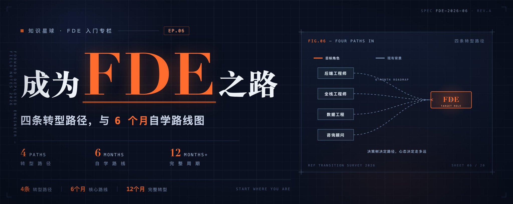
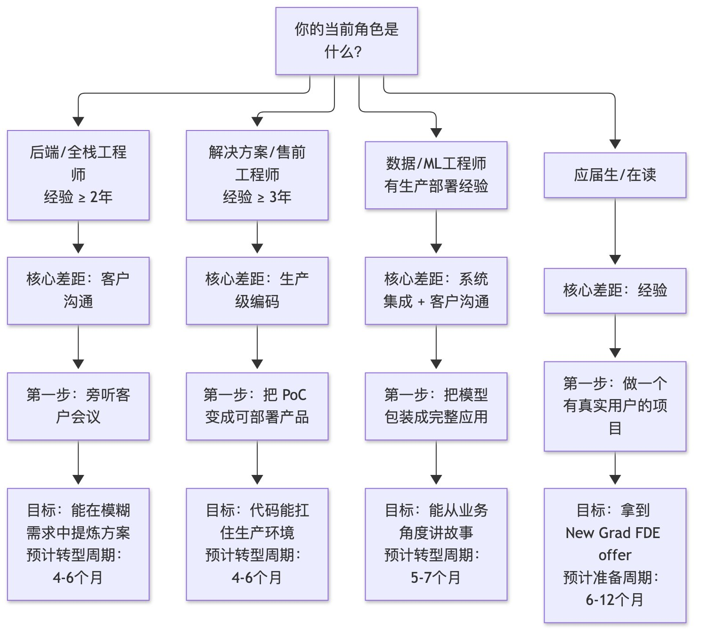
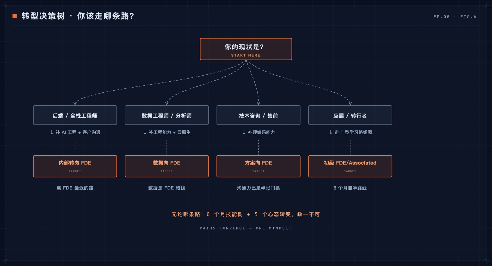

# 如何从零开始成为 FDE —— 入门路径规划

> 原文作者：aiclaw404（[@aiclaw404](https://x.com/aiclaw404)）
> 原文链接：https://x.com/aiclaw404/status/2114899779876757533
> 发布时间：2026 年 10 月 27 日 9:59 · 13 分钟阅读 · 浏览 787

作者简介：工程师 | Web3 爱好者 | 副业变现 | AI | 自媒体 | 生活观察员。AI 落地一线 · ENTJ · 天秤座。把 AI 从 Demo 真正卖进生产环境。分享从 0 到 1 的 AI 编程心得、副业变现路径和生活日常。

## 导语

前几篇文章里，我们把 FDE 这个角色从里到外翻了个遍——它的诞生史、日常实战、能力画像、成长路径，以及在大模型时代的新定位。每一篇发出后，我收到最多的私信都是同一个问题：

**“我想成为 FDE，但我现在的情况，该怎么走？”**

这不是一个轻松的问题。因为 FDE 不像传统软件工程师那样有一条标准化的培养路径——没有"FDE 专业"的学位，没有统一的认证考试，甚至没有哪家公司会公开一份"我们要求你具备这些技能"的 JD（好吧，有些会写，但写得像许愿清单）。

所以这篇文章，我想做一件务实的事：**给不同背景的人，画出四条可操作的转型路径，再附一份 6 个月的自学路线图。**

在开始之前，先摆一组数据让你心里有数：

- **JR Academy 的调研显示**，FDE 岗位的典型要求是 **4-8 年全栈/后端工程经验**——这意味着它本质上是一个"进阶角色"，而非入门岗位。
- **Recruiting From Scratch 的统计**，FDE 岗位的平均招聘周期为 **71 天**——比纯技术岗位更长，因为面试官需要同时验证你的编码、沟通和系统设计三项能力。
- **DevOpsSchool 的 FDE 路线图**将转型核心定义为：从"负责软件输出"转向"负责客户结果"——这不是加一项技能的问题，而是一次底层思维的重装。

不管你是写了五年后端的"纯技术人"，还是做了三年售前的"PPT 架构师"，或者是刚毕业的"白纸一张"——下面都有你的一条路。

## 一、先搞清楚：什么样的人离 FDE 最近？

在画路径之前，先看"谁离终点最近"。

根据 Recruiting From Scratch 的分析，**最适合转型 FDE 的三类人**依次是：

1. **感到无聊的企业软件工程师**——在 Salesforce、SAP、Oracle 等生态里做过客户交付的人
2. **做过客户交付的创业公司工程师**——已经在高压环境中面对过真实客户
3. **能写代码的技术客户经理（TAM）**——天生就在技术和客户之间做翻译

我在前几期调研中进一步补充了第四类：**有生产部署经验的数据/ML 工程师**——他们懂数据管道和模型服务化，缺的只是客户沟通的"最后一公里"。

| 排名 | 背景 | 为什么近？ | 典型差距 | 转型难度 |
|---|---|---|---|---|
| 1 | 早期创业公司工程师 | 已经面对客户、高压交付、什么都干过 | 需要补足系统化方法论 | ★★☆☆☆ |
| 2 | 做过 PoC 的解决方案架构师 | 理解客户需求，能写代码做验证 | 需要从 demo 级跨越到生产级 | ★★★☆☆ |
| 3 | 有生产部署经验的数据/ML 工程师 | 懂数据管道和模型服务化 | 需要补足客户沟通和系统集成 | ★★★☆☆ |
| 4 | 企业级软件工程师（Salesforce/SAP 等） | 熟悉企业客户环境和交付流程 | 技术栈可能偏旧，需要补现代工具链 | ★★★☆☆ |
| 5 | 会先问"为什么"的全栈工程师 | 技术广度够，有业务思维 | 需要主动争取客户接触机会 | ★★★★☆ |

**一个反直觉的发现：** 在 FDE 招聘中，最"对口"的背景既不是大厂资深工程师，也不是名校 CS 应届硕士——而是在 10-50 人创业公司干过 2-3 年的人。为什么？因为他们天然经历过 FDE 的日常：需求模糊、时间紧迫、客户就在隔壁会议室、代码今天就得上。

> 一位前 Palantir FDE 在 Glassdoor 上写道："我在创业公司的那两年，就是最好的 FDE 训练。只是当时我不知道那叫 FDE。"

## 二、四条转型路径

### 路径一：从后端/全栈工程师转型

- **你的起点：** 代码能力强，系统设计扎实，但日常工作是接 PM 写好的 PRD，和客户之间隔着三层人。
- **你的核心差距：** 不是技术，而是**在模糊需求中提炼可交付方案**的能力，以及**直接面对客户**的沟通经验。
- **第一步行动：** 这周就去找你的 PM 或客户成功经理，说一句话："下次客户会议，让我旁听。"不需要做什么大事——就坐在旁边，听客户怎么描述问题，听你的同事怎么翻译需求，听哪些话让客户皱眉、哪些话让客户点头。这些"现场感"，是任何课程都教不了的。
- **具体路线：**
  - 阶段 1（1-2 个月）：建立客户感知——旁听至少 3 场客户会议；会后写"需求翻译笔记"：客户说了什么 → 技术需求是什么；阅读《The Mom Test》；主动承担一次内部 demo 展示。
  - 阶段 2（2-3 个月）：练习模糊需求拆解——找一个潜在客户/业务方聊痛点；不写代码，先输出一页"问题理解 + 方案建议"；请 PM 或资深 FDE 反馈；尝试独立交付一个小功能。
  - 阶段 3（1-2 个月）：补齐 FDE 技能树——学习部署和 DevOps 基础（Docker, CI/CD, 云平台）；了解行业客户典型技术栈；练习画架构图讲给客户听；准备 FDE 面试。
- **关键心态转变：** 从"给我一个明确的 spec，我来实现"到"客户说不清楚他要什么，但我能通过提问和原型帮他想明白"。

### 路径二：从解决方案工程师转型

- **你的起点：** 客户沟通没问题，理解业务场景，能做 demo，甚至能写 PoC。
- **你的核心差距：** 代码能力可能停留在 demo 级别——能跑通一个 happy path，但没经历过生产环境的"毒打"：数据脏了怎么办？并发上来怎么办？客户环境和你笔记本不一样怎么办？
- **第一步行动：** 挑一个你做过的 PoC，把它变成"能交给客户 IT 团队部署和维护"的东西。写 Dockerfile、写部署文档、写监控告警配置、写故障处理手册。如果这个过程让你觉得痛苦——那就对了，你正在接近 FDE 的真实水平。
- **具体路线：**
  - 阶段 1（1-2 个月）：从 demo 级到生产级——选 1-2 个项目重构为可部署版本；加上错误处理、日志、监控、配置管理；让同事在你的笔记本以外的环境跑起来；写一份"部署 + 运维手册"。
  - 阶段 2（2-3 个月）：建立"owns outcome"心态——主动要求参与售后交付阶段；跟进上线后第一周所有问题；记录每个"这不是我的活"的时刻；学习一个不熟的技术领域。
  - 阶段 3（1-2 个月）：补齐硬核技术——系统学习数据工程基础（ETL、数据建模、管道编排）；练习 API 集成（REST、GraphQL、Webhook）；了解 LLM 应用开发（RAG、Agent、Prompt Engineering）；做端到端模拟项目。
- **关键心态转变：** 从"我负责让客户相信这个方案可行"到"我负责确保这个方案真的可行，并且在客户那里真的跑起来了"。这是售前和 FDE 之间最本质的区别。
- **JR Academy 指出的三大误区（针对解决方案工程师转型者）：**
  1. **把 FDE 当成"会讲 PPT 的工程师"**——FDE 的核心产出是可运行的代码，不是可播放的幻灯片。
  2. **拒绝出差**——FDE 意味着你要在客户现场工作，频繁出差是常态而非例外。
  3. **等客户给明确答案**——FDE 的价值恰恰在于客户给不出明确答案时，你能主动拆解问题。

### 路径三：从数据/ML 工程师转型

- **你的起点：** 数据管道、模型训练、特征工程——这些是你的日常。你可能部署过模型服务，但面对的是数据科学家或产品经理，而不是客户。
- **你的核心差距：** 两块——**系统集成能力**（你的模型怎么嵌入客户的系统）和**客户沟通能力**（你怎么让一个不懂 ML 的 CTO 理解你的方案）。
- **第一步行动：** 找一个你训练过的模型，试着把它包装成一个"客户可以直接用的产品"。不是 Jupyter Notebook，不是 API endpoint——而是一个有 UI、有错误处理、有使用文档、有 fallback 机制的完整解决方案。
- **具体路线：**
  - 阶段 1（1-2 个月）：从模型到产品——封装成可交付完整应用；加认证、限流、降级、日志；写非技术人员能看懂的指南；学前端基础。
  - 阶段 2（2-3 个月）：补足系统集成——深入学习 API 设计、数据集成、ETL 管道；了解主流企业系统对接方式；练习 Docker + K8s 部署；学一个不熟悉的业务领域。
  - 阶段 3（1-2 个月）：面对客户——争取参与客户沟通；练习"不出现任何技术术语"地解释方案；做 2-3 个模拟交付场景角色扮演；准备 FDE 面试。
- **关键心态转变：** 从"模型 AUC 提升了 3 个点"到"客户的生产效率提升了 30%，因为他们现在不需要手动做那件事了"。客户不在乎你的模型有多好，只在乎你帮他解决了什么问题。

### 路径四：应届生直接入局

- **先说坏消息：** 绝大多数 FDE 岗位不招应届生。Palantir 是少数例外——它有专门的 **New Grad Forward Deployed** 项目，每年从顶级院校招收少量应届生。其他公司如 C3.ai、Scale AI 偶尔也会开应届生通道，但极其稀缺。
- **再说好消息：** 如果你确实优秀，应届生身份反而可以是优势——你没有"错误"的工作习惯要改。
- **你需要展示的能力组合：**

| 能力维度 | 应届生如何证明 | 权重参考 |
|---|---|---|
| 全栈编码 | GitHub 上有完整项目（不是课程作业），最好有真实用户在使用 | 35% |
| 系统设计 | 能在白板上设计包含前端、后端、数据库、部署的完整系统 | 20% |
| 客户思维 | 有在非技术团队实习/协作的经验，能讲出"理解需求"的故事 | 15% |
| 快速学习 | 能在面试中现场学会一个新工具/API 并用它解决问题 | 15% |
| 抗压能力 | 有创业经历、黑客马拉松经验、或在紧迫 deadline 下交付的经历 | 15% |

- **应届生的特别建议：**
  1. **优先考虑有 New Grad FDE 项目的公司**，而不是社招——Palantir 的 Forward Deployed 项目是最成熟的选择。
  2. **实习经历极其重要**——最好在创业公司或咨询公司实习，而不是在大厂做螺丝钉。
  3. **做一个"有真实用户"的项目**——帮一个本地小企业做个数据分析工具，比做一个百万 star 的开源库更有说服力。
  4. **练习"教"的能力**——FDE 需要向客户解释技术，如果你能教别人编程，你就有潜力做 FDE。

## 三、决策树：你该走哪条路？

（原文此节嵌入了两张媒体图片，见文末配图。）

## 四、6 个月自学路线图：从零构建 FDE 技能树

不管你是哪条路径，这份 6 个月计划都可以作为你的自学框架。综合了三个信源：

- **DevOpsSchool 的 FDE 路线图**：将 FDE 技能分为三层——Core SWE Foundation → Applied AI Spine → Customer Frontline，并提供 60 天行动计划作为基础框架。
- **ClavePrep 的 4 周面试准备框架**：提供精确到周的面试准备节奏，扩展为一个月冲刺计划。
- **JR Academy 的 6 步入局路径**：补齐 LLM 应用全栈 → 做模拟交付项目 → 锻炼客户沟通 → 研究 Palantir 方法论 → 准备 FDE 面试 → 直接投递。

将这三份框架熔炼为一份 24 周的路线图：

### 月 1-2：地基——Core SWE Foundation

**目标：** 能独立把一个应用从代码推到云端运行。

| 周 | 主题 | 具体产出 | 每周投入 |
|---|---|---|---|
| 1-2 | Python 高级特性 | 异步编程、装饰器、类型标注、单元测试 | 10-15h |
| 3 | Docker 容器化 | 把一个 FastAPI 应用容器化并推送到镜像仓库 | 10h |
| 4 | AWS/GCP 基础 | EC2、S3、RDS、Lambda，通过一个云项目串起来 | 10h |
| 5 | CI/CD | 用 GitHub Actions 实现自动化测试+部署流水线 | 8h |
| 6 | Linux + 网络基础 | SSH、文件权限、HTTP/TLS、DNS 排查 | 8h |
| 7-8 | 综合项目 | 部署一个有数据库、API、前端的完整应用到云上 | 20h |

- **推荐资源：** 《Fluent Python》；Docker 官方 Get Started + 《Docker Deep Dive》；AWS Free Tier + Solutions Architect 路线；GitHub Actions 文档 + 《Continuous Delivery》。
- **检验标准：** 你能在 30 分钟内，把一个本地项目部署到云服务器上，配好域名和 HTTPS，并设置自动化测试流水线。

### 月 3-4：核心——Applied AI Spine + 数据工程

**目标：** 能处理真实世界的数据集成和 AI 应用开发。

| 周 | 主题 | 具体产出 | 每周投入 |
|---|---|---|---|
| 9-10 | 数据工程基础 | ETL 管道设计、数据建模、用 Airflow/Dagster 编排 | 12h |
| 11-12 | API 集成实战 | REST/GraphQL、OAuth、Webhook、第三方 API 对接（至少 3 个） | 12h |
| 13-14 | RAG 系统 | 向量数据库 + Embedding + 检索增强生成，搭建完整 RAG pipeline | 15h |
| 15-16 | 综合项目 | 做一个"帮客户查询内部知识库"的 AI 应用（含鉴权、日志、fallback） | 20h |

- **推荐资源：** 《Fundamentals of Data Engineering》；DeepLearning.AI Short Courses，LangChain / LlamaIndex 官方文档；《API Design Patterns》。
- **检验标准：** 你能搭建一个 RAG 系统，接收用户上传的 PDF 文档，回答基于文档内容的问题，并处理"文档里没有答案"的边界情况，全程有日志可追踪。

### 月 5：进阶——Agent 编排 + 评估体系 + 可观测性

| 周 | 主题 | 具体产出 | 每周投入 |
|---|---|---|---|
| 17-18 | Agent 编排 | 多步推理、工具调用、人机协作循环，使用 LangGraph 构建 Agent | 15h |
| 19 | 评估体系 | LLM 输出评估框架、A/B 测试、回归测试、自动化评测 pipeline | 10h |
| 20 | 可观测性 | 日志聚合、链路追踪、异常告警（OpenTelemetry + LangSmith） | 10h |

- **检验标准：** 你能构建一个多工具 Agent，能自我评估输出质量，出了问题你能在 5 分钟内定位到是哪个环节。

### 月 6：冲刺——Customer Frontline + 模拟交付 + 面试准备

| 周 | 主题 | 具体产出 | 每周投入 |
|---|---|---|---|
| 21-22 | 模拟交付项目 | 找一个"假客户"完成一次完整的 FDE 交付模拟 | 20h |
| 23 | Portfolio 搭建 | 整理 3-5 个代表项目，写成 case study 格式 | 10h |
| 24 | 模拟面试 | 技术面 + 系统设计 + 客户场景面，各至少 2 次模拟 | 15h |

- **Portfolio 项目建议（至少 3 个）：** 端到端数据集成、AI 应用、有客户故事的项目。
- **面试准备要点（融合 ClavePrep 4 周框架）：**

| 面试维度 | 考核权重 | 准备策略 |
|---|---|---|
| Python 编码 | 35% | LeetCode Medium + 数据处理题 |
| TypeScript/前端 | 35% | React 基础 + 做一个小 dashboard |
| SQL | 必考 | 窗口函数、复杂 JOIN、数据清洗 |
| AWS/云服务 | ~32% | EC2/S3/Lambda 实操、架构设计题 |
| 系统设计 | 20% | 多轮对话系统、数据管道等 |
| 客户场景模拟 | 15% | 模拟"客户描述模糊需求"的场景 |

- **ClavePrep 的 4 周冲刺节奏：** Week 1 技术基础强化；Week 2 问题分解精通；Week 3 利益相关者沟通训练；Week 4 完整模拟面试。

## 五、五个关键心态转变

1. **从"确定性"到"管理不确定性"**
2. **从"构建一切"到"利用杠杆"**
3. **从"个人所有权"到"共享赋能"**
4. **从"深度优先"到"广度优先"**
5. **从"完美主义"到"足够好且快"**

## 六、误区清单：转型 FDE 最常踩的坑

| 误区 | 真相 | 信源 |
|---|---|---|
| "FDE 就是会写代码的售前" | 售前负责"说服"，FDE 负责"交付" | JR Academy |
| "技术够强就行" | 沟通能力是准入门槛 | ClavePrep |
| "学完 AI 就能做 AI FDE" | AI 知识是加分项，Core SWE 才是底线 | DevOpsSchool |
| "FDE 不用管代码质量" | 代码要在客户生产环境长期运行 | Recruiting From Scratch |
| "不需要了解业务" | 不了解业务写代码是自嗨 | JR Academy |
| "拒绝出差就能做 FDE" | 频繁出差是常态 | JR Academy |
| "等客户给明确需求再动手" | 价值在于主动拆解问题 | JR Academy |

## 七、一些实用建议

- **关于选公司：** 列出了 Series B-D 创业公司、成熟 FDE 团队（Palantir 等）、咨询公司、企业服务厂商的对比及股权范围。
- **关于薪资预期：** 资深 FDE 头部公司总包 $250K-$400K+。
- **关于时间线：** 月 1-6 技能构建；月 5-7 面试准备；月 7-9 面试谈判；月 9+ 入职成长。

## 小结

成为 FDE 没有标准路径，但有清晰的方向：**从"对代码负责"转向"对客户结果负责"**。

> **下一篇预告：** 第七篇《FDE 的面试准备 —— 如何通过这个"三合一"考核》

**参考信源：**

- DevOpsSchool：*FDE Roadmap & 60-Day Action Plan*
- JR Academy：*How to Break Into Forward Deployed Engineering*
- ClavePrep：*FDE Interview Prep 4-Week Framework*
- Recruiting From Scratch：*FDE Hiring Data & Compensation Report*

FDE 专题系列持续更新中。如果你对某条转型路径有更多疑问，或者想分享你的转型故事，欢迎在评论区交流。

---

## 配图（原文 3 张，按出现顺序）

