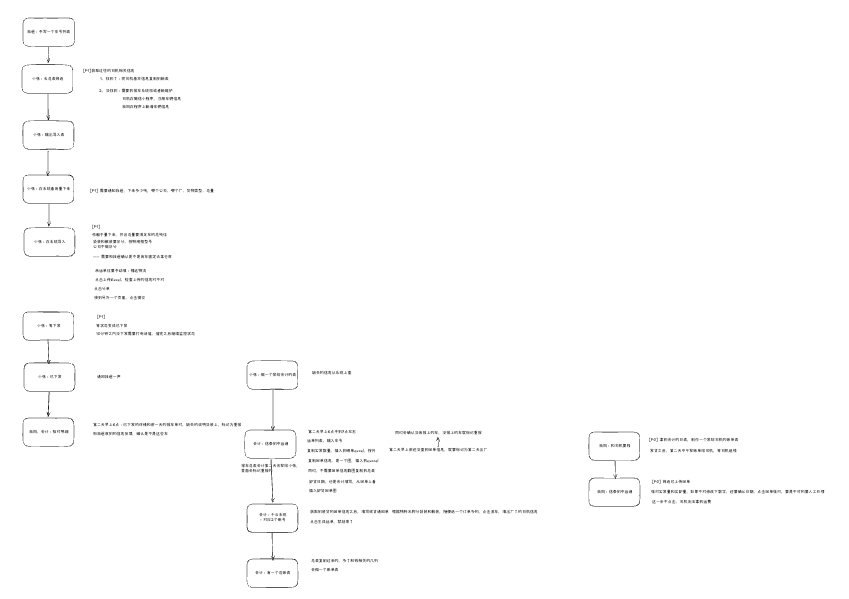
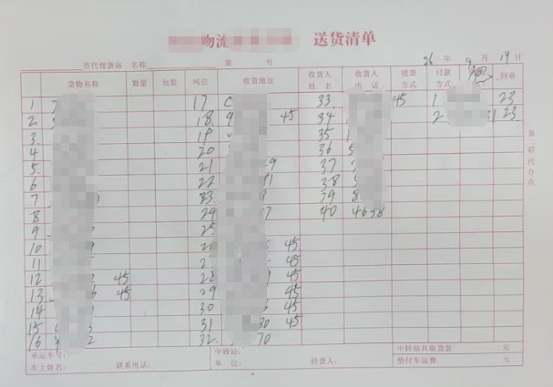
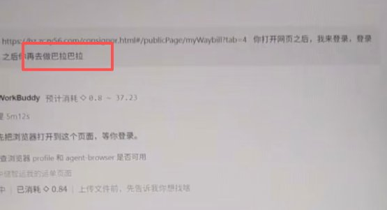

# FDE 实战｜我给爸妈的物流公司做 AI 落地

> 原文作者：奔跑的大毛腿（[@runmaotui](https://x.com/runmaotui)）
> 原文链接：https://x.com/runmaotui/status/2113206147914334644
> 发布时间：2026 年 10 月 22 日 17:49 · 8 分钟阅读 · 浏览 5 万

一家只有 4 个人的物流公司，本以为让 AI 接手工作很简单，结果光需求调研就花了半个月。传统小公司 AI 落地远比想象中复杂，完整复盘，分享给大家。

## 文章正文

这是一家小物流公司，有多小？一共只有 4 个人。老板是我爸，会计是我妈。

公司虽然小，业务却一点也不少。

每天要安排几十台车、登记司机信息、在系统里报车、核对装货情况，还要处理回单、账单。

正好最近 FDE（Forward Deployed Engineer，前线部署工程师）这个概念挺火，我就把自己当成一名 FDE，找了个真实客户，准备从需求调研、方案设计一直做到落地交付。

本来以为，无非就是登录几个系统、处理几张 Excel，应该不是什么难事。

**结果真正开始做，才发现远没有想象中那么简单。**

### 01 商机发现：我妈不相信 AI 能干她的活

我妈其实早就在用 AI 了。

她平时会用豆包，但她从来没想过，AI 还能帮她处理每天的工作。

我给她打开 Codex，它自己操作浏览器，去网上找当天排名前十的新闻，再整理好返回给我。

“你可以认为，以前你在电脑上能干的活，现在都可以尝试让 AI 帮你干。”

她还是不相信。每天要登录不同的业务系统查询，数据对不上，又要去问司机、问我爸。

“先别管能不能实现，你把每天干的活告诉我，我先研究研究。”

我平时上班、带娃，只能抽空研究，**反倒是我爸妈一直惦记着这件事**，隔三差五问我什么时候有时间，能不能再对一下、讲讲咋用。

他们对 AI 的技术原理没什么兴趣，也不关心什么 Agent、MCP、Computer Use。

他们只关心一件事：每天这些重复的活，能不能少干一点？

**很多时候，不是用户不需要 AI，而是他们根本不知道 AI 已经能帮自己做些什么。**

但演示归演示，真正落地之前，我得先弄清楚：

**我妈每天到底在干什么？**

### 02 需求调研：我差点没搞明白他们怎么干活

我先让我妈把每天的工作梳理一下。

“想让 AI 干活，至少得先让我这个 FDE 搞明白怎么干。”

我妈还挺配合，给我录了几个操作视频，又写了一份说明文档，附带着发来一堆 Excel。

结果我看了好几遍，还是没弄明白。

比如她说，填完车号之后，再和表格里的信息核对一下。

那我就得问了：和哪张表核对？数据从哪里来？查不到司机怎么办？两个地方的信息对不上又怎么处理？

这一问，才知道背后还有一套司机注册流程，如果是新司机，还得先完成注册和信息维护。

**她原本一句话就讲完的事情，实际上涉及好几个操作步骤，只有深入了解才能挖掘出来。**

文字和视频实在搞不清楚，我就约她开了个腾讯会议，让她共享屏幕，一步一步演示。

没想到业务还没开始聊，先折腾了半天电脑。微信视频教她下载安装腾讯会议、共享屏幕。

总算能正常沟通了，结果发现更麻烦的还在后面。

一开始让我妈自己讲，我一边听一边记录。她讲着讲着就跑偏了，一会儿说今天这辆车是什么情况，一会儿又说昨天有个司机怎么回事。

后来我干脆接过了主导权，不再让她从头讲到尾，而是按照业务流程，一步一步往下过。

每一步都搞清楚：谁来做？在哪个系统做？输入什么？数据从哪里来？怎样算完成？异常怎么办？

光是沟通业务流程，就花了一下午。最后我把整个流程整理成了一张流程图。

原本以为就是几个 Excel 加几个网站，没想到前前后后涉及这么多步骤。

**很多业务规则根本没有写下来，而是存在个人的脑子里。**

比如前一天报了车，第二天没装上，应该怎么处理？

有时候靠司机给我爸发微信反馈，有时候要去业务系统查实际装车情况，再人工标记重报。

这家小公司虽然没有什么标准化流程，但靠着几个人多年积累的经验和默契，业务照样能运转。

而要让 AI 接手，就得把这些藏在脑子里的规则，一点点整理出来。

### 03 方案设计：不是所有工作都适合交给 AI

业务流程总算梳理清楚了，接下来就是考虑怎么让 AI 执行。

首先碰到的是技术问题。

他们用的是 Windows 电脑，平时自己操作都卡，动不动还弹出各种广告窗口。

业务又涉及好几个系统，有的要登录，有的要上传 Excel，有的要等系统处理。

这些操作别说 AI 了，人自己做都经常碰到问题。

更麻烦的是数据。

比如每天要报哪些车，原始信息是我爸手写的一张纸。

车牌号有时候只写后面几位，省份简称直接省略。

“你看你爸写的这个车号，AI 能直接识别吗？”

识别本身不一定是问题。问题在于，这些信息背后还有一大堆默认规则：哪个司机对应哪辆车、哪些车是固定司机、换了司机要怎么处理。

如果原始信息不完整，AI 就算猜出了一个结果，我也不敢直接让它往业务系统里填。

**真正让我不敢放手的，是业务风险。**

比如报车时填错了，就可能导致司机当天装不上货，在车里多等一天。

他们还有一个环节，需要核对实际运输的货物数量和回单信息。

如果数量不对、回单有问题，却被 AI 直接确认了，一辆车就可能造成两三万块钱的损失。

**AI 出错了可以重新执行任务，但业务上的损失，谁来承担？**

肯定不能指望 AI 负责。

所以我决定不追求一步到位，而是把业务分成三个阶段。

**第一阶段，先解决我妈每天的信息核对和检查。**
比如第二天早上，她要把前一天报的车辆和系统里实际下发的车辆进行核对。这部分主要是查询、提取、对比数据，即使 AI 判断错了，也可以通过人工检查发现问题，不会直接修改业务系统里的关键数据。每天都要做，重复性又高，正适合先验证。

**第二阶段，再尝试让 AI 在业务系统里报车。**
让 AI 整理、填写司机和车辆信息，生成报车表，人工确认无误后再提交，稳定之后再考虑扩大自动化范围。

**第三阶段，再考虑回单、财务等其他业务。**
特别是涉及资金结算的操作，暂时不考虑完全交给 AI，必须保留人工审核。

这样一来，第一阶段的目标反而很简单：

**先让 AI 把车辆信息查出来、核对清楚，最后由我妈来验收。**

### 04 落地交付：终于让 AI 干上活了

工具方面，我最终选择了腾讯的 WorkBuddy。

第一阶段先做最简单的任务：让 AI 登录业务系统，查询指定日期的车辆记录，筛选出已下发的车辆，提取明细并生成 Excel。

验证通过后，我让它把整套操作流程封装成 Skill，把安装包和 Word 使用指南发给我妈，让她在自己的电脑上安装。

10 月 19 日，第一次使用就碰到了问题。

原来她把账号密码直接发到了 AI 聊天框里。我赶紧让她别这么干，自己登录系统，再交给 AI 操作。

折腾了一会儿，终于跑通了。

**“真好用啊。”**

原本要做 1 小时的工作，AI 一分钟就完成了，她核对下来一个都没错。

一个月前，她还不相信 AI 能处理自己的工作。现在已经开始主动找活给 AI 干，遇到问题还会让它排查、修改。

### 05 项目复盘：AI 真正落地，比我想的还难

这次项目虽然只完成了第一阶段的一部分，但整个过程下来，还是有不少意料之外的发现。

**第一个意外，是客户比我想象中还激进。**
原本我只打算先教会我妈做车辆信息核对，没想到她自己开始疯狂探索。从查车辆、整理 Excel，到查询磅单，甚至开始让 AI 直接核对回单。我赶紧提醒她，别太相信 AI，尤其涉及运费、资金的操作，必须由人验收。**AI 的能力越来越强，用户敢交给它的事情也越来越多，但用户未必有能力判断风险。**

**第二个意外，是交付真的需要手把手教。**
我以前觉得，现在的 AI 已经这么简单了，只要会打字，应该就能用。实际根本不是这么回事。有一次，我给我妈发了一段使用说明，大概是：“你先打开这个页面，我来登录，登录完成之后，你再去执行后面的任务，巴拉巴拉……”这里的“巴拉巴拉”只是我省略后续内容的表达。**结果我妈把“巴拉巴拉”几个字也原封不动地发给了 WorkBuddy。**真是哭笑不得。

**第三个问题，是传统小公司的数字化基础太薄弱了。**
现在大家都在讲数字化转型、智能化转型。但我爸妈公司连基础的数据和流程标准化都没做好。但 AI 不知道那些没有写下来的规则，也不知道遇到异常应该找谁。想让 AI 接手，就得先把这些信息一点点整理出来。**原本以为是在做 AI 落地，最后发现还得先补数字化、流程标准化的课。**

**第四个问题，是信任。**
这次能顺利推进，还有一个很特殊的前提：客户是我爸妈。他们愿意把业务系统、Excel、司机资料，甚至涉及资金的数据都交给我。我有什么不清楚的，直接打电话问；需要看哪个系统，随时可以让我进去研究。但如果换成一家陌生公司呢？别人凭什么把这些数据交给我？

**最后一个问题，是这门生意到底赚不赚钱？**
AI 即使能替代一部分重复劳动，客户愿意为此付多少钱？他们公司雇一个普通员工，一个月工资也就三千块钱。一次报车或者回单处理错误，就可能造成两三万的损失。节省了多少人工成本，和出了问题可能损失多少钱，根本不是一个量级。**现在 AI 已经能干很多活了，但如何让它稳定、低成本地进入这些小公司的日常业务，才是真正困难的地方。**

### 最后：技术终要为人服务

这次给爸妈公司做 AI 落地，远谈不上大功告成。

目前只是跑通了部分业务，后面还有报车、账单等工作要做，离稳定运行还有不少距离。

我妈第一次跑成功，兴奋地给我发消息：“真好用啊。”

后来她开始自己探索，恨不得把所有活都交给 AI。我得不断提醒她，文件要备份，结果要核对，涉及钱的操作千万别随便放手。

而她转头又会提醒我，早点吃饭，别太累。

平时做产品，我们总在算效率提升了多少、节省了多少成本。这次当然也要算，但对我来说，还有一点不一样。

我妈平时喜欢弹电子琴，以前经常忙完工作才有时间练。

我希望以后那些每天都要反复核对的车辆信息、整理不完的 Excel，能少占用她一些时间。

**如果她能因此多练一会儿琴，那我折腾这一趟就挺值了。**

---

## 配图（原文 9 张，按出现顺序）

