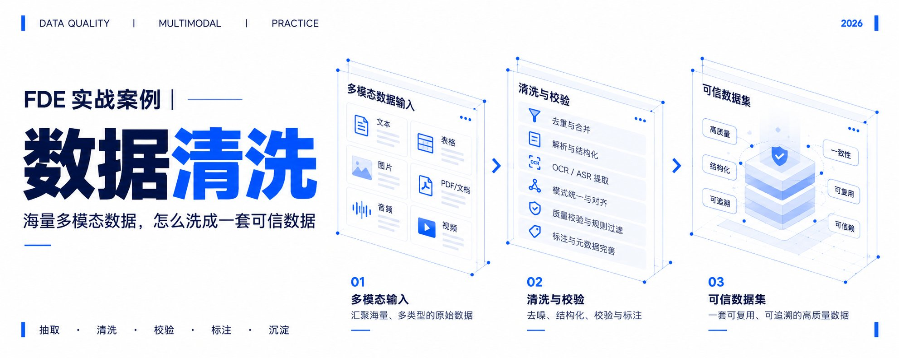
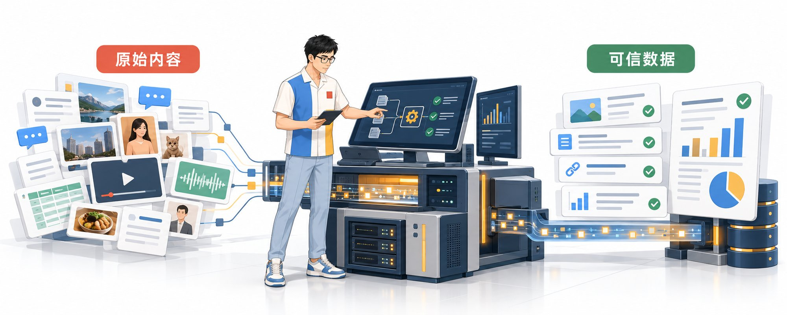
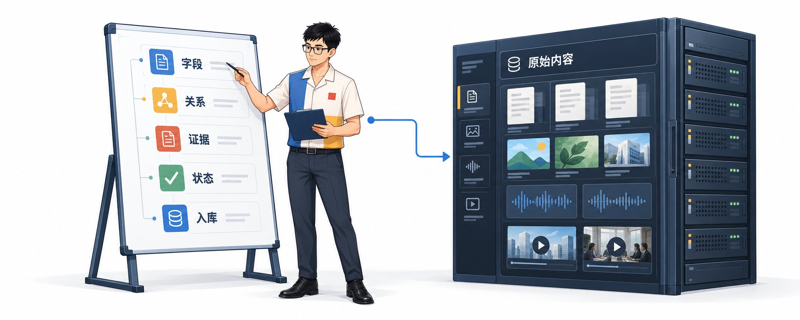
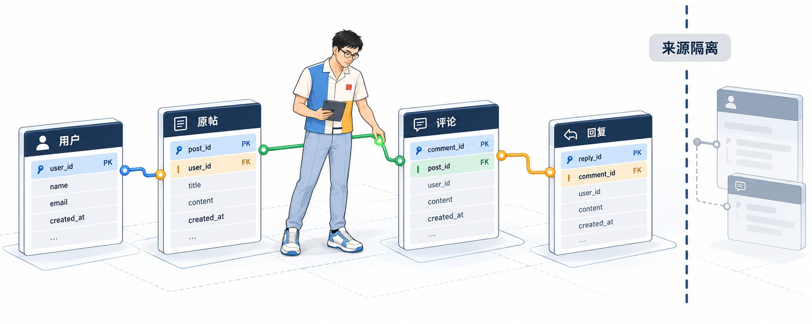
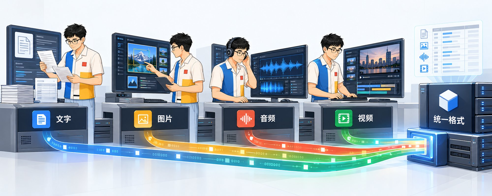
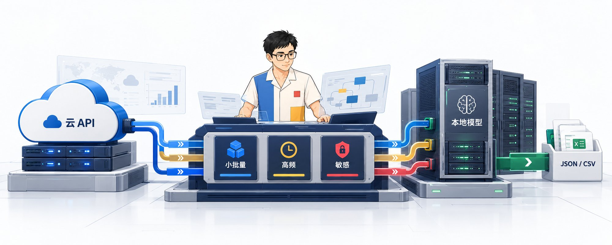
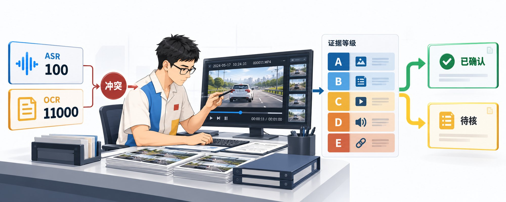
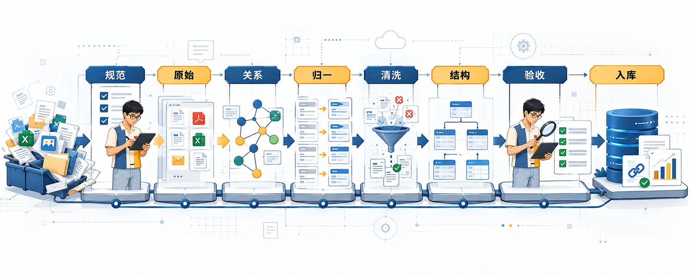

# FDE 实战案例｜数据清洗（海量多模态数据，怎么洗成一套可信数据）

> 原文作者：Miles Ma（[@miles_mazy](https://x.com/miles_mazy)）
> 原文链接：https://x.com/miles_mazy/status/2115006510979801566
> 发布时间：2026 年 10 月 27 日 17:03 · 8 分钟阅读
> 互动数据：浏览 25.4 万；回复 60；转发 319；点赞 1695；书签 3638

前段时间，我们去一家美妆企业做 FDE 落地。具体业务包括舆情分析、竞品调研、营销活动复盘，以及从评论区里提取用户对功效、肤感、成分、价格和使用场景的真实反馈。

项目启动以后，一个很现实的问题摆在面前：小红书、抖音、视频号、微博等平台的数据已经采集回来，但文字、图片、音频和视频混在一起；同一款产品有全名、简称、系列名和用户自己的叫法；原帖、评论和回复之间还要保持完整关联。只要其中一个环节处理错了，后面的用户洞察和报告结论都会跟着跑偏。

现在 AI 的搜索功能已经非常完善，所以这篇文章会从单个项目讲起，再把实际做法整理成一套通用方案。

以后需要分析小红书、抖音、视频号、微博等平台的数据，不管是做消费品洞察、汽车口碑、餐饮选址、旅游评价，还是品牌舆情，都可以参考这套链路完成数据清洗、关系整理、质量核验和入库。

整条链路分成八步：

**定数据规范 → 保留原始内容 → 梳理数据关系 → 多模态归一 → 冲突和质量清洗 → 生成结构化数据 → 执行验收 → 按规则和版本入库。**

## 第一步：先定数据规范

进入项目后，我们都会先问业务团队一句：这批数据最后拿来干什么？

舆情报告要看事件、传播和风险；竞品报告要比较品牌、产品线、功效、成分和用户评价；营销复盘要看渠道、内容、互动和反馈；评论区分析还要保留用户提问、上下文和回复关系。

**用途不同，清洗方式也不同。**

比如同一条新品种草素材，被十个账号发布。做传播复盘时，这十次发布都要保留；统计自然讨论时，它们又要被标成同一组重复内容。如果采集后直接删掉九条，后面就没法更换统计口径。

所以第一步要写清楚：

- 哪些字段必须保留；
- 帖子、评论和用户怎么关联；
- 哪些判断必须附带原文；
- 哪些数据可以直接使用；
- 哪些数据需要人工确认。

这就是数据规范。名字不复杂，作用也很直接：先统一规则，再开始处理。

## 第二步：原始内容永远保留

原文、图片、音频、视频、链接、发布时间和平台原始 ID，都要保留。

清洗后的文字单独存，不能覆盖原文。OCR、ASR 和模型生成的标签，也只能作为新增结果。

这样做有三个好处：

1. 识别错了，可以回到原内容检查。
2. 换了模型，可以重新处理。
3. 报告里的结论，可以找到对应证据。

如果只保留模型加工后的结果，后面即使发现错误，也不知道错在采集、识别还是分析。

## 第三步：把用户、原帖、评论和回复连起来

很多团队只保存作者、正文、时间和互动量。做词频统计勉强够用，分析评论就会失去上下文。

一条“这个也太差了”的评论，到底是在评价原帖里的产品，还是在回应上一条评论？要看它挂在哪个 ID 下面。

单个平台内，至少保留四类 ID：

- `user_id`：谁发布了内容；
- `post_id`：评论属于哪条原帖；
- `comment_id`：当前是哪条评论；
- `parent_comment_id`：这条回复在回应谁。

数据库里的主键可以写成“平台名 + 平台原始 ID”，避免不同平台出现相同编号。

不同平台之间不要直接认人。昵称相同、头像相似，只能当成线索。没有可靠主键和明确授权时，可以汇总话题、对象和内容，不能把两个账号直接拼成一个人的完整轨迹。

一句话概括：**平台内把关系梳理清楚，平台间把来源分开保存。**

## 第四步：文字、图片、音频、视频分别处理，再统一格式

四种内容的处理方式不同，最后都要整理成一套统一格式：谁在什么时间说了什么，提到了什么对象，证据在原内容的哪个位置。

### 文字

保留原文，再处理乱码、空白、链接、语言和重复段落。模型提取观点时，要同时返回对应原句。

### 图片

OCR 提取价格、型号、日期和截图文字；视觉模型识别对象、场景和部件。两种结果都要保留图片位置，方便后面判断文字和对象是否属于同一区域。

### 音频

先统一格式和采样率，再做 ASR。输出需要带时间码。分析多人对话时，再增加说话人区分；普通口播不需要多做一层。

### 视频

先拆出音轨和关键帧。音轨做 ASR，关键帧做 OCR 和视觉识别，最后按照时间合并。

没有必要逐帧分析整段视频。可以先低频抽帧和全文转写，找到相关片段后，再提高局部抽帧密度。

### API、本地模型怎么选

小批量验证可以直接调用 API。数据量稳定以后，再把高频任务搬到本地。常见组合是：

- 用 FFmpeg 拆音轨、转码和抽帧；
- 用 PaddleOCR 做本地 OCR；
- 用 Whisper 做本地语音识别；
- 云端 OCR 可以接百度智能云 OCR 或腾讯云 OCR；
- 云端语音识别可以接腾讯云 ASR 或火山引擎音视频字幕生成。

试用额度和并发限制会变化，上线前直接看控制台。选型时也别只看价格，要拿自己的真实样本测试方言、噪声、中英混合、竖屏字幕和截图小字。

任务会反复执行时，可以做一个轻量工作台：

**文件或链接进入 → 自动选择 OCR、ASR 或视觉工具 → 查看原文与识别结果 → 人工修正 → 导出 JSON 或 CSV。**

工作台同时记录调用次数、耗时、费用和失败原因。跑一段时间以后，团队自然知道哪些环节继续用 API，哪些值得本地部署。

## 第五步：数据冲突时，先看证据

多模态处理经常得到两个都像正确答案的结果。

我们碰到过一条视频：ASR 识别成 100，画面 OCR 识别成 11000。如果系统直接选择置信度更高的一方，错误数字会一路进入统计和报告。

处理这类问题，先给证据分级：

- **A 级**：官方字段或人工确认结果；
- **B 级**：原图、原音频、原视频里可以直接确认的内容；
- **C 级**：多个模型结果一致，上下文也能对上；
- **D 级**：单个模型的识别或判断；
- **E 级**：关键词、正则和简单规则给出的候选值。

发现冲突后，按照时间码和图片位置找到原始证据，再核对单位、上下文和发布时间。能确认就修正；暂时确认不了就进入待核队列，不参加精确数值统计。

修正时保留原始值、修正值、证据等级、修正原因、复核状态和模型版本。原值不能被覆盖。

## 第六步：重复、低质量和异常内容分开处理

公开数据里会有广告、搬运、统一素材、乱码、无关内容和异常互动。这些情况需要分开处理。

先筛相关内容。关键词和词典负责尽量找全，语义模型补充简称、缩写和相近说法。

再处理重复内容。完全复制、轻微改写、同图不同文和同视频再发布，都可以放进同一个重复组。原始记录仍然保留，统计时再决定按帖子、素材还是账号去重。

最后识别异常。发布时间、内容相似度、账号历史、发帖节奏和互动网络都可以作为判断信号。

系统最后输出四种状态：

- 正常可用；
- 重复关联；
- 低质量，等待修复或隔离；
- 高风险，进入人工复核。

风险分只负责把可疑内容排到前面。活动统一素材、媒体矩阵和合作账号也会高度相似，不能看见高分就直接删除。

## 第七步：把内容整理成可查询的数据

清洗完以后，还要把自然内容整理成字段。

比如一位用户说：“这款精华刚涂上挺润，过一会儿有点黏，敏感肌可能要先试一下；同价位我还想看看另一款。”

这句话里有当前产品、候选产品、即时肤感、后续肤感、适用人群、风险提醒、价格区间和对比意向。只打一个“负面”或“中性”标签，后面几乎没法使用。

通用的结构可以分成五类：

- 谁在表达，评价对象是谁；
- 提到了什么产品、部件、功能或服务；
- 对象之间发生了什么；
- 用户的观点、问题和意图是什么；
- 判断依据是哪句原文、哪个图片位置或哪段音频。

高频、规则稳定的任务交给规则和小模型。多语种、多对象、复杂指代和长文本交给大模型。低置信结果进入人工复核。

大模型需要按照固定 JSON 格式返回字段和证据。字段名称、可选值和空值规则提前写清楚，输出才能直接验收和入库。

## 第八步：验收通过，再按版本入库

入库前要检查：

- 原始内容和链接是否完整；
- 评论能否回到原帖和上级评论；
- OCR、ASR 和视觉结果是否带位置；
- 冲突是否有处理状态；
- 标签是否绑定正确对象；
- 规则、模型和字段是否有版本号。

团队还要准备一批人工确认过的测试样本，包括正常数据和容易出错的难例。每次换规则、换模型，都用同一批样本重新跑一遍。

最后入库时，把原始数据、处理结果、质量状态和版本信息分开保存。这样才能重新处理、对比新旧结果，也能查清一条数据是在哪一步发生了变化。

## 最后带走一套通用方案

**一，定数据规范。** 说清楚用途、字段、关系、证据和入库条件。
**二，保留原始内容。** 原文、原文件、链接、平台 ID 和采集时间全部留下。
**三，梳理数据关系。** 连好用户、原帖、评论、回复和附件。
**四，完成多模态归一。** 文字、图片、音频和视频分别处理，再整理成统一格式。
**五，做好冲突和质量清洗。** 处理识别冲突、重复、缺失、乱码和异常数据。
**六，生成结构化数据。** 提取对象、属性、关系、事件、观点和证据。
**七，执行验收。** 用人工确认过的样本检查准确率和高风险错误。
**八，按规则和版本入库。** 保存处理规则、模型版本、修正原因和处理时间。

一套完整交付还应包括数据字典、关系说明、处理流程、质量报告、难例集、复核队列和版本记录。

**FDE 在这个阶段要做的，就是把业务规则、数据处理、模型能力和人工复核接成一条能长期运行的流程。**

数据洗干净以后，下一篇再解决数据库查询：面对字段多、层级深的 Elasticsearch，AI 怎样稳定取到正确数据，并把它们写进一份可信报告。

我是 Miles，做 AI 算法研发、企业 AI 培训和 FDE 落地交付。
关注我 [@miles_mazy](https://x.com/miles_mazy)，继续交流企业 AI 的实际做法。

---

## 配图（原文 10 张，按出现顺序）

