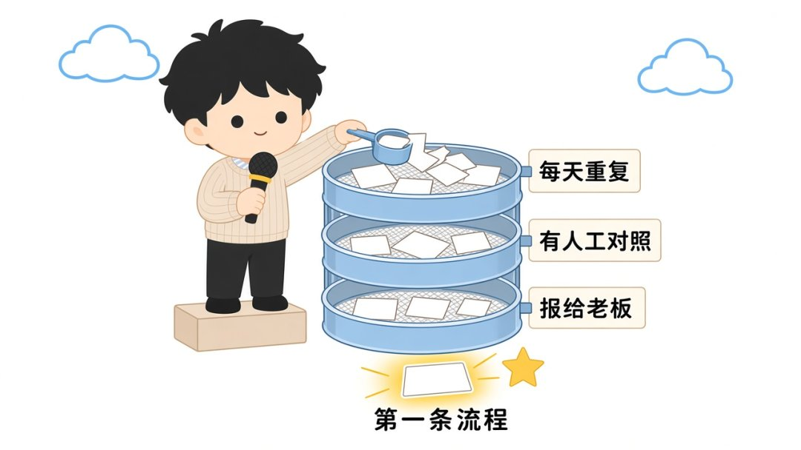
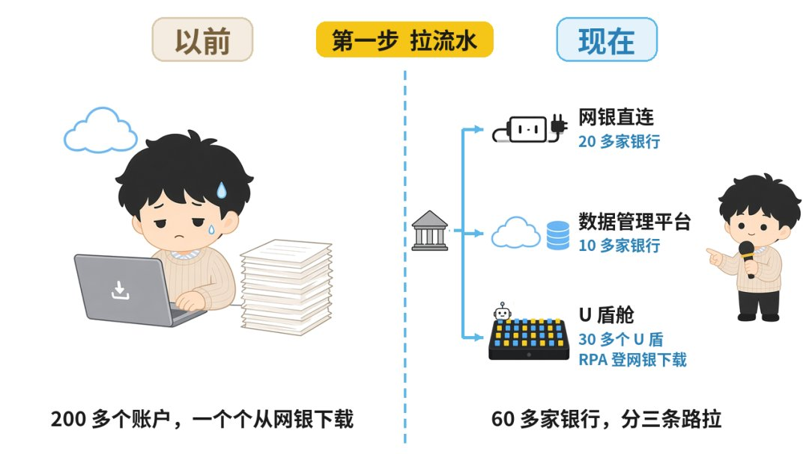
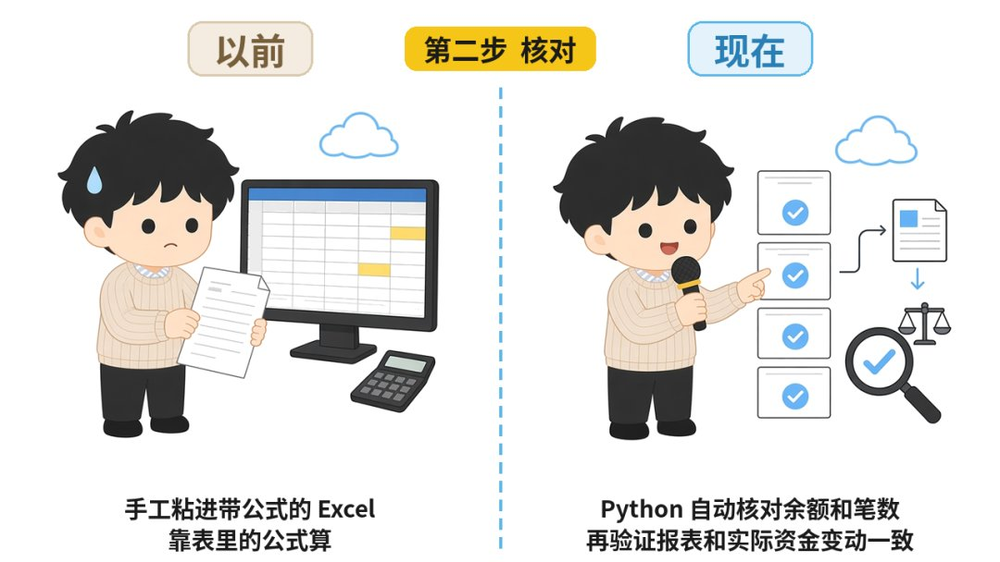
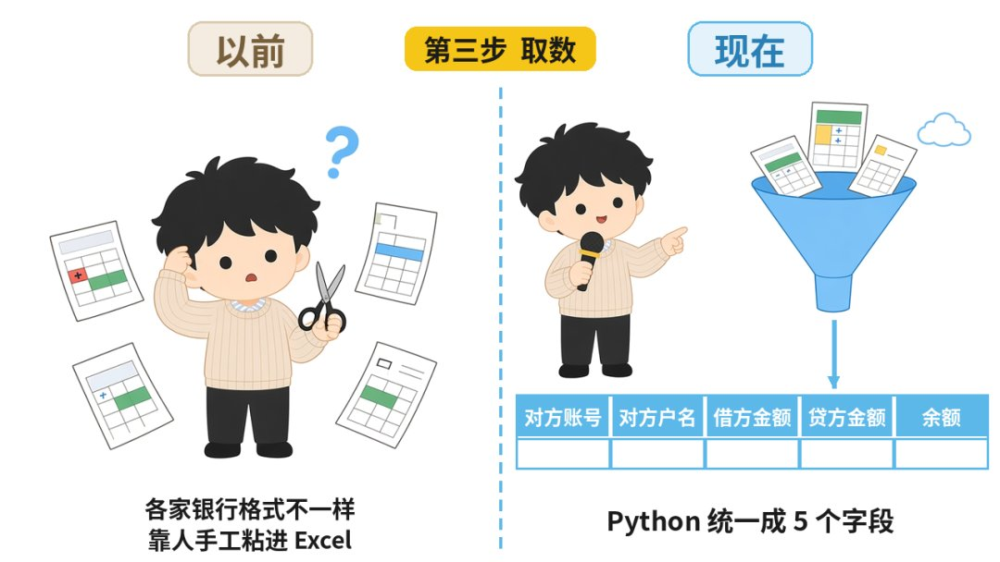
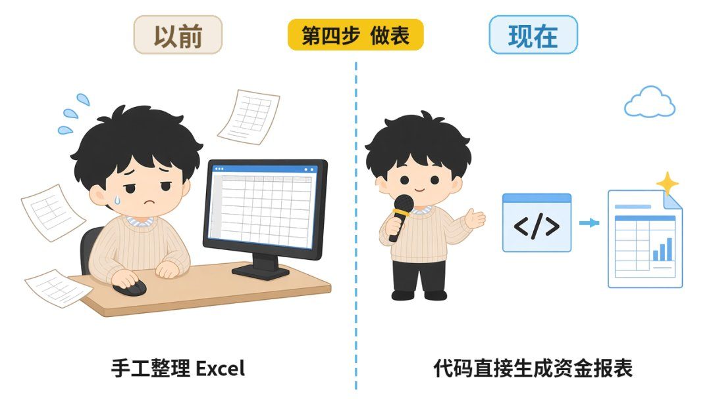
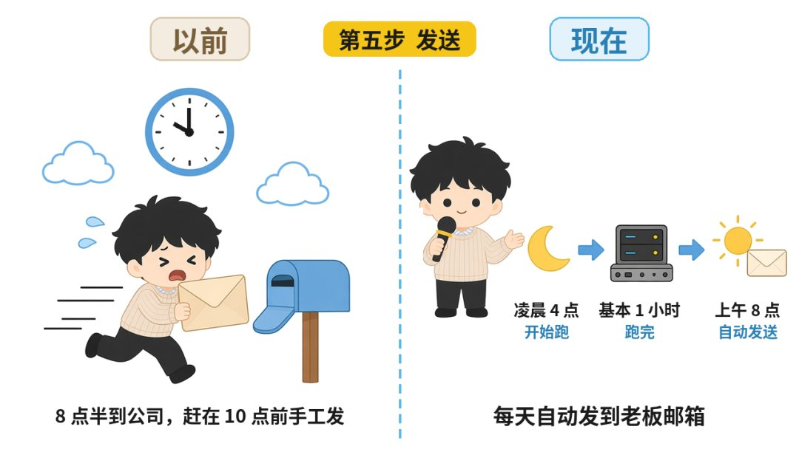
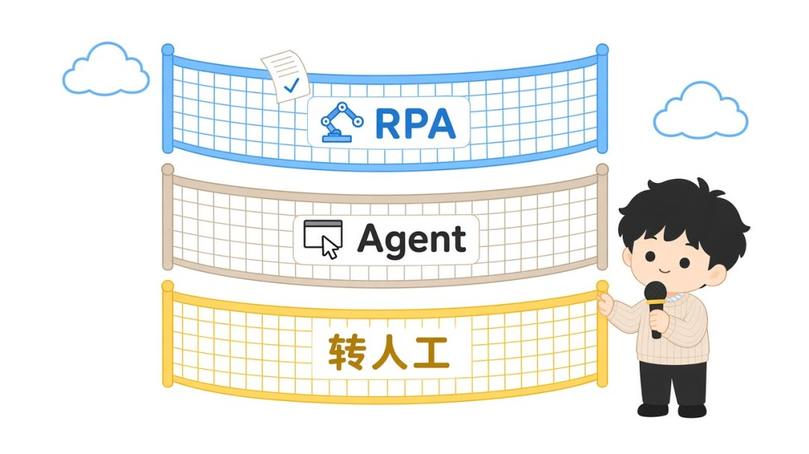

# FDE 落地实录：一张资金报表的流程改造

> 原文作者：做 FDE 的智昊（[@cnzhihao](https://x.com/cnzhihao)）
> 原文链接：https://x.com/cnzhihao/status/2114704253747089480
> 发布时间：2026 年 10 月 26 日 21:02 · 6 分钟阅读 · 浏览 3.3 万

作者简介：老板定方向，我带团队把 AI 落进业务流程。CPA 出身｜高管 FDE 训练｜企业主陪跑。每个案例的前后变化，都在 fhxqtech.com。

如果你是老板，想用 AI 改掉公司里每天靠人硬扛的流程，这篇讲一个 FDE 落地的完整案例供你参考。

前几个月，我在杭州一家制造业企业落地了一条资金报表自动化流程。

以前资金组每天上午 10 点前要赶出这张表。

现在报表每天上午 8 点自动发到老板邮箱，资金组每周复盘一次。

## 以前：每天上午像打仗

这家企业资金部 4 个人，管着 60 多家银行的 200 多个资金账户。

每天上午 10 点前，老板邮箱里要收到一张全集团的资金报表。

要出这张表，就得把 200 多个账户全部翻一遍，把流水从网银下载下来，手工粘进带公式的 Excel 表，再发到老板邮箱。

资金组每天上午 8 点半到公司，就和热锅上的蚂蚁一样点爆鼠标，赶在 10 点前把表发出去。

下面我按顺序讲，这条流程从选定到上线，我推进了哪几件事。

## 第一条自动化流程怎么选

这条流程是客户的财务总监提出来的，我判断可以先做，跟老板拍了板。

我一直觉得，离业务最近的负责人，最清楚每天哪件事最耗人。

下面三个条件是我事后总结的，你挑第一条自动化流程时可以直接拿来用：

- **每天重复。** 每天都做的事，自动化以后很快就能看出差别。
- **有人工结果可以对照。** 一直有人在做这张表，就有现成的答案可以比，AI 做得对不对，对一下就知道。
- **报给老板本人看。** 报表每天直接到老板邮箱，好不好老板天天看得到，也就有理由亲自牵头。

## 谁定什么

这件事里，老板牵头，我负责推进，财务总监和资金经理负责落地。

流程由资金经理来定。我的判断是，管这件事的人最清楚哪一步容易出错。

验收标准是我先提的，就一句话：Agent 出的结果，要和人工做的结果对得上。再由老板和团队一起确认。

我的看法是，验收标准一句话就够了：老板听得懂，资金经理也能执行。

## 以前和现在，每一步怎么变了

资金经理定下来的新流程是五步：拉流水、核对、取数、做表、发送。

我按步骤把以前和现在放在一起。

### 第一步，拉流水。

以前是人把 200 多个账户一个个翻一遍，从网银下载流水。

现在按银行分三条路拉，一共 60 多家银行：

- 20 多家银行有网银直连，走网银直连拉流水。
- 10 多家银行走数据管理平台。
- 剩下的银行只能插 U 盾登网银，一共 30 多个 U 盾，由 RPA 登网银、插 U 盾、下载流水。

这 30 多个 U 盾都插在一个 U 盾舱里。U 盾舱是一台能插几十上百个 U 盾的盒子，RPA 靠软件切换用哪个盾，不用人守在旁边插拔。

### 第二步，核对。

以前流水下载下来，手工粘进带公式的 Excel 表，靠表里的公式算。

现在 Agent 全部用 Python 处理数据，每个账户的余额和笔数，在流水账末尾自动核对，再验证资金报表和实际资金变动一致。

### 第三步，取数。

数从网银导出来的 Excel 表里取，主要是摘要、对方账号、对方户名、借方金额、贷方金额、余额。

各家银行的格式都不一样：有的只给一个变动额，用正负号代替借贷；有的写收入和支出；每一项所在的列也不一样。

以前这些都靠人手工粘进 Excel。

现在 Python 把各家的流水全部重刷成资金报表需要的格式，统一成对方账号、对方户名、借方金额、贷方金额、余额。

### 第四步，做表。

以前手工整理 Excel。现在代码直接生成资金报表。

### 第五步，发送。

以前人手工发到老板邮箱，赶在上午 10 点前。

现在每天上午 8 点自动发到老板邮箱。服务凌晨 4 点开始跑，基本一个小时跑完。定在 8 点发，是因为老板 8 点上班。

拉流水的三层兜底是我和我的团队设计的，按顺序来：

1. 先用 RPA。RPA 失败，一般是银行网站页面改版了。
2. 这时切到 Agent，用 computer-use 去操作。Agent 跑通以后，由 Agent 改脚本。
3. Agent 也失败，就通过飞书通知资金经理处理。资金经理处理时开着 RPA 录制，重新出一份脚本。

如果 Agent 核对发现报表和实际资金变动对不上，直接转人工，也由资金经理接。

上线以后基本没有转过人工。人把关的位置从每天做表，挪到了每周复盘。

## 交付和上线

这条流程原本预估 6 周，我的团队 9 天交付。

我去了客户现场，参加了 demo 和业务评审。

我团队的产品在现场出 demo，开发带回去做工程化：

- 现场开会、做出 demo、通过业务评审，约 2 天；
- 带回去工程化，包括需求确认、技术评审、demo 强化方案、开发测试，约 5 天；
- 产品测试验收，1 天。

前后 9 天。

和之前的软件开发工程化不同的是，demo 要在业务现场出：业务的人当场看、当场评，评审通过了再工程化，工程化之前业务的意见就已经收齐了。这套产研做法我之后会单独写一篇。

上线时没有直接硬切，新流程和人工并行跑了大约 2 周。

上线以后由资金经理负责维护，这是我建议的分工，我们团队只保证 Agent 正常运转。

资金组每周复盘一次，主要看两样：

- 每天流水拉取和处理花了多长时间。
- 最终数据和人工处理的结果对不对得上。

现在资金组不用每天上午 10 点前和打仗一样了，可以去做资金系统相关的需求沟通和改造。

## 第一周可以做的 6 件事

如果你想照这个案例走一遍，第一周可以先做这 6 件事：

1. 把每天、每周报到你桌上的报表列出来，标出哪几张还要靠人工汇总。
2. 问分管的高管最想先动哪条业务流程，第一条自动化流程最好由业务负责人提出来。
3. 用上面三个条件筛一遍：每天重复吗？有人工结果可以对照吗？是报给你本人看的吗？
4. 把这条流程按步骤拆开，每一步写清楚以前谁做、以后谁做、人在哪一步把关。如果要拉银行流水，先按数据来源给银行分类：哪些有网银直连，哪些走数据管理平台，哪些只能插 U 盾。
5. 和团队一起写一句验收标准，比如「和人工结果对得上」。上线时先和人工并行跑一段，对得上再切换。
6. 定下来上线后谁维护、多久复盘一次、复盘看哪几个数，以及自动化跑不通时通知谁。我的建议是业务上的事由业务部门的人管，外部团队只保证系统正常运转。

第一条自动化流程跑通以后，你们就有了一个看得见的样本，后面的流程照着它来就行。

如果你想在自己公司挑出第一条自动化流程、带团队跑起来，这就是我在做的事：先训练老板和高管，学会判断、知道 AI 能动哪里、能带队，再一起推进落地。

当然，你也可以在 fhxqtech.com 查看我们的案例。

---

## 配图（原文 13 张，按出现顺序）

