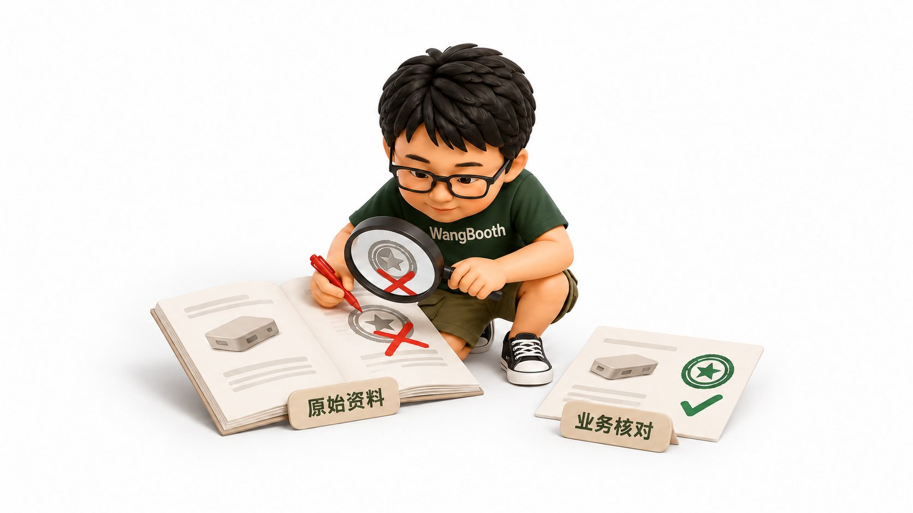
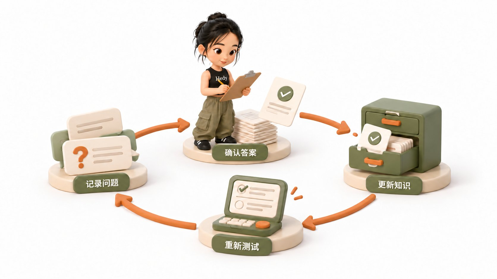

# 一线 FDE 深度复盘：企业 AI 知识库，从 demo 到真正用起来

> 原文作者：Hedy Zhang（[@xiaomanhedy](https://x.com/xiaomanhedy)）
> 原文链接：https://x.com/xiaomanhedy/status/2113174733344673956
> 发布时间：2026 年 10 月 22 日 15:44 · 8 分钟阅读 · 浏览 1.5 万

作者简介：夫妻档 FDE 团队｜真实 AI 企业落地。分享一线企业交付中真实案例和经验复盘。公开记录用 AI 重构组织与业务。把混乱变成系统，经验变成资产。FDE 同行者付费社群&咨询，vx：xiaomanok99（备注来意）。

很多人第一次看企业 AI 知识库的 demo，觉得技术已经成熟。资料放进系统，员工问问题，AI 查阅资料并回答就行。原来要翻手册或问同事的事，现在在聊天框里就能完成。

但一个问题随之而来：既然演示能回答，为什么到了企业里，还有那么多工作要做？

这篇就借我交付合伙人 2023 年曾做过的一个制造业知识库项目来做个详细拆解与复盘。

先说工期：当时这个知识库项目做了三个月，交付后又维护了三个月。

企业有网管，却缺少负责更新知识的人。外部团队结束维护后，系统曾经停滞。2024 年，有人接手改造，又继续使用。

整条链路包含八步：

**真实问题 → 小范围验证 → 资料核对 → 查询设计 → 业务验收 → 人工接管 → 知识更新 → 持续运营。**

接单前，把这八步中要做什么、由谁负责谈清楚，再开始建设。

## 一、客户为什么买：从每日耗时的工作痛点切入

我的交付合伙人服务的这家制造企业，研发人员每天反复被不同部门提问：

- 客服不懂产品找研发。
- 销售记不清型号找研发。
- 售后处理不了问题找研发。

客服、销售和售后都在问，研发就要反复停下手头的工作。公司还要花时间培训新人。新人离职后，同样的内容又得教一遍。

当时，我合伙人团队原本在谈广告业务，接触到知识库 Demo 后，用客户资料测试并演示给老板看。团队看到的是技术能力，老板想到的则是减少内部重复沟通和培训成本。

因此，跟客户聊知识库，先弄清楚一条具体流程：

**谁反复问，谁一直答，每次花多少时间，答错后有什么后果？**

如果这条流程说不清，只看到公司有很多 PDF，项目的核心价值就没找到。资料多只代表有东西可整理，有人持续需要里面的知识，才有使用价值。

## 二、签约前：拿真实问题碰真实资料

演示用的文档通常格式清晰，问题答案也在文档内，更容易展示出好效果。但企业每天面对的真实问题并不整齐：只记得半个型号、问旧产品、找具体参数，或者要找出符合条件的产品。

这里的关键是签约前，先安排约一周做小范围验证。具体时间按资料和需求来定，重点做四件事：

1. **收集真实问题**：查看客服、销售的聊天记录或研发被问的记录，不要只靠开发人员编测试题。
2. **检查代表性资料**：挑选扫描件、不规则表格、带参数的图纸和多版本产品文档进行测试。
3. **实际运行测试**：用真实问题测试资料，找出能查到、漏掉和需要人工补充的地方。
4. **确认业务专家**：由企业内部懂业务的人判断技术参数和行业知识是否正确。

如果资料分散且没人愿意收集、出现答案争议时没人确认，说明合作条件不具备。越早发现，越能及时调整或停止。

## 三、拆解需求：确定系统要实现什么

“这个产品有哪些认证”和“哪些产品有这个认证”，看起来相近，要求却不同。

第一个问题要查清某个产品的认证信息；第二个问题要把所有符合条件的产品找全。

早期通过检索文档片段交给模型回答，可以处理部分查询，但无法保证找出所有符合条件的产品。为此，团队后来把产品信息整理成表格导入数据库，走数据库查询来解决筛选问题。

面对客户的需求，要逐项问清：

- 查某个型号参数，还是筛出全部符合条件的型号？
- 找一段说明，还是比较几个产品差异？
- 允许提供相关线索，还是必须保证结果完整？
- 哪些问题需要来源，哪些需要业务人员确认？

明确这些验收标准，才能避免双方对结果产生误解。

## 四、资料导入：确保信息被正确读取

当时拿到的制造业产品手册里，有图纸、用线标出的参数，还有不规则表格。解析工具很难完整提取这些信息。

当年的解析工具处理这些资料时遇到困难。团队评估定制算法成本过高，最终安排两人手工整理必要信息并交叉检查。

这属于当年的技术选择。今天做同类项目，要重新测试手头工具的能力。交付时必须确认：

**图表信息、表格对应关系、型号与参数，有没有完整保留？**

文件上传后台只代表接入完成。必须用真实问题检查系统是否能找到关键内容，提取的含义是否与原件一致。如果前期整理成本极高，后续每月新增资料由谁处理，必须提前算清。

## 五、源头纠错：追踪并修正原始手册

验收时发现系统给出的认证信息错误。排查后发现，原始 PDF 中本身就有标错或漏标的内容。

此时调整提示词无法解决问题，必须由懂产品的人确认正确内容，修改原始资料后重新接入。

这次验收暴露了一个更大的问题：发现一处错误可以修改，但整批资料由谁负责核对？项目开始时就要明确：

- 谁确认资料有效？
- 出现冲突找谁？
- 确认后的修改如何落地？

每一类重要知识，都要有人确认。再指定一个负责人，推动修改、更新和复测。系统出错时，团队才知道该找谁。

## 六、业务验收：关注员工的实际等待时间

早期模型在部分产品型号上回答不够准。按我的交付合伙人的回忆，团队当时换了模型，部分回答有所改善，但等待时间从约十秒增加到四五十秒。

在连续接待客户的客服现场，等待时间过长会严重影响使用。因此，验收指标必须包含：

- 回答是否正确。
- 是否遗漏关键条件。
- 来源能否核对。
- 等待时间是否符合岗位要求。
- 员工看完后需要做多少检查。
- 答不好时下一步如何处理。

必须让懂业务的专家参与验收。研发若不认可系统内容，客服最终还是会回去找研发。

## 七、设计人工接管路径

我们倾向于先将知识库用于内部，让客服和销售获取参考答案，逐步过渡到对外使用。

对于第一次做项目的小团队，推荐这条路径：

**员工提问 → 系统给出答案和依据 → 员工核对 → 无法确认时交由业务专家。**

演示时只展示正确部分，上线后若发现答不出来的问题无处可去，员工仍要自己找人，处理流程也就没有接完整。

## 八、人工答过的问题，怎样留给下一个人用

客服向研发问出答案服务完客户后，如果记录只留在聊天里，第二天换个客服又得重新问。

为了让系统"越用越聪明"，需要落实五步动作：

1. 记录没有答好的问题、提问和原回答。
2. 请懂业务的人确认正确答案及适用条件。
3. 审核内容是否进入正式知识库。
4. 更新资料并处理旧内容冲突。
5. 用原问题测试，确认系统能正确回答。

聊天里的随口回答不能直接变成正式知识。把临时处理或特殊客户的上下文丢掉，单留一句话会误导别人。知识沉淀的目标是让下一个人在合适条件下得到可靠答案。

## 九、有网管，还得有人管知识

项目交付后，客户有网管维护电脑和网络，却缺少知识运营负责人。

系统打不开找网管，但系统用旧资料回答、答案有争议、员工反复问同样的问题，必须有人处理。

外部团队撤场后，系统曾停滞；2024 年有合适的人接手并改造后才继续使用。

交付后必须明确：谁收集更新，谁确认内容，谁处理反馈，谁推动这些事按时完成？如果回答是"以后看情况"，持续运营就无法落实。

## 十、报价时，把建设、维护和知识更新分开算

这类项目有个非常现实的问题：企业资料很散，整理费劲，价格又谈不上去，这单怎么算？

先算清工作量，再和客户谈范围。四类工作要分别说清楚：

| 工作类型 | 需要谈清楚的内容 |
|---|---|
| 初次建设 | 接入哪些资料，整理到什么程度，支持哪些问题 |
| 软件维护 | 出现故障找谁，支持多久，修复范围是什么 |
| 知识运营 | 谁处理新增资料、旧版本、错误答案和使用反馈 |
| 新增需求 | 新部门、新场景、新系统接入，怎样重新评估 |

分清工作，才能核算成本。但客户是否买单，还要看这些工作解决了什么问题。

客户现有方案够用，就先用着。有问题没解决，先评估能否缩小范围做验证。双方对投入和价格谈不拢，就先不接这单。签约前没有算进去的持续工作，不能留到后面靠加班承担。

## 十一、资料少、用得少，先试简单办法

只有几十份资料、少数人偶尔查阅的小公司，可以先拿现有文档测试简单方案。

但不能只看资料数量，还要看查询频次、成本、准确性、更新后能否找到正确版本，以及是否需要权限管理。

先拿一批日常问题测试，记录失败的地方。如果漏项严重、版本混乱或需要多人协作，再针对具体问题补足能力。若要求资料放本地，必须分清是文件本地存储还是模型本地运行，数据流向要符合实际需求。

## 最后：系统交付了，知识还得有人管

demo 的价值在于让客户看到了解决问题的可能性，但要将可能性转化为日常价值，中间有大量具体工作要做。

真实问题要拿出来，资料要有人确认；找相关内容和完整筛选要分清；回答速度要放入岗位测试；系统答不好时要有人接手；人工解决过的问题要沉淀为可用知识。

项目验收完成后，研发是否还在回答同样的问题，客服是否愿意打开系统，新产品资料是否有人整理，错误是否被修正，这些才是判断知识库是否真正落地的重要标准。

下次见客户时，除了谈功能，记得问一句：

**这套系统交付以后，公司里谁来让里面的知识一直可用？**

## 附：企业 AI 知识库落地检查清单

**1. 值不值得做**

- 谁在反复提问，原来由谁回答？
- 问题发生多频繁，消耗多少时间？
- 新人培训和答错问题分别带来什么成本？
- 现有办法已经解决了什么，还缺哪一步？

**2. 有没有条件做**

- 能否拿到真实问题和代表性资料？
- 谁负责协调资料，谁提供正确答案？
- 原始知识尚未记录时，谁来补充？
- 第一阶段的用户、范围和结果是否清楚？

**3. 资料是否可用**

- 关键图表、型号和参数是否被正确提取？
- 谁确认内容的真实性和有效版本？
- 历史资料与现行资料怎样区分？
- 人工核验的范围和成本是否已计入？

**4. 问题是否分清**

- 哪些是单项查询，哪些要求完整筛选？
- 哪些需要跨资料比较？
- 怎样检查遗漏和错误？
- 哪些答案需要展示依据？

**5. 怎样验收**

- 测试问题是否来自日常工作？
- 懂业务答案的人是否参与？
- 正确性、完整性、等待时间怎样评估？
- 系统不能回答时，员工知道下一步找谁吗？

**6. 怎样持续使用**

- 新资料由谁收集，旧资料由谁处理？
- 错误答案由谁确认和修正？
- 人工解决的新问题怎样进入知识库？
- 更新之后，谁负责重新测试？

**7. 服务边界是否讲清**

- 初次建设覆盖哪些资料和场景？
- 软件维护、知识运营分别由谁承担？
- 服务期结束以后怎样交接？
- 新需求和持续工作怎样重新评估投入？

---

## 配图（原文 6 张，按出现顺序）

