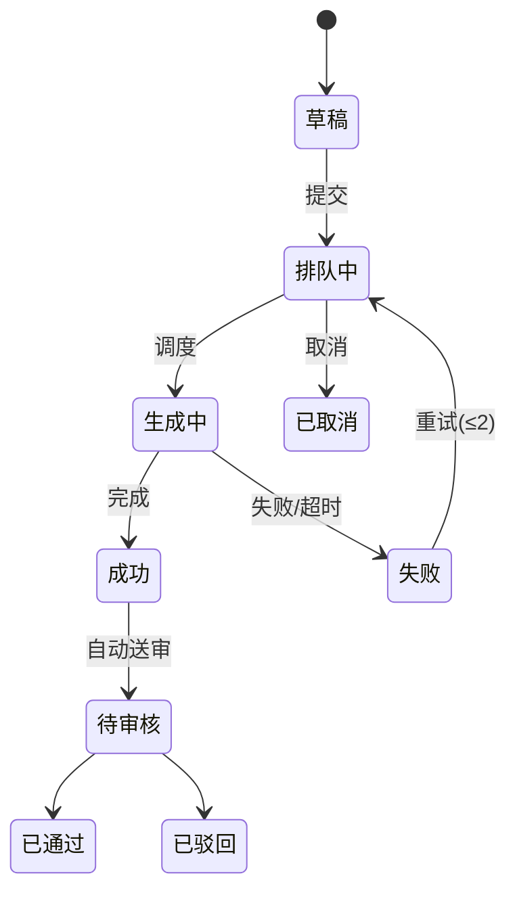
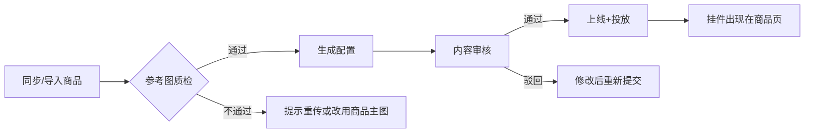

# 试穿云 LookFit · 产品需求文档（PRD）

| 项 | 内容 |
|---|---|
| 版本 | v0.1（首版评审稿） |
| 日期 | 2026-11-16 |
| 状态 | 待评审 |
| 定位 | 面向服饰商家的虚拟试穿 SaaS，双引擎：C 端试穿挂件 + 商家素材工厂 |
| 参考产品 | Anywear: Live Virtual Try-On（Decart，Chrome 扩展） |
| 配套文档 | [技术方案-虚拟试穿SaaS.md](./技术方案-虚拟试穿SaaS.md) |

**标注约定**：`[事实]` 来自公开可查资料；`[判断]` 由事实推导的产品决策；`[Assumption, TBD]` 为待验证假设；`[TBD]` 为会改变产品行为的未决信息。

---

## 1. 背景与问题

### 1.1 参考产品做了什么（事实基线）

| 维度 | Anywear / Decart 的实际情况 | 对我们的含义 |
|---|---|---|
| 形态 | 桌面 Chrome 扩展 + 独立 Web 试衣间；把服装图拖进页面浮窗，摄像头实时看到「自己穿着它」 | 形态是**消费者自用工具**，不是商家 SaaS |
| 能力 | 实时视频试穿（视频流按服装参考图逐帧重绘），可切换服装而不重连 | 核心差异点，非「上传照片出图」 |
| 成本水平 | 底层 Decart 实时模型 720p 约 \$0.02/秒，fast 模式 \$0.04/秒 `[事实]` | 实时试穿是**高单价能力**，不能当免费额度无限发放 |
| 定价 | 官网 \$1.99/60 秒、\$4.99/5 分钟，无订阅；摄像头原画预览免费 `[事实]` | 按**秒**计量、按时长售卖是可行模式 |
| 明确边界 | 官方声明「AI 预览不用于判断合身」`[事实]` | 合身/尺码是**未被满足的相邻需求**，可作为差异化 |
| 规模 | 约 6 万活跃用户、3.2/5 分（69 个评分）`[事实]` | 需求真实存在，但「好不好用」仍有大量改进空间 |
| 能力可采购性 | Decart 将 Lucy VTON 作为标准 API 售卖；阿里云 Aidge 已提供图片试穿 API `[事实]` | 试穿能力正在商品化，**壁垒在商家侧的接入、素材、数据与合规** |

### 1.2 目标市场现状

`[事实]` 淘宝 App 已上线官方「AI 试穿」：用户上传照片即可模拟穿着效果，并支持参考购物车/收藏做搭配。这意味着：

- 在淘宝站内做**同质化的照片试穿**，正面撞平台自有能力，商家没有理由额外付费；
- 第三方真正的空间是：**实时视频试穿**（平台未覆盖）、**商家素材生产**（直接省钱）、**跨平台统一投放与数据**（平台不做）、**尺码与合身建议**（Anywear 官方明确不做）。

### 1.3 问题 → 决策 → 预期结果

```
服饰商家：拍模特图/视频贵、慢、SKU 一多就排不上期
消费者：看平铺图无法判断「上身效果」，怕买错尺码
        ↓
决策：做一个商家可自助接入的 SaaS，提供两条共用模型能力的产线
  ① 素材工厂：白底图/平铺图 → AI 模特上身图 + 短视频（替代实拍）
  ② 试穿挂件：详情页/H5 让消费者拍照或开摄像头试穿（提升决策确定性）
  两条线共用商品数据、模型路由、审核与计费
        ↓
预期结果（可观察，非量化承诺）
  - 商家无需实拍即可上线「模特上身」素材，且能逐 SKU 批量补齐
  - 消费者在商品页内 ≤ 8 秒看到自己穿着该商品的效果，或 ≤ 1.5 秒看到实时首帧
  - 商家能看到「试穿 → 加购 → 成交」的链路数据，并据此判断是否续费
```

---

## 2. 目标与产品契约

### 2.1 产品定位

**试穿云 LookFit** 是给服饰商家用的虚拟试穿基础设施：商家把自己的商品接进来，我们同时产出「能卖货的素材」和「能降低决策成本的试穿体验」，并按用量计费。

三条不与平台正面竞争的原则：

1. **不做平台级流量入口**，只做商家自有阵地（详情页、店铺页、客服话术、直播、私域 H5）。
2. **实时是溢价能力**，图片是普惠能力；两者共用一套商品与配置数据。
3. **合规先行**：人脸/人体影像按敏感个人信息处理，境内租户数据不出境（见 §7.3 与技术方案 §9）。

### 2.2 目标用户与核心任务

| 角色 | 场景与任务 | 成功的样子 |
|---|---|---|
| 商家运营（主角色） | 把在售商品成批开启试穿，配置挂件样式与入口 | 10 分钟内完成首批 20 个 SKU 的试穿上线，无需开发 |
| 商家视觉/内容 | 用平铺图批量生成模特图与短视频，投主图/详情/信息流 | 一次提交 50 张任务，≥ 90% 可用，可打包下载 |
| 消费者（终端用户） | 在商品页判断「我穿是什么样、买哪个码」 | 不跳 App、不注册，8 秒内看到结果并可换码/保存 |
| 我方平台运营 | 审核素材、控配额、处理模型降级与投诉 | 单条投诉 30 分钟内可定位到会话与模型调用 |

### 2.3 产品契约

| 契约项 | 定义 |
|---|---|
| 触发 | 商家在控制台为商品开启试穿 → 挂件出现在商品页；消费者点击「试穿看看」 |
| 核心任务 | 用消费者本人的影像 + 商家指定商品，生成可信的上身效果，并给出尺码建议 |
| 完成条件 | 消费者看到结果图/视频，且能保存、分享或直接换尺码重试；商家侧产生一条可计量的用量记录 |
| 共享对象 | 商品试穿配置 `ProductTryOnConfig`、生成任务 `GenerationJob`、试穿会话 `TryOnSession`、素材 `Asset` |
| 信任基础 | 结果标注「AI 生成」；不承诺合身度；原图默认不落盘；可一键终止与删除 |

### 2.4 目标（定性、可验证）

- 商家可**零开发**完成接入：注册 → 绑定店铺 → 同步商品 → 开启 → 拿到挂件代码/二维码。
- 素材工厂的**失败可恢复**：单条失败不阻塞批次，失败项可单独重试且不重复扣费。
- 试穿挂件的**降级可见**：实时不可用时自动落到图片试穿并明确告知，而不是白屏或无限转圈。
- 每一笔用量**可追溯**：商家账单上的每一次计费都能定位到具体任务/会话、时间与模型。

---

## 3. 范围

### 3.1 P0（首版必须完成）

| 编号 | 能力 | 为什么在 P0 |
|---|---|---|
| A | 商家注册、租户与团队、店铺绑定 | 没有它就不是 SaaS |
| B | 商品/SKU 同步（API + Excel 双通道） | 决定接入成本，是留存的第一道门 |
| C | 商品试穿配置与参考图质检 | 决定生成质量，也决定算力浪费率 |
| D | 素材工厂（模特图 + 短视频，批量任务） | 商家付费的最直接理由 |
| E | 拍照试穿（异步） | 覆盖无摄像头/弱网/移动端主场景 |
| F | 实时视频试穿（限时会话） | 对齐参考产品的差异能力 |
| G | 尺码推荐 | 补齐参考产品明确不做的空白 |
| H | 挂件投放（Web SDK / H5 + 二维码 / 平台场景包） | 决定「挂进店铺」是否真的成立 |
| I | 效果看板（曝光→试穿→加购→成交） | 续费依据 |
| J | 订阅 + 用量计费、额度与超限策略 | 商业模式闭环 |
| K | 审核、合规授权、AI 标识、审计日志 | 不做就无法上线 |

### 3.2 P1（首版后）

- 直播场景实时试穿（OBS/直播伴侣旁路）；
- SKU 变更自动重生成素材、素材版本对比与 A/B；
- 多语言 + 跨境独立站（含海外模型路由）；
- 开放 API / Webhook、私有化与专有云部署；
- 搭配推荐（上衣+下装+鞋包组合试穿）。

### 3.3 明确不做

- **3D 数字人 / AR 骨骼跟踪**：成本与稳定性不匹配当前阶段，且与「2D 生成式试穿」是两条技术路线。
- **站内交易闭环、代运营、模特经纪**：不是软件产品。
- **全品类扩张**：首版只做服饰（上装、下装、连衣裙、外套），鞋包配饰按「配饰试戴」P1 处理。
- **对消费者的独立 C 端 App**：只做商家阵地内的挂件。

### 3.4 最小完整旅程（端到端可演示）

```
商家注册 → 绑定店铺 → 同步 20 个 SKU → 为 3 个 SKU 开启试穿（自动质检）
→ 拿到挂件代码 → 嵌入商品页 → 消费者点「试穿看看」
→ 拍照试穿出图（8s 内）→ 看到尺码建议 → 加购
→ 商家看板看到「曝光 120 / 试穿 18 / 加购 4」
→ 月底账单单据可逐条对上
```

失败恢复路径（必须可走通）：消费者照片人体未检出 → 提示重拍并给出拍摄示例 → 重拍成功；实时会话网络中断 → 自动落图片试穿并退还未消耗时长。

---

## 4. 角色、对象与状态

### 4.1 角色与权限矩阵

| 能力 | 租户所有者 | 运营 | 视觉/内容 | 只读/财务 | 我方平台运营 |
|---|---|---|---|---|---|
| 店铺绑定/解绑 | ✅ | ❌ | ❌ | ❌ | ✅（工单触发） |
| 商品同步 | ✅ | ✅ | ❌ | ❌ | ✅ |
| 试穿配置上下线 | ✅ | ✅ | ❌ | ❌ | ✅ |
| 素材生成与下载 | ✅ | ✅ | ✅ | ❌ | ✅ |
| 挂件样式与入口文案 | ✅ | ✅ | ❌ | ❌ | ✅ |
| 看板与导出 | ✅ | ✅ | 仅素材相关 | ✅ | ✅ |
| 订阅/发票/额度购买 | ✅ | ❌ | ❌ | ✅ | ✅ |
| 成员与角色管理 | ✅ | ❌ | ❌ | ❌ | ✅ |
| 敏感数据删除请求 | ✅ | ❌ | ❌ | ❌ | ✅ |

规则：一个租户可绑定多个店铺；同一商品在同一店铺内只能有一条生效中的试穿配置；跨租户数据不可见、不可检索、不可导出（平台运营需工单授权且留痕）。

### 4.2 核心对象

| 对象 | 关键字段 | 说明 |
|---|---|---|
| Tenant | 租户名、套餐、额度余额、数据区域（境内/境外） | 计费与隔离的根 |
| Store | 平台（淘宝/天猫/抖音/有赞/独立站）、店铺 ID、授权凭证引用 | 凭证只存引用，不存明文 |
| Product / SKU | 标题、类目、主图、平铺图、价格、尺码表 | 同步或导入 |
| ProductTryOnConfig | 商品 ID、参考图、类目适配、挂件类型、入口文案、状态 | 一个商品一条 |
| GenerationJob | 类型（图/视频）、输入素材、模型、参数、优先级、状态 | 素材工厂任务 |
| TryOnSession | 渠道、设备、输入类型（照片/实时）、时长、结果、耗量 | C 端会话 |
| Asset | 类型、来源任务、审核状态、CDN 地址、水印标识 | 生成产物 |
| UsageRecord | 计量项、数量、单价、幂等键、结算周期 | 账单最小单元 |
| ConsentRecord | 用户标识（哈希）、授权范围、时间、撤回状态 | 合规证据 |
| ModerationRecord | 对象、结果、命中项、处置动作 | 内容安全留痕 |

### 4.3 状态机

**GenerationJob**

| 当前状态 | 可执行动作 | 下一状态 | 触发者 |
|---|---|---|---|
| 草稿 | 提交 | 排队中 | 商家 |
| 排队中 | 开始处理 | 生成中 | 调度器 |
| 排队中 | 取消 | 已取消 | 商家 |
| 生成中 | 完成 | 成功 | Worker |
| 生成中 | 失败/超时 | 失败 | Worker / 超时器 |
| 失败 | 重试（≤ 2 次，不重复计费） | 排队中 | 商家 |
| 成功 | 送审 | 待审核 | 系统 |



**TryOnSession**

| 状态 | 说明 | 退出条件 |
|---|---|---|
| 初始化 | 创建会话、校验额度与商品状态 | 进入授权 |
| 已授权 | 用户完成人脸/人体影像使用同意 | 进入连接/生成 |
| 生成中 | 图片任务执行或实时流连接 | 成功/失败/取消 |
| 进行中 | 实时流稳定输出 | 用户结束/超时/断流 |
| 已完成 | 结果可取、已计量 | 终态 |
| 已降级 | 实时失败转图片试穿 | 终态或转已完成 |
| 已取消 | 用户主动终止 | 终态，未消耗部分退还 |

**ProductTryOnConfig**：未配置 → 质检中 → 待审核 → 已上线 → 已下线（可回到待审核）。质检不通过不允许上线。

---

## 5. 核心流程

### 5.1 商家上线一个可试穿商品



关键限制：质检不通过**不允许**消耗用户额度硬生成；审核未通过的商品不投放。

### 5.2 消费者试穿

```
进入商品页 → 看到「试穿看看」入口（可关闭）
  → 点击 → 打开挂件（iframe 沙箱，不跳出页面）
  → 选择方式：拍照试穿 / 实时试穿
      ├─ 拍照：上传或拍摄 → 本地质检（人脸/人体/清晰度）→ 异步生成（进度可见）
      └─ 实时：摄像头授权 → 会话计时开始 → 逐帧试穿 → 用户结束
  → 结果页：效果图/视频 + 尺码建议 + 「AI 生成」标识 + 保存/分享/换码
  → 事件上报（曝光/点击/试穿成功/加购跳转）
```

### 5.3 素材生产

```
选商品/上传平铺图 → 选模板（模特体型/场景/姿势）→ 选产出类型（图/5-15s 视频）
→ 批量提交 → 队列按优先级调度 → 逐条出结果 → 自动审核 → 打包下载 / 直推商品
```

---

## 6. 功能需求

> 每个模块统一给出：目的、触发、规则、结果与状态变化、异常。共享规则见 §7，不在此重复。

### M1 商家接入与商品同步

**目的**：让不懂技术的运营在 10 分钟内把商品接进来。

| ID | 需求 | 规则 |
|---|---|---|
| FR-101 | 注册与租户创建 | 手机号/邮箱注册即创建租户；租户默认「所有者」角色；同一租户最多 20 个成员（P0） |
| FR-102 | 平台店铺绑定 | 支持淘宝/天猫、抖音、有赞、独立站（URL + 密钥）；授权凭证加密存引用，界面只显示「已绑定/已过期」 |
| FR-103 | 商品同步 | 两条通道：①平台 API 增量同步（授权后手动/每日触发）；②Excel 模板导入（列：商品ID、标题、类目、主图URL、平铺图URL、价格、尺码表）。两者冲突时以最近一次人工编辑为准 |
| FR-104 | SKU 与尺码表 | 尺码表支持「标准模板」与「自定义」；缺少尺码表的商品允许上线试穿，但不展示尺码建议（见 FR-601） |
| FR-105 | 类目适配判定 | 仅服饰类目可开启试穿；非服饰类目在列表置灰并说明原因，不允许强行开启 |
| FR-106 | 同步结果可见 | 每次同步给出：新增/更新/失败条数、失败原因可下钻到单条 |

**结果**：商品列表出现可操作条目，状态为「可配置」。
**异常**：授权过期 → 提示重新授权，已在线的试穿配置**保持在线**但停止同步；导入文件格式错误 → 拒绝整批并给出首个错误行号，不做部分导入。

### M2 试穿配置与参考图质检

**目的**：在不牺牲体验的前提下，把「注定生成不好」的输入挡在算力之外。

| ID | 需求 | 规则 |
|---|---|---|
| FR-201 | 参考图选择 | 默认取商品平铺图/白底图；可上传；仅接受 JPG/PNG/WebP，≤ 10MB，短边 ≥ 800px |
| FR-202 | 自动质检 | 检查：主体是否单件、是否平铺/挂拍（非真人模特图）、是否有遮挡、是否低清、是否含文字水印、是否含敏感图案。输出 通过/警告/不通过 + 具体原因 |
| FR-203 | 质检分级处置 | 通过 → 可上线；警告 → 可上线但提示「效果可能不稳定」；不通过 → 禁止上线，给出重传指引 |
| FR-204 | 商品级参数 | 可设置：默认展示码数、是否展示尺码建议、挂件入口文案（≤ 8 字）、入口位置（详情页首屏/价格下方/悬浮球） |
| FR-205 | 批量开启 | 支持按筛选条件批量开启，逐条独立质检，失败项不影响其余 |
| FR-206 | 上下线 | 下线立即停止投放；已生成的会话结果不受影响；下线不退还已消耗额度 |

**结果**：商品进入「待审核 / 已上线」。
**异常**：参考图为真人模特图 → 不通过（避免二次换装导致的画面崩坏与肖像风险）；同一商品重复提交 → 幂等，不新建配置。

### M3 素材工厂（商家侧 AIGC）

**目的**：用商品平铺图批量产出可直接上架的模特图与短视频，替代部分实拍。

| ID | 需求 | 规则 |
|---|---|---|
| FR-301 | 模板选择 | 模特模板（体型/肤色/年龄段）+ 场景模板（棚拍/街拍/室内）+ 姿势模板；模板由平台维护，P0 不少于 12 套 |
| FR-302 | 产出类型 | ①上身静图（单张）②多姿势组图（≤ 6 张）③短视频 5–15 秒（含轻微动作，无口播） |
| FR-303 | 批量提交 | 单批 ≤ 100 条；按套餐并发上限排队；支持优先级（付费加急） |
| FR-304 | 进度与通知 | 任务列表显示排队位次与预计完成区间（区间由近 1 小时同类任务实测中位数给出，不承诺精确时间） |
| FR-305 | 结果可用性 | 每条结果可「采用/重生成/废弃」；重生成消耗额度，废弃不返还已消耗额度 |
| FR-306 | 下载与直推 | 支持 ZIP 打包下载（含 CSV 映射商品ID）；支持直推为商品素材位（P0 仅记录，不做平台写回） |
| FR-307 | 失败重试 | 单条失败可重试 ≤ 2 次；因我方原因失败不重复扣费 |
| FR-308 | AI 标识 | 图片结果角标「AI 生成」不可关闭；视频角标默认开启，商家可在合同约定下关闭，但不可移除隐式标识（见 §7.3） |

**结果**：Asset 进入待审核 → 通过后可下载。
**异常**：平铺图分辨率不足 → 提交时即拦截；批量中单条失败 → 批次标记「部分成功」，成功项照常计费。

### M4 拍照试穿（C 端，异步）

**目的**：覆盖绝大多数移动端消费者，成本可控，是所有商家的默认能力。

| ID | 需求 | 规则 |
|---|---|---|
| FR-401 | 入口 | 挂件以悬浮按钮/内嵌卡片呈现；首屏不自动弹窗，不阻断浏览 |
| FR-402 | 授权 | 首次使用必须展示「影像用途说明 + 单独同意」，同意后方可选择照片；拒绝则只能看静态示例 |
| FR-403 | 输入方式 | 相册选择 / 调起相机；单张；≤ 10MB；支持前置拍摄引导框 |
| FR-404 | 本地预检 | 客户端做人体检出、清晰度、遮挡、多人检查；不通过时**不上传**，直接提示重拍并给出示例 |
| FR-405 | 生成 | 服务端异步生成，前端展示进度条（分「排队/生成/美化」三段的模糊进度，不显示虚假百分比） |
| FR-406 | 结果页 | 原图/效果图对比（可拖动分割线）、尺码建议、保存到相册、分享、「AI 生成」标识 |
| FR-407 | 换装 | 同一会话内可切换同商品其他颜色/尺码，计费规则见 FR-904 |
| FR-408 | 超时 | 超过 45 秒未出结果 → 展示「生成较慢」并提供稍后查看（结果落消息中心/短链） |
| FR-409 | 删除 | 结果页提供「立即删除我的照片与结果」，删除后不可恢复 |

**结果**：消费者看到结果；产生一条计量记录。
**异常**：额度耗尽 → 挂件显示「该商品暂不可试穿」，不向消费者暴露商家账单信息；生成失败 → 自动重试 1 次，仍失败则提示并**不计费**。

### M5 实时视频试穿（C 端，WebRTC）

**目的**：对齐参考产品的核心体验，用于活动、直播、高客单商品与商家素材演示。

| ID | 需求 | 规则 |
|---|---|---|
| FR-501 | 设备与浏览器 | 仅在有摄像头且浏览器支持 WebRTC 时展示入口；移动端默认隐藏（P0），可用时以「实时试穿（Beta）」标注 |
| FR-502 | 会话时长 | 默认单次 30 秒体验额度；商家可配置 15/30/60 秒；到时进入 5 秒倒计时后可续（续期消耗额度） |
| FR-503 | 计量 | 从「模型连接成功」开始按秒计量，连接中与失败不计费；用户提前结束按实际秒数计费 |
| FR-504 | 实时换装 | 会话内切换颜色无需重连，切换过程展示旧画面直至新结果首帧到达 |
| FR-505 | 首帧与帧率 | 首帧目标 ≤ 1.5 秒；稳态 ≥ 15fps（720p）；不达标时自动降级到 540p 并提示 |
| FR-506 | 断流降级 | 网络中断 > 3 秒 → 自动结束会话、结算实际时长、提供「改用拍照试穿」 |
| FR-507 | 隐私 | 画面不落盘、不录制；结束即销毁；页面明确「离开即停止」 |
| FR-508 | 录制（P1） | 允许用户录制 5 秒片段分享，需再次授权，且带 AI 标识 |

**结果**：实时会话结束，产生秒级计量；用户可转拍照试穿继续。
**异常**：摄像头被占用/拒绝授权 → 引导改用拍照；GPU 池无可用资源 → 排队提示并给出预计等待；等待 > 20 秒自动转拍照试穿。

### M6 尺码推荐

**目的**：解决参考产品明确不覆盖的「买哪个码」，直接关联退货率。

| ID | 需求 | 规则 |
|---|---|---|
| FR-601 | 数据来源 | 商家尺码表（必填项：部位、各码数值、单位）+ 商品版型标签（修身/常规/宽松，商家填）+ 用户填写的身高体重（可选） |
| FR-602 | 计算 | 有身高体重且尺码表完整 → 给出「推荐码 + 置信度（高/中/低）」；仅有尺码表 → 给出「按尺码表对照的建议」并标注仅供参考；两者都缺 → 不展示该模块，不编造 |
| FR-603 | 展示 | 结果页与商品页的尺码模块均可展示；必须显示「AI 建议，非合身承诺」 |
| FR-604 | 用户反馈 | 提供「这个码合适/偏大/偏小」，写回商品维度统计（仅商家可见） |
| FR-605 | 边界 | 不支持童装、内衣等特殊品类（P0 直接不展示） |

**异常**：尺码表单位混用（cm/inch）→ 强制商家在录入时选择单位，不做自动猜测。

### M7 投放与嵌入

**目的**：让「挂进店铺」这件事在淘宝、抖音、独立站都能真的落地。

| ID | 需求 | 规则 |
|---|---|---|
| FR-701 | Web SDK | 一行 `<script>` + 商品 ID 即可注入入口；提供 `data-position`、`data-theme`、`data-text` 参数；SDK 体积 ≤ 30KB gzip |
| FR-702 | iframe 隔离 | 挂件内容在 iframe 内，样式与宿主隔离；不读取宿主 Cookie；只通过 `postMessage` 传商品 ID 与事件 |
| FR-703 | H5 + 二维码 | 每个商品生成独立 H5 链接与二维码，用于不能嵌 JS 的页面（淘宝详情页图片位/客服话术/包裹卡） |
| FR-704 | 平台场景包 | 淘宝/天猫：提供「详情页图片位素材 + 二维码 + 客服快捷话术」；抖音：提供「短视频挂载文案 + 主页链接」；独立站：SDK 直嵌 |
| FR-705 | 入口可关闭 | 消费者可关闭入口，同一设备 7 天内不再自动展示（不弹窗，仅隐藏） |
| FR-706 | 域名白名单 | SDK 只允许在商家登记的域名下运行，未登记域名返回 403 而非静默失败 |
| FR-707 | 埋点 | 标准事件：曝光、点击、试穿发起、试穿成功、换码、加购跳转、分享 |

**异常**：宿主页面 CSP 禁止外部脚本 → 自动降级为「二维码 + 短链」文档指引；iframe 被宿主禁用 → 提供新窗口打开模式。

### M8 效果看板

| ID | 需求 | 规则 |
|---|---|---|
| FR-801 | 指标 | 曝光、点击率、试穿发起、试穿成功率、平均生成时长、换码率、加购跳转数、成交（仅在能拿到平台回传时展示，否则显示「未接入」） |
| FR-802 | 维度 | 商品、渠道、设备、日期；支持导出 CSV |
| FR-803 | 归因说明 | 页面固定展示归因口径与局限（如淘宝成交数据需平台授权，P0 可能缺失），不伪造成交数 |
| FR-804 | 数据延迟 | 实时指标延迟 ≤ 5 分钟；成交类指标按日更新 |

**异常**：样本量过小（< 30 次试穿）→ 展示「样本不足」，不展示比率类结论。

### M9 计费与额度

| ID | 需求 | 规则 |
|---|---|---|
| FR-901 | 套餐 | 订阅制 + 用量包。套餐含月度额度（图片次数、实时秒数、视频秒数），超出按量计费或停服（商家可选） |
| FR-902 | 计量项 | ①图片试穿·成功出图 = 1 次；②实时试穿 = 连接后实际秒数；③素材图 = 1 张；④素材视频 = 1 秒；⑤尺码建议 = 0（不单独计费） |
| FR-903 | 不计费情形 | 我方原因失败、超时、审核驳回、用户主动取消且未产生结果 |
| FR-904 | 同会话换装 | 单次拍照试穿会话内换色/换码 ≤ 3 次不额外计费，第 4 次起按新任务计 |
| FR-905 | 额度预警 | 余额 ≤ 20%、≤ 5% 各提醒一次（站内信 + 邮件）；耗尽前 24 小时提醒 |
| FR-906 | 超额策略 | 「停服」或「自动按量扣费」二选一，默认停服；停服不删除数据，挂件显示「暂不可试穿」 |
| FR-907 | 账单 | 月度账单 + 明细（时间、商品、任务/会话 ID、计量项、数量、单价）；支持按天对账导出 |
| FR-908 | 退款/返还 | 计费错误 7 天内可申诉，核实后返还额度；返还记录可查 |

**异常**：计量事件重复上报 → 以幂等键去重；上游故障导致批量失败 → 自动批量返还并标注原因。

### M10 审核、合规与运营后台

| ID | 需求 | 规则 |
|---|---|---|
| FR-1001 | 素材审核 | 生成内容先审后发：涉黄、涉政、暴恐、未成年人不宜、名人肖像风险；不通过则不可下载/不可投放 |
| FR-1002 | 用户影像合规 | 单独同意、目的明示、最小必要、默认不落盘、可撤回、可删除（详见 §7.3） |
| FR-1003 | AI 标识 | 所有生成结果默认带显式标识（角标/文案）与隐式标识（文件元数据），关闭规则见 FR-308 |
| FR-1004 | 审计日志 | 记录：登录、授权、配置变更、审核动作、数据删除、额度调整；保留 ≥ 180 天 |
| FR-1005 | 运营后台 | 租户列表、额度调整、模型路由开关、任务堆积告警、投诉工单、供应商健康度 |
| FR-1006 | 投诉处置 | 单条投诉可反查到会话、输入、输出、模型与时间；支持一键下线商品试穿 |

**异常**：审核服务不可用 → 进入「待审核」积压而不是直接放行；合规删除请求 → 24 小时内完成并回执。

---

## 7. 共享规则

### 7.1 质量门（输入可用性判定）

统一在任何生成动作**之前**执行，命中即拒绝并给出可操作提示，不消耗额度：

| 检查项 | 通过条件 | 不通过提示 |
|---|---|---|
| 人体检出 | 检出 1 个完整人体 | 「没有识别到完整人物，请让全身入镜」 |
| 多人 | 仅 1 人 | 「画面中有多个人，请单独拍摄」 |
| 清晰度 | 短边 ≥ 480px 且非强模糊 | 「照片太模糊，请在光线充足处重拍」 |
| 遮挡 | 试穿区域无大面积遮挡 | 「请勿用手或物品遮挡身体」 |
| 类目 | 商品类目在服饰白名单内 | 直接不展示入口 |
| 敏感内容 | 未命中内容安全策略 | 「图片不符合要求，请更换」 |

### 7.2 计量与计费

以 UsageRecord 为唯一真相：每条记录含 `idempotency_key`、`tenant_id`、`item`、`quantity`、`unit_price`、`occurred_at`、`source_id`（任务/会话 ID）。日聚合、月出账；任何人工调整必须留审计。

### 7.3 数据与隐私（产品侧要求）

| 要求 | 产品表现 |
|---|---|
| 单独同意 | 首次使用前独立弹层，不与隐私政策捆绑勾选 |
| 目的限制 | 明示「仅用于本次试穿效果生成，不用于训练」 |
| 不落盘 | 消费者原始影像在内存中透传，默认不写对象存储 |
| 结果保留 | 结果图默认保留 7 天，可配置 0（即不保留）；商家素材保留 30 天 |
| 撤回与删除 | 结果页/消息中心可一键删除；删除后 24 小时内完成 |
| 数据区域 | 境内租户的影像数据不出境（详见技术方案 §9） |
| 未成年人 | 不面向未成年人推广；检出明显未成年人特征时不生成 |

### 7.4 降级与容错（统一策略）

| 场景 | 产品行为 |
|---|---|
| 实时不可用（无 GPU/上游故障/弱网） | 自动转拍照试穿，文案「实时试穿暂不可用，已为你切换到拍照试穿」 |
| 图片生成排队 > 30 秒 | 展示排队位次，允许「稍后通知我」 |
| 审核服务故障 | 结果进入待审核，不直接放出 |
| 额度不足 | 挂件显示不可用，后台提示充值；不向消费者暴露原因 |
| 商品下线/删除 | 进行中的会话允许完成，新会话拒绝 |

### 7.5 性能与可用性目标（产品承诺口径）

| 指标 | 目标 |
|---|---|
| 挂件首屏可交互 | P95 ≤ 1.5 秒 |
| 拍照试穿出图 | P95 ≤ 8 秒（不含排队） |
| 实时试穿首帧 | P95 ≤ 1.5 秒 |
| 实时稳态帧率 | ≥ 15fps @720p |
| 挂件可用性 | 月度 ≥ 99.5% |
| 计费准确率 | ≥ 99.9%（抽样对账） |

---

## 8. 平台接入路径（淘宝/天猫/抖音/独立站）

| 路径 | 适用 | 做法 | 可行性 |
|---|---|---|---|
| ① 详情页图片位 + 二维码 | 淘宝/天猫 | 上传「扫码试穿」图到详情页图片位，扫码进 H5 | 高，不依赖平台开放能力 |
| ② 店铺自定义页/内容位 | 淘宝/天猫 | 在店铺自建页放入口，跳 H5 | 中（受店铺装修能力限制）`[TBD]` |
| ③ 官方开放平台组件 | 淘宝/天猫 | 作为 ISV 接入详情页模块/尺码模块 | 需资质与审核，周期长 `[TBD]` |
| ④ 客服/直播话术 + 短链 | 淘宝/天猫/抖音 | 客服快捷语、直播间贴片、短视频文案带短链 | 高 |
| ⑤ Web SDK 直嵌 | 独立站/有赞/微商城 | `<script>` + iframe | 高 |
| ⑥ 抖音小程序/H5 | 抖音 | 同源 H5，适配竖屏 | 中 |

> 说明：淘宝详情页对第三方脚本有严格限制，**不能假设可直嵌 JS**。P0 以 ①④⑤ 为主路径，②③ 作为并行推进项，需与平台侧确认后再调整产品承诺。

---

## 9. 待确认问题

| 编号 | 问题 | 影响 | 谁来决策 |
|---|---|---|---|
| Q1 | 淘宝/天猫详情页是否允许第三方试穿组件嵌入，或只能走 H5/二维码 | 直接决定挂件的核心形态与转化路径 | 平台商务/开放平台 |
| Q2 | 商家订购与收款走淘宝服务市场，还是自签合同 | 计费、发票、分成、结算周期 | 商务 + 财务 |
| Q3 | 实时试穿的长期单位成本能否支撑「免费体验 30 秒」 | 定价与额度策略 | 技术 + 商务 |
| Q4 | 是否接入淘宝成交数据（需商家授权） | 看板是否可展示「试穿→成交」 | 产品 + 法务 |
| Q5 | 是否需要算法备案/深度合成备案，主体是谁 | 上线时间与合规成本 | 法务 |
| Q6 | 首批目标类目（女装/男装/内衣除外/鞋包） | 模型调优与模板设计 | 产品 |

---

## 10. 术语

| 术语 | 含义 |
|---|---|
| 拍照试穿 | 用户上传/拍摄一张照片，异步生成上身效果图 |
| 实时试穿 | 摄像头视频流逐帧重绘，用户可实时看到走动中的穿着效果 |
| 素材工厂 | 商家侧批量生成 AI 模特图与短视频的能力 |
| 挂件 | 嵌入商品页的试穿入口与试穿越层（iframe） |
| 质量门 | 生成前对输入影像/参考图的可用性判定 |
| 场景包 | 针对某平台的投放物料组合（图片位素材、二维码、话术、短链） |
