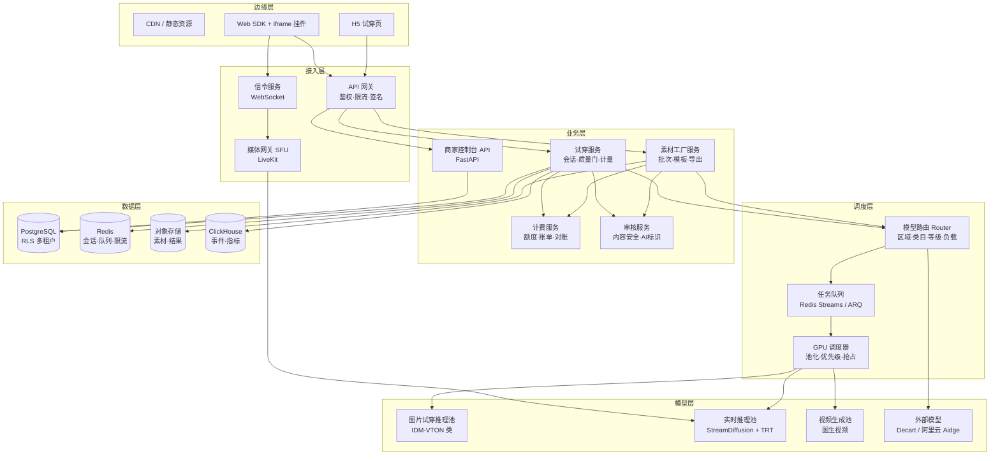
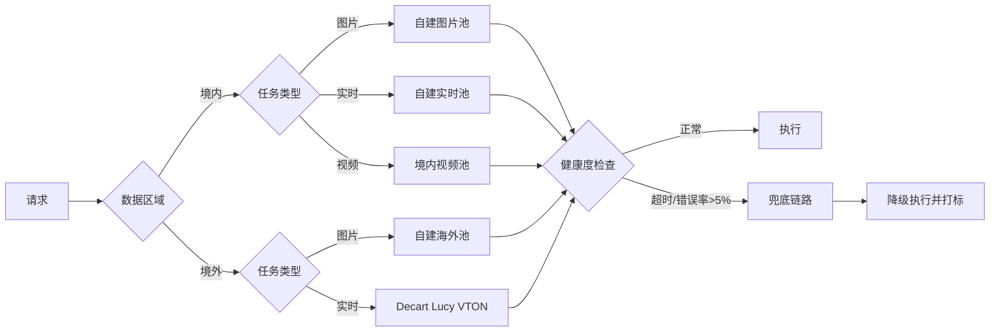
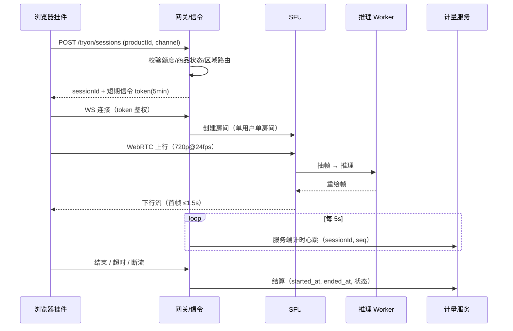
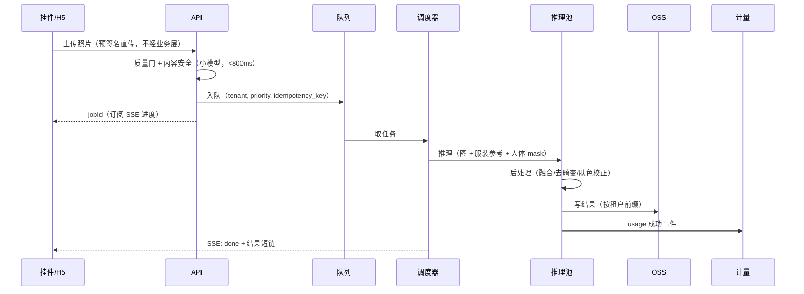
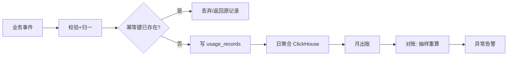

# 试穿云 LookFit · 技术方案

| 项 | 内容 |
|---|---|
| 版本 | v0.1 |
| 日期 | 2026-11-16 |
| 关联文档 | [PRD-虚拟试穿SaaS.md](./PRD-虚拟试穿SaaS.md) |
| 范围 | 双引擎（C 端试穿挂件 + 商家素材工厂）、混合模型路由、计量计费、合规与成本 |

> 本文所有金额均为**量级估算**，用于做技术取舍，不构成报价承诺。标注 `[估算]` 的数值需在 POC 阶段实测校准。

---

## 1. 设计目标与关键取舍

### 1.1 目标

| 目标 | 技术含义 |
|---|---|
| 图片试穿 P95 ≤ 8s | 异步队列 + 蒸馏采样（8–12 步）+ 输出去水印/后处理拆到异步 |
| 实时首帧 P95 ≤ 1.5s、稳态 ≥ 15fps@720p | WebRTC + 常驻 GPU 预热 + 帧级流水线，不做逐帧排队 |
| 挂件可用性 99.5% | 无状态接入层 + 多供应商路由 + 秒级降级 |
| 计量准确率 99.9% | 服务端计时 + 幂等键 + 日聚合对账 |
| 单次图片试穿成本 ≤ ¥0.15 | 自建推理 + 动态批处理 + 抢占式实例 |
| 境内影像数据不出境 | 境内模型池物理隔离，路由层按租户数据区域硬隔离 |

### 1.2 三个关键取舍

**取舍一：不采用「纯第三方 API」作为主链路。**
Decart Lucy VTON 实时 720p 为 \$0.02/秒（fast 模式 \$0.04/秒），折合 ¥0.145/秒、约 **¥8.7/分钟**。若按 PRD 的 30 秒免费体验，单次成本约 ¥4.35，无法支撑 C 端普惠。自建单卡单路实时推理的算力成本约 ¥0.002–0.003/秒，相差 1–2 个数量级。因此：**图片与实时都以自建为主，第三方 API 作为质量基线与兜底**。

**取舍二：境内实时链路不能用境外 API。**
实时试穿必须上传消费者人体/人脸视频，属于敏感个人信息。把中国用户的人体影像传给境外服务，会触发个人信息出境合规问题（评估/标准合同/单独同意），风险与成本都不可接受。因此路由按**数据区域**硬切分：

| 租户数据区域 | 图片试穿 | 实时试穿 | 素材工厂 |
|---|---|---|---|
| 境内（淘宝/天猫/抖音/有赞） | 自建（主）+ 阿里云 Aidge（兜底） | 自建 GPU 池 | 自建 + 境内图生视频 |
| 境外（独立站/跨境） | 自建 + Decart Lucy Image | Decart Lucy VTON | Decart Lucy 2.6 批处理 |

**取舍三：移动端不做实时试穿（P0）。**
移动端摄像头 + WebRTC 上行 + 720p 实时推理的功耗、发热与弱网表现不可控，且 C 端转化主要在详情页首屏（用户没耐心等）。P0 移动端只做拍照试穿；实时试穿定位桌面端活动/直播/商家演示场景。

---

## 2. 总体架构



### 2.1 技术选型（与现有团队栈对齐）

| 层 | 选型 | 理由 |
|---|---|---|
| 控制台前端 | Vue 3 + Vite + Pinia + Ant Design Vue + ECharts | 与团队既有项目一致，复用组件与图表经验 |
| 挂件 | 原生 TS + Shadow DOM/iframe，≤ 30KB gzip | 不能依赖宿主框架；体积直接影响详情页性能 |
| 业务后端 | FastAPI + SQLAlchemy 2.0 + Pydantic v2 | 与现网一致；模型侧也是 Python，减少跨语言成本 |
| 异步任务 | ARQ（轻量）+ Celery（长任务/定时） | 复用现网已用组件 |
| 数据库 | PostgreSQL 16（RLS）+ Redis 7 + ClickHouse | 事务与分析分离；事件量大时 PG 不扛聚合 |
| 对象存储 | 阿里云 OSS + CDN | 境内合规与成本 |
| 实时媒体 | 自托管 LiveKit（或阿里云 RTC 兜底） | 可控制、可计量、可审计 |
| 推理服务 | Triton / TorchServe + TensorRT-LLM/FP8 | 动态批处理、多模型共卡 |
| GPU | 阿里云 L20 / L40S（实时）、A10（图片）、抢占式（批量） | 性价比与显存匹配 |
| 可观测 | OpenTelemetry + Prometheus + Grafana + Loki | 与现网一致 |
| 部署 | Docker + ACK（K8s）+ HPA/KEDA | 按队列深度与 GPU 利用率扩缩 |

---

## 3. 模型层与混合路由

### 3.1 能力矩阵

| 能力 | 主模型 | 兜底 | 时延 | 单位成本 `[估算]` |
|---|---|---|---|---|
| 图片试穿 | 自建 IDM-VTON 类（SDXL 蒸馏 8–12 步，768×1024） | 阿里云 Aidge AiTryOn | 4–8s | ¥0.03–0.10/张 |
| 实时试穿 | 自建 StreamDiffusion + DWPose/ControlNet + IP-Adapter，TensorRT FP16/FP8 | Decart Lucy VTON（仅境外租户） | 首帧 ≤1.5s，≥15fps | ¥0.002–0.003/秒/路 |
| 素材上身图 | 图片试穿模型 + 模板化 ControlNet | 同上 | 5–12s | ¥0.05–0.15/张 |
| 素材短视频 | 图生视频（自建/境内云 API） | Decart Lucy 2.6 批处理（境外） | 30–180s | ¥0.05–0.3/秒 `[TBD]` |
| 尺码建议 | 规则引擎 + 统计模型（非生成式） | — | <100ms | ≈0 |

### 3.2 路由决策



路由键：`(data_region, task_type, category, tenant_tier, pool_health)`。路由表存数据库并支持运营后台热更新（PRD FR-1005），避免改配置要发版。

### 3.3 质量门在哪里执行

质量门（PRD §7.1）分两段：

1. **端侧**（首选）：挂件内用轻量模型（MediaPipe/BlazePose + 清晰度方差 + 人脸计数）做预检，不通过**不上传**，直接省掉一次推理成本。
2. **服务端**（兜底）：上传后用小模型复检 + 内容安全，命中即拒绝且不计费。

端侧预检是成本控制的关键：按 20% 不合格率估算，可减少约 1/5 的无效推理。

---

## 4. 实时试穿链路

### 4.1 两种连接形态

| 形态 | 链路 | 延迟 | 控制力 | 适用 |
|---|---|---|---|---|
| A. 直连上游 | 浏览器 ↔ 上游 WS（短期令牌） | 最低 | 弱（计量依赖回调） | 境外租户 / POC |
| B. 自建中转 | 浏览器 ↔ SFU ↔ 推理 Worker | +30–80ms | 强（逐帧可计量、可审计、可降级） | **境内生产（默认）** |

境内采用 B：数据不出境、可逐帧统计、可在网关侧做敏感内容实时拦截（PRD FR-1001）。



### 4.2 延迟预算（单帧）

| 阶段 | 预算 | 手段 |
|---|---|---|
| 采集 + 编码 | 15–25ms | H.264 硬编码，720p@24fps，关键帧 2s |
| 上行网络 | 30–80ms | 就近接入 + TURN 兜底；动态码率 |
| 解码 + 预处理 | 5–10ms | NVDEC 硬解，Resize 在 GPU 上做 |
| 推理（蒸馏 + TRT） | 60–120ms | 1–2 步 LCM/Turbo + FP16，USD 分区 |
| 编码 + 下行 | 30–80ms | 同上 |
| **合计** | **140–315ms** | 目标端到端 < 350ms（本地），跨省 < 500ms |

首帧 1.5s 的预算主要花在**连接建立与模型预热**上，而非单帧推理。因此 Worker 必须**常驻预热**（模型加载 + 首帧 warmup），不允许冷启动接流。

### 4.3 GPU 并发与调度

- 单卡（L20 48G）目标承载 **2–4 路** 720p@20fps 会话，用 CUDA Stream 并行 + 动态批处理（把多路同尺寸帧拼 batch）。
- 会话按 `tenant_tier` 分优先级队列；旗舰版预留池（dedicated pool），其余共享池。
- 扩容信号：`gpu_util > 75%` 或 `p99_frame_latency > 200ms` 持续 60s → KEDA 扩容；缩容冷却 10 分钟。
- 每路会话硬上限（默认 60s，PRD FR-502 默认 30s + 可续），到点由**服务端**断开，防止前端篡改时长。

### 4.4 实时降级链

```
自建实时池无资源（等待 > 5s）
  → 换备用池（预留/抢占）
  → 仍无资源 → 返回 realtime_unavailable
  → 挂件自动切拍照试穿（PRD §7.4）
```

推理侧不达标（p99 单帧 > 300ms 或 fps < 15）→ 自动降分辨率到 540p，降级事件写入会话记录并展示「已降低画质」。

---

## 5. 异步图片试穿链路



要点：

- **图片走预签名直传**，业务层不转发字节流，降低带宽与内存压力；隐私要求是「不落盘」，因此在推理完成后立即删除临时对象（生命周期规则 1 小时兜底）。
- **任务幂等**：`idempotency_key = sha256(tenant|product|session|image_hash|params)`，重复提交返回同一 jobId。
- **排队与超时**：单任务硬超时 60s；超过 45s 前端切「稍后通知」（PRD FR-408），结果落站内消息。
- **成本控制**：动态批处理（同分辨率同模型合批）；非高峰把批量素材任务放抢占式实例，被回收时任务重回队列（不重复计费）。

---

## 6. 素材工厂

- 批次 = 一个 `GenerationBatch`，子项 = `GenerationJob`，批次状态由子项聚合（全成功/部分成功/全失败）。
- 模板 = 结构化配置（体型、场景、姿势、光照、ControlNet 权重），存数据库而非硬编码，便于运营迭代（PRD FR-301 ≥ 12 套）。
- 视频：先出静帧（复用图片模型）→ 再做图生视频（首尾帧一致性约束），比直接文生视频稳定且便宜。
- 导出：后台异步打包 ZIP + CSV 映射，生成签名 URL（24 小时有效）。
- 水印与标识：显式角标在合成阶段烧录；隐式标识写入 EXIF/XMP（见 §9.3）。

---

## 7. 数据模型

> 仅列出与产品规则强相关的表与关键字段；所有业务表带 `tenant_id`，启用 PG RLS。

```sql
-- 租户与店铺
tenants(id, name, plan_id, data_region, status, created_at)
users(id, tenant_id, email, phone, role, status)
stores(id, tenant_id, platform, shop_id, credential_ref, status, last_sync_at)

-- 商品与配置
products(id, tenant_id, store_id, external_id, title, category, main_image, flat_image, price)
skus(id, product_id, code, color, size, stock)
size_charts(id, product_id, unit, fit_type, payload_json)      -- payload: 部位→各码数值
tryon_configs(id, tenant_id, product_id, ref_image, quality_level,
              widget_type, entry_text, entry_position, status,
              realtime_enabled, realtime_seconds, size_advice_enabled)

-- 生成与试穿
generation_batches(id, tenant_id, type, template_id, total, success, failed, status)
generation_jobs(id, batch_id, tenant_id, type, input_ref, model_id, params_json,
                priority, status, attempts, cost_units, created_at, finished_at)
tryon_sessions(id, tenant_id, product_id, channel, device, mode,   -- photo/realtime
               status, started_at, ended_at, duration_ms,
               result_asset_id, degrade_reason, consent_id)
assets(id, tenant_id, source_job_id, kind, oss_key, watermark,
       moderation_status, expires_at)

-- 计量与合规
usage_records(id, tenant_id, item, quantity, unit_price, source_id,
              idempotency_key UNIQUE, occurred_at, billed_period)
consents(id, session_id, subject_hash, scope, version, granted_at, revoked_at)
moderation_records(id, object_type, object_id, result, hits_json, action, created_at)
audit_logs(id, tenant_id, actor_id, action, target, detail_json, ip, created_at)
```

索引要点：`usage_records(tenant_id, occurred_at)`、`tryon_sessions(product_id, created_at)`、`generation_jobs(status, priority, created_at)`、`assets(expires_at)`（清理任务）。

---

## 8. API 设计

统一：`/v1`、Bearer JWT（控制台）或 `X-Api-Key`（服务端）、`Idempotency-Key` 头、错误码 `{code, message, request_id}`。

| 方法 | 路径 | 用途 |
|---|---|---|
| POST | `/v1/stores` | 绑定店铺（返回授权链接） |
| POST | `/v1/products/sync` | 触发同步（异步，返回 syncId） |
| POST | `/v1/products/import` | Excel 导入（返回逐行结果） |
| POST | `/v1/tryon-configs/{productId}/quality-check` | 参考图质检（同步，<2s） |
| PATCH | `/v1/tryon-configs/{productId}` | 改配置 / 上下线 |
| POST | `/v1/generation-jobs` | 批量提交素材任务 |
| GET | `/v1/generation-jobs/{id}` | 查任务与结果 |
| POST | `/v1/tryon/sessions` | 创建试穿会话（返回 widget token） |
| POST | `/v1/tryon/sessions/{id}/photo` | 提交照片（预签名上传后回调） |
| GET | `/v1/tryon/sessions/{id}/events` | SSE 进度流 |
| WS | `/v1/realtime/signal?token=` | 实时信令（SDP/ICE 交换） |
| POST | `/v1/tryon/sessions/{id}/end` | 结束会话（服务端结算） |
| GET | `/v1/analytics/overview` | 看板指标 |
| GET | `/v1/usage/bill` | 账单明细 |
| POST | `/v1/webhooks/platform` | 平台授权/订单回调 |

**对外 SDK 配置接口**（公开、限流）：`GET /v1/public/widget-config?storeId=&productId=&token=` 返回入口文案/位置/主题/是否展示实时。token 为 HMAC 短期签名（5 分钟），由商家服务端签发，避免在前端暴露密钥。

---

## 9. 安全与合规工程

### 9.1 数据流与隔离

| 控制点 | 做法 |
|---|---|
| 租户隔离 | PG RLS（`current_setting('app.tenant_id')`）+ 所有查询强制带 tenant_id；OSS 按 `tenant/{id}/` 前缀 + 签名 URL |
| 区域隔离 | 境内/境外两套独立模型池、独立 OSS bucket、独立队列；路由层按 `tenants.data_region` 硬校验，越区直接拒绝 |
| 密钥 | 平台授权凭证用 KMS 信封加密，落库仅存 `credential_ref`；前端永不接触 |
| 传输 | 全站 TLS1.3；实时媒体 DTLS-SRTP |
| 最小权限 | 成员角色（PRD §4.1）；API Key 按 scope 授权，可单独吊销 |

### 9.2 影像数据生命周期

```
上传 → 内存/临时对象 → 推理 → 立即删除临时对象（兜底 TTL 1h）
                             → 结果图写 OSS（默认 7 天，可配置 0）
                             → 用户点删除 → 24h 内物理删除 + 记审计
```

人脸/人体影像属敏感个人信息，落地要求：单独同意（`consents` 表记录版本与 scope）、目的限定（不用于训练，训练数据另行取得授权）、可撤回、可删除、个人信息保护影响评估（PIA）留档。

### 9.3 生成内容标识

- 显式：图片右下角/视频角标「AI 生成」默认开启。按 PRD FR-308，商家可关闭**视频**角标（图片角标不可关闭），但关闭动作需记录到审计日志，且以法务最终结论为准 `[TBD]`。
- 隐式：写入 EXIF/XMP `DigitalSourceType=trainedAlgorithmicMedia` 与内部 `job_id` 哈希，**不可移除**，用于溯源与平台核查。

### 9.4 内容安全

三级拦截：①端侧敏感内容预检；②上传后图片/视频审核（云内容安全 + 自建策略）；③实时链路每 30 帧抽样审核，命中即断流并记录。审核服务不可用时**积压不放行**（PRD §7.4）。

### 9.5 防刷与滥用

- 会话级：单设备单商品 24h 内试穿 ≤ 10 次；异常触发人机验证（不阻断正常用户）。
- 租户级：额度 + 速率双限；密钥泄露可即时吊销并追查调用来源。
- 计量防篡改：时长由服务端计时，前端心跳仅作参考；余额变动全部走账本。

---

## 10. 计量与计费实现



- 计量项与 PRD FR-902 一一对应：`tryon.image.ok`、`realtime.seconds`、`studio.image`、`studio.video.seconds`。
- 幂等键：`{tenant}|{item}|{source_id}|{attempt}`；重试不产生新计量（PRD FR-903）。
- 失败/驳回/取消由 `usage_records` 的 `status` 字段表达（`charged`/`refunded`/`void`），不物理删除，保证可审计。
- 实时结算公式：`quantity = max(0, ended_at - started_at - 连接建立耗时)`，精确到秒，向上取整。
- 账单日切：按租户时区（默认 Asia/Shanghai）自然日聚合，避免跨时区争议。

---

## 11. 可观测性与 SLO

| 指标 | 类型 | 告警阈值 |
|---|---|---|
| `tryon_image_p95_latency` | Histogram | > 8s 持续 5 分钟 |
| `realtime_first_frame_p95` | Histogram | > 1.5s 持续 5 分钟 |
| `realtime_fps_avg` | Gauge | < 15 持续 2 分钟 |
| `gpu_pool_queue_depth` | Gauge | > 50 |
| `moderation_fail_rate` | Counter | > 2% |
| `usage_write_fail` | Counter | > 0（立即） |
| `widget_error_rate` | Counter | > 1% |

链路追踪：每次试穿会话带 `trace_id`，贯穿网关 → 队列 → 推理 → 存储 → 计量；按 `tenant_id + session_id` 可一键拉出完整时间线（PRD FR-1006）。

---

## 12. 成本模型与容量

### 12.1 单位成本（估算）

| 项目 | 假设 | 单位成本 `[估算]` |
|---|---|---|
| 图片试穿 | A10 单卡 ¥5/h，200 张/h | ¥0.025–0.08/张 |
| 实时试穿（自建） | L20 单卡 ¥10/h，3 路并发 | ¥0.0009–0.003/秒（¥0.05–0.18/分钟） |
| 实时试穿（Decart） | \$0.02/秒 | ¥0.145/秒（¥8.7/分钟） |
| 素材视频 | 15s，¥1.5/条量级 | ¥0.08–0.15/秒 |
| 存储 | OSS 标准型 | ¥0.12/GB/月 |
| CDN | 下行 2Mbps × 60s ≈ 15MB | ≈ ¥0.01/会话 |

结论：自建实时相对第三方 API 有约 **30–100 倍** 成本优势，这是选择自研的根本原因，也是 POC 必须优先验证的假设。

### 12.2 容量规划（示例，非承诺）

| 规模 | 图片试穿 | 实时并发 | GPU 需求 |
|---|---|---|---|
| 100 商家 / 5,000 次图片/日 | 峰值 10 QPS | 5 路 | A10 × 2 + L20 × 2 |
| 1,000 商家 / 50,000 次图片/日 | 峰值 60 QPS | 30 路 | A10 × 12 + L20 × 10 |
| 10,000 商家 / 500,000 次图片/日 | 峰值 400 QPS | 200 路 | 需多可用区 + 预留池 |

### 12.3 降本优先级

1. 采样步数蒸馏（25 → 8 → 4 步），质量用 A/B 守住可用率；
2. FP8/INT8 量化 + TensorRT 引擎固化；
3. 动态批处理与多流共卡；
4. 抢占式实例承载批量素材任务；
5. 端侧预检拦截无效请求（省 15–25%）。

---

## 13. 部署与交付

- **环境**：dev / staging / prod（境内主站），境外独立部署一套（独立数据面）。
- **编排**：业务服务 ACK 部署，HPA 按 CPU/QPS；推理服务用 KEDA 按队列深度与 GPU 利用率扩缩。
- **发布**：业务服务滚动更新；模型服务按 `model_id` 影子流量灰度（5% → 25% → 100%），指标不达标自动回滚。
- **数据**：PG 主备 + 每日全量 + WAL 归档；OSS 跨区复制（境内）；ClickHouse 用于指标，不作真相源。
- **灾备**：推理池单可用区故障 → 路由切另一可用区；全区域故障 → 图片试穿降级到阿里云 Aidge，实时试穿整体降级为拍照。

---

## 14. 实施阶段

| 阶段 | 交付 | 出口标准 |
|---|---|---|
| 阶段一：能力基线 | 图片试穿自建链路 + 商家控制台 + 素材图片 + H5 挂件 | 单商品端到端可演示；图片 P95 ≤ 8s；计量对账误差 0 |
| 阶段二：实时上线 | 实时外挂（桌面端）+ 降级链 + 内容安全实时抽样 | 首帧 P95 ≤ 1.5s；连续 2 小时无断流；单卡 ≥ 2 路稳定 |
| 阶段三：规模化 | 多租户压测、成本优化、抖音/独立站适配、开放 API | 1,000 商家画像压测通过；单位成本达标 |
| 并行推进 | 淘宝详情页嵌入可行性（PRD Q1）、备案与合规（Q5） | 法务与技术结论可落地 |

阶段一到三的划分是**依赖顺序**，不是排期承诺。

---

## 15. 风险登记

| 风险 | 影响 | 缓解 |
|---|---|---|
| 自建实时质量不达 Decart 水平 | 体验差、退款、口碑 | 阶段一即做质量基线对比；保留供应商兜底；按类目分批放开 |
| 淘宝无法嵌入 JS | 挂件形态受限，转化下降 | 以二维码/H5 为主路径设计；SDK 只是加分项 |
| 实时 GPU 成本高于预期 | 毛利被侵蚀 | 单卡多路 + 蒸馏 + 端侧预检；设置单会话硬上限 |
| 深度合成备案/标识要求变化 | 上线延期 | 预留标识开关；法务提前介入 |
| 人物形象被滥用（换脸、擦边） | 合规与舆情 | 内容安全三级拦截 + 账号风控 + 快速下线能力 |
| 上游 API 涨价/停服 | 境外链路中断 | 路由层可切换；境外不做强依赖 |
| 计量争议 | 商家流失 | 明细可查 + 幂等 + 7 天申诉 + 抽样对账 |

---

## 16. 待确认的技术问题

| 编号 | 问题 | 依赖 |
|---|---|---|
| T1 | 实时自建模型选型的最终质量门槛与验收方法（人工盲评 + 可用率） | 算法团队 |
| T2 | 阿里云 Aidge / 图生视频接口的实际计费与配额 | 云厂商 |
| T3 | LiveKit 自托管与阿里云 RTC 的成本/延迟对比 | 基础设施 |
| T4 | 淘宝/天猫开放平台可用的商品与店铺接口范围 | 开放平台 |
| T5 | 深度合成备案主体与所需材料 | 法务 |
